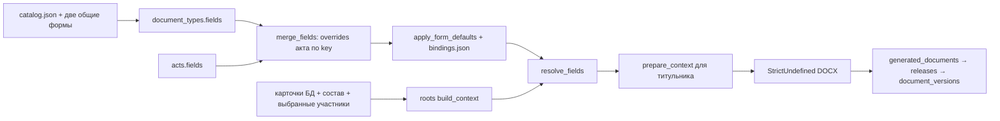

# Карта данных, полей и шаблонов ИТД

Снимок структуры на 10.11.2026. Карта построена по миграциям и исполняемым контрактам этой копии проекта. Рабочие БД и документы пользователя не открывались и не изменялись.

## Навигация

- [Итоги и границы проверки](#audit)
- [Экран → сущности → документы](#screens)
- [Порядок разрешения полей](#resolution)
- [Все таблицы и колонки](#schema)
- [Источники и обратные связи](#sources)
- [Все шаблоны и каждое поле](#forms)
- [Общая ведомость XLSX](#xlsx)
- [Как обновить карту](#update)

<a id="audit"></a>
## Итоги проверки

- Основная БД: таблиц — **54**, колонок — **391**, компонентов внешних ключей — **107**; миграции 001–021.
- Форм / DOCX / JSON-определений — **91**, включая титульник и две общие формы из `form_catalog.catalog()`.
- **2389 эффективных определений**, включая каждую колонку вложенных таблиц: literal: 863, reference: 1206, signatory: 266, table: 54.
- Ошибок проверенных контрактов: **0**. Проверены уникальность кодов и файлов, ключи bindings, существование колонок источников, порядок field_values, Jinja AST всех XML-частей DOCX, поля циклов, два рендера каждой формы (контекст пустого тестового объекта и непустые синтетические строки), целостность XML результата, SQLite integrity_check и foreign_key_check на тестовой БД.
- Результаты штатных тестов и ограничения их запуска фиксируются в CHANGELOG.md; аудит запускается отдельно.

### Что не означает «всё автоматически связано»

- **855 пустых literal-полей** ожидают индивидуальные сведения. Это явный ручной ввод в `acts.fields`, а не потерянная связь. Нельзя достоверно вывести результаты измерений, заключения, даты испытаний и объёмы из спецификации.
- **50 ручных таблиц** хранят строки в `acts.fields[].value`. Каждая их ячейка перечислена ниже. Пустое обязательное значение блокирует финал.
- `role_slot` — намеренно незавершённый выбор роли по варианту бланка; варианты указаны у соответствующих полей. Несколько представителей одной роли требуют выбора в документе.
- Не каждое поле БД печатается в документе: ключи, ревизии, хеши, пути и служебные состояния поддерживают учёт. У каждой колонки ниже показаны прямые потребители форм; «нет прямой привязки» не означает ошибку.
- Карта относится к поставляемым определениям. В рабочей БД `document_types.fields`, `acts.fields`, назначения и карточки версий могут отличаться; без выбора рабочей БД и объекта их содержание не проверялось.
- Семантическое соответствие каждого пустого места оригиналу и применимость нормативов не доказываются рендером. Наличие исходников и проверка их SHA-256 указаны отдельно для каждой формы. Постраничная визуальная сверка всех исходников в этот аудит не входит.

- Все 89 исходников из catalog.json отсутствуют по указанным путям в этой копии проекта. Их хеши сохранены как происхождение, но повторно не подтверждены. Визуальный рендер исправленной формы СП_70_А также не выполнен: встроенный LibreOffice не запускается из-за отсутствия версии CURL_OPENSSL_4 у системной libcurl.so.4. Два рендера в итогах означают подстановку Jinja в DOCX, а не визуализацию страниц.

### Выявленные особенности

- Исправлен разрыв `СП_70_А.rows_9_2.c3`: «Дата подписания акта» была определена в JSON, но отсутствовала в строке DOCX. Теперь маркер печатается и поле обязательно; генератор исходных форм отличает дату подписания от места для подписи. В ZIP шаблона изменён только word/document.xml, остальные части сохранены побайтно. Исходный бланк и зарегистрированные настройки рабочих БД не изменялись.
- 16 дочерних колонок блоков подписей намеренно остаются пустыми в DOCX. Их JSON-определения существуют, но введённый в них текст не печатается. Точные ключи и подписи перечислены ниже со статусом «Рукописная подпись». Некоторые подписи совмещены с ФИО/должностью в заголовке; автоматическое заполнение этих частей требует отдельной сверки бланка с оригиналом.
- В README шаблонов была ссылка на отсутствующий `audit_form_bindings.py` и несуществующий `app/.venv`. Ссылка заменена действующим аудитом `audit_relationships.py` и корневой `.venv`.
- У общего реестра `registry.number`, `registry.date`, `registry.note` остаются в контексте, но текущий DOCX их отдельно не печатает; номер и дата объединены в `number_date`. `registry.organization` вычисляется только при единственном исполнителе ролей `work_performer` / `builder`; пустое значение не заменяется произвольной организацией.
- У титульника `copies`, `volumes`, `font` — управляющие поля. `pages` и `contractors_info` создаются `titles.prepare_context`, хотя их нет в JSON. Это проверенное исключение, а не неопределённые маркеры.
- Титульник по умолчанию использует прежние русские ключи ролей (`Заказчик`, `Технический_заказчик`, `Генподрядчик`, `Подрядчик`). Веб-карточка участников использует английские ключи; для этих назначений при создании титульника требуется явное сопоставление `roles` в `titles.add_title`. Без него необязательные организации могут быть пустыми. Автоматическое переименование ролей здесь не выполнялось.

<a id="screens"></a>
## Экран → сущности → документы

| Раздел интерфейса | Хранилище и связи | Использование |
|---|---|---|
| Объект, реквизиты, разрешения | objects → projects; object_units | object.*, project.*, unit.*; реестр и титульник |
| Участники | organizations → signatories; object_participants; organization_assignments; signatory_assignments; participant_periods | organizations.<роль>.*, signatories.<роль>.*, companies; выбор акта через act_organizations / act_signatories |
| РД, исходные файлы | attachments; object_attachments / project_attachments; project_files | project_documentation; реестр; контроль SHA-256 и оригинала |
| Ресурсы | resources → resource_sources / resource_attachments; resource_imports / resource_import_rows; specification_pending | act_resources → resources; ведомости DOCX и XLSX; качество |
| Схемы | schemes → scheme_attachments; act_schemes | schemes в контексте акта; реестр; связь не подставляет схему в произвольное пустое поле |
| Поставки, входной контроль | supplies; quality_reviews; workspace_entries(kind=incoming), work_fields | materials через act_materials; ЖВК из journals.journal_data |
| ОЖР, работы, ЖПК | workspace_entries → work_materials → work_facts; work_material_allocations → supplies | act_entry_sources → entries; act_facts → facts; journal_rows по mapping |
| Специальные журналы | special_journals → организации / представители / акт | раздел 2 ОЖР; автоматические журналы — представления, не отдельные таблицы |
| Основные документы | document_types → acts → состав и участники; document_versions | JSON defaults → overrides → bindings → resolve_fields → DOCX |
| Выпуск, реестр, сдача | generated_documents → releases; final_reviews; package_requirements; deliveries → delivery_events / delivery_remarks | точный файл, хеш, выбранный выпуск, комплект, передача |
| Настройки и вход | отдельная БД accounts: users / settings / document_roots | выбор рабочей БД; правами управляет сервер, без FK на участников строительства |

<a id="resolution"></a>
## Порядок разрешения полей



1. `form_catalog.catalog()` добавляет к 89 записям файла каталога `СП_77_А_21` и `РЕЕСТР_ИТД`. Код формы совпадает с именем единственного DOCX и `acts.act_type → document_types.code`.
2. JSON регистрируется в `document_types.fields`. `acts.fields` заменяет определения по `key`, а не только значения: тип, source, required и формат также входят в определение.
3. `apply_form_defaults` связывает только пустые literal-поля из bindings. Непустой ручной текст, пользовательские ссылки, hidden и not_applicable сохраняются. FIELD_CONTINUATIONS объединяет продолжения; исходные удалённые ключи перечислены у формы.
4. `build_context` читает актуальные карточки, выбранные ресурсы/схемы/факты и участников. Назначение раздела перекрывает объект; явный выбор акта уточняет его. Для подписанного акта используется signers_json. Организация и представитель проверяются на совместимость общей службой.
5. `reference` читает source; `literal` читает value; `signatory` форматирует выбранного представителя и его организацию; `table` разрешает каждую дочернюю колонку с item и row.number. `field_values.X` обращается только к уже разрешённому полю в текущем проходе. Форматы дат применяются после чтения источника.
6. Пропуски required блокируют финальный контекст. В черновике выводится тире. Поля hidden/not_applicable дают пустую строку/таблицу; неприменимость требует reason.
7. Проверка статических утверждений привязана к хешам шаблона и контекста (`final_reviews`). История выпуска сохраняет контекст и хеш файла; версии связываются с точным release/attachment.
8. `resources.document_resource` вычисляет количество для DOCX и XLSX при каждом построении: явный итог resources.qty_fact имеет приоритет; если его нет, используются только confirmed-факты ресурса. При неизвестном количестве хотя бы одного подтверждённого прироста итог остаётся неизвестным. Нулевой итог сохраняется; pending/void не суммируются; БД итогов не переписывается. Скачивание последней неподписанной версии заново выпускает документ с текущими источниками. Скачивание исторической или подписанной версии возвращает точный сохранённый файл.

### Удаление связанных записей

`deletion.py` строит и проверяет план перед подтверждением. Обязательная FK-ссылка (NOT NULL или PK) удаляет дочернюю строку, необязательная очищается. Назначения объекта/раздела удаляются при удалении уровня, поскольку CHECK требует ровно один уровень. Составные FK обрабатываются вместе. JSON-ссылки work_fields на person_id/org_id обязательны для персонала ОЖР и удаляют его строку; supply_id, quality_review_id, entry_id очищаются. Явные ссылки Organisation.ID/Representative.ID в полях acts каскадно удаляют документ при required и очищаются при необязательном поле; черновые карточки версий синхронизируются. Архивные файлы и снимки выпущенных версий остаются историей. План содержит каждую удаляемую и изменяемую строку, объект/раздел и основание. Подтверждение связано с путём БД, выбранной записью и состоянием всех затронутых строк; изменение связей требует нового плана. Применение атомарно, проверяет foreign_key_check и обновляет ревизии очищенных записей.

<a id="schema"></a>
## Все таблицы и колонки

Схема снята с новой временной БД после применения всех миграций. Для каждого поля показаны тип, NOT NULL, порядок в PK, DEFAULT, FK и прямые потребители формы. CHECK, UNIQUE, составные ключи, индексы и триггеры приведены точным DDL. Для INTEGER PRIMARY KEY SQLite может показывать notnull=0; это не отменяет свойства первичного ключа.

### Основная БД ИТД

<a id="table-act_attachments"></a>
#### act_attachments — Связующая / служебная сущность

Упоминания таблицы в Python (статический указатель, включая SQL; динамические обращения см. сервисы): [app/itd/archive.py](app/itd/archive.py), [app/itd/registry.py](app/itd/registry.py), [app/itd/web.py](app/itd/web.py), [app/itd/file_manager.py](app/itd/file_manager.py), [app/itd/deletion.py](app/itd/deletion.py).

| Колонка | SQL-тип; ограничения | FK / прямые поля форм |
|---|---|---|
| `act_id` | INTEGER; NOT NULL; PK #1 | FK #1.0 → acts.id; DELETE RESTRICT, UPDATE NO ACTION<br>Нет прямой привязки поля каталога; служебное/учётное поле или косвенное использование в сервисе |
| `attachment_id` | INTEGER; NOT NULL; PK #2 | FK #0.0 → attachments.id; DELETE RESTRICT, UPDATE NO ACTION<br>Нет прямой привязки поля каталога; служебное/учётное поле или косвенное использование в сервисе |

<details><summary>Точный DDL таблицы, индексов и триггеров</summary>

```sql
CREATE TABLE act_attachments (
    act_id INTEGER NOT NULL REFERENCES acts(id) ON DELETE RESTRICT,
    attachment_id INTEGER NOT NULL REFERENCES attachments(id) ON DELETE RESTRICT,
    PRIMARY KEY (act_id, attachment_id)
);
-- sqlite_autoindex_act_attachments_1: реализует PK/UNIQUE из CREATE TABLE
```

</details>

<a id="table-act_entry_sources"></a>
#### act_entry_sources — Связующая / служебная сущность

Упоминания таблицы в Python (статический указатель, включая SQL; динамические обращения см. сервисы): [app/itd/acts.py](app/itd/acts.py), [app/itd/workflow.py](app/itd/workflow.py), [app/itd/manual.py](app/itd/manual.py), [app/itd/ojr.py](app/itd/ojr.py), [app/itd/deletion.py](app/itd/deletion.py).

| Колонка | SQL-тип; ограничения | FK / прямые поля форм |
|---|---|---|
| `act_id` | INTEGER; NOT NULL; PK #1 | FK #1.0 → acts.id; DELETE NO ACTION, UPDATE NO ACTION<br>Нет прямой привязки поля каталога; служебное/учётное поле или косвенное использование в сервисе |
| `entry_id` | INTEGER; NOT NULL; PK #2 | FK #0.0 → workspace_entries.id; DELETE NO ACTION, UPDATE NO ACTION<br>Нет прямой привязки поля каталога; служебное/учётное поле или косвенное использование в сервисе |
| `source_json` | TEXT; NOT NULL | Нет прямой привязки поля каталога; служебное/учётное поле или косвенное использование в сервисе |

<details><summary>Точный DDL таблицы, индексов и триггеров</summary>

```sql
CREATE TABLE act_entry_sources (
 act_id INTEGER NOT NULL REFERENCES acts(id), entry_id INTEGER NOT NULL REFERENCES workspace_entries(id),
 source_json TEXT NOT NULL, PRIMARY KEY(act_id,entry_id)
);
-- sqlite_autoindex_act_entry_sources_1: реализует PK/UNIQUE из CREATE TABLE
```

</details>

<a id="table-act_execution_status"></a>
#### act_execution_status — Связующая / служебная сущность

Упоминания таблицы в Python (статический указатель, включая SQL; динамические обращения см. сервисы): [app/itd/acts.py](app/itd/acts.py), [app/itd/changes.py](app/itd/changes.py), [app/itd/workspace.py](app/itd/workspace.py), [app/itd/web.py](app/itd/web.py), [app/itd/journals.py](app/itd/journals.py), [app/itd/ojr.py](app/itd/ojr.py), [app/itd/document_versions.py](app/itd/document_versions.py), [app/itd/deletion.py](app/itd/deletion.py).

| Колонка | SQL-тип; ограничения | FK / прямые поля форм |
|---|---|---|
| `act_id` | INTEGER; PK #1 | FK #0.0 → acts.id; DELETE NO ACTION, UPDATE NO ACTION<br>Нет прямой привязки поля каталога; служебное/учётное поле или косвенное использование в сервисе |
| `state` | TEXT; NOT NULL | Нет прямой привязки поля каталога; служебное/учётное поле или косвенное использование в сервисе |
| `work_description` | TEXT; NOT NULL | Нет прямой привязки поля каталога; служебное/учётное поле или косвенное использование в сервисе |
| `basis` | TEXT; NOT NULL | Нет прямой привязки поля каталога; служебное/учётное поле или косвенное использование в сервисе |
| `signers_json` | TEXT; NOT NULL | Нет прямой привязки поля каталога; служебное/учётное поле или косвенное использование в сервисе |
| `signed_date` | TEXT | Нет прямой привязки поля каталога; служебное/учётное поле или косвенное использование в сервисе |
| `revision` | INTEGER; NOT NULL; DEFAULT 1 | Нет прямой привязки поля каталога; служебное/учётное поле или косвенное использование в сервисе |

<details><summary>Точный DDL таблицы, индексов и триггеров</summary>

```sql
CREATE TABLE act_execution_status (
 act_id INTEGER PRIMARY KEY REFERENCES acts(id),
 state TEXT NOT NULL CHECK(state IN ('draft','signed')),
 work_description TEXT NOT NULL, basis TEXT NOT NULL,
 signers_json TEXT NOT NULL CHECK(json_valid(signers_json)),
 signed_date TEXT, revision INTEGER NOT NULL DEFAULT 1
);
```

</details>

<a id="table-act_facts"></a>
#### act_facts — Связующая / служебная сущность

Упоминания таблицы в Python (статический указатель, включая SQL; динамические обращения см. сервисы): [app/itd/acts.py](app/itd/acts.py), [app/itd/workflow.py](app/itd/workflow.py), [app/itd/web.py](app/itd/web.py), [app/itd/manual.py](app/itd/manual.py), [app/itd/inventory.py](app/itd/inventory.py), [app/itd/resource_card.py](app/itd/resource_card.py), [app/itd/deletion.py](app/itd/deletion.py).

| Колонка | SQL-тип; ограничения | FK / прямые поля форм |
|---|---|---|
| `act_id` | INTEGER; NOT NULL; PK #1 | FK #1.0 → acts.id; DELETE NO ACTION, UPDATE NO ACTION<br>Нет прямой привязки поля каталога; служебное/учётное поле или косвенное использование в сервисе |
| `fact_id` | INTEGER; NOT NULL; PK #2 | FK #0.0 → work_facts.id; DELETE NO ACTION, UPDATE NO ACTION<br>Нет прямой привязки поля каталога; служебное/учётное поле или косвенное использование в сервисе |

<details><summary>Точный DDL таблицы, индексов и триггеров</summary>

```sql
CREATE TABLE act_facts (
 act_id INTEGER NOT NULL REFERENCES acts(id),
 fact_id INTEGER NOT NULL REFERENCES work_facts(id),
 PRIMARY KEY(act_id,fact_id)
);
-- sqlite_autoindex_act_facts_1: реализует PK/UNIQUE из CREATE TABLE
```

</details>

<a id="table-act_journals"></a>
#### act_journals — Связующая / служебная сущность

Упоминания таблицы в Python (статический указатель, включая SQL; динамические обращения см. сервисы): [app/itd/registry.py](app/itd/registry.py), [app/itd/manual.py](app/itd/manual.py), [app/itd/journals.py](app/itd/journals.py), [app/itd/deletion.py](app/itd/deletion.py).

| Колонка | SQL-тип; ограничения | FK / прямые поля форм |
|---|---|---|
| `act_id` | INTEGER; PK #1 | FK #0.0 → acts.id; DELETE NO ACTION, UPDATE NO ACTION<br>Нет прямой привязки поля каталога; служебное/учётное поле или косвенное использование в сервисе |
| `entry_kind` | TEXT; NOT NULL | Нет прямой привязки поля каталога; служебное/учётное поле или косвенное использование в сервисе |
| `work_type` | TEXT | Нет прямой привязки поля каталога; служебное/учётное поле или косвенное использование в сервисе |
| `mapping` | TEXT; NOT NULL | Нет прямой привязки поля каталога; служебное/учётное поле или косвенное использование в сервисе |

<details><summary>Точный DDL таблицы, индексов и триггеров</summary>

```sql
CREATE TABLE act_journals (
 act_id INTEGER PRIMARY KEY REFERENCES acts(id), entry_kind TEXT NOT NULL,
 work_type TEXT, mapping TEXT NOT NULL CHECK(json_valid(mapping))
);
```

</details>

<a id="table-act_materials"></a>
#### act_materials — Связующая / служебная сущность

Упоминания таблицы в Python (статический указатель, включая SQL; динамические обращения см. сервисы): [app/itd/acts.py](app/itd/acts.py), [app/itd/manual.py](app/itd/manual.py), [app/itd/inventory.py](app/itd/inventory.py), [app/itd/deletion.py](app/itd/deletion.py).

| Колонка | SQL-тип; ограничения | FK / прямые поля форм |
|---|---|---|
| `act_id` | INTEGER; NOT NULL; PK #1 | FK #1.0 → acts.id; DELETE NO ACTION, UPDATE NO ACTION<br>Нет прямой привязки поля каталога; служебное/учётное поле или косвенное использование в сервисе |
| `supply_id` | INTEGER; NOT NULL; PK #2 | FK #0.0 → supplies.id; DELETE NO ACTION, UPDATE NO ACTION<br>Нет прямой привязки поля каталога; служебное/учётное поле или косвенное использование в сервисе |
| `quantity` | REAL; NOT NULL | Нет прямой привязки поля каталога; служебное/учётное поле или косвенное использование в сервисе |

<details><summary>Точный DDL таблицы, индексов и триггеров</summary>

```sql
CREATE TABLE act_materials (
 act_id INTEGER NOT NULL REFERENCES acts(id), supply_id INTEGER NOT NULL REFERENCES supplies(id),
 quantity REAL NOT NULL CHECK(quantity>0), PRIMARY KEY(act_id,supply_id)
);
-- sqlite_autoindex_act_materials_1: реализует PK/UNIQUE из CREATE TABLE
```

</details>

<a id="table-act_organizations"></a>
#### act_organizations — Связующая / служебная сущность

Упоминания таблицы в Python (статический указатель, включая SQL; динамические обращения см. сервисы): [app/itd/ojr.py](app/itd/ojr.py), [app/itd/act_participants.py](app/itd/act_participants.py), [app/itd/deletion.py](app/itd/deletion.py).

| Колонка | SQL-тип; ограничения | FK / прямые поля форм |
|---|---|---|
| `act_id` | INTEGER; NOT NULL; PK #1 | FK #1.0 → acts.id; DELETE NO ACTION, UPDATE NO ACTION<br>Нет прямой привязки поля каталога; служебное/учётное поле или косвенное использование в сервисе |
| `role_key` | TEXT; NOT NULL; PK #2 | Нет прямой привязки поля каталога; служебное/учётное поле или косвенное использование в сервисе |
| `org_id` | INTEGER; NOT NULL | FK #0.0 → organizations.id; DELETE NO ACTION, UPDATE NO ACTION<br>Нет прямой привязки поля каталога; служебное/учётное поле или косвенное использование в сервисе |

<details><summary>Точный DDL таблицы, индексов и триггеров</summary>

```sql
CREATE TABLE act_organizations (
 act_id INTEGER NOT NULL REFERENCES acts(id),
 role_key TEXT NOT NULL,
 org_id INTEGER NOT NULL REFERENCES organizations(id),
 PRIMARY KEY(act_id,role_key)
);
-- sqlite_autoindex_act_organizations_1: реализует PK/UNIQUE из CREATE TABLE
```

</details>

<a id="table-act_resources"></a>
#### act_resources — Связующая / служебная сущность

Упоминания таблицы в Python (статический указатель, включая SQL; динамические обращения см. сервисы): [app/itd/acts.py](app/itd/acts.py), [app/itd/workflow.py](app/itd/workflow.py), [app/itd/revision_compare.py](app/itd/revision_compare.py), [app/itd/web.py](app/itd/web.py), [app/itd/manual.py](app/itd/manual.py), [app/itd/deletion.py](app/itd/deletion.py).

| Колонка | SQL-тип; ограничения | FK / прямые поля форм |
|---|---|---|
| `act_id` | INTEGER; NOT NULL; PK #1 | FK #1.0 → acts.id; DELETE CASCADE, UPDATE NO ACTION<br>Нет прямой привязки поля каталога; служебное/учётное поле или косвенное использование в сервисе |
| `resource_id` | INTEGER; NOT NULL; PK #2 | FK #0.0 → resources.id; DELETE RESTRICT, UPDATE NO ACTION<br>Нет прямой привязки поля каталога; служебное/учётное поле или косвенное использование в сервисе |
| `ordinal` | INTEGER; NOT NULL | Нет прямой привязки поля каталога; служебное/учётное поле или косвенное использование в сервисе |

<details><summary>Точный DDL таблицы, индексов и триггеров</summary>

```sql
CREATE TABLE act_resources (
    act_id INTEGER NOT NULL REFERENCES acts(id) ON DELETE CASCADE,
    resource_id INTEGER NOT NULL REFERENCES resources(id) ON DELETE RESTRICT,
    ordinal INTEGER NOT NULL CHECK (ordinal > 0),
    PRIMARY KEY (act_id, resource_id),
    UNIQUE (act_id, ordinal)
);
-- sqlite_autoindex_act_resources_2: реализует PK/UNIQUE из CREATE TABLE
-- sqlite_autoindex_act_resources_1: реализует PK/UNIQUE из CREATE TABLE
CREATE TRIGGER act_resources_same_project_insert
BEFORE INSERT ON act_resources
WHEN (SELECT project_id FROM acts WHERE id = NEW.act_id)
  IS NOT (SELECT project_id FROM resources WHERE id = NEW.resource_id)
BEGIN
    SELECT RAISE(ABORT, 'Resource and act must belong to the same project');
END;
CREATE TRIGGER act_resources_same_project_update
BEFORE UPDATE ON act_resources
WHEN (SELECT project_id FROM acts WHERE id = NEW.act_id)
  IS NOT (SELECT project_id FROM resources WHERE id = NEW.resource_id)
BEGIN
    SELECT RAISE(ABORT, 'Resource and act must belong to the same project');
END;
```

</details>

<a id="table-act_schemes"></a>
#### act_schemes — Связующая / служебная сущность

Упоминания таблицы в Python (статический указатель, включая SQL; динамические обращения см. сервисы): [app/itd/acts.py](app/itd/acts.py), [app/itd/revision_compare.py](app/itd/revision_compare.py), [app/itd/web.py](app/itd/web.py), [app/itd/manual.py](app/itd/manual.py), [app/itd/deletion.py](app/itd/deletion.py).

| Колонка | SQL-тип; ограничения | FK / прямые поля форм |
|---|---|---|
| `act_id` | INTEGER; NOT NULL; PK #1 | FK #1.0 → acts.id; DELETE CASCADE, UPDATE NO ACTION<br>Нет прямой привязки поля каталога; служебное/учётное поле или косвенное использование в сервисе |
| `scheme_id` | INTEGER; NOT NULL; PK #2 | FK #0.0 → schemes.id; DELETE RESTRICT, UPDATE NO ACTION<br>Нет прямой привязки поля каталога; служебное/учётное поле или косвенное использование в сервисе |
| `ordinal` | INTEGER; NOT NULL | Нет прямой привязки поля каталога; служебное/учётное поле или косвенное использование в сервисе |

<details><summary>Точный DDL таблицы, индексов и триггеров</summary>

```sql
CREATE TABLE act_schemes (
    act_id INTEGER NOT NULL REFERENCES acts(id) ON DELETE CASCADE,
    scheme_id INTEGER NOT NULL REFERENCES schemes(id) ON DELETE RESTRICT,
    ordinal INTEGER NOT NULL CHECK (ordinal > 0),
    PRIMARY KEY (act_id, scheme_id),
    UNIQUE (act_id, ordinal)
);
-- sqlite_autoindex_act_schemes_2: реализует PK/UNIQUE из CREATE TABLE
-- sqlite_autoindex_act_schemes_1: реализует PK/UNIQUE из CREATE TABLE
CREATE TRIGGER act_schemes_same_project_insert
BEFORE INSERT ON act_schemes
WHEN (SELECT project_id FROM acts WHERE id = NEW.act_id)
  IS NOT (SELECT project_id FROM schemes WHERE id = NEW.scheme_id)
BEGIN
    SELECT RAISE(ABORT, 'Scheme and act must belong to the same project');
END;
CREATE TRIGGER act_schemes_same_project_update
BEFORE UPDATE ON act_schemes
WHEN (SELECT project_id FROM acts WHERE id = NEW.act_id)
  IS NOT (SELECT project_id FROM schemes WHERE id = NEW.scheme_id)
BEGIN
    SELECT RAISE(ABORT, 'Scheme and act must belong to the same project');
END;
```

</details>

<a id="table-act_signatories"></a>
#### act_signatories — Связующая / служебная сущность

Упоминания таблицы в Python (статический указатель, включая SQL; динамические обращения см. сервисы): [app/itd/registry.py](app/itd/registry.py), [app/itd/web.py](app/itd/web.py), [app/itd/ojr.py](app/itd/ojr.py), [app/itd/document_versions.py](app/itd/document_versions.py), [app/itd/deletion.py](app/itd/deletion.py).

| Колонка | SQL-тип; ограничения | FK / прямые поля форм |
|---|---|---|
| `act_id` | INTEGER; NOT NULL; PK #1 | FK #1.0 → acts.id; DELETE NO ACTION, UPDATE NO ACTION<br>Нет прямой привязки поля каталога; служебное/учётное поле или косвенное использование в сервисе |
| `role_key` | TEXT; NOT NULL; PK #2 | Нет прямой привязки поля каталога; служебное/учётное поле или косвенное использование в сервисе |
| `signatory_id` | INTEGER; NOT NULL | FK #0.0 → signatories.id; DELETE NO ACTION, UPDATE NO ACTION<br>Нет прямой привязки поля каталога; служебное/учётное поле или косвенное использование в сервисе |

<details><summary>Точный DDL таблицы, индексов и триггеров</summary>

```sql
CREATE TABLE act_signatories (
 act_id INTEGER NOT NULL REFERENCES acts(id), role_key TEXT NOT NULL,
 signatory_id INTEGER NOT NULL REFERENCES signatories(id),
 PRIMARY KEY(act_id,role_key)
);
-- sqlite_autoindex_act_signatories_1: реализует PK/UNIQUE из CREATE TABLE
```

</details>

<a id="table-acts"></a>
#### acts — Основные документы

Упоминания таблицы в Python (статический указатель, включая SQL; динамические обращения см. сервисы): [app/itd/__main__.py](app/itd/__main__.py), [app/itd/acts.py](app/itd/acts.py), [app/itd/registry.py](app/itd/registry.py), [app/itd/changes.py](app/itd/changes.py), [app/itd/releases.py](app/itd/releases.py), [app/itd/managed.py](app/itd/managed.py), [app/itd/workflow.py](app/itd/workflow.py), [app/itd/titles.py](app/itd/titles.py), [app/itd/workspace.py](app/itd/workspace.py), [app/itd/web.py](app/itd/web.py), [app/itd/manual.py](app/itd/manual.py), [app/itd/document_preview.py](app/itd/document_preview.py), [app/itd/form_catalog.py](app/itd/form_catalog.py), [app/itd/journals.py](app/itd/journals.py), [app/itd/inventory.py](app/itd/inventory.py), [app/itd/ojr.py](app/itd/ojr.py), [app/itd/document_versions.py](app/itd/document_versions.py), [app/itd/act_participants.py](app/itd/act_participants.py), [app/itd/deletion.py](app/itd/deletion.py).

| Колонка | SQL-тип; ограничения | FK / прямые поля форм |
|---|---|---|
| `id` | INTEGER; PK #1 | Нет прямой привязки поля каталога; служебное/учётное поле или косвенное использование в сервисе |
| `project_id` | INTEGER; NOT NULL | FK #1.0 → projects.id; DELETE RESTRICT, UPDATE NO ACTION<br>Нет прямой привязки поля каталога; служебное/учётное поле или косвенное использование в сервисе |
| `act_type` | TEXT; NOT NULL | FK #0.0 → document_types.code; DELETE RESTRICT, UPDATE NO ACTION<br>Нет прямой привязки поля каталога; служебное/учётное поле или косвенное использование в сервисе |
| `sequence_no` | INTEGER; NOT NULL | Нет прямой привязки поля каталога; служебное/учётное поле или косвенное использование в сервисе |
| `act_num` | TEXT; NOT NULL | Прямые привязки: 5; [список](#source-acts-act_num) |
| `date_signed` | TEXT | Прямые привязки: 140; [список](#source-acts-date_signed) |
| `is_active` | INTEGER; NOT NULL; DEFAULT 1 | Нет прямой привязки поля каталога; служебное/учётное поле или косвенное использование в сервисе |
| `fields` | TEXT; NOT NULL; DEFAULT '[]' | Нет прямой привязки поля каталога; служебное/учётное поле или косвенное использование в сервисе |
| `sheets_count` | INTEGER | Нет прямой привязки поля каталога; служебное/учётное поле или косвенное использование в сервисе |
| `registry_note` | TEXT | Нет прямой привязки поля каталога; служебное/учётное поле или косвенное использование в сервисе |
| `filename_title` | TEXT | Нет прямой привязки поля каталога; служебное/учётное поле или косвенное использование в сервисе |

<details><summary>Точный DDL таблицы, индексов и триггеров</summary>

```sql
CREATE TABLE acts (
    id INTEGER PRIMARY KEY,
    project_id INTEGER NOT NULL REFERENCES projects(id) ON DELETE RESTRICT,
    act_type TEXT NOT NULL REFERENCES document_types(code) ON DELETE RESTRICT,
    sequence_no INTEGER NOT NULL CHECK (sequence_no > 0),
    act_num TEXT NOT NULL,
    date_signed TEXT,
    is_active INTEGER NOT NULL DEFAULT 1 CHECK (is_active IN (0, 1)),
    fields TEXT NOT NULL DEFAULT '[]' CHECK (json_valid(fields) AND json_type(fields) = 'array'), sheets_count INTEGER CHECK (sheets_count IS NULL OR sheets_count > 0), registry_note TEXT, filename_title TEXT,
    UNIQUE (project_id, sequence_no),
    UNIQUE (project_id, act_num)
);
-- sqlite_autoindex_acts_2: реализует PK/UNIQUE из CREATE TABLE
-- sqlite_autoindex_acts_1: реализует PK/UNIQUE из CREATE TABLE
CREATE INDEX acts_project_idx ON acts(project_id);
CREATE TRIGGER acts_keep_project
BEFORE UPDATE OF project_id ON acts
WHEN OLD.project_id != NEW.project_id
BEGIN
    SELECT RAISE(ABORT, 'Act cannot change project');
END;
```

</details>

<a id="table-agent_state"></a>
#### agent_state — Связующая / служебная сущность

Упоминания таблицы в Python (статический указатель, включая SQL; динамические обращения см. сервисы): [app/itd/__main__.py](app/itd/__main__.py), [app/itd/web.py](app/itd/web.py), [app/itd/deletion.py](app/itd/deletion.py).

| Колонка | SQL-тип; ограничения | FK / прямые поля форм |
|---|---|---|
| `id` | INTEGER; PK #1 | Нет прямой привязки поля каталога; служебное/учётное поле или косвенное использование в сервисе |
| `project_id` | INTEGER; NOT NULL | FK #0.0 → projects.id; DELETE NO ACTION, UPDATE NO ACTION<br>Нет прямой привязки поля каталога; служебное/учётное поле или косвенное использование в сервисе |

<details><summary>Точный DDL таблицы, индексов и триггеров</summary>

```sql
CREATE TABLE agent_state (
 id INTEGER PRIMARY KEY CHECK(id=1),
 project_id INTEGER NOT NULL REFERENCES projects(id)
);
```

</details>

<a id="table-attachments"></a>
#### attachments — Архив исходных файлов

Упоминания таблицы в Python (статический указатель, включая SQL; динамические обращения см. сервисы): [app/itd/__main__.py](app/itd/__main__.py), [app/itd/archive.py](app/itd/archive.py), [app/itd/participants.py](app/itd/participants.py), [app/itd/registry.py](app/itd/registry.py), [app/itd/changes.py](app/itd/changes.py), [app/itd/specification.py](app/itd/specification.py), [app/itd/statement.py](app/itd/statement.py), [app/itd/workflow.py](app/itd/workflow.py), [app/itd/revision_compare.py](app/itd/revision_compare.py), [app/itd/web.py](app/itd/web.py), [app/itd/manual.py](app/itd/manual.py), [app/itd/journals.py](app/itd/journals.py), [app/itd/file_manager.py](app/itd/file_manager.py), [app/itd/incoming.py](app/itd/incoming.py), [app/itd/deletion.py](app/itd/deletion.py).

| Колонка | SQL-тип; ограничения | FK / прямые поля форм |
|---|---|---|
| `id` | INTEGER; PK #1 | Нет прямой привязки поля каталога; служебное/учётное поле или косвенное использование в сервисе |
| `sha256` | TEXT; NOT NULL | Нет прямой привязки поля каталога; служебное/учётное поле или косвенное использование в сервисе |
| `storage_path` | TEXT; NOT NULL | Нет прямой привязки поля каталога; служебное/учётное поле или косвенное использование в сервисе |
| `original_name` | TEXT; NOT NULL | Нет прямой привязки поля каталога; служебное/учётное поле или косвенное использование в сервисе |
| `byte_size` | INTEGER; NOT NULL | Нет прямой привязки поля каталога; служебное/учётное поле или косвенное использование в сервисе |
| `doc_type` | TEXT; NOT NULL | Нет прямой привязки поля каталога; служебное/учётное поле или косвенное использование в сервисе |
| `title` | TEXT; NOT NULL | Нет прямой привязки поля каталога; служебное/учётное поле или косвенное использование в сервисе |
| `doc_num` | TEXT | Нет прямой привязки поля каталога; служебное/учётное поле или косвенное использование в сервисе |
| `doc_date` | TEXT | Нет прямой привязки поля каталога; служебное/учётное поле или косвенное использование в сервисе |
| `sheets_count` | INTEGER | Нет прямой привязки поля каталога; служебное/учётное поле или косвенное использование в сервисе |
| `note` | TEXT | Нет прямой привязки поля каталога; служебное/учётное поле или косвенное использование в сервисе |
| `file_kind` | TEXT | Нет прямой привязки поля каталога; служебное/учётное поле или косвенное использование в сервисе |

<details><summary>Точный DDL таблицы, индексов и триггеров</summary>

```sql
CREATE TABLE attachments (
    id INTEGER PRIMARY KEY,
    sha256 TEXT NOT NULL UNIQUE CHECK (length(sha256) = 64),
    storage_path TEXT NOT NULL UNIQUE,
    original_name TEXT NOT NULL,
    byte_size INTEGER NOT NULL CHECK (byte_size >= 0),
    doc_type TEXT NOT NULL CHECK (doc_type IN ('order', 'certificate', 'passport', 'rd', 'scheme', 'other')),
    title TEXT NOT NULL,
    doc_num TEXT,
    doc_date TEXT
, sheets_count INTEGER CHECK (sheets_count IS NULL OR sheets_count > 0), note TEXT, file_kind TEXT CHECK(file_kind IS NULL OR file_kind IN ('contract','quality')));
-- sqlite_autoindex_attachments_2: реализует PK/UNIQUE из CREATE TABLE
-- sqlite_autoindex_attachments_1: реализует PK/UNIQUE из CREATE TABLE
```

</details>

<a id="table-audit_events"></a>
#### audit_events — Связующая / служебная сущность

Упоминания таблицы в Python (статический указатель, включая SQL; динамические обращения см. сервисы): [app/itd/__main__.py](app/itd/__main__.py), [app/itd/changes.py](app/itd/changes.py).

| Колонка | SQL-тип; ограничения | FK / прямые поля форм |
|---|---|---|
| `id` | INTEGER; PK #1 | Нет прямой привязки поля каталога; служебное/учётное поле или косвенное использование в сервисе |
| `occurred_at` | TEXT; NOT NULL; DEFAULT strftime('%Y-%m-%dT%H:%M:%fZ', 'now') | Нет прямой привязки поля каталога; служебное/учётное поле или косвенное использование в сервисе |
| `operation` | TEXT; NOT NULL | Нет прямой привязки поля каталога; служебное/учётное поле или косвенное использование в сервисе |
| `entity` | TEXT | Нет прямой привязки поля каталога; служебное/учётное поле или косвенное использование в сервисе |
| `entity_id` | INTEGER | Нет прямой привязки поля каталога; служебное/учётное поле или косвенное использование в сервисе |
| `before_json` | TEXT | Нет прямой привязки поля каталога; служебное/учётное поле или косвенное использование в сервисе |
| `after_json` | TEXT | Нет прямой привязки поля каталога; служебное/учётное поле или косвенное использование в сервисе |

<details><summary>Точный DDL таблицы, индексов и триггеров</summary>

```sql
CREATE TABLE audit_events (
    id INTEGER PRIMARY KEY,
    occurred_at TEXT NOT NULL DEFAULT (strftime('%Y-%m-%dT%H:%M:%fZ', 'now')),
    operation TEXT NOT NULL,
    entity TEXT,
    entity_id INTEGER,
    before_json TEXT,
    after_json TEXT
);
```

</details>

<a id="table-deliveries"></a>
#### deliveries — Сдача

Упоминания таблицы в Python (статический указатель, включая SQL; динамические обращения см. сервисы): [app/itd/__main__.py](app/itd/__main__.py), [app/itd/workflow.py](app/itd/workflow.py), [app/itd/web.py](app/itd/web.py), [app/itd/manual.py](app/itd/manual.py), [app/itd/deletion.py](app/itd/deletion.py).

| Колонка | SQL-тип; ограничения | FK / прямые поля форм |
|---|---|---|
| `id` | INTEGER; PK #1 | Нет прямой привязки поля каталога; служебное/учётное поле или косвенное использование в сервисе |
| `project_id` | INTEGER; NOT NULL | FK #1.0 → projects.id; DELETE NO ACTION, UPDATE NO ACTION<br>Нет прямой привязки поля каталога; служебное/учётное поле или косвенное использование в сервисе |
| `release_id` | INTEGER; NOT NULL | FK #0.0 → releases.id; DELETE NO ACTION, UPDATE NO ACTION<br>Нет прямой привязки поля каталога; служебное/учётное поле или косвенное использование в сервисе |
| `recipient` | TEXT; NOT NULL | Нет прямой привязки поля каталога; служебное/учётное поле или косвенное использование в сервисе |
| `status` | TEXT; NOT NULL | Нет прямой привязки поля каталога; служебное/учётное поле или косвенное использование в сервисе |
| `revision` | INTEGER; NOT NULL; DEFAULT 1 | Нет прямой привязки поля каталога; служебное/учётное поле или косвенное использование в сервисе |

<details><summary>Точный DDL таблицы, индексов и триггеров</summary>

```sql
CREATE TABLE deliveries (
 id INTEGER PRIMARY KEY,
 project_id INTEGER NOT NULL REFERENCES projects(id),
 release_id INTEGER NOT NULL REFERENCES releases(id),
 recipient TEXT NOT NULL,
 status TEXT NOT NULL CHECK(status IN ('sent','remarks','corrected','accepted')),
 revision INTEGER NOT NULL DEFAULT 1
);
CREATE INDEX deliveries_project ON deliveries(project_id);
```

</details>

<a id="table-delivery_events"></a>
#### delivery_events — Связующая / служебная сущность

Упоминания таблицы в Python (статический указатель, включая SQL; динамические обращения см. сервисы): [app/itd/__main__.py](app/itd/__main__.py), [app/itd/workflow.py](app/itd/workflow.py), [app/itd/web.py](app/itd/web.py), [app/itd/deletion.py](app/itd/deletion.py).

| Колонка | SQL-тип; ограничения | FK / прямые поля форм |
|---|---|---|
| `id` | INTEGER; PK #1 | Нет прямой привязки поля каталога; служебное/учётное поле или косвенное использование в сервисе |
| `delivery_id` | INTEGER; NOT NULL | FK #1.0 → deliveries.id; DELETE NO ACTION, UPDATE NO ACTION<br>Нет прямой привязки поля каталога; служебное/учётное поле или косвенное использование в сервисе |
| `release_id` | INTEGER; NOT NULL | FK #0.0 → releases.id; DELETE NO ACTION, UPDATE NO ACTION<br>Нет прямой привязки поля каталога; служебное/учётное поле или косвенное использование в сервисе |
| `status` | TEXT; NOT NULL | Нет прямой привязки поля каталога; служебное/учётное поле или косвенное использование в сервисе |
| `event_date` | TEXT; NOT NULL | Нет прямой привязки поля каталога; служебное/учётное поле или косвенное использование в сервисе |
| `source` | TEXT; NOT NULL | Нет прямой привязки поля каталога; служебное/учётное поле или косвенное использование в сервисе |
| `note` | TEXT; NOT NULL | Нет прямой привязки поля каталога; служебное/учётное поле или косвенное использование в сервисе |
| `revision` | INTEGER; NOT NULL | Нет прямой привязки поля каталога; служебное/учётное поле или косвенное использование в сервисе |

<details><summary>Точный DDL таблицы, индексов и триггеров</summary>

```sql
CREATE TABLE delivery_events (
 id INTEGER PRIMARY KEY,
 delivery_id INTEGER NOT NULL REFERENCES deliveries(id),
 release_id INTEGER NOT NULL REFERENCES releases(id),
 status TEXT NOT NULL CHECK(status IN ('sent','remarks','corrected','accepted')),
 event_date TEXT NOT NULL,
 source TEXT NOT NULL,
 note TEXT NOT NULL,
 revision INTEGER NOT NULL,
 UNIQUE(delivery_id,revision)
);
-- sqlite_autoindex_delivery_events_1: реализует PK/UNIQUE из CREATE TABLE
```

</details>

<a id="table-delivery_remarks"></a>
#### delivery_remarks — Связующая / служебная сущность

Упоминания таблицы в Python (статический указатель, включая SQL; динамические обращения см. сервисы): [app/itd/__main__.py](app/itd/__main__.py), [app/itd/workflow.py](app/itd/workflow.py), [app/itd/manual.py](app/itd/manual.py), [app/itd/deletion.py](app/itd/deletion.py).

| Колонка | SQL-тип; ограничения | FK / прямые поля форм |
|---|---|---|
| `id` | INTEGER; PK #1 | Нет прямой привязки поля каталога; служебное/учётное поле или косвенное использование в сервисе |
| `delivery_id` | INTEGER; NOT NULL | FK #2.0 → deliveries.id; DELETE NO ACTION, UPDATE NO ACTION<br>Нет прямой привязки поля каталога; служебное/учётное поле или косвенное использование в сервисе |
| `release_id` | INTEGER; NOT NULL | FK #1.0 → releases.id; DELETE NO ACTION, UPDATE NO ACTION<br>Нет прямой привязки поля каталога; служебное/учётное поле или косвенное использование в сервисе |
| `description` | TEXT; NOT NULL | Нет прямой привязки поля каталога; служебное/учётное поле или косвенное использование в сервисе |
| `source` | TEXT; NOT NULL | Нет прямой привязки поля каталога; служебное/учётное поле или косвенное использование в сервисе |
| `status` | TEXT; NOT NULL; DEFAULT 'open' | Нет прямой привязки поля каталога; служебное/учётное поле или косвенное использование в сервисе |
| `resolution` | TEXT | Нет прямой привязки поля каталога; служебное/учётное поле или косвенное использование в сервисе |
| `resolution_source` | TEXT | Нет прямой привязки поля каталога; служебное/учётное поле или косвенное использование в сервисе |
| `resolution_date` | TEXT | Нет прямой привязки поля каталога; служебное/учётное поле или косвенное использование в сервисе |
| `resolution_release_id` | INTEGER | FK #0.0 → releases.id; DELETE NO ACTION, UPDATE NO ACTION<br>Нет прямой привязки поля каталога; служебное/учётное поле или косвенное использование в сервисе |

<details><summary>Точный DDL таблицы, индексов и триггеров</summary>

```sql
CREATE TABLE delivery_remarks (
 id INTEGER PRIMARY KEY,
 delivery_id INTEGER NOT NULL REFERENCES deliveries(id),
 release_id INTEGER NOT NULL REFERENCES releases(id),
 description TEXT NOT NULL,
 source TEXT NOT NULL,
 status TEXT NOT NULL DEFAULT 'open' CHECK(status IN ('open','resolved')),
 resolution TEXT,
 resolution_source TEXT,
 resolution_date TEXT,
 resolution_release_id INTEGER REFERENCES releases(id)
);
```

</details>

<a id="table-document_counters"></a>
#### document_counters — Связующая / служебная сущность

Упоминания таблицы в Python (статический указатель, включая SQL; динамические обращения см. сервисы): [app/itd/acts.py](app/itd/acts.py), [app/itd/deletion.py](app/itd/deletion.py).

| Колонка | SQL-тип; ограничения | FK / прямые поля форм |
|---|---|---|
| `project_id` | INTEGER; PK #1 | FK #0.0 → projects.id; DELETE RESTRICT, UPDATE NO ACTION<br>Нет прямой привязки поля каталога; служебное/учётное поле или косвенное использование в сервисе |
| `last_number` | INTEGER; NOT NULL | Нет прямой привязки поля каталога; служебное/учётное поле или косвенное использование в сервисе |

<details><summary>Точный DDL таблицы, индексов и триггеров</summary>

```sql
CREATE TABLE document_counters (
    project_id INTEGER PRIMARY KEY REFERENCES projects(id) ON DELETE RESTRICT,
    last_number INTEGER NOT NULL CHECK (last_number >= 0)
);
```

</details>

<a id="table-document_types"></a>
#### document_types — Зарегистрированные формы

Упоминания таблицы в Python (статический указатель, включая SQL; динамические обращения см. сервисы): [app/itd/__main__.py](app/itd/__main__.py), [app/itd/acts.py](app/itd/acts.py), [app/itd/registry.py](app/itd/registry.py), [app/itd/releases.py](app/itd/releases.py), [app/itd/managed.py](app/itd/managed.py), [app/itd/workflow.py](app/itd/workflow.py), [app/itd/titles.py](app/itd/titles.py), [app/itd/web.py](app/itd/web.py), [app/itd/manual.py](app/itd/manual.py), [app/itd/document_preview.py](app/itd/document_preview.py), [app/itd/form_catalog.py](app/itd/form_catalog.py), [app/itd/journals.py](app/itd/journals.py), [app/itd/ojr.py](app/itd/ojr.py), [app/itd/document_versions.py](app/itd/document_versions.py).

| Колонка | SQL-тип; ограничения | FK / прямые поля форм |
|---|---|---|
| `id` | INTEGER; PK #1 | Нет прямой привязки поля каталога; служебное/учётное поле или косвенное использование в сервисе |
| `code` | TEXT; NOT NULL | Нет прямой привязки поля каталога; служебное/учётное поле или косвенное использование в сервисе |
| `name` | TEXT; NOT NULL | Нет прямой привязки поля каталога; служебное/учётное поле или косвенное использование в сервисе |
| `fields` | TEXT; NOT NULL; DEFAULT '[]' | Нет прямой привязки поля каталога; служебное/учётное поле или косвенное использование в сервисе |
| `form_group` | TEXT; NOT NULL; DEFAULT 'act' | Нет прямой привязки поля каталога; служебное/учётное поле или косвенное использование в сервисе |
| `filename_title` | TEXT | Нет прямой привязки поля каталога; служебное/учётное поле или косвенное использование в сервисе |

<details><summary>Точный DDL таблицы, индексов и триггеров</summary>

```sql
CREATE TABLE document_types (
    id INTEGER PRIMARY KEY,
    code TEXT NOT NULL UNIQUE CHECK (length(trim(code)) > 0),
    name TEXT NOT NULL CHECK (length(trim(name)) > 0),
    fields TEXT NOT NULL DEFAULT '[]' CHECK (json_valid(fields) AND json_type(fields) = 'array')
, form_group TEXT NOT NULL DEFAULT 'act' CHECK (form_group IN ('act', 'statement', 'registry')), filename_title TEXT);
-- sqlite_autoindex_document_types_1: реализует PK/UNIQUE из CREATE TABLE
```

</details>

<a id="table-document_versions"></a>
#### document_versions — Карточки версий документов

Упоминания таблицы в Python (статический указатель, включая SQL; динамические обращения см. сервисы): [app/itd/acts.py](app/itd/acts.py), [app/itd/web.py](app/itd/web.py), [app/itd/ojr.py](app/itd/ojr.py), [app/itd/document_versions.py](app/itd/document_versions.py), [app/itd/act_participants.py](app/itd/act_participants.py), [app/itd/deletion.py](app/itd/deletion.py).

| Колонка | SQL-тип; ограничения | FK / прямые поля форм |
|---|---|---|
| `id` | INTEGER; PK #1 | Нет прямой привязки поля каталога; служебное/учётное поле или косвенное использование в сервисе |
| `act_id` | INTEGER; NOT NULL | FK #2.0 → acts.id; DELETE NO ACTION, UPDATE NO ACTION<br>Нет прямой привязки поля каталога; служебное/учётное поле или косвенное использование в сервисе |
| `ordinal` | INTEGER; NOT NULL | Нет прямой привязки поля каталога; служебное/учётное поле или косвенное использование в сервисе |
| `card_json` | TEXT; NOT NULL | Нет прямой привязки поля каталога; служебное/учётное поле или косвенное использование в сервисе |
| `signers_json` | TEXT; NOT NULL | Нет прямой привязки поля каталога; служебное/учётное поле или косвенное использование в сервисе |
| `release_id` | INTEGER | FK #1.0 → releases.id; DELETE NO ACTION, UPDATE NO ACTION<br>Нет прямой привязки поля каталога; служебное/учётное поле или косвенное использование в сервисе |
| `attachment_id` | INTEGER | FK #0.0 → attachments.id; DELETE NO ACTION, UPDATE NO ACTION<br>Нет прямой привязки поля каталога; служебное/учётное поле или косвенное использование в сервисе |
| `snapshot_json` | TEXT | Нет прямой привязки поля каталога; служебное/учётное поле или косвенное использование в сервисе |
| `revision` | INTEGER; NOT NULL; DEFAULT 1 | Нет прямой привязки поля каталога; служебное/учётное поле или косвенное использование в сервисе |
| `created_at` | TEXT; NOT NULL; DEFAULT strftime('%Y-%m-%dT%H:%M:%fZ','now') | Нет прямой привязки поля каталога; служебное/учётное поле или косвенное использование в сервисе |

<details><summary>Точный DDL таблицы, индексов и триггеров</summary>

```sql
CREATE TABLE document_versions (
 id INTEGER PRIMARY KEY,
 act_id INTEGER NOT NULL REFERENCES acts(id),
 ordinal INTEGER NOT NULL CHECK(ordinal>0),
 card_json TEXT NOT NULL CHECK(json_valid(card_json)),
 signers_json TEXT NOT NULL CHECK(json_valid(signers_json)),
 release_id INTEGER REFERENCES releases(id),
 attachment_id INTEGER REFERENCES attachments(id),
 snapshot_json TEXT CHECK(snapshot_json IS NULL OR json_valid(snapshot_json)),
 revision INTEGER NOT NULL DEFAULT 1,
 created_at TEXT NOT NULL DEFAULT (strftime('%Y-%m-%dT%H:%M:%fZ','now')),
 UNIQUE(act_id,ordinal)
);
-- sqlite_autoindex_document_versions_1: реализует PK/UNIQUE из CREATE TABLE
```

</details>

<a id="table-file_operations"></a>
#### file_operations — Связующая / служебная сущность

Упоминания таблицы в Python (статический указатель, включая SQL; динамические обращения см. сервисы): [app/itd/web.py](app/itd/web.py), [app/itd/file_manager.py](app/itd/file_manager.py).

| Колонка | SQL-тип; ограничения | FK / прямые поля форм |
|---|---|---|
| `id` | TEXT; PK #1 | Нет прямой привязки поля каталога; служебное/учётное поле или косвенное использование в сервисе |
| `state` | TEXT; NOT NULL | Нет прямой привязки поля каталога; служебное/учётное поле или косвенное использование в сервисе |
| `moves_json` | TEXT; NOT NULL | Нет прямой привязки поля каталога; служебное/учётное поле или косвенное использование в сервисе |
| `created_at` | TEXT; NOT NULL; DEFAULT strftime('%Y-%m-%dT%H:%M:%fZ','now') | Нет прямой привязки поля каталога; служебное/учётное поле или косвенное использование в сервисе |

<details><summary>Точный DDL таблицы, индексов и триггеров</summary>

```sql
CREATE TABLE file_operations (
 id TEXT PRIMARY KEY,
 state TEXT NOT NULL CHECK(state IN ('pending','applied','rolled_back')),
 moves_json TEXT NOT NULL CHECK(json_valid(moves_json)),
 created_at TEXT NOT NULL DEFAULT(strftime('%Y-%m-%dT%H:%M:%fZ','now'))
);
-- sqlite_autoindex_file_operations_1: реализует PK/UNIQUE из CREATE TABLE
```

</details>

<a id="table-final_reviews"></a>
#### final_reviews — Связующая / служебная сущность

Упоминания таблицы в Python (статический указатель, включая SQL; динамические обращения см. сервисы): [app/itd/acts.py](app/itd/acts.py), [app/itd/web.py](app/itd/web.py), [app/itd/deletion.py](app/itd/deletion.py).

| Колонка | SQL-тип; ограничения | FK / прямые поля форм |
|---|---|---|
| `act_id` | INTEGER; PK #1 | FK #0.0 → acts.id; DELETE NO ACTION, UPDATE NO ACTION<br>Нет прямой привязки поля каталога; служебное/учётное поле или косвенное использование в сервисе |
| `template_sha256` | TEXT; NOT NULL | Нет прямой привязки поля каталога; служебное/учётное поле или косвенное использование в сервисе |
| `context_sha256` | TEXT; NOT NULL | Нет прямой привязки поля каталога; служебное/учётное поле или косвенное использование в сервисе |
| `note` | TEXT; NOT NULL | Нет прямой привязки поля каталога; служебное/учётное поле или косвенное использование в сервисе |

<details><summary>Точный DDL таблицы, индексов и триггеров</summary>

```sql
CREATE TABLE final_reviews (
 act_id INTEGER PRIMARY KEY REFERENCES acts(id),
 template_sha256 TEXT NOT NULL,
 context_sha256 TEXT NOT NULL,
 note TEXT NOT NULL
);
```

</details>

<a id="table-generated_documents"></a>
#### generated_documents — История генерации DOCX

Упоминания таблицы в Python (статический указатель, включая SQL; динамические обращения см. сервисы): [app/itd/__main__.py](app/itd/__main__.py), [app/itd/acts.py](app/itd/acts.py), [app/itd/releases.py](app/itd/releases.py), [app/itd/workflow.py](app/itd/workflow.py), [app/itd/document_versions.py](app/itd/document_versions.py), [app/itd/deletion.py](app/itd/deletion.py).

| Колонка | SQL-тип; ограничения | FK / прямые поля форм |
|---|---|---|
| `id` | INTEGER; PK #1 | Нет прямой привязки поля каталога; служебное/учётное поле или косвенное использование в сервисе |
| `act_id` | INTEGER; NOT NULL | FK #0.0 → acts.id; DELETE RESTRICT, UPDATE NO ACTION<br>Нет прямой привязки поля каталога; служебное/учётное поле или косвенное использование в сервисе |
| `output_path` | TEXT; NOT NULL | Нет прямой привязки поля каталога; служебное/учётное поле или косвенное использование в сервисе |
| `sha256` | TEXT; NOT NULL | Нет прямой привязки поля каталога; служебное/учётное поле или косвенное использование в сервисе |
| `generated_at` | TEXT; NOT NULL; DEFAULT strftime('%Y-%m-%dT%H:%M:%fZ', 'now') | Нет прямой привязки поля каталога; служебное/учётное поле или косвенное использование в сервисе |
| `mode` | TEXT; NOT NULL | Нет прямой привязки поля каталога; служебное/учётное поле или косвенное использование в сервисе |
| `context_json` | TEXT; NOT NULL | Нет прямой привязки поля каталога; служебное/учётное поле или косвенное использование в сервисе |
| `template_sha256` | TEXT; NOT NULL | Нет прямой привязки поля каталога; служебное/учётное поле или косвенное использование в сервисе |

<details><summary>Точный DDL таблицы, индексов и триггеров</summary>

```sql
CREATE TABLE generated_documents (
    id INTEGER PRIMARY KEY,
    act_id INTEGER NOT NULL REFERENCES acts(id) ON DELETE RESTRICT,
    output_path TEXT NOT NULL,
    sha256 TEXT NOT NULL,
    generated_at TEXT NOT NULL DEFAULT (strftime('%Y-%m-%dT%H:%M:%fZ', 'now')),
    mode TEXT NOT NULL CHECK (mode IN ('draft', 'final')),
    context_json TEXT NOT NULL CHECK (json_valid(context_json)),
    template_sha256 TEXT NOT NULL
);
```

</details>

<a id="table-object_attachments"></a>
#### object_attachments — Связующая / служебная сущность

Упоминания таблицы в Python (статический указатель, включая SQL; динамические обращения см. сервисы): [app/itd/archive.py](app/itd/archive.py), [app/itd/registry.py](app/itd/registry.py), [app/itd/web.py](app/itd/web.py), [app/itd/file_manager.py](app/itd/file_manager.py), [app/itd/deletion.py](app/itd/deletion.py).

| Колонка | SQL-тип; ограничения | FK / прямые поля форм |
|---|---|---|
| `object_id` | INTEGER; NOT NULL; PK #1 | FK #1.0 → objects.id; DELETE RESTRICT, UPDATE NO ACTION<br>Нет прямой привязки поля каталога; служебное/учётное поле или косвенное использование в сервисе |
| `attachment_id` | INTEGER; NOT NULL; PK #2 | FK #0.0 → attachments.id; DELETE RESTRICT, UPDATE NO ACTION<br>Нет прямой привязки поля каталога; служебное/учётное поле или косвенное использование в сервисе |

<details><summary>Точный DDL таблицы, индексов и триггеров</summary>

```sql
CREATE TABLE object_attachments (
    object_id INTEGER NOT NULL REFERENCES objects(id) ON DELETE RESTRICT,
    attachment_id INTEGER NOT NULL REFERENCES attachments(id) ON DELETE RESTRICT,
    PRIMARY KEY (object_id, attachment_id)
);
-- sqlite_autoindex_object_attachments_1: реализует PK/UNIQUE из CREATE TABLE
```

</details>

<a id="table-object_participants"></a>
#### object_participants — Роли участников объекта

Упоминания таблицы в Python (статический указатель, включая SQL; динамические обращения см. сервисы): [app/itd/__main__.py](app/itd/__main__.py), [app/itd/participants.py](app/itd/participants.py), [app/itd/changes.py](app/itd/changes.py), [app/itd/workspace.py](app/itd/workspace.py), [app/itd/manual.py](app/itd/manual.py), [app/itd/ojr.py](app/itd/ojr.py), [app/itd/deletion.py](app/itd/deletion.py).

| Колонка | SQL-тип; ограничения | FK / прямые поля форм |
|---|---|---|
| `id` | INTEGER; PK #1 | Нет прямой привязки поля каталога; служебное/учётное поле или косвенное использование в сервисе |
| `object_id` | INTEGER; NOT NULL | FK #1.0 → objects.id; DELETE NO ACTION, UPDATE NO ACTION<br>Нет прямой привязки поля каталога; служебное/учётное поле или косвенное использование в сервисе |
| `org_id` | INTEGER; NOT NULL | FK #0.0 → organizations.id; DELETE NO ACTION, UPDATE NO ACTION<br>Нет прямой привязки поля каталога; служебное/учётное поле или косвенное использование в сервисе |
| `role_key` | TEXT; NOT NULL | Нет прямой привязки поля каталога; служебное/учётное поле или косвенное использование в сервисе |

<details><summary>Точный DDL таблицы, индексов и триггеров</summary>

```sql
CREATE TABLE object_participants (
    id INTEGER PRIMARY KEY,
    object_id INTEGER NOT NULL REFERENCES objects(id),
    org_id INTEGER NOT NULL REFERENCES organizations(id),
    role_key TEXT NOT NULL,
    UNIQUE(object_id, org_id, role_key)
);
-- sqlite_autoindex_object_participants_1: реализует PK/UNIQUE из CREATE TABLE
```

</details>

<a id="table-object_units"></a>
#### object_units — Связующая / служебная сущность

Упоминания таблицы в Python (статический указатель, включая SQL; динамические обращения см. сервисы): [app/itd/acts.py](app/itd/acts.py), [app/itd/changes.py](app/itd/changes.py), [app/itd/manual.py](app/itd/manual.py), [app/itd/deletion.py](app/itd/deletion.py).

| Колонка | SQL-тип; ограничения | FK / прямые поля форм |
|---|---|---|
| `id` | INTEGER; PK #1 | Нет прямой привязки поля каталога; служебное/учётное поле или косвенное использование в сервисе |
| `object_id` | INTEGER; NOT NULL | FK #0.0 → objects.id; DELETE NO ACTION, UPDATE NO ACTION<br>Нет прямой привязки поля каталога; служебное/учётное поле или косвенное использование в сервисе |
| `name` | TEXT; NOT NULL | Нет прямой привязки поля каталога; служебное/учётное поле или косвенное использование в сервисе |
| `code` | TEXT | Нет прямой привязки поля каталога; служебное/учётное поле или косвенное использование в сервисе |
| `genplan_num` | TEXT | Нет прямой привязки поля каталога; служебное/учётное поле или косвенное использование в сервисе |

<details><summary>Точный DDL таблицы, индексов и триггеров</summary>

```sql
CREATE TABLE object_units (
 id INTEGER PRIMARY KEY, object_id INTEGER NOT NULL REFERENCES objects(id),
 name TEXT NOT NULL, code TEXT, genplan_num TEXT
);
```

</details>

<a id="table-objects"></a>
#### objects — Объекты

Упоминания таблицы в Python (статический указатель, включая SQL; динамические обращения см. сервисы): [app/itd/db.py](app/itd/db.py), [app/itd/__main__.py](app/itd/__main__.py), [app/itd/acts.py](app/itd/acts.py), [app/itd/layout.py](app/itd/layout.py), [app/itd/changes.py](app/itd/changes.py), [app/itd/statement.py](app/itd/statement.py), [app/itd/titles.py](app/itd/titles.py), [app/itd/workspace.py](app/itd/workspace.py), [app/itd/web.py](app/itd/web.py), [app/itd/manual.py](app/itd/manual.py), [app/itd/form_defaults.py](app/itd/form_defaults.py), [app/itd/journals.py](app/itd/journals.py), [app/itd/ojr.py](app/itd/ojr.py), [app/itd/file_manager.py](app/itd/file_manager.py), [app/itd/deletion.py](app/itd/deletion.py).

| Колонка | SQL-тип; ограничения | FK / прямые поля форм |
|---|---|---|
| `id` | INTEGER; PK #1 | Нет прямой привязки поля каталога; служебное/учётное поле или косвенное использование в сервисе |
| `name` | TEXT; NOT NULL | Прямые привязки: 80; [список](#source-objects-name) |
| `construction_type` | TEXT | Нет прямой привязки поля каталога; служебное/учётное поле или косвенное использование в сервисе |
| `address` | TEXT | Прямые привязки: 14; [список](#source-objects-address) |
| `permit_num` | TEXT | Нет прямой привязки поля каталога; служебное/учётное поле или косвенное использование в сервисе |
| `permit_date` | TEXT | Нет прямой привязки поля каталога; служебное/учётное поле или косвенное использование в сервисе |
| `permit_authority` | TEXT | Нет прямой привязки поля каталога; служебное/учётное поле или косвенное использование в сервисе |
| `expertise_num` | TEXT | Нет прямой привязки поля каталога; служебное/учётное поле или косвенное использование в сервисе |
| `expertise_date` | TEXT | Нет прямой привязки поля каталога; служебное/учётное поле или косвенное использование в сервисе |
| `expertise_authority` | TEXT | Нет прямой привязки поля каталога; служебное/учётное поле или косвенное использование в сервисе |
| `work_start` | TEXT | Нет прямой привязки поля каталога; служебное/учётное поле или косвенное использование в сервисе |
| `work_end` | TEXT | Нет прямой привязки поля каталога; служебное/учётное поле или косвенное использование в сервисе |
| `gsn_case` | TEXT | Нет прямой привязки поля каталога; служебное/учётное поле или косвенное использование в сервисе |
| `developer_functions` | TEXT | Нет прямой привязки поля каталога; служебное/учётное поле или косвенное использование в сервисе |
| `control_self` | INTEGER; NOT NULL; DEFAULT 0 | Нет прямой привязки поля каталога; служебное/учётное поле или косвенное использование в сервисе |
| `control_external` | INTEGER; NOT NULL; DEFAULT 0 | Нет прямой привязки поля каталога; служебное/учётное поле или косвенное использование в сервисе |
| `author_supervision` | INTEGER; NOT NULL; DEFAULT 0 | Нет прямой привязки поля каталога; служебное/учётное поле или косвенное использование в сервисе |
| `city` | TEXT | Прямые привязки: 56; [список](#source-objects-city) |
| `display_name` | TEXT | Нет прямой привязки поля каталога; служебное/учётное поле или косвенное использование в сервисе |

<details><summary>Точный DDL таблицы, индексов и триггеров</summary>

```sql
CREATE TABLE objects (
    id INTEGER PRIMARY KEY,
    name TEXT NOT NULL CHECK (length(trim(name)) > 0)
, construction_type TEXT, address TEXT, permit_num TEXT, permit_date TEXT, permit_authority TEXT, expertise_num TEXT, expertise_date TEXT, expertise_authority TEXT, work_start TEXT, work_end TEXT, gsn_case TEXT, developer_functions TEXT, control_self INTEGER NOT NULL DEFAULT 0 CHECK(control_self IN (0,1)), control_external INTEGER NOT NULL DEFAULT 0 CHECK(control_external IN (0,1)), author_supervision INTEGER NOT NULL DEFAULT 0 CHECK(author_supervision IN (0,1)), city TEXT, display_name TEXT);
```

</details>

<a id="table-organization_assignments"></a>
#### organization_assignments — Назначения организаций для документов

Упоминания таблицы в Python (статический указатель, включая SQL; динамические обращения см. сервисы): [app/itd/__main__.py](app/itd/__main__.py), [app/itd/participants.py](app/itd/participants.py), [app/itd/changes.py](app/itd/changes.py), [app/itd/workspace.py](app/itd/workspace.py), [app/itd/manual.py](app/itd/manual.py), [app/itd/journals.py](app/itd/journals.py), [app/itd/ojr.py](app/itd/ojr.py), [app/itd/deletion.py](app/itd/deletion.py).

| Колонка | SQL-тип; ограничения | FK / прямые поля форм |
|---|---|---|
| `id` | INTEGER; PK #1 | Нет прямой привязки поля каталога; служебное/учётное поле или косвенное использование в сервисе |
| `object_id` | INTEGER | FK #2.0 → objects.id; DELETE RESTRICT, UPDATE NO ACTION<br>Нет прямой привязки поля каталога; служебное/учётное поле или косвенное использование в сервисе |
| `project_id` | INTEGER | FK #1.0 → projects.id; DELETE RESTRICT, UPDATE NO ACTION<br>Нет прямой привязки поля каталога; служебное/учётное поле или косвенное использование в сервисе |
| `role_key` | TEXT; NOT NULL | Прямые привязки: 1; [список](#source-organization_assignments-role_key) |
| `org_id` | INTEGER; NOT NULL | FK #0.0 → organizations.id; DELETE RESTRICT, UPDATE NO ACTION<br>Нет прямой привязки поля каталога; служебное/учётное поле или косвенное использование в сервисе |

<details><summary>Точный DDL таблицы, индексов и триггеров</summary>

```sql
CREATE TABLE organization_assignments (
    id INTEGER PRIMARY KEY,
    object_id INTEGER REFERENCES objects(id) ON DELETE RESTRICT,
    project_id INTEGER REFERENCES projects(id) ON DELETE RESTRICT,
    role_key TEXT NOT NULL,
    org_id INTEGER NOT NULL REFERENCES organizations(id) ON DELETE RESTRICT,
    CHECK ((object_id IS NOT NULL) + (project_id IS NOT NULL) = 1)
);
CREATE UNIQUE INDEX org_role_object ON organization_assignments(object_id, role_key) WHERE object_id IS NOT NULL;
CREATE UNIQUE INDEX org_role_project ON organization_assignments(project_id, role_key) WHERE project_id IS NOT NULL;
```

</details>

<a id="table-organizations"></a>
#### organizations — Участники: организации

Упоминания таблицы в Python (статический указатель, включая SQL; динамические обращения см. сервисы): [app/itd/__main__.py](app/itd/__main__.py), [app/itd/fields.py](app/itd/fields.py), [app/itd/acts.py](app/itd/acts.py), [app/itd/participants.py](app/itd/participants.py), [app/itd/registry.py](app/itd/registry.py), [app/itd/changes.py](app/itd/changes.py), [app/itd/workflow.py](app/itd/workflow.py), [app/itd/titles.py](app/itd/titles.py), [app/itd/workspace.py](app/itd/workspace.py), [app/itd/web.py](app/itd/web.py), [app/itd/document_preview.py](app/itd/document_preview.py), [app/itd/form_defaults.py](app/itd/form_defaults.py), [app/itd/journals.py](app/itd/journals.py), [app/itd/ojr.py](app/itd/ojr.py), [app/itd/document_versions.py](app/itd/document_versions.py), [app/itd/act_participants.py](app/itd/act_participants.py), [app/itd/deletion.py](app/itd/deletion.py).

| Колонка | SQL-тип; ограничения | FK / прямые поля форм |
|---|---|---|
| `id` | INTEGER; PK #1 | Нет прямой привязки поля каталога; служебное/учётное поле или косвенное использование в сервисе |
| `full_name` | TEXT; NOT NULL | Прямые привязки: 200; [список](#source-organizations-full_name) |
| `short_name` | TEXT | Прямые привязки: 35; [список](#source-organizations-short_name) |
| `ogrn` | TEXT | Прямые привязки: 31; [список](#source-organizations-ogrn) |
| `inn` | TEXT | Прямые привязки: 31; [список](#source-organizations-inn) |
| `address` | TEXT | Прямые привязки: 31; [список](#source-organizations-address) |
| `phone` | TEXT | Прямые привязки: 31; [список](#source-organizations-phone) |
| `sro_info` | TEXT | Прямые привязки: 15; [список](#source-organizations-sro_info) |
| `postal_code` | TEXT | Нет прямой привязки поля каталога; служебное/учётное поле или косвенное использование в сервисе |
| `email` | TEXT | Нет прямой привязки поля каталога; служебное/учётное поле или косвенное использование в сервисе |
| `sro_ogrn` | TEXT | Нет прямой привязки поля каталога; служебное/учётное поле или косвенное использование в сервисе |
| `sro_inn` | TEXT | Нет прямой привязки поля каталога; служебное/учётное поле или косвенное использование в сервисе |
| `sro_certificate_num` | TEXT | Нет прямой привязки поля каталога; служебное/учётное поле или косвенное использование в сервисе |
| `sro_certificate_date` | TEXT | Нет прямой привязки поля каталога; служебное/учётное поле или косвенное использование в сервисе |

<details><summary>Точный DDL таблицы, индексов и триггеров</summary>

```sql
CREATE TABLE organizations (
    id INTEGER PRIMARY KEY,
    full_name TEXT NOT NULL,
    short_name TEXT,
    ogrn TEXT, inn TEXT, address TEXT, phone TEXT, sro_info TEXT
, postal_code TEXT, email TEXT, sro_ogrn TEXT, sro_inn TEXT, sro_certificate_num TEXT, sro_certificate_date TEXT);
```

</details>

<a id="table-package_requirements"></a>
#### package_requirements — Состав комплекта

Упоминания таблицы в Python (статический указатель, включая SQL; динамические обращения см. сервисы): [app/itd/__main__.py](app/itd/__main__.py), [app/itd/workflow.py](app/itd/workflow.py), [app/itd/manual.py](app/itd/manual.py), [app/itd/file_manager.py](app/itd/file_manager.py), [app/itd/deletion.py](app/itd/deletion.py).

| Колонка | SQL-тип; ограничения | FK / прямые поля форм |
|---|---|---|
| `id` | INTEGER; PK #1 | Нет прямой привязки поля каталога; служебное/учётное поле или косвенное использование в сервисе |
| `project_id` | INTEGER; NOT NULL | FK #5.0 → projects.id; DELETE NO ACTION, UPDATE NO ACTION<br>Нет прямой привязки поля каталога; служебное/учётное поле или косвенное использование в сервисе |
| `title` | TEXT; NOT NULL | Нет прямой привязки поля каталога; служебное/учётное поле или косвенное использование в сервисе |
| `work_scope` | TEXT; NOT NULL | Нет прямой привязки поля каталога; служебное/учётное поле или косвенное использование в сервисе |
| `basis` | TEXT; NOT NULL | Нет прямой привязки поля каталога; служебное/учётное поле или косвенное использование в сервисе |
| `kind` | TEXT; NOT NULL | Нет прямой привязки поля каталога; служебное/учётное поле или косвенное использование в сервисе |
| `act_type` | TEXT | FK #4.0 → document_types.code; DELETE NO ACTION, UPDATE NO ACTION<br>Нет прямой привязки поля каталога; служебное/учётное поле или косвенное использование в сервисе |
| `attachment_type` | TEXT | Нет прямой привязки поля каталога; служебное/учётное поле или косвенное использование в сервисе |
| `act_id` | INTEGER | FK #3.0 → acts.id; DELETE NO ACTION, UPDATE NO ACTION<br>Нет прямой привязки поля каталога; служебное/учётное поле или косвенное использование в сервисе |
| `attachment_id` | INTEGER | FK #2.0 → attachments.id; DELETE NO ACTION, UPDATE NO ACTION<br>Нет прямой привязки поля каталога; служебное/учётное поле или косвенное использование в сервисе |
| `scheme_id` | INTEGER | FK #1.0 → schemes.id; DELETE NO ACTION, UPDATE NO ACTION<br>Нет прямой привязки поля каталога; служебное/учётное поле или косвенное использование в сервисе |
| `release_id` | INTEGER | FK #0.0 → releases.id; DELETE NO ACTION, UPDATE NO ACTION<br>Нет прямой привязки поля каталога; служебное/учётное поле или косвенное использование в сервисе |
| `state` | TEXT; NOT NULL; DEFAULT 'required' | Нет прямой привязки поля каталога; служебное/учётное поле или косвенное использование в сервисе |
| `reason` | TEXT | Нет прямой привязки поля каталога; служебное/учётное поле или косвенное использование в сервисе |

<details><summary>Точный DDL таблицы, индексов и триггеров</summary>

```sql
CREATE TABLE package_requirements (
 id INTEGER PRIMARY KEY,
 project_id INTEGER NOT NULL REFERENCES projects(id),
 title TEXT NOT NULL,
 work_scope TEXT NOT NULL,
 basis TEXT NOT NULL,
 kind TEXT NOT NULL CHECK(kind IN ('act','attachment','scheme','xlsx')),
 act_type TEXT REFERENCES document_types(code),
 attachment_type TEXT CHECK(attachment_type IS NULL OR attachment_type IN ('order','certificate','passport','rd','scheme','other')),
 act_id INTEGER REFERENCES acts(id),
 attachment_id INTEGER REFERENCES attachments(id),
 scheme_id INTEGER REFERENCES schemes(id),
 release_id INTEGER REFERENCES releases(id),
 state TEXT NOT NULL DEFAULT 'required' CHECK(state IN ('required','not_applicable')),
 reason TEXT,
 CHECK(state!='not_applicable' OR length(trim(reason))>0)
);
CREATE INDEX package_requirements_project ON package_requirements(project_id);
```

</details>

<a id="table-participant_periods"></a>
#### participant_periods — Связующая / служебная сущность

Упоминания таблицы в Python (статический указатель, включая SQL; динамические обращения см. сервисы): [app/itd/participants.py](app/itd/participants.py), [app/itd/manual.py](app/itd/manual.py), [app/itd/deletion.py](app/itd/deletion.py).

| Колонка | SQL-тип; ограничения | FK / прямые поля форм |
|---|---|---|
| `id` | INTEGER; PK #1 | Нет прямой привязки поля каталога; служебное/учётное поле или косвенное использование в сервисе |
| `object_id` | INTEGER; NOT NULL | FK #1.0 → objects.id; DELETE NO ACTION, UPDATE NO ACTION<br>Нет прямой привязки поля каталога; служебное/учётное поле или косвенное использование в сервисе |
| `org_id` | INTEGER; NOT NULL | FK #0.0 → organizations.id; DELETE NO ACTION, UPDATE NO ACTION<br>Нет прямой привязки поля каталога; служебное/учётное поле или косвенное использование в сервисе |
| `active_from` | TEXT | Нет прямой привязки поля каталога; служебное/учётное поле или косвенное использование в сервисе |
| `active_to` | TEXT | Нет прямой привязки поля каталога; служебное/учётное поле или косвенное использование в сервисе |
| `basis` | TEXT; NOT NULL | Нет прямой привязки поля каталога; служебное/учётное поле или косвенное использование в сервисе |
| `revision` | INTEGER; NOT NULL; DEFAULT 1 | Нет прямой привязки поля каталога; служебное/учётное поле или косвенное использование в сервисе |

<details><summary>Точный DDL таблицы, индексов и триггеров</summary>

```sql
CREATE TABLE participant_periods (
 id INTEGER PRIMARY KEY, object_id INTEGER NOT NULL REFERENCES objects(id),
 org_id INTEGER NOT NULL REFERENCES organizations(id), active_from TEXT, active_to TEXT,
 basis TEXT NOT NULL, revision INTEGER NOT NULL DEFAULT 1,
 UNIQUE(object_id,org_id), CHECK(active_from IS NULL OR active_to IS NULL OR active_from<=active_to)
);
-- sqlite_autoindex_participant_periods_1: реализует PK/UNIQUE из CREATE TABLE
```

</details>

<a id="table-project_attachments"></a>
#### project_attachments — Связующая / служебная сущность

Упоминания таблицы в Python (статический указатель, включая SQL; динамические обращения см. сервисы): [app/itd/archive.py](app/itd/archive.py), [app/itd/registry.py](app/itd/registry.py), [app/itd/specification.py](app/itd/specification.py), [app/itd/workflow.py](app/itd/workflow.py), [app/itd/workspace.py](app/itd/workspace.py), [app/itd/web.py](app/itd/web.py), [app/itd/manual.py](app/itd/manual.py), [app/itd/file_manager.py](app/itd/file_manager.py), [app/itd/deletion.py](app/itd/deletion.py).

| Колонка | SQL-тип; ограничения | FK / прямые поля форм |
|---|---|---|
| `project_id` | INTEGER; NOT NULL; PK #1 | FK #1.0 → projects.id; DELETE RESTRICT, UPDATE NO ACTION<br>Нет прямой привязки поля каталога; служебное/учётное поле или косвенное использование в сервисе |
| `attachment_id` | INTEGER; NOT NULL; PK #2 | FK #0.0 → attachments.id; DELETE RESTRICT, UPDATE NO ACTION<br>Нет прямой привязки поля каталога; служебное/учётное поле или косвенное использование в сервисе |

<details><summary>Точный DDL таблицы, индексов и триггеров</summary>

```sql
CREATE TABLE project_attachments (
    project_id INTEGER NOT NULL REFERENCES projects(id) ON DELETE RESTRICT,
    attachment_id INTEGER NOT NULL REFERENCES attachments(id) ON DELETE RESTRICT,
    PRIMARY KEY (project_id, attachment_id)
);
-- sqlite_autoindex_project_attachments_1: реализует PK/UNIQUE из CREATE TABLE
```

</details>

<a id="table-project_files"></a>
#### project_files — Файлы раздела

Упоминания таблицы в Python (статический указатель, включая SQL; динамические обращения см. сервисы): [app/itd/archive.py](app/itd/archive.py), [app/itd/file_manager.py](app/itd/file_manager.py), [app/itd/deletion.py](app/itd/deletion.py).

| Колонка | SQL-тип; ограничения | FK / прямые поля форм |
|---|---|---|
| `project_id` | INTEGER; NOT NULL; PK #1 | FK #1.0 → projects.id; DELETE NO ACTION, UPDATE NO ACTION<br>Нет прямой привязки поля каталога; служебное/учётное поле или косвенное использование в сервисе |
| `attachment_id` | INTEGER; NOT NULL | FK #0.0 → attachments.id; DELETE NO ACTION, UPDATE NO ACTION<br>Нет прямой привязки поля каталога; служебное/учётное поле или косвенное использование в сервисе |
| `path` | TEXT; NOT NULL; PK #2 | Нет прямой привязки поля каталога; служебное/учётное поле или косвенное использование в сервисе |

<details><summary>Точный DDL таблицы, индексов и триггеров</summary>

```sql
CREATE TABLE project_files (
 project_id INTEGER NOT NULL REFERENCES projects(id),
 attachment_id INTEGER NOT NULL REFERENCES attachments(id),
 path TEXT NOT NULL,
 PRIMARY KEY(project_id,path)
);
-- sqlite_autoindex_project_files_1: реализует PK/UNIQUE из CREATE TABLE
CREATE INDEX project_files_attachment ON project_files(attachment_id,project_id);
```

</details>

<a id="table-projects"></a>
#### projects — Разделы РД

Упоминания таблицы в Python (статический указатель, включая SQL; динамические обращения см. сервисы): [app/itd/db.py](app/itd/db.py), [app/itd/__main__.py](app/itd/__main__.py), [app/itd/acts.py](app/itd/acts.py), [app/itd/layout.py](app/itd/layout.py), [app/itd/participants.py](app/itd/participants.py), [app/itd/registry.py](app/itd/registry.py), [app/itd/changes.py](app/itd/changes.py), [app/itd/statement.py](app/itd/statement.py), [app/itd/releases.py](app/itd/releases.py), [app/itd/managed.py](app/itd/managed.py), [app/itd/workflow.py](app/itd/workflow.py), [app/itd/revision_compare.py](app/itd/revision_compare.py), [app/itd/titles.py](app/itd/titles.py), [app/itd/workspace.py](app/itd/workspace.py), [app/itd/web.py](app/itd/web.py), [app/itd/manual.py](app/itd/manual.py), [app/itd/form_catalog.py](app/itd/form_catalog.py), [app/itd/journals.py](app/itd/journals.py), [app/itd/resource_import.py](app/itd/resource_import.py), [app/itd/ojr.py](app/itd/ojr.py), [app/itd/file_manager.py](app/itd/file_manager.py), [app/itd/configuration.py](app/itd/configuration.py), [app/itd/act_participants.py](app/itd/act_participants.py), [app/itd/deletion.py](app/itd/deletion.py).

| Колонка | SQL-тип; ограничения | FK / прямые поля форм |
|---|---|---|
| `id` | INTEGER; PK #1 | Нет прямой привязки поля каталога; служебное/учётное поле или косвенное использование в сервисе |
| `object_id` | INTEGER; NOT NULL | FK #2.0 → objects.id; DELETE RESTRICT, UPDATE NO ACTION<br>Нет прямой привязки поля каталога; служебное/учётное поле или косвенное использование в сервисе |
| `section_code` | TEXT; NOT NULL | Нет прямой привязки поля каталога; служебное/учётное поле или косвенное использование в сервисе |
| `code` | TEXT; NOT NULL | Прямые привязки: 26; [список](#source-projects-code) |
| `name` | TEXT; NOT NULL | Прямые привязки: 5; [список](#source-projects-name) |
| `city` | TEXT | Прямые привязки: 56; [список](#source-projects-city) |
| `smr_start` | TEXT | Нет прямой привязки поля каталога; служебное/учётное поле или косвенное использование в сервисе |
| `smr_end` | TEXT | Нет прямой привязки поля каталога; служебное/учётное поле или косвенное использование в сервисе |
| `pnr_start` | TEXT | Нет прямой привязки поля каталога; служебное/учётное поле или косвенное использование в сервисе |
| `pnr_end` | TEXT | Нет прямой привязки поля каталога; служебное/учётное поле или косвенное использование в сервисе |
| `gip` | TEXT | Нет прямой привязки поля каталога; служебное/учётное поле или косвенное использование в сервисе |
| `inv_num` | TEXT | Нет прямой привязки поля каталога; служебное/учётное поле или косвенное использование в сервисе |
| `contract_num` | TEXT | Нет прямой привязки поля каталога; служебное/учётное поле или косвенное использование в сервисе |
| `contract_date` | TEXT | Нет прямой привязки поля каталога; служебное/учётное поле или косвенное использование в сервисе |
| `form_set` | TEXT | Нет прямой привязки поля каталога; служебное/учётное поле или косвенное использование в сервисе |
| `agent_context` | TEXT; NOT NULL; DEFAULT '{}' | Нет прямой привязки поля каталога; служебное/учётное поле или косвенное использование в сервисе |
| `unit_id` | INTEGER | FK #1.0 → object_units.id; DELETE NO ACTION, UPDATE NO ACTION<br>Нет прямой привязки поля каталога; служебное/учётное поле или косвенное использование в сервисе |
| `designer_org_id` | INTEGER | FK #0.0 → organizations.id; DELETE NO ACTION, UPDATE NO ACTION<br>Прямые привязки: 16; [список](#source-projects-designer_org_id) |

<details><summary>Точный DDL таблицы, индексов и триггеров</summary>

```sql
CREATE TABLE projects (
    id INTEGER PRIMARY KEY,
    object_id INTEGER NOT NULL REFERENCES objects(id) ON DELETE RESTRICT,
    section_code TEXT NOT NULL CHECK (length(trim(section_code)) > 0),
    code TEXT NOT NULL CHECK (length(trim(code)) > 0),
    name TEXT NOT NULL CHECK (length(trim(name)) > 0),
    city TEXT,
    smr_start TEXT,
    smr_end TEXT,
    pnr_start TEXT,
    pnr_end TEXT, gip TEXT, inv_num TEXT, contract_num TEXT, contract_date TEXT, form_set TEXT, agent_context TEXT NOT NULL DEFAULT '{}' CHECK(json_valid(agent_context)), unit_id INTEGER REFERENCES object_units(id), designer_org_id INTEGER REFERENCES organizations(id),
    UNIQUE (object_id, section_code),
    CHECK (smr_start IS NULL OR smr_end IS NULL OR smr_start <= smr_end),
    CHECK (pnr_start IS NULL OR pnr_end IS NULL OR pnr_start <= pnr_end)
);
-- sqlite_autoindex_projects_1: реализует PK/UNIQUE из CREATE TABLE
CREATE INDEX projects_code_idx ON projects(code);
```

</details>

<a id="table-quality_reviews"></a>
#### quality_reviews — Проверки документов качества

Упоминания таблицы в Python (статический указатель, включая SQL; динамические обращения см. сервисы): [app/itd/__main__.py](app/itd/__main__.py), [app/itd/workflow.py](app/itd/workflow.py), [app/itd/web.py](app/itd/web.py), [app/itd/journals.py](app/itd/journals.py), [app/itd/file_manager.py](app/itd/file_manager.py), [app/itd/deletion.py](app/itd/deletion.py).

| Колонка | SQL-тип; ограничения | FK / прямые поля форм |
|---|---|---|
| `id` | INTEGER; PK #1 | Нет прямой привязки поля каталога; служебное/учётное поле или косвенное использование в сервисе |
| `resource_id` | INTEGER; NOT NULL | FK #1.0 → resources.id; DELETE NO ACTION, UPDATE NO ACTION<br>Нет прямой привязки поля каталога; служебное/учётное поле или косвенное использование в сервисе |
| `attachment_id` | INTEGER; NOT NULL | FK #0.0 → attachments.id; DELETE NO ACTION, UPDATE NO ACTION<br>Нет прямой привязки поля каталога; служебное/учётное поле или косвенное использование в сервисе |
| `status` | TEXT; NOT NULL | Нет прямой привязки поля каталога; служебное/учётное поле или косвенное использование в сервисе |
| `checked_by` | TEXT; NOT NULL | Нет прямой привязки поля каталога; служебное/учётное поле или косвенное использование в сервисе |
| `checked_date` | TEXT; NOT NULL | Нет прямой привязки поля каталога; служебное/учётное поле или косвенное использование в сервисе |
| `source` | TEXT; NOT NULL | Нет прямой привязки поля каталога; служебное/учётное поле или косвенное использование в сервисе |
| `note` | TEXT; NOT NULL | Нет прямой привязки поля каталога; служебное/учётное поле или косвенное использование в сервисе |
| `resource_sha256` | TEXT; NOT NULL | Нет прямой привязки поля каталога; служебное/учётное поле или косвенное использование в сервисе |
| `attachment_sha256` | TEXT; NOT NULL | Нет прямой привязки поля каталога; служебное/учётное поле или косвенное использование в сервисе |

<details><summary>Точный DDL таблицы, индексов и триггеров</summary>

```sql
CREATE TABLE quality_reviews (
 id INTEGER PRIMARY KEY,
 resource_id INTEGER NOT NULL REFERENCES resources(id),
 attachment_id INTEGER NOT NULL REFERENCES attachments(id),
 status TEXT NOT NULL CHECK(status IN ('matches','mismatch','uncertain')),
 checked_by TEXT NOT NULL,
 checked_date TEXT NOT NULL,
 source TEXT NOT NULL,
 note TEXT NOT NULL,
 resource_sha256 TEXT NOT NULL,
 attachment_sha256 TEXT NOT NULL
);
CREATE INDEX quality_reviews_resource ON quality_reviews(resource_id,attachment_id,id);
```

</details>

<a id="table-release_operations"></a>
#### release_operations — Связующая / служебная сущность

Упоминания таблицы в Python (статический указатель, включая SQL; динамические обращения см. сервисы): [app/itd/releases.py](app/itd/releases.py), [app/itd/web.py](app/itd/web.py), [app/itd/deletion.py](app/itd/deletion.py).

| Колонка | SQL-тип; ограничения | FK / прямые поля форм |
|---|---|---|
| `id` | INTEGER; PK #1 | Нет прямой привязки поля каталога; служебное/учётное поле или косвенное использование в сервисе |
| `release_id` | INTEGER; NOT NULL | FK #0.0 → releases.id; DELETE NO ACTION, UPDATE NO ACTION<br>Нет прямой привязки поля каталога; служебное/учётное поле или косвенное использование в сервисе |
| `old_path` | TEXT; NOT NULL | Нет прямой привязки поля каталога; служебное/учётное поле или косвенное использование в сервисе |
| `new_path` | TEXT; NOT NULL | Нет прямой привязки поля каталога; служебное/учётное поле или косвенное использование в сервисе |
| `sha256` | TEXT; NOT NULL | Нет прямой привязки поля каталога; служебное/учётное поле или косвенное использование в сервисе |
| `state` | TEXT; NOT NULL | Нет прямой привязки поля каталога; служебное/учётное поле или косвенное использование в сервисе |
| `result` | TEXT | Нет прямой привязки поля каталога; служебное/учётное поле или косвенное использование в сервисе |
| `created_at` | TEXT; NOT NULL; DEFAULT strftime('%Y-%m-%dT%H:%M:%fZ','now') | Нет прямой привязки поля каталога; служебное/учётное поле или косвенное использование в сервисе |

<details><summary>Точный DDL таблицы, индексов и триггеров</summary>

```sql
CREATE TABLE release_operations (
 id INTEGER PRIMARY KEY,
 release_id INTEGER NOT NULL REFERENCES releases(id),
 old_path TEXT NOT NULL,
 new_path TEXT NOT NULL,
 sha256 TEXT NOT NULL,
 state TEXT NOT NULL CHECK(state IN ('prepared','done','cancelled')),
 result TEXT,
 created_at TEXT NOT NULL DEFAULT (strftime('%Y-%m-%dT%H:%M:%fZ','now'))
);
CREATE UNIQUE INDEX release_pending_move ON release_operations(release_id) WHERE state='prepared';
```

</details>

<a id="table-releases"></a>
#### releases — Выпуски файлов

Упоминания таблицы в Python (статический указатель, включая SQL; динамические обращения см. сервисы): [app/itd/__main__.py](app/itd/__main__.py), [app/itd/acts.py](app/itd/acts.py), [app/itd/changes.py](app/itd/changes.py), [app/itd/statement.py](app/itd/statement.py), [app/itd/releases.py](app/itd/releases.py), [app/itd/managed.py](app/itd/managed.py), [app/itd/workflow.py](app/itd/workflow.py), [app/itd/revision_compare.py](app/itd/revision_compare.py), [app/itd/web.py](app/itd/web.py), [app/itd/document_versions.py](app/itd/document_versions.py), [app/itd/deletion.py](app/itd/deletion.py).

| Колонка | SQL-тип; ограничения | FK / прямые поля форм |
|---|---|---|
| `id` | INTEGER; PK #1 | Нет прямой привязки поля каталога; служебное/учётное поле или косвенное использование в сервисе |
| `project_id` | INTEGER; NOT NULL | FK #2.0 → projects.id; DELETE NO ACTION, UPDATE NO ACTION<br>Нет прямой привязки поля каталога; служебное/учётное поле или косвенное использование в сервисе |
| `act_id` | INTEGER | FK #1.0 → acts.id; DELETE NO ACTION, UPDATE NO ACTION<br>Нет прямой привязки поля каталога; служебное/учётное поле или косвенное использование в сервисе |
| `generated_id` | INTEGER | FK #0.0 → generated_documents.id; DELETE NO ACTION, UPDATE NO ACTION<br>Нет прямой привязки поля каталога; служебное/учётное поле или косвенное использование в сервисе |
| `kind` | TEXT; NOT NULL | Нет прямой привязки поля каталога; служебное/учётное поле или косвенное использование в сервисе |
| `title` | TEXT; NOT NULL | Нет прямой привязки поля каталога; служебное/учётное поле или косвенное использование в сервисе |
| `path` | TEXT; NOT NULL | Нет прямой привязки поля каталога; служебное/учётное поле или косвенное использование в сервисе |
| `sha256` | TEXT; NOT NULL | Нет прямой привязки поля каталога; служебное/учётное поле или косвенное использование в сервисе |
| `mode` | TEXT; NOT NULL | Нет прямой привязки поля каталога; служебное/учётное поле или косвенное использование в сервисе |
| `selected` | INTEGER; NOT NULL; DEFAULT 0 | Нет прямой привязки поля каталога; служебное/учётное поле или косвенное использование в сервисе |
| `created_at` | TEXT; NOT NULL; DEFAULT strftime('%Y-%m-%dT%H:%M:%fZ','now') | Нет прямой привязки поля каталога; служебное/учётное поле или косвенное использование в сервисе |
| `sheets_count` | INTEGER | Нет прямой привязки поля каталога; служебное/учётное поле или косвенное использование в сервисе |

<details><summary>Точный DDL таблицы, индексов и триггеров</summary>

```sql
CREATE TABLE releases (
 id INTEGER PRIMARY KEY,
 project_id INTEGER NOT NULL REFERENCES projects(id),
 act_id INTEGER REFERENCES acts(id),
 generated_id INTEGER UNIQUE REFERENCES generated_documents(id),
 kind TEXT NOT NULL CHECK(kind IN ('docx','xlsx')),
 title TEXT NOT NULL,
 path TEXT NOT NULL,
 sha256 TEXT NOT NULL,
 mode TEXT NOT NULL CHECK(mode IN ('draft','final')),
 selected INTEGER NOT NULL DEFAULT 0 CHECK(selected IN (0,1)),
 created_at TEXT NOT NULL DEFAULT (strftime('%Y-%m-%dT%H:%M:%fZ','now')),
 sheets_count INTEGER CHECK(sheets_count IS NULL OR sheets_count>0)
);
-- sqlite_autoindex_releases_1: реализует PK/UNIQUE из CREATE TABLE
CREATE UNIQUE INDEX releases_selected_act ON releases(act_id) WHERE selected=1 AND act_id IS NOT NULL;
CREATE UNIQUE INDEX releases_selected_xlsx ON releases(project_id) WHERE selected=1 AND kind='xlsx';
```

</details>

<a id="table-resource_attachments"></a>
#### resource_attachments — Связующая / служебная сущность

Упоминания таблицы в Python (статический указатель, включая SQL; динамические обращения см. сервисы): [app/itd/archive.py](app/itd/archive.py), [app/itd/registry.py](app/itd/registry.py), [app/itd/statement.py](app/itd/statement.py), [app/itd/workflow.py](app/itd/workflow.py), [app/itd/web.py](app/itd/web.py), [app/itd/file_manager.py](app/itd/file_manager.py), [app/itd/deletion.py](app/itd/deletion.py).

| Колонка | SQL-тип; ограничения | FK / прямые поля форм |
|---|---|---|
| `resource_id` | INTEGER; NOT NULL; PK #1 | FK #1.0 → resources.id; DELETE RESTRICT, UPDATE NO ACTION<br>Нет прямой привязки поля каталога; служебное/учётное поле или косвенное использование в сервисе |
| `attachment_id` | INTEGER; NOT NULL; PK #2 | FK #0.0 → attachments.id; DELETE RESTRICT, UPDATE NO ACTION<br>Нет прямой привязки поля каталога; служебное/учётное поле или косвенное использование в сервисе |

<details><summary>Точный DDL таблицы, индексов и триггеров</summary>

```sql
CREATE TABLE resource_attachments (
    resource_id INTEGER NOT NULL REFERENCES resources(id) ON DELETE RESTRICT,
    attachment_id INTEGER NOT NULL REFERENCES attachments(id) ON DELETE RESTRICT,
    PRIMARY KEY (resource_id, attachment_id)
);
-- sqlite_autoindex_resource_attachments_1: реализует PK/UNIQUE из CREATE TABLE
```

</details>

<a id="table-resource_import_rows"></a>
#### resource_import_rows — Связующая / служебная сущность

Упоминания таблицы в Python (статический указатель, включая SQL; динамические обращения см. сервисы): [app/itd/resource_import.py](app/itd/resource_import.py), [app/itd/deletion.py](app/itd/deletion.py).

| Колонка | SQL-тип; ограничения | FK / прямые поля форм |
|---|---|---|
| `project_id` | INTEGER; NOT NULL; PK #1 | FK #1.0 → projects.id; DELETE NO ACTION, UPDATE NO ACTION<br>Нет прямой привязки поля каталога; служебное/учётное поле или косвенное использование в сервисе |
| `sha256` | TEXT; NOT NULL; PK #2 | Нет прямой привязки поля каталога; служебное/учётное поле или косвенное использование в сервисе |
| `sheet` | TEXT; NOT NULL; PK #3 | Нет прямой привязки поля каталога; служебное/учётное поле или косвенное использование в сервисе |
| `header_row` | INTEGER; NOT NULL; PK #4 | Нет прямой привязки поля каталога; служебное/учётное поле или косвенное использование в сервисе |
| `row_num` | INTEGER; NOT NULL; PK #5 | Нет прямой привязки поля каталога; служебное/учётное поле или косвенное использование в сервисе |
| `resource_id` | INTEGER; NOT NULL | FK #0.0 → resources.id; DELETE NO ACTION, UPDATE NO ACTION<br>Нет прямой привязки поля каталога; служебное/учётное поле или косвенное использование в сервисе |
| `data_json` | TEXT; NOT NULL | Нет прямой привязки поля каталога; служебное/учётное поле или косвенное использование в сервисе |

<details><summary>Точный DDL таблицы, индексов и триггеров</summary>

```sql
CREATE TABLE resource_import_rows (
 project_id INTEGER NOT NULL REFERENCES projects(id), sha256 TEXT NOT NULL,
 sheet TEXT NOT NULL, header_row INTEGER NOT NULL, row_num INTEGER NOT NULL,
 resource_id INTEGER NOT NULL REFERENCES resources(id),
 data_json TEXT NOT NULL CHECK(json_valid(data_json)),
 PRIMARY KEY(project_id,sha256,sheet,header_row,row_num)
);
-- sqlite_autoindex_resource_import_rows_1: реализует PK/UNIQUE из CREATE TABLE
CREATE UNIQUE INDEX resource_import_same_source_row ON resource_import_rows(project_id,sha256,sheet,row_num);
```

</details>

<a id="table-resource_imports"></a>
#### resource_imports — Связующая / служебная сущность

Упоминания таблицы в Python (статический указатель, включая SQL; динамические обращения см. сервисы): [app/itd/registry.py](app/itd/registry.py), [app/itd/resource_import.py](app/itd/resource_import.py), [app/itd/file_manager.py](app/itd/file_manager.py), [app/itd/deletion.py](app/itd/deletion.py).

| Колонка | SQL-тип; ограничения | FK / прямые поля форм |
|---|---|---|
| `id` | TEXT; PK #1 | Нет прямой привязки поля каталога; служебное/учётное поле или косвенное использование в сервисе |
| `project_id` | INTEGER; NOT NULL | FK #1.0 → projects.id; DELETE NO ACTION, UPDATE NO ACTION<br>Нет прямой привязки поля каталога; служебное/учётное поле или косвенное использование в сервисе |
| `filename` | TEXT; NOT NULL | Нет прямой привязки поля каталога; служебное/учётное поле или косвенное использование в сервисе |
| `sha256` | TEXT; NOT NULL | Нет прямой привязки поля каталога; служебное/учётное поле или косвенное использование в сервисе |
| `content` | BLOB; NOT NULL | Нет прямой привязки поля каталога; служебное/учётное поле или косвенное использование в сервисе |
| `attachment_id` | INTEGER | FK #0.0 → attachments.id; DELETE NO ACTION, UPDATE NO ACTION<br>Нет прямой привязки поля каталога; служебное/учётное поле или косвенное использование в сервисе |

<details><summary>Точный DDL таблицы, индексов и триггеров</summary>

```sql
CREATE TABLE resource_imports (
 id TEXT PRIMARY KEY, project_id INTEGER NOT NULL REFERENCES projects(id),
 filename TEXT NOT NULL, sha256 TEXT NOT NULL, content BLOB NOT NULL,
 attachment_id INTEGER REFERENCES attachments(id)
);
-- sqlite_autoindex_resource_imports_1: реализует PK/UNIQUE из CREATE TABLE
```

</details>

<a id="table-resource_sources"></a>
#### resource_sources — Связующая / служебная сущность

Упоминания таблицы в Python (статический указатель, включая SQL; динамические обращения см. сервисы): [app/itd/__main__.py](app/itd/__main__.py), [app/itd/acts.py](app/itd/acts.py), [app/itd/specification.py](app/itd/specification.py), [app/itd/revision_compare.py](app/itd/revision_compare.py), [app/itd/resource_import.py](app/itd/resource_import.py), [app/itd/file_manager.py](app/itd/file_manager.py), [app/itd/deletion.py](app/itd/deletion.py).

| Колонка | SQL-тип; ограничения | FK / прямые поля форм |
|---|---|---|
| `id` | INTEGER; PK #1 | Нет прямой привязки поля каталога; служебное/учётное поле или косвенное использование в сервисе |
| `project_id` | INTEGER; NOT NULL | FK #2.0 → projects.id; DELETE RESTRICT, UPDATE NO ACTION<br>Нет прямой привязки поля каталога; служебное/учётное поле или косвенное использование в сервисе |
| `resource_id` | INTEGER; NOT NULL | FK #1.0 → resources.id; DELETE RESTRICT, UPDATE NO ACTION<br>Нет прямой привязки поля каталога; служебное/учётное поле или косвенное использование в сервисе |
| `attachment_id` | INTEGER; NOT NULL | FK #0.0 → attachments.id; DELETE RESTRICT, UPDATE NO ACTION<br>Нет прямой привязки поля каталога; служебное/учётное поле или косвенное использование в сервисе |
| `source_key` | TEXT; NOT NULL | Нет прямой привязки поля каталога; служебное/учётное поле или косвенное использование в сервисе |
| `page` | INTEGER | Нет прямой привязки поля каталога; служебное/учётное поле или косвенное использование в сервисе |
| `sheet` | TEXT | Нет прямой привязки поля каталога; служебное/учётное поле или косвенное использование в сервисе |
| `locator` | TEXT | Нет прямой привязки поля каталога; служебное/учётное поле или косвенное использование в сервисе |

<details><summary>Точный DDL таблицы, индексов и триггеров</summary>

```sql
CREATE TABLE resource_sources (
    id INTEGER PRIMARY KEY,
    project_id INTEGER NOT NULL REFERENCES projects(id) ON DELETE RESTRICT,
    resource_id INTEGER NOT NULL REFERENCES resources(id) ON DELETE RESTRICT,
    attachment_id INTEGER NOT NULL REFERENCES attachments(id) ON DELETE RESTRICT,
    source_key TEXT NOT NULL,
    page INTEGER CHECK (page IS NULL OR page > 0),
    sheet TEXT,
    locator TEXT,
    UNIQUE (project_id, attachment_id, source_key)
);
-- sqlite_autoindex_resource_sources_1: реализует PK/UNIQUE из CREATE TABLE
```

</details>

<a id="table-resources"></a>
#### resources — Ресурсы

Упоминания таблицы в Python (статический указатель, включая SQL; динамические обращения см. сервисы): [app/itd/__main__.py](app/itd/__main__.py), [app/itd/resources.py](app/itd/resources.py), [app/itd/fields.py](app/itd/fields.py), [app/itd/acts.py](app/itd/acts.py), [app/itd/registry.py](app/itd/registry.py), [app/itd/changes.py](app/itd/changes.py), [app/itd/specification.py](app/itd/specification.py), [app/itd/statement.py](app/itd/statement.py), [app/itd/workflow.py](app/itd/workflow.py), [app/itd/revision_compare.py](app/itd/revision_compare.py), [app/itd/workspace.py](app/itd/workspace.py), [app/itd/web.py](app/itd/web.py), [app/itd/manual.py](app/itd/manual.py), [app/itd/journals.py](app/itd/journals.py), [app/itd/inventory.py](app/itd/inventory.py), [app/itd/resource_import.py](app/itd/resource_import.py), [app/itd/resource_card.py](app/itd/resource_card.py), [app/itd/incoming.py](app/itd/incoming.py), [app/itd/deletion.py](app/itd/deletion.py).

| Колонка | SQL-тип; ограничения | FK / прямые поля форм |
|---|---|---|
| `id` | INTEGER; PK #1 | Нет прямой привязки поля каталога; служебное/учётное поле или косвенное использование в сервисе |
| `project_id` | INTEGER; NOT NULL | FK #0.0 → projects.id; DELETE RESTRICT, UPDATE NO ACTION<br>Нет прямой привязки поля каталога; служебное/учётное поле или косвенное использование в сервисе |
| `spec_num` | TEXT | Прямые привязки: 1; [список](#source-resources-spec_num) |
| `name` | TEXT; NOT NULL | Прямые привязки: 2; [список](#source-resources-name) |
| `short_name` | TEXT | Нет прямой привязки поля каталога; служебное/учётное поле или косвенное использование в сервисе |
| `type_mark` | TEXT | Прямые привязки: 2; [список](#source-resources-type_mark) |
| `category` | TEXT; NOT NULL | Нет прямой привязки поля каталога; служебное/учётное поле или косвенное использование в сервисе |
| `serial_num` | TEXT | Прямые привязки: 2; [список](#source-resources-serial_num) |
| `manufacturer` | TEXT | Нет прямой привязки поля каталога; служебное/учётное поле или косвенное использование в сервисе |
| `supplier` | TEXT | Нет прямой привязки поля каталога; служебное/учётное поле или косвенное использование в сервисе |
| `unit` | TEXT; NOT NULL | Нет прямой привязки поля каталога; служебное/учётное поле или косвенное использование в сервисе |
| `qty_proj` | REAL | Нет прямой привязки поля каталога; служебное/учётное поле или косвенное использование в сервисе |
| `qty_fact` | REAL | Прямые привязки: 1; [список](#source-resources-qty_fact) |
| `unit_weight` | REAL | Нет прямой привязки поля каталога; служебное/учётное поле или косвенное использование в сервисе |
| `note` | TEXT | Прямые привязки: 2; [список](#source-resources-note) |

<details><summary>Точный DDL таблицы, индексов и триггеров</summary>

```sql
CREATE TABLE resources (
    id INTEGER PRIMARY KEY,
    project_id INTEGER NOT NULL REFERENCES projects(id) ON DELETE RESTRICT,
    spec_num TEXT,
    name TEXT NOT NULL CHECK (length(trim(name)) > 0),
    short_name TEXT,
    type_mark TEXT,
    category TEXT NOT NULL CHECK (category IN (
        'Шкафы, пульты, клеммные и распределительные коробки',
        'Приборы и средства автоматизации',
        'Материалы для монтажа приборов и средств автоматизации',
        'Кабельная продукция'
    )),
    serial_num TEXT,
    manufacturer TEXT,
    supplier TEXT,
    unit TEXT NOT NULL CHECK (length(trim(unit)) > 0),
    qty_proj REAL CHECK (qty_proj IS NULL OR qty_proj >= 0),
    qty_fact REAL CHECK (qty_fact IS NULL OR qty_fact >= 0),
    unit_weight REAL CHECK (unit_weight IS NULL OR unit_weight >= 0),
    note TEXT
);
CREATE INDEX resources_project_idx ON resources(project_id);
CREATE TRIGGER resources_keep_project
BEFORE UPDATE OF project_id ON resources
WHEN EXISTS (SELECT 1 FROM act_resources WHERE resource_id = OLD.id)
 AND OLD.project_id != NEW.project_id
BEGIN
    SELECT RAISE(ABORT, 'Linked resource cannot change project');
END;
```

</details>

<a id="table-schema_migrations"></a>
#### schema_migrations — Связующая / служебная сущность

Упоминания таблицы в Python (статический указатель, включая SQL; динамические обращения см. сервисы): [app/itd/db.py](app/itd/db.py), [app/itd/web.py](app/itd/web.py).

| Колонка | SQL-тип; ограничения | FK / прямые поля форм |
|---|---|---|
| `version` | INTEGER; PK #1 | Нет прямой привязки поля каталога; служебное/учётное поле или косвенное использование в сервисе |
| `name` | TEXT; NOT NULL | Нет прямой привязки поля каталога; служебное/учётное поле или косвенное использование в сервисе |

<details><summary>Точный DDL таблицы, индексов и триггеров</summary>

```sql
CREATE TABLE schema_migrations (version INTEGER PRIMARY KEY, name TEXT NOT NULL);
```

</details>

<a id="table-scheme_attachments"></a>
#### scheme_attachments — Связующая / служебная сущность

Упоминания таблицы в Python (статический указатель, включая SQL; динамические обращения см. сервисы): [app/itd/archive.py](app/itd/archive.py), [app/itd/registry.py](app/itd/registry.py), [app/itd/web.py](app/itd/web.py), [app/itd/file_manager.py](app/itd/file_manager.py), [app/itd/deletion.py](app/itd/deletion.py).

| Колонка | SQL-тип; ограничения | FK / прямые поля форм |
|---|---|---|
| `scheme_id` | INTEGER; NOT NULL; PK #1 | FK #1.0 → schemes.id; DELETE RESTRICT, UPDATE NO ACTION<br>Нет прямой привязки поля каталога; служебное/учётное поле или косвенное использование в сервисе |
| `attachment_id` | INTEGER; NOT NULL; PK #2 | FK #0.0 → attachments.id; DELETE RESTRICT, UPDATE NO ACTION<br>Нет прямой привязки поля каталога; служебное/учётное поле или косвенное использование в сервисе |

<details><summary>Точный DDL таблицы, индексов и триггеров</summary>

```sql
CREATE TABLE scheme_attachments (
    scheme_id INTEGER NOT NULL REFERENCES schemes(id) ON DELETE RESTRICT,
    attachment_id INTEGER NOT NULL REFERENCES attachments(id) ON DELETE RESTRICT,
    PRIMARY KEY (scheme_id, attachment_id)
);
-- sqlite_autoindex_scheme_attachments_1: реализует PK/UNIQUE из CREATE TABLE
```

</details>

<a id="table-schemes"></a>
#### schemes — Схемы

Упоминания таблицы в Python (статический указатель, включая SQL; динамические обращения см. сервисы): [app/itd/__main__.py](app/itd/__main__.py), [app/itd/resources.py](app/itd/resources.py), [app/itd/acts.py](app/itd/acts.py), [app/itd/registry.py](app/itd/registry.py), [app/itd/changes.py](app/itd/changes.py), [app/itd/workflow.py](app/itd/workflow.py), [app/itd/web.py](app/itd/web.py), [app/itd/manual.py](app/itd/manual.py), [app/itd/deletion.py](app/itd/deletion.py).

| Колонка | SQL-тип; ограничения | FK / прямые поля форм |
|---|---|---|
| `id` | INTEGER; PK #1 | Нет прямой привязки поля каталога; служебное/учётное поле или косвенное использование в сервисе |
| `project_id` | INTEGER; NOT NULL | FK #0.0 → projects.id; DELETE RESTRICT, UPDATE NO ACTION<br>Нет прямой привязки поля каталога; служебное/учётное поле или косвенное использование в сервисе |
| `num` | TEXT; NOT NULL | Нет прямой привязки поля каталога; служебное/учётное поле или косвенное использование в сервисе |
| `ref_code` | TEXT | Нет прямой привязки поля каталога; служебное/учётное поле или косвенное использование в сервисе |
| `name` | TEXT; NOT NULL | Нет прямой привязки поля каталога; служебное/учётное поле или косвенное использование в сервисе |
| `sheets_count` | INTEGER | Нет прямой привязки поля каталога; служебное/учётное поле или косвенное использование в сервисе |
| `note` | TEXT | Нет прямой привязки поля каталога; служебное/учётное поле или косвенное использование в сервисе |

<details><summary>Точный DDL таблицы, индексов и триггеров</summary>

```sql
CREATE TABLE schemes (
    id INTEGER PRIMARY KEY,
    project_id INTEGER NOT NULL REFERENCES projects(id) ON DELETE RESTRICT,
    num TEXT NOT NULL CHECK (length(trim(num)) > 0),
    ref_code TEXT,
    name TEXT NOT NULL CHECK (length(trim(name)) > 0),
    sheets_count INTEGER CHECK (sheets_count IS NULL OR sheets_count > 0),
    note TEXT
);
CREATE INDEX schemes_project_idx ON schemes(project_id);
CREATE TRIGGER schemes_keep_project
BEFORE UPDATE OF project_id ON schemes
WHEN EXISTS (SELECT 1 FROM act_schemes WHERE scheme_id = OLD.id)
 AND OLD.project_id != NEW.project_id
BEGIN
    SELECT RAISE(ABORT, 'Linked scheme cannot change project');
END;
```

</details>

<a id="table-signatories"></a>
#### signatories — Участники: представители

Упоминания таблицы в Python (статический указатель, включая SQL; динамические обращения см. сервисы): [app/itd/__main__.py](app/itd/__main__.py), [app/itd/fields.py](app/itd/fields.py), [app/itd/acts.py](app/itd/acts.py), [app/itd/participants.py](app/itd/participants.py), [app/itd/registry.py](app/itd/registry.py), [app/itd/changes.py](app/itd/changes.py), [app/itd/workflow.py](app/itd/workflow.py), [app/itd/workspace.py](app/itd/workspace.py), [app/itd/web.py](app/itd/web.py), [app/itd/manual.py](app/itd/manual.py), [app/itd/document_preview.py](app/itd/document_preview.py), [app/itd/journals.py](app/itd/journals.py), [app/itd/ojr.py](app/itd/ojr.py), [app/itd/file_manager.py](app/itd/file_manager.py), [app/itd/document_versions.py](app/itd/document_versions.py), [app/itd/deletion.py](app/itd/deletion.py).

| Колонка | SQL-тип; ограничения | FK / прямые поля форм |
|---|---|---|
| `id` | INTEGER; PK #1 | Нет прямой привязки поля каталога; служебное/учётное поле или косвенное использование в сервисе |
| `org_id` | INTEGER; NOT NULL | FK #1.0 → organizations.id; DELETE RESTRICT, UPDATE NO ACTION<br>Нет прямой привязки поля каталога; служебное/учётное поле или косвенное использование в сервисе |
| `fio` | TEXT; NOT NULL | Прямые привязки: 288; [список](#source-signatories-fio) |
| `last_name` | TEXT | Прямые привязки: 52; [список](#source-signatories-last_name) |
| `first_name` | TEXT | Прямые привязки: 52; [список](#source-signatories-first_name) |
| `middle_name` | TEXT | Прямые привязки: 52; [список](#source-signatories-middle_name) |
| `position` | TEXT; NOT NULL | Прямые привязки: 212; [список](#source-signatories-position) |
| `nrs_id` | TEXT | Прямые привязки: 10; [список](#source-signatories-nrs_id) |
| `order_doc` | TEXT | Прямые привязки: 26; [список](#source-signatories-order_doc) |
| `order_attachment_id` | INTEGER | FK #0.0 → attachments.id; DELETE RESTRICT, UPDATE NO ACTION<br>Нет прямой привязки поля каталога; служебное/учётное поле или косвенное использование в сервисе |
| `status` | TEXT; NOT NULL; DEFAULT 'Действует' | Нет прямой привязки поля каталога; служебное/учётное поле или косвенное использование в сервисе |
| `note` | TEXT | Нет прямой привязки поля каталога; служебное/учётное поле или косвенное использование в сервисе |
| `email` | TEXT | Нет прямой привязки поля каталога; служебное/учётное поле или косвенное использование в сервисе |
| `authority_type` | TEXT | Нет прямой привязки поля каталога; служебное/учётное поле или косвенное использование в сервисе |
| `authority_num` | TEXT | Нет прямой привязки поля каталога; служебное/учётное поле или косвенное использование в сервисе |
| `authority_date` | TEXT | Нет прямой привязки поля каталога; служебное/учётное поле или косвенное использование в сервисе |

<details><summary>Точный DDL таблицы, индексов и триггеров</summary>

```sql
CREATE TABLE signatories (
    id INTEGER PRIMARY KEY,
    org_id INTEGER NOT NULL REFERENCES organizations(id) ON DELETE RESTRICT,
    fio TEXT NOT NULL,
    last_name TEXT, first_name TEXT, middle_name TEXT,
    position TEXT NOT NULL,
    nrs_id TEXT,
    order_doc TEXT,
    order_attachment_id INTEGER REFERENCES attachments(id) ON DELETE RESTRICT,
    status TEXT NOT NULL DEFAULT 'Действует' CHECK (status IN ('Действует', 'Отозван')),
    note TEXT
, email TEXT, authority_type TEXT, authority_num TEXT, authority_date TEXT);
```

</details>

<a id="table-signatory_assignments"></a>
#### signatory_assignments — Назначения представителей для документов

Упоминания таблицы в Python (статический указатель, включая SQL; динамические обращения см. сервисы): [app/itd/__main__.py](app/itd/__main__.py), [app/itd/participants.py](app/itd/participants.py), [app/itd/workspace.py](app/itd/workspace.py), [app/itd/manual.py](app/itd/manual.py), [app/itd/journals.py](app/itd/journals.py), [app/itd/ojr.py](app/itd/ojr.py), [app/itd/document_versions.py](app/itd/document_versions.py), [app/itd/deletion.py](app/itd/deletion.py).

| Колонка | SQL-тип; ограничения | FK / прямые поля форм |
|---|---|---|
| `id` | INTEGER; PK #1 | Нет прямой привязки поля каталога; служебное/учётное поле или косвенное использование в сервисе |
| `object_id` | INTEGER | FK #2.0 → objects.id; DELETE RESTRICT, UPDATE NO ACTION<br>Нет прямой привязки поля каталога; служебное/учётное поле или косвенное использование в сервисе |
| `project_id` | INTEGER | FK #1.0 → projects.id; DELETE RESTRICT, UPDATE NO ACTION<br>Нет прямой привязки поля каталога; служебное/учётное поле или косвенное использование в сервисе |
| `role_key` | TEXT; NOT NULL | Нет прямой привязки поля каталога; служебное/учётное поле или косвенное использование в сервисе |
| `signatory_id` | INTEGER; NOT NULL | FK #0.0 → signatories.id; DELETE RESTRICT, UPDATE NO ACTION<br>Нет прямой привязки поля каталога; служебное/учётное поле или косвенное использование в сервисе |

<details><summary>Точный DDL таблицы, индексов и триггеров</summary>

```sql
CREATE TABLE signatory_assignments (
    id INTEGER PRIMARY KEY,
    object_id INTEGER REFERENCES objects(id) ON DELETE RESTRICT,
    project_id INTEGER REFERENCES projects(id) ON DELETE RESTRICT,
    role_key TEXT NOT NULL,
    signatory_id INTEGER NOT NULL REFERENCES signatories(id) ON DELETE RESTRICT,
    CHECK ((object_id IS NOT NULL) + (project_id IS NOT NULL) = 1)
);
CREATE UNIQUE INDEX signer_role_object ON signatory_assignments(object_id, role_key, signatory_id) WHERE object_id IS NOT NULL;
CREATE UNIQUE INDEX signer_role_project ON signatory_assignments(project_id, role_key, signatory_id) WHERE project_id IS NOT NULL;
```

</details>

<a id="table-special_journals"></a>
#### special_journals — Специальные журналы

Упоминания таблицы в Python (статический указатель, включая SQL; динамические обращения см. сервисы): [app/itd/manual.py](app/itd/manual.py), [app/itd/journals.py](app/itd/journals.py), [app/itd/ojr.py](app/itd/ojr.py), [app/itd/deletion.py](app/itd/deletion.py).

| Колонка | SQL-тип; ограничения | FK / прямые поля форм |
|---|---|---|
| `id` | INTEGER; PK #1 | Нет прямой привязки поля каталога; служебное/учётное поле или косвенное использование в сервисе |
| `object_id` | INTEGER; NOT NULL | FK #5.0 → objects.id; DELETE NO ACTION, UPDATE NO ACTION<br>Нет прямой привязки поля каталога; служебное/учётное поле или косвенное использование в сервисе |
| `project_id` | INTEGER; NOT NULL | FK #4.0 → projects.id; DELETE NO ACTION, UPDATE NO ACTION<br>Нет прямой привязки поля каталога; служебное/учётное поле или косвенное использование в сервисе |
| `name` | TEXT; NOT NULL | Нет прямой привязки поля каталога; служебное/учётное поле или косвенное использование в сервисе |
| `act_id` | INTEGER | FK #3.0 → acts.id; DELETE NO ACTION, UPDATE NO ACTION<br>Нет прямой привязки поля каталога; служебное/учётное поле или косвенное использование в сервисе |
| `issued_date` | TEXT | Нет прямой привязки поля каталога; служебное/учётное поле или косвенное использование в сервисе |
| `org_id` | INTEGER | FK #2.0 → organizations.id; DELETE NO ACTION, UPDATE NO ACTION<br>Нет прямой привязки поля каталога; служебное/учётное поле или косвенное использование в сервисе |
| `keeper_id` | INTEGER | FK #1.0 → signatories.id; DELETE NO ACTION, UPDATE NO ACTION<br>Нет прямой привязки поля каталога; служебное/учётное поле или косвенное использование в сервисе |
| `transfer_date` | TEXT | Нет прямой привязки поля каталога; служебное/учётное поле или косвенное использование в сервисе |
| `recipient_id` | INTEGER | FK #0.0 → signatories.id; DELETE NO ACTION, UPDATE NO ACTION<br>Нет прямой привязки поля каталога; служебное/учётное поле или косвенное использование в сервисе |
| `note` | TEXT | Нет прямой привязки поля каталога; служебное/учётное поле или косвенное использование в сервисе |
| `revision` | INTEGER; NOT NULL; DEFAULT 1 | Нет прямой привязки поля каталога; служебное/учётное поле или косвенное использование в сервисе |

<details><summary>Точный DDL таблицы, индексов и триггеров</summary>

```sql
CREATE TABLE special_journals (
 id INTEGER PRIMARY KEY, object_id INTEGER NOT NULL REFERENCES objects(id),
 project_id INTEGER NOT NULL REFERENCES projects(id), name TEXT NOT NULL,
 act_id INTEGER UNIQUE REFERENCES acts(id),
 issued_date TEXT, org_id INTEGER REFERENCES organizations(id),
 keeper_id INTEGER REFERENCES signatories(id), transfer_date TEXT,
 recipient_id INTEGER REFERENCES signatories(id), note TEXT,
 revision INTEGER NOT NULL DEFAULT 1
);
-- sqlite_autoindex_special_journals_1: реализует PK/UNIQUE из CREATE TABLE
CREATE INDEX special_journals_object ON special_journals(object_id);
```

</details>

<a id="table-specification_pending"></a>
#### specification_pending — Связующая / служебная сущность

Упоминания таблицы в Python (статический указатель, включая SQL; динамические обращения см. сервисы): [app/itd/__main__.py](app/itd/__main__.py), [app/itd/specification.py](app/itd/specification.py), [app/itd/workflow.py](app/itd/workflow.py), [app/itd/web.py](app/itd/web.py), [app/itd/file_manager.py](app/itd/file_manager.py), [app/itd/deletion.py](app/itd/deletion.py).

| Колонка | SQL-тип; ограничения | FK / прямые поля форм |
|---|---|---|
| `id` | INTEGER; PK #1 | Нет прямой привязки поля каталога; служебное/учётное поле или косвенное использование в сервисе |
| `project_id` | INTEGER; NOT NULL | FK #1.0 → projects.id; DELETE NO ACTION, UPDATE NO ACTION<br>Нет прямой привязки поля каталога; служебное/учётное поле или косвенное использование в сервисе |
| `attachment_id` | INTEGER; NOT NULL | FK #0.0 → attachments.id; DELETE NO ACTION, UPDATE NO ACTION<br>Нет прямой привязки поля каталога; служебное/учётное поле или косвенное использование в сервисе |
| `source_key` | TEXT; NOT NULL | Нет прямой привязки поля каталога; служебное/учётное поле или косвенное использование в сервисе |
| `item_json` | TEXT; NOT NULL | Нет прямой привязки поля каталога; служебное/учётное поле или косвенное использование в сервисе |
| `status` | TEXT; NOT NULL; DEFAULT 'pending' | Нет прямой привязки поля каталога; служебное/учётное поле или косвенное использование в сервисе |

<details><summary>Точный DDL таблицы, индексов и триггеров</summary>

```sql
CREATE TABLE specification_pending (
 id INTEGER PRIMARY KEY,
 project_id INTEGER NOT NULL REFERENCES projects(id),
 attachment_id INTEGER NOT NULL REFERENCES attachments(id),
 source_key TEXT NOT NULL,
 item_json TEXT NOT NULL CHECK(json_valid(item_json)),
 status TEXT NOT NULL DEFAULT 'pending' CHECK(status IN ('pending','resolved')),
 UNIQUE(project_id,attachment_id,source_key)
);
-- sqlite_autoindex_specification_pending_1: реализует PK/UNIQUE из CREATE TABLE
```

</details>

<a id="table-supplies"></a>
#### supplies — Поставки

Упоминания таблицы в Python (статический указатель, включая SQL; динамические обращения см. сервисы): [app/itd/acts.py](app/itd/acts.py), [app/itd/manual.py](app/itd/manual.py), [app/itd/journals.py](app/itd/journals.py), [app/itd/inventory.py](app/itd/inventory.py), [app/itd/resource_card.py](app/itd/resource_card.py), [app/itd/file_manager.py](app/itd/file_manager.py), [app/itd/deletion.py](app/itd/deletion.py).

| Колонка | SQL-тип; ограничения | FK / прямые поля форм |
|---|---|---|
| `id` | INTEGER; PK #1 | Нет прямой привязки поля каталога; служебное/учётное поле или косвенное использование в сервисе |
| `project_id` | INTEGER; NOT NULL | FK #2.0 → projects.id; DELETE NO ACTION, UPDATE NO ACTION<br>Нет прямой привязки поля каталога; служебное/учётное поле или косвенное использование в сервисе |
| `resource_id` | INTEGER; NOT NULL | FK #1.0 → resources.id; DELETE NO ACTION, UPDATE NO ACTION<br>Нет прямой привязки поля каталога; служебное/учётное поле или косвенное использование в сервисе |
| `source_key` | TEXT; NOT NULL | Нет прямой привязки поля каталога; служебное/учётное поле или косвенное использование в сервисе |
| `batch_num` | TEXT | Нет прямой привязки поля каталога; служебное/учётное поле или косвенное использование в сервисе |
| `supply_date` | TEXT | Нет прямой привязки поля каталога; служебное/учётное поле или косвенное использование в сервисе |
| `quantity` | REAL | Нет прямой привязки поля каталога; служебное/учётное поле или косвенное использование в сервисе |
| `unit` | TEXT; NOT NULL | Нет прямой привязки поля каталога; служебное/учётное поле или косвенное использование в сервисе |
| `supplier` | TEXT | Нет прямой привязки поля каталога; служебное/учётное поле или косвенное использование в сервисе |
| `source` | TEXT; NOT NULL | Нет прямой привязки поля каталога; служебное/учётное поле или косвенное использование в сервисе |
| `attachment_id` | INTEGER | FK #0.0 → attachments.id; DELETE NO ACTION, UPDATE NO ACTION<br>Нет прямой привязки поля каталога; служебное/учётное поле или косвенное использование в сервисе |
| `status` | TEXT; NOT NULL | Нет прямой привязки поля каталога; служебное/учётное поле или косвенное использование в сервисе |
| `note` | TEXT | Нет прямой привязки поля каталога; служебное/учётное поле или косвенное использование в сервисе |
| `revision` | INTEGER; NOT NULL; DEFAULT 1 | Нет прямой привязки поля каталога; служебное/учётное поле или косвенное использование в сервисе |

<details><summary>Точный DDL таблицы, индексов и триггеров</summary>

```sql
CREATE TABLE supplies (
 id INTEGER PRIMARY KEY, project_id INTEGER NOT NULL REFERENCES projects(id),
 resource_id INTEGER NOT NULL REFERENCES resources(id), source_key TEXT NOT NULL,
 batch_num TEXT, supply_date TEXT, quantity REAL CHECK(quantity IS NULL OR quantity>=0),
 unit TEXT NOT NULL, supplier TEXT, source TEXT NOT NULL,
 attachment_id INTEGER REFERENCES attachments(id),
 status TEXT NOT NULL CHECK(status IN ('pending','accepted','rejected','void')),
 note TEXT, revision INTEGER NOT NULL DEFAULT 1, UNIQUE(project_id,source_key)
);
-- sqlite_autoindex_supplies_1: реализует PK/UNIQUE из CREATE TABLE
CREATE INDEX supplies_project ON supplies(project_id,resource_id);
```

</details>

<a id="table-work_facts"></a>
#### work_facts — Факт монтажа

Упоминания таблицы в Python (статический указатель, включая SQL; динамические обращения см. сервисы): [app/itd/__main__.py](app/itd/__main__.py), [app/itd/resources.py](app/itd/resources.py), [app/itd/acts.py](app/itd/acts.py), [app/itd/workflow.py](app/itd/workflow.py), [app/itd/web.py](app/itd/web.py), [app/itd/manual.py](app/itd/manual.py), [app/itd/inventory.py](app/itd/inventory.py), [app/itd/resource_card.py](app/itd/resource_card.py), [app/itd/file_manager.py](app/itd/file_manager.py), [app/itd/deletion.py](app/itd/deletion.py).

| Колонка | SQL-тип; ограничения | FK / прямые поля форм |
|---|---|---|
| `id` | INTEGER; PK #1 | Нет прямой привязки поля каталога; служебное/учётное поле или косвенное использование в сервисе |
| `project_id` | INTEGER; NOT NULL | FK #3.0 → projects.id; DELETE NO ACTION, UPDATE NO ACTION<br>Нет прямой привязки поля каталога; служебное/учётное поле или косвенное использование в сервисе |
| `resource_id` | INTEGER; NOT NULL | FK #2.0 → resources.id; DELETE NO ACTION, UPDATE NO ACTION<br>Нет прямой привязки поля каталога; служебное/учётное поле или косвенное использование в сервисе |
| `source_key` | TEXT; NOT NULL | Нет прямой привязки поля каталога; служебное/учётное поле или косвенное использование в сервисе |
| `location` | TEXT; NOT NULL | Нет прямой привязки поля каталога; служебное/учётное поле или косвенное использование в сервисе |
| `work_description` | TEXT; NOT NULL | Нет прямой привязки поля каталога; служебное/учётное поле или косвенное использование в сервисе |
| `quantity` | REAL | Нет прямой привязки поля каталога; служебное/учётное поле или косвенное использование в сервисе |
| `unit` | TEXT; NOT NULL | Нет прямой привязки поля каталога; служебное/учётное поле или косвенное использование в сервисе |
| `start_date` | TEXT | Нет прямой привязки поля каталога; служебное/учётное поле или косвенное использование в сервисе |
| `end_date` | TEXT | Нет прямой привязки поля каталога; служебное/учётное поле или косвенное использование в сервисе |
| `source` | TEXT; NOT NULL | Нет прямой привязки поля каталога; служебное/учётное поле или косвенное использование в сервисе |
| `reported_by` | TEXT; NOT NULL | Нет прямой привязки поля каталога; служебное/учётное поле или косвенное использование в сервисе |
| `attachment_id` | INTEGER | FK #1.0 → attachments.id; DELETE NO ACTION, UPDATE NO ACTION<br>Нет прямой привязки поля каталога; служебное/учётное поле или косвенное использование в сервисе |
| `status` | TEXT; NOT NULL | Нет прямой привязки поля каталога; служебное/учётное поле или косвенное использование в сервисе |
| `void_reason` | TEXT | Нет прямой привязки поля каталога; служебное/учётное поле или косвенное использование в сервисе |
| `created_at` | TEXT; NOT NULL; DEFAULT strftime('%Y-%m-%dT%H:%M:%fZ','now') | Нет прямой привязки поля каталога; служебное/учётное поле или косвенное использование в сервисе |
| `work_entry_id` | INTEGER | FK #0.0 → workspace_entries.id; DELETE SET NULL, UPDATE NO ACTION<br>Нет прямой привязки поля каталога; служебное/учётное поле или косвенное использование в сервисе |

<details><summary>Точный DDL таблицы, индексов и триггеров</summary>

```sql
CREATE TABLE work_facts (
 id INTEGER PRIMARY KEY,
 project_id INTEGER NOT NULL REFERENCES projects(id),
 resource_id INTEGER NOT NULL REFERENCES resources(id),
 source_key TEXT NOT NULL,
 location TEXT NOT NULL,
 work_description TEXT NOT NULL,
 quantity REAL CHECK(quantity IS NULL OR quantity>=0),
 unit TEXT NOT NULL,
 start_date TEXT,
 end_date TEXT,
 source TEXT NOT NULL,
 reported_by TEXT NOT NULL,
 attachment_id INTEGER REFERENCES attachments(id),
 status TEXT NOT NULL CHECK(status IN ('pending','confirmed','void')),
 void_reason TEXT,
 created_at TEXT NOT NULL DEFAULT (strftime('%Y-%m-%dT%H:%M:%fZ','now')), work_entry_id INTEGER REFERENCES workspace_entries(id) ON DELETE SET NULL,
 UNIQUE(project_id,source_key)
);
-- sqlite_autoindex_work_facts_1: реализует PK/UNIQUE из CREATE TABLE
CREATE INDEX work_facts_project ON work_facts(project_id,resource_id);
```

</details>

<a id="table-work_material_allocations"></a>
#### work_material_allocations — Списание поставок

Упоминания таблицы в Python (статический указатель, включая SQL; динамические обращения см. сервисы): [app/itd/manual.py](app/itd/manual.py), [app/itd/inventory.py](app/itd/inventory.py), [app/itd/deletion.py](app/itd/deletion.py).

| Колонка | SQL-тип; ограничения | FK / прямые поля форм |
|---|---|---|
| `entry_id` | INTEGER; NOT NULL; PK #1 | FK #0.0 → work_materials.entry_id; DELETE CASCADE, UPDATE NO ACTION<br>Нет прямой привязки поля каталога; служебное/учётное поле или косвенное использование в сервисе |
| `resource_id` | INTEGER; NOT NULL; PK #2 | FK #0.1 → work_materials.resource_id; DELETE CASCADE, UPDATE NO ACTION<br>Нет прямой привязки поля каталога; служебное/учётное поле или косвенное использование в сервисе |
| `supply_id` | INTEGER; NOT NULL; PK #3 | FK #1.0 → supplies.id; DELETE NO ACTION, UPDATE NO ACTION<br>Нет прямой привязки поля каталога; служебное/учётное поле или косвенное использование в сервисе |
| `quantity` | REAL; NOT NULL | Нет прямой привязки поля каталога; служебное/учётное поле или косвенное использование в сервисе |

<details><summary>Точный DDL таблицы, индексов и триггеров</summary>

```sql
CREATE TABLE work_material_allocations (
 entry_id INTEGER NOT NULL, resource_id INTEGER NOT NULL,
 supply_id INTEGER NOT NULL REFERENCES supplies(id),
 quantity REAL NOT NULL CHECK(quantity>0),
 PRIMARY KEY(entry_id,resource_id,supply_id),
 FOREIGN KEY(entry_id,resource_id) REFERENCES work_materials(entry_id,resource_id) ON DELETE CASCADE
);
-- sqlite_autoindex_work_material_allocations_1: реализует PK/UNIQUE из CREATE TABLE
```

</details>

<a id="table-work_materials"></a>
#### work_materials — Ресурсы записи работ

Упоминания таблицы в Python (статический указатель, включая SQL; динамические обращения см. сервисы): [app/itd/fields.py](app/itd/fields.py), [app/itd/changes.py](app/itd/changes.py), [app/itd/workflow.py](app/itd/workflow.py), [app/itd/workspace.py](app/itd/workspace.py), [app/itd/web.py](app/itd/web.py), [app/itd/manual.py](app/itd/manual.py), [app/itd/journals.py](app/itd/journals.py), [app/itd/inventory.py](app/itd/inventory.py), [app/itd/resource_card.py](app/itd/resource_card.py), [app/itd/deletion.py](app/itd/deletion.py).

| Колонка | SQL-тип; ограничения | FK / прямые поля форм |
|---|---|---|
| `entry_id` | INTEGER; NOT NULL; PK #1 | FK #2.0 → workspace_entries.id; DELETE NO ACTION, UPDATE NO ACTION<br>Нет прямой привязки поля каталога; служебное/учётное поле или косвенное использование в сервисе |
| `resource_id` | INTEGER; NOT NULL; PK #2 | FK #1.0 → resources.id; DELETE NO ACTION, UPDATE NO ACTION<br>Нет прямой привязки поля каталога; служебное/учётное поле или косвенное использование в сервисе |
| `quantity` | REAL; NOT NULL | Нет прямой привязки поля каталога; служебное/учётное поле или косвенное использование в сервисе |
| `unit` | TEXT; NOT NULL | Нет прямой привязки поля каталога; служебное/учётное поле или косвенное использование в сервисе |
| `fact_id` | INTEGER; NOT NULL | FK #0.0 → work_facts.id; DELETE NO ACTION, UPDATE NO ACTION<br>Нет прямой привязки поля каталога; служебное/учётное поле или косвенное использование в сервисе |

<details><summary>Точный DDL таблицы, индексов и триггеров</summary>

```sql
CREATE TABLE work_materials (
 entry_id INTEGER NOT NULL REFERENCES workspace_entries(id),
 resource_id INTEGER NOT NULL REFERENCES resources(id),
 quantity REAL NOT NULL CHECK(quantity>0), unit TEXT NOT NULL,
 fact_id INTEGER NOT NULL REFERENCES work_facts(id),
 PRIMARY KEY(entry_id,resource_id)
);
-- sqlite_autoindex_work_materials_1: реализует PK/UNIQUE из CREATE TABLE
CREATE INDEX work_materials_resource ON work_materials(resource_id);
```

</details>

<a id="table-workspace_entries"></a>
#### workspace_entries — Записи ОЖР / ЖВК / работ

Упоминания таблицы в Python (статический указатель, включая SQL; динамические обращения см. сервисы): [app/itd/__main__.py](app/itd/__main__.py), [app/itd/acts.py](app/itd/acts.py), [app/itd/workflow.py](app/itd/workflow.py), [app/itd/workspace.py](app/itd/workspace.py), [app/itd/web.py](app/itd/web.py), [app/itd/manual.py](app/itd/manual.py), [app/itd/journals.py](app/itd/journals.py), [app/itd/inventory.py](app/itd/inventory.py), [app/itd/ojr.py](app/itd/ojr.py), [app/itd/file_manager.py](app/itd/file_manager.py), [app/itd/incoming.py](app/itd/incoming.py), [app/itd/deletion.py](app/itd/deletion.py).

| Колонка | SQL-тип; ограничения | FK / прямые поля форм |
|---|---|---|
| `id` | INTEGER; PK #1 | Нет прямой привязки поля каталога; служебное/учётное поле или косвенное использование в сервисе |
| `project_id` | INTEGER; NOT NULL | FK #4.0 → projects.id; DELETE NO ACTION, UPDATE NO ACTION<br>Нет прямой привязки поля каталога; служебное/учётное поле или косвенное использование в сервисе |
| `kind` | TEXT; NOT NULL | Нет прямой привязки поля каталога; служебное/учётное поле или косвенное использование в сервисе |
| `entry_date` | TEXT | Нет прямой привязки поля каталога; служебное/учётное поле или косвенное использование в сервисе |
| `title` | TEXT; NOT NULL | Нет прямой привязки поля каталога; служебное/учётное поле или косвенное использование в сервисе |
| `details` | TEXT | Нет прямой привязки поля каталога; служебное/учётное поле или косвенное использование в сервисе |
| `conditions` | TEXT | Нет прямой привязки поля каталога; служебное/учётное поле или косвенное использование в сервисе |
| `responsible` | TEXT | Нет прямой привязки поля каталога; служебное/учётное поле или косвенное использование в сервисе |
| `resource_id` | INTEGER | FK #3.0 → resources.id; DELETE NO ACTION, UPDATE NO ACTION<br>Нет прямой привязки поля каталога; служебное/учётное поле или косвенное использование в сервисе |
| `attachment_id` | INTEGER | FK #2.0 → attachments.id; DELETE NO ACTION, UPDATE NO ACTION<br>Нет прямой привязки поля каталога; служебное/учётное поле или косвенное использование в сервисе |
| `act_id` | INTEGER | FK #1.0 → acts.id; DELETE NO ACTION, UPDATE NO ACTION<br>Нет прямой привязки поля каталога; служебное/учётное поле или косвенное использование в сервисе |
| `quantity` | REAL | Нет прямой привязки поля каталога; служебное/учётное поле или косвенное использование в сервисе |
| `unit` | TEXT | Нет прямой привязки поля каталога; служебное/учётное поле или косвенное использование в сервисе |
| `revision` | INTEGER; NOT NULL; DEFAULT 1 | Нет прямой привязки поля каталога; служебное/учётное поле или косвенное использование в сервисе |
| `work_type` | TEXT | Нет прямой привязки поля каталога; служебное/учётное поле или косвенное использование в сервисе |
| `work_fields` | TEXT; NOT NULL; DEFAULT '{}' | Нет прямой привязки поля каталога; служебное/учётное поле или косвенное использование в сервисе |
| `responsible_id` | INTEGER | FK #0.0 → signatories.id; DELETE NO ACTION, UPDATE NO ACTION<br>Нет прямой привязки поля каталога; служебное/учётное поле или косвенное использование в сервисе |

<details><summary>Точный DDL таблицы, индексов и триггеров</summary>

```sql
CREATE TABLE workspace_entries (
    id INTEGER PRIMARY KEY,
    project_id INTEGER NOT NULL REFERENCES projects(id),
    kind TEXT NOT NULL CHECK(kind IN ('work','incoming','journal')),
    entry_date TEXT,
    title TEXT NOT NULL CHECK(length(trim(title)) > 0),
    details TEXT,
    conditions TEXT,
    responsible TEXT,
    resource_id INTEGER REFERENCES resources(id),
    attachment_id INTEGER REFERENCES attachments(id),
    act_id INTEGER REFERENCES acts(id),
    quantity REAL CHECK(quantity IS NULL OR quantity >= 0),
    unit TEXT,
    revision INTEGER NOT NULL DEFAULT 1
, work_type TEXT, work_fields TEXT NOT NULL DEFAULT '{}' CHECK(json_valid(work_fields) AND json_type(work_fields)='object'), responsible_id INTEGER REFERENCES signatories(id));
CREATE INDEX workspace_entries_project ON workspace_entries(project_id, kind);
```

</details>

### Отдельная БД: accounts

<a id="table-document_roots"></a>
#### document_roots — Разрешённые рабочие папки

Упоминания таблицы в Python (статический указатель, включая SQL; динамические обращения см. сервисы): [app/itd/accounts.py](app/itd/accounts.py).

| Колонка | SQL-тип; ограничения | FK / прямые поля форм |
|---|---|---|
| `database_path` | TEXT; NOT NULL; PK #1 | Нет прямой привязки поля каталога; служебное/учётное поле или косвенное использование в сервисе |
| `path` | TEXT; NOT NULL; PK #2 | Нет прямой привязки поля каталога; служебное/учётное поле или косвенное использование в сервисе |

<details><summary>Точный DDL таблицы, индексов и триггеров</summary>

```sql
CREATE TABLE document_roots (
                    database_path TEXT NOT NULL,
                    path TEXT NOT NULL,
                    PRIMARY KEY (database_path, path)
                );
-- sqlite_autoindex_document_roots_1: реализует PK/UNIQUE из CREATE TABLE
```

</details>

<a id="table-settings"></a>
#### settings — Выбранная БД и рабочая папка

Упоминания таблицы в Python (статический указатель, включая SQL; динамические обращения см. сервисы): [app/itd/titles.py](app/itd/titles.py), [app/itd/web.py](app/itd/web.py), [app/itd/accounts.py](app/itd/accounts.py).

| Колонка | SQL-тип; ограничения | FK / прямые поля форм |
|---|---|---|
| `id` | INTEGER; PK #1 | Нет прямой привязки поля каталога; служебное/учётное поле или косвенное использование в сервисе |
| `database_path` | TEXT; NOT NULL | Нет прямой привязки поля каталога; служебное/учётное поле или косвенное использование в сервисе |
| `itd_root` | TEXT; NOT NULL | Нет прямой привязки поля каталога; служебное/учётное поле или косвенное использование в сервисе |

<details><summary>Точный DDL таблицы, индексов и триггеров</summary>

```sql
CREATE TABLE settings (
                    id INTEGER PRIMARY KEY CHECK(id=1),
                    database_path TEXT NOT NULL,
                    itd_root TEXT NOT NULL
                );
```

</details>

<a id="table-users"></a>
#### users — Пользователи

Упоминания таблицы в Python (статический указатель, включая SQL; динамические обращения см. сервисы): [app/itd/web.py](app/itd/web.py), [app/itd/accounts.py](app/itd/accounts.py).

| Колонка | SQL-тип; ограничения | FK / прямые поля форм |
|---|---|---|
| `id` | INTEGER; PK #1 | Нет прямой привязки поля каталога; служебное/учётное поле или косвенное использование в сервисе |
| `first_name` | TEXT; NOT NULL | Нет прямой привязки поля каталога; служебное/учётное поле или косвенное использование в сервисе |
| `last_name` | TEXT; NOT NULL | Нет прямой привязки поля каталога; служебное/учётное поле или косвенное использование в сервисе |
| `role` | TEXT; NOT NULL | Нет прямой привязки поля каталога; служебное/учётное поле или косвенное использование в сервисе |
| `code_hash` | TEXT; NOT NULL | Нет прямой привязки поля каталога; служебное/учётное поле или косвенное использование в сервисе |

<details><summary>Точный DDL таблицы, индексов и триггеров</summary>

```sql
CREATE TABLE users (
                    id INTEGER PRIMARY KEY AUTOINCREMENT,
                    first_name TEXT NOT NULL,
                    last_name TEXT NOT NULL,
                    role TEXT NOT NULL CHECK(role IN ('admin','editor','viewer')),
                    code_hash TEXT NOT NULL UNIQUE
                );
-- sqlite_autoindex_users_1: реализует PK/UNIQUE из CREATE TABLE
```

</details>

### Отдельная БД: knowledge

`knowledge_fts` — виртуальная FTS5-таблица. Её внутренние shadow-таблицы управляются SQLite и не являются деловыми сущностями. Связь knowledge_entries.id ↔ knowledge_fts.id логическая, без FK.

<a id="table-knowledge_entries"></a>
#### knowledge_entries — Фрагменты нормативов

Упоминания таблицы в Python (статический указатель, включая SQL; динамические обращения см. сервисы): [app/itd/knowledge.py](app/itd/knowledge.py).

| Колонка | SQL-тип; ограничения | FK / прямые поля форм |
|---|---|---|
| `id` | TEXT; PK #1 | Нет прямой привязки поля каталога; служебное/учётное поле или косвенное использование в сервисе |
| `corpus` | TEXT | Нет прямой привязки поля каталога; служебное/учётное поле или косвенное использование в сервисе |
| `kind` | TEXT | Нет прямой привязки поля каталога; служебное/учётное поле или косвенное использование в сервисе |
| `doc_id` | TEXT | Нет прямой привязки поля каталога; служебное/учётное поле или косвенное использование в сервисе |
| `clause` | TEXT | Нет прямой привязки поля каталога; служебное/учётное поле или косвенное использование в сервисе |
| `work` | TEXT | Нет прямой привязки поля каталога; служебное/учётное поле или косвенное использование в сервисе |
| `forms` | TEXT | Нет прямой привязки поля каталога; служебное/учётное поле или косвенное использование в сервисе |
| `payload` | TEXT | Нет прямой привязки поля каталога; служебное/учётное поле или косвенное использование в сервисе |

<details><summary>Точный DDL таблицы, индексов и триггеров</summary>

```sql
CREATE TABLE knowledge_entries (id TEXT PRIMARY KEY, corpus TEXT, kind TEXT, doc_id TEXT, clause TEXT, work TEXT, forms TEXT, payload TEXT);
-- sqlite_autoindex_knowledge_entries_1: реализует PK/UNIQUE из CREATE TABLE
```

</details>

<a id="table-knowledge_fts"></a>
#### knowledge_fts — Полнотекстовый поиск

Упоминания таблицы в Python (статический указатель, включая SQL; динамические обращения см. сервисы): [app/itd/knowledge.py](app/itd/knowledge.py).

| Колонка | SQL-тип; ограничения | FK / прямые поля форм |
|---|---|---|
| `id` | ANY | Нет прямой привязки поля каталога; служебное/учётное поле или косвенное использование в сервисе |
| `content` | ANY | Нет прямой привязки поля каталога; служебное/учётное поле или косвенное использование в сервисе |

<details><summary>Точный DDL таблицы, индексов и триггеров</summary>

```sql
CREATE VIRTUAL TABLE knowledge_fts USING fts5(id UNINDEXED, content, tokenize='unicode61');
```

</details>

<a id="table-knowledge_meta"></a>
#### knowledge_meta — Манифест индекса

Упоминания таблицы в Python (статический указатель, включая SQL; динамические обращения см. сервисы): [app/itd/knowledge.py](app/itd/knowledge.py).

| Колонка | SQL-тип; ограничения | FK / прямые поля форм |
|---|---|---|
| `manifest` | TEXT; NOT NULL | Нет прямой привязки поля каталога; служебное/учётное поле или косвенное использование в сервисе |

<details><summary>Точный DDL таблицы, индексов и триггеров</summary>

```sql
CREATE TABLE knowledge_meta (manifest TEXT NOT NULL);
```

</details>

<a id="sources"></a>
## Источники и обратные связи

Ниже обратный индекс **прямых** источников: физическая колонка → код формы.ключ. Для вычисляемых источников включены известные составляющие. Составы актов, условия отбора, FK и JSON-снимки — косвенные зависимости, они описаны в таблицах и порядке разрешения. Ручное значение сохраняется в acts.fields и не требует отдельной физической колонки.

<a id="source-act_attachments-act_id"></a>
### `act_attachments.act_id`


<a id="source-act_attachments-attachment_id"></a>
### `act_attachments.attachment_id`


<a id="source-act_entry_sources-act_id"></a>
### `act_entry_sources.act_id`


<a id="source-act_entry_sources-entry_id"></a>
### `act_entry_sources.entry_id`


<a id="source-act_entry_sources-source_json"></a>
### `act_entry_sources.source_json`


<a id="source-act_execution_status-act_id"></a>
### `act_execution_status.act_id`


<a id="source-act_execution_status-basis"></a>
### `act_execution_status.basis`


<a id="source-act_execution_status-revision"></a>
### `act_execution_status.revision`


<a id="source-act_execution_status-signed_date"></a>
### `act_execution_status.signed_date`


<a id="source-act_execution_status-signers_json"></a>
### `act_execution_status.signers_json`


<a id="source-act_execution_status-state"></a>
### `act_execution_status.state`


<a id="source-act_execution_status-work_description"></a>
### `act_execution_status.work_description`


<a id="source-act_facts-act_id"></a>
### `act_facts.act_id`


<a id="source-act_facts-fact_id"></a>
### `act_facts.fact_id`


<a id="source-act_journals-act_id"></a>
### `act_journals.act_id`


<a id="source-act_journals-entry_kind"></a>
### `act_journals.entry_kind`


<a id="source-act_journals-mapping"></a>
### `act_journals.mapping`


<a id="source-act_journals-work_type"></a>
### `act_journals.work_type`


<a id="source-act_materials-act_id"></a>
### `act_materials.act_id`


<a id="source-act_materials-quantity"></a>
### `act_materials.quantity`


<a id="source-act_materials-supply_id"></a>
### `act_materials.supply_id`


<a id="source-act_organizations-act_id"></a>
### `act_organizations.act_id`


<a id="source-act_organizations-org_id"></a>
### `act_organizations.org_id`


<a id="source-act_organizations-role_key"></a>
### `act_organizations.role_key`


<a id="source-act_resources-act_id"></a>
### `act_resources.act_id`


<a id="source-act_resources-ordinal"></a>
### `act_resources.ordinal`


<a id="source-act_resources-resource_id"></a>
### `act_resources.resource_id`


<a id="source-act_schemes-act_id"></a>
### `act_schemes.act_id`


<a id="source-act_schemes-ordinal"></a>
### `act_schemes.ordinal`


<a id="source-act_schemes-scheme_id"></a>
### `act_schemes.scheme_id`


<a id="source-act_signatories-act_id"></a>
### `act_signatories.act_id`


<a id="source-act_signatories-role_key"></a>
### `act_signatories.role_key`


<a id="source-act_signatories-signatory_id"></a>
### `act_signatories.signatory_id`


<a id="source-acts-act_num"></a>
### `acts.act_num`

`МИНСТРОЙ_344_АОГРО.act_num`, `МИНСТРОЙ_344_АООК.act_num`, `МИНСТРОЙ_344_АОСР.act_num`, `МИНСТРОЙ_344_АОУСИТО.act_num`, `МИНСТРОЙ_344_АРООКС.act_num`

<a id="source-acts-act_type"></a>
### `acts.act_type`


<a id="source-acts-date_signed"></a>
### `acts.date_signed`

`И_1_13_07_02.day`, `И_1_13_07_02.month`, `И_1_13_07_02.year`, `И_1_13_07_03.day`, `И_1_13_07_03.month`, `И_1_13_07_03.year`, `И_1_13_07_04.day`, `И_1_13_07_04.month`, `И_1_13_07_04.year`, `И_1_13_07_05.day`, `И_1_13_07_05.month`, `И_1_13_07_05.year`, `И_1_13_07_06.day`, `И_1_13_07_06.month`, `И_1_13_07_06.year`, `И_1_13_07_06а.day`, `И_1_13_07_06а.month`, `И_1_13_07_06а.year`, `И_1_13_07_06б.day`, `И_1_13_07_06б.month`, `И_1_13_07_06б.year`, `И_1_13_07_07.day`, `И_1_13_07_07.month`, `И_1_13_07_07.year`, `И_1_13_07_09.day`, `И_1_13_07_09.month`, `И_1_13_07_09.year`, `И_1_13_07_10.day`, `И_1_13_07_10.month`, `И_1_13_07_10.year`, `И_1_13_07_11.day`, `И_1_13_07_11.month`, `И_1_13_07_11.year`, `И_1_13_07_12.day`, `И_1_13_07_12.month`, `И_1_13_07_12.year`, `И_1_13_07_14а.day`, `И_1_13_07_14а.month`, `И_1_13_07_14а.year`, `И_1_13_07_15.day`, `И_1_13_07_15.month`, `И_1_13_07_15.year`, `И_1_13_07_16.day`, `И_1_13_07_16.month`, `И_1_13_07_16.year`, `И_1_13_07_17.day`, `И_1_13_07_17.month`, `И_1_13_07_17.year`, `И_1_13_07_18.day`, `И_1_13_07_18.month`, `И_1_13_07_18.year`, `И_1_13_07_19.day`, `И_1_13_07_19.month`, `И_1_13_07_19.year`, `И_1_13_07_20.day`, `И_1_13_07_20.month`, `И_1_13_07_20.year`, `И_1_13_07_21.day`, `И_1_13_07_21.month`, `И_1_13_07_21.year`, `И_1_13_07_22.day`, `И_1_13_07_22.month`, `И_1_13_07_22.year`, `И_1_13_07_23.day`, `И_1_13_07_23.month`, `И_1_13_07_23.year`, `И_1_13_07_24.day`, `И_1_13_07_24.month`, `И_1_13_07_24.year`, `МИНСТРОЙ_344_АОГРО.signed_day`, `МИНСТРОЙ_344_АОГРО.signed_month`, `МИНСТРОЙ_344_АОГРО.signed_year`, `МИНСТРОЙ_344_АООК.signed_day`, `МИНСТРОЙ_344_АООК.signed_month`, `МИНСТРОЙ_344_АООК.signed_year`, `МИНСТРОЙ_344_АОСР.signed_day`, `МИНСТРОЙ_344_АОСР.signed_month`, `МИНСТРОЙ_344_АОСР.signed_year`, `МИНСТРОЙ_344_АОУСИТО.signed_day`, `МИНСТРОЙ_344_АОУСИТО.signed_month`, `МИНСТРОЙ_344_АОУСИТО.signed_year`, `МИНСТРОЙ_344_АРООКС.signed_day`, `МИНСТРОЙ_344_АРООКС.signed_month`, `МИНСТРОЙ_344_АРООКС.signed_year`, `СП_68_М.date_0_2`, `СП_68_М.date_0_4`, `СП_68_М.date_0_6`, `СП_68_Н.date_6_2`, `СП_68_Н.date_6_4`, `СП_68_Н.date_6_6`, `СП_70_И.date_0_4`, `СП_70_И.date_0_6`, `СП_70_И.date_0_8`, `СП_71_Г.t0_r0_c0`, `СП_71_В.t0_r0_c0`, `СП_74_Б.date_0_3`, `СП_74_Б.date_0_5`, `СП_74_Б.date_0_7`, `СП_74_Г.date_0_3`, `СП_74_Г.date_0_5`, `СП_74_Г.date_0_7`, `СП_74_Д.date_0_3`, `СП_74_Д.date_0_5`, `СП_74_Д.date_0_7`, `СП_74_А.date_0_3`, `СП_74_А.date_0_5`, `СП_74_А.date_0_7`, `СП_77_А_2.date_0_3`, `СП_77_А_2.date_0_5`, `СП_77_А_2.date_0_7`, `СП_77_А_9.date_5_3`, `СП_77_А_9.date_5_5`, `СП_77_А_9.date_5_7`, `СП_77_А_5.date_0_3`, `СП_77_А_5.date_0_5`, `СП_77_А_5.date_0_7`, `СП_77_А_1.date_0_3`, `СП_77_А_1.date_0_5`, `СП_77_А_1.date_0_7`, `СП_77_А_3.date_0_3`, `СП_77_А_3.date_0_5`, `СП_77_А_3.date_0_7`, `СП_77_А_19_ИЗМЕРЕНИЯ.date_6_3`, `СП_77_А_19_ИЗМЕРЕНИЯ.date_6_5`, `СП_77_А_19_ИЗМЕРЕНИЯ.date_6_7`, `СП_77_А_16.date_6_3`, `СП_77_А_16.date_6_5`, `СП_77_А_16.date_6_7`, `СП_77_А_17.date_6_3`, `СП_77_А_17.date_6_5`, `СП_77_А_17.date_6_7`, `СП_77_А_24.p32_1`, `СП_77_А_24.p32_2`, `СП_77_А_24.p32_3`, `СП_77_А_20.date_0_3`, `СП_77_А_20.date_0_5`, `СП_77_А_20.date_0_7`, `СП_77_А_21.day`, `СП_77_А_21.month`, `СП_77_А_21.year`

<a id="source-acts-fields"></a>
### `acts.fields`


<a id="source-acts-filename_title"></a>
### `acts.filename_title`


<a id="source-acts-id"></a>
### `acts.id`


<a id="source-acts-is_active"></a>
### `acts.is_active`


<a id="source-acts-project_id"></a>
### `acts.project_id`


<a id="source-acts-registry_note"></a>
### `acts.registry_note`


<a id="source-acts-sequence_no"></a>
### `acts.sequence_no`


<a id="source-acts-sheets_count"></a>
### `acts.sheets_count`


<a id="source-agent_state-id"></a>
### `agent_state.id`


<a id="source-agent_state-project_id"></a>
### `agent_state.project_id`


<a id="source-attachments-byte_size"></a>
### `attachments.byte_size`


<a id="source-attachments-doc_date"></a>
### `attachments.doc_date`


<a id="source-attachments-doc_num"></a>
### `attachments.doc_num`


<a id="source-attachments-doc_type"></a>
### `attachments.doc_type`


<a id="source-attachments-file_kind"></a>
### `attachments.file_kind`


<a id="source-attachments-id"></a>
### `attachments.id`


<a id="source-attachments-note"></a>
### `attachments.note`


<a id="source-attachments-original_name"></a>
### `attachments.original_name`


<a id="source-attachments-sha256"></a>
### `attachments.sha256`


<a id="source-attachments-sheets_count"></a>
### `attachments.sheets_count`


<a id="source-attachments-storage_path"></a>
### `attachments.storage_path`


<a id="source-attachments-title"></a>
### `attachments.title`


<a id="source-audit_events-after_json"></a>
### `audit_events.after_json`


<a id="source-audit_events-before_json"></a>
### `audit_events.before_json`


<a id="source-audit_events-entity"></a>
### `audit_events.entity`


<a id="source-audit_events-entity_id"></a>
### `audit_events.entity_id`


<a id="source-audit_events-id"></a>
### `audit_events.id`


<a id="source-audit_events-occurred_at"></a>
### `audit_events.occurred_at`


<a id="source-audit_events-operation"></a>
### `audit_events.operation`


<a id="source-deliveries-id"></a>
### `deliveries.id`


<a id="source-deliveries-project_id"></a>
### `deliveries.project_id`


<a id="source-deliveries-recipient"></a>
### `deliveries.recipient`


<a id="source-deliveries-release_id"></a>
### `deliveries.release_id`


<a id="source-deliveries-revision"></a>
### `deliveries.revision`


<a id="source-deliveries-status"></a>
### `deliveries.status`


<a id="source-delivery_events-delivery_id"></a>
### `delivery_events.delivery_id`


<a id="source-delivery_events-event_date"></a>
### `delivery_events.event_date`


<a id="source-delivery_events-id"></a>
### `delivery_events.id`


<a id="source-delivery_events-note"></a>
### `delivery_events.note`


<a id="source-delivery_events-release_id"></a>
### `delivery_events.release_id`


<a id="source-delivery_events-revision"></a>
### `delivery_events.revision`


<a id="source-delivery_events-source"></a>
### `delivery_events.source`


<a id="source-delivery_events-status"></a>
### `delivery_events.status`


<a id="source-delivery_remarks-delivery_id"></a>
### `delivery_remarks.delivery_id`


<a id="source-delivery_remarks-description"></a>
### `delivery_remarks.description`


<a id="source-delivery_remarks-id"></a>
### `delivery_remarks.id`


<a id="source-delivery_remarks-release_id"></a>
### `delivery_remarks.release_id`


<a id="source-delivery_remarks-resolution"></a>
### `delivery_remarks.resolution`


<a id="source-delivery_remarks-resolution_date"></a>
### `delivery_remarks.resolution_date`


<a id="source-delivery_remarks-resolution_release_id"></a>
### `delivery_remarks.resolution_release_id`


<a id="source-delivery_remarks-resolution_source"></a>
### `delivery_remarks.resolution_source`


<a id="source-delivery_remarks-source"></a>
### `delivery_remarks.source`


<a id="source-delivery_remarks-status"></a>
### `delivery_remarks.status`


<a id="source-document_counters-last_number"></a>
### `document_counters.last_number`


<a id="source-document_counters-project_id"></a>
### `document_counters.project_id`


<a id="source-document_roots-database_path"></a>
### `document_roots.database_path`


<a id="source-document_roots-path"></a>
### `document_roots.path`


<a id="source-document_types-code"></a>
### `document_types.code`


<a id="source-document_types-fields"></a>
### `document_types.fields`


<a id="source-document_types-filename_title"></a>
### `document_types.filename_title`


<a id="source-document_types-form_group"></a>
### `document_types.form_group`


<a id="source-document_types-id"></a>
### `document_types.id`


<a id="source-document_types-name"></a>
### `document_types.name`


<a id="source-document_versions-act_id"></a>
### `document_versions.act_id`


<a id="source-document_versions-attachment_id"></a>
### `document_versions.attachment_id`


<a id="source-document_versions-card_json"></a>
### `document_versions.card_json`


<a id="source-document_versions-created_at"></a>
### `document_versions.created_at`


<a id="source-document_versions-id"></a>
### `document_versions.id`


<a id="source-document_versions-ordinal"></a>
### `document_versions.ordinal`


<a id="source-document_versions-release_id"></a>
### `document_versions.release_id`


<a id="source-document_versions-revision"></a>
### `document_versions.revision`


<a id="source-document_versions-signers_json"></a>
### `document_versions.signers_json`


<a id="source-document_versions-snapshot_json"></a>
### `document_versions.snapshot_json`


<a id="source-file_operations-created_at"></a>
### `file_operations.created_at`


<a id="source-file_operations-id"></a>
### `file_operations.id`


<a id="source-file_operations-moves_json"></a>
### `file_operations.moves_json`


<a id="source-file_operations-state"></a>
### `file_operations.state`


<a id="source-final_reviews-act_id"></a>
### `final_reviews.act_id`


<a id="source-final_reviews-context_sha256"></a>
### `final_reviews.context_sha256`


<a id="source-final_reviews-note"></a>
### `final_reviews.note`


<a id="source-final_reviews-template_sha256"></a>
### `final_reviews.template_sha256`


<a id="source-generated_documents-act_id"></a>
### `generated_documents.act_id`


<a id="source-generated_documents-context_json"></a>
### `generated_documents.context_json`


<a id="source-generated_documents-generated_at"></a>
### `generated_documents.generated_at`


<a id="source-generated_documents-id"></a>
### `generated_documents.id`


<a id="source-generated_documents-mode"></a>
### `generated_documents.mode`


<a id="source-generated_documents-output_path"></a>
### `generated_documents.output_path`


<a id="source-generated_documents-sha256"></a>
### `generated_documents.sha256`


<a id="source-generated_documents-template_sha256"></a>
### `generated_documents.template_sha256`


<a id="source-knowledge_entries-clause"></a>
### `knowledge_entries.clause`


<a id="source-knowledge_entries-corpus"></a>
### `knowledge_entries.corpus`


<a id="source-knowledge_entries-doc_id"></a>
### `knowledge_entries.doc_id`


<a id="source-knowledge_entries-forms"></a>
### `knowledge_entries.forms`


<a id="source-knowledge_entries-id"></a>
### `knowledge_entries.id`


<a id="source-knowledge_entries-kind"></a>
### `knowledge_entries.kind`


<a id="source-knowledge_entries-payload"></a>
### `knowledge_entries.payload`


<a id="source-knowledge_entries-work"></a>
### `knowledge_entries.work`


<a id="source-knowledge_fts-content"></a>
### `knowledge_fts.content`


<a id="source-knowledge_fts-id"></a>
### `knowledge_fts.id`


<a id="source-knowledge_meta-manifest"></a>
### `knowledge_meta.manifest`


<a id="source-object_attachments-attachment_id"></a>
### `object_attachments.attachment_id`


<a id="source-object_attachments-object_id"></a>
### `object_attachments.object_id`


<a id="source-object_participants-id"></a>
### `object_participants.id`


<a id="source-object_participants-object_id"></a>
### `object_participants.object_id`


<a id="source-object_participants-org_id"></a>
### `object_participants.org_id`


<a id="source-object_participants-role_key"></a>
### `object_participants.role_key`


<a id="source-object_units-code"></a>
### `object_units.code`


<a id="source-object_units-genplan_num"></a>
### `object_units.genplan_num`


<a id="source-object_units-id"></a>
### `object_units.id`


<a id="source-object_units-name"></a>
### `object_units.name`


<a id="source-object_units-object_id"></a>
### `object_units.object_id`


<a id="source-objects-address"></a>
### `objects.address`

`МИНСТРОЙ_344_АОГРО.object_address`, `МИНСТРОЙ_344_АООК.object_address`, `МИНСТРОЙ_344_АОСР.object_address`, `МИНСТРОЙ_344_АОУСИТО.object_address`, `МИНСТРОЙ_344_АРООКС.object_address`, `СП_42_101_2003_П.t0_r0_c0`, `СП_45_1.t0_r2_c1`, `СП_48_И.t0_r2_c1`, `СП_71_Г.t2_r0_c1`, `СП_71_В.t1_r2_c1`, `СП_73_Ж.t0_r0_c1`, `СП_77_А_13.t0_r2_c1`, `СП_77_А_11.t0_r5_c0`, `СП_77_А_15.t0_r5_c0`

<a id="source-objects-author_supervision"></a>
### `objects.author_supervision`


<a id="source-objects-city"></a>
### `objects.city`

`И_1_13_07_02.city`, `И_1_13_07_03.city`, `И_1_13_07_04.city`, `И_1_13_07_05.city`, `И_1_13_07_06.city`, `И_1_13_07_06а.city`, `И_1_13_07_06б.city`, `И_1_13_07_07.city`, `И_1_13_07_09.city`, `И_1_13_07_10.city`, `И_1_13_07_11.city`, `И_1_13_07_12.city`, `И_1_13_07_14а.city`, `И_1_13_07_15.city`, `И_1_13_07_16.city`, `И_1_13_07_17.city`, `И_1_13_07_18.city`, `И_1_13_07_19.city`, `И_1_13_07_20.city`, `И_1_13_07_21.city`, `И_1_13_07_22.city`, `И_1_13_07_23.city`, `И_1_13_07_24.city`, `И_1_13_07_25.city`, `ТИТУЛЬНЫЙ_ЛИСТ.city`, `СП_42_101_2003_П.t1_r0_c1`, `СП_68_М.t0_r0_c0`, `СП_68_Н.t0_r6_c0`, `СП_70_И.t0_r0_c1`, `СП_72_Д.t1_r0_c1`, `СП_73_В.t1_r2_c1`, `СП_73_Д.t1_r0_c1`, `СП_73_Г.t1_r2_c1`, `СП_74_Б.t0_r0_c1`, `СП_74_Г.t0_r0_c1`, `СП_74_Д.t0_r0_c1`, `СП_74_А.t0_r0_c1`, `СП_76_Б.t0_r0_c0`, `СП_77_А_2.t0_r0_c1`, `СП_77_А_8.t0_r6_c1`, `СП_77_А_7.t0_r5_c1`, `СП_77_А_9.t0_r5_c1`, `СП_77_А_5.t0_r0_c1`, `СП_77_А_1.t0_r0_c1`, `СП_77_А_3.t0_r0_c1`, `СП_77_А_22.t2_r0_c1`, `СП_77_А_23.t2_r0_c1`, `СП_77_А_19_МУФТА.t0_r6_c1`, `СП_77_А_19_УЧАСТОК.t0_r6_c1`, `СП_77_А_19_ИЗМЕРЕНИЯ.t0_r6_c1`, `СП_77_А_16.t0_r6_c1`, `СП_77_А_18.t0_r6_c3`, `СП_77_А_17.t0_r6_c1`, `СП_77_А_24.t0_r5_c1`, `СП_77_А_20.t0_r0_c1`, `СП_77_А_21.city`

<a id="source-objects-construction_type"></a>
### `objects.construction_type`


<a id="source-objects-control_external"></a>
### `objects.control_external`


<a id="source-objects-control_self"></a>
### `objects.control_self`


<a id="source-objects-developer_functions"></a>
### `objects.developer_functions`


<a id="source-objects-display_name"></a>
### `objects.display_name`


<a id="source-objects-expertise_authority"></a>
### `objects.expertise_authority`


<a id="source-objects-expertise_date"></a>
### `objects.expertise_date`


<a id="source-objects-expertise_num"></a>
### `objects.expertise_num`


<a id="source-objects-gsn_case"></a>
### `objects.gsn_case`


<a id="source-objects-id"></a>
### `objects.id`


<a id="source-objects-name"></a>
### `objects.name`

`И_1_13_07_02.object_name`, `И_1_13_07_03.object_name`, `И_1_13_07_04.object_name`, `И_1_13_07_05.object_name`, `И_1_13_07_06.object_name`, `И_1_13_07_06а.object_name`, `И_1_13_07_06б.object_name`, `И_1_13_07_07.object_name`, `И_1_13_07_09.object_name`, `И_1_13_07_10.object_name`, `И_1_13_07_11.object_name`, `И_1_13_07_12.object_name`, `И_1_13_07_14а.object_name`, `И_1_13_07_15.object_name`, `И_1_13_07_16.object_name`, `И_1_13_07_17.object_name`, `И_1_13_07_18.object_name`, `И_1_13_07_19.object_name`, `И_1_13_07_20.object_name`, `И_1_13_07_21.object_name`, `И_1_13_07_22.object_name`, `И_1_13_07_23.object_name`, `И_1_13_07_24.object_name`, `И_1_13_07_25.object_name`, `МИНСТРОЙ_344_АОГРО.object_name`, `МИНСТРОЙ_344_АОГРО.examined_object`, `МИНСТРОЙ_344_АООК.object_name`, `МИНСТРОЙ_344_АОСР.object_name`, `МИНСТРОЙ_344_АОУСИТО.object_name`, `МИНСТРОЙ_344_АРООКС.object_name`, `МИНСТРОЙ_344_АРООКС.examined_object`, `ТИТУЛЬНЫЙ_ЛИСТ.object`, `СП_42_101_2003_П.t0_r0_c0`, `СП_42_101_2003_П.t3_r9_c0`, `СП_45_Ш.t0_r1_c1`, `СП_45_Я.t0_r1_c1`, `СП_45_Ю.t0_r1_c1`, `СП_45_Щ.t0_r1_c1`, `СП_45_1.t0_r0_c1`, `СП_48_И.t0_r0_c1`, `СП_70_И.t7_r0_c0`, `СП_70_И.t8_r0_c0`, `СП_70_И.t15_r0_c0`, `СП_70_В.t1_r0_c0`, `СП_70_Ф.t1_r0_c0`, `СП_70_Д.t1_r0_c0`, `СП_70_Г.t1_r0_c0`, `СП_70_Е.t0_r2_c0`, `СП_70_А.t1_r0_c0`, `СП_70_Б.t1_r0_c0`, `СП_71_Г.t1_r0_c1`, `СП_71_В.t1_r0_c1`, `СП_72_Г.t1_r0_c0`, `СП_73_В.t1_r0_c1`, `СП_73_Д.t0_r0_c1`, `СП_73_Г.t1_r0_c1`, `СП_73_Е.t0_r1_c1`, `СП_74_А.t1_r0_c0`, `СП_76_Б.t0_r4_c0`, `СП_76_Б.t2_r4_c0`, `СП_77_А_2.t1_r0_c1`, `СП_77_А_2.t2_r12_c0`, `СП_77_А_9.t0_r8_c1`, `СП_77_А_5.t3_r0_c0`, `СП_77_А_1.t2_r0_c0`, `СП_77_А_13.t0_r2_c1`, `СП_77_А_14.t0_r6_c1`, `СП_77_А_10.t0_r7_c1`, `СП_77_А_19_МУФТА.t0_r7_c1`, `СП_77_А_19_УЧАСТОК.t0_r7_c1`, `СП_77_А_19_ИЗМЕРЕНИЯ.t0_r8_c1`, `СП_77_А_16.t0_r8_c1`, `СП_77_А_18.t0_r6_c0`, `СП_77_А_18.t0_r10_c3`, `СП_77_А_17.t0_r8_c1`, `СП_77_А_11.t0_r5_c0`, `СП_77_А_15.t0_r5_c0`, `СП_77_А_20.t1_r0_c1`, `СП_77_А_21.object_name`, `РЕЕСТР_ИТД.object_name`

<a id="source-objects-permit_authority"></a>
### `objects.permit_authority`


<a id="source-objects-permit_date"></a>
### `objects.permit_date`


<a id="source-objects-permit_num"></a>
### `objects.permit_num`


<a id="source-objects-work_end"></a>
### `objects.work_end`


<a id="source-objects-work_start"></a>
### `objects.work_start`


<a id="source-organization_assignments-id"></a>
### `organization_assignments.id`


<a id="source-organization_assignments-object_id"></a>
### `organization_assignments.object_id`


<a id="source-organization_assignments-org_id"></a>
### `organization_assignments.org_id`


<a id="source-organization_assignments-project_id"></a>
### `organization_assignments.project_id`


<a id="source-organization_assignments-role_key"></a>
### `organization_assignments.role_key`

`СП_77_А_21.companies.role`

<a id="source-organizations-address"></a>
### `organizations.address`

`МИНСТРОЙ_344_АОГРО.customer_address`, `МИНСТРОЙ_344_АОГРО.builder_org_address`, `МИНСТРОЙ_344_АОГРО.designer_org_address`, `МИНСТРОЙ_344_АОГРО.control_org_address`, `МИНСТРОЙ_344_АОГРО.designer_employer_address`, `МИНСТРОЙ_344_АОГРО.work_performer_employer_address`, `МИНСТРОЙ_344_АООК.customer_address`, `МИНСТРОЙ_344_АООК.builder_org_address`, `МИНСТРОЙ_344_АООК.designer_org_address`, `МИНСТРОЙ_344_АООК.control_org_address`, `МИНСТРОЙ_344_АООК.designer_employer_address`, `МИНСТРОЙ_344_АООК.work_performer_employer_address`, `МИНСТРОЙ_344_АОСР.customer_address`, `МИНСТРОЙ_344_АОСР.builder_org_address`, `МИНСТРОЙ_344_АОСР.designer_org_address`, `МИНСТРОЙ_344_АОСР.control_org_address`, `МИНСТРОЙ_344_АОСР.designer_employer_address`, `МИНСТРОЙ_344_АОСР.work_performer_employer_address`, `МИНСТРОЙ_344_АОУСИТО.customer_address`, `МИНСТРОЙ_344_АОУСИТО.builder_org_address`, `МИНСТРОЙ_344_АОУСИТО.designer_org_address`, `МИНСТРОЙ_344_АОУСИТО.control_org_address`, `МИНСТРОЙ_344_АОУСИТО.designer_employer_address`, `МИНСТРОЙ_344_АОУСИТО.work_performer_employer_address`, `МИНСТРОЙ_344_АОУСИТО.network_operator_employer_address`, `МИНСТРОЙ_344_АРООКС.customer_address`, `МИНСТРОЙ_344_АРООКС.builder_org_address`, `МИНСТРОЙ_344_АРООКС.designer_org_address`, `МИНСТРОЙ_344_АРООКС.control_org_address`, `МИНСТРОЙ_344_АРООКС.designer_employer_address`, `МИНСТРОЙ_344_АРООКС.work_performer_employer_address`

<a id="source-organizations-email"></a>
### `organizations.email`


<a id="source-organizations-full_name"></a>
### `organizations.full_name`

`И_1_13_07_02.installer_org`, `И_1_13_07_02.customer_org`, `И_1_13_07_02.t3_r0_c0`, `И_1_13_07_03.installer_org`, `И_1_13_07_03.customer_org`, `И_1_13_07_04.installer_org`, `И_1_13_07_04.customer_org`, `И_1_13_07_05.installer_org`, `И_1_13_07_05.customer_org`, `И_1_13_07_06.installer_org`, `И_1_13_07_06.customer_org`, `И_1_13_07_06а.installer_org`, `И_1_13_07_06а.customer_org`, `И_1_13_07_06б.installer_org`, `И_1_13_07_06б.customer_org`, `И_1_13_07_06б.t4_r0_c0`, `И_1_13_07_07.installer_org`, `И_1_13_07_07.customer_org`, `И_1_13_07_07.t10_r2_c2`, `И_1_13_07_09.installer_org`, `И_1_13_07_09.customer_org`, `И_1_13_07_10.installer_org`, `И_1_13_07_10.customer_org`, `И_1_13_07_11.installer_org`, `И_1_13_07_11.customer_org`, `И_1_13_07_11.t3_r1_c0`, `И_1_13_07_12.installer_org`, `И_1_13_07_12.customer_org`, `И_1_13_07_14а.installer_org`, `И_1_13_07_14а.customer_org`, `И_1_13_07_14а.t4_r0_c1`, `И_1_13_07_15.installer_org`, `И_1_13_07_15.customer_org`, `И_1_13_07_16.installer_org`, `И_1_13_07_16.customer_org`, `И_1_13_07_17.installer_org`, `И_1_13_07_17.customer_org`, `И_1_13_07_18.installer_org`, `И_1_13_07_18.customer_org`, `И_1_13_07_19.installer_org`, `И_1_13_07_19.customer_org`, `И_1_13_07_20.installer_org`, `И_1_13_07_20.customer_org`, `И_1_13_07_21.installer_org`, `И_1_13_07_21.customer_org`, `И_1_13_07_21.t8_r0_c0`, `И_1_13_07_22.installer_org`, `И_1_13_07_22.customer_org`, `И_1_13_07_23.installer_org`, `И_1_13_07_23.customer_org`, `И_1_13_07_23.t4_r0_c1`, `И_1_13_07_24.installer_org`, `И_1_13_07_24.customer_org`, `И_1_13_07_25.installer_org`, `И_1_13_07_25.customer_org`, `МИНСТРОЙ_344_АОГРО.customer_name`, `МИНСТРОЙ_344_АОГРО.builder_org_name`, `МИНСТРОЙ_344_АОГРО.designer_org_name`, `МИНСТРОЙ_344_АОГРО.control_org_name`, `МИНСТРОЙ_344_АОГРО.designer_employer_name`, `МИНСТРОЙ_344_АОГРО.work_performer_employer_name`, `МИНСТРОЙ_344_АООК.customer_name`, `МИНСТРОЙ_344_АООК.builder_org_name`, `МИНСТРОЙ_344_АООК.designer_org_name`, `МИНСТРОЙ_344_АООК.control_org_name`, `МИНСТРОЙ_344_АООК.designer_employer_name`, `МИНСТРОЙ_344_АООК.work_performer_employer_name`, `МИНСТРОЙ_344_АООК.actual_performer`, `МИНСТРОЙ_344_АООК.design_documents`, `МИНСТРОЙ_344_АОСР.customer_name`, `МИНСТРОЙ_344_АОСР.builder_org_name`, `МИНСТРОЙ_344_АОСР.designer_org_name`, `МИНСТРОЙ_344_АОСР.control_org_name`, `МИНСТРОЙ_344_АОСР.designer_employer_name`, `МИНСТРОЙ_344_АОСР.work_performer_employer_name`, `МИНСТРОЙ_344_АОСР.actual_performer`, `МИНСТРОЙ_344_АОСР.design_documents`, `МИНСТРОЙ_344_АОУСИТО.customer_name`, `МИНСТРОЙ_344_АОУСИТО.builder_org_name`, `МИНСТРОЙ_344_АОУСИТО.designer_org_name`, `МИНСТРОЙ_344_АОУСИТО.control_org_name`, `МИНСТРОЙ_344_АОУСИТО.designer_employer_name`, `МИНСТРОЙ_344_АОУСИТО.work_performer_employer_name`, `МИНСТРОЙ_344_АОУСИТО.network_operator_employer_name`, `МИНСТРОЙ_344_АОУСИТО.design_documents`, `МИНСТРОЙ_344_АРООКС.customer_name`, `МИНСТРОЙ_344_АРООКС.builder_org_name`, `МИНСТРОЙ_344_АРООКС.designer_org_name`, `МИНСТРОЙ_344_АРООКС.control_org_name`, `МИНСТРОЙ_344_АРООКС.designer_employer_name`, `МИНСТРОЙ_344_АРООКС.work_performer_employer_name`, `ТИТУЛЬНЫЙ_ЛИСТ.client`, `ТИТУЛЬНЫЙ_ЛИСТ.tech_client`, `ТИТУЛЬНЫЙ_ЛИСТ.gen_contractor`, `ТИТУЛЬНЫЙ_ЛИСТ.sub_contractor`, `СП_40_102_2000_Е.t2_r0_c1`, `СП_40_102_2000_Е.t2_r2_c0`, `СП_42_101_2003_П.t3_r0_c1`, `СП_42_101_2003_П.t6_r1_c0`, `СП_42_101_2003_Р.t0_r0_c1`, `СП_45_Ш.t0_r0_c1`, `СП_45_Я.t0_r0_c1`, `СП_45_Ю.t0_r0_c1`, `СП_45_Щ.t0_r0_c1`, `СП_68_М.t1_r2_c0`, `СП_68_М.t2_r2_c0`, `СП_68_М.t2_r6_c0`, `СП_68_М.t2_r10_c0`, `СП_68_М.t2_r14_c0`, `СП_68_М.t2_r30_c0`, `СП_68_Н.t0_r11_c0`, `СП_68_Н.t0_r16_c0`, `СП_68_Н.t0_r18_c1`, `СП_68_Н.t0_r20_c0`, `СП_68_Н.t0_r22_c1`, `СП_68_Н.t0_r24_c0`, `СП_68_Н.t0_r28_c0`, `СП_68_Н.t0_r53_c0`, `СП_70_И.t1_r0_c0`, `СП_70_В.t3_r0_c1`, `СП_70_В.t3_r2_c1`, `СП_70_В.t4_r0_c0`, `СП_70_Д.t3_r0_c1`, `СП_70_Д.t3_r2_c1`, `СП_70_Д.t4_r0_c0`, `СП_70_Г.t3_r0_c1`, `СП_70_Г.t3_r2_c1`, `СП_70_Г.t4_r0_c0`, `СП_70_А.t3_r0_c1`, `СП_70_А.t3_r2_c1`, `СП_70_А.t4_r0_c0`, `СП_70_Б.t3_r0_c1`, `СП_70_Б.t3_r2_c1`, `СП_70_Б.t4_r0_c0`, `СП_71_Г.t4_r0_c0`, `СП_71_Г.t5_r0_c0`, `СП_71_Г.t6_r0_c0`, `СП_71_Г.t7_r0_c1`, `СП_71_В.t2_r1_c0`, `СП_71_В.t3_r0_c0`, `СП_71_В.t3_r2_c1`, `СП_72_Д.t3_r0_c0`, `СП_72_Д.t4_r0_c0`, `СП_72_Д.t5_r0_c0`, `СП_73_В.t2_r0_c0`, `СП_73_В.t3_r0_c0`, `СП_73_В.t4_r0_c0`, `СП_73_Д.t2_r0_c0`, `СП_73_Д.t3_r0_c0`, `СП_73_Д.t4_r0_c0`, `СП_73_Г.t2_r0_c0`, `СП_73_Г.t3_r0_c0`, `СП_73_Г.t4_r0_c0`, `СП_73_Ж.t0_r1_c1`, `СП_74_Б.t1_r0_c1`, `СП_74_Г.t4_r0_c0`, `СП_74_Д.t4_r0_c0`, `СП_74_А.t2_r0_c0`, `СП_74_А.t3_r0_c0`, `СП_74_А.t4_r0_c0`, `СП_76_Б.t0_r2_c0`, `СП_76_Б.t1_r2_c1`, `СП_77_А_2.t2_r0_c1`, `СП_77_А_2.t2_r4_c1`, `СП_77_А_8.t0_r9_c1`, `СП_77_А_8.t0_r12_c1`, `СП_77_А_8.t0_r15_c1`, `СП_77_А_7.t0_r6_c1`, `СП_77_А_7.t0_r9_c1`, `СП_77_А_7.t0_r12_c1`, `СП_77_А_9.t0_r7_c1`, `СП_77_А_9.t0_r9_c1`, `СП_77_А_5.t1_r0_c1`, `СП_77_А_5.t2_r5_c1`, `СП_77_А_1.t1_r0_c1`, `СП_77_А_1.t1_r4_c1`, `СП_77_А_1.t3_r0_c1`, `СП_77_А_3.t1_r0_c1`, `СП_77_А_3.t2_r2_c1`, `СП_77_А_22.t3_r0_c0`, `СП_77_А_23.t3_r0_c1`, `СП_77_А_23.t7_r4_c1`, `СП_77_А_23.t7_r6_c1`, `СП_77_А_13.t0_r16_c10`, `СП_77_А_10.t0_r5_c1`, `СП_77_А_10.t0_r6_c1`, `СП_77_А_19_МУФТА.t0_r8_c1`, `СП_77_А_19_УЧАСТОК.t0_r8_c1`, `СП_77_А_19_ИЗМЕРЕНИЯ.t0_r32_c1`, `СП_77_А_16.t0_r10_c1`, `СП_77_А_16.t0_r12_c1`, `СП_77_А_18.t0_r8_c0`, `СП_77_А_18.t0_r8_c3`, `СП_77_А_17.t0_r10_c1`, `СП_77_А_11.t0_r14_c1`, `СП_77_А_11.t0_r17_c0`, `СП_77_А_15.t0_r7_c0`, `СП_77_А_24.t0_r6_c1`, `СП_77_А_20.t1_r2_c1`, `СП_77_А_21.companies.name`

<a id="source-organizations-id"></a>
### `organizations.id`


<a id="source-organizations-inn"></a>
### `organizations.inn`

`МИНСТРОЙ_344_АОГРО.customer_inn`, `МИНСТРОЙ_344_АОГРО.builder_org_inn`, `МИНСТРОЙ_344_АОГРО.designer_org_inn`, `МИНСТРОЙ_344_АОГРО.control_org_inn`, `МИНСТРОЙ_344_АОГРО.designer_employer_inn`, `МИНСТРОЙ_344_АОГРО.work_performer_employer_inn`, `МИНСТРОЙ_344_АООК.customer_inn`, `МИНСТРОЙ_344_АООК.builder_org_inn`, `МИНСТРОЙ_344_АООК.designer_org_inn`, `МИНСТРОЙ_344_АООК.control_org_inn`, `МИНСТРОЙ_344_АООК.designer_employer_inn`, `МИНСТРОЙ_344_АООК.work_performer_employer_inn`, `МИНСТРОЙ_344_АОСР.customer_inn`, `МИНСТРОЙ_344_АОСР.builder_org_inn`, `МИНСТРОЙ_344_АОСР.designer_org_inn`, `МИНСТРОЙ_344_АОСР.control_org_inn`, `МИНСТРОЙ_344_АОСР.designer_employer_inn`, `МИНСТРОЙ_344_АОСР.work_performer_employer_inn`, `МИНСТРОЙ_344_АОУСИТО.customer_inn`, `МИНСТРОЙ_344_АОУСИТО.builder_org_inn`, `МИНСТРОЙ_344_АОУСИТО.designer_org_inn`, `МИНСТРОЙ_344_АОУСИТО.control_org_inn`, `МИНСТРОЙ_344_АОУСИТО.designer_employer_inn`, `МИНСТРОЙ_344_АОУСИТО.work_performer_employer_inn`, `МИНСТРОЙ_344_АОУСИТО.network_operator_employer_inn`, `МИНСТРОЙ_344_АРООКС.customer_inn`, `МИНСТРОЙ_344_АРООКС.builder_org_inn`, `МИНСТРОЙ_344_АРООКС.designer_org_inn`, `МИНСТРОЙ_344_АРООКС.control_org_inn`, `МИНСТРОЙ_344_АРООКС.designer_employer_inn`, `МИНСТРОЙ_344_АРООКС.work_performer_employer_inn`

<a id="source-organizations-ogrn"></a>
### `organizations.ogrn`

`МИНСТРОЙ_344_АОГРО.customer_ogrn`, `МИНСТРОЙ_344_АОГРО.builder_org_ogrn`, `МИНСТРОЙ_344_АОГРО.designer_org_ogrn`, `МИНСТРОЙ_344_АОГРО.control_org_ogrn`, `МИНСТРОЙ_344_АОГРО.designer_employer_ogrn`, `МИНСТРОЙ_344_АОГРО.work_performer_employer_ogrn`, `МИНСТРОЙ_344_АООК.customer_ogrn`, `МИНСТРОЙ_344_АООК.builder_org_ogrn`, `МИНСТРОЙ_344_АООК.designer_org_ogrn`, `МИНСТРОЙ_344_АООК.control_org_ogrn`, `МИНСТРОЙ_344_АООК.designer_employer_ogrn`, `МИНСТРОЙ_344_АООК.work_performer_employer_ogrn`, `МИНСТРОЙ_344_АОСР.customer_ogrn`, `МИНСТРОЙ_344_АОСР.builder_org_ogrn`, `МИНСТРОЙ_344_АОСР.designer_org_ogrn`, `МИНСТРОЙ_344_АОСР.control_org_ogrn`, `МИНСТРОЙ_344_АОСР.designer_employer_ogrn`, `МИНСТРОЙ_344_АОСР.work_performer_employer_ogrn`, `МИНСТРОЙ_344_АОУСИТО.customer_ogrn`, `МИНСТРОЙ_344_АОУСИТО.builder_org_ogrn`, `МИНСТРОЙ_344_АОУСИТО.designer_org_ogrn`, `МИНСТРОЙ_344_АОУСИТО.control_org_ogrn`, `МИНСТРОЙ_344_АОУСИТО.designer_employer_ogrn`, `МИНСТРОЙ_344_АОУСИТО.work_performer_employer_ogrn`, `МИНСТРОЙ_344_АОУСИТО.network_operator_employer_ogrn`, `МИНСТРОЙ_344_АРООКС.customer_ogrn`, `МИНСТРОЙ_344_АРООКС.builder_org_ogrn`, `МИНСТРОЙ_344_АРООКС.designer_org_ogrn`, `МИНСТРОЙ_344_АРООКС.control_org_ogrn`, `МИНСТРОЙ_344_АРООКС.designer_employer_ogrn`, `МИНСТРОЙ_344_АРООКС.work_performer_employer_ogrn`

<a id="source-organizations-phone"></a>
### `organizations.phone`

`МИНСТРОЙ_344_АОГРО.customer_phone`, `МИНСТРОЙ_344_АОГРО.builder_org_phone`, `МИНСТРОЙ_344_АОГРО.designer_org_phone`, `МИНСТРОЙ_344_АОГРО.control_org_phone`, `МИНСТРОЙ_344_АОГРО.designer_employer_phone`, `МИНСТРОЙ_344_АОГРО.work_performer_employer_phone`, `МИНСТРОЙ_344_АООК.customer_phone`, `МИНСТРОЙ_344_АООК.builder_org_phone`, `МИНСТРОЙ_344_АООК.designer_org_phone`, `МИНСТРОЙ_344_АООК.control_org_phone`, `МИНСТРОЙ_344_АООК.designer_employer_phone`, `МИНСТРОЙ_344_АООК.work_performer_employer_phone`, `МИНСТРОЙ_344_АОСР.customer_phone`, `МИНСТРОЙ_344_АОСР.builder_org_phone`, `МИНСТРОЙ_344_АОСР.designer_org_phone`, `МИНСТРОЙ_344_АОСР.control_org_phone`, `МИНСТРОЙ_344_АОСР.designer_employer_phone`, `МИНСТРОЙ_344_АОСР.work_performer_employer_phone`, `МИНСТРОЙ_344_АОУСИТО.customer_phone`, `МИНСТРОЙ_344_АОУСИТО.builder_org_phone`, `МИНСТРОЙ_344_АОУСИТО.designer_org_phone`, `МИНСТРОЙ_344_АОУСИТО.control_org_phone`, `МИНСТРОЙ_344_АОУСИТО.designer_employer_phone`, `МИНСТРОЙ_344_АОУСИТО.work_performer_employer_phone`, `МИНСТРОЙ_344_АОУСИТО.network_operator_employer_phone`, `МИНСТРОЙ_344_АРООКС.customer_phone`, `МИНСТРОЙ_344_АРООКС.builder_org_phone`, `МИНСТРОЙ_344_АРООКС.designer_org_phone`, `МИНСТРОЙ_344_АРООКС.control_org_phone`, `МИНСТРОЙ_344_АРООКС.designer_employer_phone`, `МИНСТРОЙ_344_АРООКС.work_performer_employer_phone`

<a id="source-organizations-postal_code"></a>
### `organizations.postal_code`


<a id="source-organizations-short_name"></a>
### `organizations.short_name`

`И_1_13_07_02.t1_r1_c0`, `И_1_13_07_02.t1_r4_c0`, `И_1_13_07_02.t1_r7_c0`, `И_1_13_07_06.t1_r0_c0`, `И_1_13_07_06.t2_r0_c0`, `И_1_13_07_06.t3_r0_c0`, `И_1_13_07_06а.t1_r0_c0`, `И_1_13_07_06а.t2_r0_c0`, `И_1_13_07_06б.t1_r0_c0`, `И_1_13_07_06б.t2_r0_c0`, `И_1_13_07_07.t3_r0_c1`, `И_1_13_07_07.t3_r2_c1`, `И_1_13_07_11.t1_r0_c0`, `И_1_13_07_11.t2_r0_c0`, `И_1_13_07_12.t1_r0_c0`, `И_1_13_07_12.t2_r0_c0`, `И_1_13_07_14а.t1_r0_c0`, `И_1_13_07_14а.t2_r0_c0`, `И_1_13_07_14а.t3_r0_c0`, `И_1_13_07_17.t1_r0_c0`, `И_1_13_07_17.t2_r0_c0`, `И_1_13_07_17.t3_r0_c0`, `И_1_13_07_20.t3_r0_c0`, `И_1_13_07_20.t4_r0_c0`, `И_1_13_07_20.t5_r0_c0`, `И_1_13_07_21.t2_r0_c0`, `И_1_13_07_21.t3_r0_c0`, `И_1_13_07_21.t4_r0_c0`, `И_1_13_07_23.t5_r0_c1`, `И_1_13_07_23.t6_r0_c1`, `И_1_13_07_24.t1_r1_c0`, `И_1_13_07_24.t1_r4_c0`, `СП_77_А_21.companies.name`, `СП_77_А_21.recipient`, `СП_77_А_21.consignor`

<a id="source-organizations-sro_certificate_date"></a>
### `organizations.sro_certificate_date`


<a id="source-organizations-sro_certificate_num"></a>
### `organizations.sro_certificate_num`


<a id="source-organizations-sro_info"></a>
### `organizations.sro_info`

`МИНСТРОЙ_344_АОГРО.customer_sro`, `МИНСТРОЙ_344_АОГРО.builder_org_sro`, `МИНСТРОЙ_344_АОГРО.designer_org_sro`, `МИНСТРОЙ_344_АООК.customer_sro`, `МИНСТРОЙ_344_АООК.builder_org_sro`, `МИНСТРОЙ_344_АООК.designer_org_sro`, `МИНСТРОЙ_344_АОСР.customer_sro`, `МИНСТРОЙ_344_АОСР.builder_org_sro`, `МИНСТРОЙ_344_АОСР.designer_org_sro`, `МИНСТРОЙ_344_АОУСИТО.customer_sro`, `МИНСТРОЙ_344_АОУСИТО.builder_org_sro`, `МИНСТРОЙ_344_АОУСИТО.designer_org_sro`, `МИНСТРОЙ_344_АРООКС.customer_sro`, `МИНСТРОЙ_344_АРООКС.builder_org_sro`, `МИНСТРОЙ_344_АРООКС.designer_org_sro`

<a id="source-organizations-sro_inn"></a>
### `organizations.sro_inn`


<a id="source-organizations-sro_ogrn"></a>
### `organizations.sro_ogrn`


<a id="source-package_requirements-act_id"></a>
### `package_requirements.act_id`


<a id="source-package_requirements-act_type"></a>
### `package_requirements.act_type`


<a id="source-package_requirements-attachment_id"></a>
### `package_requirements.attachment_id`


<a id="source-package_requirements-attachment_type"></a>
### `package_requirements.attachment_type`


<a id="source-package_requirements-basis"></a>
### `package_requirements.basis`


<a id="source-package_requirements-id"></a>
### `package_requirements.id`


<a id="source-package_requirements-kind"></a>
### `package_requirements.kind`


<a id="source-package_requirements-project_id"></a>
### `package_requirements.project_id`


<a id="source-package_requirements-reason"></a>
### `package_requirements.reason`


<a id="source-package_requirements-release_id"></a>
### `package_requirements.release_id`


<a id="source-package_requirements-scheme_id"></a>
### `package_requirements.scheme_id`


<a id="source-package_requirements-state"></a>
### `package_requirements.state`


<a id="source-package_requirements-title"></a>
### `package_requirements.title`


<a id="source-package_requirements-work_scope"></a>
### `package_requirements.work_scope`


<a id="source-participant_periods-active_from"></a>
### `participant_periods.active_from`


<a id="source-participant_periods-active_to"></a>
### `participant_periods.active_to`


<a id="source-participant_periods-basis"></a>
### `participant_periods.basis`


<a id="source-participant_periods-id"></a>
### `participant_periods.id`


<a id="source-participant_periods-object_id"></a>
### `participant_periods.object_id`


<a id="source-participant_periods-org_id"></a>
### `participant_periods.org_id`


<a id="source-participant_periods-revision"></a>
### `participant_periods.revision`


<a id="source-project_attachments-attachment_id"></a>
### `project_attachments.attachment_id`


<a id="source-project_attachments-project_id"></a>
### `project_attachments.project_id`


<a id="source-project_files-attachment_id"></a>
### `project_files.attachment_id`


<a id="source-project_files-path"></a>
### `project_files.path`


<a id="source-project_files-project_id"></a>
### `project_files.project_id`


<a id="source-projects-agent_context"></a>
### `projects.agent_context`


<a id="source-projects-city"></a>
### `projects.city`

`И_1_13_07_02.city`, `И_1_13_07_03.city`, `И_1_13_07_04.city`, `И_1_13_07_05.city`, `И_1_13_07_06.city`, `И_1_13_07_06а.city`, `И_1_13_07_06б.city`, `И_1_13_07_07.city`, `И_1_13_07_09.city`, `И_1_13_07_10.city`, `И_1_13_07_11.city`, `И_1_13_07_12.city`, `И_1_13_07_14а.city`, `И_1_13_07_15.city`, `И_1_13_07_16.city`, `И_1_13_07_17.city`, `И_1_13_07_18.city`, `И_1_13_07_19.city`, `И_1_13_07_20.city`, `И_1_13_07_21.city`, `И_1_13_07_22.city`, `И_1_13_07_23.city`, `И_1_13_07_24.city`, `И_1_13_07_25.city`, `ТИТУЛЬНЫЙ_ЛИСТ.city`, `СП_42_101_2003_П.t1_r0_c1`, `СП_68_М.t0_r0_c0`, `СП_68_Н.t0_r6_c0`, `СП_70_И.t0_r0_c1`, `СП_72_Д.t1_r0_c1`, `СП_73_В.t1_r2_c1`, `СП_73_Д.t1_r0_c1`, `СП_73_Г.t1_r2_c1`, `СП_74_Б.t0_r0_c1`, `СП_74_Г.t0_r0_c1`, `СП_74_Д.t0_r0_c1`, `СП_74_А.t0_r0_c1`, `СП_76_Б.t0_r0_c0`, `СП_77_А_2.t0_r0_c1`, `СП_77_А_8.t0_r6_c1`, `СП_77_А_7.t0_r5_c1`, `СП_77_А_9.t0_r5_c1`, `СП_77_А_5.t0_r0_c1`, `СП_77_А_1.t0_r0_c1`, `СП_77_А_3.t0_r0_c1`, `СП_77_А_22.t2_r0_c1`, `СП_77_А_23.t2_r0_c1`, `СП_77_А_19_МУФТА.t0_r6_c1`, `СП_77_А_19_УЧАСТОК.t0_r6_c1`, `СП_77_А_19_ИЗМЕРЕНИЯ.t0_r6_c1`, `СП_77_А_16.t0_r6_c1`, `СП_77_А_18.t0_r6_c3`, `СП_77_А_17.t0_r6_c1`, `СП_77_А_24.t0_r5_c1`, `СП_77_А_20.t0_r0_c1`, `СП_77_А_21.city`

<a id="source-projects-code"></a>
### `projects.code`

`МИНСТРОЙ_344_АООК.design_documents`, `МИНСТРОЙ_344_АОСР.design_documents`, `МИНСТРОЙ_344_АОУСИТО.design_documents`, `ТИТУЛЬНЫЙ_ЛИСТ.cifr`, `СП_70_И.t9_r0_c0`, `СП_70_В.t3_r1_c1`, `СП_70_В.t3_r3_c1`, `СП_70_Д.t3_r1_c1`, `СП_70_Д.t3_r3_c1`, `СП_70_Г.t3_r1_c1`, `СП_70_Г.t3_r3_c1`, `СП_70_А.t3_r1_c1`, `СП_70_А.t3_r3_c1`, `СП_70_Б.t3_r1_c1`, `СП_70_Б.t3_r3_c1`, `СП_77_А_2.t2_r15_c0`, `СП_77_А_8.x_0_16`, `СП_77_А_5.t3_r0_c0`, `СП_77_А_1.t4_r0_c1`, `СП_77_А_14.t0_r7_c1`, `СП_77_А_19_МУФТА.t0_r9_c1`, `СП_77_А_19_УЧАСТОК.t0_r9_c1`, `СП_77_А_19_ИЗМЕРЕНИЯ.t0_r10_c1`, `СП_77_А_16.t0_r14_c1`, `СП_77_А_20.t1_r1_c1`, `РЕЕСТР_ИТД.project_code`

<a id="source-projects-contract_date"></a>
### `projects.contract_date`


<a id="source-projects-contract_num"></a>
### `projects.contract_num`


<a id="source-projects-designer_org_id"></a>
### `projects.designer_org_id`

`И_1_13_07_02.t3_r0_c0`, `И_1_13_07_06б.t4_r0_c0`, `И_1_13_07_11.t3_r1_c0`, `И_1_13_07_21.t8_r0_c0`, `МИНСТРОЙ_344_АООК.design_documents`, `МИНСТРОЙ_344_АОСР.design_documents`, `МИНСТРОЙ_344_АОУСИТО.design_documents`, `СП_70_В.t3_r0_c1`, `СП_70_Д.t3_r0_c1`, `СП_70_Г.t3_r0_c1`, `СП_70_А.t3_r0_c1`, `СП_70_Б.t3_r0_c1`, `СП_77_А_8.t0_r15_c1`, `СП_77_А_1.t3_r0_c1`, `СП_77_А_23.t7_r4_c1`, `СП_77_А_11.t0_r17_c0`

<a id="source-projects-form_set"></a>
### `projects.form_set`


<a id="source-projects-gip"></a>
### `projects.gip`


<a id="source-projects-id"></a>
### `projects.id`


<a id="source-projects-inv_num"></a>
### `projects.inv_num`


<a id="source-projects-name"></a>
### `projects.name`

`ТИТУЛЬНЫЙ_ЛИСТ.project`, `СП_77_А_2.t2_r15_c0`, `СП_77_А_3.t3_r0_c0`, `СП_77_А_21.project_name`, `РЕЕСТР_ИТД.project_name`

<a id="source-projects-object_id"></a>
### `projects.object_id`


<a id="source-projects-pnr_end"></a>
### `projects.pnr_end`


<a id="source-projects-pnr_start"></a>
### `projects.pnr_start`


<a id="source-projects-section_code"></a>
### `projects.section_code`


<a id="source-projects-smr_end"></a>
### `projects.smr_end`


<a id="source-projects-smr_start"></a>
### `projects.smr_start`


<a id="source-projects-unit_id"></a>
### `projects.unit_id`


<a id="source-quality_reviews-attachment_id"></a>
### `quality_reviews.attachment_id`


<a id="source-quality_reviews-attachment_sha256"></a>
### `quality_reviews.attachment_sha256`


<a id="source-quality_reviews-checked_by"></a>
### `quality_reviews.checked_by`


<a id="source-quality_reviews-checked_date"></a>
### `quality_reviews.checked_date`


<a id="source-quality_reviews-id"></a>
### `quality_reviews.id`


<a id="source-quality_reviews-note"></a>
### `quality_reviews.note`


<a id="source-quality_reviews-resource_id"></a>
### `quality_reviews.resource_id`


<a id="source-quality_reviews-resource_sha256"></a>
### `quality_reviews.resource_sha256`


<a id="source-quality_reviews-source"></a>
### `quality_reviews.source`


<a id="source-quality_reviews-status"></a>
### `quality_reviews.status`


<a id="source-release_operations-created_at"></a>
### `release_operations.created_at`


<a id="source-release_operations-id"></a>
### `release_operations.id`


<a id="source-release_operations-new_path"></a>
### `release_operations.new_path`


<a id="source-release_operations-old_path"></a>
### `release_operations.old_path`


<a id="source-release_operations-release_id"></a>
### `release_operations.release_id`


<a id="source-release_operations-result"></a>
### `release_operations.result`


<a id="source-release_operations-sha256"></a>
### `release_operations.sha256`


<a id="source-release_operations-state"></a>
### `release_operations.state`


<a id="source-releases-act_id"></a>
### `releases.act_id`


<a id="source-releases-created_at"></a>
### `releases.created_at`


<a id="source-releases-generated_id"></a>
### `releases.generated_id`


<a id="source-releases-id"></a>
### `releases.id`


<a id="source-releases-kind"></a>
### `releases.kind`


<a id="source-releases-mode"></a>
### `releases.mode`


<a id="source-releases-path"></a>
### `releases.path`


<a id="source-releases-project_id"></a>
### `releases.project_id`


<a id="source-releases-selected"></a>
### `releases.selected`


<a id="source-releases-sha256"></a>
### `releases.sha256`


<a id="source-releases-sheets_count"></a>
### `releases.sheets_count`


<a id="source-releases-title"></a>
### `releases.title`


<a id="source-resource_attachments-attachment_id"></a>
### `resource_attachments.attachment_id`


<a id="source-resource_attachments-resource_id"></a>
### `resource_attachments.resource_id`


<a id="source-resource_import_rows-data_json"></a>
### `resource_import_rows.data_json`


<a id="source-resource_import_rows-header_row"></a>
### `resource_import_rows.header_row`


<a id="source-resource_import_rows-project_id"></a>
### `resource_import_rows.project_id`


<a id="source-resource_import_rows-resource_id"></a>
### `resource_import_rows.resource_id`


<a id="source-resource_import_rows-row_num"></a>
### `resource_import_rows.row_num`


<a id="source-resource_import_rows-sha256"></a>
### `resource_import_rows.sha256`


<a id="source-resource_import_rows-sheet"></a>
### `resource_import_rows.sheet`


<a id="source-resource_imports-attachment_id"></a>
### `resource_imports.attachment_id`


<a id="source-resource_imports-content"></a>
### `resource_imports.content`


<a id="source-resource_imports-filename"></a>
### `resource_imports.filename`


<a id="source-resource_imports-id"></a>
### `resource_imports.id`


<a id="source-resource_imports-project_id"></a>
### `resource_imports.project_id`


<a id="source-resource_imports-sha256"></a>
### `resource_imports.sha256`


<a id="source-resource_sources-attachment_id"></a>
### `resource_sources.attachment_id`


<a id="source-resource_sources-id"></a>
### `resource_sources.id`


<a id="source-resource_sources-locator"></a>
### `resource_sources.locator`


<a id="source-resource_sources-page"></a>
### `resource_sources.page`


<a id="source-resource_sources-project_id"></a>
### `resource_sources.project_id`


<a id="source-resource_sources-resource_id"></a>
### `resource_sources.resource_id`


<a id="source-resource_sources-sheet"></a>
### `resource_sources.sheet`


<a id="source-resource_sources-source_key"></a>
### `resource_sources.source_key`


<a id="source-resources-category"></a>
### `resources.category`


<a id="source-resources-id"></a>
### `resources.id`


<a id="source-resources-manufacturer"></a>
### `resources.manufacturer`


<a id="source-resources-name"></a>
### `resources.name`

`И_1_13_07_05.rows_1.c2`, `СП_77_А_21.materials.item_name`

<a id="source-resources-note"></a>
### `resources.note`

`И_1_13_07_05.rows_1.c6`, `СП_77_А_21.materials.notes`

<a id="source-resources-project_id"></a>
### `resources.project_id`


<a id="source-resources-qty_fact"></a>
### `resources.qty_fact`

`И_1_13_07_05.rows_1.c5`

<a id="source-resources-qty_proj"></a>
### `resources.qty_proj`


<a id="source-resources-serial_num"></a>
### `resources.serial_num`

`И_1_13_07_05.rows_1.c4`, `СП_77_А_21.materials.serial_no`

<a id="source-resources-short_name"></a>
### `resources.short_name`


<a id="source-resources-spec_num"></a>
### `resources.spec_num`

`СП_77_А_21.materials.spec_no`

<a id="source-resources-supplier"></a>
### `resources.supplier`


<a id="source-resources-type_mark"></a>
### `resources.type_mark`

`И_1_13_07_05.rows_1.c3`, `СП_77_А_21.materials.item_type`

<a id="source-resources-unit"></a>
### `resources.unit`


<a id="source-resources-unit_weight"></a>
### `resources.unit_weight`


<a id="source-schema_migrations-name"></a>
### `schema_migrations.name`


<a id="source-schema_migrations-version"></a>
### `schema_migrations.version`


<a id="source-scheme_attachments-attachment_id"></a>
### `scheme_attachments.attachment_id`


<a id="source-scheme_attachments-scheme_id"></a>
### `scheme_attachments.scheme_id`


<a id="source-schemes-id"></a>
### `schemes.id`


<a id="source-schemes-name"></a>
### `schemes.name`


<a id="source-schemes-note"></a>
### `schemes.note`


<a id="source-schemes-num"></a>
### `schemes.num`


<a id="source-schemes-project_id"></a>
### `schemes.project_id`


<a id="source-schemes-ref_code"></a>
### `schemes.ref_code`


<a id="source-schemes-sheets_count"></a>
### `schemes.sheets_count`


<a id="source-settings-database_path"></a>
### `settings.database_path`


<a id="source-settings-id"></a>
### `settings.id`


<a id="source-settings-itd_root"></a>
### `settings.itd_root`


<a id="source-signatories-authority_date"></a>
### `signatories.authority_date`


<a id="source-signatories-authority_num"></a>
### `signatories.authority_num`


<a id="source-signatories-authority_type"></a>
### `signatories.authority_type`


<a id="source-signatories-email"></a>
### `signatories.email`


<a id="source-signatories-fio"></a>
### `signatories.fio`

`И_1_13_07_01.t1_r0_c6`, `И_1_13_07_02.t1_r1_c0`, `И_1_13_07_02.t1_r4_c0`, `И_1_13_07_02.t1_r7_c0`, `И_1_13_07_03.t2_r0_c5`, `И_1_13_07_04.t2_r0_c4`, `И_1_13_07_04.t3_r0_c4`, `И_1_13_07_04.t4_r0_c4`, `И_1_13_07_05.t2_r0_c4`, `И_1_13_07_05.t3_r0_c4`, `И_1_13_07_05.t4_r0_c4`, `И_1_13_07_06.t1_r0_c0`, `И_1_13_07_06.t2_r0_c0`, `И_1_13_07_06.t3_r0_c0`, `И_1_13_07_06а.t1_r0_c0`, `И_1_13_07_06а.t2_r0_c0`, `И_1_13_07_06б.t1_r0_c0`, `И_1_13_07_06б.t2_r0_c0`, `И_1_13_07_06б.t5_r0_c3`, `И_1_13_07_06б.t5_r0_c8`, `И_1_13_07_07.t3_r0_c1`, `И_1_13_07_07.t3_r2_c1`, `И_1_13_07_07.t12_r4_c1`, `И_1_13_07_09.t2_r0_c3`, `И_1_13_07_09.t2_r2_c3`, `И_1_13_07_10.measured_by`, `И_1_13_07_10.foreman`, `И_1_13_07_11.t1_r0_c0`, `И_1_13_07_11.t2_r0_c0`, `И_1_13_07_12.t1_r0_c0`, `И_1_13_07_12.t2_r0_c0`, `И_1_13_07_14а.t1_r0_c0`, `И_1_13_07_14а.t2_r0_c0`, `И_1_13_07_14а.t3_r0_c0`, `И_1_13_07_15.t3_r1_c3`, `И_1_13_07_15.t3_r1_c9`, `И_1_13_07_15.t4_r0_c3`, `И_1_13_07_16.heated_by`, `И_1_13_07_16.foreman`, `И_1_13_07_17.t1_r0_c0`, `И_1_13_07_17.t2_r0_c0`, `И_1_13_07_17.t3_r0_c0`, `И_1_13_07_18.t2_r0_c3`, `И_1_13_07_19.t2_r0_c3`, `И_1_13_07_20.t3_r0_c0`, `И_1_13_07_20.t4_r0_c0`, `И_1_13_07_20.t5_r0_c0`, `И_1_13_07_20.t8_r2_c1`, `И_1_13_07_20.t8_r4_c1`, `И_1_13_07_21.t2_r0_c0`, `И_1_13_07_21.t3_r0_c0`, `И_1_13_07_21.t4_r0_c0`, `И_1_13_07_21.t9_r2_c1`, `И_1_13_07_21.t9_r4_c1`, `И_1_13_07_22.t8_r0_c3`, `И_1_13_07_23.t4_r0_c1`, `И_1_13_07_23.t5_r0_c1`, `И_1_13_07_23.t6_r0_c1`, `И_1_13_07_24.t1_r1_c0`, `И_1_13_07_24.t1_r4_c0`, `МИНСТРОЙ_344_АОГРО.customer_control_details`, `МИНСТРОЙ_344_АОГРО.builder_details`, `МИНСТРОЙ_344_АОГРО.builder_control_details`, `МИНСТРОЙ_344_АОГРО.designer_details`, `МИНСТРОЙ_344_АОГРО.work_performer_details`, `МИНСТРОЙ_344_АОГРО.customer_control_signature`, `МИНСТРОЙ_344_АОГРО.builder_signature`, `МИНСТРОЙ_344_АОГРО.builder_control_signature`, `МИНСТРОЙ_344_АОГРО.designer_signature`, `МИНСТРОЙ_344_АОГРО.work_performer_signature`, `МИНСТРОЙ_344_АООК.customer_control_details`, `МИНСТРОЙ_344_АООК.builder_details`, `МИНСТРОЙ_344_АООК.builder_control_details`, `МИНСТРОЙ_344_АООК.designer_details`, `МИНСТРОЙ_344_АООК.work_performer_details`, `МИНСТРОЙ_344_АООК.customer_control_signature`, `МИНСТРОЙ_344_АООК.builder_signature`, `МИНСТРОЙ_344_АООК.builder_control_signature`, `МИНСТРОЙ_344_АООК.designer_signature`, `МИНСТРОЙ_344_АООК.work_performer_signature`, `МИНСТРОЙ_344_АОСР.customer_control_details`, `МИНСТРОЙ_344_АОСР.builder_details`, `МИНСТРОЙ_344_АОСР.builder_control_details`, `МИНСТРОЙ_344_АОСР.designer_details`, `МИНСТРОЙ_344_АОСР.work_performer_details`, `МИНСТРОЙ_344_АОСР.customer_control_signature`, `МИНСТРОЙ_344_АОСР.builder_signature`, `МИНСТРОЙ_344_АОСР.builder_control_signature`, `МИНСТРОЙ_344_АОСР.designer_signature`, `МИНСТРОЙ_344_АОСР.work_performer_signature`, `МИНСТРОЙ_344_АОУСИТО.customer_control_details`, `МИНСТРОЙ_344_АОУСИТО.builder_details`, `МИНСТРОЙ_344_АОУСИТО.builder_control_details`, `МИНСТРОЙ_344_АОУСИТО.designer_details`, `МИНСТРОЙ_344_АОУСИТО.work_performer_details`, `МИНСТРОЙ_344_АОУСИТО.network_operator_details`, `МИНСТРОЙ_344_АОУСИТО.customer_control_signature`, `МИНСТРОЙ_344_АОУСИТО.builder_signature`, `МИНСТРОЙ_344_АОУСИТО.builder_control_signature`, `МИНСТРОЙ_344_АОУСИТО.designer_signature`, `МИНСТРОЙ_344_АОУСИТО.work_performer_signature`, `МИНСТРОЙ_344_АОУСИТО.network_operator_signature`, `МИНСТРОЙ_344_АРООКС.customer_control_details`, `МИНСТРОЙ_344_АРООКС.builder_details`, `МИНСТРОЙ_344_АРООКС.builder_control_details`, `МИНСТРОЙ_344_АРООКС.designer_details`, `МИНСТРОЙ_344_АРООКС.work_performer_details`, `МИНСТРОЙ_344_АРООКС.customer_control_signature`, `МИНСТРОЙ_344_АРООКС.builder_signature`, `МИНСТРОЙ_344_АРООКС.builder_control_signature`, `МИНСТРОЙ_344_АРООКС.designer_signature`, `МИНСТРОЙ_344_АРООКС.work_performer_signature`, `СП_40_102_2000_Е.t2_r0_c1`, `СП_40_102_2000_Е.t2_r2_c0`, `СП_40_102_2000_Е.t2_r4_c0`, `СП_42_101_2003_П.t2_r1_c0`, `СП_42_101_2003_П.t2_r4_c1`, `СП_42_101_2003_П.t2_r6_c1`, `СП_42_101_2003_П.t2_r8_c1`, `СП_42_101_2003_Т.t4_r0_c0`, `СП_42_101_2003_Т.t5_r0_c1`, `СП_42_101_2003_Т.t5_r2_c1`, `СП_42_101_2003_Т.t8_r0_c1`, `СП_42_101_2003_Т.t8_r2_c1`, `СП_42_101_2003_С.t4_r0_c0`, `СП_42_101_2003_С.t5_r0_c1`, `СП_42_101_2003_С.t5_r2_c1`, `СП_42_101_2003_С.t8_r0_c1`, `СП_42_101_2003_С.t8_r2_c1`, `СП_42_101_2003_Р.t4_r0_c0`, `СП_42_101_2003_Р.t6_r0_c1`, `СП_42_101_2003_Р.t6_r2_c1`, `СП_42_101_2003_Р.t7_r0_c1`, `СП_42_101_2003_Р.t7_r2_c1`, `СП_42_101_2003_Р.t9_r0_c1`, `СП_42_101_2003_Р.t9_r2_c1`, `СП_42_101_2003_Р.t12_r0_c1`, `СП_42_101_2003_Р.t12_r2_c1`, `СП_45_Ш.t1_r0_c0`, `СП_45_Ш.t1_r2_c0`, `СП_45_Ш.t1_r4_c0`, `СП_45_Ш.t5_r1_c0`, `СП_45_Ш.t5_r3_c0`, `СП_45_Я.t1_r0_c0`, `СП_45_Я.t1_r2_c0`, `СП_45_Я.t1_r4_c0`, `СП_45_Я.t5_r1_c0`, `СП_45_Я.t5_r3_c0`, `СП_45_Ю.t1_r0_c0`, `СП_45_Ю.t1_r2_c0`, `СП_45_Ю.t1_r4_c0`, `СП_45_Ю.t5_r1_c0`, `СП_45_Ю.t5_r3_c0`, `СП_45_Щ.t1_r0_c0`, `СП_45_Щ.t1_r2_c0`, `СП_45_Щ.t1_r4_c0`, `СП_45_Щ.t5_r1_c0`, `СП_45_Щ.t5_r3_c0`, `СП_68_М.t1_r0_c1`, `СП_68_М.t2_r0_c1`, `СП_68_М.t2_r4_c1`, `СП_68_М.t2_r8_c1`, `СП_68_М.t2_r12_c1`, `СП_68_М.t2_r17_c0`, `СП_68_М.t2_r20_c0`, `СП_68_Н.t0_r9_c1`, `СП_68_Н.t0_r31_c0`, `СП_68_Н.t0_r34_c0`, `СП_70_И.t3_r0_c0`, `СП_70_И.t4_r0_c0`, `СП_70_И.t5_r0_c0`, `СП_70_В.t2_r0_c0`, `СП_70_В.t4_r0_c0`, `СП_70_Д.t2_r0_c0`, `СП_70_Д.t4_r0_c0`, `СП_70_Г.t2_r0_c0`, `СП_70_Г.t4_r0_c0`, `СП_70_А.t2_r0_c0`, `СП_70_А.t4_r0_c0`, `СП_70_Б.t2_r0_c0`, `СП_70_Б.t4_r0_c0`, `СП_71_Г.t6_r0_c0`, `СП_71_Г.t11_r0_c3`, `СП_71_Г.t11_r2_c3`, `СП_71_Г.t11_r4_c3`, `СП_71_Г.t11_r6_c3`, `СП_71_В.t2_r1_c0`, `СП_71_В.t3_r0_c0`, `СП_71_В.t5_r0_c3`, `СП_71_В.t5_r2_c3`, `СП_71_В.t5_r4_c3`, `СП_72_Д.t3_r0_c0`, `СП_72_Д.t4_r0_c0`, `СП_72_Д.t5_r0_c0`, `СП_73_В.t2_r0_c0`, `СП_73_В.t3_r0_c0`, `СП_73_В.t4_r0_c0`, `СП_73_Д.t2_r0_c0`, `СП_73_Д.t3_r0_c0`, `СП_73_Д.t4_r0_c0`, `СП_73_Г.t2_r0_c0`, `СП_73_Г.t3_r0_c0`, `СП_73_Г.t4_r0_c0`, `СП_73_Е.t19_r0_c0`, `СП_73_Е.t20_r0_c0`, `СП_73_Е.t21_r0_c0`, `СП_73_Ж.t0_r3_c0`, `СП_73_Ж.t7_r0_c1`, `СП_73_Ж.t8_r0_c1`, `СП_74_Б.t1_r2_c1`, `СП_74_Г.t1_r0_c0`, `СП_74_Г.t2_r0_c0`, `СП_74_Г.t3_r0_c1`, `СП_74_Д.t1_r0_c0`, `СП_74_Д.t2_r0_c0`, `СП_74_Д.t3_r0_c1`, `СП_74_А.t2_r0_c0`, `СП_74_А.t3_r0_c0`, `СП_74_А.t4_r0_c0`, `СП_76_Б.t1_r0_c0`, `СП_76_Б.t1_r3_c0`, `СП_76_Б.t8_r1_c2`, `СП_76_Б.t8_r1_c6`, `СП_77_А_2.t2_r2_c1`, `СП_77_А_2.t2_r6_c1`, `СП_77_А_2.t2_r9_c0`, `СП_77_А_2.t5_r0_c1`, `СП_77_А_2.t6_r0_c1`, `СП_77_А_2.t7_r0_c1`, `СП_77_А_8.t0_r10_c0`, `СП_77_А_8.t0_r13_c0`, `СП_77_А_8.t0_r37_c1`, `СП_77_А_8.t0_r39_c1`, `СП_77_А_7.t0_r10_c0`, `СП_77_А_7.t0_r13_c0`, `СП_77_А_7.t0_r26_c1`, `СП_77_А_7.t0_r28_c1`, `СП_77_А_9.t0_r12_c1`, `СП_77_А_9.t0_r14_c1`, `СП_77_А_9.t0_r26_c1`, `СП_77_А_9.t0_r28_c1`, `СП_77_А_5.t2_r3_c0`, `СП_77_А_5.t2_r6_c0`, `СП_77_А_1.t1_r2_c1`, `СП_77_А_1.t1_r6_c1`, `СП_77_А_1.t6_r0_c1`, `СП_77_А_1.t7_r0_c1`, `СП_77_А_3.t2_r0_c1`, `СП_77_А_3.t2_r4_c1`, `СП_77_А_3.t6_r0_c1`, `СП_77_А_3.t7_r0_c1`, `СП_77_А_22.t4_r0_c0`, `СП_77_А_22.t4_r2_c0`, `СП_77_А_23.t5_r0_c0`, `СП_77_А_23.t6_r0_c1`, `СП_77_А_23.t6_r2_c1`, `СП_77_А_13.t0_r18_c11`, `СП_77_А_13.t0_r18_c13`, `СП_77_А_13.t0_r19_c12`, `СП_77_А_14.t0_r33_c2`, `СП_77_А_14.t0_r35_c2`, `СП_77_А_10.t0_r26_c1`, `СП_77_А_10.t0_r28_c1`, `СП_77_А_19_МУФТА.t0_r14_c1`, `СП_77_А_19_МУФТА.t0_r15_c0`, `СП_77_А_19_МУФТА.t0_r30_c2`, `СП_77_А_19_УЧАСТОК.t0_r23_c2`, `СП_77_А_4.t5_r0_c1`, `СП_77_А_19_ИЗМЕРЕНИЯ.t0_r12_c1`, `СП_77_А_19_ИЗМЕРЕНИЯ.t0_r15_c1`, `СП_77_А_19_ИЗМЕРЕНИЯ.t0_r28_c1`, `СП_77_А_16.t0_r39_c1`, `СП_77_А_16.t0_r41_c1`, `СП_77_А_18.t0_r17_c0`, `СП_77_А_18.t0_r20_c0`, `СП_77_А_17.t0_r19_c1`, `СП_77_А_17.t0_r23_c1`, `СП_77_А_11.t0_r36_c2`, `СП_77_А_11.t0_r38_c2`, `СП_77_А_15.t0_r27_c2`, `СП_77_А_15.t0_r29_c2`, `СП_77_А_24.t0_r10_c1`, `СП_77_А_24.t0_r12_c1`, `СП_77_А_24.t0_r19_c1`, `СП_77_А_24.t0_r21_c1`, `СП_77_А_20.t3_r0_c1`, `СП_77_А_21.recipient`, `СП_77_А_21.consignor`

<a id="source-signatories-first_name"></a>
### `signatories.first_name`

`МИНСТРОЙ_344_АОГРО.customer_control_details`, `МИНСТРОЙ_344_АОГРО.builder_details`, `МИНСТРОЙ_344_АОГРО.builder_control_details`, `МИНСТРОЙ_344_АОГРО.designer_details`, `МИНСТРОЙ_344_АОГРО.work_performer_details`, `МИНСТРОЙ_344_АОГРО.customer_control_signature`, `МИНСТРОЙ_344_АОГРО.builder_signature`, `МИНСТРОЙ_344_АОГРО.builder_control_signature`, `МИНСТРОЙ_344_АОГРО.designer_signature`, `МИНСТРОЙ_344_АОГРО.work_performer_signature`, `МИНСТРОЙ_344_АООК.customer_control_details`, `МИНСТРОЙ_344_АООК.builder_details`, `МИНСТРОЙ_344_АООК.builder_control_details`, `МИНСТРОЙ_344_АООК.designer_details`, `МИНСТРОЙ_344_АООК.work_performer_details`, `МИНСТРОЙ_344_АООК.customer_control_signature`, `МИНСТРОЙ_344_АООК.builder_signature`, `МИНСТРОЙ_344_АООК.builder_control_signature`, `МИНСТРОЙ_344_АООК.designer_signature`, `МИНСТРОЙ_344_АООК.work_performer_signature`, `МИНСТРОЙ_344_АОСР.customer_control_details`, `МИНСТРОЙ_344_АОСР.builder_details`, `МИНСТРОЙ_344_АОСР.builder_control_details`, `МИНСТРОЙ_344_АОСР.designer_details`, `МИНСТРОЙ_344_АОСР.work_performer_details`, `МИНСТРОЙ_344_АОСР.customer_control_signature`, `МИНСТРОЙ_344_АОСР.builder_signature`, `МИНСТРОЙ_344_АОСР.builder_control_signature`, `МИНСТРОЙ_344_АОСР.designer_signature`, `МИНСТРОЙ_344_АОСР.work_performer_signature`, `МИНСТРОЙ_344_АОУСИТО.customer_control_details`, `МИНСТРОЙ_344_АОУСИТО.builder_details`, `МИНСТРОЙ_344_АОУСИТО.builder_control_details`, `МИНСТРОЙ_344_АОУСИТО.designer_details`, `МИНСТРОЙ_344_АОУСИТО.work_performer_details`, `МИНСТРОЙ_344_АОУСИТО.network_operator_details`, `МИНСТРОЙ_344_АОУСИТО.customer_control_signature`, `МИНСТРОЙ_344_АОУСИТО.builder_signature`, `МИНСТРОЙ_344_АОУСИТО.builder_control_signature`, `МИНСТРОЙ_344_АОУСИТО.designer_signature`, `МИНСТРОЙ_344_АОУСИТО.work_performer_signature`, `МИНСТРОЙ_344_АОУСИТО.network_operator_signature`, `МИНСТРОЙ_344_АРООКС.customer_control_details`, `МИНСТРОЙ_344_АРООКС.builder_details`, `МИНСТРОЙ_344_АРООКС.builder_control_details`, `МИНСТРОЙ_344_АРООКС.designer_details`, `МИНСТРОЙ_344_АРООКС.work_performer_details`, `МИНСТРОЙ_344_АРООКС.customer_control_signature`, `МИНСТРОЙ_344_АРООКС.builder_signature`, `МИНСТРОЙ_344_АРООКС.builder_control_signature`, `МИНСТРОЙ_344_АРООКС.designer_signature`, `МИНСТРОЙ_344_АРООКС.work_performer_signature`

<a id="source-signatories-id"></a>
### `signatories.id`


<a id="source-signatories-last_name"></a>
### `signatories.last_name`

`МИНСТРОЙ_344_АОГРО.customer_control_details`, `МИНСТРОЙ_344_АОГРО.builder_details`, `МИНСТРОЙ_344_АОГРО.builder_control_details`, `МИНСТРОЙ_344_АОГРО.designer_details`, `МИНСТРОЙ_344_АОГРО.work_performer_details`, `МИНСТРОЙ_344_АОГРО.customer_control_signature`, `МИНСТРОЙ_344_АОГРО.builder_signature`, `МИНСТРОЙ_344_АОГРО.builder_control_signature`, `МИНСТРОЙ_344_АОГРО.designer_signature`, `МИНСТРОЙ_344_АОГРО.work_performer_signature`, `МИНСТРОЙ_344_АООК.customer_control_details`, `МИНСТРОЙ_344_АООК.builder_details`, `МИНСТРОЙ_344_АООК.builder_control_details`, `МИНСТРОЙ_344_АООК.designer_details`, `МИНСТРОЙ_344_АООК.work_performer_details`, `МИНСТРОЙ_344_АООК.customer_control_signature`, `МИНСТРОЙ_344_АООК.builder_signature`, `МИНСТРОЙ_344_АООК.builder_control_signature`, `МИНСТРОЙ_344_АООК.designer_signature`, `МИНСТРОЙ_344_АООК.work_performer_signature`, `МИНСТРОЙ_344_АОСР.customer_control_details`, `МИНСТРОЙ_344_АОСР.builder_details`, `МИНСТРОЙ_344_АОСР.builder_control_details`, `МИНСТРОЙ_344_АОСР.designer_details`, `МИНСТРОЙ_344_АОСР.work_performer_details`, `МИНСТРОЙ_344_АОСР.customer_control_signature`, `МИНСТРОЙ_344_АОСР.builder_signature`, `МИНСТРОЙ_344_АОСР.builder_control_signature`, `МИНСТРОЙ_344_АОСР.designer_signature`, `МИНСТРОЙ_344_АОСР.work_performer_signature`, `МИНСТРОЙ_344_АОУСИТО.customer_control_details`, `МИНСТРОЙ_344_АОУСИТО.builder_details`, `МИНСТРОЙ_344_АОУСИТО.builder_control_details`, `МИНСТРОЙ_344_АОУСИТО.designer_details`, `МИНСТРОЙ_344_АОУСИТО.work_performer_details`, `МИНСТРОЙ_344_АОУСИТО.network_operator_details`, `МИНСТРОЙ_344_АОУСИТО.customer_control_signature`, `МИНСТРОЙ_344_АОУСИТО.builder_signature`, `МИНСТРОЙ_344_АОУСИТО.builder_control_signature`, `МИНСТРОЙ_344_АОУСИТО.designer_signature`, `МИНСТРОЙ_344_АОУСИТО.work_performer_signature`, `МИНСТРОЙ_344_АОУСИТО.network_operator_signature`, `МИНСТРОЙ_344_АРООКС.customer_control_details`, `МИНСТРОЙ_344_АРООКС.builder_details`, `МИНСТРОЙ_344_АРООКС.builder_control_details`, `МИНСТРОЙ_344_АРООКС.designer_details`, `МИНСТРОЙ_344_АРООКС.work_performer_details`, `МИНСТРОЙ_344_АРООКС.customer_control_signature`, `МИНСТРОЙ_344_АРООКС.builder_signature`, `МИНСТРОЙ_344_АРООКС.builder_control_signature`, `МИНСТРОЙ_344_АРООКС.designer_signature`, `МИНСТРОЙ_344_АРООКС.work_performer_signature`

<a id="source-signatories-middle_name"></a>
### `signatories.middle_name`

`МИНСТРОЙ_344_АОГРО.customer_control_details`, `МИНСТРОЙ_344_АОГРО.builder_details`, `МИНСТРОЙ_344_АОГРО.builder_control_details`, `МИНСТРОЙ_344_АОГРО.designer_details`, `МИНСТРОЙ_344_АОГРО.work_performer_details`, `МИНСТРОЙ_344_АОГРО.customer_control_signature`, `МИНСТРОЙ_344_АОГРО.builder_signature`, `МИНСТРОЙ_344_АОГРО.builder_control_signature`, `МИНСТРОЙ_344_АОГРО.designer_signature`, `МИНСТРОЙ_344_АОГРО.work_performer_signature`, `МИНСТРОЙ_344_АООК.customer_control_details`, `МИНСТРОЙ_344_АООК.builder_details`, `МИНСТРОЙ_344_АООК.builder_control_details`, `МИНСТРОЙ_344_АООК.designer_details`, `МИНСТРОЙ_344_АООК.work_performer_details`, `МИНСТРОЙ_344_АООК.customer_control_signature`, `МИНСТРОЙ_344_АООК.builder_signature`, `МИНСТРОЙ_344_АООК.builder_control_signature`, `МИНСТРОЙ_344_АООК.designer_signature`, `МИНСТРОЙ_344_АООК.work_performer_signature`, `МИНСТРОЙ_344_АОСР.customer_control_details`, `МИНСТРОЙ_344_АОСР.builder_details`, `МИНСТРОЙ_344_АОСР.builder_control_details`, `МИНСТРОЙ_344_АОСР.designer_details`, `МИНСТРОЙ_344_АОСР.work_performer_details`, `МИНСТРОЙ_344_АОСР.customer_control_signature`, `МИНСТРОЙ_344_АОСР.builder_signature`, `МИНСТРОЙ_344_АОСР.builder_control_signature`, `МИНСТРОЙ_344_АОСР.designer_signature`, `МИНСТРОЙ_344_АОСР.work_performer_signature`, `МИНСТРОЙ_344_АОУСИТО.customer_control_details`, `МИНСТРОЙ_344_АОУСИТО.builder_details`, `МИНСТРОЙ_344_АОУСИТО.builder_control_details`, `МИНСТРОЙ_344_АОУСИТО.designer_details`, `МИНСТРОЙ_344_АОУСИТО.work_performer_details`, `МИНСТРОЙ_344_АОУСИТО.network_operator_details`, `МИНСТРОЙ_344_АОУСИТО.customer_control_signature`, `МИНСТРОЙ_344_АОУСИТО.builder_signature`, `МИНСТРОЙ_344_АОУСИТО.builder_control_signature`, `МИНСТРОЙ_344_АОУСИТО.designer_signature`, `МИНСТРОЙ_344_АОУСИТО.work_performer_signature`, `МИНСТРОЙ_344_АОУСИТО.network_operator_signature`, `МИНСТРОЙ_344_АРООКС.customer_control_details`, `МИНСТРОЙ_344_АРООКС.builder_details`, `МИНСТРОЙ_344_АРООКС.builder_control_details`, `МИНСТРОЙ_344_АРООКС.designer_details`, `МИНСТРОЙ_344_АРООКС.work_performer_details`, `МИНСТРОЙ_344_АРООКС.customer_control_signature`, `МИНСТРОЙ_344_АРООКС.builder_signature`, `МИНСТРОЙ_344_АРООКС.builder_control_signature`, `МИНСТРОЙ_344_АРООКС.designer_signature`, `МИНСТРОЙ_344_АРООКС.work_performer_signature`

<a id="source-signatories-note"></a>
### `signatories.note`


<a id="source-signatories-nrs_id"></a>
### `signatories.nrs_id`

`МИНСТРОЙ_344_АОГРО.customer_control_nrs`, `МИНСТРОЙ_344_АОГРО.builder_control_nrs`, `МИНСТРОЙ_344_АООК.customer_control_nrs`, `МИНСТРОЙ_344_АООК.builder_control_nrs`, `МИНСТРОЙ_344_АОСР.customer_control_nrs`, `МИНСТРОЙ_344_АОСР.builder_control_nrs`, `МИНСТРОЙ_344_АОУСИТО.customer_control_nrs`, `МИНСТРОЙ_344_АОУСИТО.builder_control_nrs`, `МИНСТРОЙ_344_АРООКС.customer_control_nrs`, `МИНСТРОЙ_344_АРООКС.builder_control_nrs`

<a id="source-signatories-order_attachment_id"></a>
### `signatories.order_attachment_id`


<a id="source-signatories-order_doc"></a>
### `signatories.order_doc`

`МИНСТРОЙ_344_АОГРО.customer_control_details`, `МИНСТРОЙ_344_АОГРО.builder_details`, `МИНСТРОЙ_344_АОГРО.builder_control_details`, `МИНСТРОЙ_344_АОГРО.designer_details`, `МИНСТРОЙ_344_АОГРО.work_performer_details`, `МИНСТРОЙ_344_АООК.customer_control_details`, `МИНСТРОЙ_344_АООК.builder_details`, `МИНСТРОЙ_344_АООК.builder_control_details`, `МИНСТРОЙ_344_АООК.designer_details`, `МИНСТРОЙ_344_АООК.work_performer_details`, `МИНСТРОЙ_344_АОСР.customer_control_details`, `МИНСТРОЙ_344_АОСР.builder_details`, `МИНСТРОЙ_344_АОСР.builder_control_details`, `МИНСТРОЙ_344_АОСР.designer_details`, `МИНСТРОЙ_344_АОСР.work_performer_details`, `МИНСТРОЙ_344_АОУСИТО.customer_control_details`, `МИНСТРОЙ_344_АОУСИТО.builder_details`, `МИНСТРОЙ_344_АОУСИТО.builder_control_details`, `МИНСТРОЙ_344_АОУСИТО.designer_details`, `МИНСТРОЙ_344_АОУСИТО.work_performer_details`, `МИНСТРОЙ_344_АОУСИТО.network_operator_details`, `МИНСТРОЙ_344_АРООКС.customer_control_details`, `МИНСТРОЙ_344_АРООКС.builder_details`, `МИНСТРОЙ_344_АРООКС.builder_control_details`, `МИНСТРОЙ_344_АРООКС.designer_details`, `МИНСТРОЙ_344_АРООКС.work_performer_details`

<a id="source-signatories-org_id"></a>
### `signatories.org_id`


<a id="source-signatories-position"></a>
### `signatories.position`

`И_1_13_07_01.t1_r0_c2`, `И_1_13_07_02.t1_r1_c0`, `И_1_13_07_02.t1_r4_c0`, `И_1_13_07_02.t1_r7_c0`, `И_1_13_07_03.t2_r0_c1`, `И_1_13_07_04.t2_r0_c0`, `И_1_13_07_04.t3_r0_c0`, `И_1_13_07_04.t4_r0_c0`, `И_1_13_07_05.t2_r0_c0`, `И_1_13_07_05.t3_r0_c0`, `И_1_13_07_05.t4_r0_c0`, `И_1_13_07_06.t1_r0_c0`, `И_1_13_07_06.t2_r0_c0`, `И_1_13_07_06.t3_r0_c0`, `И_1_13_07_06а.t1_r0_c0`, `И_1_13_07_06а.t2_r0_c0`, `И_1_13_07_06б.t1_r0_c0`, `И_1_13_07_06б.t2_r0_c0`, `И_1_13_07_07.t3_r0_c1`, `И_1_13_07_07.t3_r2_c1`, `И_1_13_07_11.t1_r0_c0`, `И_1_13_07_11.t2_r0_c0`, `И_1_13_07_12.t1_r0_c0`, `И_1_13_07_12.t2_r0_c0`, `И_1_13_07_14а.t1_r0_c0`, `И_1_13_07_14а.t2_r0_c0`, `И_1_13_07_14а.t3_r0_c0`, `И_1_13_07_17.t1_r0_c0`, `И_1_13_07_17.t2_r0_c0`, `И_1_13_07_17.t3_r0_c0`, `И_1_13_07_20.t3_r0_c0`, `И_1_13_07_20.t4_r0_c0`, `И_1_13_07_20.t5_r0_c0`, `И_1_13_07_20.t8_r2_c1`, `И_1_13_07_20.t8_r4_c1`, `И_1_13_07_21.t2_r0_c0`, `И_1_13_07_21.t3_r0_c0`, `И_1_13_07_21.t4_r0_c0`, `И_1_13_07_21.t9_r2_c1`, `И_1_13_07_21.t9_r4_c1`, `И_1_13_07_23.t4_r0_c1`, `И_1_13_07_23.t5_r0_c1`, `И_1_13_07_23.t6_r0_c1`, `И_1_13_07_24.t1_r1_c0`, `И_1_13_07_24.t1_r4_c0`, `МИНСТРОЙ_344_АОГРО.customer_control_details`, `МИНСТРОЙ_344_АОГРО.builder_details`, `МИНСТРОЙ_344_АОГРО.builder_control_details`, `МИНСТРОЙ_344_АОГРО.designer_details`, `МИНСТРОЙ_344_АОГРО.work_performer_details`, `МИНСТРОЙ_344_АООК.customer_control_details`, `МИНСТРОЙ_344_АООК.builder_details`, `МИНСТРОЙ_344_АООК.builder_control_details`, `МИНСТРОЙ_344_АООК.designer_details`, `МИНСТРОЙ_344_АООК.work_performer_details`, `МИНСТРОЙ_344_АОСР.customer_control_details`, `МИНСТРОЙ_344_АОСР.builder_details`, `МИНСТРОЙ_344_АОСР.builder_control_details`, `МИНСТРОЙ_344_АОСР.designer_details`, `МИНСТРОЙ_344_АОСР.work_performer_details`, `МИНСТРОЙ_344_АОУСИТО.customer_control_details`, `МИНСТРОЙ_344_АОУСИТО.builder_details`, `МИНСТРОЙ_344_АОУСИТО.builder_control_details`, `МИНСТРОЙ_344_АОУСИТО.designer_details`, `МИНСТРОЙ_344_АОУСИТО.work_performer_details`, `МИНСТРОЙ_344_АОУСИТО.network_operator_details`, `МИНСТРОЙ_344_АРООКС.customer_control_details`, `МИНСТРОЙ_344_АРООКС.builder_details`, `МИНСТРОЙ_344_АРООКС.builder_control_details`, `МИНСТРОЙ_344_АРООКС.designer_details`, `МИНСТРОЙ_344_АРООКС.work_performer_details`, `СП_40_102_2000_Е.t2_r0_c1`, `СП_40_102_2000_Е.t2_r2_c0`, `СП_40_102_2000_Е.t2_r4_c0`, `СП_42_101_2003_П.t2_r1_c0`, `СП_42_101_2003_П.t2_r4_c1`, `СП_42_101_2003_П.t2_r6_c1`, `СП_42_101_2003_П.t2_r8_c1`, `СП_42_101_2003_Т.t4_r0_c0`, `СП_42_101_2003_Т.t5_r0_c1`, `СП_42_101_2003_Т.t5_r2_c1`, `СП_42_101_2003_Т.t8_r2_c1`, `СП_42_101_2003_С.t4_r0_c0`, `СП_42_101_2003_С.t5_r0_c1`, `СП_42_101_2003_С.t5_r2_c1`, `СП_42_101_2003_С.t8_r2_c1`, `СП_42_101_2003_Р.t4_r0_c0`, `СП_42_101_2003_Р.t6_r0_c1`, `СП_42_101_2003_Р.t6_r2_c1`, `СП_42_101_2003_Р.t7_r2_c1`, `СП_42_101_2003_Р.t9_r0_c1`, `СП_42_101_2003_Р.t9_r2_c1`, `СП_42_101_2003_Р.t12_r2_c1`, `СП_45_Ш.t1_r0_c0`, `СП_45_Ш.t1_r2_c0`, `СП_45_Ш.t1_r4_c0`, `СП_45_Я.t1_r0_c0`, `СП_45_Я.t1_r2_c0`, `СП_45_Я.t1_r4_c0`, `СП_45_Ю.t1_r0_c0`, `СП_45_Ю.t1_r2_c0`, `СП_45_Ю.t1_r4_c0`, `СП_45_Щ.t1_r0_c0`, `СП_45_Щ.t1_r2_c0`, `СП_45_Щ.t1_r4_c0`, `СП_68_М.t1_r0_c1`, `СП_68_М.t2_r0_c1`, `СП_68_М.t2_r4_c1`, `СП_68_М.t2_r8_c1`, `СП_68_М.t2_r12_c1`, `СП_68_М.t2_r17_c0`, `СП_68_М.t2_r20_c0`, `СП_68_Н.t0_r9_c1`, `СП_68_Н.t0_r31_c0`, `СП_68_Н.t0_r34_c0`, `СП_70_И.t3_r0_c0`, `СП_70_И.t4_r0_c0`, `СП_70_И.t5_r0_c0`, `СП_70_В.t2_r0_c0`, `СП_70_В.t4_r0_c0`, `СП_70_Д.t2_r0_c0`, `СП_70_Д.t4_r0_c0`, `СП_70_Г.t2_r0_c0`, `СП_70_Г.t4_r0_c0`, `СП_70_А.t2_r0_c0`, `СП_70_А.t4_r0_c0`, `СП_70_Б.t2_r0_c0`, `СП_70_Б.t4_r0_c0`, `СП_71_Г.t6_r0_c0`, `СП_71_Г.t11_r0_c3`, `СП_71_Г.t11_r2_c3`, `СП_71_Г.t11_r4_c3`, `СП_71_В.t2_r1_c0`, `СП_71_В.t3_r0_c0`, `СП_71_В.t5_r0_c3`, `СП_71_В.t5_r2_c3`, `СП_71_В.t5_r4_c3`, `СП_72_Д.t3_r0_c0`, `СП_72_Д.t4_r0_c0`, `СП_72_Д.t5_r0_c0`, `СП_73_В.t2_r0_c0`, `СП_73_В.t3_r0_c0`, `СП_73_В.t4_r0_c0`, `СП_73_Д.t2_r0_c0`, `СП_73_Д.t3_r0_c0`, `СП_73_Д.t4_r0_c0`, `СП_73_Г.t2_r0_c0`, `СП_73_Г.t3_r0_c0`, `СП_73_Г.t4_r0_c0`, `СП_73_Ж.t0_r3_c0`, `СП_74_Б.t1_r2_c1`, `СП_74_Г.t1_r0_c0`, `СП_74_Г.t2_r0_c0`, `СП_74_Г.t3_r0_c1`, `СП_74_Д.t1_r0_c0`, `СП_74_Д.t2_r0_c0`, `СП_74_Д.t3_r0_c1`, `СП_74_А.t2_r0_c0`, `СП_74_А.t3_r0_c0`, `СП_74_А.t4_r0_c0`, `СП_76_Б.t1_r0_c0`, `СП_76_Б.t1_r3_c0`, `СП_77_А_2.t2_r2_c1`, `СП_77_А_2.t2_r6_c1`, `СП_77_А_2.t2_r9_c0`, `СП_77_А_8.t0_r10_c0`, `СП_77_А_8.t0_r13_c0`, `СП_77_А_7.t0_r10_c0`, `СП_77_А_7.t0_r13_c0`, `СП_77_А_9.t0_r12_c1`, `СП_77_А_9.t0_r14_c1`, `СП_77_А_9.t0_r26_c1`, `СП_77_А_9.t0_r28_c1`, `СП_77_А_5.t2_r3_c0`, `СП_77_А_5.t2_r6_c0`, `СП_77_А_1.t1_r2_c1`, `СП_77_А_1.t1_r6_c1`, `СП_77_А_3.t2_r0_c1`, `СП_77_А_3.t2_r4_c1`, `СП_77_А_22.t4_r0_c0`, `СП_77_А_22.t4_r2_c0`, `СП_77_А_23.t5_r0_c0`, `СП_77_А_23.t6_r0_c1`, `СП_77_А_23.t6_r2_c1`, `СП_77_А_14.t0_r33_c2`, `СП_77_А_14.t0_r35_c2`, `СП_77_А_10.t0_r26_c1`, `СП_77_А_10.t0_r28_c1`, `СП_77_А_19_МУФТА.t0_r14_c1`, `СП_77_А_19_МУФТА.t0_r15_c0`, `СП_77_А_19_МУФТА.t0_r30_c2`, `СП_77_А_19_УЧАСТОК.t0_r23_c2`, `СП_77_А_19_ИЗМЕРЕНИЯ.t0_r12_c1`, `СП_77_А_19_ИЗМЕРЕНИЯ.t0_r15_c1`, `СП_77_А_19_ИЗМЕРЕНИЯ.t0_r28_c1`, `СП_77_А_16.t0_r39_c1`, `СП_77_А_16.t0_r41_c1`, `СП_77_А_18.t0_r17_c0`, `СП_77_А_18.t0_r20_c0`, `СП_77_А_17.t0_r19_c1`, `СП_77_А_17.t0_r23_c1`, `СП_77_А_11.t0_r36_c2`, `СП_77_А_11.t0_r38_c2`, `СП_77_А_15.t0_r27_c2`, `СП_77_А_15.t0_r29_c2`, `СП_77_А_24.t0_r10_c1`, `СП_77_А_24.t0_r12_c1`, `СП_77_А_24.t0_r19_c1`, `СП_77_А_24.t0_r21_c1`, `СП_77_А_20.t3_r0_c1`, `СП_77_А_21.recipient`, `СП_77_А_21.consignor`

<a id="source-signatories-status"></a>
### `signatories.status`


<a id="source-signatory_assignments-id"></a>
### `signatory_assignments.id`


<a id="source-signatory_assignments-object_id"></a>
### `signatory_assignments.object_id`


<a id="source-signatory_assignments-project_id"></a>
### `signatory_assignments.project_id`


<a id="source-signatory_assignments-role_key"></a>
### `signatory_assignments.role_key`


<a id="source-signatory_assignments-signatory_id"></a>
### `signatory_assignments.signatory_id`


<a id="source-special_journals-act_id"></a>
### `special_journals.act_id`


<a id="source-special_journals-id"></a>
### `special_journals.id`


<a id="source-special_journals-issued_date"></a>
### `special_journals.issued_date`


<a id="source-special_journals-keeper_id"></a>
### `special_journals.keeper_id`


<a id="source-special_journals-name"></a>
### `special_journals.name`


<a id="source-special_journals-note"></a>
### `special_journals.note`


<a id="source-special_journals-object_id"></a>
### `special_journals.object_id`


<a id="source-special_journals-org_id"></a>
### `special_journals.org_id`


<a id="source-special_journals-project_id"></a>
### `special_journals.project_id`


<a id="source-special_journals-recipient_id"></a>
### `special_journals.recipient_id`


<a id="source-special_journals-revision"></a>
### `special_journals.revision`


<a id="source-special_journals-transfer_date"></a>
### `special_journals.transfer_date`


<a id="source-specification_pending-attachment_id"></a>
### `specification_pending.attachment_id`


<a id="source-specification_pending-id"></a>
### `specification_pending.id`


<a id="source-specification_pending-item_json"></a>
### `specification_pending.item_json`


<a id="source-specification_pending-project_id"></a>
### `specification_pending.project_id`


<a id="source-specification_pending-source_key"></a>
### `specification_pending.source_key`


<a id="source-specification_pending-status"></a>
### `specification_pending.status`


<a id="source-supplies-attachment_id"></a>
### `supplies.attachment_id`


<a id="source-supplies-batch_num"></a>
### `supplies.batch_num`


<a id="source-supplies-id"></a>
### `supplies.id`


<a id="source-supplies-note"></a>
### `supplies.note`


<a id="source-supplies-project_id"></a>
### `supplies.project_id`


<a id="source-supplies-quantity"></a>
### `supplies.quantity`


<a id="source-supplies-resource_id"></a>
### `supplies.resource_id`


<a id="source-supplies-revision"></a>
### `supplies.revision`


<a id="source-supplies-source"></a>
### `supplies.source`


<a id="source-supplies-source_key"></a>
### `supplies.source_key`


<a id="source-supplies-status"></a>
### `supplies.status`


<a id="source-supplies-supplier"></a>
### `supplies.supplier`


<a id="source-supplies-supply_date"></a>
### `supplies.supply_date`


<a id="source-supplies-unit"></a>
### `supplies.unit`


<a id="source-users-code_hash"></a>
### `users.code_hash`


<a id="source-users-first_name"></a>
### `users.first_name`


<a id="source-users-id"></a>
### `users.id`


<a id="source-users-last_name"></a>
### `users.last_name`


<a id="source-users-role"></a>
### `users.role`


<a id="source-work_facts-attachment_id"></a>
### `work_facts.attachment_id`


<a id="source-work_facts-created_at"></a>
### `work_facts.created_at`


<a id="source-work_facts-end_date"></a>
### `work_facts.end_date`


<a id="source-work_facts-id"></a>
### `work_facts.id`


<a id="source-work_facts-location"></a>
### `work_facts.location`


<a id="source-work_facts-project_id"></a>
### `work_facts.project_id`


<a id="source-work_facts-quantity"></a>
### `work_facts.quantity`


<a id="source-work_facts-reported_by"></a>
### `work_facts.reported_by`


<a id="source-work_facts-resource_id"></a>
### `work_facts.resource_id`


<a id="source-work_facts-source"></a>
### `work_facts.source`


<a id="source-work_facts-source_key"></a>
### `work_facts.source_key`


<a id="source-work_facts-start_date"></a>
### `work_facts.start_date`


<a id="source-work_facts-status"></a>
### `work_facts.status`


<a id="source-work_facts-unit"></a>
### `work_facts.unit`


<a id="source-work_facts-void_reason"></a>
### `work_facts.void_reason`


<a id="source-work_facts-work_description"></a>
### `work_facts.work_description`


<a id="source-work_facts-work_entry_id"></a>
### `work_facts.work_entry_id`


<a id="source-work_material_allocations-entry_id"></a>
### `work_material_allocations.entry_id`


<a id="source-work_material_allocations-quantity"></a>
### `work_material_allocations.quantity`


<a id="source-work_material_allocations-resource_id"></a>
### `work_material_allocations.resource_id`


<a id="source-work_material_allocations-supply_id"></a>
### `work_material_allocations.supply_id`


<a id="source-work_materials-entry_id"></a>
### `work_materials.entry_id`


<a id="source-work_materials-fact_id"></a>
### `work_materials.fact_id`


<a id="source-work_materials-quantity"></a>
### `work_materials.quantity`


<a id="source-work_materials-resource_id"></a>
### `work_materials.resource_id`


<a id="source-work_materials-unit"></a>
### `work_materials.unit`


<a id="source-workspace_entries-act_id"></a>
### `workspace_entries.act_id`


<a id="source-workspace_entries-attachment_id"></a>
### `workspace_entries.attachment_id`


<a id="source-workspace_entries-conditions"></a>
### `workspace_entries.conditions`


<a id="source-workspace_entries-details"></a>
### `workspace_entries.details`


<a id="source-workspace_entries-entry_date"></a>
### `workspace_entries.entry_date`


<a id="source-workspace_entries-id"></a>
### `workspace_entries.id`


<a id="source-workspace_entries-kind"></a>
### `workspace_entries.kind`


<a id="source-workspace_entries-project_id"></a>
### `workspace_entries.project_id`


<a id="source-workspace_entries-quantity"></a>
### `workspace_entries.quantity`


<a id="source-workspace_entries-resource_id"></a>
### `workspace_entries.resource_id`


<a id="source-workspace_entries-responsible"></a>
### `workspace_entries.responsible`


<a id="source-workspace_entries-responsible_id"></a>
### `workspace_entries.responsible_id`


<a id="source-workspace_entries-revision"></a>
### `workspace_entries.revision`


<a id="source-workspace_entries-title"></a>
### `workspace_entries.title`


<a id="source-workspace_entries-unit"></a>
### `workspace_entries.unit`


<a id="source-workspace_entries-work_fields"></a>
### `workspace_entries.work_fields`


<a id="source-workspace_entries-work_type"></a>
### `workspace_entries.work_type`


### Корни контекста build_context

| Источник | Отбор / происхождение |
|---|---|
| object / project / act | Карточка акта → раздел → объект; project.city с fallback objects.city |
| resources | Только act_resources, ORDER BY ordinal; _source из resource_sources (attachment_id, source_key, page, sheet, locator) |
| schemes | Только act_schemes, ORDER BY ordinal |
| facts | act_facts → work_facts, только status=confirmed, ORDER BY f.id |
| entries | act_entry_sources → workspace_entries, по entry_date,id; work_fields разобран из JSON |
| materials | act_materials → supplies; quantity поставки и отдельная act_quantity; это не resources |
| journal_rows | manual.journal_rows: act_journals.mapping + записи выбранного kind/work_type |
| unit / section_designer | projects.unit_id / designer_org_id; корень существует только при выбранной связи |
| organizations / signatories | Назначения объекта → раздела → выбора в акте; roles — ключи, не названия |
| participant_ids | ojr.directory текущего объекта; Organisation.ID / Representative.ID, явный ~default=role |
| companies | Представление назначений: role, name=(short_name или full_name), остальные реквизиты organizations |
| participation_periods | Все participant_periods объекта |
| work_summary.description | ojr.act_work_description из связанных работ / фактов |
| project_documentation | code, designer_name, description, section_description, object_and_project, object_description; form_defaults.documentation_context |
| registry | Только для form_group=registry; registry.registry_rows |
| field_values / item / row | Создаёт resolve_fields; порядок полей / текущая строка / порядковый номер |

Семантические псевдонимы: `Object.City` → `object.city`; `Object.Name` → `object.name`; `Project.ShortName` → `project.section_code`; `Project.Name` → `project.name`; `Project.Cipher` → `project.code`.

### Колонки вычисляемого реестра

`no` — нумерация после сортировки; `entity/id/group` — идентичность и тип строки; `name` — document_types.name / attachments.title / schemes.name / имя журнала; `number` — acts.act_num, если форма ссылается на номер, либо attachments.doc_num / schemes.num; `date` — acts.date_signed, дата первой записи журнала, attachments.doc_date либо дата единственного файла схемы; `sheets_count` — acts/attachments/schemes.sheets_count; `note` — registry_note / note и диагностика даты. `number_date` объединяет номер и дату; `pages` вычисляет страницы по количеству листов (после неизвестного количества диапазоны пусты); `organization` — единственная организация выбранных подписантов work_performer/builder. Импортные спецификации исключены; дублированные файлы схем объединяются только при однозначной связи.

### Роли документов

| Ключ | Название |
|---|---|
| `author_supervision` | Авторский надзор |
| `builder` | Подрядчик |
| `builder_control` | Строительный контроль подрядчика |
| `chief_engineer` | Главный инженер монтажной организации |
| `commission_chair` | Председатель комиссии от заказчика |
| `commissioner` | Пусконаладочная организация |
| `consignor` | Отправитель |
| `crossing_owner` | Представитель владельца пересекаемого объекта |
| `customer` | Заказчик |
| `customer_control` | Строительный контроль заказчика |
| `designer` | Проектировщик |
| `developer` | Застройщик |
| `flaw_detector` | Дефектоскопист |
| `foreman` | Производитель работ |
| `general_contractor` | Генподрядчик |
| `gsn` | Государственный строительный надзор |
| `inspector` | Инспектор |
| `installer` | Монтажная организация |
| `laboratory_head` | Начальник лаборатории |
| `material_custodian` | Материально ответственное лицо |
| `network_operator` | Эксплуатирующая организация |
| `other_1` | Иное лицо 1 |
| `other_2` | Иное лицо 2 |
| `other_3` | Иное лицо 3 |
| `ppr_designer` | Разработчик ППР |
| `recipient` | Получатель |
| `site_manager` | Начальник участка |
| `subcontractor` | Субподрядчик |
| `supervisory` | Представитель надзорной организации |
| `welding_supervisor` | Руководитель сварочных работ |
| `work_performer` | Исполнитель работ |
| `worker` | Исполнитель |

Роли карточки объекта (`object_participants`) не равнозначны назначениям документов: `developer` — Застройщик; `operator` — Эксплуатирующая организация / региональный оператор; `builder` — Подрядчик; `designer` — Проектировщик; `subcontractor` — Субподрядчик; `gsn` — Государственный строительный надзор; `customer` — Технический заказчик; `customer_control` — Независимый строительный контроль; `author_supervision` — Авторский надзор.

<a id="forms"></a>
## Все шаблоны и каждое поле

В таблицах перечислены **все эффективные определения**, в том числе дочерние колонки и непечатаемые поля. Имена вида tN_rN_cN — ключи генератора; фактическое местоположение подтверждено разбором DOCX. Для table.key дочерняя колонка имеет путь `table.key`; item в Jinja — локальная переменная цикла. Колонка «части DOCX» показывает все части, где найдено обращение. Полные XPath каждого маркера доступны в JSON-отчёте аудита через `--json`. Обязательность и формат берутся после применения defaults; пустые ручные поля не считаются автоматически заполненными.

| Код | Название | Полей с вложенными колонками |
|---|---|---|
| [И_1_13_07_01](#form-1) | Ведомость технической документации | 12 |
| [И_1_13_07_02](#form-2) | Акт технической готовности электромонтажных работ | 15 |
| [И_1_13_07_03](#form-3) | Ведомость изменений и отступлений от проекта | 17 |
| [И_1_13_07_04](#form-4) | Ведомость электромонтажных недоделок | 21 |
| [И_1_13_07_05](#form-5) | Ведомость смонтированного электрооборудования | 23 |
| [И_1_13_07_06](#form-6) | Акт готовности строительной части помещений (сооружений) к производству электромонтажных работ | 22 |
| [И_1_13_07_06а](#form-7) | Справка о ликвидации недоделок | 13 |
| [И_1_13_07_06б](#form-8) | Акт передачи смонтированного оборудования для производства пусконаладочных работ | 15 |
| [И_1_13_07_07](#form-9) | Акт о приёмке и монтаже силового трансформатора | 42 |
| [И_1_13_07_09](#form-10) | Протокол осмотра и проверки технической готовности ЭМР по АБ | 18 |
| [И_1_13_07_10](#form-11) | Ведомость замеров при контрольном разряде аккумуляторной батареи | 30 |
| [И_1_13_07_11](#form-12) | Акт осмотра канализации из труб перед закрытием | 18 |
| [И_1_13_07_12](#form-13) | Протокол испытаний давлением | 21 |
| [И_1_13_07_14а](#form-14) | Акт приёмки траншей, каналов, туннелей и блоков под монтаж кабелей | 26 |
| [И_1_13_07_15](#form-15) | Протокол осмотра и проверки сопротивления изоляции кабелей на барабане перед прокладкой | 25 |
| [И_1_13_07_16](#form-16) | Протокол прогрева кабелей на барабане перед прокладкой при низких температурах | 19 |
| [И_1_13_07_17](#form-17) | Акт осмотра кабельной канализации в траншеях и каналах перед закрытием | 20 |
| [И_1_13_07_18](#form-18) | Журнал прокладки кабелей | 20 |
| [И_1_13_07_19](#form-19) | Журнал монтажа кабельных муфт напряжением выше 1000 В | 17 |
| [И_1_13_07_20](#form-20) | Акт готовности монолитного бетонного фундамента под опору ВЛ | 24 |
| [И_1_13_07_21](#form-21) | Акт готовности сборных железобетонных фундаментов под установку опор ВЛ | 38 |
| [И_1_13_07_22](#form-22) | Паспорт воздушной линии электропередачи | 50 |
| [И_1_13_07_23](#form-23) | Акт замеров в натуре габаритов от проводов ВЛ до пересекаемого объекта | 25 |
| [И_1_13_07_24](#form-24) | Паспорт заземляющего устройства | 30 |
| [И_1_13_07_25](#form-25) | Обложка к комплекту технической документации по сдаче-приёмке электромонтажных работ | 6 |
| [МИНСТРОЙ_344_АОГРО](#form-26) | Акт освидетельствования геодезической разбивочной основы | 57 |
| [МИНСТРОЙ_344_АООК](#form-27) | Акт освидетельствования ответственных конструкций | 67 |
| [МИНСТРОЙ_344_АОСР](#form-28) | Акт освидетельствования скрытых работ | 64 |
| [МИНСТРОЙ_344_АОУСИТО](#form-29) | Акт освидетельствования участков сетей инженерно-технического обеспечения | 74 |
| [МИНСТРОЙ_344_АРООКС](#form-30) | Акт разбивки осей объекта капитального строительства на местности | 60 |
| [ТИТУЛЬНЫЙ_ЛИСТ](#form-31) | Титульный лист исполнительной документации и наклейки | 13 |
| [СП_40_102_2000_Е](#form-32) | Акт о проведении входного контроля партии труб | 20 |
| [СП_42_101_2003_П](#form-33) | Акт приёмки газопроводов для комплексного опробования | 29 |
| [СП_42_101_2003_Т](#form-34) | Строительный паспорт ГРП | 30 |
| [СП_42_101_2003_С](#form-35) | Строительный паспорт газоиспользующего оборудования | 30 |
| [СП_42_101_2003_Р](#form-36) | Строительный паспорт газопровода | 58 |
| [СП_45_Ш](#form-37) | Акт приёмки захватки стены в грунте (баретты) | 17 |
| [СП_45_Я](#form-38) | Акт приёмки сваи | 17 |
| [СП_45_Ю](#form-39) | Акт приёмки скважины | 22 |
| [СП_45_Щ](#form-40) | Акт приёмки траншеи | 21 |
| [СП_45_1](#form-41) | Журнал контроля качества глинистого раствора | 23 |
| [СП_48_И](#form-42) | Журнал входного контроля | 20 |
| [СП_68_М](#form-43) | Акт приёмки оборудования после индивидуального испытания | 33 |
| [СП_68_Н](#form-44) | Акт приёмки оборудования после комплексного опробования | 37 |
| [СП_70_И](#form-45) | Акт испытания конструкций здания и сооружения | 28 |
| [СП_70_В](#form-46) | Журнал АКЗ сварных соединений | 30 |
| [СП_70_Ф](#form-47) | Журнал бетонных работ | 25 |
| [СП_70_Д](#form-48) | Журнал выполнения монтажных соединений на болтах с контролируемым натяжением | 39 |
| [СП_70_Г](#form-49) | Журнал замоноличивания монтажных стыков и узлов | 28 |
| [СП_70_Е](#form-50) | Журнал контрольной тарировки динамометрических ключей | 11 |
| [СП_70_А](#form-51) | Журнал работ по монтажу строительных конструкций | 44 |
| [СП_70_Б](#form-52) | Журнал сварочных работ | 46 |
| [СП_71_Г](#form-53) | Акт приёмки выполненных работ | 18 |
| [СП_71_В](#form-54) | Предписание контроля качества строительно-монтажных работ | 14 |
| [СП_72_Д](#form-55) | Акт приёмки защитного покрытия | 16 |
| [СП_72_Г](#form-56) | Журнал производства антикоррозионных работ | 21 |
| [СП_73_В](#form-57) | Акт о проведении гидростатического или манометрического испытания на герметичность | 16 |
| [СП_73_Д](#form-58) | Акт о проведении индивидуального испытания оборудования | 10 |
| [СП_73_Г](#form-59) | Акт о проведении испытания систем канализации и водостоков | 12 |
| [СП_73_Е](#form-60) | Паспорт системы вентиляции (кондиционирования воздуха) | 143 |
| [СП_73_Ж](#form-61) | Паспорт системы охлаждения (сплит, VRF, VRV) | 16 |
| [СП_74_Б](#form-62) | Акт на приёмку электрозащитной установки в эксплуатацию | 16 |
| [СП_74_Г](#form-63) | Акт о проведении испытаний трубопроводов на прочность и герметичность | 19 |
| [СП_74_Д](#form-64) | Акт о проведении промывки (продувки) трубопроводов | 14 |
| [СП_74_А](#form-65) | Акт о растяжке компенсаторов | 17 |
| [СП_76_Б](#form-66) | Акт сдачи-приёмки пусконаладочных работ | 25 |
| [СП_77_А_2](#form-67) | Акт готовности объекта к производству работ по монтажу систем автоматизации | 17 |
| [СП_77_А_8](#form-68) | Акт испытания трубных проводок на герметичность | 37 |
| [СП_77_А_7](#form-69) | Акт испытания трубных проводок на прочность и плотность | 22 |
| [СП_77_А_9](#form-70) | Акт на обезжиривание труб, арматуры и соединений | 13 |
| [СП_77_А_5](#form-71) | Акт окончания работ по монтажу систем автоматизации | 17 |
| [СП_77_А_1](#form-72) | Акт передачи рабочей документации для производства работ по монтажу систем автоматизации | 18 |
| [СП_77_А_3](#form-73) | Акт передачи технических средств автоматизации в монтаж | 19 |
| [СП_77_А_22](#form-74) | Акт приёмки в эксплуатацию отдельных систем автоматизации | 19 |
| [СП_77_А_23](#form-75) | Акт приёмки систем автоматизации в эксплуатацию | 31 |
| [СП_77_А_13](#form-76) | Журнал по сварке трубопроводов | 32 |
| [СП_77_А_14](#form-77) | Заключение о проверке качества сварных швов, произведённой методом капиллярной дефектоскопии | 23 |
| [СП_77_А_10](#form-78) | Опись технической документации | 32 |
| [СП_77_А_19_МУФТА](#form-79) | Паспорт на смонтированную соединительную муфту | 33 |
| [СП_77_А_19_УЧАСТОК](#form-80) | Паспорт регенерационного участка | 18 |
| [СП_77_А_4](#form-81) | Протокол входного контроля оптического кабеля | 16 |
| [СП_77_А_19_ИЗМЕРЕНИЯ](#form-82) | Протокол измерения параметров смонтированного оптического кабеля | 16 |
| [СП_77_А_16](#form-83) | Протокол измерения сопротивления изоляции | 26 |
| [СП_77_А_18](#form-84) | Протокол испытаний давлением | 23 |
| [СП_77_А_17](#form-85) | Протокол прогрева кабелей на барабанах | 18 |
| [СП_77_А_11](#form-86) | Свидетельство о монтаже трубных проводок | 14 |
| [СП_77_А_15](#form-87) | Список сварщиков, дефектоскопистов и сборщиков резьбовых соединений | 21 |
| [СП_77_А_24](#form-88) | Акт приостановки (консервации) монтажных работ по системам автоматизации | 15 |
| [СП_77_А_20](#form-89) | Разрешение на монтаж технических средств автоматизации | 11 |
| [СП_77_А_21](#form-90) | Ведомость смонтированных технических средств автоматизации | 18 |
| [РЕЕСТР_ИТД](#form-91) | Реестр исполнительной документации | 13 |

<a id="form-1"></a>
### И_1_13_07_01 — Ведомость технической документации

Группа: `statement`. DOCX: [app/templates/И 1.13-07/И_1_13_07_01.docx](app/templates/И%201.13-07/И_1_13_07_01.docx). Определения: [app/forms/И 1.13-07/И_1_13_07_01.fields.json](app/forms/И%201.13-07/И_1_13_07_01.fields.json).

SHA-256 рабочего DOCX: `f86381a6c4cd960ec4dd0744fe36242b8700a595e32b36d972c10ca06d040707`.

Оригинал по каталогу: [misc/downloads/Исходные формы документов/И 1.13-07/01 - Ведомость технической документации.docx](misc/downloads/Исходные%20формы%20документов/И%201.13-07/01%20-%20Ведомость%20технической%20документации.docx). SHA-256: `e6ea45715badb472fe2a29d81b9c30d67b46fd0c289ad882804c683cd2000548`. Исходник отсутствует в этой копии проекта; хеш не перепроверен.

| Поле / колонка | Подпись | Вид; required; формат | Источник / назначение | Использование; части DOCX |
|---|---|---|---|---|
| `readiness_date` | Дата акта технической готовности | literal; required=true; format=date_ru; value_type=date | Ручное значение: acts.fields[].value | DOCX; word/document.xml |
| `t1_r0_c2` | Представительмонтажной организации (должность) | reference; required=true | signatories.installer.position ← signatories.position | DOCX; word/document.xml |
| `t1_r0_c6` | Представительмонтажной организации (расшифровка подписи) | reference; required=true | signatories.installer.fio ← signatories.fio | DOCX; word/document.xml |
| `section_1_2` | Номера документов, раздел 1 | literal; required=true | Ручное значение: acts.fields[].value | DOCX; word/document.xml |
| `section_1_3` | Количество листов, раздел 1 | literal; required=true | Ручное значение: acts.fields[].value | DOCX; word/document.xml |
| `section_1_4` | Примечание, раздел 1 | literal; required=false | Ручное значение: acts.fields[].value | DOCX; word/document.xml |
| `section_2_2` | Номера документов, раздел 2 | literal; required=true | Ручное значение: acts.fields[].value | DOCX; word/document.xml |
| `section_2_3` | Количество листов, раздел 2 | literal; required=true | Ручное значение: acts.fields[].value | DOCX; word/document.xml |
| `section_2_4` | Примечание, раздел 2 | literal; required=false | Ручное значение: acts.fields[].value | DOCX; word/document.xml |
| `section_3_2` | Номера документов, раздел 3 | literal; required=true | Ручное значение: acts.fields[].value | DOCX; word/document.xml |
| `section_3_3` | Количество листов, раздел 3 | literal; required=true | Ручное значение: acts.fields[].value | DOCX; word/document.xml |
| `section_3_4` | Примечание, раздел 3 | literal; required=false | Ручное значение: acts.fields[].value | DOCX; word/document.xml |

<a id="form-2"></a>
### И_1_13_07_02 — Акт технической готовности электромонтажных работ

Группа: `act`. DOCX: [app/templates/И 1.13-07/И_1_13_07_02.docx](app/templates/И%201.13-07/И_1_13_07_02.docx). Определения: [app/forms/И 1.13-07/И_1_13_07_02.fields.json](app/forms/И%201.13-07/И_1_13_07_02.fields.json).

SHA-256 рабочего DOCX: `2a8c0a78cbdc4f3488b80f66b3d9e0725ccab39b28e192913df85a69d2577932`.

Оригинал по каталогу: [misc/downloads/Исходные формы документов/И 1.13-07/02 - Акт технической готовности электромонтажных работ.docx](misc/downloads/Исходные%20формы%20документов/И%201.13-07/02%20-%20Акт%20технической%20готовности%20электромонтажных%20работ.docx). SHA-256: `98956ddbee704992e397c653a04c579367c0619d8f0b9157ed48a0e129927079`. Исходник отсутствует в этой копии проекта; хеш не перепроверен.

| Поле / колонка | Подпись | Вид; required; формат | Источник / назначение | Использование; части DOCX |
|---|---|---|---|---|
| `city` | Город | reference; required=true | project.city (город раздела, иначе город объекта) ← objects.city, projects.city | DOCX; word/document.xml |
| `installer_org` | Электромонтажная организация | reference; required=true | organizations.installer.full_name (роль installer; назначение объекта → раздела → документа) ← organizations.full_name | DOCX; word/document.xml |
| `customer_org` | Заказчик | reference; required=true | organizations.customer.full_name (роль customer; назначение объекта → раздела → документа) ← organizations.full_name | DOCX; word/document.xml |
| `division` | Подразделение | literal; required=false | Ручное значение: acts.fields[].value | DOCX; word/document.xml |
| `object_name` | Объект | reference; required=true | object.name ← objects.name | DOCX; word/document.xml |
| `site` | Участок | literal; required=false | Ручное значение: acts.fields[].value | DOCX; word/document.xml |
| `day` | Дата подписания | reference; required=true; format=day_2digits | act.date_signed ← acts.date_signed | DOCX; word/document.xml |
| `month` | Дата подписания | reference; required=true; format=month_genitive_ru | act.date_signed ← acts.date_signed | DOCX; word/document.xml |
| `year` | Дата подписания | reference; required=true; format=year_4digits | act.date_signed ← acts.date_signed | DOCX; word/document.xml |
| `t1_r1_c0` | (должность, фамилия, имя, отчество) | signatory; required=true | Роль customer; представление {signatory.position} {organization.short_name} {signatory.fio} ← organizations.short_name, signatories.fio, signatories.position | DOCX; word/document.xml |
| `t1_r4_c0` | (должность, фамилия, имя, отчество) | signatory; required=true | Роль general_contractor; представление {signatory.position} {organization.short_name} {signatory.fio} ← organizations.short_name, signatories.fio, signatories.position | DOCX; word/document.xml |
| `t1_r7_c0` | (должность, фамилия, имя, отчество) | signatory; required=true | Роль installer; представление {signatory.position} {organization.short_name} {signatory.fio} ← organizations.short_name, signatories.fio, signatories.position | DOCX; word/document.xml |
| `t2_r0_c0` | Выполненные работы, характеристики и физические объёмы | literal; required=true | Ручное значение: acts.fields[].value | DOCX; word/document.xml |
| `t3_r0_c0` | Проектная организация | reference; required=true | project_documentation.designer_name (вычисляется form_defaults.documentation_context) ← organizations.full_name, projects.designer_org_id | DOCX; word/document.xml |
| `t4_r0_c1` | Индивидуальные испытания: проведены / не проведены | literal; required=true | Ручное значение: acts.fields[].value | DOCX; word/document.xml |

<a id="form-3"></a>
### И_1_13_07_03 — Ведомость изменений и отступлений от проекта

Группа: `statement`. DOCX: [app/templates/И 1.13-07/И_1_13_07_03.docx](app/templates/И%201.13-07/И_1_13_07_03.docx). Определения: [app/forms/И 1.13-07/И_1_13_07_03.fields.json](app/forms/И%201.13-07/И_1_13_07_03.fields.json).

SHA-256 рабочего DOCX: `55395756a3ebb3b125db2be2f9a3c40d2c37f067cd4bf664e911538802f209df`.

Оригинал по каталогу: [misc/downloads/Исходные формы документов/И 1.13-07/03 - Ведомость изменений и отступлений от проекта.docx](misc/downloads/Исходные%20формы%20документов/И%201.13-07/03%20-%20Ведомость%20изменений%20и%20отступлений%20от%20проекта.docx). SHA-256: `6b0461f395fed0ee1de5a33c02d5a48bf078128581a315e387871cd613196468`. Исходник отсутствует в этой копии проекта; хеш не перепроверен.

| Поле / колонка | Подпись | Вид; required; формат | Источник / назначение | Использование; части DOCX |
|---|---|---|---|---|
| `city` | Город | reference; required=true | project.city (город раздела, иначе город объекта) ← objects.city, projects.city | DOCX; word/document.xml |
| `installer_org` | Электромонтажная организация | reference; required=true | organizations.installer.full_name (роль installer; назначение объекта → раздела → документа) ← organizations.full_name | DOCX; word/document.xml |
| `customer_org` | Заказчик | reference; required=true | organizations.customer.full_name (роль customer; назначение объекта → раздела → документа) ← organizations.full_name | DOCX; word/document.xml |
| `division` | Подразделение | literal; required=false | Ручное значение: acts.fields[].value | DOCX; word/document.xml |
| `object_name` | Объект | reference; required=true | object.name ← objects.name | DOCX; word/document.xml |
| `site` | Участок | literal; required=false | Ручное значение: acts.fields[].value | DOCX; word/document.xml |
| `day` | Дата подписания | reference; required=true; format=day_2digits | act.date_signed ← acts.date_signed | DOCX; word/document.xml |
| `month` | Дата подписания | reference; required=true; format=month_genitive_ru | act.date_signed ← acts.date_signed | DOCX; word/document.xml |
| `year` | Дата подписания | reference; required=true; format=year_4digits | act.date_signed ← acts.date_signed | DOCX; word/document.xml |
| `readiness_date` | Дата акта технической готовности | literal; required=true; format=date_ru; value_type=date | Ручное значение: acts.fields[].value | DOCX; word/document.xml |
| `rows_1` | № п.п. / Состав изменений и отступлений / Причина изменений / Кем, когда согласовано, номер документа | table; required=true | Ручные строки: acts.fields[].value; измерения/результаты не берутся из спецификации | DOCX; word/document.xml |
| `rows_1.c1` | № п.п. | reference; required=true | item.c1 (ячейка строки, введённой в acts.fields[].value) | DOCX; word/document.xml |
| `rows_1.c2` | Состав изменений и отступлений | reference; required=true | item.c2 (ячейка строки, введённой в acts.fields[].value) | DOCX; word/document.xml |
| `rows_1.c3` | Причина изменений | reference; required=true | item.c3 (ячейка строки, введённой в acts.fields[].value) | DOCX; word/document.xml |
| `rows_1.c4` | Кем, когда согласовано, номер документа | reference; required=true | item.c4 (ячейка строки, введённой в acts.fields[].value) | DOCX; word/document.xml |
| `t2_r0_c1` | Производитель работ (должность) | reference; required=true | signatories.foreman.position ← signatories.position | DOCX; word/document.xml |
| `t2_r0_c5` | Производитель работ (расшифровка подписи) | reference; required=true | signatories.foreman.fio ← signatories.fio | DOCX; word/document.xml |

<a id="form-4"></a>
### И_1_13_07_04 — Ведомость электромонтажных недоделок

Группа: `statement`. DOCX: [app/templates/И 1.13-07/И_1_13_07_04.docx](app/templates/И%201.13-07/И_1_13_07_04.docx). Определения: [app/forms/И 1.13-07/И_1_13_07_04.fields.json](app/forms/И%201.13-07/И_1_13_07_04.fields.json).

SHA-256 рабочего DOCX: `acaf109a3b08a86035b19cc39a5111f3ebaf14ad01c9dfd5db9bcc832d6541c6`.

Оригинал по каталогу: [misc/downloads/Исходные формы документов/И 1.13-07/04 - Ведомость электромонтажных недоделок.docx](misc/downloads/Исходные%20формы%20документов/И%201.13-07/04%20-%20Ведомость%20электромонтажных%20недоделок.docx). SHA-256: `9ccff642fc63ea0ac173d9ff7ab38e54d24723ffd0de92d8bb98fd1f27fc8407`. Исходник отсутствует в этой копии проекта; хеш не перепроверен.

| Поле / колонка | Подпись | Вид; required; формат | Источник / назначение | Использование; части DOCX |
|---|---|---|---|---|
| `city` | Город | reference; required=true | project.city (город раздела, иначе город объекта) ← objects.city, projects.city | DOCX; word/document.xml |
| `installer_org` | Электромонтажная организация | reference; required=true | organizations.installer.full_name (роль installer; назначение объекта → раздела → документа) ← organizations.full_name | DOCX; word/document.xml |
| `customer_org` | Заказчик | reference; required=true | organizations.customer.full_name (роль customer; назначение объекта → раздела → документа) ← organizations.full_name | DOCX; word/document.xml |
| `division` | Подразделение | literal; required=false | Ручное значение: acts.fields[].value | DOCX; word/document.xml |
| `object_name` | Объект | reference; required=true | object.name ← objects.name | DOCX; word/document.xml |
| `site` | Участок | literal; required=false | Ручное значение: acts.fields[].value | DOCX; word/document.xml |
| `day` | Дата подписания | reference; required=true; format=day_2digits | act.date_signed ← acts.date_signed | DOCX; word/document.xml |
| `month` | Дата подписания | reference; required=true; format=month_genitive_ru | act.date_signed ← acts.date_signed | DOCX; word/document.xml |
| `year` | Дата подписания | reference; required=true; format=year_4digits | act.date_signed ← acts.date_signed | DOCX; word/document.xml |
| `readiness_date` | Дата акта технической готовности | literal; required=true; format=date_ru; value_type=date | Ручное значение: acts.fields[].value | DOCX; word/document.xml |
| `rows_1` | № п.п. / Недоделки / Срок устранения / Кто устраняет | table; required=true | Ручные строки: acts.fields[].value; измерения/результаты не берутся из спецификации | DOCX; word/document.xml |
| `rows_1.c1` | № п.п. | reference; required=true | item.c1 (ячейка строки, введённой в acts.fields[].value) | DOCX; word/document.xml |
| `rows_1.c2` | Недоделки | reference; required=true | item.c2 (ячейка строки, введённой в acts.fields[].value) | DOCX; word/document.xml |
| `rows_1.c3` | Срок устранения | reference; required=true | item.c3 (ячейка строки, введённой в acts.fields[].value) | DOCX; word/document.xml |
| `rows_1.c4` | Кто устраняет | reference; required=true | item.c4 (ячейка строки, введённой в acts.fields[].value) | DOCX; word/document.xml |
| `t2_r0_c0` | (должность) | reference; required=true | signatories.installer.position ← signatories.position | DOCX; word/document.xml |
| `t2_r0_c4` | (расшифровка подписи) | reference; required=true | signatories.installer.fio ← signatories.fio | DOCX; word/document.xml |
| `t3_r0_c0` | (должность) | reference; required=true | signatories.general_contractor.position ← signatories.position | DOCX; word/document.xml |
| `t3_r0_c4` | (расшифровка подписи) | reference; required=true | signatories.general_contractor.fio ← signatories.fio | DOCX; word/document.xml |
| `t4_r0_c0` | (должность) | reference; required=true | signatories.customer.position ← signatories.position | DOCX; word/document.xml |
| `t4_r0_c4` | (расшифровка подписи) | reference; required=true | signatories.customer.fio ← signatories.fio | DOCX; word/document.xml |

<a id="form-5"></a>
### И_1_13_07_05 — Ведомость смонтированного электрооборудования

Группа: `statement`. DOCX: [app/templates/И 1.13-07/И_1_13_07_05.docx](app/templates/И%201.13-07/И_1_13_07_05.docx). Определения: [app/forms/И 1.13-07/И_1_13_07_05.fields.json](app/forms/И%201.13-07/И_1_13_07_05.fields.json).

SHA-256 рабочего DOCX: `64c6bedda91b00dadfb85a7916a2d15cddb5f0fc41b911fea4378e6d3ba0f6a1`.

Оригинал по каталогу: [misc/downloads/Исходные формы документов/И 1.13-07/05 - Ведомость смонтированного электрооборудования.docx](misc/downloads/Исходные%20формы%20документов/И%201.13-07/05%20-%20Ведомость%20смонтированного%20электрооборудования.docx). SHA-256: `48a83d2456697f1368c25b3cde472932b06371b38388b8c7f54f4bbf36c18d8c`. Исходник отсутствует в этой копии проекта; хеш не перепроверен.

| Поле / колонка | Подпись | Вид; required; формат | Источник / назначение | Использование; части DOCX |
|---|---|---|---|---|
| `city` | Город | reference; required=true | project.city (город раздела, иначе город объекта) ← objects.city, projects.city | DOCX; word/document.xml |
| `installer_org` | Электромонтажная организация | reference; required=true | organizations.installer.full_name (роль installer; назначение объекта → раздела → документа) ← organizations.full_name | DOCX; word/document.xml |
| `customer_org` | Заказчик | reference; required=true | organizations.customer.full_name (роль customer; назначение объекта → раздела → документа) ← organizations.full_name | DOCX; word/document.xml |
| `division` | Подразделение | literal; required=false | Ручное значение: acts.fields[].value | DOCX; word/document.xml |
| `object_name` | Объект | reference; required=true | object.name ← objects.name | DOCX; word/document.xml |
| `site` | Участок | literal; required=false | Ручное значение: acts.fields[].value | DOCX; word/document.xml |
| `day` | Дата подписания | reference; required=true; format=day_2digits | act.date_signed ← acts.date_signed | DOCX; word/document.xml |
| `month` | Дата подписания | reference; required=true; format=month_genitive_ru | act.date_signed ← acts.date_signed | DOCX; word/document.xml |
| `year` | Дата подписания | reference; required=true; format=year_4digits | act.date_signed ← acts.date_signed | DOCX; word/document.xml |
| `readiness_date` | Дата акта технической готовности | literal; required=true; format=date_ru; value_type=date | Ручное значение: acts.fields[].value | DOCX; word/document.xml |
| `rows_1` | № п.п. / Наименование электрооборудования, комплекта / Тип, марка / Заводской номер или маркировка / Кол-во / Примечание | table; required=true | resources (строки resources; состав и отбор описаны выше) | DOCX; word/document.xml |
| `rows_1.c1` | № п.п. | reference; required=true | Порядковый номер строки, начиная с 1; не ID БД | DOCX; word/document.xml |
| `rows_1.c2` | Наименование электрооборудования, комплекта | reference; required=true | item.name ← resources.name | DOCX; word/document.xml |
| `rows_1.c3` | Тип, марка | reference; required=true | item.type_mark ← resources.type_mark | DOCX; word/document.xml |
| `rows_1.c4` | Заводской номер или маркировка | reference; required=true | item.serial_num ← resources.serial_num | DOCX; word/document.xml |
| `rows_1.c5` | Кол-во | reference; required=true | item.qty_fact ← resources.qty_fact | DOCX; word/document.xml |
| `rows_1.c6` | Примечание | reference; required=false | item.note ← resources.note | DOCX; word/document.xml |
| `t2_r0_c0` | (должность) | reference; required=true | signatories.installer.position ← signatories.position | DOCX; word/document.xml |
| `t2_r0_c4` | (расшифровка подписи) | reference; required=true | signatories.installer.fio ← signatories.fio | DOCX; word/document.xml |
| `t3_r0_c0` | (должность) | reference; required=true | signatories.customer.position ← signatories.position | DOCX; word/document.xml |
| `t3_r0_c4` | (расшифровка подписи) | reference; required=true | signatories.customer.fio ← signatories.fio | DOCX; word/document.xml |
| `t4_r0_c0` | (должность) | reference; required=true | signatories.general_contractor.position ← signatories.position | DOCX; word/document.xml |
| `t4_r0_c4` | (расшифровка подписи) | reference; required=true | signatories.general_contractor.fio ← signatories.fio | DOCX; word/document.xml |

<a id="form-6"></a>
### И_1_13_07_06 — Акт готовности строительной части помещений (сооружений) к производству электромонтажных работ

Группа: `act`. DOCX: [app/templates/И 1.13-07/И_1_13_07_06.docx](app/templates/И%201.13-07/И_1_13_07_06.docx). Определения: [app/forms/И 1.13-07/И_1_13_07_06.fields.json](app/forms/И%201.13-07/И_1_13_07_06.fields.json).

SHA-256 рабочего DOCX: `89448886a0d4fadfb4e77c0ba89820274596ee0f0920dcdb6dee2814f6d3f086`.

Оригинал по каталогу: [misc/downloads/Исходные формы документов/И 1.13-07/06 - Акт готовности строительной части помещений (сооружений) к производству электромонтажных работ.docx](misc/downloads/Исходные%20формы%20документов/И%201.13-07/06%20-%20Акт%20готовности%20строительной%20части%20помещений%20(сооружений)%20к%20производству%20электромонтажных%20работ.docx). SHA-256: `edc5ddd115c95e13973f9216a56ed16bddbab4065433ce057a3485303eb181ee`. Исходник отсутствует в этой копии проекта; хеш не перепроверен.

| Поле / колонка | Подпись | Вид; required; формат | Источник / назначение | Использование; части DOCX |
|---|---|---|---|---|
| `city` | Город | reference; required=true | project.city (город раздела, иначе город объекта) ← objects.city, projects.city | DOCX; word/document.xml |
| `installer_org` | Электромонтажная организация | reference; required=true | organizations.installer.full_name (роль installer; назначение объекта → раздела → документа) ← organizations.full_name | DOCX; word/document.xml |
| `customer_org` | Заказчик | reference; required=true | organizations.customer.full_name (роль customer; назначение объекта → раздела → документа) ← organizations.full_name | DOCX; word/document.xml |
| `division` | Подразделение | literal; required=false | Ручное значение: acts.fields[].value | DOCX; word/document.xml |
| `object_name` | Объект | reference; required=true | object.name ← objects.name | DOCX; word/document.xml |
| `site` | Участок | literal; required=false | Ручное значение: acts.fields[].value | DOCX; word/document.xml |
| `day` | Дата подписания | reference; required=true; format=day_2digits | act.date_signed ← acts.date_signed | DOCX; word/document.xml |
| `month` | Дата подписания | reference; required=true; format=month_genitive_ru | act.date_signed ← acts.date_signed | DOCX; word/document.xml |
| `year` | Дата подписания | reference; required=true; format=year_4digits | act.date_signed ← acts.date_signed | DOCX; word/document.xml |
| `ready_date` | Дата готовности помещений | literal; required=true; format=date_ru; value_type=date | Ручное значение: acts.fields[].value | DOCX; word/document.xml |
| `rows_7` | № п.п. / Помещение (сооружение) / Недоделки / Сроки устранения / Кто устраняет | table; required=true | Ручные строки: acts.fields[].value; измерения/результаты не берутся из спецификации | DOCX; word/document.xml |
| `rows_7.c1` | № п.п. | reference; required=true | item.c1 (ячейка строки, введённой в acts.fields[].value) | DOCX; word/document.xml |
| `rows_7.c2` | Помещение (сооружение) | reference; required=true | item.c2 (ячейка строки, введённой в acts.fields[].value) | DOCX; word/document.xml |
| `rows_7.c3` | Недоделки | reference; required=true | item.c3 (ячейка строки, введённой в acts.fields[].value) | DOCX; word/document.xml |
| `rows_7.c4` | Сроки устранения | reference; required=true | item.c4 (ячейка строки, введённой в acts.fields[].value) | DOCX; word/document.xml |
| `rows_7.c5` | Кто устраняет | reference; required=true | item.c5 (ячейка строки, введённой в acts.fields[].value) | DOCX; word/document.xml |
| `t1_r0_c0` | (должность, фамилия, и., о.) | signatory; required=true | Роль builder; представление {signatory.position} {organization.short_name} {signatory.fio} ← organizations.short_name, signatories.fio, signatories.position | DOCX; word/document.xml |
| `t2_r0_c0` | (должность, фамилия, и., о.) | signatory; required=true | Роль customer; представление {signatory.position} {organization.short_name} {signatory.fio} ← organizations.short_name, signatories.fio, signatories.position | DOCX; word/document.xml |
| `t3_r0_c0` | (должность, фамилия, и., о.) | signatory; required=true | Роль installer; представление {signatory.position} {organization.short_name} {signatory.fio} ← organizations.short_name, signatories.fio, signatories.position | DOCX; word/document.xml |
| `t4_r0_c0` | (наименование помещений, сооружений) | literal; required=true | Ручное значение: acts.fields[].value | DOCX; word/document.xml |
| `t5_r0_c0` | (указать проект, № чертежа) | literal; required=true | Ручное значение: acts.fields[].value | DOCX; word/document.xml |
| `t6_r0_c0` | (наименование проектной организации, № чертежей строительных зданий) | literal; required=true | Ручное значение: acts.fields[].value | DOCX; word/document.xml |

<a id="form-7"></a>
### И_1_13_07_06а — Справка о ликвидации недоделок

Группа: `act`. DOCX: [app/templates/И 1.13-07/И_1_13_07_06а.docx](app/templates/И%201.13-07/И_1_13_07_06а.docx). Определения: [app/forms/И 1.13-07/И_1_13_07_06а.fields.json](app/forms/И%201.13-07/И_1_13_07_06а.fields.json).

SHA-256 рабочего DOCX: `c67a7d83b7d7b5efd9d8146fec5d350b9a7754b6e60dae3dfe056d7d2c9c4879`.

Оригинал по каталогу: [misc/downloads/Исходные формы документов/И 1.13-07/06а - Справка о ликвидации недоделок.docx](misc/downloads/Исходные%20формы%20документов/И%201.13-07/06а%20-%20Справка%20о%20ликвидации%20недоделок.docx). SHA-256: `8c8904a5e812f53a7e02fa97d62d2794b28d1865313b340f16f62cf3517946e9`. Исходник отсутствует в этой копии проекта; хеш не перепроверен.

| Поле / колонка | Подпись | Вид; required; формат | Источник / назначение | Использование; части DOCX |
|---|---|---|---|---|
| `city` | Город | reference; required=true | project.city (город раздела, иначе город объекта) ← objects.city, projects.city | DOCX; word/document.xml |
| `installer_org` | Электромонтажная организация | reference; required=true | organizations.installer.full_name (роль installer; назначение объекта → раздела → документа) ← organizations.full_name | DOCX; word/document.xml |
| `customer_org` | Заказчик | reference; required=true | organizations.customer.full_name (роль customer; назначение объекта → раздела → документа) ← organizations.full_name | DOCX; word/document.xml |
| `division` | Подразделение | literal; required=false | Ручное значение: acts.fields[].value | DOCX; word/document.xml |
| `object_name` | Объект | reference; required=true | object.name ← objects.name | DOCX; word/document.xml |
| `site` | Участок | literal; required=false | Ручное значение: acts.fields[].value | DOCX; word/document.xml |
| `day` | Дата подписания | reference; required=true; format=day_2digits | act.date_signed ← acts.date_signed | DOCX; word/document.xml |
| `month` | Дата подписания | reference; required=true; format=month_genitive_ru | act.date_signed ← acts.date_signed | DOCX; word/document.xml |
| `year` | Дата подписания | reference; required=true; format=year_4digits | act.date_signed ← acts.date_signed | DOCX; word/document.xml |
| `defects_date` | Дата ведомости недоделок | literal; required=true; format=date_ru; value_type=date | Ручное значение: acts.fields[].value | DOCX; word/document.xml |
| `t1_r0_c0` | (должность, фамилия, и., о.) | signatory; required=true | Роль customer; представление {signatory.position} {organization.short_name} {signatory.fio} ← organizations.short_name, signatories.fio, signatories.position | DOCX; word/document.xml |
| `t2_r0_c0` | (должность, фамилия, и., о.) | signatory; required=true | Роль installer; представление {signatory.position} {organization.short_name} {signatory.fio} ← organizations.short_name, signatories.fio, signatories.position | DOCX; word/document.xml |
| `t3_r0_c0` | Ликвидированные недоделки | literal; required=true | Ручное значение: acts.fields[].value | DOCX; word/document.xml |

<a id="form-8"></a>
### И_1_13_07_06б — Акт передачи смонтированного оборудования для производства пусконаладочных работ

Группа: `act`. DOCX: [app/templates/И 1.13-07/И_1_13_07_06б.docx](app/templates/И%201.13-07/И_1_13_07_06б.docx). Определения: [app/forms/И 1.13-07/И_1_13_07_06б.fields.json](app/forms/И%201.13-07/И_1_13_07_06б.fields.json).

SHA-256 рабочего DOCX: `de7db6308037fa9ad874c029b546a48f077fdf041e0988277bf9f64ddccec294`.

Оригинал по каталогу: [misc/downloads/Исходные формы документов/И 1.13-07/06б - Акт передачи смонтированного оборудования для производства пусконаладочных работ.docx](misc/downloads/Исходные%20формы%20документов/И%201.13-07/06б%20-%20Акт%20передачи%20смонтированного%20оборудования%20для%20производства%20пусконаладочных%20работ.docx). SHA-256: `e65f7d55e40de33c376e905fa2950a56f7407d641d9f2c29b765ccf0b25f5f36`. Исходник отсутствует в этой копии проекта; хеш не перепроверен.

| Поле / колонка | Подпись | Вид; required; формат | Источник / назначение | Использование; части DOCX |
|---|---|---|---|---|
| `city` | Город | reference; required=true | project.city (город раздела, иначе город объекта) ← objects.city, projects.city | DOCX; word/document.xml |
| `installer_org` | Электромонтажная организация | reference; required=true | organizations.installer.full_name (роль installer; назначение объекта → раздела → документа) ← organizations.full_name | DOCX; word/document.xml |
| `customer_org` | Заказчик | reference; required=true | organizations.customer.full_name (роль customer; назначение объекта → раздела → документа) ← organizations.full_name | DOCX; word/document.xml |
| `division` | Подразделение | literal; required=false | Ручное значение: acts.fields[].value | DOCX; word/document.xml |
| `object_name` | Объект | reference; required=true | object.name ← objects.name | DOCX; word/document.xml |
| `site` | Участок | literal; required=false | Ручное значение: acts.fields[].value | DOCX; word/document.xml |
| `day` | Дата подписания | reference; required=true; format=day_2digits | act.date_signed ← acts.date_signed | DOCX; word/document.xml |
| `month` | Дата подписания | reference; required=true; format=month_genitive_ru | act.date_signed ← acts.date_signed | DOCX; word/document.xml |
| `year` | Дата подписания | reference; required=true; format=year_4digits | act.date_signed ← acts.date_signed | DOCX; word/document.xml |
| `t1_r0_c0` | (должность, фамилия, и., о.) | signatory; required=true | Роль commissioner; представление {signatory.position} {organization.short_name} {signatory.fio} ← organizations.short_name, signatories.fio, signatories.position | DOCX; word/document.xml |
| `t2_r0_c0` | (должность, фамилия, и., о.) | signatory; required=true | Роль installer; представление {signatory.position} {organization.short_name} {signatory.fio} ← organizations.short_name, signatories.fio, signatories.position | DOCX; word/document.xml |
| `t3_r0_c0` | Выполненные работы, характеристики и физические объёмы | literal; required=true | Ручное значение: acts.fields[].value | DOCX; word/document.xml |
| `t4_r0_c0` | Проектная организация | reference; required=true | project_documentation.designer_name (вычисляется form_defaults.documentation_context) ← organizations.full_name, projects.designer_org_id | DOCX; word/document.xml |
| `t5_r0_c3` | Сдали / ФИО | reference; required=true | signatories.installer.fio ← signatories.fio | DOCX; word/document.xml |
| `t5_r0_c8` | Сдали / Приняли / ФИО | reference; required=true | signatories.commissioner.fio ← signatories.fio | DOCX; word/document.xml |

<a id="form-9"></a>
### И_1_13_07_07 — Акт о приёмке и монтаже силового трансформатора

Группа: `act`. DOCX: [app/templates/И 1.13-07/И_1_13_07_07.docx](app/templates/И%201.13-07/И_1_13_07_07.docx). Определения: [app/forms/И 1.13-07/И_1_13_07_07.fields.json](app/forms/И%201.13-07/И_1_13_07_07.fields.json).

SHA-256 рабочего DOCX: `1d233be44b317ed5204bb96c42e80ae41a6698f1fd0a89c60a3ad1a155eb15dd`.

Оригинал по каталогу: [misc/downloads/Исходные формы документов/И 1.13-07/07 - Акт о приёмке и монтаже силового трансформатора.docx](misc/downloads/Исходные%20формы%20документов/И%201.13-07/07%20-%20Акт%20о%20приёмке%20и%20монтаже%20силового%20трансформатора.docx). SHA-256: `4d9a5d4d3ed8020b71fc9dcce5180aeb777ae71ff9e410d8db920c4646bd9d78`. Исходник отсутствует в этой копии проекта; хеш не перепроверен.

| Поле / колонка | Подпись | Вид; required; формат | Источник / назначение | Использование; части DOCX |
|---|---|---|---|---|
| `date_t7_r4` | Дата акта приёмки строительной части | literal; required=true; format=date_ru; value_type=date | Ручное значение: acts.fields[].value | DOCX; word/document.xml |
| `city` | Город | reference; required=true | project.city (город раздела, иначе город объекта) ← objects.city, projects.city | DOCX; word/document.xml |
| `installer_org` | Электромонтажная организация | reference; required=true | organizations.installer.full_name (роль installer; назначение объекта → раздела → документа) ← organizations.full_name | DOCX; word/document.xml |
| `customer_org` | Заказчик | reference; required=true | organizations.customer.full_name (роль customer; назначение объекта → раздела → документа) ← organizations.full_name | DOCX; word/document.xml |
| `division` | Подразделение | literal; required=false | Ручное значение: acts.fields[].value | DOCX; word/document.xml |
| `object_name` | Объект | reference; required=true | object.name ← objects.name | DOCX; word/document.xml |
| `site` | Участок | literal; required=false | Ручное значение: acts.fields[].value | DOCX; word/document.xml |
| `day` | Дата подписания | reference; required=true; format=day_2digits | act.date_signed ← acts.date_signed | DOCX; word/document.xml |
| `month` | Дата подписания | reference; required=true; format=month_genitive_ru | act.date_signed ← acts.date_signed | DOCX; word/document.xml |
| `year` | Дата подписания | reference; required=true; format=year_4digits | act.date_signed ← acts.date_signed | DOCX; word/document.xml |
| `t1_r0_c1` | Мощность | literal; required=true | Ручное значение: acts.fields[].value | DOCX; word/document.xml |
| `t1_r0_c3` | Мощность кВА, ВН | literal; required=true | Ручное значение: acts.fields[].value | DOCX; word/document.xml |
| `t1_r1_c1` | СН | literal; required=true | Ручное значение: acts.fields[].value | DOCX; word/document.xml |
| `t1_r1_c3` | СН кВ, НН | literal; required=true | Ручное значение: acts.fields[].value | DOCX; word/document.xml |
| `t2_r0_c1` | Завод-изготовитель | literal; required=true | Ручное значение: acts.fields[].value | DOCX; word/document.xml |
| `t2_r0_c3` | Завод-изготовитель , тип | literal; required=true | Ручное значение: acts.fields[].value | DOCX; word/document.xml |
| `t2_r1_c1` | заводской номер | literal; required=true | Ручное значение: acts.fields[].value | DOCX; word/document.xml |
| `t2_r1_c3` | заводской номер , дата выпуска | literal; required=true | Ручное значение: acts.fields[].value | DOCX; word/document.xml |
| `t2_r2_c1` | дата прибытия на площадку | literal; required=true | Ручное значение: acts.fields[].value | DOCX; word/document.xml |
| `t3_r0_c1` | от предприятия заказчика (должность, фамилия, и.о.) | signatory; required=true | Роль customer; представление {signatory.position} {organization.short_name} {signatory.fio} ← organizations.short_name, signatories.fio, signatories.position | DOCX; word/document.xml |
| `t3_r2_c1` | от электромонтажной организации (должность, фамилия, и.о.) | signatory; required=true | Роль installer; представление {signatory.position} {organization.short_name} {signatory.fio} ← organizations.short_name, signatories.fio, signatories.position | DOCX; word/document.xml |
| `t4_r1_c1` | трансформатор по перечню ГОСТ Р 52719-2007 (п. 6.8.2) (есть, нет) | literal; required=true | Ручное значение: acts.fields[].value | DOCX; word/document.xml |
| `t4_r3_c1` | Отсутствуют документы (наименование документов) | literal; required=true | Ручное значение: acts.fields[].value | DOCX; word/document.xml |
| `t4_r5_c2` | б) трансформатор (укомплектован, не полностью укомплектован | literal; required=true | Ручное значение: acts.fields[].value | DOCX; word/document.xml |
| `t4_r7_c0` | 1. Комплектность | literal; required=true | Ручное значение: acts.fields[].value | DOCX; word/document.xml |
| `t4_r9_c0` | 1. Комплектность | literal; required=true | Ручное значение: acts.fields[].value | DOCX; word/document.xml |
| `t4_r11_c1` | К трансформатору не поставлены: | literal; required=true | Ручное значение: acts.fields[].value | DOCX; word/document.xml |
| `t5_r0_c0` | Результаты внешнего осмотра трансформатора | literal; required=true | Ручное значение: acts.fields[].value | DOCX; word/document.xml |
| `t6_r0_c0` | (отсутствие течи масла из бака трансформатора и узлов, заполненных маслом) | literal; required=true | Ручное значение: acts.fields[].value | DOCX; word/document.xml |
| `t7_r1_c1` | пути и др.) выполнена согласно проекта № | literal; required=true | Ручное значение: acts.fields[].value | DOCX; word/document.xml |
| `t7_r2_c0` | (приняты, не приняты) | literal; required=true | Ручное значение: acts.fields[].value | DOCX; word/document.xml |
| `t7_r4_c1` | монтажной организацией по акту № | literal; required=true | Ручное значение: acts.fields[].value | DOCX; word/document.xml |
| `t8_r0_c1` | Не закончено строительством (перечислить неоконченные работы) | literal; required=true | Ручное значение: acts.fields[].value | DOCX; word/document.xml |
| `t8_r2_c0` | Акт о приёмке и монтаже силового трансформатора | literal; required=true | Ручное значение: acts.fields[].value | DOCX; word/document.xml |
| `t9_r0_c0` | (наименование стандарта, ТУ, пробивное напряжение) | literal; required=true | Ручное значение: acts.fields[].value | DOCX; word/document.xml |
| `t9_r2_c1` | всего требуется масла (с учётом расхода на технологические нужды) | literal; required=true | Ручное значение: acts.fields[].value | DOCX; word/document.xml |
| `t10_r0_c1` | имеется в трансформаторе | literal; required=true | Ручное значение: acts.fields[].value | DOCX; word/document.xml |
| `t10_r1_c1` | недостающее количество масла | literal; required=true | Ручное значение: acts.fields[].value | DOCX; word/document.xml |
| `t10_r2_c1` | будет поставлено заказчиком (дата) | literal; required=true | Ручное значение: acts.fields[].value | DOCX; word/document.xml |
| `t10_r2_c2` | Заказчик | reference; required=true | organizations.customer.full_name (роль customer; назначение объекта → раздела → документа) ← organizations.full_name | DOCX; word/document.xml |
| `t11_r0_c0` | Заключение о пригодности к монтажу | literal; required=true | Ручное значение: acts.fields[].value | DOCX; word/document.xml |
| `t12_r4_c1` | Материально ответственное лицо | signatory; required=true | Роль material_custodian; представление {signatory.fio} ← signatories.fio | DOCX; word/document.xml |

<a id="form-10"></a>
### И_1_13_07_09 — Протокол осмотра и проверки технической готовности ЭМР по АБ

Группа: `act`. DOCX: [app/templates/И 1.13-07/И_1_13_07_09.docx](app/templates/И%201.13-07/И_1_13_07_09.docx). Определения: [app/forms/И 1.13-07/И_1_13_07_09.fields.json](app/forms/И%201.13-07/И_1_13_07_09.fields.json).

SHA-256 рабочего DOCX: `dd43308d84d4b754381c2abe81f181a096a9aad1e343416ec5cf19a36009d566`.

Оригинал по каталогу: [misc/downloads/Исходные формы документов/И 1.13-07/09 - Протокол осмотра и проверки технической готовности ЭМР по АБ.docx](misc/downloads/Исходные%20формы%20документов/И%201.13-07/09%20-%20Протокол%20осмотра%20и%20проверки%20технической%20готовности%20ЭМР%20по%20АБ.docx). SHA-256: `30ed6966c7c071fc2c9e30ba7beecc2e1ce416eb5d64907d5636f498ae8a8641`. Исходник отсутствует в этой копии проекта; хеш не перепроверен.

| Поле / колонка | Подпись | Вид; required; формат | Источник / назначение | Использование; части DOCX |
|---|---|---|---|---|
| `city` | Город | reference; required=true | project.city (город раздела, иначе город объекта) ← objects.city, projects.city | DOCX; word/document.xml |
| `installer_org` | Электромонтажная организация | reference; required=true | organizations.installer.full_name (роль installer; назначение объекта → раздела → документа) ← organizations.full_name | DOCX; word/document.xml |
| `customer_org` | Заказчик | reference; required=true | organizations.customer.full_name (роль customer; назначение объекта → раздела → документа) ← organizations.full_name | DOCX; word/document.xml |
| `division` | Подразделение | literal; required=false | Ручное значение: acts.fields[].value | DOCX; word/document.xml |
| `object_name` | Объект | reference; required=true | object.name ← objects.name | DOCX; word/document.xml |
| `site` | Участок | literal; required=false | Ручное значение: acts.fields[].value | DOCX; word/document.xml |
| `day` | Дата подписания | reference; required=true; format=day_2digits | act.date_signed ← acts.date_signed | DOCX; word/document.xml |
| `month` | Дата подписания | reference; required=true; format=month_genitive_ru | act.date_signed ← acts.date_signed | DOCX; word/document.xml |
| `year` | Дата подписания | reference; required=true; format=year_4digits | act.date_signed ← acts.date_signed | DOCX; word/document.xml |
| `t1_r0_c2` | 1. Аккумуляторная батарея | literal; required=true | Ручное значение: acts.fields[].value | DOCX; word/document.xml |
| `t1_r0_c4` | 1. Аккумуляторная батарея ёмкость | literal; required=true | Ручное значение: acts.fields[].value | DOCX; word/document.xml |
| `t1_r1_c1` | напряжение | literal; required=true | Ручное значение: acts.fields[].value | DOCX; word/document.xml |
| `t1_r1_c3` | напряжение В, количество элементов | literal; required=true | Ручное значение: acts.fields[].value | DOCX; word/document.xml |
| `t1_r2_c1` | с проектом | literal; required=true | Ручное значение: acts.fields[].value | DOCX; word/document.xml |
| `t1_r2_c2` | с проектом (наименование проектной организации, | literal; required=true | Ручное значение: acts.fields[].value | DOCX; word/document.xml |
| `t1_r4_c0` | ЭЛЕКТРОМОНТАЖНЫХ РАБОТ ПО АККУМУЛЯТОРНОЙ БАТАРЕЕ | literal; required=true | Ручное значение: acts.fields[].value | DOCX; word/document.xml |
| `t2_r0_c3` | Осмотр и проверку произвел / (ФИО) | reference; required=true | signatories.inspector.fio ← signatories.fio | DOCX; word/document.xml |
| `t2_r2_c3` | Производитель работ (мастер) / (ФИО) | reference; required=true | signatories.foreman.fio ← signatories.fio | DOCX; word/document.xml |

<a id="form-11"></a>
### И_1_13_07_10 — Ведомость замеров при контрольном разряде аккумуляторной батареи

Группа: `statement`. DOCX: [app/templates/И 1.13-07/И_1_13_07_10.docx](app/templates/И%201.13-07/И_1_13_07_10.docx). Определения: [app/forms/И 1.13-07/И_1_13_07_10.fields.json](app/forms/И%201.13-07/И_1_13_07_10.fields.json).

SHA-256 рабочего DOCX: `423c4bf68d57fc5d5c8f0e1cbecd15e4bebb9cb453a24cf70aefcfa5b09ca879`.

Оригинал по каталогу: [misc/downloads/Исходные формы документов/И 1.13-07/10 - Ведомость замеров при контрольном разряде аккумуляторной батареи.docx](misc/downloads/Исходные%20формы%20документов/И%201.13-07/10%20-%20Ведомость%20замеров%20при%20контрольном%20разряде%20аккумуляторной%20батареи.docx). SHA-256: `a27e9fcc445880806679fcfc479a5854b9f566829627919a03fda1b3defed91e`. Исходник отсутствует в этой копии проекта; хеш не перепроверен.

| Поле / колонка | Подпись | Вид; required; формат | Источник / назначение | Использование; части DOCX |
|---|---|---|---|---|
| `city` | Город | reference; required=true | project.city (город раздела, иначе город объекта) ← objects.city, projects.city | DOCX; word/document.xml |
| `installer_org` | Электромонтажная организация | reference; required=true | organizations.installer.full_name (роль installer; назначение объекта → раздела → документа) ← organizations.full_name | DOCX; word/document.xml |
| `customer_org` | Заказчик | reference; required=true | organizations.customer.full_name (роль customer; назначение объекта → раздела → документа) ← organizations.full_name | DOCX; word/document.xml |
| `division` | Подразделение | literal; required=false | Ручное значение: acts.fields[].value | DOCX; word/document.xml |
| `object_name` | Объект | reference; required=true | object.name ← objects.name | DOCX; word/document.xml |
| `site` | Участок | literal; required=false | Ручное значение: acts.fields[].value | DOCX; word/document.xml |
| `day` | Дата подписания | reference; required=true; format=day_2digits | act.date_signed ← acts.date_signed | DOCX; word/document.xml |
| `month` | Дата подписания | reference; required=true; format=month_genitive_ru | act.date_signed ← acts.date_signed | DOCX; word/document.xml |
| `year` | Дата подписания | reference; required=true; format=year_4digits | act.date_signed ← acts.date_signed | DOCX; word/document.xml |
| `rows_2` | Номер элемента / Напряжение, В заряжен / Плотность, г/см³ заряжен / Напряжение, В разряжен / Плотность, г/см³ Разряжен / Напряжение В / Плотность, г/см³ | table; required=true | Ручные строки: acts.fields[].value; измерения/результаты не берутся из спецификации | DOCX; word/document.xml |
| `rows_2.c1` | Номер элемента | reference; required=true | item.c1 (ячейка строки, введённой в acts.fields[].value) | DOCX; word/document.xml |
| `rows_2.c2` | Напряжение, В заряжен | reference; required=true | item.c2 (ячейка строки, введённой в acts.fields[].value) | DOCX; word/document.xml |
| `rows_2.c3` | Плотность, г/см³ заряжен | reference; required=true | item.c3 (ячейка строки, введённой в acts.fields[].value) | DOCX; word/document.xml |
| `rows_2.c4` | Напряжение, В разряжен | reference; required=true | item.c4 (ячейка строки, введённой в acts.fields[].value) | DOCX; word/document.xml |
| `rows_2.c5` | Плотность, г/см³ Разряжен | reference; required=true | item.c5 (ячейка строки, введённой в acts.fields[].value) | DOCX; word/document.xml |
| `rows_2.c6` | Напряжение В | reference; required=true | item.c6 (ячейка строки, введённой в acts.fields[].value) | DOCX; word/document.xml |
| `rows_2.c7` | Плотность, г/см³ | reference; required=true | item.c7 (ячейка строки, введённой в acts.fields[].value) | DOCX; word/document.xml |
| `t1_r0_c0` | (тип аккумулятора) | literal; required=true | Ручное значение: acts.fields[].value | DOCX; word/document.xml |
| `t1_r0_c2` | , ёмкость | literal; required=true | Ручное значение: acts.fields[].value | DOCX; word/document.xml |
| `t1_r0_c4` | , ёмкость А.ч, напряжение | literal; required=true | Ручное значение: acts.fields[].value | DOCX; word/document.xml |
| `t1_r2_c1` | количество элементов | literal; required=true | Ручное значение: acts.fields[].value | DOCX; word/document.xml |
| `t1_r3_c1` | Сопротивление изоляции аккумуляторов, замеренное по методике ПУЭ-7 п.1.8.38-1, | literal; required=true | Ручное значение: acts.fields[].value | DOCX; word/document.xml |
| `t1_r4_c1` | Температура помещения | literal; required=true | Ручное значение: acts.fields[].value | DOCX; word/document.xml |
| `t1_r4_c3` | Температура помещения °С, температура электролита | literal; required=true | Ручное значение: acts.fields[].value | DOCX; word/document.xml |
| `t3_r0_c1` | Разряд производится | literal; required=true | Ручное значение: acts.fields[].value | DOCX; word/document.xml |
| `t4_r0_c1` | Ёмкость аккумуляторной батареи (по разряду) составляет | literal; required=true | Ручное значение: acts.fields[].value | DOCX; word/document.xml |
| `t4_r1_c1` | отстающих элементов | literal; required=true | Ручное значение: acts.fields[].value | DOCX; word/document.xml |
| `t4_r1_c3` | отстающих элементов шт., номера отстающих элементов | literal; required=true | Ручное значение: acts.fields[].value | DOCX; word/document.xml |
| `measured_by` | Замеры выполнил | reference; required=true | signatories.inspector.fio ← signatories.fio | DOCX; word/document.xml |
| `foreman` | Производитель работ | reference; required=true | signatories.foreman.fio ← signatories.fio | DOCX; word/document.xml |

<a id="form-12"></a>
### И_1_13_07_11 — Акт осмотра канализации из труб перед закрытием

Группа: `act`. DOCX: [app/templates/И 1.13-07/И_1_13_07_11.docx](app/templates/И%201.13-07/И_1_13_07_11.docx). Определения: [app/forms/И 1.13-07/И_1_13_07_11.fields.json](app/forms/И%201.13-07/И_1_13_07_11.fields.json).

SHA-256 рабочего DOCX: `adc4d487c523c7376c4c991a1bf055f6ca95e51d1c8509dd818b1c9e06abfcc1`.

Оригинал по каталогу: [misc/downloads/Исходные формы документов/И 1.13-07/11 - Акт осмотра канализации из труб перед закрытием.docx](misc/downloads/Исходные%20формы%20документов/И%201.13-07/11%20-%20Акт%20осмотра%20канализации%20из%20труб%20перед%20закрытием.docx). SHA-256: `1b2f625cfb9ef69f85e697fec77b0ded60a6907584ce5a370c897a0b9c555491`. Исходник отсутствует в этой копии проекта; хеш не перепроверен.

| Поле / колонка | Подпись | Вид; required; формат | Источник / назначение | Использование; части DOCX |
|---|---|---|---|---|
| `city` | Город | reference; required=true | project.city (город раздела, иначе город объекта) ← objects.city, projects.city | DOCX; word/document.xml |
| `installer_org` | Электромонтажная организация | reference; required=true | organizations.installer.full_name (роль installer; назначение объекта → раздела → документа) ← organizations.full_name | DOCX; word/document.xml |
| `customer_org` | Заказчик | reference; required=true | organizations.customer.full_name (роль customer; назначение объекта → раздела → документа) ← organizations.full_name | DOCX; word/document.xml |
| `division` | Подразделение | literal; required=false | Ручное значение: acts.fields[].value | DOCX; word/document.xml |
| `object_name` | Объект | reference; required=true | object.name ← objects.name | DOCX; word/document.xml |
| `site` | Участок | literal; required=false | Ручное значение: acts.fields[].value | DOCX; word/document.xml |
| `day` | Дата подписания | reference; required=true; format=day_2digits | act.date_signed ← acts.date_signed | DOCX; word/document.xml |
| `month` | Дата подписания | reference; required=true; format=month_genitive_ru | act.date_signed ← acts.date_signed | DOCX; word/document.xml |
| `year` | Дата подписания | reference; required=true; format=year_4digits | act.date_signed ← acts.date_signed | DOCX; word/document.xml |
| `t1_r0_c0` | (должность, фамилия, и.о.) | signatory; required=true | Роль installer; представление {signatory.position} {organization.short_name} {signatory.fio} ← organizations.short_name, signatories.fio, signatories.position | DOCX; word/document.xml |
| `t2_r0_c0` | (должность, фамилия, и.о.) | signatory; required=true | Роль customer; представление {signatory.position} {organization.short_name} {signatory.fio} ← organizations.short_name, signatories.fio, signatories.position | DOCX; word/document.xml |
| `t2_r2_c1` | произвела осмотр (материал) | literal; required=true | Ручное значение: acts.fields[].value | DOCX; word/document.xml |
| `t2_r4_c0` | (место укладки) | literal; required=true | Ручное значение: acts.fields[].value | DOCX; word/document.xml |
| `t3_r0_c2` | 1. Прокладка труб произведена по чертежам № | literal; required=true | Ручное значение: acts.fields[].value | DOCX; word/document.xml |
| `t3_r1_c0` | Проектная организация | reference; required=true | project_documentation.designer_name (вычисляется form_defaults.documentation_context) ← organizations.full_name, projects.designer_org_id | DOCX; word/document.xml |
| `t4_r0_c0` | (при наличии отклонения указывается кем согласованы, № чертежа и дата согласования) | literal; required=true | Ручное значение: acts.fields[].value | DOCX; word/document.xml |
| `t4_r2_c2` | 3. Соединения труб выполнены | literal; required=true | Ручное значение: acts.fields[].value | DOCX; word/document.xml |
| `t4_r3_c1` | металлических труб обеспечен (чем) | literal; required=true | Ручное значение: acts.fields[].value | DOCX; word/document.xml |

<a id="form-13"></a>
### И_1_13_07_12 — Протокол испытаний давлением

Группа: `act`. DOCX: [app/templates/И 1.13-07/И_1_13_07_12.docx](app/templates/И%201.13-07/И_1_13_07_12.docx). Определения: [app/forms/И 1.13-07/И_1_13_07_12.fields.json](app/forms/И%201.13-07/И_1_13_07_12.fields.json).

SHA-256 рабочего DOCX: `aa6a2565d3f626d625ac870c535f46872357349b3bd39bdcfe7586528714b87f`.

Оригинал по каталогу: [misc/downloads/Исходные формы документов/И 1.13-07/12 - Протокол испытаний давлением.docx](misc/downloads/Исходные%20формы%20документов/И%201.13-07/12%20-%20Протокол%20испытаний%20давлением.docx). SHA-256: `12bb9d1a1e65d65627e84b4a2fa245f2728776503bcaf7822a4b0c67c94c6607`. Исходник отсутствует в этой копии проекта; хеш не перепроверен.

| Поле / колонка | Подпись | Вид; required; формат | Источник / назначение | Использование; части DOCX |
|---|---|---|---|---|
| `city` | Город | reference; required=true | project.city (город раздела, иначе город объекта) ← objects.city, projects.city | DOCX; word/document.xml |
| `installer_org` | Электромонтажная организация | reference; required=true | organizations.installer.full_name (роль installer; назначение объекта → раздела → документа) ← organizations.full_name | DOCX; word/document.xml |
| `customer_org` | Заказчик | reference; required=true | organizations.customer.full_name (роль customer; назначение объекта → раздела → документа) ← organizations.full_name | DOCX; word/document.xml |
| `division` | Подразделение | literal; required=false | Ручное значение: acts.fields[].value | DOCX; word/document.xml |
| `object_name` | Объект | reference; required=true | object.name ← objects.name | DOCX; word/document.xml |
| `site` | Участок | literal; required=false | Ручное значение: acts.fields[].value | DOCX; word/document.xml |
| `day` | Дата подписания | reference; required=true; format=day_2digits | act.date_signed ← acts.date_signed | DOCX; word/document.xml |
| `month` | Дата подписания | reference; required=true; format=month_genitive_ru | act.date_signed ← acts.date_signed | DOCX; word/document.xml |
| `year` | Дата подписания | reference; required=true; format=year_4digits | act.date_signed ← acts.date_signed | DOCX; word/document.xml |
| `rows_3` | Место установки или участок / Класс взрыво-опасной зоны / Фактическое давление, кПа / Падение давления при испытаниях, кПа / Продолжительность испытания, мин / Примечание | table; required=true | Ручные строки: acts.fields[].value; измерения/результаты не берутся из спецификации | DOCX; word/document.xml |
| `rows_3.c1` | Место установки или участок | reference; required=true | item.c1 (ячейка строки, введённой в acts.fields[].value) | DOCX; word/document.xml |
| `rows_3.c2` | Класс взрыво-опасной зоны | reference; required=true | item.c2 (ячейка строки, введённой в acts.fields[].value) | DOCX; word/document.xml |
| `rows_3.c3` | Фактическое давление, кПа | reference; required=true | item.c3 (ячейка строки, введённой в acts.fields[].value) | DOCX; word/document.xml |
| `rows_3.c4` | Падение давления при испытаниях, кПа | reference; required=true | item.c4 (ячейка строки, введённой в acts.fields[].value) | DOCX; word/document.xml |
| `rows_3.c5` | Продолжительность испытания, мин | reference; required=true | item.c5 (ячейка строки, введённой в acts.fields[].value) | DOCX; word/document.xml |
| `rows_3.c6` | Примечание | reference; required=false | item.c6 (ячейка строки, введённой в acts.fields[].value) | DOCX; word/document.xml |
| `t1_r0_c0` | (должность, фамилия, и., о.) | signatory; required=true | Роль installer; представление {signatory.position} {organization.short_name} {signatory.fio} ← organizations.short_name, signatories.fio, signatories.position | DOCX; word/document.xml |
| `t2_r0_c0` | (должность, фамилия, и., о.) | signatory; required=true | Роль customer; представление {signatory.position} {organization.short_name} {signatory.fio} ← organizations.short_name, signatories.fio, signatories.position | DOCX; word/document.xml |
| `t4_r0_c1` | Испытательное давление измерено манометром, заводской номер | literal; required=true | Ручное значение: acts.fields[].value | DOCX; word/document.xml |
| `t4_r1_c1` | класс точности (не более четвёртого) | literal; required=true | Ручное значение: acts.fields[].value | DOCX; word/document.xml |
| `t4_r4_c2` | класса | literal; required=true | Ручное значение: acts.fields[].value | DOCX; word/document.xml |

<a id="form-14"></a>
### И_1_13_07_14а — Акт приёмки траншей, каналов, туннелей и блоков под монтаж кабелей

Группа: `act`. DOCX: [app/templates/И 1.13-07/И_1_13_07_14а.docx](app/templates/И%201.13-07/И_1_13_07_14а.docx). Определения: [app/forms/И 1.13-07/И_1_13_07_14а.fields.json](app/forms/И%201.13-07/И_1_13_07_14а.fields.json).

SHA-256 рабочего DOCX: `dd53507ea15d052ffaf39fabe8c0f401bec9f54a3cf8273dc076e0cea42117f9`.

Оригинал по каталогу: [misc/downloads/Исходные формы документов/И 1.13-07/14а - Акт приёмки траншей, каналов, туннелей и блоков под монтаж кабелей.docx](misc/downloads/Исходные%20формы%20документов/И%201.13-07/14а%20-%20Акт%20приёмки%20траншей,%20каналов,%20туннелей%20и%20блоков%20под%20монтаж%20кабелей.docx). SHA-256: `8a007b347126536cc59fbfb58cea1dcb0dfd2b419555da2d6cd7fe421eedf1f1`. Исходник отсутствует в этой копии проекта; хеш не перепроверен.

| Поле / колонка | Подпись | Вид; required; формат | Источник / назначение | Использование; части DOCX |
|---|---|---|---|---|
| `city` | Город | reference; required=true | project.city (город раздела, иначе город объекта) ← objects.city, projects.city | DOCX; word/document.xml |
| `installer_org` | Электромонтажная организация | reference; required=true | organizations.installer.full_name (роль installer; назначение объекта → раздела → документа) ← organizations.full_name | DOCX; word/document.xml |
| `customer_org` | Заказчик | reference; required=true | organizations.customer.full_name (роль customer; назначение объекта → раздела → документа) ← organizations.full_name | DOCX; word/document.xml |
| `division` | Подразделение | literal; required=false | Ручное значение: acts.fields[].value | DOCX; word/document.xml |
| `object_name` | Объект | reference; required=true | object.name ← objects.name | DOCX; word/document.xml |
| `site` | Участок | literal; required=false | Ручное значение: acts.fields[].value | DOCX; word/document.xml |
| `day` | Дата подписания | reference; required=true; format=day_2digits | act.date_signed ← acts.date_signed | DOCX; word/document.xml |
| `month` | Дата подписания | reference; required=true; format=month_genitive_ru | act.date_signed ← acts.date_signed | DOCX; word/document.xml |
| `year` | Дата подписания | reference; required=true; format=year_4digits | act.date_signed ← acts.date_signed | DOCX; word/document.xml |
| `t1_r0_c0` | (должность, фамилия, и., о.) | signatory; required=true | Роль installer; представление {signatory.position} {organization.short_name} {signatory.fio} ← organizations.short_name, signatories.fio, signatories.position | DOCX; word/document.xml |
| `t2_r0_c0` | (должность, фамилия, и., о.) | signatory; required=true | Роль customer; представление {signatory.position} {organization.short_name} {signatory.fio} ← organizations.short_name, signatories.fio, signatories.position | DOCX; word/document.xml |
| `t3_r0_c0` | (должность, фамилия, и., о.) | signatory; required=true | Роль general_contractor; представление {signatory.position} {organization.short_name} {signatory.fio} ← organizations.short_name, signatories.fio, signatories.position | DOCX; word/document.xml |
| `t4_r0_c1` | Генподрядчик | reference; required=true | organizations.general_contractor.full_name (роль general_contractor; назначение объекта → раздела → документа) ← organizations.full_name | DOCX; word/document.xml |
| `t5_r0_c0` | (траншеи, каналы, туннели, блоки кабельной канализации) | literal; required=true | Ручное значение: acts.fields[].value | DOCX; word/document.xml |
| `t6_r0_c0` | (наименование организации, № чертежей рабочей документации) | literal; required=true | Ручное значение: acts.fields[].value | DOCX; word/document.xml |
| `t7_r0_c0` | (перечислить) | literal; required=true | Ручное значение: acts.fields[].value | DOCX; word/document.xml |
| `t7_r2_c1` | согласованы (наименование проектной организации) | literal; required=true | Ручное значение: acts.fields[].value | DOCX; word/document.xml |
| `t7_r4_c1` | 4. Разбивка трассы траншеи (каналов, туннелей) (выполнена, не выполнена) | literal; required=true | Ручное значение: acts.fields[].value | DOCX; word/document.xml |
| `t7_r7_c1` | выполнена из | literal; required=true | Ручное значение: acts.fields[].value | DOCX; word/document.xml |
| `t7_r7_c3` | выполнена из толщиной слоя | literal; required=true | Ручное значение: acts.fields[].value | DOCX; word/document.xml |
| `t7_r8_c1` | трубах (материал) | literal; required=true | Ручное значение: acts.fields[].value | DOCX; word/document.xml |
| `t7_r10_c1` | глубине | literal; required=true | Ручное значение: acts.fields[].value | DOCX; word/document.xml |
| `t7_r10_c3` | глубине мм, соединение и окраска труб (способ выполнения) | literal; required=true | Ручное значение: acts.fields[].value | DOCX; word/document.xml |
| `t8_r0_c0` | Обрамление и перекрытия кабельных каналов | literal; required=true | Ручное значение: acts.fields[].value | DOCX; word/document.xml |
| `t9_r0_c1` | 9. Особые замечания | literal; required=true | Ручное значение: acts.fields[].value | DOCX; word/document.xml |
| `t9_r1_c0` | 8. Дренаж выполнен по проекту. | literal; required=true | Ручное значение: acts.fields[].value | DOCX; word/document.xml |

<a id="form-15"></a>
### И_1_13_07_15 — Протокол осмотра и проверки сопротивления изоляции кабелей на барабане перед прокладкой

Группа: `act`. DOCX: [app/templates/И 1.13-07/И_1_13_07_15.docx](app/templates/И%201.13-07/И_1_13_07_15.docx). Определения: [app/forms/И 1.13-07/И_1_13_07_15.fields.json](app/forms/И%201.13-07/И_1_13_07_15.fields.json).

SHA-256 рабочего DOCX: `e83c2ca20f9590f4c31fdb2ef66112a72993d136245929194534d9c98ef36dc6`.

Оригинал по каталогу: [misc/downloads/Исходные формы документов/И 1.13-07/15 - Протокол осмотра и проверки сопротивления изоляции кабелей на барабане перед прокладкой.docx](misc/downloads/Исходные%20формы%20документов/И%201.13-07/15%20-%20Протокол%20осмотра%20и%20проверки%20сопротивления%20изоляции%20кабелей%20на%20барабане%20перед%20прокладкой.docx). SHA-256: `c77e5dc97e266f73a9c19fd4f516e6064ccba1cec77ab177751a516649b83a44`. Исходник отсутствует в этой копии проекта; хеш не перепроверен.

| Поле / колонка | Подпись | Вид; required; формат | Источник / назначение | Использование; части DOCX |
|---|---|---|---|---|
| `city` | Город | reference; required=true | project.city (город раздела, иначе город объекта) ← objects.city, projects.city | DOCX; word/document.xml |
| `installer_org` | Электромонтажная организация | reference; required=true | organizations.installer.full_name (роль installer; назначение объекта → раздела → документа) ← organizations.full_name | DOCX; word/document.xml |
| `customer_org` | Заказчик | reference; required=true | organizations.customer.full_name (роль customer; назначение объекта → раздела → документа) ← organizations.full_name | DOCX; word/document.xml |
| `division` | Подразделение | literal; required=false | Ручное значение: acts.fields[].value | DOCX; word/document.xml |
| `object_name` | Объект | reference; required=true | object.name ← objects.name | DOCX; word/document.xml |
| `site` | Участок | literal; required=false | Ручное значение: acts.fields[].value | DOCX; word/document.xml |
| `day` | Дата подписания | reference; required=true; format=day_2digits | act.date_signed ← acts.date_signed | DOCX; word/document.xml |
| `month` | Дата подписания | reference; required=true; format=month_genitive_ru | act.date_signed ← acts.date_signed | DOCX; word/document.xml |
| `year` | Дата подписания | reference; required=true; format=year_4digits | act.date_signed ← acts.date_signed | DOCX; word/document.xml |
| `rows_1` | Номер барабана / Марка кабеля, сечение, мм², напряжение, кВ / Длина кабеля, м / Завод-изготовитель / Дата выпуска / Состояние / барабана и обшивки / Состояние / наружных витков / Состояние / герметизиру-ющих заделок / Сопротивление изоляции, МОм / Заключение | table; required=true | Ручные строки: acts.fields[].value; измерения/результаты не берутся из спецификации | DOCX; word/document.xml |
| `rows_1.c1` | Номер барабана | reference; required=true | item.c1 (ячейка строки, введённой в acts.fields[].value) | DOCX; word/document.xml |
| `rows_1.c2` | Марка кабеля, сечение, мм², напряжение, кВ | reference; required=true | item.c2 (ячейка строки, введённой в acts.fields[].value) | DOCX; word/document.xml |
| `rows_1.c3` | Длина кабеля, м | reference; required=true | item.c3 (ячейка строки, введённой в acts.fields[].value) | DOCX; word/document.xml |
| `rows_1.c4` | Завод-изготовитель | reference; required=true | item.c4 (ячейка строки, введённой в acts.fields[].value) | DOCX; word/document.xml |
| `rows_1.c5` | Дата выпуска | reference; required=true | item.c5 (ячейка строки, введённой в acts.fields[].value) | DOCX; word/document.xml |
| `rows_1.c6` | Состояние / барабана и обшивки | reference; required=true | item.c6 (ячейка строки, введённой в acts.fields[].value) | DOCX; word/document.xml |
| `rows_1.c7` | Состояние / наружных витков | reference; required=true | item.c7 (ячейка строки, введённой в acts.fields[].value) | DOCX; word/document.xml |
| `rows_1.c8` | Состояние / герметизиру-ющих заделок | reference; required=true | item.c8 (ячейка строки, введённой в acts.fields[].value) | DOCX; word/document.xml |
| `rows_1.c9` | Сопротивление изоляции, МОм | reference; required=true | item.c9 (ячейка строки, введённой в acts.fields[].value) | DOCX; word/document.xml |
| `rows_1.c10` | Заключение | reference; required=true | item.c10 (ячейка строки, введённой в acts.fields[].value) | DOCX; word/document.xml |
| `t2_r0_c1` | Сопротивление изоляции замерено мегаомметром на напряжение 2500 В типа | literal; required=true | Ручное значение: acts.fields[].value | DOCX; word/document.xml |
| `t2_r1_c1` | заводской № | literal; required=true | Ручное значение: acts.fields[].value | DOCX; word/document.xml |
| `t3_r1_c3` | произвел / (ФИО) | reference; required=true | signatories.inspector.fio ← signatories.fio | DOCX; word/document.xml |
| `t3_r1_c9` | произвел / / (мастер) / (ФИО) | reference; required=true | signatories.foreman.fio ← signatories.fio | DOCX; word/document.xml |
| `t4_r0_c3` | Представитель заказчика / (ФИО) | reference; required=true | signatories.customer.fio ← signatories.fio | DOCX; word/document.xml |

<a id="form-16"></a>
### И_1_13_07_16 — Протокол прогрева кабелей на барабане перед прокладкой при низких температурах

Группа: `act`. DOCX: [app/templates/И 1.13-07/И_1_13_07_16.docx](app/templates/И%201.13-07/И_1_13_07_16.docx). Определения: [app/forms/И 1.13-07/И_1_13_07_16.fields.json](app/forms/И%201.13-07/И_1_13_07_16.fields.json).

SHA-256 рабочего DOCX: `6bdbc089531302440d745bafaa5d5cb5aee3ca25131d7145f21aea7fc99471d1`.

Оригинал по каталогу: [misc/downloads/Исходные формы документов/И 1.13-07/16 - Протокол прогрева кабелей на барабане перед прокладкой при низких температурах.docx](misc/downloads/Исходные%20формы%20документов/И%201.13-07/16%20-%20Протокол%20прогрева%20кабелей%20на%20барабане%20перед%20прокладкой%20при%20низких%20температурах.docx). SHA-256: `19172c89f6ee4f8f509dde972d3dcb668b19bbd4f6e81063e25f09c9a6157c70`. Исходник отсутствует в этой копии проекта; хеш не перепроверен.

| Поле / колонка | Подпись | Вид; required; формат | Источник / назначение | Использование; части DOCX |
|---|---|---|---|---|
| `city` | Город | reference; required=true | project.city (город раздела, иначе город объекта) ← objects.city, projects.city | DOCX; word/document.xml |
| `installer_org` | Электромонтажная организация | reference; required=true | organizations.installer.full_name (роль installer; назначение объекта → раздела → документа) ← organizations.full_name | DOCX; word/document.xml |
| `customer_org` | Заказчик | reference; required=true | organizations.customer.full_name (роль customer; назначение объекта → раздела → документа) ← organizations.full_name | DOCX; word/document.xml |
| `division` | Подразделение | literal; required=false | Ручное значение: acts.fields[].value | DOCX; word/document.xml |
| `object_name` | Объект | reference; required=true | object.name ← objects.name | DOCX; word/document.xml |
| `site` | Участок | literal; required=false | Ручное значение: acts.fields[].value | DOCX; word/document.xml |
| `day` | Дата подписания | reference; required=true; format=day_2digits | act.date_signed ← acts.date_signed | DOCX; word/document.xml |
| `month` | Дата подписания | reference; required=true; format=month_genitive_ru | act.date_signed ← acts.date_signed | DOCX; word/document.xml |
| `year` | Дата подписания | reference; required=true; format=year_4digits | act.date_signed ← acts.date_signed | DOCX; word/document.xml |
| `rows_1` | Номер барабана / Марка кабеля, сечение, мм², напряжение, кВ / Длина кабеля, м / Прогрев кабелей внутри обогреваемых помещений / температура в помещении, °С / Прогрев кабелей внутри обогреваемых помещений / продолжительность прогрева, ч / Прогрев кабелей электрическим током, А / температура внешних витков кабеля при температуре наружного воздуха / -10°С / Прогрев кабелей электрическим током, А / температура внешних витков кабеля при температуре наружного воздуха / ниже -10°С | table; required=true | Ручные строки: acts.fields[].value; измерения/результаты не берутся из спецификации | DOCX; word/document.xml |
| `rows_1.c1` | Номер барабана | reference; required=true | item.c1 (ячейка строки, введённой в acts.fields[].value) | DOCX; word/document.xml |
| `rows_1.c2` | Марка кабеля, сечение, мм², напряжение, кВ | reference; required=true | item.c2 (ячейка строки, введённой в acts.fields[].value) | DOCX; word/document.xml |
| `rows_1.c3` | Длина кабеля, м | reference; required=true | item.c3 (ячейка строки, введённой в acts.fields[].value) | DOCX; word/document.xml |
| `rows_1.c4` | Прогрев кабелей внутри обогреваемых помещений / температура в помещении, °С | reference; required=true | item.c4 (ячейка строки, введённой в acts.fields[].value) | DOCX; word/document.xml |
| `rows_1.c5` | Прогрев кабелей внутри обогреваемых помещений / продолжительность прогрева, ч | reference; required=true | item.c5 (ячейка строки, введённой в acts.fields[].value) | DOCX; word/document.xml |
| `rows_1.c6` | Прогрев кабелей электрическим током, А / температура внешних витков кабеля при температуре наружного воздуха / -10°С | reference; required=true | item.c6 (ячейка строки, введённой в acts.fields[].value) | DOCX; word/document.xml |
| `rows_1.c7` | Прогрев кабелей электрическим током, А / температура внешних витков кабеля при температуре наружного воздуха / ниже -10°С | reference; required=true | item.c7 (ячейка строки, введённой в acts.fields[].value) | DOCX; word/document.xml |
| `heated_by` | Прогрев произвёл | reference; required=true | signatories.worker.fio ← signatories.fio | DOCX; word/document.xml |
| `foreman` | Производитель работ | reference; required=true | signatories.foreman.fio ← signatories.fio | DOCX; word/document.xml |

<a id="form-17"></a>
### И_1_13_07_17 — Акт осмотра кабельной канализации в траншеях и каналах перед закрытием

Группа: `act`. DOCX: [app/templates/И 1.13-07/И_1_13_07_17.docx](app/templates/И%201.13-07/И_1_13_07_17.docx). Определения: [app/forms/И 1.13-07/И_1_13_07_17.fields.json](app/forms/И%201.13-07/И_1_13_07_17.fields.json).

SHA-256 рабочего DOCX: `41234e44f0c1e7b8dd574322ebb83be3f3747989228caed154f13d9d662f13e5`.

Оригинал по каталогу: [misc/downloads/Исходные формы документов/И 1.13-07/17 - Акт осмотра кабельной канализации в траншеях и каналах перед закрытием.docx](misc/downloads/Исходные%20формы%20документов/И%201.13-07/17%20-%20Акт%20осмотра%20кабельной%20канализации%20в%20траншеях%20и%20каналах%20перед%20закрытием.docx). SHA-256: `da1c380bf8fb39770bc438def8517211b10b2ad2943a6903f5f548b06130c31e`. Исходник отсутствует в этой копии проекта; хеш не перепроверен.

| Поле / колонка | Подпись | Вид; required; формат | Источник / назначение | Использование; части DOCX |
|---|---|---|---|---|
| `city` | Город | reference; required=true | project.city (город раздела, иначе город объекта) ← objects.city, projects.city | DOCX; word/document.xml |
| `installer_org` | Электромонтажная организация | reference; required=true | organizations.installer.full_name (роль installer; назначение объекта → раздела → документа) ← organizations.full_name | DOCX; word/document.xml |
| `customer_org` | Заказчик | reference; required=true | organizations.customer.full_name (роль customer; назначение объекта → раздела → документа) ← organizations.full_name | DOCX; word/document.xml |
| `division` | Подразделение | literal; required=false | Ручное значение: acts.fields[].value | DOCX; word/document.xml |
| `object_name` | Объект | reference; required=true | object.name ← objects.name | DOCX; word/document.xml |
| `site` | Участок | literal; required=false | Ручное значение: acts.fields[].value | DOCX; word/document.xml |
| `day` | Дата подписания | reference; required=true; format=day_2digits | act.date_signed ← acts.date_signed | DOCX; word/document.xml |
| `month` | Дата подписания | reference; required=true; format=month_genitive_ru | act.date_signed ← acts.date_signed | DOCX; word/document.xml |
| `year` | Дата подписания | reference; required=true; format=year_4digits | act.date_signed ← acts.date_signed | DOCX; word/document.xml |
| `t1_r0_c0` | (должность, фамилия, и., о.) | signatory; required=true | Роль installer; представление {signatory.position} {organization.short_name} {signatory.fio} ← organizations.short_name, signatories.fio, signatories.position | DOCX; word/document.xml |
| `t2_r0_c0` | (должность, фамилия, и., о.) | signatory; required=true | Роль customer; представление {signatory.position} {organization.short_name} {signatory.fio} ← organizations.short_name, signatories.fio, signatories.position | DOCX; word/document.xml |
| `t3_r0_c0` | (должность, фамилия, и., о.) | signatory; required=true | Роль general_contractor; представление {signatory.position} {organization.short_name} {signatory.fio} ← organizations.short_name, signatories.fio, signatories.position | DOCX; word/document.xml |
| `t3_r2_c1` | произвела осмотр кабельной канализации в (траншее, канале) | literal; required=true | Ручное значение: acts.fields[].value | DOCX; word/document.xml |
| `t4_r0_c0` | (наименование проектной организации, № чертежей и кабельных журналов) | literal; required=true | Ручное значение: acts.fields[].value | DOCX; word/document.xml |
| `t4_r2_c1` | 2. Отступления от проекта согласованы и нанесены на чертежи № | literal; required=true | Ручное значение: acts.fields[].value | DOCX; word/document.xml |
| `t5_r0_c1` | 4. На кабелях смонтировано (количество) | literal; required=true | Ручное значение: acts.fields[].value | DOCX; word/document.xml |
| `t5_r3_c1` | 5. Произведена подсыпка кабельных линий слоем (материал подсыпки) | literal; required=true | Ручное значение: acts.fields[].value | DOCX; word/document.xml |
| `t5_r6_c0` | (указать дополнительные места защиты кабелей при наличии) | literal; required=true | Ручное значение: acts.fields[].value | DOCX; word/document.xml |
| `t5_r9_c1` | защищены (указать, чем защищены) | literal; required=true | Ручное значение: acts.fields[].value | DOCX; word/document.xml |
| `t6_r0_c0` | Другие особенности, отмеченные комиссией | literal; required=true | Ручное значение: acts.fields[].value | DOCX; word/document.xml |

<a id="form-18"></a>
### И_1_13_07_18 — Журнал прокладки кабелей

Группа: `statement`. DOCX: [app/templates/И 1.13-07/И_1_13_07_18.docx](app/templates/И%201.13-07/И_1_13_07_18.docx). Определения: [app/forms/И 1.13-07/И_1_13_07_18.fields.json](app/forms/И%201.13-07/И_1_13_07_18.fields.json).

SHA-256 рабочего DOCX: `d87236678a4c06aa17f233d7d90945d3a4d2098559c0823e4719a36217364167`.

Оригинал по каталогу: [misc/downloads/Исходные формы документов/И 1.13-07/18 - Журнал прокладки кабелей.docx](misc/downloads/Исходные%20формы%20документов/И%201.13-07/18%20-%20Журнал%20прокладки%20кабелей.docx). SHA-256: `46947d89a3d0425693e4d5a4b2ff43b2cbc42e4b140edbc7c87745048e6cca26`. Исходник отсутствует в этой копии проекта; хеш не перепроверен.

| Поле / колонка | Подпись | Вид; required; формат | Источник / назначение | Использование; части DOCX |
|---|---|---|---|---|
| `city` | Город | reference; required=true | project.city (город раздела, иначе город объекта) ← objects.city, projects.city | DOCX; word/document.xml |
| `installer_org` | Электромонтажная организация | reference; required=true | organizations.installer.full_name (роль installer; назначение объекта → раздела → документа) ← organizations.full_name | DOCX; word/document.xml |
| `customer_org` | Заказчик | reference; required=true | organizations.customer.full_name (роль customer; назначение объекта → раздела → документа) ← organizations.full_name | DOCX; word/document.xml |
| `division` | Подразделение | literal; required=false | Ручное значение: acts.fields[].value | DOCX; word/document.xml |
| `object_name` | Объект | reference; required=true | object.name ← objects.name | DOCX; word/document.xml |
| `site` | Участок | literal; required=false | Ручное значение: acts.fields[].value | DOCX; word/document.xml |
| `day` | Дата подписания | reference; required=true; format=day_2digits | act.date_signed ← acts.date_signed | DOCX; word/document.xml |
| `month` | Дата подписания | reference; required=true; format=month_genitive_ru | act.date_signed ← acts.date_signed | DOCX; word/document.xml |
| `year` | Дата подписания | reference; required=true; format=year_4digits | act.date_signed ← acts.date_signed | DOCX; word/document.xml |
| `rows_1` | Дата прокладки / Наименование и номер кабеля по кабельному журналу или исполнительной схеме / Марка кабеля, напряжение, кВ, сечение, мм² / Общая длина линии, м / Номер барабана и длина кабеля на каждом, м / Коли- чество соеди- нительных муфт на линии / Температура окружаю- щего воздуха при прокладке, °С / Способ подогрева кабеля и продолжи- тельность прокладки, ч / Фамилия и подпись ответст- венного за прокладку | table; required=true | Ручные строки: acts.fields[].value; измерения/результаты не берутся из спецификации | DOCX; word/document.xml |
| `rows_1.c1` | Дата прокладки | reference; required=true | item.c1 (ячейка строки, введённой в acts.fields[].value) | DOCX; word/document.xml |
| `rows_1.c2` | Наименование и номер кабеля по кабельному журналу или исполнительной схеме | reference; required=true | item.c2 (ячейка строки, введённой в acts.fields[].value) | DOCX; word/document.xml |
| `rows_1.c3` | Марка кабеля, напряжение, кВ, сечение, мм² | reference; required=true | item.c3 (ячейка строки, введённой в acts.fields[].value) | DOCX; word/document.xml |
| `rows_1.c4` | Общая длина линии, м | reference; required=true | item.c4 (ячейка строки, введённой в acts.fields[].value) | DOCX; word/document.xml |
| `rows_1.c5` | Номер барабана и длина кабеля на каждом, м | reference; required=true | item.c5 (ячейка строки, введённой в acts.fields[].value) | DOCX; word/document.xml |
| `rows_1.c6` | Коли- чество соеди- нительных муфт на линии | reference; required=true | item.c6 (ячейка строки, введённой в acts.fields[].value) | DOCX; word/document.xml |
| `rows_1.c7` | Температура окружаю- щего воздуха при прокладке, °С | reference; required=true | item.c7 (ячейка строки, введённой в acts.fields[].value) | DOCX; word/document.xml |
| `rows_1.c8` | Способ подогрева кабеля и продолжи- тельность прокладки, ч | reference; required=true | item.c8 (ячейка строки, введённой в acts.fields[].value) | DOCX; word/document.xml |
| `rows_1.c9` | Фамилия и подпись ответст- венного за прокладку | reference; required=false | item.c9 (ячейка строки, введённой в acts.fields[].value) | DOCX; word/document.xml |
| `t2_r0_c3` | Производитель работ / (ФИО) | reference; required=true | signatories.foreman.fio ← signatories.fio | DOCX; word/document.xml |

<a id="form-19"></a>
### И_1_13_07_19 — Журнал монтажа кабельных муфт напряжением выше 1000 В

Группа: `statement`. DOCX: [app/templates/И 1.13-07/И_1_13_07_19.docx](app/templates/И%201.13-07/И_1_13_07_19.docx). Определения: [app/forms/И 1.13-07/И_1_13_07_19.fields.json](app/forms/И%201.13-07/И_1_13_07_19.fields.json).

SHA-256 рабочего DOCX: `2c2943c2b7ccc65e8ce2504a4c6aaaa4eb2c95b418bdbca745f27ba63ab90962`.

Оригинал по каталогу: [misc/downloads/Исходные формы документов/И 1.13-07/19 - Журнал монтажа кабельных муфт напряжением выше 1000 В.docx](misc/downloads/Исходные%20формы%20документов/И%201.13-07/19%20-%20Журнал%20монтажа%20кабельных%20муфт%20напряжением%20выше%201000%20В.docx). SHA-256: `722c6d39813415cceb7e649dc93d2b201e0fc539f566e69a3560ff98441df330`. Исходник отсутствует в этой копии проекта; хеш не перепроверен.

| Поле / колонка | Подпись | Вид; required; формат | Источник / назначение | Использование; части DOCX |
|---|---|---|---|---|
| `city` | Город | reference; required=true | project.city (город раздела, иначе город объекта) ← objects.city, projects.city | DOCX; word/document.xml |
| `installer_org` | Электромонтажная организация | reference; required=true | organizations.installer.full_name (роль installer; назначение объекта → раздела → документа) ← organizations.full_name | DOCX; word/document.xml |
| `customer_org` | Заказчик | reference; required=true | organizations.customer.full_name (роль customer; назначение объекта → раздела → документа) ← organizations.full_name | DOCX; word/document.xml |
| `division` | Подразделение | literal; required=false | Ручное значение: acts.fields[].value | DOCX; word/document.xml |
| `object_name` | Объект | reference; required=true | object.name ← objects.name | DOCX; word/document.xml |
| `site` | Участок | literal; required=false | Ручное значение: acts.fields[].value | DOCX; word/document.xml |
| `day` | Дата подписания | reference; required=true; format=day_2digits | act.date_signed ← acts.date_signed | DOCX; word/document.xml |
| `month` | Дата подписания | reference; required=true; format=month_genitive_ru | act.date_signed ← acts.date_signed | DOCX; word/document.xml |
| `year` | Дата подписания | reference; required=true; format=year_4digits | act.date_signed ← acts.date_signed | DOCX; word/document.xml |
| `rows_1` | Кабель / Номер по кабельному журналу / Кабель / Марка, сечение, мм², напряжение, кВ / Муфта / Номер / Муфта / Тип, размер / Муфта / Дата монтажа / Фамилия и подпись исполнителя | table; required=true | Ручные строки: acts.fields[].value; измерения/результаты не берутся из спецификации | DOCX; word/document.xml |
| `rows_1.c1` | Кабель / Номер по кабельному журналу | reference; required=true | item.c1 (ячейка строки, введённой в acts.fields[].value) | DOCX; word/document.xml |
| `rows_1.c2` | Кабель / Марка, сечение, мм², напряжение, кВ | reference; required=true | item.c2 (ячейка строки, введённой в acts.fields[].value) | DOCX; word/document.xml |
| `rows_1.c3` | Муфта / Номер | reference; required=true | item.c3 (ячейка строки, введённой в acts.fields[].value) | DOCX; word/document.xml |
| `rows_1.c4` | Муфта / Тип, размер | reference; required=true | item.c4 (ячейка строки, введённой в acts.fields[].value) | DOCX; word/document.xml |
| `rows_1.c5` | Муфта / Дата монтажа | reference; required=true | item.c5 (ячейка строки, введённой в acts.fields[].value) | DOCX; word/document.xml |
| `rows_1.c6` | Фамилия и подпись исполнителя | reference; required=false | item.c6 (ячейка строки, введённой в acts.fields[].value) | DOCX; word/document.xml |
| `t2_r0_c3` | Производитель работ (мастер) / (ФИО) | reference; required=true | signatories.foreman.fio ← signatories.fio | DOCX; word/document.xml |

<a id="form-20"></a>
### И_1_13_07_20 — Акт готовности монолитного бетонного фундамента под опору ВЛ

Группа: `act`. DOCX: [app/templates/И 1.13-07/И_1_13_07_20.docx](app/templates/И%201.13-07/И_1_13_07_20.docx). Определения: [app/forms/И 1.13-07/И_1_13_07_20.fields.json](app/forms/И%201.13-07/И_1_13_07_20.fields.json).

SHA-256 рабочего DOCX: `59fab3c82652a0fe13069d40f32d1b4b2e3e50fd14cc3bbec2a67d8a71c6ffc7`.

Оригинал по каталогу: [misc/downloads/Исходные формы документов/И 1.13-07/20 - Акт готовности монолитного бетонного фундамента под опору ВЛ.docx](misc/downloads/Исходные%20формы%20документов/И%201.13-07/20%20-%20Акт%20готовности%20монолитного%20бетонного%20фундамента%20под%20опору%20ВЛ.docx). SHA-256: `d120fde00b23ddc2c8ec43ce2d96793740d360f41a7768af33105f9a74600b2a`. Исходник отсутствует в этой копии проекта; хеш не перепроверен.

| Поле / колонка | Подпись | Вид; required; формат | Источник / назначение | Использование; части DOCX |
|---|---|---|---|---|
| `city` | Город | reference; required=true | project.city (город раздела, иначе город объекта) ← objects.city, projects.city | DOCX; word/document.xml |
| `installer_org` | Электромонтажная организация | reference; required=true | organizations.installer.full_name (роль installer; назначение объекта → раздела → документа) ← organizations.full_name | DOCX; word/document.xml |
| `customer_org` | Заказчик | reference; required=true | organizations.customer.full_name (роль customer; назначение объекта → раздела → документа) ← organizations.full_name | DOCX; word/document.xml |
| `division` | Подразделение | literal; required=false | Ручное значение: acts.fields[].value | DOCX; word/document.xml |
| `object_name` | Объект | reference; required=true | object.name ← objects.name | DOCX; word/document.xml |
| `site` | Участок | literal; required=false | Ручное значение: acts.fields[].value | DOCX; word/document.xml |
| `day` | Дата подписания | reference; required=true; format=day_2digits | act.date_signed ← acts.date_signed | DOCX; word/document.xml |
| `month` | Дата подписания | reference; required=true; format=month_genitive_ru | act.date_signed ← acts.date_signed | DOCX; word/document.xml |
| `year` | Дата подписания | reference; required=true; format=year_4digits | act.date_signed ← acts.date_signed | DOCX; word/document.xml |
| `t1_r0_c1` | ПОД ОПОРУ ВЛ | literal; required=true | Ручное значение: acts.fields[].value | DOCX; word/document.xml |
| `t2_r0_c1` | Опора № | literal; required=true | Ручное значение: acts.fields[].value | DOCX; word/document.xml |
| `t2_r0_c3` | Опора № , наименование опоры | literal; required=true | Ручное значение: acts.fields[].value | DOCX; word/document.xml |
| `t2_r0_c5` | Опора № , наименование опоры , тип | literal; required=true | Ручное значение: acts.fields[].value | DOCX; word/document.xml |
| `t3_r0_c0` | (должность, фамилия, и., о.) | signatory; required=true | Роль customer; представление {signatory.position} {organization.short_name} {signatory.fio} ← organizations.short_name, signatories.fio, signatories.position | DOCX; word/document.xml |
| `t4_r0_c0` | (должность, фамилия, и., о.) | signatory; required=true | Роль builder; представление {signatory.position} {organization.short_name} {signatory.fio} ← organizations.short_name, signatories.fio, signatories.position | DOCX; word/document.xml |
| `t5_r0_c0` | (должность, фамилия, и., о.) | signatory; required=true | Роль installer; представление {signatory.position} {organization.short_name} {signatory.fio} ← organizations.short_name, signatories.fio, signatories.position | DOCX; word/document.xml |
| `t6_r0_c2` | 1. Фундамент выполнен согласно проекту по чертежам | literal; required=true | Ручное значение: acts.fields[].value | DOCX; word/document.xml |
| `t6_r2_c2` | 2. Согласно предъявленным протоколам марка бетона составляет | literal; required=true | Ручное значение: acts.fields[].value | DOCX; word/document.xml |
| `t7_r0_c0` | (материал покрытия, число слоев) | literal; required=true | Ручное значение: acts.fields[].value | DOCX; word/document.xml |
| `t7_r2_c2` | 3. Анкерные болты (закладные части) установлены по чертежам № | literal; required=true | Ручное значение: acts.fields[].value | DOCX; word/document.xml |
| `t8_r0_c2` | 5. Отступления от проекта (существо отступления) | literal; required=true | Ручное значение: acts.fields[].value | DOCX; word/document.xml |
| `t8_r2_c1` | Представитель заказчика | signatory; required=true | Роль customer; представление {signatory.position} {signatory.fio} ← signatories.fio, signatories.position | DOCX; word/document.xml |
| `t8_r4_c1` | Представитель проектировщика | signatory; required=true | Роль designer; представление {signatory.position} {signatory.fio} ← signatories.fio, signatories.position | DOCX; word/document.xml |
| `t9_r0_c0` | (номера чертежей) | literal; required=true | Ручное значение: acts.fields[].value | DOCX; word/document.xml |

<a id="form-21"></a>
### И_1_13_07_21 — Акт готовности сборных железобетонных фундаментов под установку опор ВЛ

Группа: `act`. DOCX: [app/templates/И 1.13-07/И_1_13_07_21.docx](app/templates/И%201.13-07/И_1_13_07_21.docx). Определения: [app/forms/И 1.13-07/И_1_13_07_21.fields.json](app/forms/И%201.13-07/И_1_13_07_21.fields.json).

SHA-256 рабочего DOCX: `60b8ece8f9b234cdab148a2217068ffd0fd1cdac030c1e0310180270855bb54d`.

Оригинал по каталогу: [misc/downloads/Исходные формы документов/И 1.13-07/21 - Акт готовности сборных железобетонных фундаментов под установку опор ВЛ.docx](misc/downloads/Исходные%20формы%20документов/И%201.13-07/21%20-%20Акт%20готовности%20сборных%20железобетонных%20фундаментов%20под%20установку%20опор%20ВЛ.docx). SHA-256: `3ce46566f318bcf286eadfa70e1489403c67efeebff73afbd137f68872342fcb`. Исходник отсутствует в этой копии проекта; хеш не перепроверен.

| Поле / колонка | Подпись | Вид; required; формат | Источник / назначение | Использование; части DOCX |
|---|---|---|---|---|
| `date_t10_r1` | Дата повторного предъявления фундаментов | literal; required=true; format=date_ru; value_type=date | Ручное значение: acts.fields[].value | DOCX; word/document.xml |
| `city` | Город | reference; required=true | project.city (город раздела, иначе город объекта) ← objects.city, projects.city | DOCX; word/document.xml |
| `installer_org` | Электромонтажная организация | reference; required=true | organizations.installer.full_name (роль installer; назначение объекта → раздела → документа) ← organizations.full_name | DOCX; word/document.xml |
| `customer_org` | Заказчик | reference; required=true | organizations.customer.full_name (роль customer; назначение объекта → раздела → документа) ← organizations.full_name | DOCX; word/document.xml |
| `division` | Подразделение | literal; required=false | Ручное значение: acts.fields[].value | DOCX; word/document.xml |
| `object_name` | Объект | reference; required=true | object.name ← objects.name | DOCX; word/document.xml |
| `site` | Участок | literal; required=false | Ручное значение: acts.fields[].value | DOCX; word/document.xml |
| `day` | Дата подписания | reference; required=true; format=day_2digits | act.date_signed ← acts.date_signed | DOCX; word/document.xml |
| `month` | Дата подписания | reference; required=true; format=month_genitive_ru | act.date_signed ← acts.date_signed | DOCX; word/document.xml |
| `year` | Дата подписания | reference; required=true; format=year_4digits | act.date_signed ← acts.date_signed | DOCX; word/document.xml |
| `rows_11` | Номер опоры / Наимено-вание и тип опоры / Тип фундам-мента / Завод-изгото-витель сборного ЖБ, паспорт, марка / № чертежа фунда-мента / Наличие гидро-изоляция, материал / Дата устрой-ства фунда-мента / Установка на опоры разре-шается, подпись произво-дителя работ / Приме-чание | table; required=true | Ручные строки: acts.fields[].value; измерения/результаты не берутся из спецификации | DOCX; word/document.xml |
| `rows_11.c1` | Номер опоры | reference; required=true | item.c1 (ячейка строки, введённой в acts.fields[].value) | DOCX; word/document.xml |
| `rows_11.c2` | Наимено-вание и тип опоры | reference; required=true | item.c2 (ячейка строки, введённой в acts.fields[].value) | DOCX; word/document.xml |
| `rows_11.c3` | Тип фундам-мента | reference; required=true | item.c3 (ячейка строки, введённой в acts.fields[].value) | DOCX; word/document.xml |
| `rows_11.c4` | Завод-изгото-витель сборного ЖБ, паспорт, марка | reference; required=true | item.c4 (ячейка строки, введённой в acts.fields[].value) | DOCX; word/document.xml |
| `rows_11.c5` | № чертежа фунда-мента | reference; required=true | item.c5 (ячейка строки, введённой в acts.fields[].value) | DOCX; word/document.xml |
| `rows_11.c6` | Наличие гидро-изоляция, материал | reference; required=true | item.c6 (ячейка строки, введённой в acts.fields[].value) | DOCX; word/document.xml |
| `rows_11.c7` | Дата устрой-ства фунда-мента | reference; required=true | item.c7 (ячейка строки, введённой в acts.fields[].value) | DOCX; word/document.xml |
| `rows_11.c8` | Установка на опоры разре-шается, подпись произво-дителя работ | reference; required=false | item.c8 (ячейка строки, введённой в acts.fields[].value) | DOCX; word/document.xml |
| `rows_11.c9` | Приме-чание | reference; required=true | item.c9 (ячейка строки, введённой в acts.fields[].value) | DOCX; word/document.xml |
| `t1_r0_c1` | ФУНДАМЕНТОВ ПОД УСТАНОВКУ ОПОР ВЛ | literal; required=true | Ручное значение: acts.fields[].value | DOCX; word/document.xml |
| `t2_r0_c0` | (должность, фамилия, и., о.) | signatory; required=true | Роль customer; представление {signatory.position} {organization.short_name} {signatory.fio} ← organizations.short_name, signatories.fio, signatories.position | DOCX; word/document.xml |
| `t3_r0_c0` | (должность, фамилия, и., о.) | signatory; required=true | Роль builder; представление {signatory.position} {organization.short_name} {signatory.fio} ← organizations.short_name, signatories.fio, signatories.position | DOCX; word/document.xml |
| `t4_r0_c0` | (должность, фамилия, и., о.) | signatory; required=true | Роль installer; представление {signatory.position} {organization.short_name} {signatory.fio} ← organizations.short_name, signatories.fio, signatories.position | DOCX; word/document.xml |
| `t5_r0_c0` | рассмотрела техническую документацию на сборные железобетонные фундаменты ВЛ | literal; required=true | Ручное значение: acts.fields[].value | DOCX; word/document.xml |
| `t6_r0_c2` | 1. Предъявлено под установку опор ВЛ законченные устройством (число) | literal; required=true | Ручное значение: acts.fields[].value | DOCX; word/document.xml |
| `t7_r0_c1` | Из них под опоры: промежуточные (число) | literal; required=true | Ручное значение: acts.fields[].value | DOCX; word/document.xml |
| `t7_r0_c3` | Из них под опоры: промежуточные , анкерные (число) | literal; required=true | Ручное значение: acts.fields[].value | DOCX; word/document.xml |
| `t7_r2_c1` | угловые (число) | literal; required=true | Ручное значение: acts.fields[].value | DOCX; word/document.xml |
| `t7_r2_c3` | угловые , другие (число) | literal; required=true | Ручное значение: acts.fields[].value | DOCX; word/document.xml |
| `t8_r0_c0` | Проектная организация | reference; required=true | project_documentation.designer_name (вычисляется form_defaults.documentation_context) ← organizations.full_name, projects.designer_org_id | DOCX; word/document.xml |
| `t8_r2_c1` | по чертежам (наименование и номера чертежей) | literal; required=true | Ручное значение: acts.fields[].value | DOCX; word/document.xml |
| `t9_r0_c2` | 4. Отступления от проекта (существо отступления) | literal; required=true | Ручное значение: acts.fields[].value | DOCX; word/document.xml |
| `t9_r2_c1` | Представитель заказчика | signatory; required=true | Роль customer; представление {signatory.position} {signatory.fio} ← signatories.fio, signatories.position | DOCX; word/document.xml |
| `t9_r4_c1` | Представитель проектировщика | signatory; required=true | Роль designer; представление {signatory.position} {signatory.fio} ← signatories.fio, signatories.position | DOCX; word/document.xml |
| `t9_r6_c2` | 5. Сборные железобетонные фундаменты для опор (номера опор) | literal; required=true | Ручное значение: acts.fields[].value | DOCX; word/document.xml |
| `t9_r8_c1` | комиссией не приняты по причине (указать причину) | literal; required=true | Ручное значение: acts.fields[].value | DOCX; word/document.xml |
| `t10_r0_c0` | Срок переделки (доработки) отбракованных фундаментов и повторного их предъявления | literal; required=true | Ручное значение: acts.fields[].value | DOCX; word/document.xml |

<a id="form-22"></a>
### И_1_13_07_22 — Паспорт воздушной линии электропередачи

Группа: `act`. DOCX: [app/templates/И 1.13-07/И_1_13_07_22.docx](app/templates/И%201.13-07/И_1_13_07_22.docx). Определения: [app/forms/И 1.13-07/И_1_13_07_22.fields.json](app/forms/И%201.13-07/И_1_13_07_22.fields.json).

SHA-256 рабочего DOCX: `d0a738099f5b19deea2b8db206606e9ec850d533667116081e8516e7f1fd0619`.

Оригинал по каталогу: [misc/downloads/Исходные формы документов/И 1.13-07/22 - Паспорт воздушной линии электропередачи.docx](misc/downloads/Исходные%20формы%20документов/И%201.13-07/22%20-%20Паспорт%20воздушной%20линии%20электропередачи.docx). SHA-256: `9c15813671dfb41bdb3091fcaad0d7138ba44805ed7960b0b393d8036c27c3bc`. Исходник отсутствует в этой копии проекта; хеш не перепроверен.

| Поле / колонка | Подпись | Вид; required; формат | Источник / назначение | Использование; части DOCX |
|---|---|---|---|---|
| `city` | Город | reference; required=true | project.city (город раздела, иначе город объекта) ← objects.city, projects.city | DOCX; word/document.xml |
| `installer_org` | Электромонтажная организация | reference; required=true | organizations.installer.full_name (роль installer; назначение объекта → раздела → документа) ← organizations.full_name | DOCX; word/document.xml |
| `customer_org` | Заказчик | reference; required=true | organizations.customer.full_name (роль customer; назначение объекта → раздела → документа) ← organizations.full_name | DOCX; word/document.xml |
| `division` | Подразделение | literal; required=false | Ручное значение: acts.fields[].value | DOCX; word/document.xml |
| `object_name` | Объект | reference; required=true | object.name ← objects.name | DOCX; word/document.xml |
| `site` | Участок | literal; required=false | Ручное значение: acts.fields[].value | DOCX; word/document.xml |
| `day` | Дата подписания | reference; required=true; format=day_2digits | act.date_signed ← acts.date_signed | DOCX; word/document.xml |
| `month` | Дата подписания | reference; required=true; format=month_genitive_ru | act.date_signed ← acts.date_signed | DOCX; word/document.xml |
| `year` | Дата подписания | reference; required=true; format=year_4digits | act.date_signed ← acts.date_signed | DOCX; word/document.xml |
| `rows_3` | Номер опор и пролетов, на которых смонтированы соединения / Тип соединительного напряженного зажима / Способ монтажа соединения / Исполнитель / Фамилия, И.О. / Исполнитель / Подпись | table; required=true | Ручные строки: acts.fields[].value; измерения/результаты не берутся из спецификации | DOCX; word/document.xml |
| `rows_3.c1` | Номер опор и пролетов, на которых смонтированы соединения | reference; required=true | item.c1 (ячейка строки, введённой в acts.fields[].value) | DOCX; word/document.xml |
| `rows_3.c2` | Тип соединительного напряженного зажима | reference; required=true | item.c2 (ячейка строки, введённой в acts.fields[].value) | DOCX; word/document.xml |
| `rows_3.c3` | Способ монтажа соединения | reference; required=true | item.c3 (ячейка строки, введённой в acts.fields[].value) | DOCX; word/document.xml |
| `rows_3.c4` | Исполнитель / Фамилия, И.О. | reference; required=true | item.c4 (ячейка строки, введённой в acts.fields[].value) | DOCX; word/document.xml |
| `rows_3.c5` | Исполнитель / Подпись | reference; required=false | item.c5 (ячейка строки, введённой в acts.fields[].value) | DOCX; word/document.xml |
| `t1_r3_c0` | 1. Монтаж опор воздушной линии электропередачи | literal; required=true | Ручное значение: acts.fields[].value | DOCX; word/document.xml |
| `t1_r4_c1` | Промежуточные / Установлено на ВЛ, шт. | literal; required=true | Ручное значение: acts.fields[].value | DOCX; word/document.xml |
| `t1_r4_c2` | Промежуточные / Тип опоры (номер чертежа для нетиповых) | literal; required=true | Ручное значение: acts.fields[].value | DOCX; word/document.xml |
| `t1_r4_c3` | Промежуточные / Материал опоры | literal; required=true | Ручное значение: acts.fields[].value | DOCX; word/document.xml |
| `t1_r4_c4` | Промежуточные / Защитное покрытие дополнительно к заводскому (окраска, антисептик), к-во опор | literal; required=true | Ручное значение: acts.fields[].value | DOCX; word/document.xml |
| `t1_r5_c1` | Анкерные / Установлено на ВЛ, шт. | literal; required=true | Ручное значение: acts.fields[].value | DOCX; word/document.xml |
| `t1_r5_c2` | Анкерные / Тип опоры (номер чертежа для нетиповых) | literal; required=true | Ручное значение: acts.fields[].value | DOCX; word/document.xml |
| `t1_r5_c3` | Анкерные / Материал опоры | literal; required=true | Ручное значение: acts.fields[].value | DOCX; word/document.xml |
| `t1_r5_c4` | Анкерные / Защитное покрытие дополнительно к заводскому (окраска, антисептик), к-во опор | literal; required=true | Ручное значение: acts.fields[].value | DOCX; word/document.xml |
| `t1_r6_c1` | Угловые / Установлено на ВЛ, шт. | literal; required=true | Ручное значение: acts.fields[].value | DOCX; word/document.xml |
| `t1_r6_c2` | Угловые / Тип опоры (номер чертежа для нетиповых) | literal; required=true | Ручное значение: acts.fields[].value | DOCX; word/document.xml |
| `t1_r6_c3` | Угловые / Материал опоры | literal; required=true | Ручное значение: acts.fields[].value | DOCX; word/document.xml |
| `t1_r6_c4` | Угловые / Защитное покрытие дополнительно к заводскому (окраска, антисептик), к-во опор | literal; required=true | Ручное значение: acts.fields[].value | DOCX; word/document.xml |
| `t1_r7_c1` | Другие / Установлено на ВЛ, шт. | literal; required=true | Ручное значение: acts.fields[].value | DOCX; word/document.xml |
| `t1_r7_c2` | Другие / Тип опоры (номер чертежа для нетиповых) | literal; required=true | Ручное значение: acts.fields[].value | DOCX; word/document.xml |
| `t1_r7_c3` | Другие / Материал опоры | literal; required=true | Ручное значение: acts.fields[].value | DOCX; word/document.xml |
| `t1_r7_c4` | Другие / Защитное покрытие дополнительно к заводскому (окраска, антисептик), к-во опор | literal; required=true | Ручное значение: acts.fields[].value | DOCX; word/document.xml |
| `t1_r8_c1` | Всего: / Установлено на ВЛ, шт. | literal; required=true | Ручное значение: acts.fields[].value | DOCX; word/document.xml |
| `t1_r8_c2` | Всего: / Тип опоры (номер чертежа для нетиповых) | literal; required=true | Ручное значение: acts.fields[].value | DOCX; word/document.xml |
| `t1_r8_c3` | Всего: / Материал опоры | literal; required=true | Ручное значение: acts.fields[].value | DOCX; word/document.xml |
| `t1_r8_c4` | Всего: / Защитное покрытие дополнительно к заводскому (окраска, антисептик), к-во опор | literal; required=true | Ручное значение: acts.fields[].value | DOCX; word/document.xml |
| `t2_r0_c1` | На ВЛ | literal; required=true | Ручное значение: acts.fields[].value | DOCX; word/document.xml |
| `t2_r0_c3` | На ВЛ кВ смонтирован провод марки | literal; required=true | Ручное значение: acts.fields[].value | DOCX; word/document.xml |
| `t2_r1_c1` | сечением | literal; required=true | Ручное значение: acts.fields[].value | DOCX; word/document.xml |
| `t2_r1_c3` | сечением мм², в общем количестве | literal; required=true | Ручное значение: acts.fields[].value | DOCX; word/document.xml |
| `t2_r2_c1` | марки | literal; required=true | Ручное значение: acts.fields[].value | DOCX; word/document.xml |
| `t2_r2_c3` | марки протяжённостью | literal; required=true | Ручное значение: acts.fields[].value | DOCX; word/document.xml |
| `t4_r0_c1` | На ВЛ | literal; required=true | Ручное значение: acts.fields[].value | DOCX; word/document.xml |
| `t4_r1_c2` | а) трубчатые разрядники типа | literal; required=true | Ручное значение: acts.fields[].value | DOCX; word/document.xml |
| `t4_r2_c1` | на опорах (перечислить номера опор) | literal; required=true | Ручное значение: acts.fields[].value | DOCX; word/document.xml |
| `t5_r0_c2` | б) разъединители типа | literal; required=true | Ручное значение: acts.fields[].value | DOCX; word/document.xml |
| `t5_r1_c1` | на опорах (номера опор) | literal; required=true | Ручное значение: acts.fields[].value | DOCX; word/document.xml |
| `t6_r0_c1` | Монтаж заземляющих устройств опор ВЛ | literal; required=true | Ручное значение: acts.fields[].value | DOCX; word/document.xml |
| `t7_r0_c0` | Заключение | literal; required=true | Ручное значение: acts.fields[].value | DOCX; word/document.xml |
| `t8_r0_c3` | Производитель работ / (ФИО) | reference; required=true | signatories.foreman.fio ← signatories.fio | DOCX; word/document.xml |

<a id="form-23"></a>
### И_1_13_07_23 — Акт замеров в натуре габаритов от проводов ВЛ до пересекаемого объекта

Группа: `act`. DOCX: [app/templates/И 1.13-07/И_1_13_07_23.docx](app/templates/И%201.13-07/И_1_13_07_23.docx). Определения: [app/forms/И 1.13-07/И_1_13_07_23.fields.json](app/forms/И%201.13-07/И_1_13_07_23.fields.json).

SHA-256 рабочего DOCX: `adb9880713ac11f3a33273bad1b6f3f2c838ede3f3e21aa073073bcbb9184eb7`.

Оригинал по каталогу: [misc/downloads/Исходные формы документов/И 1.13-07/23 - Акт замеров в натуре габаритов от проводов ВЛ до пересекаемого объекта.docx](misc/downloads/Исходные%20формы%20документов/И%201.13-07/23%20-%20Акт%20замеров%20в%20натуре%20габаритов%20от%20проводов%20ВЛ%20до%20пересекаемого%20объекта.docx). SHA-256: `ae32a29b2204a0145aa6937d66000074fee8830531e976b6ad7f373785eb7e21`. Исходник отсутствует в этой копии проекта; хеш не перепроверен.

| Поле / колонка | Подпись | Вид; required; формат | Источник / назначение | Использование; части DOCX |
|---|---|---|---|---|
| `city` | Город | reference; required=true | project.city (город раздела, иначе город объекта) ← objects.city, projects.city | DOCX; word/document.xml |
| `installer_org` | Электромонтажная организация | reference; required=true | organizations.installer.full_name (роль installer; назначение объекта → раздела → документа) ← organizations.full_name | DOCX; word/document.xml |
| `customer_org` | Заказчик | reference; required=true | organizations.customer.full_name (роль customer; назначение объекта → раздела → документа) ← organizations.full_name | DOCX; word/document.xml |
| `division` | Подразделение | literal; required=false | Ручное значение: acts.fields[].value | DOCX; word/document.xml |
| `object_name` | Объект | reference; required=true | object.name ← objects.name | DOCX; word/document.xml |
| `site` | Участок | literal; required=false | Ручное значение: acts.fields[].value | DOCX; word/document.xml |
| `day` | Дата подписания | reference; required=true; format=day_2digits | act.date_signed ← acts.date_signed | DOCX; word/document.xml |
| `month` | Дата подписания | reference; required=true; format=month_genitive_ru | act.date_signed ← acts.date_signed | DOCX; word/document.xml |
| `year` | Дата подписания | reference; required=true; format=year_4digits | act.date_signed ← acts.date_signed | DOCX; word/document.xml |
| `t1_r0_c1` | Мы, нижеподписавшиеся, произвели осмотр и измерения пересечения ВЛ | literal; required=true | Ручное значение: acts.fields[].value | DOCX; word/document.xml |
| `t1_r1_c0` | (наименование ВЛ) | literal; required=true | Ручное значение: acts.fields[].value | DOCX; word/document.xml |
| `t1_r3_c1` | с объектом (наименование объекта) | literal; required=true | Ручное значение: acts.fields[].value | DOCX; word/document.xml |
| `t2_r0_c2` | 1. Пересечение выполнено согласно чертежу | literal; required=true | Ручное значение: acts.fields[].value | DOCX; word/document.xml |
| `t2_r1_c2` | 2. На пересекающей ВЛ смонтированы (число) | literal; required=true | Ручное значение: acts.fields[].value | DOCX; word/document.xml |
| `t2_r1_c4` | 2. На пересекающей ВЛ смонтированы проводов марки | literal; required=true | Ручное значение: acts.fields[].value | DOCX; word/document.xml |
| `t2_r3_c2` | 3. Ограничивающие объект пересечения опоры ВЛ № | literal; required=true | Ручное значение: acts.fields[].value | DOCX; word/document.xml |
| `t2_r4_c1` | установлены на пикетах. | literal; required=true | Ручное значение: acts.fields[].value | DOCX; word/document.xml |
| `t3_r1_c1` | составляет | literal; required=true | Ручное значение: acts.fields[].value | DOCX; word/document.xml |
| `t3_r2_c2` | 5. Расстояние от ближайшего провода ВЛ (до пересекаемого | literal; required=true | Ручное значение: acts.fields[].value | DOCX; word/document.xml |
| `t3_r4_c0` | Акт замеров в натуре габаритов от проводов ВЛ до пересекаемого объекта | literal; required=true | Ручное значение: acts.fields[].value | DOCX; word/document.xml |
| `t3_r6_c1` | составляет | literal; required=true | Ручное значение: acts.fields[].value | DOCX; word/document.xml |
| `t3_r7_c2` | 6. Измерения выполнялись при температуре окружающей среды | literal; required=true | Ручное значение: acts.fields[].value | DOCX; word/document.xml |
| `t4_r0_c1` | Представитель владельца пересекаемого объекта | signatory; required=true | Роль crossing_owner; представление {organization.full_name}, {signatory.position} {signatory.fio} ← organizations.full_name, signatories.fio, signatories.position | DOCX; word/document.xml |
| `t5_r0_c1` | Представитель заказчика (должность фамилия, и, о, подпись) | signatory; required=true | Роль customer; представление {signatory.position} {organization.short_name} {signatory.fio} ← organizations.short_name, signatories.fio, signatories.position | DOCX; word/document.xml |
| `t6_r0_c1` | Представитель монтажной организации (должность фамилия, и, о, подпись) | signatory; required=true | Роль installer; представление {signatory.position} {organization.short_name} {signatory.fio} ← organizations.short_name, signatories.fio, signatories.position | DOCX; word/document.xml |

<a id="form-24"></a>
### И_1_13_07_24 — Паспорт заземляющего устройства

Группа: `act`. DOCX: [app/templates/И 1.13-07/И_1_13_07_24.docx](app/templates/И%201.13-07/И_1_13_07_24.docx). Определения: [app/forms/И 1.13-07/И_1_13_07_24.fields.json](app/forms/И%201.13-07/И_1_13_07_24.fields.json).

SHA-256 рабочего DOCX: `98194194e3df02f121db2a42518fc012ac16779a57567fef6ecb92e5d9e14830`.

Оригинал по каталогу: [misc/downloads/Исходные формы документов/И 1.13-07/24 - Паспорт заземляющего устройства.docx](misc/downloads/Исходные%20формы%20документов/И%201.13-07/24%20-%20Паспорт%20заземляющего%20устройства.docx). SHA-256: `b89ecb92e38b1f425a33a01fbc527c6dfc753d9d3172a9483bd8db4974af0497`. Исходник отсутствует в этой копии проекта; хеш не перепроверен.

| Поле / колонка | Подпись | Вид; required; формат | Источник / назначение | Использование; части DOCX |
|---|---|---|---|---|
| `city` | Город | reference; required=true | project.city (город раздела, иначе город объекта) ← objects.city, projects.city | DOCX; word/document.xml |
| `installer_org` | Электромонтажная организация | reference; required=true | organizations.installer.full_name (роль installer; назначение объекта → раздела → документа) ← organizations.full_name | DOCX; word/document.xml |
| `customer_org` | Заказчик | reference; required=true | organizations.customer.full_name (роль customer; назначение объекта → раздела → документа) ← organizations.full_name | DOCX; word/document.xml |
| `division` | Подразделение | literal; required=false | Ручное значение: acts.fields[].value | DOCX; word/document.xml |
| `object_name` | Объект | reference; required=true | object.name ← objects.name | DOCX; word/document.xml |
| `site` | Участок | literal; required=false | Ручное значение: acts.fields[].value | DOCX; word/document.xml |
| `day` | Дата подписания | reference; required=true; format=day_2digits | act.date_signed ← acts.date_signed | DOCX; word/document.xml |
| `month` | Дата подписания | reference; required=true; format=month_genitive_ru | act.date_signed ← acts.date_signed | DOCX; word/document.xml |
| `year` | Дата подписания | reference; required=true; format=year_4digits | act.date_signed ← acts.date_signed | DOCX; word/document.xml |
| `rows_3` | № п.п. / Элемент заземляющих устройств / Параметры элементов заземляющего устройства / материал / Параметры элементов заземляющего устройства / профиль / Параметры элементов заземляющего устройства / размеры, мм / Параметры элементов заземляющего устройства / кол-во, шт. / Параметры элементов заземляющего устройства / глубина заложения, м / Примечание | table; required=true | Ручные строки: acts.fields[].value; измерения/результаты не берутся из спецификации | DOCX; word/document.xml |
| `rows_3.c1` | № п.п. | reference; required=true | item.c1 (ячейка строки, введённой в acts.fields[].value) | DOCX; word/document.xml |
| `rows_3.c2` | Элемент заземляющих устройств | reference; required=true | item.c2 (ячейка строки, введённой в acts.fields[].value) | DOCX; word/document.xml |
| `rows_3.c3` | Параметры элементов заземляющего устройства / материал | reference; required=true | item.c3 (ячейка строки, введённой в acts.fields[].value) | DOCX; word/document.xml |
| `rows_3.c4` | Параметры элементов заземляющего устройства / профиль | reference; required=true | item.c4 (ячейка строки, введённой в acts.fields[].value) | DOCX; word/document.xml |
| `rows_3.c5` | Параметры элементов заземляющего устройства / размеры, мм | reference; required=true | item.c5 (ячейка строки, введённой в acts.fields[].value) | DOCX; word/document.xml |
| `rows_3.c6` | Параметры элементов заземляющего устройства / кол-во, шт. | reference; required=true | item.c6 (ячейка строки, введённой в acts.fields[].value) | DOCX; word/document.xml |
| `rows_3.c7` | Параметры элементов заземляющего устройства / глубина заложения, м | reference; required=true | item.c7 (ячейка строки, введённой в acts.fields[].value) | DOCX; word/document.xml |
| `rows_3.c8` | Примечание | reference; required=false | item.c8 (ячейка строки, введённой в acts.fields[].value) | DOCX; word/document.xml |
| `t1_r1_c0` | (должность, фамилия, и., о.) | signatory; required=true | Роль installer; представление {signatory.position} {organization.short_name} {signatory.fio} ← organizations.short_name, signatories.fio, signatories.position | DOCX; word/document.xml |
| `t1_r4_c0` | (должность, фамилия, и., о.) | signatory; required=true | Роль customer; представление {signatory.position} {organization.short_name} {signatory.fio} ← organizations.short_name, signatories.fio, signatories.position | DOCX; word/document.xml |
| `t2_r0_c0` | (название) | literal; required=true | Ручное значение: acts.fields[].value | DOCX; word/document.xml |
| `t2_r2_c1` | разработанным (проектная организация) | literal; required=true | Ручное значение: acts.fields[].value | DOCX; word/document.xml |
| `t2_r4_c1` | по чертежам (номер) | literal; required=true | Ручное значение: acts.fields[].value | DOCX; word/document.xml |
| `t2_r6_c1` | 2. Отступления от проекта | literal; required=true | Ручное значение: acts.fields[].value | DOCX; word/document.xml |
| `t2_r7_c0` | 1. Заземляющее устройство выполнено в соответствии с проектом | literal; required=true | Ручное значение: acts.fields[].value | DOCX; word/document.xml |
| `t2_r8_c1` | Согласование отступлений: организация, представитель и дата | literal; required=true | Ручное значение: acts.fields[].value | DOCX; word/document.xml |
| `t2_r10_c1` | и внесены в чертежи (номер) | literal; required=true | Ручное значение: acts.fields[].value | DOCX; word/document.xml |
| `t4_r0_c0` | Характер соединений элементов заземления | literal; required=true | Ручное значение: acts.fields[].value | DOCX; word/document.xml |
| `t5_r0_c1` | 5. Выделены дефекты | literal; required=true | Ручное значение: acts.fields[].value | DOCX; word/document.xml |
| `t5_r1_c0` | Паспорт заземляющего устройства | literal; required=true | Ручное значение: acts.fields[].value | DOCX; word/document.xml |

<a id="form-25"></a>
### И_1_13_07_25 — Обложка к комплекту технической документации по сдаче-приёмке электромонтажных работ

Группа: `act`. DOCX: [app/templates/И 1.13-07/И_1_13_07_25.docx](app/templates/И%201.13-07/И_1_13_07_25.docx). Определения: [app/forms/И 1.13-07/И_1_13_07_25.fields.json](app/forms/И%201.13-07/И_1_13_07_25.fields.json).

SHA-256 рабочего DOCX: `96446f236136b253b8da17e6debbe5d9dc53e95c5716f12e17d995ed6f5599de`.

Оригинал по каталогу: [misc/downloads/Исходные формы документов/И 1.13-07/25 - Обложка к комплекту технической документации по сдаче-приёмке электромонтажных работ.docx](misc/downloads/Исходные%20формы%20документов/И%201.13-07/25%20-%20Обложка%20к%20комплекту%20технической%20документации%20по%20сдаче-приёмке%20электромонтажных%20работ.docx). SHA-256: `600f5a08496b83e477e2043a6e5246421e51f397c9c5d37b1010d9bd220f6371`. Исходник отсутствует в этой копии проекта; хеш не перепроверен.

| Поле / колонка | Подпись | Вид; required; формат | Источник / назначение | Использование; части DOCX |
|---|---|---|---|---|
| `installer_org` | Электромонтажная организация | reference; required=true | organizations.installer.full_name (роль installer; назначение объекта → раздела → документа) ← organizations.full_name | DOCX; word/document.xml |
| `t0_r2_c0` | (Подразделение) | literal; required=true | Ручное значение: acts.fields[].value | DOCX; word/document.xml |
| `object_name` | Объект | reference; required=true | object.name ← objects.name | DOCX; word/document.xml |
| `customer_org` | Заказчик | reference; required=true | organizations.customer.full_name (роль customer; назначение объекта → раздела → документа) ← organizations.full_name | DOCX; word/document.xml |
| `city` | Город | reference; required=true | project.city (город раздела, иначе город объекта) ← objects.city, projects.city | DOCX; word/document.xml |
| `year` | Год комплекта | literal; required=true | Ручное значение: acts.fields[].value | DOCX; word/document.xml |

<a id="form-26"></a>
### МИНСТРОЙ_344_АОГРО — Акт освидетельствования геодезической разбивочной основы

Группа: `act`. DOCX: [app/templates/Приказ Минстроя №344_пр/МИНСТРОЙ_344_АОГРО.docx](app/templates/Приказ%20Минстроя%20№344_пр/МИНСТРОЙ_344_АОГРО.docx). Определения: [app/forms/Приказ Минстроя №344_пр/МИНСТРОЙ_344_АОГРО.fields.json](app/forms/Приказ%20Минстроя%20№344_пр/МИНСТРОЙ_344_АОГРО.fields.json).

SHA-256 рабочего DOCX: `be5785905eff3c0654dac564c4e66131cc65a11a5ca25013d4d3d20d621bd818`.

Оригинал по каталогу: [misc/downloads/Исходные формы документов/Приказ Минстроя №344_пр/АОГРО.docx](misc/downloads/Исходные%20формы%20документов/Приказ%20Минстроя%20№344_пр/АОГРО.docx). SHA-256: `3064f6446103057e134362a3abda60a10db9576c9fc5e7be4861ae718c023f3b`. Исходник отсутствует в этой копии проекта; хеш не перепроверен.

| Поле / колонка | Подпись | Вид; required; формат | Источник / назначение | Использование; части DOCX |
|---|---|---|---|---|
| `object_name` | Наименование объекта | reference; required=true | object.name ← objects.name | DOCX; word/document.xml |
| `object_address` | Адрес объекта | reference; required=true | object.address ← objects.address | DOCX; word/document.xml |
| `customer_name` | customer: наименование | reference; required=true | organizations.customer.full_name (роль customer; назначение объекта → раздела → документа) ← organizations.full_name | DOCX; word/document.xml |
| `customer_ogrn` | customer: ОГРН | reference; required=false | organizations.customer.ogrn (роль customer; назначение объекта → раздела → документа) ← organizations.ogrn | DOCX; word/document.xml |
| `customer_inn` | customer: ИНН | reference; required=false | organizations.customer.inn (роль customer; назначение объекта → раздела → документа) ← organizations.inn | DOCX; word/document.xml |
| `customer_address` | customer: адрес | reference; required=false | organizations.customer.address (роль customer; назначение объекта → раздела → документа) ← organizations.address | DOCX; word/document.xml |
| `customer_phone` | customer: телефон | reference; required=false | organizations.customer.phone (роль customer; назначение объекта → раздела → документа) ← organizations.phone | DOCX; word/document.xml |
| `customer_sro` | customer: сведения СРО | reference; required=false | organizations.customer.sro_info (роль customer; назначение объекта → раздела → документа) ← organizations.sro_info | DOCX; word/document.xml |
| `customer_individual` | Индивидуальные реквизиты физического лица/ИП при необходимости | literal; required=false | Ручное значение: acts.fields[].value | DOCX; word/document.xml |
| `builder_org_name` | builder_org: наименование | reference; required=true | organizations.builder.full_name (роль builder; назначение объекта → раздела → документа) ← organizations.full_name | DOCX; word/document.xml |
| `builder_org_ogrn` | builder_org: ОГРН | reference; required=false | organizations.builder.ogrn (роль builder; назначение объекта → раздела → документа) ← organizations.ogrn | DOCX; word/document.xml |
| `builder_org_inn` | builder_org: ИНН | reference; required=false | organizations.builder.inn (роль builder; назначение объекта → раздела → документа) ← organizations.inn | DOCX; word/document.xml |
| `builder_org_address` | builder_org: адрес | reference; required=false | organizations.builder.address (роль builder; назначение объекта → раздела → документа) ← organizations.address | DOCX; word/document.xml |
| `builder_org_phone` | builder_org: телефон | reference; required=false | organizations.builder.phone (роль builder; назначение объекта → раздела → документа) ← organizations.phone | DOCX; word/document.xml |
| `builder_org_sro` | builder_org: сведения СРО | reference; required=false | organizations.builder.sro_info (роль builder; назначение объекта → раздела → документа) ← organizations.sro_info | DOCX; word/document.xml |
| `designer_org_name` | designer_org: наименование | reference; required=false | organizations.designer.full_name (роль designer; назначение объекта → раздела → документа) ← organizations.full_name | DOCX; word/document.xml |
| `designer_org_ogrn` | designer_org: ОГРН | reference; required=false | organizations.designer.ogrn (роль designer; назначение объекта → раздела → документа) ← organizations.ogrn | DOCX; word/document.xml |
| `designer_org_inn` | designer_org: ИНН | reference; required=false | organizations.designer.inn (роль designer; назначение объекта → раздела → документа) ← organizations.inn | DOCX; word/document.xml |
| `designer_org_address` | designer_org: адрес | reference; required=false | organizations.designer.address (роль designer; назначение объекта → раздела → документа) ← organizations.address | DOCX; word/document.xml |
| `designer_org_phone` | designer_org: телефон | reference; required=false | organizations.designer.phone (роль designer; назначение объекта → раздела → документа) ← organizations.phone | DOCX; word/document.xml |
| `designer_org_sro` | designer_org: сведения СРО | reference; required=false | organizations.designer.sro_info (роль designer; назначение объекта → раздела → документа) ← organizations.sro_info | DOCX; word/document.xml |
| `act_num` | Номер акта | reference; required=true | act.act_num ← acts.act_num | DOCX; word/document.xml |
| `signed_day` | День подписания | reference; required=true; format=day_2digits | act.date_signed ← acts.date_signed | DOCX; word/document.xml |
| `signed_month` | Месяц подписания | reference; required=true; format=month_genitive_ru | act.date_signed ← acts.date_signed | DOCX; word/document.xml |
| `signed_year` | Год подписания | reference; required=true; format=year_4digits | act.date_signed ← acts.date_signed | DOCX; word/document.xml |
| `customer_control_details` | Строительный контроль застройщика/заказчика | signatory; required=true | Роль customer_control; представление {signatory.position}, {signatory.fio_short}, {signatory.order_doc} ← signatories.fio, signatories.first_name, signatories.last_name, signatories.middle_name, signatories.order_doc, signatories.position | DOCX; word/document.xml |
| `customer_control_nrs` | Строительный контроль застройщика/заказчика: номер НРС | reference; required=false | signatories.customer_control.nrs_id ← signatories.nrs_id | DOCX; word/document.xml |
| `control_org_name` | control_org: наименование | reference; required=false | signatories.customer_control.organization.full_name ← organizations.full_name | DOCX; word/document.xml |
| `control_org_ogrn` | control_org: ОГРН | reference; required=false | signatories.customer_control.organization.ogrn ← organizations.ogrn | DOCX; word/document.xml |
| `control_org_inn` | control_org: ИНН | reference; required=false | signatories.customer_control.organization.inn ← organizations.inn | DOCX; word/document.xml |
| `control_org_address` | control_org: адрес | reference; required=false | signatories.customer_control.organization.address ← organizations.address | DOCX; word/document.xml |
| `control_org_phone` | control_org: телефон | reference; required=false | signatories.customer_control.organization.phone ← organizations.phone | DOCX; word/document.xml |
| `builder_details` | Лицо, осуществляющее строительство | signatory; required=true | Роль builder; представление {signatory.position}, {signatory.fio_short}, {signatory.order_doc} ← signatories.fio, signatories.first_name, signatories.last_name, signatories.middle_name, signatories.order_doc, signatories.position | DOCX; word/document.xml |
| `builder_control_details` | Строительный контроль лица, осуществляющего строительство | signatory; required=true | Роль builder_control; представление {signatory.position}, {signatory.fio_short}, {signatory.order_doc} ← signatories.fio, signatories.first_name, signatories.last_name, signatories.middle_name, signatories.order_doc, signatories.position | DOCX; word/document.xml |
| `builder_control_nrs` | Строительный контроль лица, осуществляющего строительство: номер НРС | reference; required=false | signatories.builder_control.nrs_id ← signatories.nrs_id | DOCX; word/document.xml |
| `designer_details` | Представитель проектировщика | signatory; required=false | Роль designer; представление {signatory.position}, {signatory.fio_short}, {signatory.order_doc} ← signatories.fio, signatories.first_name, signatories.last_name, signatories.middle_name, signatories.order_doc, signatories.position | DOCX; word/document.xml |
| `designer_employer_name` | designer_employer: наименование | reference; required=false | signatories.designer.organization.full_name ← organizations.full_name | DOCX; word/document.xml |
| `designer_employer_ogrn` | designer_employer: ОГРН | reference; required=false | signatories.designer.organization.ogrn ← organizations.ogrn | DOCX; word/document.xml |
| `designer_employer_inn` | designer_employer: ИНН | reference; required=false | signatories.designer.organization.inn ← organizations.inn | DOCX; word/document.xml |
| `designer_employer_address` | designer_employer: адрес | reference; required=false | signatories.designer.organization.address ← organizations.address | DOCX; word/document.xml |
| `designer_employer_phone` | designer_employer: телефон | reference; required=false | signatories.designer.organization.phone ← organizations.phone | DOCX; word/document.xml |
| `work_performer_details` | Представитель фактического исполнителя работ | signatory; required=false | Роль work_performer; представление {signatory.position}, {signatory.fio_short}, {signatory.order_doc} ← signatories.fio, signatories.first_name, signatories.last_name, signatories.middle_name, signatories.order_doc, signatories.position | DOCX; word/document.xml |
| `work_performer_employer_name` | work_performer_employer: наименование | reference; required=false | signatories.work_performer.organization.full_name ← organizations.full_name | DOCX; word/document.xml |
| `work_performer_employer_ogrn` | work_performer_employer: ОГРН | reference; required=false | signatories.work_performer.organization.ogrn ← organizations.ogrn | DOCX; word/document.xml |
| `work_performer_employer_inn` | work_performer_employer: ИНН | reference; required=false | signatories.work_performer.organization.inn ← organizations.inn | DOCX; word/document.xml |
| `work_performer_employer_address` | work_performer_employer: адрес | reference; required=false | signatories.work_performer.organization.address ← organizations.address | DOCX; word/document.xml |
| `work_performer_employer_phone` | work_performer_employer: телефон | reference; required=false | signatories.work_performer.organization.phone ← organizations.phone | DOCX; word/document.xml |
| `examined_object` | Наименование объекта | reference; required=true | object.name ← objects.name | DOCX; word/document.xml |
| `design_compliance` | Чертежи, проектировщик, регламенты и нормативные акты | literal; required=true | Ручное значение: acts.fields[].value | DOCX; word/document.xml |
| `additional_info` | Дополнительные сведения | literal; required=false | Ручное значение: acts.fields[].value | DOCX; word/document.xml |
| `copies_count` | Количество экземпляров | literal; required=false; value_type=number | Ручное значение: acts.fields[].value | DOCX; word/document.xml |
| `attachments` | Приложения: чертежи, схемы, ведомости | literal; required=true | Ручное значение: acts.fields[].value | DOCX; word/document.xml |
| `customer_control_signature` | Строительный контроль застройщика/заказчика: подпись/ФИО | signatory; required=true | Роль customer_control; представление {signatory.fio_short} ← signatories.fio, signatories.first_name, signatories.last_name, signatories.middle_name | DOCX; word/document.xml |
| `builder_signature` | Лицо, осуществляющее строительство: подпись/ФИО | signatory; required=true | Роль builder; представление {signatory.fio_short} ← signatories.fio, signatories.first_name, signatories.last_name, signatories.middle_name | DOCX; word/document.xml |
| `builder_control_signature` | Строительный контроль лица, осуществляющего строительство: подпись/ФИО | signatory; required=true | Роль builder_control; представление {signatory.fio_short} ← signatories.fio, signatories.first_name, signatories.last_name, signatories.middle_name | DOCX; word/document.xml |
| `designer_signature` | Представитель проектировщика: подпись/ФИО | signatory; required=false | Роль designer; представление {signatory.fio_short} ← signatories.fio, signatories.first_name, signatories.last_name, signatories.middle_name | DOCX; word/document.xml |
| `work_performer_signature` | Представитель фактического исполнителя работ: подпись/ФИО | signatory; required=false | Роль work_performer; представление {signatory.fio_short} ← signatories.fio, signatories.first_name, signatories.last_name, signatories.middle_name | DOCX; word/document.xml |

<a id="form-27"></a>
### МИНСТРОЙ_344_АООК — Акт освидетельствования ответственных конструкций

Группа: `act`. DOCX: [app/templates/Приказ Минстроя №344_пр/МИНСТРОЙ_344_АООК.docx](app/templates/Приказ%20Минстроя%20№344_пр/МИНСТРОЙ_344_АООК.docx). Определения: [app/forms/Приказ Минстроя №344_пр/МИНСТРОЙ_344_АООК.fields.json](app/forms/Приказ%20Минстроя%20№344_пр/МИНСТРОЙ_344_АООК.fields.json).

SHA-256 рабочего DOCX: `807601179a3c3e1c1dd49e5899bf00d6a8484c1ce14e9e0e24a35b7a5b201dda`.

Оригинал по каталогу: [misc/downloads/Исходные формы документов/Приказ Минстроя №344_пр/АООК.docx](misc/downloads/Исходные%20формы%20документов/Приказ%20Минстроя%20№344_пр/АООК.docx). SHA-256: `9be387e2c63c9a4b721dae07aecd7534015f85e10d4e81c3c73bcdf484365a94`. Исходник отсутствует в этой копии проекта; хеш не перепроверен.

| Поле / колонка | Подпись | Вид; required; формат | Источник / назначение | Использование; части DOCX |
|---|---|---|---|---|
| `object_name` | Наименование объекта | reference; required=true | object.name ← objects.name | DOCX; word/document.xml |
| `object_address` | Адрес объекта | reference; required=true | object.address ← objects.address | DOCX; word/document.xml |
| `customer_name` | customer: наименование | reference; required=true | organizations.customer.full_name (роль customer; назначение объекта → раздела → документа) ← organizations.full_name | DOCX; word/document.xml |
| `customer_ogrn` | customer: ОГРН | reference; required=false | organizations.customer.ogrn (роль customer; назначение объекта → раздела → документа) ← organizations.ogrn | DOCX; word/document.xml |
| `customer_inn` | customer: ИНН | reference; required=false | organizations.customer.inn (роль customer; назначение объекта → раздела → документа) ← organizations.inn | DOCX; word/document.xml |
| `customer_address` | customer: адрес | reference; required=false | organizations.customer.address (роль customer; назначение объекта → раздела → документа) ← organizations.address | DOCX; word/document.xml |
| `customer_phone` | customer: телефон | reference; required=false | organizations.customer.phone (роль customer; назначение объекта → раздела → документа) ← organizations.phone | DOCX; word/document.xml |
| `customer_sro` | customer: сведения СРО | reference; required=false | organizations.customer.sro_info (роль customer; назначение объекта → раздела → документа) ← organizations.sro_info | DOCX; word/document.xml |
| `customer_individual` | Индивидуальные реквизиты физического лица/ИП при необходимости | literal; required=false | Ручное значение: acts.fields[].value | DOCX; word/document.xml |
| `builder_org_name` | builder_org: наименование | reference; required=true | organizations.builder.full_name (роль builder; назначение объекта → раздела → документа) ← organizations.full_name | DOCX; word/document.xml |
| `builder_org_ogrn` | builder_org: ОГРН | reference; required=false | organizations.builder.ogrn (роль builder; назначение объекта → раздела → документа) ← organizations.ogrn | DOCX; word/document.xml |
| `builder_org_inn` | builder_org: ИНН | reference; required=false | organizations.builder.inn (роль builder; назначение объекта → раздела → документа) ← organizations.inn | DOCX; word/document.xml |
| `builder_org_address` | builder_org: адрес | reference; required=false | organizations.builder.address (роль builder; назначение объекта → раздела → документа) ← organizations.address | DOCX; word/document.xml |
| `builder_org_phone` | builder_org: телефон | reference; required=false | organizations.builder.phone (роль builder; назначение объекта → раздела → документа) ← organizations.phone | DOCX; word/document.xml |
| `builder_org_sro` | builder_org: сведения СРО | reference; required=false | organizations.builder.sro_info (роль builder; назначение объекта → раздела → документа) ← organizations.sro_info | DOCX; word/document.xml |
| `designer_org_name` | designer_org: наименование | reference; required=false | organizations.designer.full_name (роль designer; назначение объекта → раздела → документа) ← organizations.full_name | DOCX; word/document.xml |
| `designer_org_ogrn` | designer_org: ОГРН | reference; required=false | organizations.designer.ogrn (роль designer; назначение объекта → раздела → документа) ← organizations.ogrn | DOCX; word/document.xml |
| `designer_org_inn` | designer_org: ИНН | reference; required=false | organizations.designer.inn (роль designer; назначение объекта → раздела → документа) ← organizations.inn | DOCX; word/document.xml |
| `designer_org_address` | designer_org: адрес | reference; required=false | organizations.designer.address (роль designer; назначение объекта → раздела → документа) ← organizations.address | DOCX; word/document.xml |
| `designer_org_phone` | designer_org: телефон | reference; required=false | organizations.designer.phone (роль designer; назначение объекта → раздела → документа) ← organizations.phone | DOCX; word/document.xml |
| `designer_org_sro` | designer_org: сведения СРО | reference; required=false | organizations.designer.sro_info (роль designer; назначение объекта → раздела → документа) ← organizations.sro_info | DOCX; word/document.xml |
| `act_num` | Номер акта | reference; required=true | act.act_num ← acts.act_num | DOCX; word/document.xml |
| `signed_day` | День подписания | reference; required=true; format=day_2digits | act.date_signed ← acts.date_signed | DOCX; word/document.xml |
| `signed_month` | Месяц подписания | reference; required=true; format=month_genitive_ru | act.date_signed ← acts.date_signed | DOCX; word/document.xml |
| `signed_year` | Год подписания | reference; required=true; format=year_4digits | act.date_signed ← acts.date_signed | DOCX; word/document.xml |
| `customer_control_details` | Строительный контроль застройщика/заказчика | signatory; required=true | Роль customer_control; представление {signatory.position}, {signatory.fio_short}, {signatory.order_doc} ← signatories.fio, signatories.first_name, signatories.last_name, signatories.middle_name, signatories.order_doc, signatories.position | DOCX; word/document.xml |
| `customer_control_nrs` | Строительный контроль застройщика/заказчика: номер НРС | reference; required=false | signatories.customer_control.nrs_id ← signatories.nrs_id | DOCX; word/document.xml |
| `control_org_name` | control_org: наименование | reference; required=false | signatories.customer_control.organization.full_name ← organizations.full_name | DOCX; word/document.xml |
| `control_org_ogrn` | control_org: ОГРН | reference; required=false | signatories.customer_control.organization.ogrn ← organizations.ogrn | DOCX; word/document.xml |
| `control_org_inn` | control_org: ИНН | reference; required=false | signatories.customer_control.organization.inn ← organizations.inn | DOCX; word/document.xml |
| `control_org_address` | control_org: адрес | reference; required=false | signatories.customer_control.organization.address ← organizations.address | DOCX; word/document.xml |
| `control_org_phone` | control_org: телефон | reference; required=false | signatories.customer_control.organization.phone ← organizations.phone | DOCX; word/document.xml |
| `builder_details` | Лицо, осуществляющее строительство | signatory; required=true | Роль builder; представление {signatory.position}, {signatory.fio_short}, {signatory.order_doc} ← signatories.fio, signatories.first_name, signatories.last_name, signatories.middle_name, signatories.order_doc, signatories.position | DOCX; word/document.xml |
| `builder_control_details` | Строительный контроль лица, осуществляющего строительство | signatory; required=true | Роль builder_control; представление {signatory.position}, {signatory.fio_short}, {signatory.order_doc} ← signatories.fio, signatories.first_name, signatories.last_name, signatories.middle_name, signatories.order_doc, signatories.position | DOCX; word/document.xml |
| `builder_control_nrs` | Строительный контроль лица, осуществляющего строительство: номер НРС | reference; required=false | signatories.builder_control.nrs_id ← signatories.nrs_id | DOCX; word/document.xml |
| `designer_details` | Представитель проектировщика | signatory; required=false | Роль designer; представление {signatory.position}, {signatory.fio_short}, {signatory.order_doc} ← signatories.fio, signatories.first_name, signatories.last_name, signatories.middle_name, signatories.order_doc, signatories.position | DOCX; word/document.xml |
| `designer_employer_name` | designer_employer: наименование | reference; required=false | signatories.designer.organization.full_name ← organizations.full_name | DOCX; word/document.xml |
| `designer_employer_ogrn` | designer_employer: ОГРН | reference; required=false | signatories.designer.organization.ogrn ← organizations.ogrn | DOCX; word/document.xml |
| `designer_employer_inn` | designer_employer: ИНН | reference; required=false | signatories.designer.organization.inn ← organizations.inn | DOCX; word/document.xml |
| `designer_employer_address` | designer_employer: адрес | reference; required=false | signatories.designer.organization.address ← organizations.address | DOCX; word/document.xml |
| `designer_employer_phone` | designer_employer: телефон | reference; required=false | signatories.designer.organization.phone ← organizations.phone | DOCX; word/document.xml |
| `work_performer_details` | Представитель фактического исполнителя работ | signatory; required=false | Роль work_performer; представление {signatory.position}, {signatory.fio_short}, {signatory.order_doc} ← signatories.fio, signatories.first_name, signatories.last_name, signatories.middle_name, signatories.order_doc, signatories.position | DOCX; word/document.xml |
| `work_performer_employer_name` | work_performer_employer: наименование | reference; required=false | signatories.work_performer.organization.full_name ← organizations.full_name | DOCX; word/document.xml |
| `work_performer_employer_ogrn` | work_performer_employer: ОГРН | reference; required=false | signatories.work_performer.organization.ogrn ← organizations.ogrn | DOCX; word/document.xml |
| `work_performer_employer_inn` | work_performer_employer: ИНН | reference; required=false | signatories.work_performer.organization.inn ← organizations.inn | DOCX; word/document.xml |
| `work_performer_employer_address` | work_performer_employer: адрес | reference; required=false | signatories.work_performer.organization.address ← organizations.address | DOCX; word/document.xml |
| `work_performer_employer_phone` | work_performer_employer: телефон | reference; required=false | signatories.work_performer.organization.phone ← organizations.phone | DOCX; word/document.xml |
| `actual_performer` | Фактический исполнитель работ/конструкций | reference; required=true | organizations.work_performer.full_name (роль work_performer; назначение объекта → раздела → документа) ← organizations.full_name | DOCX; word/document.xml |
| `construction_description` | Перечень и характеристика конструкций | literal; required=true | Ручное значение: acts.fields[].value | DOCX; word/document.xml |
| `design_documents` | Рабочая документация и проектировщик | reference; required=true | project_documentation.description (вычисляется form_defaults.documentation_context) ← organizations.full_name, projects.code, projects.designer_org_id | DOCX; word/document.xml |
| `hidden_works_acts` | Скрытые работы, даты и номера актов | literal; required=true | Ручное значение: acts.fields[].value | DOCX; word/document.xml |
| `materials_quality` | Применённые материалы и документы качества | literal; required=true | Ручное значение: acts.fields[].value | DOCX; word/document.xml |
| `geodetic_schemes` | Исполнительные геодезические схемы | literal; required=true | Ручное значение: acts.fields[].value | DOCX; word/document.xml |
| `control_results` | Экспертизы, обследования и испытания | literal; required=true | Ручное значение: acts.fields[].value | DOCX; word/document.xml |
| `test_reports` | Документы проведённых испытаний и опробований | literal; required=true | Ручное значение: acts.fields[].value | DOCX; word/document.xml |
| `compliance_basis` | Технические регламенты и разделы документации | literal; required=true | Ручное значение: acts.fields[].value | DOCX; word/document.xml |
| `decision` | Решение по пункту 9: выбранные подпункты, нагрузка, условия и последующие работы | literal; required=true | Ручное значение: acts.fields[].value | DOCX; word/document.xml |
| `additional_info` | Дополнительные сведения | literal; required=false | Ручное значение: acts.fields[].value | DOCX; word/document.xml |
| `copies_count` | Количество экземпляров | literal; required=false; value_type=number | Ручное значение: acts.fields[].value | DOCX; word/document.xml |
| `attachments` | Приложения | literal; required=true | Ручное значение: acts.fields[].value | DOCX; word/document.xml |
| `work_start` | Индивидуальная дата начала работ | literal; required=true; format=date_ru; value_type=date | Ручное значение: acts.fields[].value | DOCX; word/document.xml |
| `work_end` | Индивидуальная дата окончания работ | literal; required=true; format=date_ru; value_type=date | Ручное значение: acts.fields[].value | DOCX; word/document.xml |
| `customer_control_signature` | Строительный контроль застройщика/заказчика: подпись/ФИО | signatory; required=true | Роль customer_control; представление {signatory.fio_short} ← signatories.fio, signatories.first_name, signatories.last_name, signatories.middle_name | DOCX; word/document.xml |
| `builder_signature` | Лицо, осуществляющее строительство: подпись/ФИО | signatory; required=true | Роль builder; представление {signatory.fio_short} ← signatories.fio, signatories.first_name, signatories.last_name, signatories.middle_name | DOCX; word/document.xml |
| `builder_control_signature` | Строительный контроль лица, осуществляющего строительство: подпись/ФИО | signatory; required=true | Роль builder_control; представление {signatory.fio_short} ← signatories.fio, signatories.first_name, signatories.last_name, signatories.middle_name | DOCX; word/document.xml |
| `designer_signature` | Представитель проектировщика: подпись/ФИО | signatory; required=false | Роль designer; представление {signatory.fio_short} ← signatories.fio, signatories.first_name, signatories.last_name, signatories.middle_name | DOCX; word/document.xml |
| `work_performer_signature` | Представитель фактического исполнителя работ: подпись/ФИО | signatory; required=false | Роль work_performer; представление {signatory.fio_short} ← signatories.fio, signatories.first_name, signatories.last_name, signatories.middle_name | DOCX; word/document.xml |

<a id="form-28"></a>
### МИНСТРОЙ_344_АОСР — Акт освидетельствования скрытых работ

Группа: `act`. DOCX: [app/templates/Приказ Минстроя №344_пр/МИНСТРОЙ_344_АОСР.docx](app/templates/Приказ%20Минстроя%20№344_пр/МИНСТРОЙ_344_АОСР.docx). Определения: [app/forms/Приказ Минстроя №344_пр/МИНСТРОЙ_344_АОСР.fields.json](app/forms/Приказ%20Минстроя%20№344_пр/МИНСТРОЙ_344_АОСР.fields.json).

SHA-256 рабочего DOCX: `201a34a8d10be72fcf6faab808f9ccea844a2118aba539e92bdd563ec4d0a1b3`.

Оригинал по каталогу: [misc/downloads/Исходные формы документов/Приказ Минстроя №344_пр/АОСР.docx](misc/downloads/Исходные%20формы%20документов/Приказ%20Минстроя%20№344_пр/АОСР.docx). SHA-256: `2d95d1b37a821f0013c57dd0bb1bcacea23ae738e79b1ec8ec3c2a9ffcd9e30a`. Исходник отсутствует в этой копии проекта; хеш не перепроверен.

| Поле / колонка | Подпись | Вид; required; формат | Источник / назначение | Использование; части DOCX |
|---|---|---|---|---|
| `object_name` | Наименование объекта | reference; required=true | object.name ← objects.name | DOCX; word/document.xml |
| `object_address` | Адрес объекта | reference; required=true | object.address ← objects.address | DOCX; word/document.xml |
| `customer_name` | customer: наименование | reference; required=true | organizations.customer.full_name (роль customer; назначение объекта → раздела → документа) ← organizations.full_name | DOCX; word/document.xml |
| `customer_ogrn` | customer: ОГРН | reference; required=false | organizations.customer.ogrn (роль customer; назначение объекта → раздела → документа) ← organizations.ogrn | DOCX; word/document.xml |
| `customer_inn` | customer: ИНН | reference; required=false | organizations.customer.inn (роль customer; назначение объекта → раздела → документа) ← organizations.inn | DOCX; word/document.xml |
| `customer_address` | customer: адрес | reference; required=false | organizations.customer.address (роль customer; назначение объекта → раздела → документа) ← organizations.address | DOCX; word/document.xml |
| `customer_phone` | customer: телефон | reference; required=false | organizations.customer.phone (роль customer; назначение объекта → раздела → документа) ← organizations.phone | DOCX; word/document.xml |
| `customer_sro` | customer: сведения СРО | reference; required=false | organizations.customer.sro_info (роль customer; назначение объекта → раздела → документа) ← organizations.sro_info | DOCX; word/document.xml |
| `customer_individual` | Индивидуальные реквизиты физического лица/ИП при необходимости | literal; required=false | Ручное значение: acts.fields[].value | DOCX; word/document.xml |
| `builder_org_name` | builder_org: наименование | reference; required=true | organizations.builder.full_name (роль builder; назначение объекта → раздела → документа) ← organizations.full_name | DOCX; word/document.xml |
| `builder_org_ogrn` | builder_org: ОГРН | reference; required=false | organizations.builder.ogrn (роль builder; назначение объекта → раздела → документа) ← organizations.ogrn | DOCX; word/document.xml |
| `builder_org_inn` | builder_org: ИНН | reference; required=false | organizations.builder.inn (роль builder; назначение объекта → раздела → документа) ← organizations.inn | DOCX; word/document.xml |
| `builder_org_address` | builder_org: адрес | reference; required=false | organizations.builder.address (роль builder; назначение объекта → раздела → документа) ← organizations.address | DOCX; word/document.xml |
| `builder_org_phone` | builder_org: телефон | reference; required=false | organizations.builder.phone (роль builder; назначение объекта → раздела → документа) ← organizations.phone | DOCX; word/document.xml |
| `builder_org_sro` | builder_org: сведения СРО | reference; required=false | organizations.builder.sro_info (роль builder; назначение объекта → раздела → документа) ← organizations.sro_info | DOCX; word/document.xml |
| `designer_org_name` | designer_org: наименование | reference; required=false | organizations.designer.full_name (роль designer; назначение объекта → раздела → документа) ← organizations.full_name | DOCX; word/document.xml |
| `designer_org_ogrn` | designer_org: ОГРН | reference; required=false | organizations.designer.ogrn (роль designer; назначение объекта → раздела → документа) ← organizations.ogrn | DOCX; word/document.xml |
| `designer_org_inn` | designer_org: ИНН | reference; required=false | organizations.designer.inn (роль designer; назначение объекта → раздела → документа) ← organizations.inn | DOCX; word/document.xml |
| `designer_org_address` | designer_org: адрес | reference; required=false | organizations.designer.address (роль designer; назначение объекта → раздела → документа) ← organizations.address | DOCX; word/document.xml |
| `designer_org_phone` | designer_org: телефон | reference; required=false | organizations.designer.phone (роль designer; назначение объекта → раздела → документа) ← organizations.phone | DOCX; word/document.xml |
| `designer_org_sro` | designer_org: сведения СРО | reference; required=false | organizations.designer.sro_info (роль designer; назначение объекта → раздела → документа) ← organizations.sro_info | DOCX; word/document.xml |
| `act_num` | Номер акта | reference; required=true | act.act_num ← acts.act_num | DOCX; word/document.xml |
| `signed_day` | День подписания | reference; required=true; format=day_2digits | act.date_signed ← acts.date_signed | DOCX; word/document.xml |
| `signed_month` | Месяц подписания | reference; required=true; format=month_genitive_ru | act.date_signed ← acts.date_signed | DOCX; word/document.xml |
| `signed_year` | Год подписания | reference; required=true; format=year_4digits | act.date_signed ← acts.date_signed | DOCX; word/document.xml |
| `customer_control_details` | Строительный контроль застройщика/заказчика | signatory; required=true | Роль customer_control; представление {signatory.position}, {signatory.fio_short}, {signatory.order_doc} ← signatories.fio, signatories.first_name, signatories.last_name, signatories.middle_name, signatories.order_doc, signatories.position | DOCX; word/document.xml |
| `customer_control_nrs` | Строительный контроль застройщика/заказчика: номер НРС | reference; required=false | signatories.customer_control.nrs_id ← signatories.nrs_id | DOCX; word/document.xml |
| `control_org_name` | control_org: наименование | reference; required=false | signatories.customer_control.organization.full_name ← organizations.full_name | DOCX; word/document.xml |
| `control_org_ogrn` | control_org: ОГРН | reference; required=false | signatories.customer_control.organization.ogrn ← organizations.ogrn | DOCX; word/document.xml |
| `control_org_inn` | control_org: ИНН | reference; required=false | signatories.customer_control.organization.inn ← organizations.inn | DOCX; word/document.xml |
| `control_org_address` | control_org: адрес | reference; required=false | signatories.customer_control.organization.address ← organizations.address | DOCX; word/document.xml |
| `control_org_phone` | control_org: телефон | reference; required=false | signatories.customer_control.organization.phone ← organizations.phone | DOCX; word/document.xml |
| `builder_details` | Лицо, осуществляющее строительство | signatory; required=true | Роль builder; представление {signatory.position}, {signatory.fio_short}, {signatory.order_doc} ← signatories.fio, signatories.first_name, signatories.last_name, signatories.middle_name, signatories.order_doc, signatories.position | DOCX; word/document.xml |
| `builder_control_details` | Строительный контроль лица, осуществляющего строительство | signatory; required=true | Роль builder_control; представление {signatory.position}, {signatory.fio_short}, {signatory.order_doc} ← signatories.fio, signatories.first_name, signatories.last_name, signatories.middle_name, signatories.order_doc, signatories.position | DOCX; word/document.xml |
| `builder_control_nrs` | Строительный контроль лица, осуществляющего строительство: номер НРС | reference; required=false | signatories.builder_control.nrs_id ← signatories.nrs_id | DOCX; word/document.xml |
| `designer_details` | Представитель проектировщика | signatory; required=false | Роль designer; представление {signatory.position}, {signatory.fio_short}, {signatory.order_doc} ← signatories.fio, signatories.first_name, signatories.last_name, signatories.middle_name, signatories.order_doc, signatories.position | DOCX; word/document.xml |
| `designer_employer_name` | designer_employer: наименование | reference; required=false | signatories.designer.organization.full_name ← organizations.full_name | DOCX; word/document.xml |
| `designer_employer_ogrn` | designer_employer: ОГРН | reference; required=false | signatories.designer.organization.ogrn ← organizations.ogrn | DOCX; word/document.xml |
| `designer_employer_inn` | designer_employer: ИНН | reference; required=false | signatories.designer.organization.inn ← organizations.inn | DOCX; word/document.xml |
| `designer_employer_address` | designer_employer: адрес | reference; required=false | signatories.designer.organization.address ← organizations.address | DOCX; word/document.xml |
| `designer_employer_phone` | designer_employer: телефон | reference; required=false | signatories.designer.organization.phone ← organizations.phone | DOCX; word/document.xml |
| `work_performer_details` | Представитель фактического исполнителя работ | signatory; required=false | Роль work_performer; представление {signatory.position}, {signatory.fio_short}, {signatory.order_doc} ← signatories.fio, signatories.first_name, signatories.last_name, signatories.middle_name, signatories.order_doc, signatories.position | DOCX; word/document.xml |
| `work_performer_employer_name` | work_performer_employer: наименование | reference; required=false | signatories.work_performer.organization.full_name ← organizations.full_name | DOCX; word/document.xml |
| `work_performer_employer_ogrn` | work_performer_employer: ОГРН | reference; required=false | signatories.work_performer.organization.ogrn ← organizations.ogrn | DOCX; word/document.xml |
| `work_performer_employer_inn` | work_performer_employer: ИНН | reference; required=false | signatories.work_performer.organization.inn ← organizations.inn | DOCX; word/document.xml |
| `work_performer_employer_address` | work_performer_employer: адрес | reference; required=false | signatories.work_performer.organization.address ← organizations.address | DOCX; word/document.xml |
| `work_performer_employer_phone` | work_performer_employer: телефон | reference; required=false | signatories.work_performer.organization.phone ← organizations.phone | DOCX; word/document.xml |
| `actual_performer` | Фактический исполнитель работ/конструкций | reference; required=true | organizations.work_performer.full_name (роль work_performer; назначение объекта → раздела → документа) ← organizations.full_name | DOCX; word/document.xml |
| `work_description` | Наименование скрытых работ | literal; required=true | Ручное значение: acts.fields[].value | DOCX; word/document.xml |
| `design_documents` | Рабочая документация и проектировщик | reference; required=true | project_documentation.description (вычисляется form_defaults.documentation_context) ← organizations.full_name, projects.code, projects.designer_org_id | DOCX; word/document.xml |
| `materials_quality` | Применённые материалы и документы качества | literal; required=true | Ручное значение: acts.fields[].value | DOCX; word/document.xml |
| `compliance_documents` | Исполнительные схемы, экспертизы, обследования, испытания | literal; required=true | Ручное значение: acts.fields[].value | DOCX; word/document.xml |
| `compliance_basis` | Технические регламенты, нормативные акты и разделы документации | literal; required=true | Ручное значение: acts.fields[].value | DOCX; word/document.xml |
| `subsequent_works` | Разрешённые последующие работы | literal; required=true | Ручное значение: acts.fields[].value | DOCX; word/document.xml |
| `additional_info` | Дополнительные сведения | literal; required=false | Ручное значение: acts.fields[].value | DOCX; word/document.xml |
| `copies_count` | Количество экземпляров | literal; required=false; value_type=number | Ручное значение: acts.fields[].value | DOCX; word/document.xml |
| `attachments` | Приложения | literal; required=true | Ручное значение: acts.fields[].value | DOCX; word/document.xml |
| `work_start` | Индивидуальная дата начала работ | literal; required=true; format=date_ru; value_type=date | Ручное значение: acts.fields[].value | DOCX; word/document.xml |
| `work_end` | Индивидуальная дата окончания работ | literal; required=true; format=date_ru; value_type=date | Ручное значение: acts.fields[].value | DOCX; word/document.xml |
| `customer_control_signature` | Строительный контроль застройщика/заказчика: подпись/ФИО | signatory; required=true | Роль customer_control; представление {signatory.fio_short} ← signatories.fio, signatories.first_name, signatories.last_name, signatories.middle_name | DOCX; word/document.xml |
| `builder_signature` | Лицо, осуществляющее строительство: подпись/ФИО | signatory; required=true | Роль builder; представление {signatory.fio_short} ← signatories.fio, signatories.first_name, signatories.last_name, signatories.middle_name | DOCX; word/document.xml |
| `builder_control_signature` | Строительный контроль лица, осуществляющего строительство: подпись/ФИО | signatory; required=true | Роль builder_control; представление {signatory.fio_short} ← signatories.fio, signatories.first_name, signatories.last_name, signatories.middle_name | DOCX; word/document.xml |
| `designer_signature` | Представитель проектировщика: подпись/ФИО | signatory; required=false | Роль designer; представление {signatory.fio_short} ← signatories.fio, signatories.first_name, signatories.last_name, signatories.middle_name | DOCX; word/document.xml |
| `work_performer_signature` | Представитель фактического исполнителя работ: подпись/ФИО | signatory; required=false | Роль work_performer; представление {signatory.fio_short} ← signatories.fio, signatories.first_name, signatories.last_name, signatories.middle_name | DOCX; word/document.xml |

<a id="form-29"></a>
### МИНСТРОЙ_344_АОУСИТО — Акт освидетельствования участков сетей инженерно-технического обеспечения

Группа: `act`. DOCX: [app/templates/Приказ Минстроя №344_пр/МИНСТРОЙ_344_АОУСИТО.docx](app/templates/Приказ%20Минстроя%20№344_пр/МИНСТРОЙ_344_АОУСИТО.docx). Определения: [app/forms/Приказ Минстроя №344_пр/МИНСТРОЙ_344_АОУСИТО.fields.json](app/forms/Приказ%20Минстроя%20№344_пр/МИНСТРОЙ_344_АОУСИТО.fields.json).

SHA-256 рабочего DOCX: `e103672c9aad11a22a7d75065ae6aabd7309f1fb4496367eb4a437ed3204347e`.

Оригинал по каталогу: [misc/downloads/Исходные формы документов/Приказ Минстроя №344_пр/АОУСИТО.docx](misc/downloads/Исходные%20формы%20документов/Приказ%20Минстроя%20№344_пр/АОУСИТО.docx). SHA-256: `d069a91c9731df9a5b69bea9eef78823e094b0810d2b20ab23b4c7d97af7c632`. Исходник отсутствует в этой копии проекта; хеш не перепроверен.

| Поле / колонка | Подпись | Вид; required; формат | Источник / назначение | Использование; части DOCX |
|---|---|---|---|---|
| `object_name` | Наименование объекта | reference; required=true | object.name ← objects.name | DOCX; word/document.xml |
| `object_address` | Адрес объекта | reference; required=true | object.address ← objects.address | DOCX; word/document.xml |
| `customer_name` | customer: наименование | reference; required=true | organizations.customer.full_name (роль customer; назначение объекта → раздела → документа) ← organizations.full_name | DOCX; word/document.xml |
| `customer_ogrn` | customer: ОГРН | reference; required=false | organizations.customer.ogrn (роль customer; назначение объекта → раздела → документа) ← organizations.ogrn | DOCX; word/document.xml |
| `customer_inn` | customer: ИНН | reference; required=false | organizations.customer.inn (роль customer; назначение объекта → раздела → документа) ← organizations.inn | DOCX; word/document.xml |
| `customer_address` | customer: адрес | reference; required=false | organizations.customer.address (роль customer; назначение объекта → раздела → документа) ← organizations.address | DOCX; word/document.xml |
| `customer_phone` | customer: телефон | reference; required=false | organizations.customer.phone (роль customer; назначение объекта → раздела → документа) ← organizations.phone | DOCX; word/document.xml |
| `customer_sro` | customer: сведения СРО | reference; required=false | organizations.customer.sro_info (роль customer; назначение объекта → раздела → документа) ← organizations.sro_info | DOCX; word/document.xml |
| `customer_individual` | Индивидуальные реквизиты физического лица/ИП при необходимости | literal; required=false | Ручное значение: acts.fields[].value | DOCX; word/document.xml |
| `builder_org_name` | builder_org: наименование | reference; required=true | organizations.builder.full_name (роль builder; назначение объекта → раздела → документа) ← organizations.full_name | DOCX; word/document.xml |
| `builder_org_ogrn` | builder_org: ОГРН | reference; required=false | organizations.builder.ogrn (роль builder; назначение объекта → раздела → документа) ← organizations.ogrn | DOCX; word/document.xml |
| `builder_org_inn` | builder_org: ИНН | reference; required=false | organizations.builder.inn (роль builder; назначение объекта → раздела → документа) ← organizations.inn | DOCX; word/document.xml |
| `builder_org_address` | builder_org: адрес | reference; required=false | organizations.builder.address (роль builder; назначение объекта → раздела → документа) ← organizations.address | DOCX; word/document.xml |
| `builder_org_phone` | builder_org: телефон | reference; required=false | organizations.builder.phone (роль builder; назначение объекта → раздела → документа) ← organizations.phone | DOCX; word/document.xml |
| `builder_org_sro` | builder_org: сведения СРО | reference; required=false | organizations.builder.sro_info (роль builder; назначение объекта → раздела → документа) ← organizations.sro_info | DOCX; word/document.xml |
| `designer_org_name` | designer_org: наименование | reference; required=false | organizations.designer.full_name (роль designer; назначение объекта → раздела → документа) ← organizations.full_name | DOCX; word/document.xml |
| `designer_org_ogrn` | designer_org: ОГРН | reference; required=false | organizations.designer.ogrn (роль designer; назначение объекта → раздела → документа) ← organizations.ogrn | DOCX; word/document.xml |
| `designer_org_inn` | designer_org: ИНН | reference; required=false | organizations.designer.inn (роль designer; назначение объекта → раздела → документа) ← organizations.inn | DOCX; word/document.xml |
| `designer_org_address` | designer_org: адрес | reference; required=false | organizations.designer.address (роль designer; назначение объекта → раздела → документа) ← organizations.address | DOCX; word/document.xml |
| `designer_org_phone` | designer_org: телефон | reference; required=false | organizations.designer.phone (роль designer; назначение объекта → раздела → документа) ← organizations.phone | DOCX; word/document.xml |
| `designer_org_sro` | designer_org: сведения СРО | reference; required=false | organizations.designer.sro_info (роль designer; назначение объекта → раздела → документа) ← organizations.sro_info | DOCX; word/document.xml |
| `act_num` | Номер акта | reference; required=true | act.act_num ← acts.act_num | DOCX; word/document.xml |
| `signed_day` | День подписания | reference; required=true; format=day_2digits | act.date_signed ← acts.date_signed | DOCX; word/document.xml |
| `signed_month` | Месяц подписания | reference; required=true; format=month_genitive_ru | act.date_signed ← acts.date_signed | DOCX; word/document.xml |
| `signed_year` | Год подписания | reference; required=true; format=year_4digits | act.date_signed ← acts.date_signed | DOCX; word/document.xml |
| `customer_control_details` | Строительный контроль застройщика/заказчика | signatory; required=true | Роль customer_control; представление {signatory.position}, {signatory.fio_short}, {signatory.order_doc} ← signatories.fio, signatories.first_name, signatories.last_name, signatories.middle_name, signatories.order_doc, signatories.position | DOCX; word/document.xml |
| `customer_control_nrs` | Строительный контроль застройщика/заказчика: номер НРС | reference; required=false | signatories.customer_control.nrs_id ← signatories.nrs_id | DOCX; word/document.xml |
| `control_org_name` | control_org: наименование | reference; required=false | signatories.customer_control.organization.full_name ← organizations.full_name | DOCX; word/document.xml |
| `control_org_ogrn` | control_org: ОГРН | reference; required=false | signatories.customer_control.organization.ogrn ← organizations.ogrn | DOCX; word/document.xml |
| `control_org_inn` | control_org: ИНН | reference; required=false | signatories.customer_control.organization.inn ← organizations.inn | DOCX; word/document.xml |
| `control_org_address` | control_org: адрес | reference; required=false | signatories.customer_control.organization.address ← organizations.address | DOCX; word/document.xml |
| `control_org_phone` | control_org: телефон | reference; required=false | signatories.customer_control.organization.phone ← organizations.phone | DOCX; word/document.xml |
| `builder_details` | Лицо, осуществляющее строительство | signatory; required=true | Роль builder; представление {signatory.position}, {signatory.fio_short}, {signatory.order_doc} ← signatories.fio, signatories.first_name, signatories.last_name, signatories.middle_name, signatories.order_doc, signatories.position | DOCX; word/document.xml |
| `builder_control_details` | Строительный контроль лица, осуществляющего строительство | signatory; required=true | Роль builder_control; представление {signatory.position}, {signatory.fio_short}, {signatory.order_doc} ← signatories.fio, signatories.first_name, signatories.last_name, signatories.middle_name, signatories.order_doc, signatories.position | DOCX; word/document.xml |
| `builder_control_nrs` | Строительный контроль лица, осуществляющего строительство: номер НРС | reference; required=false | signatories.builder_control.nrs_id ← signatories.nrs_id | DOCX; word/document.xml |
| `designer_details` | Представитель проектировщика | signatory; required=false | Роль designer; представление {signatory.position}, {signatory.fio_short}, {signatory.order_doc} ← signatories.fio, signatories.first_name, signatories.last_name, signatories.middle_name, signatories.order_doc, signatories.position | DOCX; word/document.xml |
| `designer_employer_name` | designer_employer: наименование | reference; required=false | signatories.designer.organization.full_name ← organizations.full_name | DOCX; word/document.xml |
| `designer_employer_ogrn` | designer_employer: ОГРН | reference; required=false | signatories.designer.organization.ogrn ← organizations.ogrn | DOCX; word/document.xml |
| `designer_employer_inn` | designer_employer: ИНН | reference; required=false | signatories.designer.organization.inn ← organizations.inn | DOCX; word/document.xml |
| `designer_employer_address` | designer_employer: адрес | reference; required=false | signatories.designer.organization.address ← organizations.address | DOCX; word/document.xml |
| `designer_employer_phone` | designer_employer: телефон | reference; required=false | signatories.designer.organization.phone ← organizations.phone | DOCX; word/document.xml |
| `work_performer_details` | Представитель фактического исполнителя работ | signatory; required=false | Роль work_performer; представление {signatory.position}, {signatory.fio_short}, {signatory.order_doc} ← signatories.fio, signatories.first_name, signatories.last_name, signatories.middle_name, signatories.order_doc, signatories.position | DOCX; word/document.xml |
| `work_performer_employer_name` | work_performer_employer: наименование | reference; required=false | signatories.work_performer.organization.full_name ← organizations.full_name | DOCX; word/document.xml |
| `work_performer_employer_ogrn` | work_performer_employer: ОГРН | reference; required=false | signatories.work_performer.organization.ogrn ← organizations.ogrn | DOCX; word/document.xml |
| `work_performer_employer_inn` | work_performer_employer: ИНН | reference; required=false | signatories.work_performer.organization.inn ← organizations.inn | DOCX; word/document.xml |
| `work_performer_employer_address` | work_performer_employer: адрес | reference; required=false | signatories.work_performer.organization.address ← organizations.address | DOCX; word/document.xml |
| `work_performer_employer_phone` | work_performer_employer: телефон | reference; required=false | signatories.work_performer.organization.phone ← organizations.phone | DOCX; word/document.xml |
| `network_operator_details` | Представитель эксплуатирующей организации | signatory; required=false | Роль network_operator; представление {signatory.position}, {signatory.fio_short}, {signatory.order_doc} ← signatories.fio, signatories.first_name, signatories.last_name, signatories.middle_name, signatories.order_doc, signatories.position | DOCX; word/document.xml |
| `network_operator_employer_name` | network_operator_employer: наименование | reference; required=false | signatories.network_operator.organization.full_name ← organizations.full_name | DOCX; word/document.xml |
| `network_operator_employer_ogrn` | network_operator_employer: ОГРН | reference; required=false | signatories.network_operator.organization.ogrn ← organizations.ogrn | DOCX; word/document.xml |
| `network_operator_employer_inn` | network_operator_employer: ИНН | reference; required=false | signatories.network_operator.organization.inn ← organizations.inn | DOCX; word/document.xml |
| `network_operator_employer_address` | network_operator_employer: адрес | reference; required=false | signatories.network_operator.organization.address ← organizations.address | DOCX; word/document.xml |
| `network_operator_employer_phone` | network_operator_employer: телефон | reference; required=false | signatories.network_operator.organization.phone ← organizations.phone | DOCX; word/document.xml |
| `network_sections` | Перечень и характеристика участков сетей | literal; required=true | Ручное значение: acts.fields[].value | DOCX; word/document.xml |
| `design_documents` | Рабочая документация и проектировщик | reference; required=true | project_documentation.description (вычисляется form_defaults.documentation_context) ← organizations.full_name, projects.code, projects.designer_org_id | DOCX; word/document.xml |
| `connection_conditions` | Технические условия подключения: номер, дата, кем выданы, срок действия | literal; required=true | Ручное значение: acts.fields[].value | DOCX; word/document.xml |
| `hidden_works_acts` | Скрытые работы, даты и номера актов | literal; required=true | Ручное значение: acts.fields[].value | DOCX; word/document.xml |
| `materials_quality` | Применённые материалы и документы качества | literal; required=true | Ручное значение: acts.fields[].value | DOCX; word/document.xml |
| `geodetic_schemes` | Исполнительные геодезические схемы | literal; required=true | Ручное значение: acts.fields[].value | DOCX; word/document.xml |
| `control_results` | Экспертизы, обследования и испытания | literal; required=true | Ручное значение: acts.fields[].value | DOCX; word/document.xml |
| `technical_conditions` | Реквизиты предъявленных технических условий | literal; required=true | Ручное значение: acts.fields[].value | DOCX; word/document.xml |
| `test_reports` | Документы проведённых испытаний и опробований | literal; required=true | Ручное значение: acts.fields[].value | DOCX; word/document.xml |
| `compliance_basis` | Технические условия, регламенты, нормативные акты и разделы документации | literal; required=true | Ручное значение: acts.fields[].value | DOCX; word/document.xml |
| `additional_info` | Дополнительные сведения | literal; required=false | Ручное значение: acts.fields[].value | DOCX; word/document.xml |
| `copies_count` | Количество экземпляров | literal; required=false; value_type=number | Ручное значение: acts.fields[].value | DOCX; word/document.xml |
| `attachments` | Приложения | literal; required=true | Ручное значение: acts.fields[].value | DOCX; word/document.xml |
| `work_start` | Индивидуальная дата начала работ | literal; required=true; format=date_ru; value_type=date | Ручное значение: acts.fields[].value | DOCX; word/document.xml |
| `work_end` | Индивидуальная дата окончания работ | literal; required=true; format=date_ru; value_type=date | Ручное значение: acts.fields[].value | DOCX; word/document.xml |
| `customer_control_signature` | Строительный контроль застройщика/заказчика: подпись/ФИО | signatory; required=true | Роль customer_control; представление {signatory.fio_short} ← signatories.fio, signatories.first_name, signatories.last_name, signatories.middle_name | DOCX; word/document.xml |
| `builder_signature` | Лицо, осуществляющее строительство: подпись/ФИО | signatory; required=true | Роль builder; представление {signatory.fio_short} ← signatories.fio, signatories.first_name, signatories.last_name, signatories.middle_name | DOCX; word/document.xml |
| `builder_control_signature` | Строительный контроль лица, осуществляющего строительство: подпись/ФИО | signatory; required=true | Роль builder_control; представление {signatory.fio_short} ← signatories.fio, signatories.first_name, signatories.last_name, signatories.middle_name | DOCX; word/document.xml |
| `designer_signature` | Представитель проектировщика: подпись/ФИО | signatory; required=false | Роль designer; представление {signatory.fio_short} ← signatories.fio, signatories.first_name, signatories.last_name, signatories.middle_name | DOCX; word/document.xml |
| `work_performer_signature` | Представитель фактического исполнителя работ: подпись/ФИО | signatory; required=false | Роль work_performer; представление {signatory.fio_short} ← signatories.fio, signatories.first_name, signatories.last_name, signatories.middle_name | DOCX; word/document.xml |
| `network_operator_signature` | Представитель эксплуатирующей организации: подпись/ФИО | signatory; required=false | Роль network_operator; представление {signatory.fio_short} ← signatories.fio, signatories.first_name, signatories.last_name, signatories.middle_name | DOCX; word/document.xml |

<a id="form-30"></a>
### МИНСТРОЙ_344_АРООКС — Акт разбивки осей объекта капитального строительства на местности

Группа: `act`. DOCX: [app/templates/Приказ Минстроя №344_пр/МИНСТРОЙ_344_АРООКС.docx](app/templates/Приказ%20Минстроя%20№344_пр/МИНСТРОЙ_344_АРООКС.docx). Определения: [app/forms/Приказ Минстроя №344_пр/МИНСТРОЙ_344_АРООКС.fields.json](app/forms/Приказ%20Минстроя%20№344_пр/МИНСТРОЙ_344_АРООКС.fields.json).

SHA-256 рабочего DOCX: `c74cde5e18e13edfeb47f9779387cbb55e076837f4ce5f4fb6ac204bdcdd5dab`.

Оригинал по каталогу: [misc/downloads/Исходные формы документов/Приказ Минстроя №344_пр/АРООКС.docx](misc/downloads/Исходные%20формы%20документов/Приказ%20Минстроя%20№344_пр/АРООКС.docx). SHA-256: `55cdeabe2095133631e7ffba30f3ec730df16fc849f46ce2fe150e280c73dab3`. Исходник отсутствует в этой копии проекта; хеш не перепроверен.

| Поле / колонка | Подпись | Вид; required; формат | Источник / назначение | Использование; части DOCX |
|---|---|---|---|---|
| `object_name` | Наименование объекта | reference; required=true | object.name ← objects.name | DOCX; word/document.xml |
| `object_address` | Адрес объекта | reference; required=true | object.address ← objects.address | DOCX; word/document.xml |
| `customer_name` | customer: наименование | reference; required=true | organizations.customer.full_name (роль customer; назначение объекта → раздела → документа) ← organizations.full_name | DOCX; word/document.xml |
| `customer_ogrn` | customer: ОГРН | reference; required=false | organizations.customer.ogrn (роль customer; назначение объекта → раздела → документа) ← organizations.ogrn | DOCX; word/document.xml |
| `customer_inn` | customer: ИНН | reference; required=false | organizations.customer.inn (роль customer; назначение объекта → раздела → документа) ← organizations.inn | DOCX; word/document.xml |
| `customer_address` | customer: адрес | reference; required=false | organizations.customer.address (роль customer; назначение объекта → раздела → документа) ← organizations.address | DOCX; word/document.xml |
| `customer_phone` | customer: телефон | reference; required=false | organizations.customer.phone (роль customer; назначение объекта → раздела → документа) ← organizations.phone | DOCX; word/document.xml |
| `customer_sro` | customer: сведения СРО | reference; required=false | organizations.customer.sro_info (роль customer; назначение объекта → раздела → документа) ← organizations.sro_info | DOCX; word/document.xml |
| `customer_individual` | Индивидуальные реквизиты физического лица/ИП при необходимости | literal; required=false | Ручное значение: acts.fields[].value | DOCX; word/document.xml |
| `builder_org_name` | builder_org: наименование | reference; required=true | organizations.builder.full_name (роль builder; назначение объекта → раздела → документа) ← organizations.full_name | DOCX; word/document.xml |
| `builder_org_ogrn` | builder_org: ОГРН | reference; required=false | organizations.builder.ogrn (роль builder; назначение объекта → раздела → документа) ← organizations.ogrn | DOCX; word/document.xml |
| `builder_org_inn` | builder_org: ИНН | reference; required=false | organizations.builder.inn (роль builder; назначение объекта → раздела → документа) ← organizations.inn | DOCX; word/document.xml |
| `builder_org_address` | builder_org: адрес | reference; required=false | organizations.builder.address (роль builder; назначение объекта → раздела → документа) ← organizations.address | DOCX; word/document.xml |
| `builder_org_phone` | builder_org: телефон | reference; required=false | organizations.builder.phone (роль builder; назначение объекта → раздела → документа) ← organizations.phone | DOCX; word/document.xml |
| `builder_org_sro` | builder_org: сведения СРО | reference; required=false | organizations.builder.sro_info (роль builder; назначение объекта → раздела → документа) ← organizations.sro_info | DOCX; word/document.xml |
| `designer_org_name` | designer_org: наименование | reference; required=false | organizations.designer.full_name (роль designer; назначение объекта → раздела → документа) ← organizations.full_name | DOCX; word/document.xml |
| `designer_org_ogrn` | designer_org: ОГРН | reference; required=false | organizations.designer.ogrn (роль designer; назначение объекта → раздела → документа) ← organizations.ogrn | DOCX; word/document.xml |
| `designer_org_inn` | designer_org: ИНН | reference; required=false | organizations.designer.inn (роль designer; назначение объекта → раздела → документа) ← organizations.inn | DOCX; word/document.xml |
| `designer_org_address` | designer_org: адрес | reference; required=false | organizations.designer.address (роль designer; назначение объекта → раздела → документа) ← organizations.address | DOCX; word/document.xml |
| `designer_org_phone` | designer_org: телефон | reference; required=false | organizations.designer.phone (роль designer; назначение объекта → раздела → документа) ← organizations.phone | DOCX; word/document.xml |
| `designer_org_sro` | designer_org: сведения СРО | reference; required=false | organizations.designer.sro_info (роль designer; назначение объекта → раздела → документа) ← organizations.sro_info | DOCX; word/document.xml |
| `act_num` | Номер акта | reference; required=true | act.act_num ← acts.act_num | DOCX; word/document.xml |
| `signed_day` | День подписания | reference; required=true; format=day_2digits | act.date_signed ← acts.date_signed | DOCX; word/document.xml |
| `signed_month` | Месяц подписания | reference; required=true; format=month_genitive_ru | act.date_signed ← acts.date_signed | DOCX; word/document.xml |
| `signed_year` | Год подписания | reference; required=true; format=year_4digits | act.date_signed ← acts.date_signed | DOCX; word/document.xml |
| `customer_control_details` | Строительный контроль застройщика/заказчика | signatory; required=true | Роль customer_control; представление {signatory.position}, {signatory.fio_short}, {signatory.order_doc} ← signatories.fio, signatories.first_name, signatories.last_name, signatories.middle_name, signatories.order_doc, signatories.position | DOCX; word/document.xml |
| `customer_control_nrs` | Строительный контроль застройщика/заказчика: номер НРС | reference; required=false | signatories.customer_control.nrs_id ← signatories.nrs_id | DOCX; word/document.xml |
| `control_org_name` | control_org: наименование | reference; required=false | signatories.customer_control.organization.full_name ← organizations.full_name | DOCX; word/document.xml |
| `control_org_ogrn` | control_org: ОГРН | reference; required=false | signatories.customer_control.organization.ogrn ← organizations.ogrn | DOCX; word/document.xml |
| `control_org_inn` | control_org: ИНН | reference; required=false | signatories.customer_control.organization.inn ← organizations.inn | DOCX; word/document.xml |
| `control_org_address` | control_org: адрес | reference; required=false | signatories.customer_control.organization.address ← organizations.address | DOCX; word/document.xml |
| `control_org_phone` | control_org: телефон | reference; required=false | signatories.customer_control.organization.phone ← organizations.phone | DOCX; word/document.xml |
| `builder_details` | Лицо, осуществляющее строительство | signatory; required=true | Роль builder; представление {signatory.position}, {signatory.fio_short}, {signatory.order_doc} ← signatories.fio, signatories.first_name, signatories.last_name, signatories.middle_name, signatories.order_doc, signatories.position | DOCX; word/document.xml |
| `builder_control_details` | Строительный контроль лица, осуществляющего строительство | signatory; required=true | Роль builder_control; представление {signatory.position}, {signatory.fio_short}, {signatory.order_doc} ← signatories.fio, signatories.first_name, signatories.last_name, signatories.middle_name, signatories.order_doc, signatories.position | DOCX; word/document.xml |
| `builder_control_nrs` | Строительный контроль лица, осуществляющего строительство: номер НРС | reference; required=false | signatories.builder_control.nrs_id ← signatories.nrs_id | DOCX; word/document.xml |
| `designer_details` | Представитель проектировщика | signatory; required=false | Роль designer; представление {signatory.position}, {signatory.fio_short}, {signatory.order_doc} ← signatories.fio, signatories.first_name, signatories.last_name, signatories.middle_name, signatories.order_doc, signatories.position | DOCX; word/document.xml |
| `designer_employer_name` | designer_employer: наименование | reference; required=false | signatories.designer.organization.full_name ← organizations.full_name | DOCX; word/document.xml |
| `designer_employer_ogrn` | designer_employer: ОГРН | reference; required=false | signatories.designer.organization.ogrn ← organizations.ogrn | DOCX; word/document.xml |
| `designer_employer_inn` | designer_employer: ИНН | reference; required=false | signatories.designer.organization.inn ← organizations.inn | DOCX; word/document.xml |
| `designer_employer_address` | designer_employer: адрес | reference; required=false | signatories.designer.organization.address ← organizations.address | DOCX; word/document.xml |
| `designer_employer_phone` | designer_employer: телефон | reference; required=false | signatories.designer.organization.phone ← organizations.phone | DOCX; word/document.xml |
| `work_performer_details` | Представитель фактического исполнителя работ | signatory; required=false | Роль work_performer; представление {signatory.position}, {signatory.fio_short}, {signatory.order_doc} ← signatories.fio, signatories.first_name, signatories.last_name, signatories.middle_name, signatories.order_doc, signatories.position | DOCX; word/document.xml |
| `work_performer_employer_name` | work_performer_employer: наименование | reference; required=false | signatories.work_performer.organization.full_name ← organizations.full_name | DOCX; word/document.xml |
| `work_performer_employer_ogrn` | work_performer_employer: ОГРН | reference; required=false | signatories.work_performer.organization.ogrn ← organizations.ogrn | DOCX; word/document.xml |
| `work_performer_employer_inn` | work_performer_employer: ИНН | reference; required=false | signatories.work_performer.organization.inn ← organizations.inn | DOCX; word/document.xml |
| `work_performer_employer_address` | work_performer_employer: адрес | reference; required=false | signatories.work_performer.organization.address ← organizations.address | DOCX; word/document.xml |
| `work_performer_employer_phone` | work_performer_employer: телефон | reference; required=false | signatories.work_performer.organization.phone ← organizations.phone | DOCX; word/document.xml |
| `axes` | Оси, по которым произведена разбивка | literal; required=true | Ручное значение: acts.fields[].value | DOCX; word/document.xml |
| `examined_object` | Наименование объекта | reference; required=true | object.name ← objects.name | DOCX; word/document.xml |
| `setting_out_basis` | Данные и чертежи, по которым выполнена разбивка | literal; required=true | Ручное значение: acts.fields[].value | DOCX; word/document.xml |
| `axes_fixing` | Способ закрепления осей | literal; required=true | Ручное значение: acts.fields[].value | DOCX; word/document.xml |
| `design_compliance` | Чертежи, проектная документация, регламенты и нормативные акты | literal; required=true | Ручное значение: acts.fields[].value | DOCX; word/document.xml |
| `additional_info` | Дополнительные сведения | literal; required=false | Ручное значение: acts.fields[].value | DOCX; word/document.xml |
| `copies_count` | Количество экземпляров | literal; required=false; value_type=number | Ручное значение: acts.fields[].value | DOCX; word/document.xml |
| `attachments` | Приложения: чертежи, схемы, ведомости | literal; required=true | Ручное значение: acts.fields[].value | DOCX; word/document.xml |
| `customer_control_signature` | Строительный контроль застройщика/заказчика: подпись/ФИО | signatory; required=true | Роль customer_control; представление {signatory.fio_short} ← signatories.fio, signatories.first_name, signatories.last_name, signatories.middle_name | DOCX; word/document.xml |
| `builder_signature` | Лицо, осуществляющее строительство: подпись/ФИО | signatory; required=true | Роль builder; представление {signatory.fio_short} ← signatories.fio, signatories.first_name, signatories.last_name, signatories.middle_name | DOCX; word/document.xml |
| `builder_control_signature` | Строительный контроль лица, осуществляющего строительство: подпись/ФИО | signatory; required=true | Роль builder_control; представление {signatory.fio_short} ← signatories.fio, signatories.first_name, signatories.last_name, signatories.middle_name | DOCX; word/document.xml |
| `designer_signature` | Представитель проектировщика: подпись/ФИО | signatory; required=false | Роль designer; представление {signatory.fio_short} ← signatories.fio, signatories.first_name, signatories.last_name, signatories.middle_name | DOCX; word/document.xml |
| `work_performer_signature` | Представитель фактического исполнителя работ: подпись/ФИО | signatory; required=false | Роль work_performer; представление {signatory.fio_short} ← signatories.fio, signatories.first_name, signatories.last_name, signatories.middle_name | DOCX; word/document.xml |

<a id="form-31"></a>
### ТИТУЛЬНЫЙ_ЛИСТ — Титульный лист исполнительной документации и наклейки

Группа: `act`. DOCX: [app/templates/Титульники/ТИТУЛЬНЫЙ_ЛИСТ.docx](app/templates/Титульники/ТИТУЛЬНЫЙ_ЛИСТ.docx). Определения: [app/forms/ТИТУЛЬНЫЙ_ЛИСТ.fields.json](app/forms/ТИТУЛЬНЫЙ_ЛИСТ.fields.json).

SHA-256 рабочего DOCX: `fa9c217d902bd3d4187c44221ea9dbd64da45e5273127e152090d23b982771e0`.

Оригинал по каталогу: [misc/downloads/Исходные формы документов/Титульники/template.docx](misc/downloads/Исходные%20формы%20документов/Титульники/template.docx). SHA-256: `bfc4abe58bba5cfdb5a8e62ac19c8ccb2a0f327d9f3ebc3638cb32278a7e30fc`. Исходник отсутствует в этой копии проекта; хеш не перепроверен.

| Поле / колонка | Подпись | Вид; required; формат | Источник / назначение | Использование; части DOCX |
|---|---|---|---|---|
| `object` | — | reference; required=true; value_type=text | object.name ← objects.name | DOCX; word/document.xml |
| `project` | — | reference; required=true; value_type=text | project.name ← projects.name | DOCX; word/document.xml |
| `cifr` | — | reference; required=true; value_type=text | project.code ← projects.code | DOCX; word/document.xml |
| `city` | — | reference; required=true; value_type=text | project.city (город раздела, иначе город объекта) ← objects.city, projects.city | DOCX; word/footer1.xml, word/footer2.xml, word/footer3.xml |
| `client` | — | reference; required=false; value_type=text | organizations.Заказчик.full_name (роль Заказчик; назначение объекта → раздела → документа) ← organizations.full_name | DOCX; word/document.xml |
| `tech_client` | — | reference; required=false; value_type=text | organizations.Технический_заказчик.full_name (роль Технический_заказчик; назначение объекта → раздела → документа) ← organizations.full_name | DOCX; word/document.xml |
| `gen_contractor` | — | reference; required=false; value_type=text | organizations.Генподрядчик.full_name (роль Генподрядчик; назначение объекта → раздела → документа) ← organizations.full_name | DOCX; word/document.xml |
| `sub_contractor` | — | reference; required=false; value_type=text | organizations.Подрядчик.full_name (роль Подрядчик; назначение объекта → раздела → документа) ← organizations.full_name | DOCX; word/document.xml |
| `year` | — | literal; required=true | Ручное значение: acts.fields[].value | DOCX; word/footer1.xml, word/footer2.xml, word/footer3.xml |
| `copies` | — | literal; required=false | Значение по умолчанию: 1 | Управляет prepare_context / оформлением DOCX |
| `volumes` | — | literal; required=false | Значение по умолчанию: 1 | Управляет prepare_context / оформлением DOCX |
| `font` | — | literal; required=false | Значение по умолчанию: "Arial" | Управляет prepare_context / оформлением DOCX |
| `labels` | — | literal; required=false | Значение по умолчанию: true | DOCX; word/document.xml |

Дополнительные вычисленные поля DOCX: `pages[].duplicates`, `pages[].volumes_info`, `contractors_info`. Контракт задаёт `titles.prepare_context`; copies × volumes определяет число страниц.

<a id="form-32"></a>
### СП_40_102_2000_Е — Акт о проведении входного контроля партии труб

Группа: `act`. DOCX: [app/templates/СП 40-102-2000/СП_40_102_2000_Е.docx](app/templates/СП%2040-102-2000/СП_40_102_2000_Е.docx). Определения: [app/forms/СП 40-102-2000/СП_40_102_2000_Е.fields.json](app/forms/СП%2040-102-2000/СП_40_102_2000_Е.fields.json).

SHA-256 рабочего DOCX: `1cd95d4214fc33b4e683131ac7d10a402b533d0dca6687dc528e1a2e3072323d`.

Оригинал по каталогу: [misc/downloads/Исходные формы документов/СП 40-102-2000/Акт о проведении входного контроля партии труб.docx](misc/downloads/Исходные%20формы%20документов/СП%2040-102-2000/Акт%20о%20проведении%20входного%20контроля%20партии%20труб.docx). SHA-256: `c61596ca5277721cf6b6b7f0ee3d2878cc3d78b99054ca7a1b6dbdadc7529e18`. Исходник отсутствует в этой копии проекта; хеш не перепроверен.

| Поле / колонка | Подпись | Вид; required; формат | Источник / назначение | Использование; части DOCX |
|---|---|---|---|---|
| `t0_r0_c1` | наименование организации получателя | literal; required=true | Ручное значение: acts.fields[].value | DOCX; word/document.xml |
| `t1_r0_c1` | водопровод, канализация и др. | literal; required=true | Ручное значение: acts.fields[].value | DOCX; word/document.xml |
| `t1_r2_c1` | давлением | literal; required=true | Ручное значение: acts.fields[].value | DOCX; word/document.xml |
| `t2_r0_c1` | Представитель заказчика | signatory; required=true | Роль customer; представление {organization.full_name}, {signatory.position} {signatory.fio} ← organizations.full_name, signatories.fio, signatories.position | DOCX; word/document.xml |
| `t2_r2_c0` | Представитель заказчика | signatory; required=true | Роль customer; представление {organization.full_name}, {signatory.position} {signatory.fio} ← organizations.full_name, signatories.fio, signatories.position | DOCX; word/document.xml |
| `t2_r4_c0` | Представитель эксплуатирующей организации | signatory; required=true | Роль network_operator; представление {signatory.position} {signatory.fio} ← signatories.fio, signatories.position | DOCX; word/document.xml |
| `t3_r0_c1` | провели входной контроль партии труб (соединительных деталей) № | literal; required=true | Ручное значение: acts.fields[].value | DOCX; word/document.xml |
| `t3_r1_c1` | диаметром | literal; required=true | Ручное значение: acts.fields[].value | DOCX; word/document.xml |
| `t3_r2_c1` | наименование фирмы, дата | literal; required=true | Ручное значение: acts.fields[].value | DOCX; word/document.xml |
| `t3_r4_c1` | из полимера типа | literal; required=true | Ручное значение: acts.fields[].value | DOCX; word/document.xml |
| `t4_r0_c1` | шт., бухт или барабанов (ящиков соединительных деталей) | literal; required=true | Ручное значение: acts.fields[].value | DOCX; word/document.xml |
| `t4_r2_c1` | российский или зарубежный стандарт | literal; required=true | Ручное значение: acts.fields[].value | DOCX; word/document.xml |
| `t5_r0_c1` | Количество труб Ду | literal; required=true | Ручное значение: acts.fields[].value | DOCX; word/document.xml |
| `t5_r0_c3` | мм, длиной | literal; required=true | Ручное значение: acts.fields[].value | DOCX; word/document.xml |
| `t5_r0_c5` | (маркировка по стандарту) | literal; required=true | Ручное значение: acts.fields[].value | DOCX; word/document.xml |
| `t5_r2_c1` | Количество деталей Ду | literal; required=true | Ручное значение: acts.fields[].value | DOCX; word/document.xml |
| `t5_r2_c3` | мм | literal; required=true | Ручное значение: acts.fields[].value | DOCX; word/document.xml |
| `t5_r2_c5` | (маркировка по стандарту) | literal; required=true | Ручное значение: acts.fields[].value | DOCX; word/document.xml |
| `t6_r0_c1` | Данные о сопроводительном сертификате | literal; required=true | Ручное значение: acts.fields[].value | DOCX; word/document.xml |
| `t7_r0_c1` | Дата | literal; required=true | Ручное значение: acts.fields[].value | DOCX; word/document.xml |

<a id="form-33"></a>
### СП_42_101_2003_П — Акт приёмки газопроводов для комплексного опробования

Группа: `act`. DOCX: [app/templates/СП 42-101-2003/СП_42_101_2003_П.docx](app/templates/СП%2042-101-2003/СП_42_101_2003_П.docx). Определения: [app/forms/СП 42-101-2003/СП_42_101_2003_П.fields.json](app/forms/СП%2042-101-2003/СП_42_101_2003_П.fields.json).

SHA-256 рабочего DOCX: `69da5273390e8603646731006ca31d7c004f3f9838f90757b0646dece994d123`.

Оригинал по каталогу: [misc/downloads/Исходные формы документов/СП 42-101-2003/Акт приёмки газопроводов для комплексного опробования.docx](misc/downloads/Исходные%20формы%20документов/СП%2042-101-2003/Акт%20приёмки%20газопроводов%20для%20комплексного%20опробования.docx). SHA-256: `a1f0ee77324568febe10221e3cbd32cf61b88ce90222d0b473148c9ef87e0254`. Исходник отсутствует в этой копии проекта; хеш не перепроверен.

| Поле / колонка | Подпись | Вид; required; формат | Источник / назначение | Использование; части DOCX |
|---|---|---|---|---|
| `p120_1` | 2. Предъявленное к приемке газооборудование считать принятым с "…"… 20… г. для проведения комплексного опробования (пусконаладочных работ). | literal; required=true | Ручное значение: acts.fields[].value | DOCX; word/document.xml |
| `p120_2` | 2. Предъявленное к приемке газооборудование считать принятым с "…"… 20… г. для проведения комплексного опробования (пусконаладочных работ). | literal; required=true | Ручное значение: acts.fields[].value | DOCX; word/document.xml |
| `p120_3` | 2. Предъявленное к приемке газооборудование считать принятым с "…"… 20… г. для проведения комплексного опробования (пусконаладочных работ). | literal; required=true | Ручное значение: acts.fields[].value | DOCX; word/document.xml |
| `t0_r0_c0` | Объект и адрес | reference; required=true | project_documentation.object_description (вычисляется form_defaults.documentation_context) ← objects.address, objects.name | DOCX; word/document.xml |
| `t1_r0_c1` | г. | reference; required=true | project.city (город раздела, иначе город объекта) ← objects.city, projects.city | DOCX; word/document.xml |
| `t1_r0_c4` | « | literal; required=true | Ручное значение: acts.fields[].value | DOCX; word/document.xml |
| `t1_r0_c6` | » | literal; required=true | Ручное значение: acts.fields[].value | DOCX; word/document.xml |
| `t1_r0_c8` | 20 | literal; required=true | Ручное значение: acts.fields[].value | DOCX; word/document.xml |
| `t2_r1_c0` | Председатель комиссии от заказчика | signatory; required=true | Роль commission_chair; представление {signatory.position} {signatory.fio} ← signatories.fio, signatories.position | DOCX; word/document.xml |
| `t2_r4_c1` | Представитель генподрядчика | signatory; required=true | Роль general_contractor; представление {signatory.position} {signatory.fio} ← signatories.fio, signatories.position | DOCX; word/document.xml |
| `t2_r6_c1` | Представитель эксплуатирующей организации | signatory; required=true | Роль network_operator; представление {signatory.position} {signatory.fio} ← signatories.fio, signatories.position | DOCX; word/document.xml |
| `t2_r8_c1` | Строительный контроль заказчика | signatory; required=true | Роль customer_control; представление {signatory.position} {signatory.fio} ← signatories.fio, signatories.position | DOCX; word/document.xml |
| `t3_r0_c1` | Генподрядчик | reference; required=true | organizations.general_contractor.full_name (роль general_contractor; назначение объекта → раздела → документа) ← organizations.full_name | DOCX; word/document.xml |
| `t3_r3_c0` | (тип, количество, техническая характеристика) | literal; required=true | Ручное значение: acts.fields[].value | DOCX; word/document.xml |
| `t3_r5_c1` | , | literal; required=true | Ручное значение: acts.fields[].value | DOCX; word/document.xml |
| `t3_r6_c0` | (тип автоматики) | literal; required=true | Ручное значение: acts.fields[].value | DOCX; word/document.xml |
| `t3_r9_c0` | (наименование объекта) | reference; required=true | object.name ← objects.name | DOCX; word/document.xml |
| `t4_r0_c1` | 2. Проект N | literal; required=true | Ручное значение: acts.fields[].value | DOCX; word/document.xml |
| `t4_r0_c3` | (наименование организации) | literal; required=true | Ручное значение: acts.fields[].value | DOCX; word/document.xml |
| `t5_r1_c1` | (месяц, год) | literal; required=true | Ручное значение: acts.fields[].value | DOCX; word/document.xml |
| `t5_r1_c3` | (месяц, год) | literal; required=true | Ручное значение: acts.fields[].value | DOCX; word/document.xml |
| `t6_r1_c0` | Пусконаладочная организация | reference; required=true | organizations.commissioner.full_name (роль commissioner; назначение объекта → раздела → документа) ← organizations.full_name | DOCX; word/document.xml |
| `t7_r0_c3` | от « | literal; required=true | Ручное значение: acts.fields[].value | DOCX; word/document.xml |
| `t7_r0_c5` | » | literal; required=true | Ручное значение: acts.fields[].value | DOCX; word/document.xml |
| `t7_r0_c7` | 20 | literal; required=true | Ручное значение: acts.fields[].value | DOCX; word/document.xml |
| `t7_r2_c2` | « | literal; required=true | Ручное значение: acts.fields[].value | DOCX; word/document.xml |
| `t7_r2_c4` | » | literal; required=true | Ручное значение: acts.fields[].value | DOCX; word/document.xml |
| `t7_r2_c6` | 20 | literal; required=true | Ручное значение: acts.fields[].value | DOCX; word/document.xml |
| `t8_r0_c0` | (виды испытаний) | literal; required=true | Ручное значение: acts.fields[].value | DOCX; word/document.xml |

<a id="form-34"></a>
### СП_42_101_2003_Т — Строительный паспорт ГРП

Группа: `act`. DOCX: [app/templates/СП 42-101-2003/СП_42_101_2003_Т.docx](app/templates/СП%2042-101-2003/СП_42_101_2003_Т.docx). Определения: [app/forms/СП 42-101-2003/СП_42_101_2003_Т.fields.json](app/forms/СП%2042-101-2003/СП_42_101_2003_Т.fields.json).

SHA-256 рабочего DOCX: `ee19f7a496685f89301b4c8a79e8c30fefd12c364daae4cbcfa609c0d62200ea`.

Оригинал по каталогу: [misc/downloads/Исходные формы документов/СП 42-101-2003/Строительный паспорт ГРП.docx](misc/downloads/Исходные%20формы%20документов/СП%2042-101-2003/Строительный%20паспорт%20ГРП.docx). SHA-256: `31257058ddfa91dabf4abdc867115c07a9003648b3c6e39472e3f99b9b616e4c`. Исходник отсутствует в этой копии проекта; хеш не перепроверен.

| Поле / колонка | Подпись | Вид; required; формат | Источник / назначение | Использование; части DOCX |
|---|---|---|---|---|
| `p53_1` | «…» … 20… г. произведено испытание газопровода и оборудования ГРП на герметичность давлением … МПа в течение 12 ч при помощи манометра класса точности …. | literal; required=true | Ручное значение: acts.fields[].value | DOCX; word/document.xml |
| `p53_2` | «…» … 20… г. произведено испытание газопровода и оборудования ГРП на герметичность давлением … МПа в течение 12 ч при помощи манометра класса точности …. | literal; required=true | Ручное значение: acts.fields[].value | DOCX; word/document.xml |
| `p53_3` | «…» … 20… г. произведено испытание газопровода и оборудования ГРП на герметичность давлением … МПа в течение 12 ч при помощи манометра класса точности …. | literal; required=true | Ручное значение: acts.fields[].value | DOCX; word/document.xml |
| `p53_4` | «…» … 20… г. произведено испытание газопровода и оборудования ГРП на герметичность давлением … МПа в течение 12 ч при помощи манометра класса точности …. | literal; required=true | Ручное значение: acts.fields[].value | DOCX; word/document.xml |
| `p53_5` | «…» … 20… г. произведено испытание газопровода и оборудования ГРП на герметичность давлением … МПа в течение 12 ч при помощи манометра класса точности …. | literal; required=true | Ручное значение: acts.fields[].value | DOCX; word/document.xml |
| `p54_6` | Падение давления … МПа при допускаемом падении давления … МПа. | literal; required=true | Ручное значение: acts.fields[].value | DOCX; word/document.xml |
| `p54_7` | Падение давления … МПа при допускаемом падении давления … МПа. | literal; required=true | Ручное значение: acts.fields[].value | DOCX; word/document.xml |
| `t0_r0_c1` | (наименование строительно-монтажной организации, номер проекта) | literal; required=true | Ручное значение: acts.fields[].value | DOCX; word/document.xml |
| `t0_r2_c1` | по адресу: | literal; required=true | Ручное значение: acts.fields[].value | DOCX; word/document.xml |
| `t1_r0_c0` | Указываются давление газа (на входе и на выходе), тип и размеры установленного оборудования, число и площадь помещений, система отопления и вентиляции, данные об освещении, связи, телеуправлении | literal; required=true | Ручное значение: acts.fields[].value | DOCX; word/document.xml |
| `t2_r0_c0` | 2. Перечень прилагаемых сертификатов, технических паспортов (или их копий) и других документов, удостоверяющих качество материалов и оборудования | literal; required=true | Ручное значение: acts.fields[].value | DOCX; word/document.xml |
| `rows_3_2` | 3*. Данные о сварке стыков газопровода | table; required=true | Ручные строки: acts.fields[].value; измерения/результаты не берутся из спецификации | DOCX; word/document.xml |
| `rows_3_2.c1` | Фамилия, имя, отчество сварщика (паяльщика) | reference; required=true | item.c1 (ячейка строки, введённой в acts.fields[].value) | DOCX; word/document.xml |
| `rows_3_2.c2` | Номер (клеймо) сварщика (паяльщика) | reference; required=true | item.c2 (ячейка строки, введённой в acts.fields[].value) | DOCX; word/document.xml |
| `rows_3_2.c3` | Сварено стыков / Диаметр труб, мм | reference; required=true | item.c3 (ячейка строки, введённой в acts.fields[].value) | DOCX; word/document.xml |
| `rows_3_2.c4` | Дата проведения сварочных работ / Число, шт. | reference; required=true | item.c4 (ячейка строки, введённой в acts.fields[].value) | DOCX; word/document.xml |
| `rows_3_2.c5` | Графа 5 | reference; required=true | item.c5 (ячейка строки, введённой в acts.fields[].value) | DOCX; word/document.xml |
| `t4_r0_c0` | Производитель работ | signatory; required=true | Роль foreman; представление {signatory.position} {signatory.fio} ← signatories.fio, signatories.position | DOCX; word/document.xml |
| `t5_r0_c1` | Производитель работ | signatory; required=true | Роль foreman; представление {signatory.position} {signatory.fio} ← signatories.fio, signatories.position | DOCX; word/document.xml |
| `t5_r2_c1` | Представитель эксплуатирующей организации | signatory; required=true | Роль network_operator; представление {signatory.position} {signatory.fio} ← signatories.fio, signatories.position | DOCX; word/document.xml |
| `t6_r1_c0` | (наименование проектной организации, дата выпуска проекта) | literal; required=true | Ручное значение: acts.fields[].value | DOCX; word/document.xml |
| `t6_r3_c1` | с учетом согласованных изменений, внесенных в рабочие чертежи № | literal; required=true | Ручное значение: acts.fields[].value | DOCX; word/document.xml |
| `t7_r0_c2` | « | literal; required=true | Ручное значение: acts.fields[].value | DOCX; word/document.xml |
| `t7_r0_c4` | » | literal; required=true | Ручное значение: acts.fields[].value | DOCX; word/document.xml |
| `t7_r0_c6` | 20 | literal; required=true | Ручное значение: acts.fields[].value | DOCX; word/document.xml |
| `t7_r2_c2` | « | literal; required=true | Ручное значение: acts.fields[].value | DOCX; word/document.xml |
| `t7_r2_c4` | » | literal; required=true | Ручное значение: acts.fields[].value | DOCX; word/document.xml |
| `t7_r2_c6` | 20 | literal; required=true | Ручное значение: acts.fields[].value | DOCX; word/document.xml |
| `t8_r0_c1` | Главный инженер монтажной организации | signatory; required=true | Роль chief_engineer; представление {signatory.fio} ← signatories.fio | DOCX; word/document.xml |
| `t8_r2_c1` | Представитель эксплуатирующей организации | signatory; required=true | Роль network_operator; представление {signatory.position} {signatory.fio} ← signatories.fio, signatories.position | DOCX; word/document.xml |

Объединение исходных полей (хвостовые ключи удалены из эффективного контекста): `t1_r0_c0` ← `t1_r1_c0`; `t2_r0_c0` ← `t2_r1_c0`.

| Исходное поле продолжения | Подпись | Исходное определение |
|---|---|---|

<a id="form-35"></a>
### СП_42_101_2003_С — Строительный паспорт газоиспользующего оборудования

Группа: `act`. DOCX: [app/templates/СП 42-101-2003/СП_42_101_2003_С.docx](app/templates/СП%2042-101-2003/СП_42_101_2003_С.docx). Определения: [app/forms/СП 42-101-2003/СП_42_101_2003_С.fields.json](app/forms/СП%2042-101-2003/СП_42_101_2003_С.fields.json).

SHA-256 рабочего DOCX: `deeea87102cd3f61a94d421f796a7a681aa3ecb06b6962c3e8bbf1853b4d02b4`.

Оригинал по каталогу: [misc/downloads/Исходные формы документов/СП 42-101-2003/Строительный паспорт газоиспользующего оборудования.docx](misc/downloads/Исходные%20формы%20документов/СП%2042-101-2003/Строительный%20паспорт%20газоиспользующего%20оборудования.docx). SHA-256: `36198022fe155275e2016640d5ada33b19a980e3a5be75029a6f936adad513cc`. Исходник отсутствует в этой копии проекта; хеш не перепроверен.

| Поле / колонка | Подпись | Вид; required; формат | Источник / назначение | Использование; части DOCX |
|---|---|---|---|---|
| `p56_1` | «…»…20… г. газопровод испытан на герметичность давлением … МПа в течение … ч, с подключенным газоиспользующим оборудованием. Фактическое падение давления … МПа установлено при помощи манометра класса точности …. | literal; required=true | Ручное значение: acts.fields[].value | DOCX; word/document.xml |
| `p56_2` | «…»…20… г. газопровод испытан на герметичность давлением … МПа в течение … ч, с подключенным газоиспользующим оборудованием. Фактическое падение давления … МПа установлено при помощи манометра класса точности …. | literal; required=true | Ручное значение: acts.fields[].value | DOCX; word/document.xml |
| `p56_3` | «…»…20… г. газопровод испытан на герметичность давлением … МПа в течение … ч, с подключенным газоиспользующим оборудованием. Фактическое падение давления … МПа установлено при помощи манометра класса точности …. | literal; required=true | Ручное значение: acts.fields[].value | DOCX; word/document.xml |
| `p56_4` | «…»…20… г. газопровод испытан на герметичность давлением … МПа в течение … ч, с подключенным газоиспользующим оборудованием. Фактическое падение давления … МПа установлено при помощи манометра класса точности …. | literal; required=true | Ручное значение: acts.fields[].value | DOCX; word/document.xml |
| `p56_5` | «…»…20… г. газопровод испытан на герметичность давлением … МПа в течение … ч, с подключенным газоиспользующим оборудованием. Фактическое падение давления … МПа установлено при помощи манометра класса точности …. | literal; required=true | Ручное значение: acts.fields[].value | DOCX; word/document.xml |
| `p56_6` | «…»…20… г. газопровод испытан на герметичность давлением … МПа в течение … ч, с подключенным газоиспользующим оборудованием. Фактическое падение давления … МПа установлено при помощи манометра класса точности …. | literal; required=true | Ручное значение: acts.fields[].value | DOCX; word/document.xml |
| `p56_7` | «…»…20… г. газопровод испытан на герметичность давлением … МПа в течение … ч, с подключенным газоиспользующим оборудованием. Фактическое падение давления … МПа установлено при помощи манометра класса точности …. | literal; required=true | Ручное значение: acts.fields[].value | DOCX; word/document.xml |
| `t0_r0_c1` | (наименование строительно-монтажной организации и номер проекта) | literal; required=true | Ручное значение: acts.fields[].value | DOCX; word/document.xml |
| `t0_r2_c1` | (город, улица, привязки начального и конечного пикетов) | literal; required=true | Ручное значение: acts.fields[].value | DOCX; word/document.xml |
| `t1_r0_c0` | ность газопровода и число запорных устройств на них; для внутрицехового оборудования — общая протяженность газопровода, тип и число установленного газоиспользующего оборудования, рабочее давление газа | literal; required=true | Ручное значение: acts.fields[].value | DOCX; word/document.xml |
| `t2_r0_c0` | 2. Перечень прилагаемых сертификатов, технических паспортов (или их копий) и других документов, удостоверяющих качество материалов и оборудования | literal; required=true | Ручное значение: acts.fields[].value | DOCX; word/document.xml |
| `rows_3_2` | 3. Данные о сварке стыков газопровода | table; required=true | Ручные строки: acts.fields[].value; измерения/результаты не берутся из спецификации | DOCX; word/document.xml |
| `rows_3_2.c1` | Фамилия, имя, отчество сварщика (паяльщика) | reference; required=true | item.c1 (ячейка строки, введённой в acts.fields[].value) | DOCX; word/document.xml |
| `rows_3_2.c2` | Номер (клеймо) сварщика (паяльщика) | reference; required=true | item.c2 (ячейка строки, введённой в acts.fields[].value) | DOCX; word/document.xml |
| `rows_3_2.c3` | Сварено стыков / Диаметр труб, мм | reference; required=true | item.c3 (ячейка строки, введённой в acts.fields[].value) | DOCX; word/document.xml |
| `rows_3_2.c4` | Дата проведения сварочных работ / Число, шт. | reference; required=true | item.c4 (ячейка строки, введённой в acts.fields[].value) | DOCX; word/document.xml |
| `rows_3_2.c5` | Графа 5 | reference; required=true | item.c5 (ячейка строки, введённой в acts.fields[].value) | DOCX; word/document.xml |
| `t4_r0_c0` | Производитель работ | signatory; required=true | Роль foreman; представление {signatory.position} {signatory.fio} ← signatories.fio, signatories.position | DOCX; word/document.xml |
| `t5_r0_c1` | Производитель работ | signatory; required=true | Роль foreman; представление {signatory.position} {signatory.fio} ← signatories.fio, signatories.position | DOCX; word/document.xml |
| `t5_r2_c1` | Представитель эксплуатирующей организации | signatory; required=true | Роль network_operator; представление {signatory.position} {signatory.fio} ← signatories.fio, signatories.position | DOCX; word/document.xml |
| `t6_r1_c0` | (наименование проектной организации, дата выпуска проекта) | literal; required=true | Ручное значение: acts.fields[].value | DOCX; word/document.xml |
| `t6_r3_c1` | с учетом согласованных изменений, внесенных в рабочие чертежи № | literal; required=true | Ручное значение: acts.fields[].value | DOCX; word/document.xml |
| `t7_r0_c2` | « | literal; required=true | Ручное значение: acts.fields[].value | DOCX; word/document.xml |
| `t7_r0_c4` | » | literal; required=true | Ручное значение: acts.fields[].value | DOCX; word/document.xml |
| `t7_r0_c6` | 20 | literal; required=true | Ручное значение: acts.fields[].value | DOCX; word/document.xml |
| `t7_r2_c2` | « | literal; required=true | Ручное значение: acts.fields[].value | DOCX; word/document.xml |
| `t7_r2_c4` | » | literal; required=true | Ручное значение: acts.fields[].value | DOCX; word/document.xml |
| `t7_r2_c6` | 20 | literal; required=true | Ручное значение: acts.fields[].value | DOCX; word/document.xml |
| `t8_r0_c1` | Главный инженер монтажной организации | signatory; required=true | Роль chief_engineer; представление {signatory.fio} ← signatories.fio | DOCX; word/document.xml |
| `t8_r2_c1` | Представитель эксплуатирующей организации | signatory; required=true | Роль network_operator; представление {signatory.position} {signatory.fio} ← signatories.fio, signatories.position | DOCX; word/document.xml |

Объединение исходных полей (хвостовые ключи удалены из эффективного контекста): `t1_r0_c0` ← `t1_r1_c0`; `t2_r0_c0` ← `t2_r1_c0`.

| Исходное поле продолжения | Подпись | Исходное определение |
|---|---|---|

<a id="form-36"></a>
### СП_42_101_2003_Р — Строительный паспорт газопровода

Группа: `act`. DOCX: [app/templates/СП 42-101-2003/СП_42_101_2003_Р.docx](app/templates/СП%2042-101-2003/СП_42_101_2003_Р.docx). Определения: [app/forms/СП 42-101-2003/СП_42_101_2003_Р.fields.json](app/forms/СП%2042-101-2003/СП_42_101_2003_Р.fields.json).

SHA-256 рабочего DOCX: `fa6a20301dbac65a728105b77b67fe7cdc4a51df083ea0c7de4aa7e453dfbf1c`.

Оригинал по каталогу: [misc/downloads/Исходные формы документов/СП 42-101-2003/Строительный паспорт газопровода.docx](misc/downloads/Исходные%20формы%20документов/СП%2042-101-2003/Строительный%20паспорт%20газопровода.docx). SHA-256: `6862408b40ebe470ec04b0f449c65ab32154affcc923cd9d3208f3b7fd9c3c73`. Исходник отсутствует в этой копии проекта; хеш не перепроверен.

| Поле / колонка | Подпись | Вид; required; формат | Источник / назначение | Использование; части DOCX |
|---|---|---|---|---|
| `p112_1` | на отсутствие механических повреждений и трещин — внешним осмотром; толщина — замером по ГОСТ 9.602 … мм; адгезия к стали — по ГОСТ 9.602; сплошность — дефектоскопом. | literal; required=true | Ручное значение: acts.fields[].value | DOCX; word/document.xml |
| `p114_2` | 3. Проверка на отсутствие электрического контакта между металлом трубы и грунтом произведена после полной засыпки траншеи «…» … 20 … г. | literal; required=true | Ручное значение: acts.fields[].value | DOCX; word/document.xml |
| `p114_3` | 3. Проверка на отсутствие электрического контакта между металлом трубы и грунтом произведена после полной засыпки траншеи «…» … 20 … г. | literal; required=true | Ручное значение: acts.fields[].value | DOCX; word/document.xml |
| `p114_4` | 3. Проверка на отсутствие электрического контакта между металлом трубы и грунтом произведена после полной засыпки траншеи «…» … 20 … г. | literal; required=true | Ручное значение: acts.fields[].value | DOCX; word/document.xml |
| `p127_5` | 1. «…» … 20… г. перед испытанием на герметичность произведена продувка газопровода воздухом. | literal; required=true | Ручное значение: acts.fields[].value | DOCX; word/document.xml |
| `p127_6` | 1. «…» … 20… г. перед испытанием на герметичность произведена продувка газопровода воздухом. | literal; required=true | Ручное значение: acts.fields[].value | DOCX; word/document.xml |
| `p127_7` | 1. «…» … 20… г. перед испытанием на герметичность произведена продувка газопровода воздухом. | literal; required=true | Ручное значение: acts.fields[].value | DOCX; word/document.xml |
| `p128_8` | 2. «…» … 20… г. засыпанный до проектных отметок газопровод с установленной на нем арматурой и ответвлениями к объектам до отключающих запорных устройств (или подземная часть газового ввода) испытан на герметичность в течение … ч. | literal; required=true | Ручное значение: acts.fields[].value | DOCX; word/document.xml |
| `p128_9` | 2. «…» … 20… г. засыпанный до проектных отметок газопровод с установленной на нем арматурой и ответвлениями к объектам до отключающих запорных устройств (или подземная часть газового ввода) испытан на герметичность в течение … ч. | literal; required=true | Ручное значение: acts.fields[].value | DOCX; word/document.xml |
| `p128_10` | 2. «…» … 20… г. засыпанный до проектных отметок газопровод с установленной на нем арматурой и ответвлениями к объектам до отключающих запорных устройств (или подземная часть газового ввода) испытан на герметичность в течение … ч. | literal; required=true | Ручное значение: acts.fields[].value | DOCX; word/document.xml |
| `p128_11` | 2. «…» … 20… г. засыпанный до проектных отметок газопровод с установленной на нем арматурой и ответвлениями к объектам до отключающих запорных устройств (или подземная часть газового ввода) испытан на герметичность в течение … ч. | literal; required=true | Ручное значение: acts.fields[].value | DOCX; word/document.xml |
| `p129_12` | До начала испытания подземный (наземный) газопровод находился под давлением воздуха в течение … ч для выравнивания температуры воздуха в газопроводе с температурой грунта. | literal; required=true | Ручное значение: acts.fields[].value | DOCX; word/document.xml |
| `p130_13` | Замеры давления производились манометром (дифманометром) по ГОСТ …, класс …. | literal; required=true | Ручное значение: acts.fields[].value | DOCX; word/document.xml |
| `p130_14` | Замеры давления производились манометром (дифманометром) по ГОСТ …, класс …. | literal; required=true | Ручное значение: acts.fields[].value | DOCX; word/document.xml |
| `p163_15` | «…» … 20… г. произведено испытание надземного газопровода (надземной части газового ввода) на герметичность давлением … МПа с выдержкой в течение … ч, последующим внешним осмотром и проверкой всех сварных, резьбовых и фланцевых соединений. Утечки и дефекты не обнаружены. Надземный газопровод (надземная часть газового ввода) испытание на герметичность выдержал. | literal; required=true | Ручное значение: acts.fields[].value | DOCX; word/document.xml |
| `p163_16` | «…» … 20… г. произведено испытание надземного газопровода (надземной части газового ввода) на герметичность давлением … МПа с выдержкой в течение … ч, последующим внешним осмотром и проверкой всех сварных, резьбовых и фланцевых соединений. Утечки и дефекты не обнаружены. Надземный газопровод (надземная часть газового ввода) испытание на герметичность выдержал. | literal; required=true | Ручное значение: acts.fields[].value | DOCX; word/document.xml |
| `p163_17` | «…» … 20… г. произведено испытание надземного газопровода (надземной части газового ввода) на герметичность давлением … МПа с выдержкой в течение … ч, последующим внешним осмотром и проверкой всех сварных, резьбовых и фланцевых соединений. Утечки и дефекты не обнаружены. Надземный газопровод (надземная часть газового ввода) испытание на герметичность выдержал. | literal; required=true | Ручное значение: acts.fields[].value | DOCX; word/document.xml |
| `p163_18` | «…» … 20… г. произведено испытание надземного газопровода (надземной части газового ввода) на герметичность давлением … МПа с выдержкой в течение … ч, последующим внешним осмотром и проверкой всех сварных, резьбовых и фланцевых соединений. Утечки и дефекты не обнаружены. Надземный газопровод (надземная часть газового ввода) испытание на герметичность выдержал. | literal; required=true | Ручное значение: acts.fields[].value | DOCX; word/document.xml |
| `p163_19` | «…» … 20… г. произведено испытание надземного газопровода (надземной части газового ввода) на герметичность давлением … МПа с выдержкой в течение … ч, последующим внешним осмотром и проверкой всех сварных, резьбовых и фланцевых соединений. Утечки и дефекты не обнаружены. Надземный газопровод (надземная часть газового ввода) испытание на герметичность выдержал. | literal; required=true | Ручное значение: acts.fields[].value | DOCX; word/document.xml |
| `t0_r0_c1` | Монтажная организация | reference; required=true | organizations.installer.full_name (роль installer; назначение объекта → раздела → документа) ← organizations.full_name | DOCX; word/document.xml |
| `t0_r2_c0` | и номер проекта) | literal; required=true | Ручное значение: acts.fields[].value | DOCX; word/document.xml |
| `t0_r4_c1` | (город, улица, привязки начального и конечного пикетов) | literal; required=true | Ручное значение: acts.fields[].value | DOCX; word/document.xml |
| `t1_r0_c0` | зопровода, материал труб, тип изоляционного покрытия линейной части и сварных стыков (для стальных подземных газопроводов и газовых вводов), число установленных запорных устройств и других сооружений. | literal; required=true | Ручное значение: acts.fields[].value | DOCX; word/document.xml |
| `t2_r0_c0` | 2. Перечень прилагаемых сертификатов, технических паспортов (или их копий) и других документов, удостоверяющих качество материалов и оборудования | literal; required=true | Ручное значение: acts.fields[].value | DOCX; word/document.xml |
| `rows_3_2` | 3. Данные о сварке стыков газопровода | table; required=true | Ручные строки: acts.fields[].value; измерения/результаты не берутся из спецификации | DOCX; word/document.xml |
| `rows_3_2.c1` | Фамилия, имя, отчество сварщика | reference; required=true | item.c1 (ячейка строки, введённой в acts.fields[].value) | DOCX; word/document.xml |
| `rows_3_2.c2` | Вид сварки | reference; required=true | item.c2 (ячейка строки, введённой в acts.fields[].value) | DOCX; word/document.xml |
| `rows_3_2.c3` | Номер (клеймо) сварщика | reference; required=true | item.c3 (ячейка строки, введённой в acts.fields[].value) | DOCX; word/document.xml |
| `rows_3_2.c4` | Сварено стыков / Диаметр труб, мм | reference; required=true | item.c4 (ячейка строки, введённой в acts.fields[].value) | DOCX; word/document.xml |
| `rows_3_2.c5` | Дата проведения сварочных работ / Число, шт. | reference; required=true | item.c5 (ячейка строки, введённой в acts.fields[].value) | DOCX; word/document.xml |
| `rows_3_2.c6` | Графа 6 | reference; required=true | item.c6 (ячейка строки, введённой в acts.fields[].value) | DOCX; word/document.xml |
| `t4_r0_c0` | Производитель работ | signatory; required=true | Роль foreman; представление {signatory.position} {signatory.fio} ← signatories.fio, signatories.position | DOCX; word/document.xml |
| `t6_r0_c1` | Производитель работ | signatory; required=true | Роль foreman; представление {signatory.position} {signatory.fio} ← signatories.fio, signatories.position | DOCX; word/document.xml |
| `t6_r2_c1` | Представитель эксплуатирующей организации | signatory; required=true | Роль network_operator; представление {signatory.position} {signatory.fio} ← signatories.fio, signatories.position | DOCX; word/document.xml |
| `t7_r0_c1` | Начальник лаборатории | signatory; required=true | Роль laboratory_head; представление {signatory.fio} ← signatories.fio | DOCX; word/document.xml |
| `t7_r2_c1` | Представитель эксплуатирующей организации | signatory; required=true | Роль network_operator; представление {signatory.position} {signatory.fio} ← signatories.fio, signatories.position | DOCX; word/document.xml |
| `rows_8_3` | Данные замеров давления при испытании подземного (наземного) газопровода | table; required=true | Ручные строки: acts.fields[].value; измерения/результаты не берутся из спецификации | DOCX; word/document.xml |
| `rows_8_3.c1` | Дата испытания / Месяц | reference; required=true | item.c1 (ячейка строки, введённой в acts.fields[].value) | DOCX; word/document.xml |
| `rows_8_3.c2` | Замеры давления, кПа (мм рт. ст.) / Число | reference; required=true | item.c2 (ячейка строки, введённой в acts.fields[].value) | DOCX; word/document.xml |
| `rows_8_3.c3` | Падение давления, кПа (мм рт. ст.) / Часы | reference; required=true | item.c3 (ячейка строки, введённой в acts.fields[].value) | DOCX; word/document.xml |
| `rows_8_3.c4` | манометрическое / P1 | reference; required=true | item.c4 (ячейка строки, введённой в acts.fields[].value) | DOCX; word/document.xml |
| `rows_8_3.c5` | барометрическое / P2 | reference; required=true | item.c5 (ячейка строки, введённой в acts.fields[].value) | DOCX; word/document.xml |
| `rows_8_3.c6` | допускаемое / B1 | reference; required=true | item.c6 (ячейка строки, введённой в acts.fields[].value) | DOCX; word/document.xml |
| `rows_8_3.c7` | фактическое / B2 | reference; required=true | item.c7 (ячейка строки, введённой в acts.fields[].value) | DOCX; word/document.xml |
| `rows_8_3.c8` | Графа 8 | reference; required=true | item.c8 (ячейка строки, введённой в acts.fields[].value) | DOCX; word/document.xml |
| `rows_8_3.c9` | Графа 9 | reference; required=true | item.c9 (ячейка строки, введённой в acts.fields[].value) | DOCX; word/document.xml |
| `t9_r0_c1` | Производитель работ | signatory; required=true | Роль foreman; представление {signatory.position} {signatory.fio} ← signatories.fio, signatories.position | DOCX; word/document.xml |
| `t9_r2_c1` | Представитель эксплуатирующей организации | signatory; required=true | Роль network_operator; представление {signatory.position} {signatory.fio} ← signatories.fio, signatories.position | DOCX; word/document.xml |
| `t10_r1_c0` | (наименование проектной организации, дата выпуска проекта) | literal; required=true | Ручное значение: acts.fields[].value | DOCX; word/document.xml |
| `t10_r3_c1` | с учетом согласованных изменений, внесенных в рабочие чертежи № | literal; required=true | Ручное значение: acts.fields[].value | DOCX; word/document.xml |
| `t11_r0_c2` | « | literal; required=true | Ручное значение: acts.fields[].value | DOCX; word/document.xml |
| `t11_r0_c4` | » | literal; required=true | Ручное значение: acts.fields[].value | DOCX; word/document.xml |
| `t11_r0_c6` | 20 | literal; required=true | Ручное значение: acts.fields[].value | DOCX; word/document.xml |
| `t11_r2_c2` | « | literal; required=true | Ручное значение: acts.fields[].value | DOCX; word/document.xml |
| `t11_r2_c4` | » | literal; required=true | Ручное значение: acts.fields[].value | DOCX; word/document.xml |
| `t11_r2_c6` | 20 | literal; required=true | Ручное значение: acts.fields[].value | DOCX; word/document.xml |
| `t12_r0_c1` | Главный инженер монтажной организации | signatory; required=true | Роль chief_engineer; представление {signatory.fio} ← signatories.fio | DOCX; word/document.xml |
| `t12_r2_c1` | Представитель эксплуатирующей организации | signatory; required=true | Роль network_operator; представление {signatory.position} {signatory.fio} ← signatories.fio, signatories.position | DOCX; word/document.xml |

Объединение исходных полей (хвостовые ключи удалены из эффективного контекста): `t1_r0_c0` ← `t1_r1_c0`; `t2_r0_c0` ← `t2_r1_c0`.

| Исходное поле продолжения | Подпись | Исходное определение |
|---|---|---|

<a id="form-37"></a>
### СП_45_Ш — Акт приёмки захватки стены в грунте (баретты)

Группа: `act`. DOCX: [app/templates/СП 45.13330.2017/СП_45_Ш.docx](app/templates/СП%2045.13330.2017/СП_45_Ш.docx). Определения: [app/forms/СП 45.13330.2017/СП_45_Ш.fields.json](app/forms/СП%2045.13330.2017/СП_45_Ш.fields.json).

SHA-256 рабочего DOCX: `7e883c843b943b2ed105493f0a00e54fff3942fbc20e89b079f465a70e410b03`.

Оригинал по каталогу: [misc/downloads/Исходные формы документов/СП 45.13330.2017/Акт приёмки захватки стены в грунте (баретты).docx](misc/downloads/Исходные%20формы%20документов/СП%2045.13330.2017/Акт%20приёмки%20захватки%20стены%20в%20грунте%20(баретты).docx). SHA-256: `5faa1725b1c155f4f655dda0f5a65e1e7d7ba54e34397bf06c15bba8a49842a0`. Исходник отсутствует в этой копии проекта; хеш не перепроверен.

| Поле / колонка | Подпись | Вид; required; формат | Источник / назначение | Использование; части DOCX |
|---|---|---|---|---|
| `p9_1` | освидетельствования и приемки захватки стены в грунте (баретты) №… | literal; required=true | Ручное значение: acts.fields[].value | DOCX; word/document.xml |
| `t0_r0_c1` | Представитель подрядчика | reference; required=true | organizations.builder.full_name (роль builder; назначение объекта → раздела → документа) ← organizations.full_name | DOCX; word/document.xml |
| `t0_r1_c1` | Наименование строительного объекта | reference; required=true | object.name ← objects.name | DOCX; word/document.xml |
| `t1_r0_c0` | Строительный контроль заказчика | signatory; required=true | Роль customer_control; представление {signatory.position} {signatory.fio} ← signatories.fio, signatories.position | DOCX; word/document.xml |
| `t1_r2_c0` | Строительный контроль подрядчика | signatory; required=true | Роль builder_control; представление {signatory.position} {signatory.fio} ← signatories.fio, signatories.position | DOCX; word/document.xml |
| `t1_r4_c0` | Представитель исполнителя работ | signatory; required=true | Роль work_performer; представление {signatory.position} {signatory.fio} ← signatories.fio, signatories.position | DOCX; word/document.xml |
| `t2_r0_c1` | установили, что захватка № (баретта №) | literal; required=true | Ручное значение: acts.fields[].value | DOCX; word/document.xml |
| `t3_r0_c2` | Работы по захватке стены в грунте (баретты) выполнены с отметки | literal; required=true | Ручное значение: acts.fields[].value | DOCX; word/document.xml |
| `t3_r1_c2` | Траншея разработана на глубину, м | literal; required=true | Ручное значение: acts.fields[].value | DOCX; word/document.xml |
| `t3_r2_c2` | Грунт в основании траншеи | literal; required=true | Ручное значение: acts.fields[].value | DOCX; word/document.xml |
| `t3_r3_c2` | Траншея заполнена бетоном класса | literal; required=true | Ручное значение: acts.fields[].value | DOCX; word/document.xml |
| `t3_r4_c2` | Размеры захватки (баретты), м | literal; required=true | Ручное значение: acts.fields[].value | DOCX; word/document.xml |
| `t4_r0_c2` | Акт освидетельствования и приемки траншеи захватки № (баретты №) | literal; required=true | Ручное значение: acts.fields[].value | DOCX; word/document.xml |
| `t4_r1_c2` | Акт освидетельствования арматурного каркаса захватки № (баретты №) | literal; required=true | Ручное значение: acts.fields[].value | DOCX; word/document.xml |
| `t5_r1_c0` | Строительный контроль подрядчика | signatory; required=true | Роль builder_control; представление {signatory.fio} ← signatories.fio | DOCX; word/document.xml |
| `t5_r3_c0` | Представитель исполнителя работ | signatory; required=true | Роль work_performer; представление {signatory.fio} ← signatories.fio | DOCX; word/document.xml |
| `t5_r5_c0` | 4_r0_c2 }}2.Акт освидетельствования арматурного каркаса захватки № (баретты №){{ t4_r1_c2 }}3.Сертификат на бентонит (полимерный порошок).4.Сертификат на арматуру.5.Ведомость контроля качества бетона. | literal; required=true | Ручное значение: acts.fields[].value | DOCX; word/document.xml |

<a id="form-38"></a>
### СП_45_Я — Акт приёмки сваи

Группа: `act`. DOCX: [app/templates/СП 45.13330.2017/СП_45_Я.docx](app/templates/СП%2045.13330.2017/СП_45_Я.docx). Определения: [app/forms/СП 45.13330.2017/СП_45_Я.fields.json](app/forms/СП%2045.13330.2017/СП_45_Я.fields.json).

SHA-256 рабочего DOCX: `109c7d797e2ff6de4a14c8e39629023c886f121803bb2534a041bc89cc421781`.

Оригинал по каталогу: [misc/downloads/Исходные формы документов/СП 45.13330.2017/Акт приёмки сваи.docx](misc/downloads/Исходные%20формы%20документов/СП%2045.13330.2017/Акт%20приёмки%20сваи.docx). SHA-256: `b38f59480d88ece49b1d3728925337064ccb4c09001ecf782a21031a8a7dc7cb`. Исходник отсутствует в этой копии проекта; хеш не перепроверен.

| Поле / колонка | Подпись | Вид; required; формат | Источник / назначение | Использование; части DOCX |
|---|---|---|---|---|
| `p9_1` | освидетельствования и приёмки сваи №… | literal; required=true | Ручное значение: acts.fields[].value | DOCX; word/document.xml |
| `t0_r0_c1` | Представитель подрядчика | reference; required=true | organizations.builder.full_name (роль builder; назначение объекта → раздела → документа) ← organizations.full_name | DOCX; word/document.xml |
| `t0_r1_c1` | Наименование строительного объекта | reference; required=true | object.name ← objects.name | DOCX; word/document.xml |
| `t1_r0_c0` | Строительный контроль заказчика | signatory; required=true | Роль customer_control; представление {signatory.position} {signatory.fio} ← signatories.fio, signatories.position | DOCX; word/document.xml |
| `t1_r2_c0` | Строительный контроль подрядчика | signatory; required=true | Роль builder_control; представление {signatory.position} {signatory.fio} ← signatories.fio, signatories.position | DOCX; word/document.xml |
| `t1_r4_c0` | Представитель исполнителя работ | signatory; required=true | Роль work_performer; представление {signatory.position} {signatory.fio} ← signatories.fio, signatories.position | DOCX; word/document.xml |
| `t2_r0_c1` | установили, что свая № | literal; required=true | Ручное значение: acts.fields[].value | DOCX; word/document.xml |
| `t3_r0_c2` | Работы по свае выполнены с отметки | literal; required=true | Ручное значение: acts.fields[].value | DOCX; word/document.xml |
| `t3_r1_c2` | Скважина пробурена на глубину, м | literal; required=true | Ручное значение: acts.fields[].value | DOCX; word/document.xml |
| `t3_r2_c2` | Грунт в основании подошвы сваи | literal; required=true | Ручное значение: acts.fields[].value | DOCX; word/document.xml |
| `t3_r3_c2` | Скважина заполнена бетоном класса | literal; required=true | Ручное значение: acts.fields[].value | DOCX; word/document.xml |
| `t3_r4_c2` | Размеры сваи (диаметр, длина), м | literal; required=true | Ручное значение: acts.fields[].value | DOCX; word/document.xml |
| `t4_r0_c2` | Акт освидетельствования и приемки скважины сваи № | literal; required=true | Ручное значение: acts.fields[].value | DOCX; word/document.xml |
| `t4_r1_c2` | Акт освидетельствования арматурного каркаса сваи № | literal; required=true | Ручное значение: acts.fields[].value | DOCX; word/document.xml |
| `t5_r1_c0` | Строительный контроль подрядчика | signatory; required=true | Роль builder_control; представление {signatory.fio} ← signatories.fio | DOCX; word/document.xml |
| `t5_r3_c0` | Представитель исполнителя работ | signatory; required=true | Роль work_performer; представление {signatory.fio} ← signatories.fio | DOCX; word/document.xml |
| `t5_r5_c0` | r0_c2 }}2.Акт освидетельствования арматурного каркаса сваи №{{ t4_r1_c2 }}3.Документ о качестве на бентонит (полимерный порошок).4.Документ о качестве на арматуру.5.Ведомость контроля качества бетона. | literal; required=true | Ручное значение: acts.fields[].value | DOCX; word/document.xml |

<a id="form-39"></a>
### СП_45_Ю — Акт приёмки скважины

Группа: `act`. DOCX: [app/templates/СП 45.13330.2017/СП_45_Ю.docx](app/templates/СП%2045.13330.2017/СП_45_Ю.docx). Определения: [app/forms/СП 45.13330.2017/СП_45_Ю.fields.json](app/forms/СП%2045.13330.2017/СП_45_Ю.fields.json).

SHA-256 рабочего DOCX: `ee6cba92ebf4f4e39bda1910790c1e84afe427b9cf1b8549f83245b862df5d41`.

Оригинал по каталогу: [misc/downloads/Исходные формы документов/СП 45.13330.2017/Акт приёмки скважины.docx](misc/downloads/Исходные%20формы%20документов/СП%2045.13330.2017/Акт%20приёмки%20скважины.docx). SHA-256: `0db78f16a6f60858c8b5f276bb39071b5a71aa60313116c905dc0dcc41dd6b29`. Исходник отсутствует в этой копии проекта; хеш не перепроверен.

| Поле / колонка | Подпись | Вид; required; формат | Источник / назначение | Использование; части DOCX |
|---|---|---|---|---|
| `p9_1` | освидетельствования и приёмки скважины сваи №… | literal; required=true | Ручное значение: acts.fields[].value | DOCX; word/document.xml |
| `t0_r0_c1` | Представитель подрядчика | reference; required=true | organizations.builder.full_name (роль builder; назначение объекта → раздела → документа) ← organizations.full_name | DOCX; word/document.xml |
| `t0_r1_c1` | Наименование строительного объекта | reference; required=true | object.name ← objects.name | DOCX; word/document.xml |
| `t1_r0_c0` | Строительный контроль заказчика | signatory; required=true | Роль customer_control; представление {signatory.position} {signatory.fio} ← signatories.fio, signatories.position | DOCX; word/document.xml |
| `t1_r2_c0` | Строительный контроль подрядчика | signatory; required=true | Роль builder_control; представление {signatory.position} {signatory.fio} ← signatories.fio, signatories.position | DOCX; word/document.xml |
| `t1_r4_c0` | Представитель исполнителя работ | signatory; required=true | Роль work_performer; представление {signatory.position} {signatory.fio} ← signatories.fio, signatories.position | DOCX; word/document.xml |
| `t3_r0_c2` | Отметка низа скважины, м | literal; required=true | Ручное значение: acts.fields[].value | DOCX; word/document.xml |
| `t3_r1_c2` | Отметка устья скважины, м | literal; required=true | Ручное значение: acts.fields[].value | DOCX; word/document.xml |
| `t3_r2_c2` | Абсолютная отметка кровли | literal; required=true | Ручное значение: acts.fields[].value | DOCX; word/document.xml |
| `t3_r3_c2` | и мощности слоя грунта, | literal; required=true | Ручное значение: acts.fields[].value | DOCX; word/document.xml |
| `t3_r4_c2` | Диаметр и глубина скважины, м | literal; required=true | Ручное значение: acts.fields[].value | DOCX; word/document.xml |
| `t3_r5_c2` | Отклонения скважины | literal; required=true | Ручное значение: acts.fields[].value | DOCX; word/document.xml |
| `t3_r7_c1` | Буровой шлам удален из скважины с применением (способ и время) | literal; required=true | Ручное значение: acts.fields[].value | DOCX; word/document.xml |
| `t3_r9_c1` | на строительной площадке и установили: | literal; required=true | Ручное значение: acts.fields[].value | DOCX; word/document.xml |
| `t4_r1_c1` | (наименование работ и конструкций) | literal; required=true | Ручное значение: acts.fields[].value | DOCX; word/document.xml |
| `t4_r3_c2` | Начать бетонирование не позднее | literal; required=true | Ручное значение: acts.fields[].value | DOCX; word/document.xml |
| `t4_r3_c4` | ч. « | literal; required=true | Ручное значение: acts.fields[].value | DOCX; word/document.xml |
| `t4_r3_c6` | » | literal; required=true | Ручное значение: acts.fields[].value | DOCX; word/document.xml |
| `t4_r3_c8` | 20 | literal; required=true | Ручное значение: acts.fields[].value | DOCX; word/document.xml |
| `t5_r1_c0` | Строительный контроль подрядчика | signatory; required=true | Роль builder_control; представление {signatory.fio} ← signatories.fio | DOCX; word/document.xml |
| `t5_r3_c0` | Представитель исполнителя работ | signatory; required=true | Роль work_performer; представление {signatory.fio} ← signatories.fio | DOCX; word/document.xml |
| `t5_r5_c0` | производство последующих работ по устройству (монтажу){{ t4_r1_c1 }}(наименование работ и конструкций)2.Начать бетонирование не позднее{{ t4_r3_c2 }}ч. «{{ t4_r3_c4 }}»{{ t4_r3_c6 }}20{{ t4_r3_c8 }}г. | literal; required=true | Ручное значение: acts.fields[].value | DOCX; word/document.xml |

<a id="form-40"></a>
### СП_45_Щ — Акт приёмки траншеи

Группа: `act`. DOCX: [app/templates/СП 45.13330.2017/СП_45_Щ.docx](app/templates/СП%2045.13330.2017/СП_45_Щ.docx). Определения: [app/forms/СП 45.13330.2017/СП_45_Щ.fields.json](app/forms/СП%2045.13330.2017/СП_45_Щ.fields.json).

SHA-256 рабочего DOCX: `ca61d06b74ea8677e4d5c7dc3ff3a2b0dc6d15f00d6e8ae7528ed00081879a84`.

Оригинал по каталогу: [misc/downloads/Исходные формы документов/СП 45.13330.2017/Акт приёмки траншеи.docx](misc/downloads/Исходные%20формы%20документов/СП%2045.13330.2017/Акт%20приёмки%20траншеи.docx). SHA-256: `d9d236e28d492b83b7140ea63cfa7a4b04d8aad3154e4447eebd9a7185fc1119`. Исходник отсутствует в этой копии проекта; хеш не перепроверен.

| Поле / колонка | Подпись | Вид; required; формат | Источник / назначение | Использование; части DOCX |
|---|---|---|---|---|
| `t0_r0_c1` | Представитель подрядчика | reference; required=true | organizations.builder.full_name (роль builder; назначение объекта → раздела → документа) ← organizations.full_name | DOCX; word/document.xml |
| `t0_r1_c1` | Наименование строительного объекта | reference; required=true | object.name ← objects.name | DOCX; word/document.xml |
| `t1_r0_c0` | Строительный контроль заказчика | signatory; required=true | Роль customer_control; представление {signatory.position} {signatory.fio} ← signatories.fio, signatories.position | DOCX; word/document.xml |
| `t1_r2_c0` | Строительный контроль подрядчика | signatory; required=true | Роль builder_control; представление {signatory.position} {signatory.fio} ← signatories.fio, signatories.position | DOCX; word/document.xml |
| `t1_r4_c0` | Представитель исполнителя работ | signatory; required=true | Роль work_performer; представление {signatory.position} {signatory.fio} ← signatories.fio, signatories.position | DOCX; word/document.xml |
| `t3_r0_c2` | Отметка низа траншеи, м | literal; required=true | Ручное значение: acts.fields[].value | DOCX; word/document.xml |
| `t3_r1_c2` | Отметка устья траншеи, м | literal; required=true | Ручное значение: acts.fields[].value | DOCX; word/document.xml |
| `t3_r2_c2` | Абсолютная отметка кровли | literal; required=true | Ручное значение: acts.fields[].value | DOCX; word/document.xml |
| `t3_r3_c2` | и мощности слоя грунта, | literal; required=true | Ручное значение: acts.fields[].value | DOCX; word/document.xml |
| `t3_r4_c2` | Размеры (глубина) траншеи, м | literal; required=true | Ручное значение: acts.fields[].value | DOCX; word/document.xml |
| `t3_r5_c2` | Отклонения траншеи | literal; required=true | Ручное значение: acts.fields[].value | DOCX; word/document.xml |
| `t3_r7_c1` | Буровой шлам удален из траншеи с применением (способ и время) | literal; required=true | Ручное значение: acts.fields[].value | DOCX; word/document.xml |
| `t3_r9_c1` | на строительной площадке и установили: | literal; required=true | Ручное значение: acts.fields[].value | DOCX; word/document.xml |
| `t4_r1_c1` | (наименование работ и конструкций) | literal; required=true | Ручное значение: acts.fields[].value | DOCX; word/document.xml |
| `t4_r3_c2` | Начать бетонирование не позднее | literal; required=true | Ручное значение: acts.fields[].value | DOCX; word/document.xml |
| `t4_r3_c4` | ч. « | literal; required=true | Ручное значение: acts.fields[].value | DOCX; word/document.xml |
| `t4_r3_c6` | » | literal; required=true | Ручное значение: acts.fields[].value | DOCX; word/document.xml |
| `t4_r3_c8` | 20 | literal; required=true | Ручное значение: acts.fields[].value | DOCX; word/document.xml |
| `t5_r1_c0` | Строительный контроль подрядчика | signatory; required=true | Роль builder_control; представление {signatory.fio} ← signatories.fio | DOCX; word/document.xml |
| `t5_r3_c0` | Представитель исполнителя работ | signatory; required=true | Роль work_performer; представление {signatory.fio} ← signatories.fio | DOCX; word/document.xml |
| `t5_r5_c0` | производство последующих работ по устройству (монтажу){{ t4_r1_c1 }}(наименование работ и конструкций)2.Начать бетонирование не позднее{{ t4_r3_c2 }}ч. «{{ t4_r3_c4 }}»{{ t4_r3_c6 }}20{{ t4_r3_c8 }}г. | literal; required=true | Ручное значение: acts.fields[].value | DOCX; word/document.xml |

<a id="form-41"></a>
### СП_45_1 — Журнал контроля качества глинистого раствора

Группа: `statement`. DOCX: [app/templates/СП 45.13330.2017/СП_45_1.docx](app/templates/СП%2045.13330.2017/СП_45_1.docx). Определения: [app/forms/СП 45.13330.2017/СП_45_1.fields.json](app/forms/СП%2045.13330.2017/СП_45_1.fields.json).

SHA-256 рабочего DOCX: `cf13b5924bcd927640890a676e0c5b795d4926b26775170acbb7bf0136f62a36`.

Оригинал по каталогу: [misc/downloads/Исходные формы документов/СП 45.13330.2017/Журнал контроля качества глинистого раствора.docx](misc/downloads/Исходные%20формы%20документов/СП%2045.13330.2017/Журнал%20контроля%20качества%20глинистого%20раствора.docx). SHA-256: `e0f23b4cdb241a5dc5aa9fe0676c26574fbaac36a3fba793eabeb6004ed1f566`. Исходник отсутствует в этой копии проекта; хеш не перепроверен.

| Поле / колонка | Подпись | Вид; required; формат | Источник / назначение | Использование; части DOCX |
|---|---|---|---|---|
| `t0_r0_c1` | Наименование объекта | reference; required=true | object.name ← objects.name | DOCX; word/document.xml |
| `t0_r2_c1` | Адрес объекта | reference; required=true | object.address ← objects.address | DOCX; word/document.xml |
| `t0_r4_c1` | Наименование строительной организации | literal; required=true | Ручное значение: acts.fields[].value | DOCX; word/document.xml |
| `t1_r0_c1` | Начат « | literal; required=true | Ручное значение: acts.fields[].value | DOCX; word/document.xml |
| `t1_r0_c3` | » | literal; required=true | Ручное значение: acts.fields[].value | DOCX; word/document.xml |
| `t1_r0_c5` | 20 | literal; required=true | Ручное значение: acts.fields[].value | DOCX; word/document.xml |
| `t1_r2_c1` | Окончен « | literal; required=true | Ручное значение: acts.fields[].value | DOCX; word/document.xml |
| `t1_r2_c3` | » | literal; required=true | Ручное значение: acts.fields[].value | DOCX; word/document.xml |
| `t1_r2_c5` | 20 | literal; required=true | Ручное значение: acts.fields[].value | DOCX; word/document.xml |
| `rows_2_3` | Начат «{{ t1_r0_c1 }}»{{ t1_r0_c3 }}20{{ t1_r0_c5 }}г.Окончен «{{ t1_r2_c1 }}»{{ t1_r2_c3 }}20{{ t1_r2_c5 }}г. | table; required=true | Ручные строки: acts.fields[].value; измерения/результаты не берутся из спецификации | DOCX; word/document.xml |
| `rows_2_3.c1` | № п/п | reference; required=true | item.c1 (ячейка строки, введённой в acts.fields[].value) | DOCX; word/document.xml |
| `rows_2_3.c2` | Время проб отбора / Дата | reference; required=true | item.c2 (ячейка строки, введённой в acts.fields[].value) | DOCX; word/document.xml |
| `rows_2_3.c3` | Место отбора пробы / Часы | reference; required=true | item.c3 (ячейка строки, введённой в acts.fields[].value) | DOCX; word/document.xml |
| `rows_2_3.c4` | Вид работы при отборе пробы | reference; required=true | item.c4 (ячейка строки, введённой в acts.fields[].value) | DOCX; word/document.xml |
| `rows_2_3.c5` | Глубина отбора пробы | reference; required=true | item.c5 (ячейка строки, введённой в acts.fields[].value) | DOCX; word/document.xml |
| `rows_2_3.c6` | Параметры раствора | reference; required=true | item.c6 (ячейка строки, введённой в acts.fields[].value) | DOCX; word/document.xml |
| `rows_2_3.c7` | Примечания / Вязкость, с | reference; required=false | item.c7 (ячейка строки, введённой в acts.fields[].value) | DOCX; word/document.xml |
| `rows_2_3.c8` | Водоотделение, % | reference; required=true | item.c8 (ячейка строки, введённой в acts.fields[].value) | DOCX; word/document.xml |
| `rows_2_3.c9` | Стабильность, г/см³ | reference; required=true | item.c9 (ячейка строки, введённой в acts.fields[].value) | DOCX; word/document.xml |
| `rows_2_3.c10` | Содержание песка, % | reference; required=true | item.c10 (ячейка строки, введённой в acts.fields[].value) | DOCX; word/document.xml |
| `rows_2_3.c11` | Водоотдача, см³ за 30 мин | reference; required=true | item.c11 (ячейка строки, введённой в acts.fields[].value) | DOCX; word/document.xml |
| `rows_2_3.c12` | Плотность, г/см³ | reference; required=true | item.c12 (ячейка строки, введённой в acts.fields[].value) | DOCX; word/document.xml |
| `rows_2_3.c13` | Графа 13 | reference; required=true | item.c13 (ячейка строки, введённой в acts.fields[].value) | DOCX; word/document.xml |

<a id="form-42"></a>
### СП_48_И — Журнал входного контроля

Группа: `statement`. DOCX: [app/templates/СП 48.13330.2019/СП_48_И.docx](app/templates/СП%2048.13330.2019/СП_48_И.docx). Определения: [app/forms/СП 48.13330.2019/СП_48_И.fields.json](app/forms/СП%2048.13330.2019/СП_48_И.fields.json).

SHA-256 рабочего DOCX: `9ebb123850e4df7970ab882b313d4f9a4b91c30587255dccd59ce293c328dc04`.

Оригинал по каталогу: [misc/downloads/Исходные формы документов/СП 48.13330.2019/Журнал входного контроля.docx](misc/downloads/Исходные%20формы%20документов/СП%2048.13330.2019/Журнал%20входного%20контроля.docx). SHA-256: `28ab85f9eca43db4e6094640770cf86fc21cfa5d542ab8572f53b9f2b15b2ea6`. Исходник отсутствует в этой копии проекта; хеш не перепроверен.

| Поле / колонка | Подпись | Вид; required; формат | Источник / назначение | Использование; части DOCX |
|---|---|---|---|---|
| `t0_r0_c1` | Наименование объекта | reference; required=true | object.name ← objects.name | DOCX; word/document.xml |
| `t0_r2_c1` | Адрес объекта | reference; required=true | object.address ← objects.address | DOCX; word/document.xml |
| `t0_r4_c1` | Наименование строительной организации | literal; required=true | Ручное значение: acts.fields[].value | DOCX; word/document.xml |
| `t1_r0_c1` | Начат « | literal; required=true | Ручное значение: acts.fields[].value | DOCX; word/document.xml |
| `t1_r0_c3` | » | literal; required=true | Ручное значение: acts.fields[].value | DOCX; word/document.xml |
| `t1_r0_c5` | 20 | literal; required=true | Ручное значение: acts.fields[].value | DOCX; word/document.xml |
| `t1_r2_c1` | Окончен « | literal; required=true | Ручное значение: acts.fields[].value | DOCX; word/document.xml |
| `t1_r2_c3` | » | literal; required=true | Ручное значение: acts.fields[].value | DOCX; word/document.xml |
| `t1_r2_c5` | 20 | literal; required=true | Ручное значение: acts.fields[].value | DOCX; word/document.xml |
| `rows_2_2` | Начат «{{ t1_r0_c1 }}»{{ t1_r0_c3 }}20{{ t1_r0_c5 }}г.Окончен «{{ t1_r2_c1 }}»{{ t1_r2_c3 }}20{{ t1_r2_c5 }}г. | table; required=true | Ручные строки: acts.fields[].value; измерения/результаты не берутся из спецификации | DOCX; word/document.xml |
| `rows_2_2.c1` | № п/п | reference; required=true | item.c1 (ячейка строки, введённой в acts.fields[].value) | DOCX; word/document.xml |
| `rows_2_2.c2` | Дата доставки | reference; required=true | item.c2 (ячейка строки, введённой в acts.fields[].value) | DOCX; word/document.xml |
| `rows_2_2.c3` | Наименование деталей, материалов, изделий, конструкций, оборудования | reference; required=true | item.c3 (ячейка строки, введённой в acts.fields[].value) | DOCX; word/document.xml |
| `rows_2_2.c4` | Кол-во | reference; required=true | item.c4 (ячейка строки, введённой в acts.fields[].value) | DOCX; word/document.xml |
| `rows_2_2.c5` | Поставщик | reference; required=true | item.c5 (ячейка строки, введённой в acts.fields[].value) | DOCX; word/document.xml |
| `rows_2_2.c6` | Наименование и номер документа изготовителя | reference; required=true | item.c6 (ячейка строки, введённой в acts.fields[].value) | DOCX; word/document.xml |
| `rows_2_2.c7` | Результат проверки сопроводительных документов производителя и визуального осмотра на соответствие требованиям утвержденной проектной документации и соответствующим документам по стандартизации | reference; required=true | item.c7 (ячейка строки, введённой в acts.fields[].value) | DOCX; word/document.xml |
| `rows_2_2.c8` | Решение о необходимости проведения лабораторного контроля | reference; required=true | item.c8 (ячейка строки, введённой в acts.fields[].value) | DOCX; word/document.xml |
| `rows_2_2.c9` | Результат лабораторного контроля | reference; required=true | item.c9 (ячейка строки, введённой в acts.fields[].value) | DOCX; word/document.xml |
| `rows_2_2.c10` | Подпись лица, осуществляющего контроль | reference; required=false | item.c10 (ячейка строки, введённой в acts.fields[].value) | Рукописная подпись: ячейка DOCX оставлена пустой |

<a id="form-43"></a>
### СП_68_М — Акт приёмки оборудования после индивидуального испытания

Группа: `act`. DOCX: [app/templates/СП 68.13330.2017/СП_68_М.docx](app/templates/СП%2068.13330.2017/СП_68_М.docx). Определения: [app/forms/СП 68.13330.2017/СП_68_М.fields.json](app/forms/СП%2068.13330.2017/СП_68_М.fields.json).

SHA-256 рабочего DOCX: `e5415d7f3d2f77eb2b177f8bce214d34ca559c708a493c829083a2b30b28ba45`.

Оригинал по каталогу: [misc/downloads/Исходные формы документов/СП 68.13330.2017/Акт приёмки оборудования после индивидуального испытания.docx](misc/downloads/Исходные%20формы%20документов/СП%2068.13330.2017/Акт%20приёмки%20оборудования%20после%20индивидуального%20испытания.docx). SHA-256: `43e26e7b10d479c5298e258fab3074c50e2578a7d1c29e72cb68940eb61d9706`. Исходник отсутствует в этой копии проекта; хеш не перепроверен.

| Поле / колонка | Подпись | Вид; required; формат | Источник / назначение | Использование; части DOCX |
|---|---|---|---|---|
| `date_0_2` | День подписания | reference; required=true; format=day_2digits | act.date_signed ← acts.date_signed | DOCX; word/document.xml |
| `date_0_4` | Месяц подписания | reference; required=true; format=month_genitive_ru | act.date_signed ← acts.date_signed | DOCX; word/document.xml |
| `date_0_6` | Год подписания | reference; required=true; format=year_4digits | act.date_signed ← acts.date_signed | DOCX; word/document.xml |
| `t0_r0_c0` | Город | reference; required=true | project.city (город раздела, иначе город объекта) ← objects.city, projects.city | DOCX; word/document.xml |
| `t1_r0_c1` | Представитель заказчика | signatory; required=true | Роль customer; представление {signatory.position} {signatory.fio} ← signatories.fio, signatories.position | DOCX; word/document.xml |
| `t1_r2_c0` | Заказчик | reference; required=true | organizations.customer.full_name (роль customer; назначение объекта → раздела → документа) ← organizations.full_name | DOCX; word/document.xml |
| `t2_r0_c1` | Представитель генподрядчика | signatory; required=true | Роль general_contractor; представление {signatory.position} {signatory.fio} ← signatories.fio, signatories.position | DOCX; word/document.xml |
| `t2_r2_c0` | Генподрядчик | reference; required=true | organizations.general_contractor.full_name (роль general_contractor; назначение объекта → раздела → документа) ← organizations.full_name | DOCX; word/document.xml |
| `t2_r4_c1` | Представитель монтажной организации | signatory; required=true | Роль installer; представление {signatory.position} {signatory.fio} ← signatories.fio, signatories.position | DOCX; word/document.xml |
| `t2_r6_c0` | Монтажная организация | reference; required=true | organizations.installer.full_name (роль installer; назначение объекта → раздела → документа) ← organizations.full_name | DOCX; word/document.xml |
| `t2_r8_c1` | Представитель эксплуатирующей организации | signatory; required=true | Роль network_operator; представление {signatory.position} {signatory.fio} ← signatories.fio, signatories.position | DOCX; word/document.xml |
| `t2_r10_c0` | Представитель эксплуатирующей организации | reference; required=true | organizations.network_operator.full_name (роль network_operator; назначение объекта → раздела → документа) ← organizations.full_name | DOCX; word/document.xml |
| `t2_r12_c1` | Представитель проектировщика | signatory; required=true | Роль designer; представление {signatory.position} {signatory.fio} ← signatories.fio, signatories.position | DOCX; word/document.xml |
| `t2_r14_c0` | Проектная организация | reference; required=true | organizations.designer.full_name (роль designer; назначение объекта → раздела → документа) ← organizations.full_name | DOCX; word/document.xml |
| `t2_r17_c0` | Государственный строительный надзор | signatory; required=true | Роль gsn; представление {signatory.position} {signatory.fio} ← signatories.fio, signatories.position | DOCX; word/document.xml |
| `t2_r20_c0` | Представитель надзорной организации | signatory; required=true | Роль supervisory; представление {signatory.position} {signatory.fio} ← signatories.fio, signatories.position | DOCX; word/document.xml |
| `t2_r22_c1` | 1. Предъявлено к приёмке следующее оборудование: | literal; required=true | Ручное значение: acts.fields[].value | DOCX; word/document.xml |
| `t2_r23_c0` | [перечень оборудования и его краткая техническая характеристика (при необходимости перечень указывается в приложении)] | literal; required=true | Ручное значение: acts.fields[].value | DOCX; word/document.xml |
| `t2_r25_c1` | (наименование здания, сооружения, цеха) | literal; required=true | Ручное значение: acts.fields[].value | DOCX; word/document.xml |
| `t2_r27_c1` | (наименование предприятия, его очереди, пускового комплекса) | literal; required=true | Ручное значение: acts.fields[].value | DOCX; word/document.xml |
| `t2_r29_c1` | 2. Монтажные работы выполнены | literal; required=true | Ручное значение: acts.fields[].value | DOCX; word/document.xml |
| `t2_r30_c0` | Монтажная организация | reference; required=true | organizations.installer.full_name (роль installer; назначение объекта → раздела → документа) ← organizations.full_name | DOCX; word/document.xml |
| `t2_r32_c1` | 3. Проектная документация разработана | literal; required=true | Ручное значение: acts.fields[].value | DOCX; word/document.xml |
| `t2_r33_c0` | (наименования проектных организаций, номера чертежей и даты их составления) | literal; required=true | Ручное значение: acts.fields[].value | DOCX; word/document.xml |
| `t2_r35_c1` | (месяц и год) | literal; required=true | Ручное значение: acts.fields[].value | DOCX; word/document.xml |
| `t2_r37_c1` | (месяц и год) | literal; required=true | Ручное значение: acts.fields[].value | DOCX; word/document.xml |
| `t2_r40_c0` | (наименование испытаний) | literal; required=true | Ручное значение: acts.fields[].value | DOCX; word/document.xml |
| `t3_r0_c2` | « | literal; required=true | Ручное значение: acts.fields[].value | DOCX; word/document.xml |
| `t3_r0_c4` | » | literal; required=true | Ручное значение: acts.fields[].value | DOCX; word/document.xml |
| `t3_r0_c6` | 20 | literal; required=true | Ручное значение: acts.fields[].value | DOCX; word/document.xml |
| `t4_r1_c0` | с«{{ t3_r0_c2 }}»{{ t3_r0_c4 }}20{{ t3_r0_c6 }}г.для комплексного опробования. | literal; required=true | Ручное значение: acts.fields[].value | DOCX; word/document.xml |
| `t4_r2_c0` | с«{{ t3_r0_c2 }}»{{ t3_r0_c4 }}20{{ t3_r0_c6 }}г.для комплексного опробования. | literal; required=true | Ручное значение: acts.fields[].value | DOCX; word/document.xml |
| `t4_r2_c2` | Повтор сведений | reference; required=true | Уже разрешённое поле t4_r2_c0 этой же формы | DOCX; word/document.xml |

<a id="form-44"></a>
### СП_68_Н — Акт приёмки оборудования после комплексного опробования

Группа: `act`. DOCX: [app/templates/СП 68.13330.2017/СП_68_Н.docx](app/templates/СП%2068.13330.2017/СП_68_Н.docx). Определения: [app/forms/СП 68.13330.2017/СП_68_Н.fields.json](app/forms/СП%2068.13330.2017/СП_68_Н.fields.json).

SHA-256 рабочего DOCX: `e69e50ab221beb58f01f3d61086f66c5a1f715c619ff9a08a7ca31f8783cc746`.

Оригинал по каталогу: [misc/downloads/Исходные формы документов/СП 68.13330.2017/Акт приёмки оборудования после комплексного опробования.xlsx](misc/downloads/Исходные%20формы%20документов/СП%2068.13330.2017/Акт%20приёмки%20оборудования%20после%20комплексного%20опробования.xlsx). SHA-256: `6fe3ffedf9131459e55ba06571df87e56aae3c041ea72674ff302eea83f360bc`. Исходник отсутствует в этой копии проекта; хеш не перепроверен.

| Поле / колонка | Подпись | Вид; required; формат | Источник / назначение | Использование; части DOCX |
|---|---|---|---|---|
| `p343_1` | указываются в приложении … к акту), выявленные в процессе комплексного опробования, | literal; required=true | Ручное значение: acts.fields[].value | DOCX; word/document.xml |
| `p346_2` | в приложении … к акту. | literal; required=true | Ручное значение: acts.fields[].value | DOCX; word/document.xml |
| `date_6_2` | День подписания | reference; required=true; format=day_2digits | act.date_signed ← acts.date_signed | DOCX; word/document.xml |
| `date_6_4` | Месяц подписания | reference; required=true; format=month_genitive_ru | act.date_signed ← acts.date_signed | DOCX; word/document.xml |
| `date_6_6` | Год подписания | reference; required=true; format=year_4digits | act.date_signed ← acts.date_signed | DOCX; word/document.xml |
| `t0_r6_c0` | Город | reference; required=true | project.city (город раздела, иначе город объекта) ← objects.city, projects.city | DOCX; word/document.xml |
| `t0_r9_c1` | Представитель заказчика | signatory; required=true | Роль customer; представление {signatory.position} {signatory.fio} ← signatories.fio, signatories.position | DOCX; word/document.xml |
| `t0_r11_c0` | Заказчик | reference; required=true | organizations.customer.full_name (роль customer; назначение объекта → раздела → документа) ← organizations.full_name | DOCX; word/document.xml |
| `t0_r14_c1` | генерального подрядчика | literal; required=true | Ручное значение: acts.fields[].value | DOCX; word/document.xml |
| `t0_r16_c0` | Генподрядчик | reference; required=true | organizations.general_contractor.full_name (роль general_contractor; назначение объекта → раздела → документа) ← organizations.full_name | DOCX; word/document.xml |
| `t0_r18_c1` | Монтажная организация | reference; required=true | organizations.installer.full_name (роль installer; назначение объекта → раздела → документа) ← organizations.full_name | DOCX; word/document.xml |
| `t0_r20_c0` | Монтажная организация | reference; required=true | organizations.installer.full_name (роль installer; назначение объекта → раздела → документа) ← organizations.full_name | DOCX; word/document.xml |
| `t0_r22_c1` | Представитель эксплуатирующей организации | reference; required=true | organizations.network_operator.full_name (роль network_operator; назначение объекта → раздела → документа) ← organizations.full_name | DOCX; word/document.xml |
| `t0_r24_c0` | Представитель эксплуатирующей организации | reference; required=true | organizations.network_operator.full_name (роль network_operator; назначение объекта → раздела → документа) ← organizations.full_name | DOCX; word/document.xml |
| `t0_r26_c1` | генерального проектировщика | literal; required=true | Ручное значение: acts.fields[].value | DOCX; word/document.xml |
| `t0_r28_c0` | Проектная организация | reference; required=true | organizations.designer.full_name (роль designer; назначение объекта → раздела → документа) ← organizations.full_name | DOCX; word/document.xml |
| `t0_r31_c0` | Государственный строительный надзор | signatory; required=true | Роль gsn; представление {signatory.position} {signatory.fio} ← signatories.fio, signatories.position | DOCX; word/document.xml |
| `t0_r34_c0` | Представитель надзорной организации | signatory; required=true | Роль supervisory; представление {signatory.position} {signatory.fio} ← signatories.fio, signatories.position | DOCX; word/document.xml |
| `t0_r36_c1` | 1. Оборудование: | literal; required=true | Ручное значение: acts.fields[].value | DOCX; word/document.xml |
| `t0_r38_c0` | (при необходимости указывается в приложении к акту)] | literal; required=true | Ручное значение: acts.fields[].value | DOCX; word/document.xml |
| `t0_r40_c1` | смонтированное в | literal; required=true | Ручное значение: acts.fields[].value | DOCX; word/document.xml |
| `t0_r42_c1` | входящего в состав | literal; required=true | Ручное значение: acts.fields[].value | DOCX; word/document.xml |
| `t0_r46_c2` | " | literal; required=true | Ручное значение: acts.fields[].value | DOCX; word/document.xml |
| `t0_r46_c4` | " | literal; required=true | Ручное значение: acts.fields[].value | DOCX; word/document.xml |
| `t0_r46_c6` | 20 | literal; required=true | Ручное значение: acts.fields[].value | DOCX; word/document.xml |
| `t0_r46_c10` | " | literal; required=true | Ручное значение: acts.fields[].value | DOCX; word/document.xml |
| `t0_r46_c12` | " | literal; required=true | Ручное значение: acts.fields[].value | DOCX; word/document.xml |
| `t0_r46_c14` | 20 | literal; required=true | Ручное значение: acts.fields[].value | DOCX; word/document.xml |
| `t0_r48_c1` | в течение | literal; required=true | Ручное значение: acts.fields[].value | DOCX; word/document.xml |
| `t0_r50_c1` | и по | literal; required=true | Ручное значение: acts.fields[].value | DOCX; word/document.xml |
| `t0_r53_c0` | Пусконаладочная организация | reference; required=true | organizations.commissioner.full_name (роль commissioner; назначение объекта → раздела → документа) ← organizations.full_name | DOCX; word/document.xml |
| `t0_r63_c1` | " | literal; required=true | Ручное значение: acts.fields[].value | DOCX; word/document.xml |
| `t0_r63_c3` | " | literal; required=true | Ручное значение: acts.fields[].value | DOCX; word/document.xml |
| `t0_r63_c5` | 20 | literal; required=true | Ручное значение: acts.fields[].value | DOCX; word/document.xml |
| `t0_r68_c1` | таблица 0, строка 68, ячейка 1 | literal; required=true | Ручное значение: acts.fields[].value | DOCX; word/document.xml |
| `t0_r69_c1` | таблица 0, строка 69, ячейка 1 | literal; required=true | Ручное значение: acts.fields[].value | DOCX; word/document.xml |
| `t0_r69_c9` | Повтор сведений | reference; required=true | Уже разрешённое поле t0_r69_c1 этой же формы | DOCX; word/document.xml |

<a id="form-45"></a>
### СП_70_И — Акт испытания конструкций здания и сооружения

Группа: `act`. DOCX: [app/templates/СП 70.13330.2012/СП_70_И.docx](app/templates/СП%2070.13330.2012/СП_70_И.docx). Определения: [app/forms/СП 70.13330.2012/СП_70_И.fields.json](app/forms/СП%2070.13330.2012/СП_70_И.fields.json).

SHA-256 рабочего DOCX: `8ca4cbcd461bfca3a9fd5fcf756f8581e181a5b5522b6af1d6c05ea74df8e401`.

Оригинал по каталогу: [misc/downloads/Исходные формы документов/СП 70.13330.2012/Акт испытания конструкций здания и сооружения.docx](misc/downloads/Исходные%20формы%20документов/СП%2070.13330.2012/Акт%20испытания%20конструкций%20здания%20и%20сооружения.docx). SHA-256: `c81f4e63589dc178f55931ef460532c26a62e1f13957ff56fe5738cb6c59273b`. Исходник отсутствует в этой копии проекта; хеш не перепроверен.

| Поле / колонка | Подпись | Вид; required; формат | Источник / назначение | Использование; части DOCX |
|---|---|---|---|---|
| `date_0_4` | День подписания | reference; required=true; format=day_2digits | act.date_signed ← acts.date_signed | DOCX; word/document.xml |
| `date_0_6` | Месяц подписания | reference; required=true; format=month_genitive_ru | act.date_signed ← acts.date_signed | DOCX; word/document.xml |
| `date_0_8` | Год подписания | reference; required=true; format=year_4digits | act.date_signed ← acts.date_signed | DOCX; word/document.xml |
| `t0_r0_c1` | г. | reference; required=true | project.city (город раздела, иначе город объекта) ← objects.city, projects.city | DOCX; word/document.xml |
| `t1_r0_c0` | Заказчик | reference; required=true | organizations.customer.full_name (роль customer; назначение объекта → раздела → документа) ← organizations.full_name | DOCX; word/document.xml |
| `t2_r0_c2` | « | literal; required=true | Ручное значение: acts.fields[].value | DOCX; word/document.xml |
| `t2_r0_c4` | » | literal; required=true | Ручное значение: acts.fields[].value | DOCX; word/document.xml |
| `t2_r0_c6` | 20 | literal; required=true | Ручное значение: acts.fields[].value | DOCX; word/document.xml |
| `t2_r0_c9` | № | literal; required=true | Ручное значение: acts.fields[].value | DOCX; word/document.xml |
| `t3_r0_c0` | Председатель комиссии от заказчика | signatory; required=true | Роль commission_chair; представление {signatory.position} {signatory.fio} ← signatories.fio, signatories.position | DOCX; word/document.xml |
| `t4_r0_c0` | Представитель генподрядчика | signatory; required=true | Роль general_contractor; представление {signatory.position} {signatory.fio} ← signatories.fio, signatories.position | DOCX; word/document.xml |
| `t5_r0_c0` | Представитель монтажной организации | signatory; required=true | Роль installer; представление {signatory.position} {signatory.fio} ← signatories.fio, signatories.position | DOCX; word/document.xml |
| `t6_r0_c0` | (наименование организации и ее ведомственная подчиненность) | literal; required=true | Ручное значение: acts.fields[].value | DOCX; word/document.xml |
| `t7_r0_c0` | Наименование объекта | reference; required=true | object.name ← objects.name | DOCX; word/document.xml |
| `t8_r0_c0` | (наименование объекта) | reference; required=true | object.name ← objects.name | DOCX; word/document.xml |
| `t9_r0_c0` | (шифр проекта) | reference; required=true | project.code ← projects.code | DOCX; word/document.xml |
| `t9_r2_c0` | (наименование проектной организации и ее ведомственная подчиненность) | literal; required=true | Ручное значение: acts.fields[].value | DOCX; word/document.xml |
| `t10_r0_c0` | (виды работ) | literal; required=true | Ручное значение: acts.fields[].value | DOCX; word/document.xml |
| `t11_r0_c0` | (наименование организации и перечень видов работ) | literal; required=true | Ручное значение: acts.fields[].value | DOCX; word/document.xml |
| `t12_r0_c1` | (месяц, год) | literal; required=true | Ручное значение: acts.fields[].value | DOCX; word/document.xml |
| `t12_r0_c4` | (месяц, год) | literal; required=true | Ручное значение: acts.fields[].value | DOCX; word/document.xml |
| `t13_r0_c0` | (шифр проекта, наименование организации, ведомственная подчиненность) | literal; required=true | Ручное значение: acts.fields[].value | DOCX; word/document.xml |
| `t13_r2_c1` | (дата начала и окончания испытания) | literal; required=true | Ручное значение: acts.fields[].value | DOCX; word/document.xml |
| `t14_r0_c0` | (указать результаты испытаний) | literal; required=true | Ручное значение: acts.fields[].value | DOCX; word/document.xml |
| `t15_r0_c0` | Наименование объекта | reference; required=true | object.name ← objects.name | DOCX; word/document.xml |
| `t16_r0_c1` | 1 | literal; required=true | Ручное значение: acts.fields[].value | DOCX; word/document.xml |
| `t17_r0_c1` | 2 | literal; required=true | Ручное значение: acts.fields[].value | DOCX; word/document.xml |
| `t19_r0_c1` | Члены комиссии | literal; required=true | Ручное значение: acts.fields[].value | DOCX; word/document.xml |

<a id="form-46"></a>
### СП_70_В — Журнал АКЗ сварных соединений

Группа: `statement`. DOCX: [app/templates/СП 70.13330.2012/СП_70_В.docx](app/templates/СП%2070.13330.2012/СП_70_В.docx). Определения: [app/forms/СП 70.13330.2012/СП_70_В.fields.json](app/forms/СП%2070.13330.2012/СП_70_В.fields.json).

SHA-256 рабочего DOCX: `ca697cc40ebfb07e94a05bf61f0fc576965228b2db07b9fec76ee5e4466df9eb`.

Оригинал по каталогу: [misc/downloads/Исходные формы документов/СП 70.13330.2012/Журнал АКЗ сварных соединений.docx](misc/downloads/Исходные%20формы%20документов/СП%2070.13330.2012/Журнал%20АКЗ%20сварных%20соединений.docx). SHA-256: `69439e8888126797e553c82b5948aaca7dc9b8f55d416991e148ef0c8b1e4417`. Исходник отсутствует в этой копии проекта; хеш не перепроверен.

| Поле / колонка | Подпись | Вид; required; формат | Источник / назначение | Использование; части DOCX |
|---|---|---|---|---|
| `p18_1` | Журнал антикоррозионной защиты сварных соединений №… | literal; required=true | Ручное значение: acts.fields[].value | DOCX; word/document.xml |
| `t0_r0_c0` | Наименование организации, выполняющей работы | literal; required=true | Ручное значение: acts.fields[].value | DOCX; word/document.xml |
| `t1_r0_c0` | Наименование объекта строительства | reference; required=true | object.name ← objects.name | DOCX; word/document.xml |
| `t2_r0_c0` | Представитель исполнителя работ | signatory; required=true | Роль work_performer; представление {signatory.position} {signatory.fio} ← signatories.fio, signatories.position | DOCX; word/document.xml |
| `t3_r0_c1` | Проектная организация РД | reference; required=true | project_documentation.designer_name (вычисляется form_defaults.documentation_context) ← organizations.full_name, projects.designer_org_id | DOCX; word/document.xml |
| `t3_r1_c1` | Шифр проекта | reference; required=true | project.code ← projects.code | DOCX; word/document.xml |
| `t3_r2_c1` | Разработчик ППР | reference; required=true | organizations.ppr_designer.full_name (роль ppr_designer; назначение объекта → раздела → документа) ← organizations.full_name | DOCX; word/document.xml |
| `t3_r3_c1` | Шифр проекта | reference; required=true | project.code ← projects.code | DOCX; word/document.xml |
| `t3_r4_c1` | Предприятие, изготовившее конструкции | literal; required=true | Ручное значение: acts.fields[].value | DOCX; word/document.xml |
| `t3_r5_c1` | Шифр заказа | literal; required=true | Ручное значение: acts.fields[].value | DOCX; word/document.xml |
| `t4_r0_c0` | Строительный контроль заказчика | signatory; required=true | Роль customer_control; представление {organization.full_name}, {signatory.position} {signatory.fio} ← organizations.full_name, signatories.fio, signatories.position | DOCX; word/document.xml |
| `t5_r0_c2` | " | literal; required=true | Ручное значение: acts.fields[].value | DOCX; word/document.xml |
| `t5_r0_c4` | " | literal; required=true | Ручное значение: acts.fields[].value | DOCX; word/document.xml |
| `t5_r0_c6` | 20 | literal; required=true | Ручное значение: acts.fields[].value | DOCX; word/document.xml |
| `t6_r0_c2` | " | literal; required=true | Ручное значение: acts.fields[].value | DOCX; word/document.xml |
| `t6_r0_c4` | " | literal; required=true | Ручное значение: acts.fields[].value | DOCX; word/document.xml |
| `t6_r0_c6` | 20 | literal; required=true | Ручное значение: acts.fields[].value | DOCX; word/document.xml |
| `rows_7_2` | Журнал окончен "{{ t6_r0_c2 }}"{{ t6_r0_c4 }}20{{ t6_r0_c6 }}г. | table; required=true | Ручные строки: acts.fields[].value; измерения/результаты не берутся из спецификации | DOCX; word/document.xml |
| `rows_7_2.c1` | Дата выполнения работ | reference; required=true | item.c1 (ячейка строки, введённой в acts.fields[].value) | DOCX; word/document.xml |
| `rows_7_2.c2` | Наименование соединяемых элементов и материал антикоррозионного покрытия закладных изделий, нанесённого на заводе | reference; required=true | item.c2 (ячейка строки, введённой в acts.fields[].value) | DOCX; word/document.xml |
| `rows_7_2.c3` | Место или номер (по чертежу или схеме) стыкуемого элемента | reference; required=true | item.c3 (ячейка строки, введённой в acts.fields[].value) | DOCX; word/document.xml |
| `rows_7_2.c4` | Отметка о сдаче и приёмке узла под антикоррозионную защиту (должность, подпись) | reference; required=false | item.c4 (ячейка строки, введённой в acts.fields[].value) | Рукописная подпись: ячейка DOCX оставлена пустой |
| `rows_7_2.c5` | Материал покрытия сварных соединений и способ его нанесения | reference; required=true | item.c5 (ячейка строки, введённой в acts.fields[].value) | DOCX; word/document.xml |
| `rows_7_2.c6` | Атмосферные условия при производстве антикоррозионной защиты сварных соединений (температура воздуха, осадки) | reference; required=true | item.c6 (ячейка строки, введённой в acts.fields[].value) | DOCX; word/document.xml |
| `rows_7_2.c7` | Фамилия и инициалы исполнителя | reference; required=true | item.c7 (ячейка строки, введённой в acts.fields[].value) | DOCX; word/document.xml |
| `rows_7_2.c8` | Фамилия и инициалы ответственного за ведение работ по антикоррозионной защите (мастера, производителя работ) | reference; required=true | item.c8 (ячейка строки, введённой в acts.fields[].value) | DOCX; word/document.xml |
| `rows_7_2.c9` | Результаты осмотра качества покрытия. Толщина покрытия | reference; required=true | item.c9 (ячейка строки, введённой в acts.fields[].value) | DOCX; word/document.xml |
| `rows_7_2.c10` | Подпись исполнителя | reference; required=false | item.c10 (ячейка строки, введённой в acts.fields[].value) | Рукописная подпись: ячейка DOCX оставлена пустой |
| `rows_7_2.c11` | Подписи о приёмке антикоррозионной защиты (мастера, производителя работ) | reference; required=false | item.c11 (ячейка строки, введённой в acts.fields[].value) | Рукописная подпись: ячейка DOCX оставлена пустой |
| `rows_7_2.c12` | Замечания по контрольной проверке (производителя работ, авторского надзора, технического надзора, заказчика) | reference; required=true | item.c12 (ячейка строки, введённой в acts.fields[].value) | DOCX; word/document.xml |

<a id="form-47"></a>
### СП_70_Ф — Журнал бетонных работ

Группа: `statement`. DOCX: [app/templates/СП 70.13330.2012/СП_70_Ф.docx](app/templates/СП%2070.13330.2012/СП_70_Ф.docx). Определения: [app/forms/СП 70.13330.2012/СП_70_Ф.fields.json](app/forms/СП%2070.13330.2012/СП_70_Ф.fields.json).

SHA-256 рабочего DOCX: `3e3d609676dd98234a59ce6997644acb8e0ea22dcc664499cc26a1a085f3d0da`.

Оригинал по каталогу: [misc/downloads/Исходные формы документов/СП 70.13330.2012/Журнал бетонных работ.docx](misc/downloads/Исходные%20формы%20документов/СП%2070.13330.2012/Журнал%20бетонных%20работ.docx). SHA-256: `92801ce22622d03fc097b2dbf9fa83cc691a62cd518037f4977d3aa554f12e6b`. Исходник отсутствует в этой копии проекта; хеш не перепроверен.

| Поле / колонка | Подпись | Вид; required; формат | Источник / назначение | Использование; части DOCX |
|---|---|---|---|---|
| `t0_r0_c0` | Организация | literal; required=true | Ручное значение: acts.fields[].value | DOCX; word/document.xml |
| `t1_r0_c0` | Наименование объекта | reference; required=true | object.name ← objects.name | DOCX; word/document.xml |
| `t2_r0_c0` | Адрес | literal; required=true | Ручное значение: acts.fields[].value | DOCX; word/document.xml |
| `t3_r0_c0` | 1. Класс бетона по прочности на сжатие конструктивных элементов | literal; required=true | Ручное значение: acts.fields[].value | DOCX; word/document.xml |
| `t4_r0_c1` | 2. Объём бетона общий | literal; required=true | Ручное значение: acts.fields[].value | DOCX; word/document.xml |
| `t5_r0_c1` | Объём бетона неармированного | literal; required=true | Ручное значение: acts.fields[].value | DOCX; word/document.xml |
| `t6_r0_c1` | Объём бетона армированного | literal; required=true | Ручное значение: acts.fields[].value | DOCX; word/document.xml |
| `t7_r0_c1` | Производитель работ | literal; required=true | Ручное значение: acts.fields[].value | DOCX; word/document.xml |
| `t8_r0_c1` | Начало | literal; required=true | Ручное значение: acts.fields[].value | DOCX; word/document.xml |
| `t9_r0_c1` | Окончание | literal; required=true | Ручное значение: acts.fields[].value | DOCX; word/document.xml |
| `rows_10_3` | Окончание{{ t9_r0_c1 }} | table; required=true | Ручные строки: acts.fields[].value; измерения/результаты не берутся из спецификации | DOCX; word/document.xml |
| `rows_10_3.c1` | Дата и время укладки бетона | reference; required=true | item.c1 (ячейка строки, введённой в acts.fields[].value) | DOCX; word/document.xml |
| `rows_10_3.c2` | Наименование бетонируемой конструкции и ее расположение (оси, отметка) | reference; required=true | item.c2 (ячейка строки, введённой в acts.fields[].value) | DOCX; word/document.xml |
| `rows_10_3.c3` | Изготовитель (поставщик) бетонной смеси | reference; required=true | item.c3 (ячейка строки, введённой в acts.fields[].value) | DOCX; word/document.xml |
| `rows_10_3.c4` | Условное обозначение бетонной смеси и номер документа о качестве по ГОСТ 7473 | reference; required=true | item.c4 (ячейка строки, введённой в acts.fields[].value) | DOCX; word/document.xml |
| `rows_10_3.c5` | Объем партии бетонной смеси, уложенной в конструкцию, м3 | reference; required=true | item.c5 (ячейка строки, введённой в acts.fields[].value) | DOCX; word/document.xml |
| `rows_10_3.c6` | Температура наружного воздуха, °С | reference; required=true | item.c6 (ячейка строки, введённой в acts.fields[].value) | DOCX; word/document.xml |
| `rows_10_3.c7` | Способ и режим твердения бетона | reference; required=true | item.c7 (ячейка строки, введённой в acts.fields[].value) | DOCX; word/document.xml |
| `rows_10_3.c8` | Проектный класс прочности бетона В / Нормируемый (В норм) | reference; required=true | item.c8 (ячейка строки, введённой в acts.fields[].value) | DOCX; word/document.xml |
| `rows_10_3.c9` | Прочность бетона в промежуточном возрасте при распалубке или нагружении конструкций (% Внорм) / Фактический (Вф) в проектном возрасте в контролируемой партии конструкций по результатам сплошного неразрушающего контроля прочности по ГОСТ 18105 | reference; required=true | item.c9 (ячейка строки, введённой в acts.fields[].value) | DOCX; word/document.xml |
| `rows_10_3.c10` | Средняя прочность серий контрольных образцов бетона (МПа) по результатам входного контроля прочности бетонной смеси по пунктам 6.2 и 7.2.4 ГОСТ 18105-2018 или по пункту 8.2.4 ГОСТ 18105-2018 / Нормируемая | reference; required=true | item.c10 (ячейка строки, введённой в acts.fields[].value) | DOCX; word/document.xml |
| `rows_10_3.c11` | Подписи ответственных исполнителей работ по бетонированию и контролю качества / Фактическая в контролируемой партии конструкций по результатам сплошного неразрушающего контроля прочности по ГОСТ 18105 | reference; required=false | item.c11 (ячейка строки, введённой в acts.fields[].value) | Рукописная подпись: ячейка DOCX оставлена пустой |
| `rows_10_3.c12` | В промежуточном возрасте | reference; required=true | item.c12 (ячейка строки, введённой в acts.fields[].value) | DOCX; word/document.xml |
| `rows_10_3.c13` | В проектном возрасте | reference; required=true | item.c13 (ячейка строки, введённой в acts.fields[].value) | DOCX; word/document.xml |
| `rows_10_3.c14` | Графа 14 | reference; required=true | item.c14 (ячейка строки, введённой в acts.fields[].value) | DOCX; word/document.xml |

Объединение исходных полей (хвостовые ключи удалены из эффективного контекста): `t3_r0_c0` ← `t3_r1_c0`, `t3_r2_c0`, `t3_r3_c0`, `t3_r4_c0`.

| Исходное поле продолжения | Подпись | Исходное определение |
|---|---|---|

<a id="form-48"></a>
### СП_70_Д — Журнал выполнения монтажных соединений на болтах с контролируемым натяжением

Группа: `statement`. DOCX: [app/templates/СП 70.13330.2012/СП_70_Д.docx](app/templates/СП%2070.13330.2012/СП_70_Д.docx). Определения: [app/forms/СП 70.13330.2012/СП_70_Д.fields.json](app/forms/СП%2070.13330.2012/СП_70_Д.fields.json).

SHA-256 рабочего DOCX: `140d310ba06780093fe607463b8ac43d8c7b7653fa40d3e0d3bd599093460689`.

Оригинал по каталогу: [misc/downloads/Исходные формы документов/СП 70.13330.2012/Журнал выполнения монтажных соединений на болтах с контролируемым натяжением.docx](misc/downloads/Исходные%20формы%20документов/СП%2070.13330.2012/Журнал%20выполнения%20монтажных%20соединений%20на%20болтах%20с%20контролируемым%20натяжением.docx). SHA-256: `7ba14101abfe853354d88eb1509981be78522f51bbfce65ac1b809f45e25a43b`. Исходник отсутствует в этой копии проекта; хеш не перепроверен.

| Поле / колонка | Подпись | Вид; required; формат | Источник / назначение | Использование; части DOCX |
|---|---|---|---|---|
| `p12_1` | на болтах с контролируемым натяжением №… | literal; required=true | Ручное значение: acts.fields[].value | DOCX; word/document.xml |
| `t0_r0_c1` | Наименование организации, выполняющей работы | literal; required=true | Ручное значение: acts.fields[].value | DOCX; word/document.xml |
| `t1_r0_c0` | Наименование объекта строительства | reference; required=true | object.name ← objects.name | DOCX; word/document.xml |
| `t2_r0_c0` | Представитель исполнителя работ | signatory; required=true | Роль work_performer; представление {signatory.position} {signatory.fio} ← signatories.fio, signatories.position | DOCX; word/document.xml |
| `t3_r0_c1` | Проектная организация РД | reference; required=true | project_documentation.designer_name (вычисляется form_defaults.documentation_context) ← organizations.full_name, projects.designer_org_id | DOCX; word/document.xml |
| `t3_r1_c1` | Шифр проекта | reference; required=true | project.code ← projects.code | DOCX; word/document.xml |
| `t3_r1_c3` | Диаметры и классы прочности болтов | literal; required=true | Ручное значение: acts.fields[].value | DOCX; word/document.xml |
| `t3_r2_c1` | Разработчик ППР | reference; required=true | organizations.ppr_designer.full_name (роль ppr_designer; назначение объекта → раздела → документа) ← organizations.full_name | DOCX; word/document.xml |
| `t3_r3_c1` | Шифр проекта | reference; required=true | project.code ← projects.code | DOCX; word/document.xml |
| `t3_r4_c1` | Предприятие, разработавшее чертежи КМД и изготовившее конструкции | literal; required=true | Ручное значение: acts.fields[].value | DOCX; word/document.xml |
| `t3_r5_c1` | Шифр заказа | literal; required=true | Ручное значение: acts.fields[].value | DOCX; word/document.xml |
| `t3_r5_c3` | Диаметры и классы прочности болтов | literal; required=true | Ручное значение: acts.fields[].value | DOCX; word/document.xml |
| `t4_r0_c0` | Строительный контроль заказчика | signatory; required=true | Роль customer_control; представление {organization.full_name}, {signatory.position} {signatory.fio} ← organizations.full_name, signatories.fio, signatories.position | DOCX; word/document.xml |
| `t5_r0_c2` | " | literal; required=true | Ручное значение: acts.fields[].value | DOCX; word/document.xml |
| `t5_r0_c4` | " | literal; required=true | Ручное значение: acts.fields[].value | DOCX; word/document.xml |
| `t5_r0_c6` | 20 | literal; required=true | Ручное значение: acts.fields[].value | DOCX; word/document.xml |
| `t6_r0_c2` | " | literal; required=true | Ручное значение: acts.fields[].value | DOCX; word/document.xml |
| `t6_r0_c4` | " | literal; required=true | Ручное значение: acts.fields[].value | DOCX; word/document.xml |
| `t6_r0_c6` | 20 | literal; required=true | Ручное значение: acts.fields[].value | DOCX; word/document.xml |
| `rows_7_2` | и лиц, ответственных за выполнение работ и ведение журнала | table; required=true | Ручные строки: acts.fields[].value; измерения/результаты не берутся из спецификации | DOCX; word/document.xml |
| `rows_7_2.c1` | Фамилия, имя, отчество | reference; required=true | item.c1 (ячейка строки, введённой в acts.fields[].value) | DOCX; word/document.xml |
| `rows_7_2.c2` | Присвоенный разряд | reference; required=true | item.c2 (ячейка строки, введённой в acts.fields[].value) | DOCX; word/document.xml |
| `rows_7_2.c3` | Присвоенный номер или знак (клеймо) | reference; required=true | item.c3 (ячейка строки, введённой в acts.fields[].value) | DOCX; word/document.xml |
| `rows_7_2.c4` | Квалификационное удостоверение / Дата выдачи | reference; required=true | item.c4 (ячейка строки, введённой в acts.fields[].value) | DOCX; word/document.xml |
| `rows_7_2.c5` | Примечание / Кем выдано | reference; required=false | item.c5 (ячейка строки, введённой в acts.fields[].value) | DOCX; word/document.xml |
| `rows_7_2.c6` | Графа 6 | reference; required=true | item.c6 (ячейка строки, введённой в acts.fields[].value) | DOCX; word/document.xml |
| `rows_8_3` | р или знак (клеймо)Квалификационное удостоверениеПримечаниеДата выдачиКем выдано{{ item.c1 }}{{ item.c2 }}{{ item.c3 }}{{ item.c4 }}{{ item.c5 }}{{ item.c6 }} | table; required=true | Ручные строки: acts.fields[].value; измерения/результаты не берутся из спецификации | DOCX; word/document.xml |
| `rows_8_3.c1` | Дата | reference; required=true | item.c1 (ячейка строки, введённой в acts.fields[].value) | DOCX; word/document.xml |
| `rows_8_3.c2` | Номер чертежа КМД и наименование узла (стыка) в соединении, ряд, ось, отметка | reference; required=true | item.c2 (ячейка строки, введённой в acts.fields[].value) | DOCX; word/document.xml |
| `rows_8_3.c3` | Постановка болтов / Число постав-ленных болтов в соеди-нении, шт. | reference; required=true | item.c3 (ячейка строки, введённой в acts.fields[].value) | DOCX; word/document.xml |
| `rows_8_3.c4` | Результаты контроля / Номер серти-фиката на болты | reference; required=true | item.c4 (ячейка строки, введённой в acts.fields[].value) | DOCX; word/document.xml |
| `rows_8_3.c5` | Способ обработки контактных поверхностей | reference; required=true | item.c5 (ячейка строки, введённой в acts.fields[].value) | DOCX; word/document.xml |
| `rows_8_3.c6` | Расчётный момент закручивания, кгс*м, угол поворота, град. | reference; required=true | item.c6 (ячейка строки, введённой в acts.fields[].value) | DOCX; word/document.xml |
| `rows_8_3.c7` | Качество обработки контактных поверхно-стей | reference; required=true | item.c7 (ячейка строки, введённой в acts.fields[].value) | DOCX; word/document.xml |
| `rows_8_3.c8` | Число прове-ренных болтов, шт | reference; required=true | item.c8 (ячейка строки, введённой в acts.fields[].value) | DOCX; word/document.xml |
| `rows_8_3.c9` | Результаты проверки момента закручивания, кгс*м, угла поворота, град. | reference; required=true | item.c9 (ячейка строки, введённой в acts.fields[].value) | DOCX; word/document.xml |
| `rows_8_3.c10` | Номер клейма, подпись бригадира | reference; required=false | item.c10 (ячейка строки, введённой в acts.fields[].value) | Рукописная подпись: ячейка DOCX оставлена пустой |
| `rows_8_3.c11` | Подпись лица, ответственного за постановку болтов | reference; required=false | item.c11 (ячейка строки, введённой в acts.fields[].value) | Рукописная подпись: ячейка DOCX оставлена пустой |
| `rows_8_3.c12` | Подпись представителя заказчика | reference; required=false | item.c12 (ячейка строки, введённой в acts.fields[].value) | Рукописная подпись: ячейка DOCX оставлена пустой |

<a id="form-49"></a>
### СП_70_Г — Журнал замоноличивания монтажных стыков и узлов

Группа: `statement`. DOCX: [app/templates/СП 70.13330.2012/СП_70_Г.docx](app/templates/СП%2070.13330.2012/СП_70_Г.docx). Определения: [app/forms/СП 70.13330.2012/СП_70_Г.fields.json](app/forms/СП%2070.13330.2012/СП_70_Г.fields.json).

SHA-256 рабочего DOCX: `382a6fa2658084c11da3d8ccc0f2ee42656c363082e8f9265d36eff1f7d646c6`.

Оригинал по каталогу: [misc/downloads/Исходные формы документов/СП 70.13330.2012/Журнал замоноличивания монтажных стыков и узлов.docx](misc/downloads/Исходные%20формы%20документов/СП%2070.13330.2012/Журнал%20замоноличивания%20монтажных%20стыков%20и%20узлов.docx). SHA-256: `11217e4b0304b0d4541e2c9a22e2f219b4a73845d52c0233cedc8eaf887f08aa`. Исходник отсутствует в этой копии проекта; хеш не перепроверен.

| Поле / колонка | Подпись | Вид; required; формат | Источник / назначение | Использование; части DOCX |
|---|---|---|---|---|
| `p16_1` | Журнал замоноличивания монтажных стыков и узлов №… | literal; required=true | Ручное значение: acts.fields[].value | DOCX; word/document.xml |
| `t0_r0_c1` | Наименование организации, выполняющей работы | literal; required=true | Ручное значение: acts.fields[].value | DOCX; word/document.xml |
| `t1_r0_c0` | Наименование объекта строительства | reference; required=true | object.name ← objects.name | DOCX; word/document.xml |
| `t2_r0_c0` | Представитель исполнителя работ | signatory; required=true | Роль work_performer; представление {signatory.position} {signatory.fio} ← signatories.fio, signatories.position | DOCX; word/document.xml |
| `t3_r0_c1` | Проектная организация РД | reference; required=true | project_documentation.designer_name (вычисляется form_defaults.documentation_context) ← organizations.full_name, projects.designer_org_id | DOCX; word/document.xml |
| `t3_r1_c1` | Шифр проекта | reference; required=true | project.code ← projects.code | DOCX; word/document.xml |
| `t3_r2_c1` | Разработчик ППР | reference; required=true | organizations.ppr_designer.full_name (роль ppr_designer; назначение объекта → раздела → документа) ← organizations.full_name | DOCX; word/document.xml |
| `t3_r3_c1` | Шифр проекта | reference; required=true | project.code ← projects.code | DOCX; word/document.xml |
| `t3_r4_c1` | Предприятие, изготовившее конструкции | literal; required=true | Ручное значение: acts.fields[].value | DOCX; word/document.xml |
| `t3_r5_c1` | Шифр заказа | literal; required=true | Ручное значение: acts.fields[].value | DOCX; word/document.xml |
| `t4_r0_c0` | Строительный контроль заказчика | signatory; required=true | Роль customer_control; представление {organization.full_name}, {signatory.position} {signatory.fio} ← organizations.full_name, signatories.fio, signatories.position | DOCX; word/document.xml |
| `t5_r0_c2` | " | literal; required=true | Ручное значение: acts.fields[].value | DOCX; word/document.xml |
| `t5_r0_c4` | " | literal; required=true | Ручное значение: acts.fields[].value | DOCX; word/document.xml |
| `t5_r0_c6` | 20 | literal; required=true | Ручное значение: acts.fields[].value | DOCX; word/document.xml |
| `t6_r0_c2` | " | literal; required=true | Ручное значение: acts.fields[].value | DOCX; word/document.xml |
| `t6_r0_c4` | " | literal; required=true | Ручное значение: acts.fields[].value | DOCX; word/document.xml |
| `t6_r0_c6` | 20 | literal; required=true | Ручное значение: acts.fields[].value | DOCX; word/document.xml |
| `rows_7_2` | Журнал окончен "{{ t6_r0_c2 }}"{{ t6_r0_c4 }}20{{ t6_r0_c6 }}г. | table; required=true | Ручные строки: acts.fields[].value; измерения/результаты не берутся из спецификации | DOCX; word/document.xml |
| `rows_7_2.c1` | Дата замоноличивания | reference; required=true | item.c1 (ячейка строки, введённой в acts.fields[].value) | DOCX; word/document.xml |
| `rows_7_2.c2` | Наименование стыков и узлов, место или номер по чертежу или схеме | reference; required=true | item.c2 (ячейка строки, введённой в acts.fields[].value) | DOCX; word/document.xml |
| `rows_7_2.c3` | Заданные марки бетона (раствора) и рабочий состав бетонной (растворной) смеси | reference; required=true | item.c3 (ячейка строки, введённой в acts.fields[].value) | DOCX; word/document.xml |
| `rows_7_2.c4` | Температура наружного воздуха, °С | reference; required=true | item.c4 (ячейка строки, введённой в acts.fields[].value) | DOCX; word/document.xml |
| `rows_7_2.c5` | Температура предварительного обогрева элементов в узлах, °С | reference; required=true | item.c5 (ячейка строки, введённой в acts.fields[].value) | DOCX; word/document.xml |
| `rows_7_2.c6` | Температура бетона в момент укладки, °С | reference; required=true | item.c6 (ячейка строки, введённой в acts.fields[].value) | DOCX; word/document.xml |
| `rows_7_2.c7` | Результата испытаний контрольных образцов | reference; required=true | item.c7 (ячейка строки, введённой в acts.fields[].value) | DOCX; word/document.xml |
| `rows_7_2.c8` | Дата распалубки | reference; required=true | item.c8 (ячейка строки, введённой в acts.fields[].value) | DOCX; word/document.xml |
| `rows_7_2.c9` | Фамилия и инициалы исполнителя (бригадира), подпись | reference; required=false | item.c9 (ячейка строки, введённой в acts.fields[].value) | Рукописная подпись: ячейка DOCX оставлена пустой |
| `rows_7_2.c10` | Замечания производителя работ, авторского надзора, технического надзора заказчика | reference; required=true | item.c10 (ячейка строки, введённой в acts.fields[].value) | DOCX; word/document.xml |

<a id="form-50"></a>
### СП_70_Е — Журнал контрольной тарировки динамометрических ключей

Группа: `statement`. DOCX: [app/templates/СП 70.13330.2012/СП_70_Е.docx](app/templates/СП%2070.13330.2012/СП_70_Е.docx). Определения: [app/forms/СП 70.13330.2012/СП_70_Е.fields.json](app/forms/СП%2070.13330.2012/СП_70_Е.fields.json).

SHA-256 рабочего DOCX: `0271466f07c93ef1c9663603d9d29fc84776ef4155127800954dd4a61c1ef007`.

Оригинал по каталогу: [misc/downloads/Исходные формы документов/СП 70.13330.2012/Журнал контрольной тарировки динамометрических ключей.docx](misc/downloads/Исходные%20формы%20документов/СП%2070.13330.2012/Журнал%20контрольной%20тарировки%20динамометрических%20ключей.docx). SHA-256: `d3eabf039e4de9176c4b773cbbf00998b115baa0670ae2691838d95c8096dd8e`. Исходник отсутствует в этой копии проекта; хеш не перепроверен.

| Поле / колонка | Подпись | Вид; required; формат | Источник / назначение | Использование; части DOCX |
|---|---|---|---|---|
| `t0_r0_c0` | (наименование строительной организации) | literal; required=true | Ручное значение: acts.fields[].value | DOCX; word/document.xml |
| `t0_r2_c0` | (наименование объекта строительства) | reference; required=true | object.name ← objects.name | DOCX; word/document.xml |
| `t0_r4_c0` | (месторасположение объекта) | literal; required=true | Ручное значение: acts.fields[].value | DOCX; word/document.xml |
| `rows_1_2` | контрольной тарировки динамометрических ключей | table; required=true | Ручные строки: acts.fields[].value; измерения/результаты не берутся из спецификации | DOCX; word/document.xml |
| `rows_1_2.c1` | Дата | reference; required=true | item.c1 (ячейка строки, введённой в acts.fields[].value) | DOCX; word/document.xml |
| `rows_1_2.c2` | Ключ / тип | reference; required=true | item.c2 (ячейка строки, введённой в acts.fields[].value) | DOCX; word/document.xml |
| `rows_1_2.c3` | Вес груза*, Н (кгс) / номер | reference; required=true | item.c3 (ячейка строки, введённой в acts.fields[].value) | DOCX; word/document.xml |
| `rows_1_2.c4` | Момент от контрольного груза, Нм (кгс*м) | reference; required=true | item.c4 (ячейка строки, введённой в acts.fields[].value) | DOCX; word/document.xml |
| `rows_1_2.c5` | Показания на приборе**, деление | reference; required=true | item.c5 (ячейка строки, введённой в acts.fields[].value) | DOCX; word/document.xml |
| `rows_1_2.c6` | Подпись бригадира | reference; required=false | item.c6 (ячейка строки, введённой в acts.fields[].value) | Рукописная подпись: ячейка DOCX оставлена пустой |
| `rows_1_2.c7` | Графа 7 | reference; required=true | item.c7 (ячейка строки, введённой в acts.fields[].value) | DOCX; word/document.xml |

<a id="form-51"></a>
### СП_70_А — Журнал работ по монтажу строительных конструкций

Группа: `statement`. DOCX: [app/templates/СП 70.13330.2012/СП_70_А.docx](app/templates/СП%2070.13330.2012/СП_70_А.docx). Определения: [app/forms/СП 70.13330.2012/СП_70_А.fields.json](app/forms/СП%2070.13330.2012/СП_70_А.fields.json).

SHA-256 рабочего DOCX: `f7c302e76f4c414aa19fbc680627bbd7dba576803a7549c45121224318d63fab`.

Оригинал по каталогу: [misc/downloads/Исходные формы документов/СП 70.13330.2012/Журнал работ по монтажу строительных конструкций.docx](misc/downloads/Исходные%20формы%20документов/СП%2070.13330.2012/Журнал%20работ%20по%20монтажу%20строительных%20конструкций.docx). SHA-256: `dd06eaf63a1bef33362f5b50b8a38647cb63286e53bd9bbefeede3c3670fdbff`. Исходник отсутствует в этой копии проекта; хеш не перепроверен.

| Поле / колонка | Подпись | Вид; required; формат | Источник / назначение | Использование; части DOCX |
|---|---|---|---|---|
| `p16_1` | Журнал работ по монтажу строительных конструкций №… | literal; required=true | Ручное значение: acts.fields[].value | DOCX; word/document.xml |
| `t0_r0_c1` | Наименование организации, выполняющей работы | literal; required=true | Ручное значение: acts.fields[].value | DOCX; word/document.xml |
| `t1_r0_c0` | Наименование объекта строительства | reference; required=true | object.name ← objects.name | DOCX; word/document.xml |
| `t2_r0_c0` | Представитель исполнителя работ | signatory; required=true | Роль work_performer; представление {signatory.position} {signatory.fio} ← signatories.fio, signatories.position | DOCX; word/document.xml |
| `t3_r0_c1` | Проектная организация РД | reference; required=true | project_documentation.designer_name (вычисляется form_defaults.documentation_context) ← organizations.full_name, projects.designer_org_id | DOCX; word/document.xml |
| `t3_r1_c1` | Шифр проекта | reference; required=true | project.code ← projects.code | DOCX; word/document.xml |
| `t3_r2_c1` | Разработчик ППР | reference; required=true | organizations.ppr_designer.full_name (роль ppr_designer; назначение объекта → раздела → документа) ← organizations.full_name | DOCX; word/document.xml |
| `t3_r3_c1` | Шифр проекта | reference; required=true | project.code ← projects.code | DOCX; word/document.xml |
| `t3_r4_c1` | Предприятие, изготовившее конструкции | literal; required=true | Ручное значение: acts.fields[].value | DOCX; word/document.xml |
| `t3_r5_c1` | Шифр заказа | literal; required=true | Ручное значение: acts.fields[].value | DOCX; word/document.xml |
| `t4_r0_c0` | Строительный контроль заказчика | signatory; required=true | Роль customer_control; представление {organization.full_name}, {signatory.position} {signatory.fio} ← organizations.full_name, signatories.fio, signatories.position | DOCX; word/document.xml |
| `t5_r0_c1` | Объем работ: стальных конструкций, т | literal; required=true | Ручное значение: acts.fields[].value | DOCX; word/document.xml |
| `t5_r1_c1` | сборных железобетонных конструкций, м³ | literal; required=true | Ручное значение: acts.fields[].value | DOCX; word/document.xml |
| `t5_r2_c1` | деревянных конструкций, м³ | literal; required=true | Ручное значение: acts.fields[].value | DOCX; word/document.xml |
| `t6_r0_c2` | " | literal; required=true | Ручное значение: acts.fields[].value | DOCX; word/document.xml |
| `t6_r0_c4` | " | literal; required=true | Ручное значение: acts.fields[].value | DOCX; word/document.xml |
| `t6_r0_c6` | 20 | literal; required=true | Ручное значение: acts.fields[].value | DOCX; word/document.xml |
| `t7_r0_c2` | " | literal; required=true | Ручное значение: acts.fields[].value | DOCX; word/document.xml |
| `t7_r0_c4` | " | literal; required=true | Ручное значение: acts.fields[].value | DOCX; word/document.xml |
| `t7_r0_c6` | 20 | literal; required=true | Ручное значение: acts.fields[].value | DOCX; word/document.xml |
| `rows_8_1` | инженерно-технического персонала, занятого на монтаже здания (сооружения) | table; required=true | Ручные строки: acts.fields[].value; измерения/результаты не берутся из спецификации | DOCX; word/document.xml |
| `rows_8_1.c1` | Фамилия, имя, отчество | reference; required=true | item.c1 (ячейка строки, введённой в acts.fields[].value) | DOCX; word/document.xml |
| `rows_8_1.c2` | Специальность и образование | reference; required=true | item.c2 (ячейка строки, введённой в acts.fields[].value) | DOCX; word/document.xml |
| `rows_8_1.c3` | Занимаемая должность | reference; required=true | item.c3 (ячейка строки, введённой в acts.fields[].value) | DOCX; word/document.xml |
| `rows_8_1.c4` | Дата начала работы на объекте | reference; required=true | item.c4 (ячейка строки, введённой в acts.fields[].value) | DOCX; word/document.xml |
| `rows_8_1.c5` | Отметка о прохождении аттестации и дата аттестации | reference; required=true | item.c5 (ячейка строки, введённой в acts.fields[].value) | DOCX; word/document.xml |
| `rows_8_1.c6` | Дата окончания работы на объекте | reference; required=true | item.c6 (ячейка строки, введённой в acts.fields[].value) | DOCX; word/document.xml |
| `rows_9_2` | актов освидетельствования скрытых работ и актов промежуточной приемки ответственных конструкций | table; required=true | Ручные строки: acts.fields[].value; измерения/результаты не берутся из спецификации | DOCX; word/document.xml |
| `rows_9_2.c1` | № п/п | reference; required=true | item.c1 (ячейка строки, введённой в acts.fields[].value) | DOCX; word/document.xml |
| `rows_9_2.c2` | Наименование актов | reference; required=true | item.c2 (ячейка строки, введённой в acts.fields[].value) | DOCX; word/document.xml |
| `rows_9_2.c3` | Дата подписания акта | reference; required=true | item.c3 (ячейка строки, введённой в acts.fields[].value) | DOCX; word/document.xml |
| `t9_r1_c0` | {{ item.c1 }} | literal; required=true | Ручное значение: acts.fields[].value | DOCX; word/document.xml |
| `t9_r1_c1` | {{ item.c2 }} | literal; required=true | Ручное значение: acts.fields[].value | DOCX; word/document.xml |
| `t9_r1_c2` | Повтор сведений | reference; required=true | Уже разрешённое поле t9_r1_c1 этой же формы | DOCX; word/document.xml |
| `rows_10_2` | № п/пНаименование актов Дата подписания акта {{ t9_r1_c0 }}{{ t9_r1_c1 }}{{ t9_r1_c2 }}{{ item.c1 }}{{ item.c2 }} | table; required=true | Ручные строки: acts.fields[].value; измерения/результаты не берутся из спецификации | DOCX; word/document.xml |
| `rows_10_2.c1` | Дата выполнения работ, смена | reference; required=true | item.c1 (ячейка строки, введённой в acts.fields[].value) | DOCX; word/document.xml |
| `rows_10_2.c2` | Описание производимых работ, наименование устанавливаемых конструкций, их марка, результаты осмотра конструкций | reference; required=true | item.c2 (ячейка строки, введённой в acts.fields[].value) | DOCX; word/document.xml |
| `rows_10_2.c3` | Место установки и номера монтажных схем | reference; required=true | item.c3 (ячейка строки, введённой в acts.fields[].value) | DOCX; word/document.xml |
| `rows_10_2.c4` | Номера технических паспортов на конструкции | reference; required=true | item.c4 (ячейка строки, введённой в acts.fields[].value) | DOCX; word/document.xml |
| `rows_10_2.c5` | Атмосферные условия (температура окружающего воздуха, осадки, скорость ветра) | reference; required=true | item.c5 (ячейка строки, введённой в acts.fields[].value) | DOCX; word/document.xml |
| `rows_10_2.c6` | Фамилия, инициалы исполнителя (бригадира) | reference; required=true | item.c6 (ячейка строки, введённой в acts.fields[].value) | DOCX; word/document.xml |
| `rows_10_2.c7` | Подпись исполнителя (бригадира) | reference; required=false | item.c7 (ячейка строки, введённой в acts.fields[].value) | Рукописная подпись: ячейка DOCX оставлена пустой |
| `rows_10_2.c8` | Замечания и предложения по монтажу конструкций руководителей монтажной организации, авторского надзора, технического надзора заказчика | reference; required=true | item.c8 (ячейка строки, введённой в acts.fields[].value) | DOCX; word/document.xml |
| `rows_10_2.c9` | Подпись мастера (производителя работ), разрешившего производство работ и принявшего работу. Подпись лиц, осуществляющих авторский надзор | reference; required=false | item.c9 (ячейка строки, введённой в acts.fields[].value) | Рукописная подпись: ячейка DOCX оставлена пустой |

<a id="form-52"></a>
### СП_70_Б — Журнал сварочных работ

Группа: `statement`. DOCX: [app/templates/СП 70.13330.2012/СП_70_Б.docx](app/templates/СП%2070.13330.2012/СП_70_Б.docx). Определения: [app/forms/СП 70.13330.2012/СП_70_Б.fields.json](app/forms/СП%2070.13330.2012/СП_70_Б.fields.json).

SHA-256 рабочего DOCX: `af46cea6ece6339b514d7cd40593aa3d9a31f29969b1ec76584ae996b00e1c9d`.

Оригинал по каталогу: [misc/downloads/Исходные формы документов/СП 70.13330.2012/Журнал сварочных работ.docx](misc/downloads/Исходные%20формы%20документов/СП%2070.13330.2012/Журнал%20сварочных%20работ.docx). SHA-256: `0b249d0c1e1eeeb642ea37ef3073852636f70986ea01a39f467275bcd6a4ba99`. Исходник отсутствует в этой копии проекта; хеш не перепроверен.

| Поле / колонка | Подпись | Вид; required; формат | Источник / назначение | Использование; части DOCX |
|---|---|---|---|---|
| `p16_1` | Журнал сварочных работ №… | literal; required=true | Ручное значение: acts.fields[].value | DOCX; word/document.xml |
| `t0_r0_c1` | Наименование организации, выполняющей работы: | literal; required=true | Ручное значение: acts.fields[].value | DOCX; word/document.xml |
| `t1_r0_c0` | Наименование объекта строительства: | reference; required=true | object.name ← objects.name | DOCX; word/document.xml |
| `t2_r0_c0` | Представитель исполнителя работ | signatory; required=true | Роль work_performer; представление {signatory.position} {signatory.fio} ← signatories.fio, signatories.position | DOCX; word/document.xml |
| `t3_r0_c1` | Проектная организация РД | reference; required=true | project_documentation.designer_name (вычисляется form_defaults.documentation_context) ← organizations.full_name, projects.designer_org_id | DOCX; word/document.xml |
| `t3_r1_c1` | Шифр проекта | reference; required=true | project.code ← projects.code | DOCX; word/document.xml |
| `t3_r2_c1` | Разработчик ППР | reference; required=true | organizations.ppr_designer.full_name (роль ppr_designer; назначение объекта → раздела → документа) ← organizations.full_name | DOCX; word/document.xml |
| `t3_r3_c1` | Шифр проекта | reference; required=true | project.code ← projects.code | DOCX; word/document.xml |
| `t3_r4_c1` | Предприятие, изготовившее стальные конструкции, арматурные и закладные изделия | literal; required=true | Ручное значение: acts.fields[].value | DOCX; word/document.xml |
| `t3_r5_c1` | Шифр документа о качестве | literal; required=true | Ручное значение: acts.fields[].value | DOCX; word/document.xml |
| `t4_r0_c0` | Строительный контроль заказчика | signatory; required=true | Роль customer_control; представление {organization.full_name}, {signatory.position} {signatory.fio} ← organizations.full_name, signatories.fio, signatories.position | DOCX; word/document.xml |
| `t5_r0_c2` | " | literal; required=true | Ручное значение: acts.fields[].value | DOCX; word/document.xml |
| `t5_r0_c4` | " | literal; required=true | Ручное значение: acts.fields[].value | DOCX; word/document.xml |
| `t5_r0_c6` | 20 | literal; required=true | Ручное значение: acts.fields[].value | DOCX; word/document.xml |
| `t6_r0_c2` | " | literal; required=true | Ручное значение: acts.fields[].value | DOCX; word/document.xml |
| `t6_r0_c4` | " | literal; required=true | Ручное значение: acts.fields[].value | DOCX; word/document.xml |
| `t6_r0_c6` | 20 | literal; required=true | Ручное значение: acts.fields[].value | DOCX; word/document.xml |
| `rows_7_1` | инженерно-технического персонала, занятого выполнением сварочных работ | table; required=true | Ручные строки: acts.fields[].value; измерения/результаты не берутся из спецификации | DOCX; word/document.xml |
| `rows_7_1.c1` | Фамилия, имя, отчество | reference; required=true | item.c1 (ячейка строки, введённой в acts.fields[].value) | DOCX; word/document.xml |
| `rows_7_1.c2` | Специальность и образование | reference; required=true | item.c2 (ячейка строки, введённой в acts.fields[].value) | DOCX; word/document.xml |
| `rows_7_1.c3` | Занимаемая должность | reference; required=true | item.c3 (ячейка строки, введённой в acts.fields[].value) | DOCX; word/document.xml |
| `rows_7_1.c4` | Дата начала работы на объекте | reference; required=true | item.c4 (ячейка строки, введённой в acts.fields[].value) | DOCX; word/document.xml |
| `rows_7_1.c5` | Отметка о прохождении аттестации и дата | reference; required=true | item.c5 (ячейка строки, введённой в acts.fields[].value) | DOCX; word/document.xml |
| `rows_7_1.c6` | Дата окончания работы на объекте | reference; required=true | item.c6 (ячейка строки, введённой в acts.fields[].value) | DOCX; word/document.xml |
| `rows_8_2` | выполнявших сварочные работы на объекте | table; required=true | Ручные строки: acts.fields[].value; измерения/результаты не берутся из спецификации | DOCX; word/document.xml |
| `rows_8_2.c1` | Фамилия, имя, отчество | reference; required=true | item.c1 (ячейка строки, введённой в acts.fields[].value) | DOCX; word/document.xml |
| `rows_8_2.c2` | Разряд квалифи-кационный | reference; required=true | item.c2 (ячейка строки, введённой в acts.fields[].value) | DOCX; word/document.xml |
| `rows_8_2.c3` | Номер личного клейма | reference; required=true | item.c3 (ячейка строки, введённой в acts.fields[].value) | DOCX; word/document.xml |
| `rows_8_2.c4` | Диплом, удостоверение на право производства сварочных работ / номер | reference; required=true | item.c4 (ячейка строки, введённой в acts.fields[].value) | DOCX; word/document.xml |
| `rows_8_2.c5` | Отметка о сварке пробных и контрольных образцов / срок действия | reference; required=true | item.c5 (ячейка строки, введённой в acts.fields[].value) | DOCX; word/document.xml |
| `rows_8_2.c6` | допущен к сварке (швов в пространственном положении) | reference; required=true | item.c6 (ячейка строки, введённой в acts.fields[].value) | DOCX; word/document.xml |
| `rows_8_2.c7` | Графа 7 | reference; required=true | item.c7 (ячейка строки, введённой в acts.fields[].value) | DOCX; word/document.xml |
| `rows_9_2` | ерсрок действиядопущен к сварке (швов в пространственном положении){{ item.c1 }}{{ item.c2 }}{{ item.c3 }}{{ item.c4 }}{{ item.c5 }}{{ item.c6 }}{{ item.c7 }} | table; required=true | Ручные строки: acts.fields[].value; измерения/результаты не берутся из спецификации | DOCX; word/document.xml |
| `rows_9_2.c1` | Дата выполнения работ, смена | reference; required=true | item.c1 (ячейка строки, введённой в acts.fields[].value) | DOCX; word/document.xml |
| `rows_9_2.c2` | Наименование соединяемых элементов; марка стали | reference; required=true | item.c2 (ячейка строки, введённой в acts.fields[].value) | DOCX; word/document.xml |
| `rows_9_2.c3` | Место или номер (по чертежу или схеме) свариваемого элемента | reference; required=true | item.c3 (ячейка строки, введённой в acts.fields[].value) | DOCX; word/document.xml |
| `rows_9_2.c4` | Отметка о сдаче и приёмке узла под сварку (должность, фамилия, инициалы, подпись) | reference; required=false | item.c4 (ячейка строки, введённой в acts.fields[].value) | Рукописная подпись: ячейка DOCX оставлена пустой |
| `rows_9_2.c5` | Марка применяемых сварочных материалов (проволока, флюс, электроды), номер партии | reference; required=true | item.c5 (ячейка строки, введённой в acts.fields[].value) | DOCX; word/document.xml |
| `rows_9_2.c6` | Атмосферные условия (температура воздуха, осадки, скорость ветра) | reference; required=true | item.c6 (ячейка строки, введённой в acts.fields[].value) | DOCX; word/document.xml |
| `rows_9_2.c7` | Фамилия, инициалы сварщика, номер удостоверения | reference; required=true | item.c7 (ячейка строки, введённой в acts.fields[].value) | DOCX; word/document.xml |
| `rows_9_2.c8` | Клеймо | reference; required=true | item.c8 (ячейка строки, введённой в acts.fields[].value) | DOCX; word/document.xml |
| `rows_9_2.c9` | Подписи сварщиков, сваривших соединения | reference; required=false | item.c9 (ячейка строки, введённой в acts.fields[].value) | Рукописная подпись: ячейка DOCX оставлена пустой |
| `rows_9_2.c10` | Фамилия, инициалы ответственного за производство работ (мастера, производителя работ) | reference; required=true | item.c10 (ячейка строки, введённой в acts.fields[].value) | DOCX; word/document.xml |
| `rows_9_2.c11` | Подпись руководителя сварочных работ | reference; required=false | item.c11 (ячейка строки, введённой в acts.fields[].value) | Рукописная подпись: ячейка DOCX оставлена пустой |
| `rows_9_2.c12` | Отметка о приёмке сварного соединения представителя ИЛ | reference; required=true | item.c12 (ячейка строки, введённой в acts.fields[].value) | DOCX; word/document.xml |
| `rows_9_2.c13` | Замечания по контрольной проверке (производителя работ и др.) | reference; required=true | item.c13 (ячейка строки, введённой в acts.fields[].value) | DOCX; word/document.xml |

<a id="form-53"></a>
### СП_71_Г — Акт приёмки выполненных работ

Группа: `act`. DOCX: [app/templates/СП 71.13330.2017/СП_71_Г.docx](app/templates/СП%2071.13330.2017/СП_71_Г.docx). Определения: [app/forms/СП 71.13330.2017/СП_71_Г.fields.json](app/forms/СП%2071.13330.2017/СП_71_Г.fields.json).

SHA-256 рабочего DOCX: `6b35adca3c8be214a4b6f2ea141d4f3ad0fa48113c01c845446dfa38ac332a88`.

Оригинал по каталогу: [misc/downloads/Исходные формы документов/СП 71.13330.2017/Акт приёмки выполненных работ.docx](misc/downloads/Исходные%20формы%20документов/СП%2071.13330.2017/Акт%20приёмки%20выполненных%20работ.docx). SHA-256: `e54009469da96d1344c90dd56ea660159198a89e9f5505edff90207165b37086`. Исходник отсутствует в этой копии проекта; хеш не перепроверен.

| Поле / колонка | Подпись | Вид; required; формат | Источник / назначение | Использование; части DOCX |
|---|---|---|---|---|
| `t0_r0_c0` | Дата документа | reference; required=true; format=date_ru | act.date_signed ← acts.date_signed | DOCX; word/document.xml |
| `t1_r0_c1` | Наименование объекта | reference; required=true | object.name ← objects.name | DOCX; word/document.xml |
| `t1_r2_c1` | в осях: | literal; required=true | Ручное значение: acts.fields[].value | DOCX; word/document.xml |
| `t1_r2_c4` | на отм.: | literal; required=true | Ручное значение: acts.fields[].value | DOCX; word/document.xml |
| `t2_r0_c1` | Адрес объекта | reference; required=true | object.address ← objects.address | DOCX; word/document.xml |
| `t3_r0_c0` | - авторского надзора | literal; required=true | Ручное значение: acts.fields[].value | DOCX; word/document.xml |
| `t4_r0_c0` | Строительный контроль заказчика | reference; required=true | organizations.customer_control.full_name (роль customer_control; назначение объекта → раздела → документа) ← organizations.full_name | DOCX; word/document.xml |
| `t5_r0_c0` | Генподрядчик | reference; required=true | organizations.general_contractor.full_name (роль general_contractor; назначение объекта → раздела → документа) ← organizations.full_name | DOCX; word/document.xml |
| `t6_r0_c0` | Представитель субподрядчика | signatory; required=true | Роль subcontractor; представление {organization.full_name}, {signatory.position} {signatory.fio} ← organizations.full_name, signatories.fio, signatories.position | DOCX; word/document.xml |
| `t7_r0_c1` | Монтажная организация | reference; required=true | organizations.installer.full_name (роль installer; назначение объекта → раздела → документа) ← organizations.full_name | DOCX; word/document.xml |
| `t8_r0_c0` | (наименование работ) | literal; required=true | Ручное значение: acts.fields[].value | DOCX; word/document.xml |
| `t9_r0_c0` | (стандарт, проект серии, наименование проектной организации, номера чертежей и дата их составления) | literal; required=true | Ручное значение: acts.fields[].value | DOCX; word/document.xml |
| `t9_r2_c1` | 3 Работы выполнены в период с | literal; required=true | Ручное значение: acts.fields[].value | DOCX; word/document.xml |
| `t9_r2_c3` | по | literal; required=true | Ручное значение: acts.fields[].value | DOCX; word/document.xml |
| `t11_r0_c3` | Авторский надзор | signatory; required=true | Роль author_supervision; представление {signatory.position} {signatory.fio} ← signatories.fio, signatories.position | DOCX; word/document.xml |
| `t11_r2_c3` | Строительный контроль заказчика | signatory; required=true | Роль customer_control; представление {signatory.position} {signatory.fio} ← signatories.fio, signatories.position | DOCX; word/document.xml |
| `t11_r4_c3` | Представитель генподрядчика | signatory; required=true | Роль general_contractor; представление {signatory.position} {signatory.fio} ← signatories.fio, signatories.position | DOCX; word/document.xml |
| `t11_r6_c3` | Представитель субподрядчика | signatory; required=true | Роль subcontractor; представление {signatory.fio} ← signatories.fio | DOCX; word/document.xml |

<a id="form-54"></a>
### СП_71_В — Предписание контроля качества строительно-монтажных работ

Группа: `act`. DOCX: [app/templates/СП 71.13330.2017/СП_71_В.docx](app/templates/СП%2071.13330.2017/СП_71_В.docx). Определения: [app/forms/СП 71.13330.2017/СП_71_В.fields.json](app/forms/СП%2071.13330.2017/СП_71_В.fields.json).

SHA-256 рабочего DOCX: `b76a3e6ebaa2caf9fcee510728c5f808bb51853c8d11df6c02cce148c1cfd94c`.

Оригинал по каталогу: [misc/downloads/Исходные формы документов/СП 71.13330.2017/Предписание контроля качества строительно-монтажных работ.docx](misc/downloads/Исходные%20формы%20документов/СП%2071.13330.2017/Предписание%20контроля%20качества%20строительно-монтажных%20работ.docx). SHA-256: `b67bf58212acbd9608688f6eadb7f38c0ea5ddd3ee8c1074e0711ae6d6b5ea0b`. Исходник отсутствует в этой копии проекта; хеш не перепроверен.

| Поле / колонка | Подпись | Вид; required; формат | Источник / назначение | Использование; части DOCX |
|---|---|---|---|---|
| `t0_r0_c0` | Дата документа | reference; required=true; format=date_ru | act.date_signed ← acts.date_signed | DOCX; word/document.xml |
| `t1_r0_c1` | Наименование объекта | reference; required=true | object.name ← objects.name | DOCX; word/document.xml |
| `t1_r2_c1` | Адрес объекта | reference; required=true | object.address ← objects.address | DOCX; word/document.xml |
| `t2_r1_c0` | Представитель, проводящий осмотр | signatory; required=true | Роль inspection_party; представление {organization.full_name}, {signatory.position} {signatory.fio}; требуется выбор inspection_party: customer_control, author_supervision, general_contractor ← organizations.full_name, signatories.fio, signatories.position | DOCX; word/document.xml |
| `t3_r0_c0` | Представитель подрядчика | signatory; required=true | Роль builder; представление {organization.full_name}, {signatory.position} {signatory.fio} ← organizations.full_name, signatories.fio, signatories.position | DOCX; word/document.xml |
| `t3_r2_c1` | Монтажная организация | reference; required=true | organizations.installer.full_name (роль installer; назначение объекта → раздела → документа) ← organizations.full_name | DOCX; word/document.xml |
| `rows_4_2` | На основании проведённого осмотра предложены к выполнению следующие мероприятия: | table; required=true | Ручные строки: acts.fields[].value; измерения/результаты не берутся из спецификации | DOCX; word/document.xml |
| `rows_4_2.c1` | N п/п | reference; required=true | item.c1 (ячейка строки, введённой в acts.fields[].value) | DOCX; word/document.xml |
| `rows_4_2.c2` | Наименование мероприятий | reference; required=true | item.c2 (ячейка строки, введённой в acts.fields[].value) | DOCX; word/document.xml |
| `rows_4_2.c3` | Срок исполнения | reference; required=true | item.c3 (ячейка строки, введённой в acts.fields[].value) | DOCX; word/document.xml |
| `rows_4_2.c4` | Отметки о выполнении | reference; required=true | item.c4 (ячейка строки, введённой в acts.fields[].value) | DOCX; word/document.xml |
| `t5_r0_c3` | Авторский надзор | signatory; required=true | Роль author_supervision; представление {signatory.position} {signatory.fio} ← signatories.fio, signatories.position | DOCX; word/document.xml |
| `t5_r2_c3` | Строительный контроль заказчика | signatory; required=true | Роль customer_control; представление {signatory.position} {signatory.fio} ← signatories.fio, signatories.position | DOCX; word/document.xml |
| `t5_r4_c3` | Представитель генподрядчика | signatory; required=true | Роль general_contractor; представление {signatory.position} {signatory.fio} ← signatories.fio, signatories.position | DOCX; word/document.xml |

<a id="form-55"></a>
### СП_72_Д — Акт приёмки защитного покрытия

Группа: `act`. DOCX: [app/templates/СП 72.13330.2016/СП_72_Д.docx](app/templates/СП%2072.13330.2016/СП_72_Д.docx). Определения: [app/forms/СП 72.13330.2016/СП_72_Д.fields.json](app/forms/СП%2072.13330.2016/СП_72_Д.fields.json).

SHA-256 рабочего DOCX: `03e37b93678a212a83f9b4257bb4551fb1e81ced83bb07b945cb3af9acb8b9fb`.

Оригинал по каталогу: [misc/downloads/Исходные формы документов/СП 72.13330.2016/Акт приёмки защитного покрытия.docx](misc/downloads/Исходные%20формы%20документов/СП%2072.13330.2016/Акт%20приёмки%20защитного%20покрытия.docx). SHA-256: `54d8b46d7d92f9d4d55c3ce123d9eed1c5a3388d474abe7ee8595b37d31aba01`. Исходник отсутствует в этой копии проекта; хеш не перепроверен.

| Поле / колонка | Подпись | Вид; required; формат | Источник / назначение | Использование; части DOCX |
|---|---|---|---|---|
| `t0_r0_c1` | АКТ № | literal; required=true | Ручное значение: acts.fields[].value | DOCX; word/document.xml |
| `t1_r0_c1` | г. | reference; required=true | project.city (город раздела, иначе город объекта) ← objects.city, projects.city | DOCX; word/document.xml |
| `t1_r0_c3` | " | literal; required=true | Ручное значение: acts.fields[].value | DOCX; word/document.xml |
| `t1_r0_c5` | " | literal; required=true | Ручное значение: acts.fields[].value | DOCX; word/document.xml |
| `t1_r0_c7` | Повтор сведений | reference; required=true | Уже разрешённое поле t1_r0_c5 этой же формы | DOCX; word/document.xml |
| `t2_r0_c0` | (наименование) | literal; required=true | Ручное значение: acts.fields[].value | DOCX; word/document.xml |
| `t3_r0_c0` | Представитель монтажной организации | signatory; required=true | Роль installer; представление {organization.full_name}, {signatory.position} {signatory.fio} ← organizations.full_name, signatories.fio, signatories.position | DOCX; word/document.xml |
| `t4_r0_c0` | Представитель заказчика | signatory; required=true | Роль customer; представление {organization.full_name}, {signatory.position} {signatory.fio} ← organizations.full_name, signatories.fio, signatories.position | DOCX; word/document.xml |
| `t5_r0_c0` | Представитель генподрядчика | signatory; required=true | Роль general_contractor; представление {organization.full_name}, {signatory.position} {signatory.fio} ← organizations.full_name, signatories.fio, signatories.position | DOCX; word/document.xml |
| `t6_r0_c1` | 1. | literal; required=true | Ручное значение: acts.fields[].value | DOCX; word/document.xml |
| `t7_r0_c1` | 2. | literal; required=true | Ручное значение: acts.fields[].value | DOCX; word/document.xml |
| `t8_r0_c2` | Объём выполненных работ | literal; required=true | Ручное значение: acts.fields[].value | DOCX; word/document.xml |
| `t9_r0_c2` | Дата начала работ | literal; required=true | Ручное значение: acts.fields[].value | DOCX; word/document.xml |
| `t10_r0_c2` | Дата окончания работ | literal; required=true | Ручное значение: acts.fields[].value | DOCX; word/document.xml |
| `t11_r0_c0` | Работы выполнены в соответствии с проектно-сметной документацией, стандартами, строительными нормами и правилами и отвечают требованиям их приёмки. | literal; required=true | Ручное значение: acts.fields[].value | DOCX; word/document.xml |
| `t12_r0_c1` | Качество выполненных работ: | literal; required=true | Ручное значение: acts.fields[].value | DOCX; word/document.xml |

<a id="form-56"></a>
### СП_72_Г — Журнал производства антикоррозионных работ

Группа: `statement`. DOCX: [app/templates/СП 72.13330.2016/СП_72_Г.docx](app/templates/СП%2072.13330.2016/СП_72_Г.docx). Определения: [app/forms/СП 72.13330.2016/СП_72_Г.fields.json](app/forms/СП%2072.13330.2016/СП_72_Г.fields.json).

SHA-256 рабочего DOCX: `ed79ffbd2bcddf88d932f6c0e5a7272ce68e0903e0783681b87fd82d4afa17d2`.

Оригинал по каталогу: [misc/downloads/Исходные формы документов/СП 72.13330.2016/Журнал производства антикоррозионных работ.docx](misc/downloads/Исходные%20формы%20документов/СП%2072.13330.2016/Журнал%20производства%20антикоррозионных%20работ.docx). SHA-256: `02fe498c140f4065d3abb887706e3e87ccf3bac22501e70ad3e91d5c22ba141d`. Исходник отсутствует в этой копии проекта; хеш не перепроверен.

| Поле / колонка | Подпись | Вид; required; формат | Источник / назначение | Использование; части DOCX |
|---|---|---|---|---|
| `t0_r0_c1` | № | literal; required=true | Ручное значение: acts.fields[].value | DOCX; word/document.xml |
| `t1_r0_c0` | Наименование объекта | reference; required=true | object.name ← objects.name | DOCX; word/document.xml |
| `t2_r0_c1` | Основание для выполнения работ | literal; required=true | Ручное значение: acts.fields[].value | DOCX; word/document.xml |
| `t3_r0_c1` | Производитель работ | literal; required=true | Ручное значение: acts.fields[].value | DOCX; word/document.xml |
| `t4_r0_c1` | Начало работ | literal; required=true | Ручное значение: acts.fields[].value | DOCX; word/document.xml |
| `t4_r0_c3` | Окончание работ | literal; required=true | Ручное значение: acts.fields[].value | DOCX; word/document.xml |
| `t5_r0_c1` | В журнале пронумеровано | literal; required=true | Ручное значение: acts.fields[].value | DOCX; word/document.xml |
| `rows_7_4` | Подпись администрации организации, выдавшей журнал | table; required=true | Ручные строки: acts.fields[].value; измерения/результаты не берутся из спецификации | DOCX; word/document.xml |
| `rows_7_4.c1` | Дата (число, месяц, год), смена | reference; required=true | item.c1 (ячейка строки, введённой в acts.fields[].value) | DOCX; word/document.xml |
| `rows_7_4.c2` | Наименование работ и применяемых материалов (пооперационно) | reference; required=true | item.c2 (ячейка строки, введённой в acts.fields[].value) | DOCX; word/document.xml |
| `rows_7_4.c3` | Объём | reference; required=true | item.c3 (ячейка строки, введённой в acts.fields[].value) | DOCX; word/document.xml |
| `rows_7_4.c4` | Температура во время выполнения работ, С / на поверхности материала | reference; required=true | item.c4 (ячейка строки, введённой в acts.fields[].value) | DOCX; word/document.xml |
| `rows_7_4.c5` | Применяемые материалы / окружающего воздуха на расстоянии не более 1 м от поверхности | reference; required=true | item.c5 (ячейка строки, введённой в acts.fields[].value) | DOCX; word/document.xml |
| `rows_7_4.c6` | Число нанесенных слоев и их толщина, мкм / Наименование, ГОСТ, ТУ | reference; required=true | item.c6 (ячейка строки, введённой в acts.fields[].value) | DOCX; word/document.xml |
| `rows_7_4.c7` | Температура С, и продолжительность сушки отдельных слоев покрытия, ч / номер / паспорта качества | reference; required=true | item.c7 (ячейка строки, введённой в acts.fields[].value) | DOCX; word/document.xml |
| `rows_7_4.c8` | Фамилия и инициалы бригадира (специалиста), выполнявшего защитное покрытие / протокола входного контроля | reference; required=true | item.c8 (ячейка строки, введённой в acts.fields[].value) | DOCX; word/document.xml |
| `rows_7_4.c9` | Дата и номер акта освидетельствования выполненных работ | reference; required=true | item.c9 (ячейка строки, введённой в acts.fields[].value) | DOCX; word/document.xml |
| `rows_7_4.c10` | Примечание | reference; required=false | item.c10 (ячейка строки, введённой в acts.fields[].value) | DOCX; word/document.xml |
| `rows_7_4.c11` | Графа 11 | reference; required=true | item.c11 (ячейка строки, введённой в acts.fields[].value) | DOCX; word/document.xml |
| `rows_7_4.c12` | Графа 12 | reference; required=true | item.c12 (ячейка строки, введённой в acts.fields[].value) | DOCX; word/document.xml |
| `rows_7_4.c13` | Графа 13 | reference; required=true | item.c13 (ячейка строки, введённой в acts.fields[].value) | DOCX; word/document.xml |

<a id="form-57"></a>
### СП_73_В — Акт о проведении гидростатического или манометрического испытания на герметичность

Группа: `act`. DOCX: [app/templates/СП 73.13330.2016/СП_73_В.docx](app/templates/СП%2073.13330.2016/СП_73_В.docx). Определения: [app/forms/СП 73.13330.2016/СП_73_В.fields.json](app/forms/СП%2073.13330.2016/СП_73_В.fields.json).

SHA-256 рабочего DOCX: `513bdfc43fdba5b707446fc51b1012c58d212f3a8ec5cbfdcc0f4d31673838e1`.

Оригинал по каталогу: [misc/downloads/Исходные формы документов/СП 73.13330.2016/Акт о проведении гидростатического или манометрического испытания на герметичность.docx](misc/downloads/Исходные%20формы%20документов/СП%2073.13330.2016/Акт%20о%20проведении%20гидростатического%20или%20манометрического%20испытания%20на%20герметичность.docx). SHA-256: `6c4b6fbdbd1ff4fecb4a80caf09007d5431c4b8abb20f68cd3ff981ed9445109`. Исходник отсутствует в этой копии проекта; хеш не перепроверен.

| Поле / колонка | Подпись | Вид; required; формат | Источник / назначение | Использование; части DOCX |
|---|---|---|---|---|
| `t0_r0_c0` | (наименование системы) | literal; required=true | Ручное значение: acts.fields[].value | DOCX; word/document.xml |
| `t1_r0_c1` | Наименование объекта | reference; required=true | object.name ← objects.name | DOCX; word/document.xml |
| `t1_r2_c1` | Город | reference; required=true | project.city (город раздела, иначе город объекта) ← objects.city, projects.city | DOCX; word/document.xml |
| `t1_r2_c3` | " | literal; required=true | Ручное значение: acts.fields[].value | DOCX; word/document.xml |
| `t1_r2_c5` | " | literal; required=true | Ручное значение: acts.fields[].value | DOCX; word/document.xml |
| `t1_r2_c7` | 20 | literal; required=true | Ручное значение: acts.fields[].value | DOCX; word/document.xml |
| `t2_r0_c0` | Представитель заказчика | signatory; required=true | Роль customer; представление {organization.full_name}, {signatory.position} {signatory.fio} ← organizations.full_name, signatories.fio, signatories.position | DOCX; word/document.xml |
| `t3_r0_c0` | Представитель подрядчика | signatory; required=true | Роль builder; представление {organization.full_name}, {signatory.position} {signatory.fio} ← organizations.full_name, signatories.fio, signatories.position | DOCX; word/document.xml |
| `t4_r0_c0` | Представитель монтажной организации | signatory; required=true | Роль installer; представление {organization.full_name}, {signatory.position} {signatory.fio} ← organizations.full_name, signatories.fio, signatories.position | DOCX; word/document.xml |
| `t5_r0_c1` | (наименование проектной организации и номера чертежей) | literal; required=true | Ручное значение: acts.fields[].value | DOCX; word/document.xml |
| `t5_r2_c1` | (гидростатическим или манометрическим методом) | literal; required=true | Ручное значение: acts.fields[].value | DOCX; word/document.xml |
| `t5_r4_c1` | давлением | literal; required=true | Ручное значение: acts.fields[].value | DOCX; word/document.xml |
| `t5_r4_c4` | ( | literal; required=true | Ручное значение: acts.fields[].value | DOCX; word/document.xml |
| `t5_r5_c1` | в течение | literal; required=true | Ручное значение: acts.fields[].value | DOCX; word/document.xml |
| `t5_r6_c1` | 3. Падение давления составило | literal; required=true | Ручное значение: acts.fields[].value | DOCX; word/document.xml |
| `t5_r6_c4` | ( | literal; required=true | Ручное значение: acts.fields[].value | DOCX; word/document.xml |

<a id="form-58"></a>
### СП_73_Д — Акт о проведении индивидуального испытания оборудования

Группа: `act`. DOCX: [app/templates/СП 73.13330.2016/СП_73_Д.docx](app/templates/СП%2073.13330.2016/СП_73_Д.docx). Определения: [app/forms/СП 73.13330.2016/СП_73_Д.fields.json](app/forms/СП%2073.13330.2016/СП_73_Д.fields.json).

SHA-256 рабочего DOCX: `bdb346291d4e26e5592a262ffb2ba456336eb27aecf9d357eceef25a81483036`.

Оригинал по каталогу: [misc/downloads/Исходные формы документов/СП 73.13330.2016/Акт о проведении индивидуального испытания оборудования.docx](misc/downloads/Исходные%20формы%20документов/СП%2073.13330.2016/Акт%20о%20проведении%20индивидуального%20испытания%20оборудования.docx). SHA-256: `24b7810e3e37ee969e710342b3d9a6d383a51872e4b2bedabb40679f7b3207d3`. Исходник отсутствует в этой копии проекта; хеш не перепроверен.

| Поле / колонка | Подпись | Вид; required; формат | Источник / назначение | Использование; части DOCX |
|---|---|---|---|---|
| `t0_r0_c1` | Наименование объекта | reference; required=true | object.name ← objects.name | DOCX; word/document.xml |
| `t1_r0_c1` | Город | reference; required=true | project.city (город раздела, иначе город объекта) ← objects.city, projects.city | DOCX; word/document.xml |
| `t1_r0_c3` | " | literal; required=true | Ручное значение: acts.fields[].value | DOCX; word/document.xml |
| `t1_r0_c5` | " | literal; required=true | Ручное значение: acts.fields[].value | DOCX; word/document.xml |
| `t1_r0_c7` | 20 | literal; required=true | Ручное значение: acts.fields[].value | DOCX; word/document.xml |
| `t2_r0_c0` | Представитель заказчика | signatory; required=true | Роль customer; представление {organization.full_name}, {signatory.position} {signatory.fio} ← organizations.full_name, signatories.fio, signatories.position | DOCX; word/document.xml |
| `t3_r0_c0` | Представитель подрядчика | signatory; required=true | Роль builder; представление {organization.full_name}, {signatory.position} {signatory.fio} ← organizations.full_name, signatories.fio, signatories.position | DOCX; word/document.xml |
| `t4_r0_c0` | Представитель монтажной организации | signatory; required=true | Роль installer; представление {organization.full_name}, {signatory.position} {signatory.fio} ← organizations.full_name, signatories.fio, signatories.position | DOCX; word/document.xml |
| `t5_r0_c0` | (вентиляторы, насосы, муфты, самоочищающиеся фильтры с электроприводом, регулирующие клапаны систем вентиляции (кондиционирования воздуха), теплоутилизаторы, увлажнители, секции нагрева и охлаждения, воздушно-тепловые завесы (указываются номера систем)) | literal; required=true | Ручное значение: acts.fields[].value | DOCX; word/document.xml |
| `t5_r2_c1` | прошли испытание в течение | literal; required=true | Ручное значение: acts.fields[].value | DOCX; word/document.xml |

<a id="form-59"></a>
### СП_73_Г — Акт о проведении испытания систем канализации и водостоков

Группа: `act`. DOCX: [app/templates/СП 73.13330.2016/СП_73_Г.docx](app/templates/СП%2073.13330.2016/СП_73_Г.docx). Определения: [app/forms/СП 73.13330.2016/СП_73_Г.fields.json](app/forms/СП%2073.13330.2016/СП_73_Г.fields.json).

SHA-256 рабочего DOCX: `a228aa44a890d46ad5aa199166f92569ebc061ff451583f551d2cc0fc4a74a70`.

Оригинал по каталогу: [misc/downloads/Исходные формы документов/СП 73.13330.2016/Акт о проведении испытания систем канализации и водостоков.docx](misc/downloads/Исходные%20формы%20документов/СП%2073.13330.2016/Акт%20о%20проведении%20испытания%20систем%20канализации%20и%20водостоков.docx). SHA-256: `3c8d74655b4bc6fec4199a25cf74eb264f8014c9f5049a682a0a5a10236ad665`. Исходник отсутствует в этой копии проекта; хеш не перепроверен.

| Поле / колонка | Подпись | Вид; required; формат | Источник / назначение | Использование; части DOCX |
|---|---|---|---|---|
| `t0_r0_c0` | (наименование системы) | literal; required=true | Ручное значение: acts.fields[].value | DOCX; word/document.xml |
| `t1_r0_c1` | Наименование объекта | reference; required=true | object.name ← objects.name | DOCX; word/document.xml |
| `t1_r2_c1` | Город | reference; required=true | project.city (город раздела, иначе город объекта) ← objects.city, projects.city | DOCX; word/document.xml |
| `t1_r2_c3` | " | literal; required=true | Ручное значение: acts.fields[].value | DOCX; word/document.xml |
| `t1_r2_c5` | " | literal; required=true | Ручное значение: acts.fields[].value | DOCX; word/document.xml |
| `t1_r2_c7` | 20 | literal; required=true | Ручное значение: acts.fields[].value | DOCX; word/document.xml |
| `t2_r0_c0` | Представитель заказчика | signatory; required=true | Роль customer; представление {organization.full_name}, {signatory.position} {signatory.fio} ← organizations.full_name, signatories.fio, signatories.position | DOCX; word/document.xml |
| `t3_r0_c0` | Представитель подрядчика | signatory; required=true | Роль builder; представление {organization.full_name}, {signatory.position} {signatory.fio} ← organizations.full_name, signatories.fio, signatories.position | DOCX; word/document.xml |
| `t4_r0_c0` | Представитель монтажной организации | signatory; required=true | Роль installer; представление {organization.full_name}, {signatory.position} {signatory.fio} ← organizations.full_name, signatories.fio, signatories.position | DOCX; word/document.xml |
| `t5_r0_c1` | (наименование проектной организации и номера чертежей) | literal; required=true | Ручное значение: acts.fields[].value | DOCX; word/document.xml |
| `t6_r0_c2` | проливом воды путем одновременного открытия | literal; required=true | Ручное значение: acts.fields[].value | DOCX; word/document.xml |
| `t6_r2_c1` | санитарных приборов, подключенных к проверяемому участку в течение | literal; required=true | Ручное значение: acts.fields[].value | DOCX; word/document.xml |

<a id="form-60"></a>
### СП_73_Е — Паспорт системы вентиляции (кондиционирования воздуха)

Группа: `act`. DOCX: [app/templates/СП 73.13330.2016/СП_73_Е.docx](app/templates/СП%2073.13330.2016/СП_73_Е.docx). Определения: [app/forms/СП 73.13330.2016/СП_73_Е.fields.json](app/forms/СП%2073.13330.2016/СП_73_Е.fields.json).

SHA-256 рабочего DOCX: `83c3cd1c8179667110ad295f4e0a9bdeb3a615060d4ba1339538de69b6e9c280`.

Оригинал по каталогу: [misc/downloads/Исходные формы документов/СП 73.13330.2016/Паспорт системы вентиляции (кондиционирования воздуха).docx](misc/downloads/Исходные%20формы%20документов/СП%2073.13330.2016/Паспорт%20системы%20вентиляции%20(кондиционирования%20воздуха).docx). SHA-256: `1fe79b60b52d932720447aea22eceecc6b71c6d9c7b85c636d2d55f5f4a5c9ac`. Исходник отсутствует в этой копии проекта; хеш не перепроверен.

| Поле / колонка | Подпись | Вид; required; формат | Источник / назначение | Использование; части DOCX |
|---|---|---|---|---|
| `t0_r0_c1` | Наименование системы, установки | literal; required=true | Ручное значение: acts.fields[].value | DOCX; word/document.xml |
| `t0_r1_c1` | Объект | reference; required=true | object.name ← objects.name | DOCX; word/document.xml |
| `t0_r2_c1` | Адрес | literal; required=true | Ручное значение: acts.fields[].value | DOCX; word/document.xml |
| `t0_r3_c1` | Зона, цех, помещения | literal; required=true | Ручное значение: acts.fields[].value | DOCX; word/document.xml |
| `t1_r0_c1` | 1. Назначение системы | literal; required=true | Ручное значение: acts.fields[].value | DOCX; word/document.xml |
| `t1_r1_c1` | 2. Местонахождение оборудования системы | literal; required=true | Ручное значение: acts.fields[].value | DOCX; word/document.xml |
| `t2_r4_c1` | По проекту | literal; required=true | Ручное значение: acts.fields[].value | DOCX; word/document.xml |
| `t2_r4_c2` | Повтор сведений | reference; required=true | Уже разрешённое поле t2_r4_c1 этой же формы | DOCX; word/document.xml |
| `t2_r4_c3` | Повтор сведений | reference; required=true | Уже разрешённое поле t2_r4_c2 этой же формы | DOCX; word/document.xml |
| `t2_r4_c4` | Повтор сведений | reference; required=true | Уже разрешённое поле t2_r4_c3 этой же формы | DOCX; word/document.xml |
| `t2_r4_c5` | Повтор сведений | reference; required=true | Уже разрешённое поле t2_r4_c4 этой же формы | DOCX; word/document.xml |
| `t2_r4_c6` | Повтор сведений | reference; required=true | Уже разрешённое поле t2_r4_c5 этой же формы | DOCX; word/document.xml |
| `t2_r4_c7` | Повтор сведений | reference; required=true | Уже разрешённое поле t2_r4_c6 этой же формы | DOCX; word/document.xml |
| `t2_r5_c1` | Фактически | literal; required=true | Ручное значение: acts.fields[].value | DOCX; word/document.xml |
| `t2_r5_c2` | Повтор сведений | reference; required=true | Уже разрешённое поле t2_r5_c1 этой же формы | DOCX; word/document.xml |
| `t2_r5_c3` | Повтор сведений | reference; required=true | Уже разрешённое поле t2_r5_c2 этой же формы | DOCX; word/document.xml |
| `t2_r5_c4` | Повтор сведений | reference; required=true | Уже разрешённое поле t2_r5_c3 этой же формы | DOCX; word/document.xml |
| `t2_r5_c5` | Повтор сведений | reference; required=true | Уже разрешённое поле t2_r5_c4 этой же формы | DOCX; word/document.xml |
| `t2_r5_c6` | Повтор сведений | reference; required=true | Уже разрешённое поле t2_r5_c5 этой же формы | DOCX; word/document.xml |
| `t2_r5_c7` | Повтор сведений | reference; required=true | Уже разрешённое поле t2_r5_c6 этой же формы | DOCX; word/document.xml |
| `t3_r0_c1` | Примечание - | literal; required=false | Ручное значение: acts.fields[].value | DOCX; word/document.xml |
| `t4_r3_c1` | По проекту | literal; required=true | Ручное значение: acts.fields[].value | DOCX; word/document.xml |
| `t4_r3_c2` | Повтор сведений | reference; required=true | Уже разрешённое поле t4_r3_c1 этой же формы | DOCX; word/document.xml |
| `t4_r3_c3` | Повтор сведений | reference; required=true | Уже разрешённое поле t4_r3_c2 этой же формы | DOCX; word/document.xml |
| `t4_r3_c4` | Повтор сведений | reference; required=true | Уже разрешённое поле t4_r3_c3 этой же формы | DOCX; word/document.xml |
| `t4_r3_c5` | Повтор сведений | reference; required=true | Уже разрешённое поле t4_r3_c4 этой же формы | DOCX; word/document.xml |
| `t4_r3_c6` | Повтор сведений | reference; required=true | Уже разрешённое поле t4_r3_c5 этой же формы | DOCX; word/document.xml |
| `t4_r3_c7` | Повтор сведений | reference; required=true | Уже разрешённое поле t4_r3_c6 этой же формы | DOCX; word/document.xml |
| `t4_r3_c8` | Повтор сведений | reference; required=true | Уже разрешённое поле t4_r3_c7 этой же формы | DOCX; word/document.xml |
| `t4_r4_c1` | Фактически | literal; required=true | Ручное значение: acts.fields[].value | DOCX; word/document.xml |
| `t4_r4_c2` | Повтор сведений | reference; required=true | Уже разрешённое поле t4_r4_c1 этой же формы | DOCX; word/document.xml |
| `t4_r4_c3` | Повтор сведений | reference; required=true | Уже разрешённое поле t4_r4_c2 этой же формы | DOCX; word/document.xml |
| `t4_r4_c4` | Повтор сведений | reference; required=true | Уже разрешённое поле t4_r4_c3 этой же формы | DOCX; word/document.xml |
| `t4_r4_c5` | Повтор сведений | reference; required=true | Уже разрешённое поле t4_r4_c4 этой же формы | DOCX; word/document.xml |
| `t4_r4_c6` | Повтор сведений | reference; required=true | Уже разрешённое поле t4_r4_c5 этой же формы | DOCX; word/document.xml |
| `t4_r4_c7` | Повтор сведений | reference; required=true | Уже разрешённое поле t4_r4_c6 этой же формы | DOCX; word/document.xml |
| `t4_r4_c8` | Повтор сведений | reference; required=true | Уже разрешённое поле t4_r4_c7 этой же формы | DOCX; word/document.xml |
| `t5_r0_c1` | Примечание - | literal; required=false | Ручное значение: acts.fields[].value | DOCX; word/document.xml |
| `t6_r2_c1` | По проекту | literal; required=true | Ручное значение: acts.fields[].value | DOCX; word/document.xml |
| `t6_r2_c2` | Повтор сведений | reference; required=true | Уже разрешённое поле t6_r2_c1 этой же формы | DOCX; word/document.xml |
| `t6_r2_c3` | Повтор сведений | reference; required=true | Уже разрешённое поле t6_r2_c2 этой же формы | DOCX; word/document.xml |
| `t6_r2_c4` | Повтор сведений | reference; required=true | Уже разрешённое поле t6_r2_c3 этой же формы | DOCX; word/document.xml |
| `t6_r2_c5` | Повтор сведений | reference; required=true | Уже разрешённое поле t6_r2_c4 этой же формы | DOCX; word/document.xml |
| `t6_r2_c6` | Повтор сведений | reference; required=true | Уже разрешённое поле t6_r2_c5 этой же формы | DOCX; word/document.xml |
| `t6_r2_c7` | Повтор сведений | reference; required=true | Уже разрешённое поле t6_r2_c6 этой же формы | DOCX; word/document.xml |
| `t6_r3_c1` | Фактически | literal; required=true | Ручное значение: acts.fields[].value | DOCX; word/document.xml |
| `t6_r3_c2` | Повтор сведений | reference; required=true | Уже разрешённое поле t6_r3_c1 этой же формы | DOCX; word/document.xml |
| `t6_r3_c3` | Повтор сведений | reference; required=true | Уже разрешённое поле t6_r3_c2 этой же формы | DOCX; word/document.xml |
| `t6_r3_c4` | Повтор сведений | reference; required=true | Уже разрешённое поле t6_r3_c3 этой же формы | DOCX; word/document.xml |
| `t6_r3_c5` | Повтор сведений | reference; required=true | Уже разрешённое поле t6_r3_c4 этой же формы | DOCX; word/document.xml |
| `t6_r3_c6` | Повтор сведений | reference; required=true | Уже разрешённое поле t6_r3_c5 этой же формы | DOCX; word/document.xml |
| `t6_r3_c7` | Повтор сведений | reference; required=true | Уже разрешённое поле t6_r3_c6 этой же формы | DOCX; word/document.xml |
| `t7_r0_c1` | Примечание - | literal; required=false | Ручное значение: acts.fields[].value | DOCX; word/document.xml |
| `t8_r2_c1` | По проекту | literal; required=true | Ручное значение: acts.fields[].value | DOCX; word/document.xml |
| `t8_r2_c2` | Повтор сведений | reference; required=true | Уже разрешённое поле t8_r2_c1 этой же формы | DOCX; word/document.xml |
| `t8_r2_c3` | Повтор сведений | reference; required=true | Уже разрешённое поле t8_r2_c2 этой же формы | DOCX; word/document.xml |
| `t8_r2_c4` | Повтор сведений | reference; required=true | Уже разрешённое поле t8_r2_c3 этой же формы | DOCX; word/document.xml |
| `t8_r2_c5` | Повтор сведений | reference; required=true | Уже разрешённое поле t8_r2_c4 этой же формы | DOCX; word/document.xml |
| `t8_r2_c6` | Повтор сведений | reference; required=true | Уже разрешённое поле t8_r2_c5 этой же формы | DOCX; word/document.xml |
| `t8_r2_c7` | Повтор сведений | reference; required=true | Уже разрешённое поле t8_r2_c6 этой же формы | DOCX; word/document.xml |
| `t8_r2_c8` | Повтор сведений | reference; required=true | Уже разрешённое поле t8_r2_c7 этой же формы | DOCX; word/document.xml |
| `t8_r2_c9` | Повтор сведений | reference; required=true | Уже разрешённое поле t8_r2_c8 этой же формы | DOCX; word/document.xml |
| `t8_r3_c1` | Фактически | literal; required=true | Ручное значение: acts.fields[].value | DOCX; word/document.xml |
| `t8_r3_c2` | Повтор сведений | reference; required=true | Уже разрешённое поле t8_r3_c1 этой же формы | DOCX; word/document.xml |
| `t8_r3_c3` | Повтор сведений | reference; required=true | Уже разрешённое поле t8_r3_c2 этой же формы | DOCX; word/document.xml |
| `t8_r3_c4` | Повтор сведений | reference; required=true | Уже разрешённое поле t8_r3_c3 этой же формы | DOCX; word/document.xml |
| `t8_r3_c5` | Повтор сведений | reference; required=true | Уже разрешённое поле t8_r3_c4 этой же формы | DOCX; word/document.xml |
| `t8_r3_c6` | Повтор сведений | reference; required=true | Уже разрешённое поле t8_r3_c5 этой же формы | DOCX; word/document.xml |
| `t8_r3_c7` | Повтор сведений | reference; required=true | Уже разрешённое поле t8_r3_c6 этой же формы | DOCX; word/document.xml |
| `t8_r3_c8` | Повтор сведений | reference; required=true | Уже разрешённое поле t8_r3_c7 этой же формы | DOCX; word/document.xml |
| `t8_r3_c9` | Повтор сведений | reference; required=true | Уже разрешённое поле t8_r3_c8 этой же формы | DOCX; word/document.xml |
| `t9_r0_c1` | Примечание - | literal; required=false | Ручное значение: acts.fields[].value | DOCX; word/document.xml |
| `t10_r4_c1` | По проекту | literal; required=true | Ручное значение: acts.fields[].value | DOCX; word/document.xml |
| `t10_r4_c2` | Повтор сведений | reference; required=true | Уже разрешённое поле t10_r4_c1 этой же формы | DOCX; word/document.xml |
| `t10_r4_c3` | Повтор сведений | reference; required=true | Уже разрешённое поле t10_r4_c2 этой же формы | DOCX; word/document.xml |
| `t10_r4_c4` | Повтор сведений | reference; required=true | Уже разрешённое поле t10_r4_c3 этой же формы | DOCX; word/document.xml |
| `t10_r4_c5` | Повтор сведений | reference; required=true | Уже разрешённое поле t10_r4_c4 этой же формы | DOCX; word/document.xml |
| `t10_r4_c6` | Повтор сведений | reference; required=true | Уже разрешённое поле t10_r4_c5 этой же формы | DOCX; word/document.xml |
| `t10_r5_c1` | Фактически | literal; required=true | Ручное значение: acts.fields[].value | DOCX; word/document.xml |
| `t10_r5_c2` | Повтор сведений | reference; required=true | Уже разрешённое поле t10_r5_c1 этой же формы | DOCX; word/document.xml |
| `t10_r5_c3` | Повтор сведений | reference; required=true | Уже разрешённое поле t10_r5_c2 этой же формы | DOCX; word/document.xml |
| `t10_r5_c4` | Повтор сведений | reference; required=true | Уже разрешённое поле t10_r5_c3 этой же формы | DOCX; word/document.xml |
| `t10_r5_c5` | Повтор сведений | reference; required=true | Уже разрешённое поле t10_r5_c4 этой же формы | DOCX; word/document.xml |
| `t10_r5_c6` | Повтор сведений | reference; required=true | Уже разрешённое поле t10_r5_c5 этой же формы | DOCX; word/document.xml |
| `t11_r0_c1` | Примечание - | literal; required=false | Ручное значение: acts.fields[].value | DOCX; word/document.xml |
| `t12_r4_c1` | По проекту | literal; required=true | Ручное значение: acts.fields[].value | DOCX; word/document.xml |
| `t12_r4_c2` | Повтор сведений | reference; required=true | Уже разрешённое поле t12_r4_c1 этой же формы | DOCX; word/document.xml |
| `t12_r4_c3` | Повтор сведений | reference; required=true | Уже разрешённое поле t12_r4_c2 этой же формы | DOCX; word/document.xml |
| `t12_r4_c4` | Повтор сведений | reference; required=true | Уже разрешённое поле t12_r4_c3 этой же формы | DOCX; word/document.xml |
| `t12_r4_c5` | Повтор сведений | reference; required=true | Уже разрешённое поле t12_r4_c4 этой же формы | DOCX; word/document.xml |
| `t12_r4_c6` | Повтор сведений | reference; required=true | Уже разрешённое поле t12_r4_c5 этой же формы | DOCX; word/document.xml |
| `t12_r4_c7` | Повтор сведений | reference; required=true | Уже разрешённое поле t12_r4_c6 этой же формы | DOCX; word/document.xml |
| `t12_r4_c8` | Повтор сведений | reference; required=true | Уже разрешённое поле t12_r4_c7 этой же формы | DOCX; word/document.xml |
| `t12_r4_c9` | Повтор сведений | reference; required=true | Уже разрешённое поле t12_r4_c8 этой же формы | DOCX; word/document.xml |
| `t12_r4_c10` | Повтор сведений | reference; required=true | Уже разрешённое поле t12_r4_c9 этой же формы | DOCX; word/document.xml |
| `t12_r4_c11` | Повтор сведений | reference; required=true | Уже разрешённое поле t12_r4_c10 этой же формы | DOCX; word/document.xml |
| `t12_r4_c12` | Повтор сведений | reference; required=true | Уже разрешённое поле t12_r4_c11 этой же формы | DOCX; word/document.xml |
| `t12_r5_c1` | Фактически | literal; required=true | Ручное значение: acts.fields[].value | DOCX; word/document.xml |
| `t12_r5_c2` | Повтор сведений | reference; required=true | Уже разрешённое поле t12_r5_c1 этой же формы | DOCX; word/document.xml |
| `t12_r5_c3` | Повтор сведений | reference; required=true | Уже разрешённое поле t12_r5_c2 этой же формы | DOCX; word/document.xml |
| `t12_r5_c4` | Повтор сведений | reference; required=true | Уже разрешённое поле t12_r5_c3 этой же формы | DOCX; word/document.xml |
| `t12_r5_c5` | Повтор сведений | reference; required=true | Уже разрешённое поле t12_r5_c4 этой же формы | DOCX; word/document.xml |
| `t12_r5_c6` | Повтор сведений | reference; required=true | Уже разрешённое поле t12_r5_c5 этой же формы | DOCX; word/document.xml |
| `t12_r5_c7` | Повтор сведений | reference; required=true | Уже разрешённое поле t12_r5_c6 этой же формы | DOCX; word/document.xml |
| `t12_r5_c8` | Повтор сведений | reference; required=true | Уже разрешённое поле t12_r5_c7 этой же формы | DOCX; word/document.xml |
| `t12_r5_c9` | Повтор сведений | reference; required=true | Уже разрешённое поле t12_r5_c8 этой же формы | DOCX; word/document.xml |
| `t12_r5_c10` | Повтор сведений | reference; required=true | Уже разрешённое поле t12_r5_c9 этой же формы | DOCX; word/document.xml |
| `t12_r5_c11` | Повтор сведений | reference; required=true | Уже разрешённое поле t12_r5_c10 этой же формы | DOCX; word/document.xml |
| `t12_r5_c12` | Повтор сведений | reference; required=true | Уже разрешённое поле t12_r5_c11 этой же формы | DOCX; word/document.xml |
| `t13_r0_c1` | Примечание - | literal; required=false | Ручное значение: acts.fields[].value | DOCX; word/document.xml |
| `t14_r2_c1` | По проекту | literal; required=true | Ручное значение: acts.fields[].value | DOCX; word/document.xml |
| `t14_r2_c2` | Повтор сведений | reference; required=true | Уже разрешённое поле t14_r2_c1 этой же формы | DOCX; word/document.xml |
| `t14_r2_c3` | Повтор сведений | reference; required=true | Уже разрешённое поле t14_r2_c2 этой же формы | DOCX; word/document.xml |
| `t14_r2_c4` | Повтор сведений | reference; required=true | Уже разрешённое поле t14_r2_c3 этой же формы | DOCX; word/document.xml |
| `t14_r2_c5` | Повтор сведений | reference; required=true | Уже разрешённое поле t14_r2_c4 этой же формы | DOCX; word/document.xml |
| `t14_r3_c1` | Фактически | literal; required=true | Ручное значение: acts.fields[].value | DOCX; word/document.xml |
| `t14_r3_c2` | Повтор сведений | reference; required=true | Уже разрешённое поле t14_r3_c1 этой же формы | DOCX; word/document.xml |
| `t14_r3_c3` | Повтор сведений | reference; required=true | Уже разрешённое поле t14_r3_c2 этой же формы | DOCX; word/document.xml |
| `t14_r3_c4` | Повтор сведений | reference; required=true | Уже разрешённое поле t14_r3_c3 этой же формы | DOCX; word/document.xml |
| `t14_r3_c5` | Повтор сведений | reference; required=true | Уже разрешённое поле t14_r3_c4 этой же формы | DOCX; word/document.xml |
| `t15_r0_c1` | Примечание - | literal; required=false | Ручное значение: acts.fields[].value | DOCX; word/document.xml |
| `t16_r2_c1` | По проекту | literal; required=true | Ручное значение: acts.fields[].value | DOCX; word/document.xml |
| `t16_r2_c2` | Повтор сведений | reference; required=true | Уже разрешённое поле t16_r2_c1 этой же формы | DOCX; word/document.xml |
| `t16_r2_c3` | Повтор сведений | reference; required=true | Уже разрешённое поле t16_r2_c2 этой же формы | DOCX; word/document.xml |
| `t16_r2_c4` | Повтор сведений | reference; required=true | Уже разрешённое поле t16_r2_c3 этой же формы | DOCX; word/document.xml |
| `t16_r2_c5` | Повтор сведений | reference; required=true | Уже разрешённое поле t16_r2_c4 этой же формы | DOCX; word/document.xml |
| `t16_r2_c6` | Повтор сведений | reference; required=true | Уже разрешённое поле t16_r2_c5 этой же формы | DOCX; word/document.xml |
| `t16_r3_c1` | Фактически | literal; required=true | Ручное значение: acts.fields[].value | DOCX; word/document.xml |
| `t16_r3_c2` | Повтор сведений | reference; required=true | Уже разрешённое поле t16_r3_c1 этой же формы | DOCX; word/document.xml |
| `t16_r3_c3` | Повтор сведений | reference; required=true | Уже разрешённое поле t16_r3_c2 этой же формы | DOCX; word/document.xml |
| `t16_r3_c4` | Повтор сведений | reference; required=true | Уже разрешённое поле t16_r3_c3 этой же формы | DOCX; word/document.xml |
| `t16_r3_c5` | Повтор сведений | reference; required=true | Уже разрешённое поле t16_r3_c4 этой же формы | DOCX; word/document.xml |
| `t16_r3_c6` | Повтор сведений | reference; required=true | Уже разрешённое поле t16_r3_c5 этой же формы | DOCX; word/document.xml |
| `t17_r0_c1` | Примечание - | literal; required=false | Ручное значение: acts.fields[].value | DOCX; word/document.xml |
| `rows_18_3` | Таблица Е.2 - Расход воздуха по помещениям | table; required=true | Ручные строки: acts.fields[].value; измерения/результаты не берутся из спецификации | DOCX; word/document.xml |
| `rows_18_3.c1` | Номер мерного сечения | reference; required=true | item.c1 (ячейка строки, введённой в acts.fields[].value) | DOCX; word/document.xml |
| `rows_18_3.c2` | Наименование помещений | reference; required=true | item.c2 (ячейка строки, введённой в acts.fields[].value) | DOCX; word/document.xml |
| `rows_18_3.c3` | Расход воздуха, м³/ч / Фактически | reference; required=true | item.c3 (ячейка строки, введённой в acts.fields[].value) | DOCX; word/document.xml |
| `rows_18_3.c4` | Невязка, % отклонения от показателей / По проекту | reference; required=true | item.c4 (ячейка строки, введённой в acts.fields[].value) | DOCX; word/document.xml |
| `rows_18_3.c5` | Графа 5 | reference; required=true | item.c5 (ячейка строки, введённой в acts.fields[].value) | DOCX; word/document.xml |
| `t19_r0_c0` | Заказчик или наладочная организация | signatory; required=true | Роль acceptance_party; представление {signatory.fio}; требуется выбор acceptance_party: customer, commissioner ← signatories.fio | DOCX; word/document.xml |
| `t20_r0_c0` | Представитель проектировщика | signatory; required=true | Роль designer; представление {signatory.fio} ← signatories.fio | DOCX; word/document.xml |
| `t21_r0_c0` | Представитель монтажной организации | signatory; required=true | Роль installer; представление {signatory.fio} ← signatories.fio | DOCX; word/document.xml |

<a id="form-61"></a>
### СП_73_Ж — Паспорт системы охлаждения (сплит, VRF, VRV)

Группа: `act`. DOCX: [app/templates/СП 73.13330.2016/СП_73_Ж.docx](app/templates/СП%2073.13330.2016/СП_73_Ж.docx). Определения: [app/forms/СП 73.13330.2016/СП_73_Ж.fields.json](app/forms/СП%2073.13330.2016/СП_73_Ж.fields.json).

SHA-256 рабочего DOCX: `996d1a422f068c2d8e8c0c4dce13fa77b11792aa41045a4d54d5d811f429b5fd`.

Оригинал по каталогу: [misc/downloads/Исходные формы документов/СП 73.13330.2016/Паспорт системы охлаждения (сплит, VRF, VRV).docx](misc/downloads/Исходные%20формы%20документов/СП%2073.13330.2016/Паспорт%20системы%20охлаждения%20(сплит,%20VRF,%20VRV).docx). SHA-256: `5e01d6c1ff49d3710bada529dcae426110f7cf79570ed56f3d46668a63df992c`. Исходник отсутствует в этой копии проекта; хеш не перепроверен.

| Поле / колонка | Подпись | Вид; required; формат | Источник / назначение | Использование; части DOCX |
|---|---|---|---|---|
| `t0_r0_c1` | Адрес объекта | reference; required=true | object.address ← objects.address | DOCX; word/document.xml |
| `t0_r1_c1` | Монтажная организация | reference; required=true | organizations.installer.full_name (роль installer; назначение объекта → раздела → документа) ← organizations.full_name | DOCX; word/document.xml |
| `t0_r3_c0` | Представитель монтажной организации | signatory; required=true | Роль installer; представление {signatory.position} {signatory.fio} ← signatories.fio, signatories.position | DOCX; word/document.xml |
| `t0_r5_c1` | Наименование системы | literal; required=true | Ручное значение: acts.fields[].value | DOCX; word/document.xml |
| `t0_r6_c1` | (тип, модель, производитель) | literal; required=true | Ручное значение: acts.fields[].value | DOCX; word/document.xml |
| `t1_r0_c1` | (230 В±10%) | literal; required=true | Ручное значение: acts.fields[].value | DOCX; word/document.xml |
| `t1_r4_c1` | (не менее 12ºС) | literal; required=true | Ручное значение: acts.fields[].value | DOCX; word/document.xml |
| `t1_r6_c1` | (отклонение от заводских параметров не более ±5%) | literal; required=true | Ручное значение: acts.fields[].value | DOCX; word/document.xml |
| `t2_r0_c1` | Используемый хладон | literal; required=true | Ручное значение: acts.fields[].value | DOCX; word/document.xml |
| `t3_r0_c1` | Количество дозаправленного хладагента, кг | literal; required=true | Ручное значение: acts.fields[].value | DOCX; word/document.xml |
| `t4_r0_c1` | Пролив конденсата | literal; required=true | Ручное значение: acts.fields[].value | DOCX; word/document.xml |
| `t5_r0_c1` | Наличие дополнительных агрегатов и опций | literal; required=true | Ручное значение: acts.fields[].value | DOCX; word/document.xml |
| `t5_r1_c0` | (дренажная помпа, козырек, защитная сетка, комплект зимнего старта, прочее) | literal; required=true | Ручное значение: acts.fields[].value | DOCX; word/document.xml |
| `t6_r0_c1` | Заключение | literal; required=true | Ручное значение: acts.fields[].value | DOCX; word/document.xml |
| `t7_r0_c1` | Представитель заказчика | signatory; required=true | Роль customer; представление {signatory.fio} ← signatories.fio | DOCX; word/document.xml |
| `t8_r0_c1` | Представитель монтажной организации | signatory; required=true | Роль installer; представление {signatory.fio} ← signatories.fio | DOCX; word/document.xml |

<a id="form-62"></a>
### СП_74_Б — Акт на приёмку электрозащитной установки в эксплуатацию

Группа: `act`. DOCX: [app/templates/СП 74.13330.2023/СП_74_Б.docx](app/templates/СП%2074.13330.2023/СП_74_Б.docx). Определения: [app/forms/СП 74.13330.2023/СП_74_Б.fields.json](app/forms/СП%2074.13330.2023/СП_74_Б.fields.json).

SHA-256 рабочего DOCX: `5e7c9ae830ebef005d9f11b41cd9d37f3fb46a48ee0c6e7d2e5b2b06e290941d`.

Оригинал по каталогу: [misc/downloads/Исходные формы документов/СП 74.13330.2023/Акт на приёмку электрозащитной установки в эксплуатацию.docx](misc/downloads/Исходные%20формы%20документов/СП%2074.13330.2023/Акт%20на%20приёмку%20электрозащитной%20установки%20в%20эксплуатацию.docx). SHA-256: `db2ea38f2c400f7a83b3f650a4c1f55e1dced9cebdcfe2d4eafe1139c93e2ae8`. Исходник отсутствует в этой копии проекта; хеш не перепроверен.

| Поле / колонка | Подпись | Вид; required; формат | Источник / назначение | Использование; части DOCX |
|---|---|---|---|---|
| `date_0_3` | День подписания | reference; required=true; format=day_2digits | act.date_signed ← acts.date_signed | DOCX; word/document.xml |
| `date_0_5` | Месяц подписания | reference; required=true; format=month_genitive_ru | act.date_signed ← acts.date_signed | DOCX; word/document.xml |
| `date_0_7` | Год подписания | reference; required=true; format=year_4digits | act.date_signed ← acts.date_signed | DOCX; word/document.xml |
| `t0_r0_c1` | г. | reference; required=true | project.city (город раздела, иначе город объекта) ← objects.city, projects.city | DOCX; word/document.xml |
| `t1_r0_c1` | Монтажная организация | reference; required=true | organizations.installer.full_name (роль installer; назначение объекта → раздела → документа) ← organizations.full_name | DOCX; word/document.xml |
| `t1_r1_c1` | ОЭТС | literal; required=true | Ручное значение: acts.fields[].value | DOCX; word/document.xml |
| `t1_r2_c1` | Представитель заказчика | signatory; required=true | Роль customer; представление {signatory.position} {signatory.fio} ← signatories.fio, signatories.position | DOCX; word/document.xml |
| `t2_r0_c0` | (стене, опоре, фундаменте) | literal; required=true | Ручное значение: acts.fields[].value | DOCX; word/document.xml |
| `t3_r0_c1` | по адресу | literal; required=true | Ручное значение: acts.fields[].value | DOCX; word/document.xml |
| `t4_r0_c1` | (дренажная, катодная и др.) | literal; required=true | Ручное значение: acts.fields[].value | DOCX; word/document.xml |
| `t4_r2_c2` | Общая протяжённость защищаемых сетей | literal; required=true | Ручное значение: acts.fields[].value | DOCX; word/document.xml |
| `t5_r0_c1` | (тип, количество) | literal; required=true | Ручное значение: acts.fields[].value | DOCX; word/document.xml |
| `t5_r2_c1` | (марка, длина) | literal; required=true | Ручное значение: acts.fields[].value | DOCX; word/document.xml |
| `t5_r4_c1` | (характеристика, значение сопротивления растеканию) | literal; required=true | Ручное значение: acts.fields[].value | DOCX; word/document.xml |
| `t5_r6_c1` | (количество и на каких сооружениях) | literal; required=true | Ручное значение: acts.fields[].value | DOCX; word/document.xml |
| `t5_r8_c1` | Перемычки между | literal; required=true | Ручное значение: acts.fields[].value | DOCX; word/document.xml |

<a id="form-63"></a>
### СП_74_Г — Акт о проведении испытаний трубопроводов на прочность и герметичность

Группа: `act`. DOCX: [app/templates/СП 74.13330.2023/СП_74_Г.docx](app/templates/СП%2074.13330.2023/СП_74_Г.docx). Определения: [app/forms/СП 74.13330.2023/СП_74_Г.fields.json](app/forms/СП%2074.13330.2023/СП_74_Г.fields.json).

SHA-256 рабочего DOCX: `512852cceedcdb788367ec65bcb2bd4fd70988a0913a89de8ba5a05eb3807974`.

Оригинал по каталогу: [misc/downloads/Исходные формы документов/СП 74.13330.2023/Акт о проведении испытаний трубопроводов на прочность и герметичность.docx](misc/downloads/Исходные%20формы%20документов/СП%2074.13330.2023/Акт%20о%20проведении%20испытаний%20трубопроводов%20на%20прочность%20и%20герметичность.docx). SHA-256: `762115b530778c3547a669f0fbcd0fda10354925441cb5e66a850fe5797e3c0e`. Исходник отсутствует в этой копии проекта; хеш не перепроверен.

| Поле / колонка | Подпись | Вид; required; формат | Источник / назначение | Использование; части DOCX |
|---|---|---|---|---|
| `date_0_3` | День подписания | reference; required=true; format=day_2digits | act.date_signed ← acts.date_signed | DOCX; word/document.xml |
| `date_0_5` | Месяц подписания | reference; required=true; format=month_genitive_ru | act.date_signed ← acts.date_signed | DOCX; word/document.xml |
| `date_0_7` | Год подписания | reference; required=true; format=year_4digits | act.date_signed ← acts.date_signed | DOCX; word/document.xml |
| `t0_r0_c1` | г. | reference; required=true | project.city (город раздела, иначе город объекта) ← objects.city, projects.city | DOCX; word/document.xml |
| `t1_r0_c0` | Представитель монтажной организации | signatory; required=true | Роль installer; представление {signatory.position} {signatory.fio} ← signatories.fio, signatories.position | DOCX; word/document.xml |
| `t2_r0_c0` | Строительный контроль заказчика | signatory; required=true | Роль customer_control; представление {signatory.position} {signatory.fio} ← signatories.fio, signatories.position | DOCX; word/document.xml |
| `t3_r0_c1` | Представитель эксплуатирующей организации | signatory; required=true | Роль network_operator; представление {signatory.position} {signatory.fio} ← signatories.fio, signatories.position | DOCX; word/document.xml |
| `t4_r0_c0` | Монтажная организация | reference; required=true | organizations.installer.full_name (роль installer; назначение объекта → раздела → документа) ← organizations.full_name | DOCX; word/document.xml |
| `t5_r0_c1` | (гидравлические или пневматические) | literal; required=true | Ручное значение: acts.fields[].value | DOCX; word/document.xml |
| `t6_r0_c1` | (пикета, шахты) № | literal; required=true | Ручное значение: acts.fields[].value | DOCX; word/document.xml |
| `t6_r0_c3` | до камеры (пикета, шахты) № | literal; required=true | Ручное значение: acts.fields[].value | DOCX; word/document.xml |
| `t6_r1_c1` | (наименование трубопровода) | literal; required=true | Ручное значение: acts.fields[].value | DOCX; word/document.xml |
| `t6_r1_c3` | протяженностью | literal; required=true | Ручное значение: acts.fields[].value | DOCX; word/document.xml |
| `rows_7_4` | (пикета, шахты) №{{ t6_r0_c1 }}до камеры (пикета, шахты) №{{ t6_r0_c3 }}трассы{{ t6_r1_c1 }}протяженностью{{ t6_r1_c3 }}м.(наименование трубопровода) | table; required=true | Ручные строки: acts.fields[].value; измерения/результаты не берутся из спецификации | DOCX; word/document.xml |
| `rows_7_4.c1` | Трубопровод | reference; required=true | item.c1 (ячейка строки, введённой в acts.fields[].value) | DOCX; word/document.xml |
| `rows_7_4.c2` | Испытательное давление, МПа (кгс/см²) | reference; required=true | item.c2 (ячейка строки, введённой в acts.fields[].value) | DOCX; word/document.xml |
| `rows_7_4.c3` | Продолжительность, выдержки под испытательным давлением, мин | reference; required=true | item.c3 (ячейка строки, введённой в acts.fields[].value) | DOCX; word/document.xml |
| `rows_7_4.c4` | Наружный осмотр при давлении, МПа (кгс/см²) | reference; required=true | item.c4 (ячейка строки, введённой в acts.fields[].value) | DOCX; word/document.xml |
| `t8_r1_c0` | (наименование проектной организации, номера чертежей и дата их составления) | literal; required=true | Ручное значение: acts.fields[].value | DOCX; word/document.xml |

<a id="form-64"></a>
### СП_74_Д — Акт о проведении промывки (продувки) трубопроводов

Группа: `act`. DOCX: [app/templates/СП 74.13330.2023/СП_74_Д.docx](app/templates/СП%2074.13330.2023/СП_74_Д.docx). Определения: [app/forms/СП 74.13330.2023/СП_74_Д.fields.json](app/forms/СП%2074.13330.2023/СП_74_Д.fields.json).

SHA-256 рабочего DOCX: `2d3ceda9e39be063900df0b099836f66f409adcd8701f1b06b80946593fbdc57`.

Оригинал по каталогу: [misc/downloads/Исходные формы документов/СП 74.13330.2023/Акт о проведении промывки (продувки) трубопроводов.docx](misc/downloads/Исходные%20формы%20документов/СП%2074.13330.2023/Акт%20о%20проведении%20промывки%20(продувки)%20трубопроводов.docx). SHA-256: `36d13d97b5a664035b4c8cc153ab756c1b9f55858ff293fffff8224209b38f9c`. Исходник отсутствует в этой копии проекта; хеш не перепроверен.

| Поле / колонка | Подпись | Вид; required; формат | Источник / назначение | Использование; части DOCX |
|---|---|---|---|---|
| `date_0_3` | День подписания | reference; required=true; format=day_2digits | act.date_signed ← acts.date_signed | DOCX; word/document.xml |
| `date_0_5` | Месяц подписания | reference; required=true; format=month_genitive_ru | act.date_signed ← acts.date_signed | DOCX; word/document.xml |
| `date_0_7` | Год подписания | reference; required=true; format=year_4digits | act.date_signed ← acts.date_signed | DOCX; word/document.xml |
| `t0_r0_c1` | г. | reference; required=true | project.city (город раздела, иначе город объекта) ← objects.city, projects.city | DOCX; word/document.xml |
| `t1_r0_c0` | Представитель монтажной организации | signatory; required=true | Роль installer; представление {signatory.position} {signatory.fio} ← signatories.fio, signatories.position | DOCX; word/document.xml |
| `t2_r0_c0` | Строительный контроль заказчика | signatory; required=true | Роль customer_control; представление {signatory.position} {signatory.fio} ← signatories.fio, signatories.position | DOCX; word/document.xml |
| `t3_r0_c1` | Представитель эксплуатирующей организации | signatory; required=true | Роль network_operator; представление {signatory.position} {signatory.fio} ← signatories.fio, signatories.position | DOCX; word/document.xml |
| `t4_r0_c0` | Монтажная организация | reference; required=true | organizations.installer.full_name (роль installer; назначение объекта → раздела → документа) ← organizations.full_name | DOCX; word/document.xml |
| `t5_r1_c1` | участке от камеры (пикета, шахты) № | literal; required=true | Ручное значение: acts.fields[].value | DOCX; word/document.xml |
| `t5_r1_c3` | до камеры (пикета, шахты) № | literal; required=true | Ручное значение: acts.fields[].value | DOCX; word/document.xml |
| `t5_r2_c0` | (наименование трубопровода) | literal; required=true | Ручное значение: acts.fields[].value | DOCX; word/document.xml |
| `t5_r4_c1` | протяженностью | literal; required=true | Ручное значение: acts.fields[].value | DOCX; word/document.xml |
| `t5_r5_c1` | (наименование среды, давление, расход) | literal; required=true | Ручное значение: acts.fields[].value | DOCX; word/document.xml |
| `t5_r8_c0` | (наименование проектной организации, номера чертежей и дата их составления) | literal; required=true | Ручное значение: acts.fields[].value | DOCX; word/document.xml |

<a id="form-65"></a>
### СП_74_А — Акт о растяжке компенсаторов

Группа: `act`. DOCX: [app/templates/СП 74.13330.2023/СП_74_А.docx](app/templates/СП%2074.13330.2023/СП_74_А.docx). Определения: [app/forms/СП 74.13330.2023/СП_74_А.fields.json](app/forms/СП%2074.13330.2023/СП_74_А.fields.json).

SHA-256 рабочего DOCX: `50e03773f2a5644d3b258d2a260f15cbe388b5a5d92a7fde9d54b7cad010847c`.

Оригинал по каталогу: [misc/downloads/Исходные формы документов/СП 74.13330.2023/Акт о растяжке компенсаторов.docx](misc/downloads/Исходные%20формы%20документов/СП%2074.13330.2023/Акт%20о%20растяжке%20компенсаторов.docx). SHA-256: `c03bffc28545f63a9c46364011a6a03acf95d37d87e875b286572fc6c0ccb757`. Исходник отсутствует в этой копии проекта; хеш не перепроверен.

| Поле / колонка | Подпись | Вид; required; формат | Источник / назначение | Использование; части DOCX |
|---|---|---|---|---|
| `date_0_3` | День подписания | reference; required=true; format=day_2digits | act.date_signed ← acts.date_signed | DOCX; word/document.xml |
| `date_0_5` | Месяц подписания | reference; required=true; format=month_genitive_ru | act.date_signed ← acts.date_signed | DOCX; word/document.xml |
| `date_0_7` | Год подписания | reference; required=true; format=year_4digits | act.date_signed ← acts.date_signed | DOCX; word/document.xml |
| `t0_r0_c1` | г. | reference; required=true | project.city (город раздела, иначе город объекта) ← objects.city, projects.city | DOCX; word/document.xml |
| `t1_r0_c0` | Объект | reference; required=true | object.name ← objects.name | DOCX; word/document.xml |
| `t2_r0_c0` | Представитель заказчика | signatory; required=true | Роль customer; представление {organization.full_name}, {signatory.position} {signatory.fio} ← organizations.full_name, signatories.fio, signatories.position | DOCX; word/document.xml |
| `t3_r0_c0` | Представитель подрядчика | signatory; required=true | Роль builder; представление {organization.full_name}, {signatory.position} {signatory.fio} ← organizations.full_name, signatories.fio, signatories.position | DOCX; word/document.xml |
| `t4_r0_c0` | Представитель эксплуатирующей организации | signatory; required=true | Роль network_operator; представление {organization.full_name}, {signatory.position} {signatory.fio} ← organizations.full_name, signatories.fio, signatories.position | DOCX; word/document.xml |
| `t4_r2_c1` | составили настоящий акт о том, что на участке тепловых сетей от камеры (пикета) № | literal; required=true | Ручное значение: acts.fields[].value | DOCX; word/document.xml |
| `t5_r1_c1` | таблице, на участке до камеры (пикета, шахты) № | literal; required=true | Ручное значение: acts.fields[].value | DOCX; word/document.xml |
| `rows_6_4` | 1.К освидетельствованию и приемке предъявлена растяжка компенсаторов, перечисленных в таблице, на участке до камеры (пикета, шахты) №{{ t5_r1_c1 }}проведена растяжка компенсаторов: | table; required=true | Ручные строки: acts.fields[].value; измерения/результаты не берутся из спецификации | DOCX; word/document.xml |
| `rows_6_4.c1` | Номер компенсатора по проектной схеме | reference; required=true | item.c1 (ячейка строки, введённой в acts.fields[].value) | DOCX; word/document.xml |
| `rows_6_4.c2` | Номер чертежа | reference; required=true | item.c2 (ячейка строки, введённой в acts.fields[].value) | DOCX; word/document.xml |
| `rows_6_4.c3` | Тип компенсатора | reference; required=true | item.c3 (ячейка строки, введённой в acts.fields[].value) | DOCX; word/document.xml |
| `rows_6_4.c4` | Величина растяжки, мм / проектная | reference; required=true | item.c4 (ячейка строки, введённой в acts.fields[].value) | DOCX; word/document.xml |
| `rows_6_4.c5` | фактическая | reference; required=true | item.c5 (ячейка строки, введённой в acts.fields[].value) | DOCX; word/document.xml |
| `t7_r0_c1` | Растяжка компенсаторов проведена при температуре окружающего воздуха | literal; required=true | Ручное значение: acts.fields[].value | DOCX; word/document.xml |

<a id="form-66"></a>
### СП_76_Б — Акт сдачи-приёмки пусконаладочных работ

Группа: `act`. DOCX: [app/templates/СП 76.13330.2016/СП_76_Б.docx](app/templates/СП%2076.13330.2016/СП_76_Б.docx). Определения: [app/forms/СП 76.13330.2016/СП_76_Б.fields.json](app/forms/СП%2076.13330.2016/СП_76_Б.fields.json).

SHA-256 рабочего DOCX: `88e417ba7ee2b5c5a0f5f11772ddd3b6130f0027d9d2b1998a440ee9a46bc66a`.

Оригинал по каталогу: [misc/downloads/Исходные формы документов/СП 76.13330.2016/Акт сдачи-приёмки пусконаладочных работ.docx](misc/downloads/Исходные%20формы%20документов/СП%2076.13330.2016/Акт%20сдачи-приёмки%20пусконаладочных%20работ.docx). SHA-256: `95d04f5d0d9bc77bf5c3d37f6e96b3f6ca1fdf2c32afd63c32527acadb106a9f`. Исходник отсутствует в этой копии проекта; хеш не перепроверен.

| Поле / колонка | Подпись | Вид; required; формат | Источник / назначение | Использование; части DOCX |
|---|---|---|---|---|
| `t0_r0_c0` | Город | reference; required=true | project.city (город раздела, иначе город объекта) ← objects.city, projects.city | DOCX; word/document.xml |
| `t0_r2_c0` | Заказчик | reference; required=true | organizations.customer.full_name (роль customer; назначение объекта → раздела → документа) ← organizations.full_name | DOCX; word/document.xml |
| `t0_r4_c0` | (объект) | reference; required=true | object.name ← objects.name | DOCX; word/document.xml |
| `t1_r0_c0` | Представитель заказчика | signatory; required=true | Роль customer; представление {signatory.position} {signatory.fio} ← signatories.fio, signatories.position | DOCX; word/document.xml |
| `t1_r2_c1` | Пусконаладочная организация | reference; required=true | organizations.commissioner.full_name (роль commissioner; назначение объекта → раздела → документа) ← organizations.full_name | DOCX; word/document.xml |
| `t1_r3_c0` | Представитель пусконаладочной организации | signatory; required=true | Роль commissioner; представление {signatory.position} {signatory.fio} ← signatories.fio, signatories.position | DOCX; word/document.xml |
| `t2_r0_c1` | 1. В соответствии с договором № | literal; required=true | Ручное значение: acts.fields[].value | DOCX; word/document.xml |
| `t2_r0_c4` | " | literal; required=true | Ручное значение: acts.fields[].value | DOCX; word/document.xml |
| `t2_r0_c6` | " | literal; required=true | Ручное значение: acts.fields[].value | DOCX; word/document.xml |
| `t2_r0_c8` | 20 | literal; required=true | Ручное значение: acts.fields[].value | DOCX; word/document.xml |
| `t2_r1_c1` | заключённым между | literal; required=true | Ручное значение: acts.fields[].value | DOCX; word/document.xml |
| `t2_r2_c1` | и | literal; required=true | Ручное значение: acts.fields[].value | DOCX; word/document.xml |
| `t2_r4_c0` | Наименование объекта | reference; required=true | object.name ← objects.name | DOCX; word/document.xml |
| `t2_r6_c0` | установила следующее: | literal; required=true | Ручное значение: acts.fields[].value | DOCX; word/document.xml |
| `t3_r0_c0` | 2. Работы выполнены на следующих электроустановках | literal; required=true | Ручное значение: acts.fields[].value | DOCX; word/document.xml |
| `t4_r0_c3` | " | literal; required=true | Ручное значение: acts.fields[].value | DOCX; word/document.xml |
| `t4_r0_c5` | " | literal; required=true | Ручное значение: acts.fields[].value | DOCX; word/document.xml |
| `t4_r0_c7` | 20 | literal; required=true | Ручное значение: acts.fields[].value | DOCX; word/document.xml |
| `t5_r0_c2` | " | literal; required=true | Ручное значение: acts.fields[].value | DOCX; word/document.xml |
| `t5_r0_c4` | " | literal; required=true | Ручное значение: acts.fields[].value | DOCX; word/document.xml |
| `t5_r0_c6` | 20 | literal; required=true | Ручное значение: acts.fields[].value | DOCX; word/document.xml |
| `t6_r0_c0` | 4. Результаты пусконаладочных работ приведены в представленной технической документации в составе: | literal; required=true | Ручное значение: acts.fields[].value | DOCX; word/document.xml |
| `t7_r0_c0` | 6. Дополнительные замечания: | literal; required=true | Ручное значение: acts.fields[].value | DOCX; word/document.xml |
| `t8_r1_c2` | Представитель пусконаладочной организации | signatory; required=true | Роль commissioner; представление {signatory.fio} ← signatories.fio | DOCX; word/document.xml |
| `t8_r1_c6` | Представитель заказчика | signatory; required=true | Роль customer; представление {signatory.fio} ← signatories.fio | DOCX; word/document.xml |

<a id="form-67"></a>
### СП_77_А_2 — Акт готовности объекта к производству работ по монтажу систем автоматизации

Группа: `act`. DOCX: [app/templates/СП 77.13330.2016/СП_77_А_2.docx](app/templates/СП%2077.13330.2016/СП_77_А_2.docx). Определения: [app/forms/СП 77.13330.2016/СП_77_А_2.fields.json](app/forms/СП%2077.13330.2016/СП_77_А_2.fields.json).

SHA-256 рабочего DOCX: `1cc1fce5badf832acdc556500c8c6c296d10d3dc17adaeacd71715fc0366d0b3`.

Оригинал по каталогу: [misc/downloads/Исходные формы документов/СП 77.13330.2016/Акт готовности объекта к производству работ по монтажу систем автоматизации.docx](misc/downloads/Исходные%20формы%20документов/СП%2077.13330.2016/Акт%20готовности%20объекта%20к%20производству%20работ%20по%20монтажу%20систем%20автоматизации.docx). SHA-256: `cc602d8b291cd33bde978c4af5cd9f32a50e040f87e3fd25fdb34de7ac38d941`. Исходник отсутствует в этой копии проекта; хеш не перепроверен.

| Поле / колонка | Подпись | Вид; required; формат | Источник / назначение | Использование; части DOCX |
|---|---|---|---|---|
| `date_0_3` | День подписания | reference; required=true; format=day_2digits | act.date_signed ← acts.date_signed | DOCX; word/document.xml |
| `date_0_5` | Месяц подписания | reference; required=true; format=month_genitive_ru | act.date_signed ← acts.date_signed | DOCX; word/document.xml |
| `date_0_7` | Год подписания | reference; required=true; format=year_4digits | act.date_signed ← acts.date_signed | DOCX; word/document.xml |
| `t0_r0_c1` | Город | reference; required=true | project.city (город раздела, иначе город объекта) ← objects.city, projects.city | DOCX; word/document.xml |
| `t1_r0_c1` | Объект | reference; required=true | object.name ← objects.name | DOCX; word/document.xml |
| `t2_r0_c1` | Генподрядчик | reference; required=true | organizations.general_contractor.full_name (роль general_contractor; назначение объекта → раздела → документа) ← organizations.full_name | DOCX; word/document.xml |
| `t2_r2_c1` | Представитель генподрядчика | signatory; required=true | Роль general_contractor; представление {signatory.position} {signatory.fio} ← signatories.fio, signatories.position | DOCX; word/document.xml |
| `t2_r4_c1` | Монтажная организация | reference; required=true | organizations.installer.full_name (роль installer; назначение объекта → раздела → документа) ← organizations.full_name | DOCX; word/document.xml |
| `t2_r6_c1` | Представитель монтажной организации | signatory; required=true | Роль installer; представление {signatory.position} {signatory.fio} ← signatories.fio, signatories.position | DOCX; word/document.xml |
| `t2_r9_c0` | Строительный контроль заказчика | signatory; required=true | Роль customer_control; представление {signatory.position} {signatory.fio} ← signatories.fio, signatories.position | DOCX; word/document.xml |
| `t2_r12_c0` | Наименование объекта | reference; required=true | object.name ← objects.name | DOCX; word/document.xml |
| `t2_r15_c0` | Раздел и шифр РД | reference; required=true | project_documentation.section_description (вычисляется form_defaults.documentation_context) ← projects.code, projects.name | DOCX; word/document.xml |
| `t3_r0_c0` | Особые замечания | literal; required=true | Ручное значение: acts.fields[].value | DOCX; word/document.xml |
| `t4_r0_c0` | Приложение | literal; required=true | Ручное значение: acts.fields[].value | DOCX; word/document.xml |
| `t5_r0_c1` | Представитель генподрядчика | signatory; required=true | Роль general_contractor; представление {signatory.fio} ← signatories.fio | DOCX; word/document.xml |
| `t6_r0_c1` | Представитель монтажной организации | signatory; required=true | Роль installer; представление {signatory.fio} ← signatories.fio | DOCX; word/document.xml |
| `t7_r0_c1` | Строительный контроль заказчика | signatory; required=true | Роль customer_control; представление {signatory.fio} ← signatories.fio | DOCX; word/document.xml |

Объединение исходных полей (хвостовые ключи удалены из эффективного контекста): `t3_r0_c0` ← `t3_r1_c0`; `t4_r0_c0` ← `t4_r1_c0`.

| Исходное поле продолжения | Подпись | Исходное определение |
|---|---|---|

<a id="form-68"></a>
### СП_77_А_8 — Акт испытания трубных проводок на герметичность

Группа: `act`. DOCX: [app/templates/СП 77.13330.2016/СП_77_А_8.docx](app/templates/СП%2077.13330.2016/СП_77_А_8.docx). Определения: [app/forms/СП 77.13330.2016/СП_77_А_8.fields.json](app/forms/СП%2077.13330.2016/СП_77_А_8.fields.json).

SHA-256 рабочего DOCX: `9418389acf1ad0f3d5662995a50da0e40f51a11746dad7b131e1edba43b4472e`.

Оригинал по каталогу: [misc/downloads/Исходные формы документов/СП 77.13330.2016/Акт испытания трубных проводок на герметичность.xlsx](misc/downloads/Исходные%20формы%20документов/СП%2077.13330.2016/Акт%20испытания%20трубных%20проводок%20на%20герметичность.xlsx). SHA-256: `3e1f45c9e6c9b5a0e5ca33eb81f40eb9fa79f5f9e57521e88eb90985f87e6b5f`. Исходник отсутствует в этой копии проекта; хеш не перепроверен.

| Поле / колонка | Подпись | Вид; required; формат | Источник / назначение | Использование; части DOCX |
|---|---|---|---|---|
| `p36_1` | "…" … 20… г. | literal; required=true | Ручное значение: acts.fields[].value | DOCX; word/document.xml |
| `p36_2` | "…" … 20… г. | literal; required=true | Ручное значение: acts.fields[].value | DOCX; word/document.xml |
| `p36_3` | "…" … 20… г. | literal; required=true | Ручное значение: acts.fields[].value | DOCX; word/document.xml |
| `p83_4` | в начале испытания … °C | literal; required=true | Ручное значение: acts.fields[].value | DOCX; word/document.xml |
| `p84_5` | в конце испытания … °C | literal; required=true | Ручное значение: acts.fields[].value | DOCX; word/document.xml |
| `p151_6` | Установлено … заглушек. Снято после испытаний … заглушек.Согласно приведенным результатам испытаний и осмотру монтаж трубных проводок выполнен в соответствии с рабочей документацией и СП 77.13330 | literal; required=true | Ручное значение: acts.fields[].value | DOCX; word/document.xml |
| `p151_7` | Установлено … заглушек. Снято после испытаний … заглушек.Согласно приведенным результатам испытаний и осмотру монтаж трубных проводок выполнен в соответствии с рабочей документацией и СП 77.13330 | literal; required=true | Ручное значение: acts.fields[].value | DOCX; word/document.xml |
| `x_0_16` | Проект N | reference; required=true | project.code ← projects.code | DOCX; word/document.xml |
| `rows_0_21` | Таблица 1 | table; required=true | Ручные строки: acts.fields[].value; измерения/результаты не берутся из спецификации | DOCX; word/document.xml |
| `rows_0_21.c1` | Проект N {{ x_0_16 }} / Данные контрольных приборов / N п/п | reference; required=true | item.c1 (ячейка строки, введённой в acts.fields[].value) | DOCX; word/document.xml |
| `rows_0_21.c2` | Наименование приборов | reference; required=true | item.c2 (ячейка строки, введённой в acts.fields[].value) | DOCX; word/document.xml |
| `rows_0_21.c3` | Тип | reference; required=true | item.c3 (ячейка строки, введённой в acts.fields[].value) | DOCX; word/document.xml |
| `rows_0_21.c4` | N прибора | reference; required=true | item.c4 (ячейка строки, введённой в acts.fields[].value) | DOCX; word/document.xml |
| `rows_0_21.c5` | Шкала | reference; required=true | item.c5 (ячейка строки, введённой в acts.fields[].value) | DOCX; word/document.xml |
| `rows_0_21.c6` | Класс | reference; required=true | item.c6 (ячейка строки, введённой в acts.fields[].value) | DOCX; word/document.xml |
| `rows_0_21.c7` | Примечание | reference; required=false | item.c7 (ячейка строки, введённой в acts.fields[].value) | DOCX; word/document.xml |
| `rows_0_32` | Таблица 1 | table; required=true | Ручные строки: acts.fields[].value; измерения/результаты не берутся из спецификации | DOCX; word/document.xml |
| `rows_0_32.c1` | Графа 1 | reference; required=true | item.c1 (ячейка строки, введённой в acts.fields[].value) | DOCX; word/document.xml |
| `rows_0_32.c2` | Графа 2 | reference; required=true | item.c2 (ячейка строки, введённой в acts.fields[].value) | DOCX; word/document.xml |
| `rows_0_32.c3` | Графа 3 | reference; required=true | item.c3 (ячейка строки, введённой в acts.fields[].value) | DOCX; word/document.xml |
| `rows_0_32.c4` | Графа 4 | reference; required=true | item.c4 (ячейка строки, введённой в acts.fields[].value) | DOCX; word/document.xml |
| `rows_0_32.c5` | Графа 5 | reference; required=true | item.c5 (ячейка строки, введённой в acts.fields[].value) | DOCX; word/document.xml |
| `rows_0_32.c6` | Графа 6 | reference; required=true | item.c6 (ячейка строки, введённой в acts.fields[].value) | DOCX; word/document.xml |
| `rows_0_32.c7` | Графа 7 | reference; required=true | item.c7 (ячейка строки, введённой в acts.fields[].value) | DOCX; word/document.xml |
| `rows_0_32.c8` | Графа 8 | reference; required=true | item.c8 (ячейка строки, введённой в acts.fields[].value) | DOCX; word/document.xml |
| `rows_0_32.c9` | Графа 9 | reference; required=true | item.c9 (ячейка строки, введённой в acts.fields[].value) | DOCX; word/document.xml |
| `t0_r6_c1` | Город | reference; required=true | project.city (город раздела, иначе город объекта) ← objects.city, projects.city | DOCX; word/document.xml |
| `t0_r7_c1` | (наименование) | literal; required=true | Ручное значение: acts.fields[].value | DOCX; word/document.xml |
| `t0_r9_c1` | Заказчик | reference; required=true | organizations.customer.full_name (роль customer; назначение объекта → раздела → документа) ← organizations.full_name | DOCX; word/document.xml |
| `t0_r10_c0` | Представитель заказчика | signatory; required=true | Роль customer; представление {signatory.position} {signatory.fio} ← signatories.fio, signatories.position | DOCX; word/document.xml |
| `t0_r12_c1` | Монтажная организация | reference; required=true | organizations.installer.full_name (роль installer; назначение объекта → раздела → документа) ← organizations.full_name | DOCX; word/document.xml |
| `t0_r13_c0` | Представитель монтажной организации | signatory; required=true | Роль installer; представление {signatory.position} {signatory.fio} ← signatories.fio, signatories.position | DOCX; word/document.xml |
| `t0_r15_c1` | Проектная организация | reference; required=true | project_documentation.designer_name (вычисляется form_defaults.documentation_context) ← organizations.full_name, projects.designer_org_id | DOCX; word/document.xml |
| `t0_r15_c2` | Повтор сведений | reference; required=true | Уже разрешённое поле t0_r15_c1 этой же формы | DOCX; word/document.xml |
| `t0_r24_c1` | Испытательная среда | literal; required=true | Ручное значение: acts.fields[].value | DOCX; word/document.xml |
| `t0_r37_c1` | Представитель заказчика | signatory; required=true | Роль customer; представление {signatory.fio} ← signatories.fio | DOCX; word/document.xml |
| `t0_r39_c1` | Представитель монтажной организации | signatory; required=true | Роль installer; представление {signatory.fio} ← signatories.fio | DOCX; word/document.xml |

<a id="form-69"></a>
### СП_77_А_7 — Акт испытания трубных проводок на прочность и плотность

Группа: `act`. DOCX: [app/templates/СП 77.13330.2016/СП_77_А_7.docx](app/templates/СП%2077.13330.2016/СП_77_А_7.docx). Определения: [app/forms/СП 77.13330.2016/СП_77_А_7.fields.json](app/forms/СП%2077.13330.2016/СП_77_А_7.fields.json).

SHA-256 рабочего DOCX: `883564917c4b8b5a9b5747319989b1f11319ff637070b2020509560d29055aa1`.

Оригинал по каталогу: [misc/downloads/Исходные формы документов/СП 77.13330.2016/Акт испытания трубных проводок на прочность и плотность.xlsx](misc/downloads/Исходные%20формы%20документов/СП%2077.13330.2016/Акт%20испытания%20трубных%20проводок%20на%20прочность%20и%20плотность.xlsx). SHA-256: `928b9ed508ecad5a6841046a0d03bdd6bde8ddb67360a3f6564c91d908f149c9`. Исходник отсутствует в этой копии проекта; хеш не перепроверен.

| Поле / колонка | Подпись | Вид; required; формат | Источник / назначение | Использование; части DOCX |
|---|---|---|---|---|
| `p35_1` | "…" … 20… г. | literal; required=true | Ручное значение: acts.fields[].value | DOCX; word/document.xml |
| `p35_2` | "…" … 20… г. | literal; required=true | Ручное значение: acts.fields[].value | DOCX; word/document.xml |
| `p35_3` | "…" … 20… г. | literal; required=true | Ручное значение: acts.fields[].value | DOCX; word/document.xml |
| `p93_4` | Установлено … заглушек. | literal; required=true | Ручное значение: acts.fields[].value | DOCX; word/document.xml |
| `p94_5` | Снято после испытания … заглушек. | literal; required=true | Ручное значение: acts.fields[].value | DOCX; word/document.xml |
| `rows_0_21` | Таблица 1 | table; required=true | Ручные строки: acts.fields[].value; измерения/результаты не берутся из спецификации | DOCX; word/document.xml |
| `rows_0_21.c1` | N трубной проводки | reference; required=true | item.c1 (ячейка строки, введённой в acts.fields[].value) | DOCX; word/document.xml |
| `rows_0_21.c2` | Наименование трубной проводки | reference; required=true | item.c2 (ячейка строки, введённой в acts.fields[].value) | DOCX; word/document.xml |
| `rows_0_21.c3` | Внутренний диаметр трубопровода, мм | reference; required=true | item.c3 (ячейка строки, введённой в acts.fields[].value) | DOCX; word/document.xml |
| `rows_0_21.c4` | Длина трубной проводки, мм | reference; required=true | item.c4 (ячейка строки, введённой в acts.fields[].value) | DOCX; word/document.xml |
| `rows_0_21.c5` | Испытательное давление на прочность, МПа, (кгс/см²) | reference; required=true | item.c5 (ячейка строки, введённой в acts.fields[].value) | DOCX; word/document.xml |
| `rows_0_21.c6` | Испытательное давление на плотность, МПа, (кгс/см²) | reference; required=true | item.c6 (ячейка строки, введённой в acts.fields[].value) | DOCX; word/document.xml |
| `rows_0_21.c7` | Примечание | reference; required=false | item.c7 (ячейка строки, введённой в acts.fields[].value) | DOCX; word/document.xml |
| `t0_r5_c1` | Город | reference; required=true | project.city (город раздела, иначе город объекта) ← objects.city, projects.city | DOCX; word/document.xml |
| `t0_r6_c1` | Заказчик | reference; required=true | organizations.customer.full_name (роль customer; назначение объекта → раздела → документа) ← organizations.full_name | DOCX; word/document.xml |
| `t0_r7_c0` | (наименование) | literal; required=true | Ручное значение: acts.fields[].value | DOCX; word/document.xml |
| `t0_r9_c1` | Заказчик | reference; required=true | organizations.customer.full_name (роль customer; назначение объекта → раздела → документа) ← organizations.full_name | DOCX; word/document.xml |
| `t0_r10_c0` | Представитель заказчика | signatory; required=true | Роль customer; представление {signatory.position} {signatory.fio} ← signatories.fio, signatories.position | DOCX; word/document.xml |
| `t0_r12_c1` | Монтажная организация | reference; required=true | organizations.installer.full_name (роль installer; назначение объекта → раздела → документа) ← organizations.full_name | DOCX; word/document.xml |
| `t0_r13_c0` | Представитель монтажной организации | signatory; required=true | Роль installer; представление {signatory.position} {signatory.fio} ← signatories.fio, signatories.position | DOCX; word/document.xml |
| `t0_r26_c1` | Представитель заказчика | signatory; required=true | Роль customer; представление {signatory.fio} ← signatories.fio | DOCX; word/document.xml |
| `t0_r28_c1` | Представитель монтажной организации | signatory; required=true | Роль installer; представление {signatory.fio} ← signatories.fio | DOCX; word/document.xml |

<a id="form-70"></a>
### СП_77_А_9 — Акт на обезжиривание труб, арматуры и соединений

Группа: `act`. DOCX: [app/templates/СП 77.13330.2016/СП_77_А_9.docx](app/templates/СП%2077.13330.2016/СП_77_А_9.docx). Определения: [app/forms/СП 77.13330.2016/СП_77_А_9.fields.json](app/forms/СП%2077.13330.2016/СП_77_А_9.fields.json).

SHA-256 рабочего DOCX: `7b1270d8aa484c9ffbc7f98b6cfebe68f9aad0ebaa36050286c172b309c0a993`.

Оригинал по каталогу: [misc/downloads/Исходные формы документов/СП 77.13330.2016/Акт на обезжиривание труб, арматуры и соединений.xlsx](misc/downloads/Исходные%20формы%20документов/СП%2077.13330.2016/Акт%20на%20обезжиривание%20труб,%20арматуры%20и%20соединений.xlsx). SHA-256: `7accea367252663ed536ed541311dab1f3c23e3fc23ec6b38fa6ae1288340765`. Исходник отсутствует в этой копии проекта; хеш не перепроверен.

| Поле / колонка | Подпись | Вид; required; формат | Источник / назначение | Использование; части DOCX |
|---|---|---|---|---|
| `date_5_3` | День подписания | reference; required=true; format=day_2digits | act.date_signed ← acts.date_signed | DOCX; word/document.xml |
| `date_5_5` | Месяц подписания | reference; required=true; format=month_genitive_ru | act.date_signed ← acts.date_signed | DOCX; word/document.xml |
| `date_5_7` | Год подписания | reference; required=true; format=year_4digits | act.date_signed ← acts.date_signed | DOCX; word/document.xml |
| `t0_r5_c1` | Город | reference; required=true | project.city (город раздела, иначе город объекта) ← objects.city, projects.city | DOCX; word/document.xml |
| `t0_r7_c1` | Заказчик | reference; required=true | organizations.customer.full_name (роль customer; назначение объекта → раздела → документа) ← organizations.full_name | DOCX; word/document.xml |
| `t0_r8_c1` | Наименование объекта | reference; required=true | object.name ← objects.name | DOCX; word/document.xml |
| `t0_r9_c1` | Монтажная организация | reference; required=true | organizations.installer.full_name (роль installer; назначение объекта → раздела → документа) ← organizations.full_name | DOCX; word/document.xml |
| `t0_r12_c1` | Представитель заказчика | signatory; required=true | Роль customer; представление {signatory.position} {signatory.fio} ← signatories.fio, signatories.position | DOCX; word/document.xml |
| `t0_r14_c1` | Представитель монтажной организации | signatory; required=true | Роль installer; представление {signatory.position} {signatory.fio} ← signatories.fio, signatories.position | DOCX; word/document.xml |
| `t0_r17_c0` | (наименование изделий) | literal; required=true | Ручное значение: acts.fields[].value | DOCX; word/document.xml |
| `t0_r20_c0` | (метод обезжиривания) | literal; required=true | Ручное значение: acts.fields[].value | DOCX; word/document.xml |
| `t0_r26_c1` | Представитель заказчика | signatory; required=true | Роль customer; представление {signatory.position} {signatory.fio} ← signatories.fio, signatories.position | DOCX; word/document.xml |
| `t0_r28_c1` | Представитель монтажной организации | signatory; required=true | Роль installer; представление {signatory.position} {signatory.fio} ← signatories.fio, signatories.position | DOCX; word/document.xml |

<a id="form-71"></a>
### СП_77_А_5 — Акт окончания работ по монтажу систем автоматизации

Группа: `act`. DOCX: [app/templates/СП 77.13330.2016/СП_77_А_5.docx](app/templates/СП%2077.13330.2016/СП_77_А_5.docx). Определения: [app/forms/СП 77.13330.2016/СП_77_А_5.fields.json](app/forms/СП%2077.13330.2016/СП_77_А_5.fields.json).

SHA-256 рабочего DOCX: `e6c921e2e1fa810ffd0277e5bf4d9fa3ff0dce823db7215894ac03557d586162`.

Оригинал по каталогу: [misc/downloads/Исходные формы документов/СП 77.13330.2016/Акт окончания работ по монтажу систем автоматизации.docx](misc/downloads/Исходные%20формы%20документов/СП%2077.13330.2016/Акт%20окончания%20работ%20по%20монтажу%20систем%20автоматизации.docx). SHA-256: `f44faa24ed4b56863b62ec1580d1c604a74e175a19e55eab5f0a3b502cea7bff`. Исходник отсутствует в этой копии проекта; хеш не перепроверен.

| Поле / колонка | Подпись | Вид; required; формат | Источник / назначение | Использование; части DOCX |
|---|---|---|---|---|
| `date_0_3` | День подписания | reference; required=true; format=day_2digits | act.date_signed ← acts.date_signed | DOCX; word/document.xml |
| `date_0_5` | Месяц подписания | reference; required=true; format=month_genitive_ru | act.date_signed ← acts.date_signed | DOCX; word/document.xml |
| `date_0_7` | Год подписания | reference; required=true; format=year_4digits | act.date_signed ← acts.date_signed | DOCX; word/document.xml |
| `t0_r0_c1` | Город | reference; required=true | project.city (город раздела, иначе город объекта) ← objects.city, projects.city | DOCX; word/document.xml |
| `t1_r0_c1` | Организация: Генподрядчик или заказчик | reference; required=true | organizations.construction_party.full_name (роль construction_party; назначение объекта → раздела → документа); требуется выбор construction_party: general_contractor, customer ← organizations.full_name | DOCX; word/document.xml |
| `t2_r3_c0` | Генподрядчик или заказчик | signatory; required=true | Роль construction_party; представление {signatory.position} {signatory.fio}; требуется выбор construction_party: general_contractor, customer ← signatories.fio, signatories.position | DOCX; word/document.xml |
| `t2_r5_c1` | Монтажная организация | reference; required=true | organizations.installer.full_name (роль installer; назначение объекта → раздела → документа) ← organizations.full_name | DOCX; word/document.xml |
| `t2_r6_c0` | Представитель монтажной организации | signatory; required=true | Роль installer; представление {signatory.position} {signatory.fio} ← signatories.fio, signatories.position | DOCX; word/document.xml |
| `t3_r0_c0` | Объект и шифр РД | reference; required=true | project_documentation.object_and_project (вычисляется form_defaults.documentation_context) ← objects.name, projects.code | DOCX; word/document.xml |
| `t4_r0_c2` | " | literal; required=true | Ручное значение: acts.fields[].value | DOCX; word/document.xml |
| `t4_r0_c4` | " | literal; required=true | Ручное значение: acts.fields[].value | DOCX; word/document.xml |
| `t4_r0_c6` | 20 | literal; required=true | Ручное значение: acts.fields[].value | DOCX; word/document.xml |
| `t5_r0_c2` | " | literal; required=true | Ручное значение: acts.fields[].value | DOCX; word/document.xml |
| `t5_r0_c4` | " | literal; required=true | Ручное значение: acts.fields[].value | DOCX; word/document.xml |
| `t5_r0_c6` | 20 | literal; required=true | Ручное значение: acts.fields[].value | DOCX; word/document.xml |
| `t6_r0_c1` | Перечень прилагаемой к акту документации | literal; required=true | Ручное значение: acts.fields[].value | DOCX; word/document.xml |
| `t6_r1_c0` | кументацией. Смонтированные приборы, средства автоматизации и вспомогательная аппаратура перечислены в ведомости смонтированных технических средств систем автоматизации, прилагаемой к настоящему акту. | literal; required=true | Ручное значение: acts.fields[].value | DOCX; word/document.xml |

Объединение исходных полей (хвостовые ключи удалены из эффективного контекста): `t6_r1_c0` ← `t6_r2_c0`.

| Исходное поле продолжения | Подпись | Исходное определение |
|---|---|---|

<a id="form-72"></a>
### СП_77_А_1 — Акт передачи рабочей документации для производства работ по монтажу систем автоматизации

Группа: `act`. DOCX: [app/templates/СП 77.13330.2016/СП_77_А_1.docx](app/templates/СП%2077.13330.2016/СП_77_А_1.docx). Определения: [app/forms/СП 77.13330.2016/СП_77_А_1.fields.json](app/forms/СП%2077.13330.2016/СП_77_А_1.fields.json).

SHA-256 рабочего DOCX: `831dbac70c62941f48d683da199b78ded46b8ec1fb1ddb42bb5a38cf28bebc2a`.

Оригинал по каталогу: [misc/downloads/Исходные формы документов/СП 77.13330.2016/Акт передачи рабочей документации для производства работ по монтажу систем автоматизации.docx](misc/downloads/Исходные%20формы%20документов/СП%2077.13330.2016/Акт%20передачи%20рабочей%20документации%20для%20производства%20работ%20по%20монтажу%20систем%20автоматизации.docx). SHA-256: `56409992b2bddbbe2287f89c65de391421fc3a0cc2b6ce9290185d91aa685731`. Исходник отсутствует в этой копии проекта; хеш не перепроверен.

| Поле / колонка | Подпись | Вид; required; формат | Источник / назначение | Использование; части DOCX |
|---|---|---|---|---|
| `date_0_3` | День подписания | reference; required=true; format=day_2digits | act.date_signed ← acts.date_signed | DOCX; word/document.xml |
| `date_0_5` | Месяц подписания | reference; required=true; format=month_genitive_ru | act.date_signed ← acts.date_signed | DOCX; word/document.xml |
| `date_0_7` | Год подписания | reference; required=true; format=year_4digits | act.date_signed ← acts.date_signed | DOCX; word/document.xml |
| `t0_r0_c1` | Город | reference; required=true | project.city (город раздела, иначе город объекта) ← objects.city, projects.city | DOCX; word/document.xml |
| `t1_r0_c1` | Организация: Генподрядчик или заказчик | reference; required=true | organizations.construction_party.full_name (роль construction_party; назначение объекта → раздела → документа); требуется выбор construction_party: general_contractor, customer ← organizations.full_name | DOCX; word/document.xml |
| `t1_r2_c1` | Генподрядчик или заказчик | signatory; required=true | Роль construction_party; представление {signatory.position} {signatory.fio}; требуется выбор construction_party: general_contractor, customer ← signatories.fio, signatories.position | DOCX; word/document.xml |
| `t1_r4_c1` | Монтажная организация | reference; required=true | organizations.installer.full_name (роль installer; назначение объекта → раздела → документа) ← organizations.full_name | DOCX; word/document.xml |
| `t1_r6_c1` | Представитель монтажной организации | signatory; required=true | Роль installer; представление {signatory.position} {signatory.fio} ← signatories.fio, signatories.position | DOCX; word/document.xml |
| `t2_r0_c0` | Наименование объекта | reference; required=true | object.name ← objects.name | DOCX; word/document.xml |
| `t3_r0_c1` | Проектная организация | reference; required=true | project_documentation.designer_name (вычисляется form_defaults.documentation_context) ← organizations.full_name, projects.designer_org_id | DOCX; word/document.xml |
| `t4_r0_c1` | Проект № | reference; required=true | project.code ← projects.code | DOCX; word/document.xml |
| `rows_5_2` | Переданы в производство работ | table; required=true | Ручные строки: acts.fields[].value; измерения/результаты не берутся из спецификации | DOCX; word/document.xml |
| `rows_5_2.c1` | № п/п | reference; required=true | item.c1 (ячейка строки, введённой в acts.fields[].value) | DOCX; word/document.xml |
| `rows_5_2.c2` | Наименование и номер чертежа | reference; required=true | item.c2 (ячейка строки, введённой в acts.fields[].value) | DOCX; word/document.xml |
| `rows_5_2.c3` | Количество экз. | reference; required=true | item.c3 (ячейка строки, введённой в acts.fields[].value) | DOCX; word/document.xml |
| `rows_5_2.c4` | Примечание | reference; required=false | item.c4 (ячейка строки, введённой в acts.fields[].value) | DOCX; word/document.xml |
| `t6_r0_c1` | Генподрядчик или заказчик | signatory; required=true | Роль construction_party; представление {signatory.fio}; требуется выбор construction_party: general_contractor, customer ← signatories.fio | DOCX; word/document.xml |
| `t7_r0_c1` | Представитель монтажной организации | signatory; required=true | Роль installer; представление {signatory.fio} ← signatories.fio | DOCX; word/document.xml |

<a id="form-73"></a>
### СП_77_А_3 — Акт передачи технических средств автоматизации в монтаж

Группа: `act`. DOCX: [app/templates/СП 77.13330.2016/СП_77_А_3.docx](app/templates/СП%2077.13330.2016/СП_77_А_3.docx). Определения: [app/forms/СП 77.13330.2016/СП_77_А_3.fields.json](app/forms/СП%2077.13330.2016/СП_77_А_3.fields.json).

SHA-256 рабочего DOCX: `3d1ab69f9cf2b1a8e5f5ffc3647b173b0d878c402ca5855ca6361ad2a795a9d5`.

Оригинал по каталогу: [misc/downloads/Исходные формы документов/СП 77.13330.2016/Акт передачи технических средств автоматизации в монтаж.docx](misc/downloads/Исходные%20формы%20документов/СП%2077.13330.2016/Акт%20передачи%20технических%20средств%20автоматизации%20в%20монтаж.docx). SHA-256: `3ecda3dbea78941976e8ba97eae39269c7a979ca92bced5bf36b6964e2edf180`. Исходник отсутствует в этой копии проекта; хеш не перепроверен.

| Поле / колонка | Подпись | Вид; required; формат | Источник / назначение | Использование; части DOCX |
|---|---|---|---|---|
| `date_0_3` | День подписания | reference; required=true; format=day_2digits | act.date_signed ← acts.date_signed | DOCX; word/document.xml |
| `date_0_5` | Месяц подписания | reference; required=true; format=month_genitive_ru | act.date_signed ← acts.date_signed | DOCX; word/document.xml |
| `date_0_7` | Год подписания | reference; required=true; format=year_4digits | act.date_signed ← acts.date_signed | DOCX; word/document.xml |
| `t0_r0_c1` | Город | reference; required=true | project.city (город раздела, иначе город объекта) ← objects.city, projects.city | DOCX; word/document.xml |
| `t1_r0_c1` | Заказчик | reference; required=true | organizations.customer.full_name (роль customer; назначение объекта → раздела → документа) ← organizations.full_name | DOCX; word/document.xml |
| `t2_r0_c1` | Представитель заказчика | signatory; required=true | Роль customer; представление {signatory.position} {signatory.fio} ← signatories.fio, signatories.position | DOCX; word/document.xml |
| `t2_r2_c1` | Монтажная организация | reference; required=true | organizations.installer.full_name (роль installer; назначение объекта → раздела → документа) ← organizations.full_name | DOCX; word/document.xml |
| `t2_r4_c1` | Представитель монтажной организации | signatory; required=true | Роль installer; представление {signatory.position} {signatory.fio} ← signatories.fio, signatories.position | DOCX; word/document.xml |
| `t3_r0_c0` | Название раздела | reference; required=true | project.name ← projects.name | DOCX; word/document.xml |
| `t3_r2_c0` | (наименование конкретного объекта монтажа) | literal; required=true | Ручное значение: acts.fields[].value | DOCX; word/document.xml |
| `rows_4_4` | следующие технические средства и материалы: | table; required=true | Ручные строки: acts.fields[].value; измерения/результаты не берутся из спецификации | DOCX; word/document.xml |
| `rows_4_4.c1` | № п/п | reference; required=true | item.c1 (ячейка строки, введённой в acts.fields[].value) | DOCX; word/document.xml |
| `rows_4_4.c2` | Наименование и номер чертежа | reference; required=true | item.c2 (ячейка строки, введённой в acts.fields[].value) | DOCX; word/document.xml |
| `rows_4_4.c3` | Тип, марка и заводская документация | reference; required=true | item.c3 (ячейка строки, введённой в acts.fields[].value) | DOCX; word/document.xml |
| `rows_4_4.c4` | Единица измерения | reference; required=true | item.c4 (ячейка строки, введённой в acts.fields[].value) | DOCX; word/document.xml |
| `rows_4_4.c5` | Количество | reference; required=true | item.c5 (ячейка строки, введённой в acts.fields[].value) | DOCX; word/document.xml |
| `t5_r0_c0` | (обозначение с "СО1") | literal; required=true | Ручное значение: acts.fields[].value | DOCX; word/document.xml |
| `t6_r0_c1` | Представитель заказчика | signatory; required=true | Роль customer; представление {signatory.fio} ← signatories.fio | DOCX; word/document.xml |
| `t7_r0_c1` | Представитель монтажной организации | signatory; required=true | Роль installer; представление {signatory.fio} ← signatories.fio | DOCX; word/document.xml |

<a id="form-74"></a>
### СП_77_А_22 — Акт приёмки в эксплуатацию отдельных систем автоматизации

Группа: `act`. DOCX: [app/templates/СП 77.13330.2016/СП_77_А_22.docx](app/templates/СП%2077.13330.2016/СП_77_А_22.docx). Определения: [app/forms/СП 77.13330.2016/СП_77_А_22.fields.json](app/forms/СП%2077.13330.2016/СП_77_А_22.fields.json).

SHA-256 рабочего DOCX: `bd0db161bdbc8112f587fe21e57e282a0c26a168177122a998ea218ced98a2a2`.

Оригинал по каталогу: [misc/downloads/Исходные формы документов/СП 77.13330.2016/Акт приёмки в эксплуатацию отдельных систем автоматизации.docx](misc/downloads/Исходные%20формы%20документов/СП%2077.13330.2016/Акт%20приёмки%20в%20эксплуатацию%20отдельных%20систем%20автоматизации.docx). SHA-256: `1e4addc0adc39009a95d971175721ac05187f0be9dda028e86f56e66bfa76f22`. Исходник отсутствует в этой копии проекта; хеш не перепроверен.

| Поле / колонка | Подпись | Вид; required; формат | Источник / назначение | Использование; части DOCX |
|---|---|---|---|---|
| `t0_r1_c0` | Обозначение формы | literal; required=false | Значение по умолчанию: "Приложение А.22" | DOCX; word/document.xml |
| `t0_r2_c0` | Обозначение формы | literal; required=false | Значение по умолчанию: "Приложение А.22" | DOCX; word/document.xml |
| `t1_r0_c1` | " | literal; required=true | Ручное значение: acts.fields[].value | DOCX; word/document.xml |
| `t1_r0_c3` | " | literal; required=true | Ручное значение: acts.fields[].value | DOCX; word/document.xml |
| `t1_r0_c5` | 20 | literal; required=true | Ручное значение: acts.fields[].value | DOCX; word/document.xml |
| `t2_r0_c1` | Город | reference; required=true | project.city (город раздела, иначе город объекта) ← objects.city, projects.city | DOCX; word/document.xml |
| `t2_r0_c3` | " | literal; required=true | Ручное значение: acts.fields[].value | DOCX; word/document.xml |
| `t2_r0_c5` | " | literal; required=true | Ручное значение: acts.fields[].value | DOCX; word/document.xml |
| `t2_r0_c7` | 20 | literal; required=true | Ручное значение: acts.fields[].value | DOCX; word/document.xml |
| `t3_r0_c0` | Пусконаладочная организация | reference; required=true | organizations.commissioner.full_name (роль commissioner; назначение объекта → раздела → документа) ← organizations.full_name | DOCX; word/document.xml |
| `t4_r0_c0` | Представитель заказчика | signatory; required=true | Роль customer; представление {signatory.position} {signatory.fio} ← signatories.fio, signatories.position | DOCX; word/document.xml |
| `t4_r2_c0` | Представитель пусконаладочной организации | signatory; required=true | Роль commissioner; представление {signatory.position} {signatory.fio} ← signatories.fio, signatories.position | DOCX; word/document.xml |
| `t5_r0_c0` | (наименование систем автоматизации) | literal; required=true | Ручное значение: acts.fields[].value | DOCX; word/document.xml |
| `t6_r0_c1` | (времени) | literal; required=true | Ручное значение: acts.fields[].value | DOCX; word/document.xml |
| `t7_r0_c0` | (наименование нормативного документа, проекта) | literal; required=true | Ручное значение: acts.fields[].value | DOCX; word/document.xml |
| `t8_r1_c2` | Пусконаладочные работы выполнены с оценкой | literal; required=true | Ручное значение: acts.fields[].value | DOCX; word/document.xml |
| `t9_r0_c1` | 1. | literal; required=true | Ручное значение: acts.fields[].value | DOCX; word/document.xml |
| `t9_r1_c1` | 2. | literal; required=true | Ручное значение: acts.fields[].value | DOCX; word/document.xml |
| `t9_r2_c1` | 3. | literal; required=true | Ручное значение: acts.fields[].value | DOCX; word/document.xml |

<a id="form-75"></a>
### СП_77_А_23 — Акт приёмки систем автоматизации в эксплуатацию

Группа: `act`. DOCX: [app/templates/СП 77.13330.2016/СП_77_А_23.docx](app/templates/СП%2077.13330.2016/СП_77_А_23.docx). Определения: [app/forms/СП 77.13330.2016/СП_77_А_23.fields.json](app/forms/СП%2077.13330.2016/СП_77_А_23.fields.json).

SHA-256 рабочего DOCX: `5060039cf8f41b8f491a951d8ff8e5514c552a7f68648d440250e0b35bac2676`.

Оригинал по каталогу: [misc/downloads/Исходные формы документов/СП 77.13330.2016/Акт приёмки систем автоматизации в эксплуатацию.docx](misc/downloads/Исходные%20формы%20документов/СП%2077.13330.2016/Акт%20приёмки%20систем%20автоматизации%20в%20эксплуатацию.docx). SHA-256: `3bb78f65546bf4823c1871bb3345d927573701f899a566f26e0819661966a97e`. Исходник отсутствует в этой копии проекта; хеш не перепроверен.

| Поле / колонка | Подпись | Вид; required; формат | Источник / назначение | Использование; части DOCX |
|---|---|---|---|---|
| `p86_1` | Перечисленные системы автоматизации, прошедшие комплексную наладку, считать принятыми в эксплуатацию с «…» … 20 … г. | literal; required=true | Ручное значение: acts.fields[].value | DOCX; word/document.xml |
| `p86_2` | Перечисленные системы автоматизации, прошедшие комплексную наладку, считать принятыми в эксплуатацию с «…» … 20 … г. | literal; required=true | Ручное значение: acts.fields[].value | DOCX; word/document.xml |
| `p86_3` | Перечисленные системы автоматизации, прошедшие комплексную наладку, считать принятыми в эксплуатацию с «…» … 20 … г. | literal; required=true | Ручное значение: acts.fields[].value | DOCX; word/document.xml |
| `t0_r1_c0` | Обозначение формы | literal; required=false | Значение по умолчанию: "Приложение А.23" | DOCX; word/document.xml |
| `t0_r2_c0` | Обозначение формы | literal; required=false | Значение по умолчанию: "Приложение А.23" | DOCX; word/document.xml |
| `t1_r0_c1` | " | literal; required=true | Ручное значение: acts.fields[].value | DOCX; word/document.xml |
| `t1_r0_c3` | " | literal; required=true | Ручное значение: acts.fields[].value | DOCX; word/document.xml |
| `t1_r0_c5` | 20 | literal; required=true | Ручное значение: acts.fields[].value | DOCX; word/document.xml |
| `t2_r0_c1` | Город | reference; required=true | project.city (город раздела, иначе город объекта) ← objects.city, projects.city | DOCX; word/document.xml |
| `t2_r0_c3` | " | literal; required=true | Ручное значение: acts.fields[].value | DOCX; word/document.xml |
| `t2_r0_c5` | " | literal; required=true | Ручное значение: acts.fields[].value | DOCX; word/document.xml |
| `t2_r0_c7` | 20 | literal; required=true | Ручное значение: acts.fields[].value | DOCX; word/document.xml |
| `t3_r0_c1` | Заказчик | reference; required=true | organizations.customer.full_name (роль customer; назначение объекта → раздела → документа) ← organizations.full_name | DOCX; word/document.xml |
| `t4_r0_c1` | приказом от « | literal; required=true | Ручное значение: acts.fields[].value | DOCX; word/document.xml |
| `t4_r0_c3` | » | literal; required=true | Ручное значение: acts.fields[].value | DOCX; word/document.xml |
| `t4_r0_c5` | 20 | literal; required=true | Ручное значение: acts.fields[].value | DOCX; word/document.xml |
| `t4_r0_c7` | г. № | literal; required=true | Ручное значение: acts.fields[].value | DOCX; word/document.xml |
| `t5_r0_c0` | Председатель комиссии от заказчика | signatory; required=true | Роль commission_chair; представление {signatory.position} {signatory.fio} ← signatories.fio, signatories.position | DOCX; word/document.xml |
| `t6_r0_c1` | Представитель пусконаладочной организации | signatory; required=true | Роль commissioner; представление {signatory.position} {signatory.fio} ← signatories.fio, signatories.position | DOCX; word/document.xml |
| `t6_r2_c1` | Представитель надзорной организации | signatory; required=true | Роль supervisory; представление {signatory.position} {signatory.fio} ← signatories.fio, signatories.position | DOCX; word/document.xml |
| `t7_r0_c0` | (наименование систем или технических средств) | literal; required=true | Ручное значение: acts.fields[].value | DOCX; word/document.xml |
| `t7_r2_c1` | (обозначение проекта, дата разработки) | literal; required=true | Ручное значение: acts.fields[].value | DOCX; word/document.xml |
| `t7_r4_c1` | Проектная организация | reference; required=true | project_documentation.designer_name (вычисляется form_defaults.documentation_context) ← organizations.full_name, projects.designer_org_id | DOCX; word/document.xml |
| `t7_r6_c1` | Пусконаладочная организация | reference; required=true | organizations.commissioner.full_name (роль commissioner; назначение объекта → раздела → документа) ← organizations.full_name | DOCX; word/document.xml |
| `t8_r0_c1` | с « | literal; required=true | Ручное значение: acts.fields[].value | DOCX; word/document.xml |
| `t8_r0_c3` | » | literal; required=true | Ручное значение: acts.fields[].value | DOCX; word/document.xml |
| `t8_r0_c5` | 20 | literal; required=true | Ручное значение: acts.fields[].value | DOCX; word/document.xml |
| `t8_r0_c7` | г. по « | literal; required=true | Ручное значение: acts.fields[].value | DOCX; word/document.xml |
| `t8_r0_c9` | » | literal; required=true | Ручное значение: acts.fields[].value | DOCX; word/document.xml |
| `t8_r0_c11` | 20 | literal; required=true | Ручное значение: acts.fields[].value | DOCX; word/document.xml |
| `t9_r0_c0` | Перечень прилагаемой к акту документации: | literal; required=true | Ручное значение: acts.fields[].value | DOCX; word/document.xml |

<a id="form-76"></a>
### СП_77_А_13 — Журнал по сварке трубопроводов

Группа: `statement`. DOCX: [app/templates/СП 77.13330.2016/СП_77_А_13.docx](app/templates/СП%2077.13330.2016/СП_77_А_13.docx). Определения: [app/forms/СП 77.13330.2016/СП_77_А_13.fields.json](app/forms/СП%2077.13330.2016/СП_77_А_13.fields.json).

SHA-256 рабочего DOCX: `8e9b3b794d58c6271d585c124e99527d2aad7c2fbf5bcb096c20e723fea898f6`.

Оригинал по каталогу: [misc/downloads/Исходные формы документов/СП 77.13330.2016/Журнал по сварке трубопроводов.xlsx](misc/downloads/Исходные%20формы%20документов/СП%2077.13330.2016/Журнал%20по%20сварке%20трубопроводов.xlsx). SHA-256: `f66add7c13af53fe73edbc01c9b00495d5d2609469c1d3df64545c59f6aed94f`. Исходник отсутствует в этой копии проекта; хеш не перепроверен.

| Поле / колонка | Подпись | Вид; required; формат | Источник / назначение | Использование; части DOCX |
|---|---|---|---|---|
| `p260_1` | "…" … 20… г. | literal; required=true | Ручное значение: acts.fields[].value | DOCX; word/document.xml |
| `p260_2` | "…" … 20… г. | literal; required=true | Ручное значение: acts.fields[].value | DOCX; word/document.xml |
| `p260_3` | "…" … 20… г. | literal; required=true | Ручное значение: acts.fields[].value | DOCX; word/document.xml |
| `p261_4` | "…" … 20… г. | literal; required=true | Ручное значение: acts.fields[].value | DOCX; word/document.xml |
| `p261_5` | "…" … 20… г. | literal; required=true | Ручное значение: acts.fields[].value | DOCX; word/document.xml |
| `p261_6` | "…" … 20… г. | literal; required=true | Ручное значение: acts.fields[].value | DOCX; word/document.xml |
| `rows_0_8` | Таблица 1 | table; required=true | Ручные строки: acts.fields[].value; измерения/результаты не берутся из спецификации | DOCX; word/document.xml |
| `rows_0_8.c1` | (N чертежей расположения трубопроводов, буквенно-цифровое обозначение участков) / № п/п | reference; required=true | item.c1 (ячейка строки, введённой в acts.fields[].value) | DOCX; word/document.xml |
| `rows_0_8.c2` | (наименование и месторасположение объекта) / Номер сварного соединения по чертежам (исполнительным чертежам) | reference; required=true | item.c2 (ячейка строки, введённой в acts.fields[].value) | DOCX; word/document.xml |
| `rows_0_8.c3` | Номер трубной проводки | reference; required=true | item.c3 (ячейка строки, введённой в acts.fields[].value) | DOCX; word/document.xml |
| `rows_0_8.c4` | Ф.И.О. сварщика, личное клеймо | reference; required=true | item.c4 (ячейка строки, введённой в acts.fields[].value) | DOCX; word/document.xml |
| `rows_0_8.c5` | Марка стали (композиция марок сталей), НД, № сертификата | reference; required=true | item.c5 (ячейка строки, введённой в acts.fields[].value) | DOCX; word/document.xml |
| `rows_0_8.c6` | Наружный диаметр элемента трубопровода и толщина стенки DнхS, мм | reference; required=true | item.c6 (ячейка строки, введённой в acts.fields[].value) | DOCX; word/document.xml |
| `rows_0_8.c7` | Дата сварки, температурные условия в рабочей зоне, °С | reference; required=true | item.c7 (ячейка строки, введённой в acts.fields[].value) | DOCX; word/document.xml |
| `rows_0_8.c8` | Способ сварки | reference; required=true | item.c8 (ячейка строки, введённой в acts.fields[].value) | DOCX; word/document.xml |
| `rows_0_8.c9` | Сварочные материалы (марка электрода, сварочной проволоки, защитный газ, флюс), НД, № сертификата | reference; required=true | item.c9 (ячейка строки, введённой в acts.fields[].value) | DOCX; word/document.xml |
| `rows_0_8.c10` | Режим предварительного и сопутствующего подогрева | reference; required=true | item.c10 (ячейка строки, введённой в acts.fields[].value) | DOCX; word/document.xml |
| `rows_0_8.c11` | Отметка о контроле корня шва | reference; required=true | item.c11 (ячейка строки, введённой в acts.fields[].value) | DOCX; word/document.xml |
| `rows_0_8.c12` | Стилоскопирование металла шва, № заключения, дата | reference; required=true | item.c12 (ячейка строки, введённой в acts.fields[].value) | DOCX; word/document.xml |
| `rows_0_8.c13` | Ф.И.О. оператора-термиста, личное клеймо | reference; required=true | item.c13 (ячейка строки, введённой в acts.fields[].value) | DOCX; word/document.xml |
| `rows_0_8.c14` | № диаграммы по журналу термообработки сварных соединений | reference; required=true | item.c14 (ячейка строки, введённой в acts.fields[].value) | DOCX; word/document.xml |
| `rows_0_8.c15` | Замер твердости металла шва, N включения, дата | reference; required=true | item.c15 (ячейка строки, введённой в acts.fields[].value) | DOCX; word/document.xml |
| `rows_0_8.c16` | Отметка о годности сварного соединения по внешнему осмотру и измерениям | reference; required=true | item.c16 (ячейка строки, введённой в acts.fields[].value) | DOCX; word/document.xml |
| `rows_0_8.c17` | Способ и результаты неразрушающего контроля сварного соединения, N заключения, дата | reference; required=true | item.c17 (ячейка строки, введённой в acts.fields[].value) | DOCX; word/document.xml |
| `rows_0_8.c18` | Результаты замера ферритной фазы в металле шва, N заключения, дата | reference; required=true | item.c18 (ячейка строки, введённой в acts.fields[].value) | DOCX; word/document.xml |
| `t0_r2_c1` | Объект и адрес | reference; required=true | project_documentation.object_description (вычисляется form_defaults.documentation_context) ← objects.address, objects.name | DOCX; word/document.xml |
| `t0_r4_c0` | (N чертежей расположения трубопроводов, буквенно-цифровое обозначение участков) | literal; required=true | Ручное значение: acts.fields[].value | DOCX; word/document.xml |
| `t0_r16_c10` | Монтажная организация | reference; required=true | organizations.installer.full_name (роль installer; назначение объекта → раздела → документа) ← organizations.full_name | DOCX; word/document.xml |
| `t0_r18_c11` | Начальник участка | signatory; required=true | Роль site_manager; представление {signatory.fio} ← signatories.fio | DOCX; word/document.xml |
| `t0_r18_c13` | Руководитель сварочных работ | signatory; required=true | Роль welding_supervisor; представление {signatory.fio} ← signatories.fio | DOCX; word/document.xml |
| `t0_r19_c10` | "{{ p260_1 }}" {{ p260_2 }} 20{{ p260_3 }} г. | literal; required=true | Ручное значение: acts.fields[].value | DOCX; word/document.xml |
| `t0_r19_c12` | Руководитель сварочных работ | signatory; required=true | Роль welding_supervisor; представление {signatory.fio} ← signatories.fio | DOCX; word/document.xml |

<a id="form-77"></a>
### СП_77_А_14 — Заключение о проверке качества сварных швов, произведённой методом капиллярной дефектоскопии

Группа: `act`. DOCX: [app/templates/СП 77.13330.2016/СП_77_А_14.docx](app/templates/СП%2077.13330.2016/СП_77_А_14.docx). Определения: [app/forms/СП 77.13330.2016/СП_77_А_14.fields.json](app/forms/СП%2077.13330.2016/СП_77_А_14.fields.json).

SHA-256 рабочего DOCX: `aa72d82a2d8dd417be4b4061fe05ca32331da49e2a3d1d680ef86eb71e1a6739`.

Оригинал по каталогу: [misc/downloads/Исходные формы документов/СП 77.13330.2016/Заключение о проверке качества сварных швов, произведённой методом капиллярной дефектоскопии.xlsx](misc/downloads/Исходные%20формы%20документов/СП%2077.13330.2016/Заключение%20о%20проверке%20качества%20сварных%20швов,%20произведённой%20методом%20капиллярной%20дефектоскопии.xlsx). SHA-256: `a171ef947bef1a27026134ecccb7b0515f8c37100facdd11f4af464749fe1a12`. Исходник отсутствует в этой копии проекта; хеш не перепроверен.

| Поле / колонка | Подпись | Вид; required; формат | Источник / назначение | Использование; части DOCX |
|---|---|---|---|---|
| `p11_1` | …сварочная лаборатория | literal; required=true | Ручное значение: acts.fields[].value | DOCX; word/document.xml |
| `p15_2` | ЗАКЛЮЧЕНИЕ N … | literal; required=true | Ручное значение: acts.fields[].value | DOCX; word/document.xml |
| `rows_0_16` | Таблица 1 | table; required=true | Ручные строки: acts.fields[].value; измерения/результаты не берутся из спецификации | DOCX; word/document.xml |
| `rows_0_16.c1` | Дефектоскопист / Удостоверение / Результаты контроля / N блока | reference; required=true | item.c1 (ячейка строки, введённой в acts.fields[].value) | DOCX; word/document.xml |
| `rows_0_16.c2` | Поз. КИП | reference; required=true | item.c2 (ячейка строки, введённой в acts.fields[].value) | DOCX; word/document.xml |
| `rows_0_16.c3` | Место контроля (наименование участка, диаметр и толщина стенки трубы) | reference; required=true | item.c3 (ячейка строки, введённой в acts.fields[].value) | DOCX; word/document.xml |
| `rows_0_16.c4` | Дата контроля | reference; required=true | item.c4 (ячейка строки, введённой в acts.fields[].value) | DOCX; word/document.xml |
| `rows_0_16.c5` | Номер стыка | reference; required=true | item.c5 (ячейка строки, введённой в acts.fields[].value) | DOCX; word/document.xml |
| `rows_0_16.c6` | Ф.И.О. сварщика | reference; required=true | item.c6 (ячейка строки, введённой в acts.fields[].value) | DOCX; word/document.xml |
| `rows_0_16.c7` | Клеймо сварщика | reference; required=true | item.c7 (ячейка строки, введённой в acts.fields[].value) | DOCX; word/document.xml |
| `rows_0_16.c8` | Обнаружены дефекты | reference; required=true | item.c8 (ячейка строки, введённой в acts.fields[].value) | DOCX; word/document.xml |
| `rows_0_16.c9` | Заключение по контролю | reference; required=true | item.c9 (ячейка строки, введённой в acts.fields[].value) | DOCX; word/document.xml |
| `t0_r3_c1` | {{ p11_1 }}сварочная лаборатория | literal; required=true | Ручное значение: acts.fields[].value | DOCX; word/document.xml |
| `t0_r6_c1` | Объект | reference; required=true | object.name ← objects.name | DOCX; word/document.xml |
| `t0_r6_c2` | Повтор сведений | reference; required=true | Уже разрешённое поле t0_r6_c1 этой же формы | DOCX; word/document.xml |
| `t0_r7_c1` | Шифр рабочей документации | reference; required=true | project.code ← projects.code | DOCX; word/document.xml |
| `t0_r7_c2` | Повтор сведений | reference; required=true | Уже разрешённое поле t0_r7_c1 этой же формы | DOCX; word/document.xml |
| `t0_r9_c1` | Контроль производился дефектоскопическим комплектом | literal; required=true | Ручное значение: acts.fields[].value | DOCX; word/document.xml |
| `t0_r10_c1` | Класс чувствительности контроля | literal; required=true | Ручное значение: acts.fields[].value | DOCX; word/document.xml |
| `t0_r11_c1` | Дефектоскопист | literal; required=true | Ручное значение: acts.fields[].value | DOCX; word/document.xml |
| `t0_r12_c1` | Удостоверение | literal; required=true | Ручное значение: acts.fields[].value | DOCX; word/document.xml |
| `t0_r33_c2` | Дефектоскопист | signatory; required=true | Роль flaw_detector; представление {signatory.position} {signatory.fio} ← signatories.fio, signatories.position | DOCX; word/document.xml |
| `t0_r35_c2` | Начальник лаборатории | signatory; required=true | Роль laboratory_head; представление {signatory.position} {signatory.fio} ← signatories.fio, signatories.position | DOCX; word/document.xml |

<a id="form-78"></a>
### СП_77_А_10 — Опись технической документации

Группа: `statement`. DOCX: [app/templates/СП 77.13330.2016/СП_77_А_10.docx](app/templates/СП%2077.13330.2016/СП_77_А_10.docx). Определения: [app/forms/СП 77.13330.2016/СП_77_А_10.fields.json](app/forms/СП%2077.13330.2016/СП_77_А_10.fields.json).

SHA-256 рабочего DOCX: `efb034d1dd2df3af5ac9366c0206452184fec48ffb8204b1d16f1152c1dad36d`.

Оригинал по каталогу: [misc/downloads/Исходные формы документов/СП 77.13330.2016/Опись технической документации.xlsx](misc/downloads/Исходные%20формы%20документов/СП%2077.13330.2016/Опись%20технической%20документации.xlsx). SHA-256: `011309c9277ffc7ef79eeaa77ca3e0fbf8b3d8fa5e5457e7570d6b6cac17ee31`. Исходник отсутствует в этой копии проекта; хеш не перепроверен.

| Поле / колонка | Подпись | Вид; required; формат | Источник / назначение | Использование; части DOCX |
|---|---|---|---|---|
| `t0_r5_c1` | Монтажная организация | reference; required=true | organizations.installer.full_name (роль installer; назначение объекта → раздела → документа) ← organizations.full_name | DOCX; word/document.xml |
| `t0_r6_c1` | Заказчик | reference; required=true | organizations.customer.full_name (роль customer; назначение объекта → раздела → документа) ← organizations.full_name | DOCX; word/document.xml |
| `t0_r7_c1` | Наименование объекта | reference; required=true | object.name ← objects.name | DOCX; word/document.xml |
| `t0_r8_c1` | Вид документации | literal; required=true | Ручное значение: acts.fields[].value | DOCX; word/document.xml |
| `t0_r12_c2` | Свидетельство о монтаже | literal; required=true | Ручное значение: acts.fields[].value | DOCX; word/document.xml |
| `t0_r12_c3` | Повтор сведений | reference; required=true | Уже разрешённое поле t0_r12_c2 этой же формы | DOCX; word/document.xml |
| `t0_r13_c2` | Акт на обезжиривание труб, арматуры и соединений (для кислородопроводов) | literal; required=true | Ручное значение: acts.fields[].value | DOCX; word/document.xml |
| `t0_r13_c3` | Повтор сведений | reference; required=true | Уже разрешённое поле t0_r13_c2 этой же формы | DOCX; word/document.xml |
| `t0_r14_c2` | Схема расположения сварных швов | literal; required=true | Ручное значение: acts.fields[].value | DOCX; word/document.xml |
| `t0_r14_c3` | Повтор сведений | reference; required=true | Уже разрешённое поле t0_r14_c2 этой же формы | DOCX; word/document.xml |
| `t0_r15_c2` | Журнал по сварке трубопроводов | literal; required=true | Ручное значение: acts.fields[].value | DOCX; word/document.xml |
| `t0_r15_c3` | Повтор сведений | reference; required=true | Уже разрешённое поле t0_r15_c2 этой же формы | DOCX; word/document.xml |
| `t0_r16_c2` | Заключение ВИК | literal; required=true | Ручное значение: acts.fields[].value | DOCX; word/document.xml |
| `t0_r16_c3` | Повтор сведений | reference; required=true | Уже разрешённое поле t0_r16_c2 этой же формы | DOCX; word/document.xml |
| `t0_r17_c2` | Заключение цветной дефектоскопии | literal; required=true | Ручное значение: acts.fields[].value | DOCX; word/document.xml |
| `t0_r17_c3` | Повтор сведений | reference; required=true | Уже разрешённое поле t0_r17_c2 этой же формы | DOCX; word/document.xml |
| `t0_r18_c2` | Заключение дефектоскопии ультразвуковым или радиографическим методом | literal; required=true | Ручное значение: acts.fields[].value | DOCX; word/document.xml |
| `t0_r18_c3` | Повтор сведений | reference; required=true | Уже разрешённое поле t0_r18_c2 этой же формы | DOCX; word/document.xml |
| `t0_r19_c2` | Список сварщиков, дефектоскопистов и сборщиков резьбовых соединений | literal; required=true | Ручное значение: acts.fields[].value | DOCX; word/document.xml |
| `t0_r19_c3` | Повтор сведений | reference; required=true | Уже разрешённое поле t0_r19_c2 этой же формы | DOCX; word/document.xml |
| `t0_r20_c2` | Копии удостоверений сварщиков | literal; required=true | Ручное значение: acts.fields[].value | DOCX; word/document.xml |
| `t0_r20_c3` | Повтор сведений | reference; required=true | Уже разрешённое поле t0_r20_c2 этой же формы | DOCX; word/document.xml |
| `t0_r21_c2` | Копии удостоверений дефектоскопистов, сборщиков резьбовых соединений | literal; required=true | Ручное значение: acts.fields[].value | DOCX; word/document.xml |
| `t0_r21_c3` | Повтор сведений | reference; required=true | Уже разрешённое поле t0_r21_c2 этой же формы | DOCX; word/document.xml |
| `t0_r22_c2` | Документация входного контроля на изделия и материалы для трубных проводок. Сертификаты | literal; required=true | Ручное значение: acts.fields[].value | DOCX; word/document.xml |
| `t0_r22_c3` | Повтор сведений | reference; required=true | Уже разрешённое поле t0_r22_c2 этой же формы | DOCX; word/document.xml |
| `t0_r23_c2` | Акт испытания трубных проводок на прочность и плотность | literal; required=true | Ручное значение: acts.fields[].value | DOCX; word/document.xml |
| `t0_r23_c3` | Повтор сведений | reference; required=true | Уже разрешённое поле t0_r23_c2 этой же формы | DOCX; word/document.xml |
| `t0_r24_c2` | Акт испытания трубных проводок на герметичность с определением падения давления за время испытания | literal; required=true | Ручное значение: acts.fields[].value | DOCX; word/document.xml |
| `t0_r24_c3` | Повтор сведений | reference; required=true | Уже разрешённое поле t0_r24_c2 этой же формы | DOCX; word/document.xml |
| `t0_r26_c1` | Документацию сдал | signatory; required=true | Роль documentation_sender; представление {signatory.position} {signatory.fio}; требуется выбор documentation_sender: installer, general_contractor, builder, customer ← signatories.fio, signatories.position | DOCX; word/document.xml |
| `t0_r28_c1` | Документацию принял | signatory; required=true | Роль documentation_recipient; представление {signatory.position} {signatory.fio}; требуется выбор documentation_recipient: customer, general_contractor, installer, builder ← signatories.fio, signatories.position | DOCX; word/document.xml |

<a id="form-79"></a>
### СП_77_А_19_МУФТА — Паспорт на смонтированную соединительную муфту

Группа: `act`. DOCX: [app/templates/СП 77.13330.2016/СП_77_А_19_МУФТА.docx](app/templates/СП%2077.13330.2016/СП_77_А_19_МУФТА.docx). Определения: [app/forms/СП 77.13330.2016/СП_77_А_19_МУФТА.fields.json](app/forms/СП%2077.13330.2016/СП_77_А_19_МУФТА.fields.json).

SHA-256 рабочего DOCX: `2fda9132b21ae49f420e0f274ed2f6a4f0623ce1254aa9693a4755e89d3207ad`.

Оригинал по каталогу: [misc/downloads/Исходные формы документов/СП 77.13330.2016/Паспорт на смонтированную соединительную муфту.xlsx](misc/downloads/Исходные%20формы%20документов/СП%2077.13330.2016/Паспорт%20на%20смонтированную%20соединительную%20муфту.xlsx). SHA-256: `ef9e6dac36d12fd0c661c1faeb26e493a5925b34ff7911241d43636d9e166f74`. Исходник отсутствует в этой копии проекта; хеш не перепроверен.

| Поле / колонка | Подпись | Вид; required; формат | Источник / назначение | Использование; части DOCX |
|---|---|---|---|---|
| `p58_1` | "…" … 20… г. | literal; required=true | Ручное значение: acts.fields[].value | DOCX; word/document.xml |
| `p58_2` | "…" … 20… г. | literal; required=true | Ручное значение: acts.fields[].value | DOCX; word/document.xml |
| `p58_3` | "…" … 20… г. | literal; required=true | Ручное значение: acts.fields[].value | DOCX; word/document.xml |
| `t0_r6_c1` | Город | reference; required=true | project.city (город раздела, иначе город объекта) ← objects.city, projects.city | DOCX; word/document.xml |
| `t0_r7_c1` | Объект | reference; required=true | object.name ← objects.name | DOCX; word/document.xml |
| `t0_r8_c1` | Монтажная организация | reference; required=true | organizations.installer.full_name (роль installer; назначение объекта → раздела → документа) ← organizations.full_name | DOCX; word/document.xml |
| `t0_r9_c1` | Шифр рабочей документации | reference; required=true | project.code ← projects.code | DOCX; word/document.xml |
| `t0_r10_c1` | Муфта N | literal; required=true | Ручное значение: acts.fields[].value | DOCX; word/document.xml |
| `t0_r11_c1` | Оптические линии связи | literal; required=true | Ручное значение: acts.fields[].value | DOCX; word/document.xml |
| `t0_r12_c1` | Регенерационный участок | literal; required=true | Ручное значение: acts.fields[].value | DOCX; word/document.xml |
| `t0_r13_c1` | Марка оптического кабеля | literal; required=true | Ручное значение: acts.fields[].value | DOCX; word/document.xml |
| `t0_r14_c1` | Исполнитель | signatory; required=true | Роль worker; представление {signatory.position} {signatory.fio} ← signatories.fio, signatories.position | DOCX; word/document.xml |
| `t0_r15_c0` | Представитель монтажной организации | signatory; required=true | Роль installer; представление {signatory.position} {signatory.fio} ← signatories.fio, signatories.position | DOCX; word/document.xml |
| `t0_r17_c1` | Сведения о ремонте | literal; required=true | Ручное значение: acts.fields[].value | DOCX; word/document.xml |
| `t0_r18_c1` | Измерительные приборы | literal; required=true | Ручное значение: acts.fields[].value | DOCX; word/document.xml |
| `t0_r19_c0` | НомерОВ | literal; required=true | Ручное значение: acts.fields[].value | DOCX; word/document.xml |
| `t0_r22_c1` | 1 | literal; required=true | Ручное значение: acts.fields[].value | DOCX; word/document.xml |
| `t0_r22_c2` | Повтор сведений | reference; required=true | Уже разрешённое поле t0_r22_c1 этой же формы | DOCX; word/document.xml |
| `t0_r23_c1` | 2 | literal; required=true | Ручное значение: acts.fields[].value | DOCX; word/document.xml |
| `t0_r23_c2` | Повтор сведений | reference; required=true | Уже разрешённое поле t0_r23_c1 этой же формы | DOCX; word/document.xml |
| `t0_r24_c1` | 3 | literal; required=true | Ручное значение: acts.fields[].value | DOCX; word/document.xml |
| `t0_r24_c2` | Повтор сведений | reference; required=true | Уже разрешённое поле t0_r24_c1 этой же формы | DOCX; word/document.xml |
| `t0_r25_c1` | 4 | literal; required=true | Ручное значение: acts.fields[].value | DOCX; word/document.xml |
| `t0_r25_c2` | Повтор сведений | reference; required=true | Уже разрешённое поле t0_r25_c1 этой же формы | DOCX; word/document.xml |
| `t0_r26_c1` | 5 | literal; required=true | Ручное значение: acts.fields[].value | DOCX; word/document.xml |
| `t0_r26_c2` | Повтор сведений | reference; required=true | Уже разрешённое поле t0_r26_c1 этой же формы | DOCX; word/document.xml |
| `t0_r27_c1` | 6 | literal; required=true | Ручное значение: acts.fields[].value | DOCX; word/document.xml |
| `t0_r27_c2` | Повтор сведений | reference; required=true | Уже разрешённое поле t0_r27_c1 этой же формы | DOCX; word/document.xml |
| `t0_r28_c1` | 7 | literal; required=true | Ручное значение: acts.fields[].value | DOCX; word/document.xml |
| `t0_r28_c2` | Повтор сведений | reference; required=true | Уже разрешённое поле t0_r28_c1 этой же формы | DOCX; word/document.xml |
| `t0_r29_c1` | 8 | literal; required=true | Ручное значение: acts.fields[].value | DOCX; word/document.xml |
| `t0_r29_c2` | Повтор сведений | reference; required=true | Уже разрешённое поле t0_r29_c1 этой же формы | DOCX; word/document.xml |
| `t0_r30_c2` | Проверяющий | signatory; required=true | Роль inspector; представление {signatory.position} {signatory.fio} ← signatories.fio, signatories.position | DOCX; word/document.xml |

<a id="form-80"></a>
### СП_77_А_19_УЧАСТОК — Паспорт регенерационного участка

Группа: `act`. DOCX: [app/templates/СП 77.13330.2016/СП_77_А_19_УЧАСТОК.docx](app/templates/СП%2077.13330.2016/СП_77_А_19_УЧАСТОК.docx). Определения: [app/forms/СП 77.13330.2016/СП_77_А_19_УЧАСТОК.fields.json](app/forms/СП%2077.13330.2016/СП_77_А_19_УЧАСТОК.fields.json).

SHA-256 рабочего DOCX: `05397521999d01968a9d9eb3e06b4b812f9d1e3420748d4bc723e00ef7814fff`.

Оригинал по каталогу: [misc/downloads/Исходные формы документов/СП 77.13330.2016/Паспорт регенерационного участка.xlsx](misc/downloads/Исходные%20формы%20документов/СП%2077.13330.2016/Паспорт%20регенерационного%20участка.xlsx). SHA-256: `1c55f34a7493904ae6610550b1a690fc0a660657e273cb948268a59e6f52046a`. Исходник отсутствует в этой копии проекта; хеш не перепроверен.

| Поле / колонка | Подпись | Вид; required; формат | Источник / назначение | Использование; части DOCX |
|---|---|---|---|---|
| `p58_1` | "…" … 20… г. | literal; required=true | Ручное значение: acts.fields[].value | DOCX; word/document.xml |
| `p58_2` | "…" … 20… г. | literal; required=true | Ручное значение: acts.fields[].value | DOCX; word/document.xml |
| `p58_3` | "…" … 20… г. | literal; required=true | Ручное значение: acts.fields[].value | DOCX; word/document.xml |
| `rows_0_18` | Таблица 1 | table; required=true | Ручные строки: acts.fields[].value; измерения/результаты не берутся из спецификации | DOCX; word/document.xml |
| `rows_0_18.c1` | Графа 1 | reference; required=true | item.c1 (ячейка строки, введённой в acts.fields[].value) | DOCX; word/document.xml |
| `rows_0_18.c2` | НаправлениеА-Б / Pвх | reference; required=true | item.c2 (ячейка строки, введённой в acts.fields[].value) | DOCX; word/document.xml |
| `rows_0_18.c3` | Направление Б-А / Pвых | reference; required=true | item.c3 (ячейка строки, введённой в acts.fields[].value) | DOCX; word/document.xml |
| `rows_0_18.c4` | Затухание А, дБ / Pвх | reference; required=true | item.c4 (ячейка строки, введённой в acts.fields[].value) | DOCX; word/document.xml |
| `rows_0_18.c5` | Pвых | reference; required=true | item.c5 (ячейка строки, введённой в acts.fields[].value) | DOCX; word/document.xml |
| `rows_0_18.c6` | Графа 6 | reference; required=true | item.c6 (ячейка строки, введённой в acts.fields[].value) | DOCX; word/document.xml |
| `rows_0_18.c7` | Графа 7 | reference; required=true | item.c7 (ячейка строки, введённой в acts.fields[].value) | DOCX; word/document.xml |
| `t0_r6_c1` | Город | reference; required=true | project.city (город раздела, иначе город объекта) ← objects.city, projects.city | DOCX; word/document.xml |
| `t0_r7_c1` | Объект | reference; required=true | object.name ← objects.name | DOCX; word/document.xml |
| `t0_r8_c1` | Монтажная организация | reference; required=true | organizations.installer.full_name (роль installer; назначение объекта → раздела → документа) ← organizations.full_name | DOCX; word/document.xml |
| `t0_r9_c1` | Шифр рабочей документации | reference; required=true | project.code ← projects.code | DOCX; word/document.xml |
| `t0_r10_c1` | Регенерационный участок | literal; required=true | Ручное значение: acts.fields[].value | DOCX; word/document.xml |
| `t0_r11_c0` | НомерОВ | literal; required=true | Ручное значение: acts.fields[].value | DOCX; word/document.xml |
| `t0_r23_c2` | Проверяющий | signatory; required=true | Роль inspector; представление {signatory.position} {signatory.fio} ← signatories.fio, signatories.position | DOCX; word/document.xml |

<a id="form-81"></a>
### СП_77_А_4 — Протокол входного контроля оптического кабеля

Группа: `act`. DOCX: [app/templates/СП 77.13330.2016/СП_77_А_4.docx](app/templates/СП%2077.13330.2016/СП_77_А_4.docx). Определения: [app/forms/СП 77.13330.2016/СП_77_А_4.fields.json](app/forms/СП%2077.13330.2016/СП_77_А_4.fields.json).

SHA-256 рабочего DOCX: `c70911fe09f4e878cc43498bc1b017c70fb0edfcb08347cd6ee8b3570c95decc`.

Оригинал по каталогу: [misc/downloads/Исходные формы документов/СП 77.13330.2016/Протокол входного контроля оптического кабеля.docx](misc/downloads/Исходные%20формы%20документов/СП%2077.13330.2016/Протокол%20входного%20контроля%20оптического%20кабеля.docx). SHA-256: `b74c3af49c420dc24771603cebc175b1a30c1dbaf5021515ac8db003e853b1d1`. Исходник отсутствует в этой копии проекта; хеш не перепроверен.

| Поле / колонка | Подпись | Вид; required; формат | Источник / назначение | Использование; части DOCX |
|---|---|---|---|---|
| `t0_r0_c1` | № бухты барабана | literal; required=true | Ручное значение: acts.fields[].value | DOCX; word/document.xml |
| `t1_r0_c1` | Марка кабеля | literal; required=true | Ручное значение: acts.fields[].value | DOCX; word/document.xml |
| `t2_r0_c1` | Количество оптических волокон | literal; required=true | Ручное значение: acts.fields[].value | DOCX; word/document.xml |
| `t3_r0_c2` | тип | literal; required=true | Ручное значение: acts.fields[].value | DOCX; word/document.xml |
| `t3_r1_c2` | заводской № | literal; required=true | Ручное значение: acts.fields[].value | DOCX; word/document.xml |
| `t3_r2_c2` | год выпуска | literal; required=true | Ручное значение: acts.fields[].value | DOCX; word/document.xml |
| `rows_4_5` | Прибор:тип{{ t3_r0_c2 }}заводской №{{ t3_r1_c2 }}год выпуска{{ t3_r2_c2 }} | table; required=true | Ручные строки: acts.fields[].value; измерения/результаты не берутся из спецификации | DOCX; word/document.xml |
| `rows_4_5.c1` | Длина ОК, М L | reference; required=true | item.c1 (ячейка строки, введённой в acts.fields[].value) | DOCX; word/document.xml |
| `rows_4_5.c2` | Номер ОВ | reference; required=true | item.c2 (ячейка строки, введённой в acts.fields[].value) | DOCX; word/document.xml |
| `rows_4_5.c3` | Паспортные данные (затухание ОВ, А, ДБ) | reference; required=true | item.c3 (ячейка строки, введённой в acts.fields[].value) | DOCX; word/document.xml |
| `rows_4_5.c4` | Мощность излучения по индикатору, ДБ / Авх | reference; required=true | item.c4 (ячейка строки, введённой в acts.fields[].value) | DOCX; word/document.xml |
| `rows_4_5.c5` | Результаты расчёта / Затухания А, ДБ / Авых | reference; required=true | item.c5 (ячейка строки, введённой в acts.fields[].value) | DOCX; word/document.xml |
| `rows_4_5.c6` | Дата проверки / Коэффициент затухания α, ДБ/км | reference; required=true | item.c6 (ячейка строки, введённой в acts.fields[].value) | DOCX; word/document.xml |
| `rows_4_5.c7` | Графа 7 | reference; required=true | item.c7 (ячейка строки, введённой в acts.fields[].value) | DOCX; word/document.xml |
| `rows_4_5.c8` | Графа 8 | reference; required=true | item.c8 (ячейка строки, введённой в acts.fields[].value) | DOCX; word/document.xml |
| `t5_r0_c1` | Проверяющий | signatory; required=true | Роль inspector; представление {signatory.fio} ← signatories.fio | DOCX; word/document.xml |

<a id="form-82"></a>
### СП_77_А_19_ИЗМЕРЕНИЯ — Протокол измерения параметров смонтированного оптического кабеля

Группа: `act`. DOCX: [app/templates/СП 77.13330.2016/СП_77_А_19_ИЗМЕРЕНИЯ.docx](app/templates/СП%2077.13330.2016/СП_77_А_19_ИЗМЕРЕНИЯ.docx). Определения: [app/forms/СП 77.13330.2016/СП_77_А_19_ИЗМЕРЕНИЯ.fields.json](app/forms/СП%2077.13330.2016/СП_77_А_19_ИЗМЕРЕНИЯ.fields.json).

SHA-256 рабочего DOCX: `8cfe34cdf83f78d78f247fec87c4fbf81f4a57cf9ebbfd4d386285b324e0b22a`.

Оригинал по каталогу: [misc/downloads/Исходные формы документов/СП 77.13330.2016/Протокол измерения параметров смонтированного оптического кабеля.xlsx](misc/downloads/Исходные%20формы%20документов/СП%2077.13330.2016/Протокол%20измерения%20параметров%20смонтированного%20оптического%20кабеля.xlsx). SHA-256: `51b9a171b911ec081e6b252ba8f2f5ea89b18ba5321d7e37cb97cc0f3d72f494`. Исходник отсутствует в этой копии проекта; хеш не перепроверен.

| Поле / колонка | Подпись | Вид; required; формат | Источник / назначение | Использование; части DOCX |
|---|---|---|---|---|
| `date_6_3` | День подписания | reference; required=true; format=day_2digits | act.date_signed ← acts.date_signed | DOCX; word/document.xml |
| `date_6_5` | Месяц подписания | reference; required=true; format=month_genitive_ru | act.date_signed ← acts.date_signed | DOCX; word/document.xml |
| `date_6_7` | Год подписания | reference; required=true; format=year_4digits | act.date_signed ← acts.date_signed | DOCX; word/document.xml |
| `t0_r6_c1` | Город | reference; required=true | project.city (город раздела, иначе город объекта) ← objects.city, projects.city | DOCX; word/document.xml |
| `t0_r8_c1` | Объект | reference; required=true | object.name ← objects.name | DOCX; word/document.xml |
| `t0_r10_c1` | Шифр рабочей документации | reference; required=true | project.code ← projects.code | DOCX; word/document.xml |
| `t0_r12_c1` | Представитель монтажной организации | signatory; required=true | Роль installer; представление {signatory.position} {signatory.fio} ← signatories.fio, signatories.position | DOCX; word/document.xml |
| `t0_r15_c1` | Представитель заказчика | signatory; required=true | Роль customer; представление {signatory.position} {signatory.fio} ← signatories.fio, signatories.position | DOCX; word/document.xml |
| `t0_r19_c1` | рабочие чертежи | literal; required=true | Ручное значение: acts.fields[].value | DOCX; word/document.xml |
| `t0_r20_c1` | отступление от рабочих чертежей | literal; required=true | Ручное значение: acts.fields[].value | DOCX; word/document.xml |
| `t0_r24_c0` | 4. Заключение о сдаче-приемке ВОЛС | literal; required=true | Ручное значение: acts.fields[].value | DOCX; word/document.xml |
| `t0_r26_c0` | таблица 0, строка 26, ячейка 0 | literal; required=true | Ручное значение: acts.fields[].value | DOCX; word/document.xml |
| `t0_r28_c1` | Представитель монтажной организации | signatory; required=true | Роль installer; представление {signatory.position} {signatory.fio} ← signatories.fio, signatories.position | DOCX; word/document.xml |
| `t0_r28_c3` | Повтор сведений | reference; required=true | Уже разрешённое поле t0_r28_c1 этой же формы | DOCX; word/document.xml |
| `t0_r32_c1` | Заказчик | reference; required=true | organizations.customer.full_name (роль customer; назначение объекта → раздела → документа) ← organizations.full_name | DOCX; word/document.xml |
| `t0_r32_c3` | Повтор сведений | reference; required=true | Уже разрешённое поле t0_r32_c1 этой же формы | DOCX; word/document.xml |

<a id="form-83"></a>
### СП_77_А_16 — Протокол измерения сопротивления изоляции

Группа: `act`. DOCX: [app/templates/СП 77.13330.2016/СП_77_А_16.docx](app/templates/СП%2077.13330.2016/СП_77_А_16.docx). Определения: [app/forms/СП 77.13330.2016/СП_77_А_16.fields.json](app/forms/СП%2077.13330.2016/СП_77_А_16.fields.json).

SHA-256 рабочего DOCX: `8e89f6bcce641088a06137f43a50825071d7624b7708f8f79d073602d460d6bd`.

Оригинал по каталогу: [misc/downloads/Исходные формы документов/СП 77.13330.2016/Протокол измерения сопротивления изоляции.xlsx](misc/downloads/Исходные%20формы%20документов/СП%2077.13330.2016/Протокол%20измерения%20сопротивления%20изоляции.xlsx). SHA-256: `379c08ba0940c13f6cc904cc00189f4c40d013a3363b2cb7d9c1bb2646bc6396`. Исходник отсутствует в этой копии проекта; хеш не перепроверен.

| Поле / колонка | Подпись | Вид; required; формат | Источник / назначение | Использование; части DOCX |
|---|---|---|---|---|
| `date_6_3` | День подписания | reference; required=true; format=day_2digits | act.date_signed ← acts.date_signed | DOCX; word/document.xml |
| `date_6_5` | Месяц подписания | reference; required=true; format=month_genitive_ru | act.date_signed ← acts.date_signed | DOCX; word/document.xml |
| `date_6_7` | Год подписания | reference; required=true; format=year_4digits | act.date_signed ← acts.date_signed | DOCX; word/document.xml |
| `rows_0_22` | Таблица 1 | table; required=true | Ручные строки: acts.fields[].value; измерения/результаты не берутся из спецификации | DOCX; word/document.xml |
| `rows_0_22.c1` | № п/п | reference; required=true | item.c1 (ячейка строки, введённой в acts.fields[].value) | DOCX; word/document.xml |
| `rows_0_22.c2` | Наименование прибора | reference; required=true | item.c2 (ячейка строки, введённой в acts.fields[].value) | DOCX; word/document.xml |
| `rows_0_22.c3` | Тип | reference; required=true | item.c3 (ячейка строки, введённой в acts.fields[].value) | DOCX; word/document.xml |
| `rows_0_22.c4` | № прибора | reference; required=true | item.c4 (ячейка строки, введённой в acts.fields[].value) | DOCX; word/document.xml |
| `rows_0_22.c5` | Шкала | reference; required=true | item.c5 (ячейка строки, введённой в acts.fields[].value) | DOCX; word/document.xml |
| `rows_0_22.c6` | Класс | reference; required=true | item.c6 (ячейка строки, введённой в acts.fields[].value) | DOCX; word/document.xml |
| `rows_0_22.c7` | Примечание | reference; required=false | item.c7 (ячейка строки, введённой в acts.fields[].value) | DOCX; word/document.xml |
| `rows_0_33` | Таблица 1 | table; required=true | Ручные строки: acts.fields[].value; измерения/результаты не берутся из спецификации | DOCX; word/document.xml |
| `rows_0_33.c1` | Графа 1 | reference; required=true | item.c1 (ячейка строки, введённой в acts.fields[].value) | DOCX; word/document.xml |
| `rows_0_33.c2` | Графа 2 | reference; required=true | item.c2 (ячейка строки, введённой в acts.fields[].value) | DOCX; word/document.xml |
| `rows_0_33.c3` | Графа 3 | reference; required=true | item.c3 (ячейка строки, введённой в acts.fields[].value) | DOCX; word/document.xml |
| `rows_0_33.c4` | Графа 4 | reference; required=true | item.c4 (ячейка строки, введённой в acts.fields[].value) | DOCX; word/document.xml |
| `rows_0_33.c5` | между проводами (жилами) | reference; required=true | item.c5 (ячейка строки, введённой в acts.fields[].value) | DOCX; word/document.xml |
| `rows_0_33.c6` | относи-тельно земли | reference; required=true | item.c6 (ячейка строки, введённой в acts.fields[].value) | DOCX; word/document.xml |
| `rows_0_33.c7` | Графа 7 | reference; required=true | item.c7 (ячейка строки, введённой в acts.fields[].value) | DOCX; word/document.xml |
| `t0_r6_c1` | Город | reference; required=true | project.city (город раздела, иначе город объекта) ← objects.city, projects.city | DOCX; word/document.xml |
| `t0_r8_c1` | Объект | reference; required=true | object.name ← objects.name | DOCX; word/document.xml |
| `t0_r10_c1` | Заказчик | reference; required=true | organizations.customer.full_name (роль customer; назначение объекта → раздела → документа) ← organizations.full_name | DOCX; word/document.xml |
| `t0_r12_c1` | Монтажная организация | reference; required=true | organizations.installer.full_name (роль installer; назначение объекта → раздела → документа) ← organizations.full_name | DOCX; word/document.xml |
| `t0_r14_c1` | Проект № | reference; required=true | project.code ← projects.code | DOCX; word/document.xml |
| `t0_r39_c1` | Представитель заказчика | signatory; required=true | Роль customer; представление {signatory.position} {signatory.fio} ← signatories.fio, signatories.position | DOCX; word/document.xml |
| `t0_r41_c1` | Представитель монтажной организации | signatory; required=true | Роль installer; представление {signatory.position} {signatory.fio} ← signatories.fio, signatories.position | DOCX; word/document.xml |

<a id="form-84"></a>
### СП_77_А_18 — Протокол испытаний давлением

Группа: `act`. DOCX: [app/templates/СП 77.13330.2016/СП_77_А_18.docx](app/templates/СП%2077.13330.2016/СП_77_А_18.docx). Определения: [app/forms/СП 77.13330.2016/СП_77_А_18.fields.json](app/forms/СП%2077.13330.2016/СП_77_А_18.fields.json).

SHA-256 рабочего DOCX: `f4b32832754b2b158fe2d306345979509d29987bfd5c250b7d9f3f5f16ddcb40`.

Оригинал по каталогу: [misc/downloads/Исходные формы документов/СП 77.13330.2016/Протокол испытаний давлением.xlsx](misc/downloads/Исходные%20формы%20документов/СП%2077.13330.2016/Протокол%20испытаний%20давлением.xlsx). SHA-256: `5909b97c343540e63b782696717b39759e3ae32d8226edda55a0178571b1403d`. Исходник отсутствует в этой копии проекта; хеш не перепроверен.

| Поле / колонка | Подпись | Вид; required; формат | Источник / назначение | Использование; части DOCX |
|---|---|---|---|---|
| `rows_0_29` | Таблица 1 | table; required=true | Ручные строки: acts.fields[].value; измерения/результаты не берутся из спецификации | DOCX; word/document.xml |
| `rows_0_29.c1` | Место установки или участок | reference; required=true | item.c1 (ячейка строки, введённой в acts.fields[].value) | DOCX; word/document.xml |
| `rows_0_29.c2` | Класс взрывоопасной зоны | reference; required=true | item.c2 (ячейка строки, введённой в acts.fields[].value) | DOCX; word/document.xml |
| `rows_0_29.c3` | Фактическое давление, кПа | reference; required=true | item.c3 (ячейка строки, введённой в acts.fields[].value) | DOCX; word/document.xml |
| `rows_0_29.c4` | Падение давления при испытании, кПа | reference; required=true | item.c4 (ячейка строки, введённой в acts.fields[].value) | DOCX; word/document.xml |
| `rows_0_29.c5` | Продолжительность испытания, мин | reference; required=true | item.c5 (ячейка строки, введённой в acts.fields[].value) | DOCX; word/document.xml |
| `rows_0_29.c6` | Примечание | reference; required=false | item.c6 (ячейка строки, введённой в acts.fields[].value) | DOCX; word/document.xml |
| `t0_r6_c0` | (объект) | reference; required=true | object.name ← objects.name | DOCX; word/document.xml |
| `t0_r6_c3` | (город) | reference; required=true | project.city (город раздела, иначе город объекта) ← objects.city, projects.city | DOCX; word/document.xml |
| `t0_r8_c0` | Монтажная организация | reference; required=true | organizations.installer.full_name (роль installer; назначение объекта → раздела → документа) ← organizations.full_name | DOCX; word/document.xml |
| `t0_r8_c3` | Заказчик | reference; required=true | organizations.customer.full_name (роль customer; назначение объекта → раздела → документа) ← organizations.full_name | DOCX; word/document.xml |
| `t0_r10_c0` | (подразделение) | literal; required=true | Ручное значение: acts.fields[].value | DOCX; word/document.xml |
| `t0_r10_c3` | (объект) | reference; required=true | object.name ← objects.name | DOCX; word/document.xml |
| `t0_r12_c0` | (участок) | literal; required=true | Ручное значение: acts.fields[].value | DOCX; word/document.xml |
| `t0_r12_c2` | " | literal; required=true | Ручное значение: acts.fields[].value | DOCX; word/document.xml |
| `t0_r12_c4` | " | literal; required=true | Ручное значение: acts.fields[].value | DOCX; word/document.xml |
| `t0_r12_c6` | 20 | literal; required=true | Ручное значение: acts.fields[].value | DOCX; word/document.xml |
| `t0_r17_c0` | Представитель монтажной организации | signatory; required=true | Роль installer; представление {signatory.position} {signatory.fio} ← signatories.fio, signatories.position | DOCX; word/document.xml |
| `t0_r20_c0` | Представитель заказчика | signatory; required=true | Роль customer; представление {signatory.position} {signatory.fio} ← signatories.fio, signatories.position | DOCX; word/document.xml |
| `t0_r33_c1` | Испытательное давление измерено манометром, заводской номер | literal; required=true | Ручное значение: acts.fields[].value | DOCX; word/document.xml |
| `t0_r34_c1` | точности | literal; required=true | Ручное значение: acts.fields[].value | DOCX; word/document.xml |
| `t0_r37_c0` | таблица 0, строка 37, ячейка 0 | literal; required=true | Ручное значение: acts.fields[].value | DOCX; word/document.xml |
| `t0_r37_c2` | класса | literal; required=true | Ручное значение: acts.fields[].value | DOCX; word/document.xml |

<a id="form-85"></a>
### СП_77_А_17 — Протокол прогрева кабелей на барабанах

Группа: `act`. DOCX: [app/templates/СП 77.13330.2016/СП_77_А_17.docx](app/templates/СП%2077.13330.2016/СП_77_А_17.docx). Определения: [app/forms/СП 77.13330.2016/СП_77_А_17.fields.json](app/forms/СП%2077.13330.2016/СП_77_А_17.fields.json).

SHA-256 рабочего DOCX: `dc0d7573c25d36c41e8dad67dd061766b28655905e4d3cc673c75f5465379f89`.

Оригинал по каталогу: [misc/downloads/Исходные формы документов/СП 77.13330.2016/Протокол прогрева кабелей на барабанах.xlsx](misc/downloads/Исходные%20формы%20документов/СП%2077.13330.2016/Протокол%20прогрева%20кабелей%20на%20барабанах.xlsx). SHA-256: `bd3920300c980911f75c261ae23e2cf742498fc5ad59b98b17f75d74de91bfb7`. Исходник отсутствует в этой копии проекта; хеш не перепроверен.

| Поле / колонка | Подпись | Вид; required; формат | Источник / назначение | Использование; части DOCX |
|---|---|---|---|---|
| `date_6_3` | День подписания | reference; required=true; format=day_2digits | act.date_signed ← acts.date_signed | DOCX; word/document.xml |
| `date_6_5` | Месяц подписания | reference; required=true; format=month_genitive_ru | act.date_signed ← acts.date_signed | DOCX; word/document.xml |
| `date_6_7` | Год подписания | reference; required=true; format=year_4digits | act.date_signed ← acts.date_signed | DOCX; word/document.xml |
| `rows_0_16` | Таблица 1 | table; required=true | Ручные строки: acts.fields[].value; измерения/результаты не берутся из спецификации | DOCX; word/document.xml |
| `rows_0_16.c1` | Номер барабана | reference; required=true | item.c1 (ячейка строки, введённой в acts.fields[].value) | DOCX; word/document.xml |
| `rows_0_16.c2` | Марка кабеля, напряжение, кВ, сечение, мм2 | reference; required=true | item.c2 (ячейка строки, введённой в acts.fields[].value) | DOCX; word/document.xml |
| `rows_0_16.c3` | Длина кабеля, м | reference; required=true | item.c3 (ячейка строки, введённой в acts.fields[].value) | DOCX; word/document.xml |
| `rows_0_16.c4` | Прогрев кабелей внутри обогреваемых помещений / температура в помещении, °С | reference; required=true | item.c4 (ячейка строки, введённой в acts.fields[].value) | DOCX; word/document.xml |
| `rows_0_16.c5` | Прогрев кабелей электрическим током, А / температура внешних витков кабеля при температуре наружного воздуха / продолжительность прогрева, ч | reference; required=true | item.c5 (ячейка строки, введённой в acts.fields[].value) | DOCX; word/document.xml |
| `rows_0_16.c6` | -10°С | reference; required=true | item.c6 (ячейка строки, введённой в acts.fields[].value) | DOCX; word/document.xml |
| `rows_0_16.c7` | ниже-10°С | reference; required=true | item.c7 (ячейка строки, введённой в acts.fields[].value) | DOCX; word/document.xml |
| `t0_r6_c1` | Город | reference; required=true | project.city (город раздела, иначе город объекта) ← objects.city, projects.city | DOCX; word/document.xml |
| `t0_r8_c1` | Объект | reference; required=true | object.name ← objects.name | DOCX; word/document.xml |
| `t0_r10_c1` | Монтажная организация | reference; required=true | organizations.installer.full_name (роль installer; назначение объекта → раздела → документа) ← organizations.full_name | DOCX; word/document.xml |
| `t0_r19_c1` | Исполнитель | signatory; required=true | Роль worker; представление {signatory.position} {signatory.fio} ← signatories.fio, signatories.position | DOCX; word/document.xml |
| `t0_r19_c3` | Повтор сведений | reference; required=true | Уже разрешённое поле t0_r19_c1 этой же формы | DOCX; word/document.xml |
| `t0_r23_c1` | Представитель монтажной организации | signatory; required=true | Роль installer; представление {signatory.position} {signatory.fio} ← signatories.fio, signatories.position | DOCX; word/document.xml |
| `t0_r23_c3` | Повтор сведений | reference; required=true | Уже разрешённое поле t0_r23_c1 этой же формы | DOCX; word/document.xml |

<a id="form-86"></a>
### СП_77_А_11 — Свидетельство о монтаже трубных проводок

Группа: `act`. DOCX: [app/templates/СП 77.13330.2016/СП_77_А_11.docx](app/templates/СП%2077.13330.2016/СП_77_А_11.docx). Определения: [app/forms/СП 77.13330.2016/СП_77_А_11.fields.json](app/forms/СП%2077.13330.2016/СП_77_А_11.fields.json).

SHA-256 рабочего DOCX: `99f1802069d1f5ae06f0cc0e9c44e8faad09b324aabb26819fc96d88616dc948`.

Оригинал по каталогу: [misc/downloads/Исходные формы документов/СП 77.13330.2016/Свидетельство о монтаже трубных проводок.xlsx](misc/downloads/Исходные%20формы%20документов/СП%2077.13330.2016/Свидетельство%20о%20монтаже%20трубных%20проводок.xlsx). SHA-256: `b8cff0c400ec4c9a72cb5a035f46d04bbe33078c3ece86230fca46c6f164b820`. Исходник отсутствует в этой копии проекта; хеш не перепроверен.

| Поле / колонка | Подпись | Вид; required; формат | Источник / назначение | Использование; части DOCX |
|---|---|---|---|---|
| `t0_r3_c1` | Свидетельство № | literal; required=true | Ручное значение: acts.fields[].value | DOCX; word/document.xml |
| `t0_r5_c0` | Объект и адрес | reference; required=true | project_documentation.object_description (вычисляется form_defaults.documentation_context) ← objects.address, objects.name | DOCX; word/document.xml |
| `t0_r7_c0` | (назначение и категория трубопровода) | literal; required=true | Ручное значение: acts.fields[].value | DOCX; word/document.xml |
| `t0_r9_c0` | (буквенно-цифровое обозначение) | literal; required=true | Ручное значение: acts.fields[].value | DOCX; word/document.xml |
| `t0_r11_c0` | (рабочая среда, рабочее давление, рабочая температура) | literal; required=true | Ручное значение: acts.fields[].value | DOCX; word/document.xml |
| `t0_r14_c1` | Монтажная организация | reference; required=true | organizations.installer.full_name (роль installer; назначение объекта → раздела → документа) ← organizations.full_name | DOCX; word/document.xml |
| `t0_r16_c1` | в полном соответствии с рабочей документацией, разработанной | literal; required=true | Ручное значение: acts.fields[].value | DOCX; word/document.xml |
| `t0_r17_c0` | Проектная организация | reference; required=true | project_documentation.designer_name (вычисляется form_defaults.documentation_context) ← organizations.full_name, projects.designer_org_id | DOCX; word/document.xml |
| `t0_r19_c1` | (номера чертежей расположения оборудования трубопроводов) | literal; required=true | Ручное значение: acts.fields[].value | DOCX; word/document.xml |
| `t0_r22_c1` | Вид сварки, применявшейся при монтаже трубных проводок | literal; required=true | Ручное значение: acts.fields[].value | DOCX; word/document.xml |
| `t0_r23_c1` | Методы и объем контроля качества сварных соединений | literal; required=true | Ручное значение: acts.fields[].value | DOCX; word/document.xml |
| `t0_r30_c0` | Примечание - Пункты 3 и 4 заполняются при наличии указаний в рабочей документации или НТД о необходимости выполнения указанных работ | literal; required=false | Ручное значение: acts.fields[].value | DOCX; word/document.xml |
| `t0_r36_c2` | Представитель монтажной организации | signatory; required=true | Роль installer; представление {signatory.position} {signatory.fio} ← signatories.fio, signatories.position | DOCX; word/document.xml |
| `t0_r38_c2` | Главный инженер монтажной организации | signatory; required=true | Роль chief_engineer; представление {signatory.position} {signatory.fio} ← signatories.fio, signatories.position | DOCX; word/document.xml |

<a id="form-87"></a>
### СП_77_А_15 — Список сварщиков, дефектоскопистов и сборщиков резьбовых соединений

Группа: `statement`. DOCX: [app/templates/СП 77.13330.2016/СП_77_А_15.docx](app/templates/СП%2077.13330.2016/СП_77_А_15.docx). Определения: [app/forms/СП 77.13330.2016/СП_77_А_15.fields.json](app/forms/СП%2077.13330.2016/СП_77_А_15.fields.json).

SHA-256 рабочего DOCX: `d82cc977e9cb91f6c5c735460b6f4d9685341254ad34bd747dea4b84283a3714`.

Оригинал по каталогу: [misc/downloads/Исходные формы документов/СП 77.13330.2016/Список сварщиков, дефектоскопистов и сборщиков резьбовых соединений.xlsx](misc/downloads/Исходные%20формы%20документов/СП%2077.13330.2016/Список%20сварщиков,%20дефектоскопистов%20и%20сборщиков%20резьбовых%20соединений.xlsx). SHA-256: `536494bc86fe48083c332d5c542c46663e920d8cfe0fdb265087b7eb2fbf2927`. Исходник отсутствует в этой копии проекта; хеш не перепроверен.

| Поле / колонка | Подпись | Вид; required; формат | Источник / назначение | Использование; части DOCX |
|---|---|---|---|---|
| `rows_0_11` | Таблица 1 | table; required=true | Ручные строки: acts.fields[].value; измерения/результаты не берутся из спецификации | DOCX; word/document.xml |
| `rows_0_11.c1` | (месторасположение объекта, отделение, корпус) / (наименование монтажной организации) / N п/п | reference; required=true | item.c1 (ячейка строки, введённой в acts.fields[].value) | DOCX; word/document.xml |
| `rows_0_11.c2` | Ф.И.О. | reference; required=true | item.c2 (ячейка строки, введённой в acts.fields[].value) | DOCX; word/document.xml |
| `rows_0_11.c3` | Специальность, вид операции | reference; required=true | item.c3 (ячейка строки, введённой в acts.fields[].value) | DOCX; word/document.xml |
| `rows_0_11.c4` | Разряд | reference; required=true | item.c4 (ячейка строки, введённой в acts.fields[].value) | DOCX; word/document.xml |
| `rows_0_11.c5` | Личное клеймо | reference; required=true | item.c5 (ячейка строки, введённой в acts.fields[].value) | DOCX; word/document.xml |
| `rows_0_11.c6` | Номер | reference; required=true | item.c6 (ячейка строки, введённой в acts.fields[].value) | DOCX; word/document.xml |
| `rows_0_11.c7` | N журнала учета и проверки качества контрольных соединений | reference; required=true | item.c7 (ячейка строки, введённой в acts.fields[].value) | DOCX; word/document.xml |
| `rows_0_11.c8` | Образец подписи | reference; required=false | item.c8 (ячейка строки, введённой в acts.fields[].value) | Рукописная подпись: ячейка DOCX оставлена пустой |
| `t0_r5_c0` | Объект и адрес | reference; required=true | project_documentation.object_description (вычисляется form_defaults.documentation_context) ← objects.address, objects.name | DOCX; word/document.xml |
| `t0_r7_c0` | Монтажная организация | reference; required=true | organizations.installer.full_name (роль installer; назначение объекта → раздела → документа) ← organizations.full_name | DOCX; word/document.xml |
| `t0_r10_c0` | {{ item.c1 }} | literal; required=true | Ручное значение: acts.fields[].value | DOCX; word/document.xml |
| `t0_r10_c1` | {{ item.c2 }} | literal; required=true | Ручное значение: acts.fields[].value | DOCX; word/document.xml |
| `t0_r10_c2` | {{ item.c3 }} | literal; required=true | Ручное значение: acts.fields[].value | DOCX; word/document.xml |
| `t0_r10_c3` | {{ item.c4 }} | literal; required=true | Ручное значение: acts.fields[].value | DOCX; word/document.xml |
| `t0_r10_c4` | {{ item.c5 }} | literal; required=true | Ручное значение: acts.fields[].value | DOCX; word/document.xml |
| `t0_r10_c5` | {{ item.c6 }} | literal; required=true | Ручное значение: acts.fields[].value | DOCX; word/document.xml |
| `t0_r10_c6` | {{ item.c7 }} | literal; required=true | Ручное значение: acts.fields[].value | DOCX; word/document.xml |
| `t0_r10_c7` | Повтор сведений | reference; required=true | Уже разрешённое поле t0_r10_c6 этой же формы | DOCX; word/document.xml |
| `t0_r27_c2` | Руководитель сварочных работ | signatory; required=true | Роль welding_supervisor; представление {signatory.position} {signatory.fio} ← signatories.fio, signatories.position | DOCX; word/document.xml |
| `t0_r29_c2` | Представитель монтажной организации | signatory; required=true | Роль installer; представление {signatory.position} {signatory.fio} ← signatories.fio, signatories.position | DOCX; word/document.xml |

<a id="form-88"></a>
### СП_77_А_24 — Акт приостановки (консервации) монтажных работ по системам автоматизации

Группа: `act`. DOCX: [app/templates/СП 77.13330.2016/СП_77_А_24.docx](app/templates/СП%2077.13330.2016/СП_77_А_24.docx). Определения: [app/forms/СП 77.13330.2016/СП_77_А_24.fields.json](app/forms/СП%2077.13330.2016/СП_77_А_24.fields.json).

SHA-256 рабочего DOCX: `0949d8310222e486f94bece67d776fcbcd216e6246f8f76e68745d916d1f12c8`.

Оригинал по каталогу: [misc/downloads/Исходные формы документов/СП 77.13330.2016/Акт приостановки (консервации) монтажных работ по системам автоматизации.xlsx](misc/downloads/Исходные%20формы%20документов/СП%2077.13330.2016/Акт%20приостановки%20(консервации)%20монтажных%20работ%20по%20системам%20автоматизации.xlsx). SHA-256: `dad64a50c5308182cf735ed43783ac342b73ab61e2d4d3e557338eb799907c3c`. Исходник отсутствует в этой копии проекта; хеш не перепроверен.

| Поле / колонка | Подпись | Вид; required; формат | Источник / назначение | Использование; части DOCX |
|---|---|---|---|---|
| `p32_1` | День подписания | reference; required=true; format=day_2digits | act.date_signed ← acts.date_signed | DOCX; word/document.xml |
| `p32_2` | Месяц подписания | reference; required=true; format=month_genitive_ru | act.date_signed ← acts.date_signed | DOCX; word/document.xml |
| `p32_3` | Год подписания | reference; required=true; format=year_4digits | act.date_signed ← acts.date_signed | DOCX; word/document.xml |
| `rows_0_17` | Выполненные работы и технические средства, переданные заказчику | table; required=true | Ручные строки: acts.fields[].value; измерения/результаты не берутся из спецификации | DOCX; word/document.xml |
| `rows_0_17.c1` | № п/п | reference; required=true | item.c1 (ячейка строки, введённой в acts.fields[].value) | DOCX; word/document.xml |
| `rows_0_17.c2` | Выполненные и принятые заказчиком работы | reference; required=true | item.c2 (ячейка строки, введённой в acts.fields[].value) | DOCX; word/document.xml |
| `rows_0_17.c3` | Технические средства систем автоматизации, переданные заказчику | reference; required=true | item.c3 (ячейка строки, введённой в acts.fields[].value) | DOCX; word/document.xml |
| `rows_0_17.c4` | Примечание | reference; required=false | item.c4 (ячейка строки, введённой в acts.fields[].value) | DOCX; word/document.xml |
| `t0_r5_c1` | Город | reference; required=true | project.city (город раздела, иначе город объекта) ← objects.city, projects.city | DOCX; word/document.xml |
| `t0_r6_c1` | Заказчик | reference; required=true | organizations.customer.full_name (роль customer; назначение объекта → раздела → документа) ← organizations.full_name | DOCX; word/document.xml |
| `t0_r8_c1` | (наименование и номер проекта, проектная организация) | literal; required=true | Ручное значение: acts.fields[].value | DOCX; word/document.xml |
| `t0_r10_c1` | Генподрядчик или заказчик | signatory; required=true | Роль construction_party; представление {signatory.position} {signatory.fio}; требуется выбор construction_party: general_contractor, customer ← signatories.fio, signatories.position | DOCX; word/document.xml |
| `t0_r12_c1` | Представитель монтажной организации | signatory; required=true | Роль installer; представление {signatory.position} {signatory.fio} ← signatories.fio, signatories.position | DOCX; word/document.xml |
| `t0_r19_c1` | Представитель монтажной организации | signatory; required=true | Роль installer; представление {signatory.position} {signatory.fio} ← signatories.fio, signatories.position | DOCX; word/document.xml |
| `t0_r21_c1` | Генподрядчик или заказчик | signatory; required=true | Роль construction_party; представление {signatory.position} {signatory.fio}; требуется выбор construction_party: general_contractor, customer ← signatories.fio, signatories.position | DOCX; word/document.xml |

<a id="form-89"></a>
### СП_77_А_20 — Разрешение на монтаж технических средств автоматизации

Группа: `act`. DOCX: [app/templates/СП 77.13330.2016/СП_77_А_20.docx](app/templates/СП%2077.13330.2016/СП_77_А_20.docx). Определения: [app/forms/СП 77.13330.2016/СП_77_А_20.fields.json](app/forms/СП%2077.13330.2016/СП_77_А_20.fields.json).

SHA-256 рабочего DOCX: `6910236d77ad86043b9763fdbb861002934842408dc23effe80bed8b8884025a`.

Оригинал по каталогу: [misc/downloads/Исходные формы документов/СП 77.13330.2016/Разрешение на монтаж технических средств автоматизации.docx](misc/downloads/Исходные%20формы%20документов/СП%2077.13330.2016/Разрешение%20на%20монтаж%20технических%20средств%20автоматизации.docx). SHA-256: `fb071911b81be512510c258e6d3c5fda6a73cfbcd12a67af8c8c04d3a34edba9`. Исходник отсутствует в этой копии проекта; хеш не перепроверен.

| Поле / колонка | Подпись | Вид; required; формат | Источник / назначение | Использование; части DOCX |
|---|---|---|---|---|
| `date_0_3` | День подписания | reference; required=true; format=day_2digits | act.date_signed ← acts.date_signed | DOCX; word/document.xml |
| `date_0_5` | Месяц подписания | reference; required=true; format=month_genitive_ru | act.date_signed ← acts.date_signed | DOCX; word/document.xml |
| `date_0_7` | Год подписания | reference; required=true; format=year_4digits | act.date_signed ← acts.date_signed | DOCX; word/document.xml |
| `t0_r0_c1` | Город | reference; required=true | project.city (город раздела, иначе город объекта) ← objects.city, projects.city | DOCX; word/document.xml |
| `t1_r0_c1` | Объект | reference; required=true | object.name ← objects.name | DOCX; word/document.xml |
| `t1_r1_c1` | Шифр рабочей документации | reference; required=true | project.code ← projects.code | DOCX; word/document.xml |
| `t1_r2_c1` | Заказчик | reference; required=true | organizations.customer.full_name (роль customer; назначение объекта → раздела → документа) ← organizations.full_name | DOCX; word/document.xml |
| `t2_r0_c0` | Недоделки, подлежащие устранению: строка 1 | literal; required=true | Ручное значение: acts.fields[].value | DOCX; word/document.xml |
| `t2_r1_c0` | Недоделки, подлежащие устранению: строка 2 | literal; required=false | Ручное значение: acts.fields[].value | DOCX; word/document.xml |
| `t2_r2_c0` | Недоделки, подлежащие устранению: строка 3 | literal; required=false | Ручное значение: acts.fields[].value | DOCX; word/document.xml |
| `t3_r0_c1` | Представитель заказчика | signatory; required=true | Роль customer; представление {signatory.position} {signatory.fio} ← signatories.fio, signatories.position | DOCX; word/document.xml |

<a id="form-90"></a>
### СП_77_А_21 — Ведомость смонтированных технических средств автоматизации

Группа: `statement`. DOCX: [app/templates/СП 77.13330.2016/СП_77_А_21.docx](app/templates/СП%2077.13330.2016/СП_77_А_21.docx). Определения: [app/forms/СП_77_А_21.fields.json](app/forms/СП_77_А_21.fields.json).

SHA-256 рабочего DOCX: `b192165b1a738907e55478459be5784214dff2c8328d2e9716f8f496e47bc723`.

Не указан в каталоге (общая форма); см. app/templates/README.md.

| Поле / колонка | Подпись | Вид; required; формат | Источник / назначение | Использование; части DOCX |
|---|---|---|---|---|
| `city` | Город | reference; required=true | project.city (город раздела, иначе город объекта) ← objects.city, projects.city | DOCX; word/document.xml |
| `day` | — | reference; required=true; format=day_2digits | act.date_signed ← acts.date_signed | DOCX; word/document.xml |
| `month` | — | reference; required=true; format=month_genitive_ru | act.date_signed ← acts.date_signed | DOCX; word/document.xml |
| `year` | — | reference; required=true; format=year_4digits | act.date_signed ← acts.date_signed | DOCX; word/document.xml |
| `object_name` | — | reference; required=true | object.name ← objects.name | DOCX; word/document.xml |
| `project_name` | — | reference; required=true | project.name ← projects.name | DOCX; word/document.xml |
| `companies` | — | table; required=false | companies (строки organizations; состав и отбор описаны выше) | DOCX; word/document.xml |
| `companies.role` | — | reference; required=true | item.role ← organization_assignments.role_key | DOCX; word/document.xml |
| `companies.name` | — | reference; required=true | item.name ← organizations.full_name, organizations.short_name | DOCX; word/document.xml |
| `materials` | — | table; required=true | resources (строки resources; состав и отбор описаны выше) | DOCX; word/document.xml |
| `materials.no` | — | reference; required=false | Порядковый номер строки, начиная с 1; не ID БД | DOCX; word/document.xml |
| `materials.spec_no` | — | reference; required=true | item.spec_num ← resources.spec_num | DOCX; word/document.xml |
| `materials.item_name` | — | reference; required=true | item.name ← resources.name | DOCX; word/document.xml |
| `materials.item_type` | — | reference; required=false | item.type_mark ← resources.type_mark | DOCX; word/document.xml |
| `materials.serial_no` | — | reference; required=false | item.serial_num ← resources.serial_num | DOCX; word/document.xml |
| `materials.notes` | — | reference; required=false | item.note ← resources.note | DOCX; word/document.xml |
| `recipient` | Принял | signatory; required=true | Роль recipient; представление {signatory.position} {organization.short_name} {signatory.fio} ← organizations.short_name, signatories.fio, signatories.position | DOCX; word/document.xml |
| `consignor` | Сдал | signatory; required=true | Роль consignor; представление {signatory.position} {organization.short_name} {signatory.fio} ← organizations.short_name, signatories.fio, signatories.position | DOCX; word/document.xml |

<a id="form-91"></a>
### РЕЕСТР_ИТД — Реестр исполнительной документации

Группа: `registry`. DOCX: [app/templates/РЕЕСТР_ИТД.docx](app/templates/РЕЕСТР_ИТД.docx). Определения: [app/forms/РЕЕСТР_ИТД.fields.json](app/forms/РЕЕСТР_ИТД.fields.json).

SHA-256 рабочего DOCX: `de520846561a98d20e4d056fea73334812d79ed45640d61b360678302d91a004`.

Не указан в каталоге (общая форма); см. app/templates/README.md.

| Поле / колонка | Подпись | Вид; required; формат | Источник / назначение | Использование; части DOCX |
|---|---|---|---|---|
| `object_name` | — | reference; required=true | object.name ← objects.name | DOCX; word/document.xml |
| `project_code` | — | reference; required=true | project.code ← projects.code | DOCX; word/document.xml |
| `project_name` | — | reference; required=true | project.name ← projects.name | DOCX; word/document.xml |
| `registry` | — | table; required=true | registry_rows: акты, схемы, вложения и автоматические журналы раздела | DOCX; word/document.xml |
| `registry.no` | — | reference; required=true | item.no (вычисляемая колонка registry_rows; см. контракт реестра) | DOCX; word/document.xml |
| `registry.name` | — | reference; required=true | item.name (вычисляемая колонка registry_rows; см. контракт реестра) | DOCX; word/document.xml |
| `registry.number` | — | reference; required=false | item.number (вычисляемая колонка registry_rows; см. контракт реестра) | В контексте реестра, отдельно не печатается |
| `registry.date` | — | reference; required=false; format=date_ru | item.date (вычисляемая колонка registry_rows; см. контракт реестра) | В контексте реестра, отдельно не печатается |
| `registry.sheets_count` | — | reference; required=true | item.sheets_count (вычисляемая колонка registry_rows; см. контракт реестра) | DOCX; word/document.xml |
| `registry.note` | — | reference; required=false | item.note (вычисляемая колонка registry_rows; см. контракт реестра) | В контексте реестра, отдельно не печатается |
| `registry.number_date` | — | reference; required=false | item.number_date (вычисляемая колонка registry_rows; см. контракт реестра) | DOCX; word/document.xml |
| `registry.organization` | — | reference; required=false | item.organization (вычисляемая колонка registry_rows; см. контракт реестра) | DOCX; word/document.xml |
| `registry.pages` | — | reference; required=false | item.pages (вычисляемая колонка registry_rows; см. контракт реестра) | DOCX; word/document.xml |

<a id="xlsx"></a>
## Общая ведомость XLSX

Шаблон: [app/templates/Ведомость оборудования и материалов.xlsx](app/templates/Ведомость%20оборудования%20и%20материалов.xlsx). Это отдельный контракт `statement.py` / `statement.mjs`; он не связан с document_types и не использует Jinja.

| Ячейка / колонка с 8-й строки | Источник |
|---|---|
| B3 | objects.name по projects.object_id |
| B4 | projects.name + projects.code (section_label) |
| A | resources.spec_num |
| B | resources.category |
| C | resources.name |
| D | resources.type_mark |
| E | resources.serial_num |
| F | resources.unit |
| G | resources.qty_proj |
| H | resources.qty_fact; если итог не внесён — сумма подтверждённых work_facts.quantity того же ресурса при известных количествах и совпадающей единице |
| I | resource_attachments → attachments: title, doc_num, doc_date; certificate/passport или file_kind=quality |

Ресурсы отбираются по project_id, ORDER BY id. Результат регистрируется в releases(kind=xlsx, act_id=NULL). Листы/строки образца, ширины и объединения — оформление; данные начинают записываться с 8-й строки.

### JSON-связи и поля журналов

- `workspace_entries.work_fields` — расширяемый JSON, не отдельная SQL-таблица. Базовые поля работ: cable(line_number, mark, drum, couplings, temperature, heating), general(location, method, tests). Для ОЖР journal_section выбирает раздел; раздел 1: organization, person, org_id, person_id, start_date, end_date, scope, authority; раздел 2: issued_date, keeper, transfer_date, recipient; разделы 4/6: defects, deadline, resolved_date, resolved_by. Разделы 3/5 собираются из работ и документов. Входной контроль использует incoming_result, entry_id, supply_id, quality_review_id и дополнительные описания. ID в JSON — логические связи, проверяются journals.validate_entry, а не SQL FK. Полный JSON допускает дополнительные скалярные ключи; закрытого исчерпывающего SQL-списка для него нет.
- `acts.fields` / `document_types.fields` — упорядоченные массивы определений; `key, label, kind, required, source/value, fields, role, template/presentation, format, value_type, state, reason` определяют разрешение. `role_slot/role_options` обслуживают выбор варианта бланка.
- `document_versions.card_json`, `signers_json`, `snapshot_json` и `act_execution_status.signers_json` хранят карточки и снимки. `generated_documents.context_json` — контекст конкретного выпуска. Это копии значений на момент события, а не живые FK на все вложенные реквизиты.
- `act_entry_sources.source_json` — снимок записи работ для обнаружения изменений; `act_journals.mapping` — сопоставление полей журнала; `resource_import_rows.data_json` и `specification_pending.item_json` — импортные строки; `projects.agent_context`, `audit_events.before_json/after_json`, `file_operations.moves_json` — служебные состояния.

<a id="update"></a>
## Как обновить карту

```bash
PYTHONPATH=app .venv/bin/python app/scripts/audit_relationships.py
PYTHONPATH=app .venv/bin/python app/scripts/audit_relationships.py --write-map
PYTHONPATH=app .venv/bin/python app/scripts/audit_relationships.py --json /tmp/itd-relationships.json
PYTHONPATH=app .venv/bin/python -m unittest discover -s app/tests -v
```

Аудит создаёт БД и результаты рендеринга только во временном каталоге. Код выхода ненулевой при ошибке контракта. MAP.md обновляется только при успешной проверке; при изменениях SQL, кода контекста, каталога, bindings или DOCX обновляйте карту и выполняйте тесты. Новые вычисляемые источники нужно явно добавить в проверяемый контракт скрипта. Для фактической БД требуется отдельно согласовать БД и объект; эта карта не удостоверяет её содержимое.
