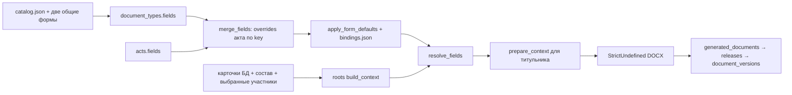

# Карта данных, полей и шаблонов ИТД

Снимок структуры на 25.11.2026. Карта построена по миграциям и исполняемым контрактам этой копии проекта. Рабочие БД и документы пользователя не открывались и не изменялись.

## Навигация

- [Итоги и границы проверки](#audit)
- [Экран → сущности → документы](#screens)
- [Порядок разрешения полей](#resolution)
- [Все таблицы и колонки](#schema)
- [Источники и обратные связи](#sources)
- [Все шаблоны и каждое поле](#forms)
- [Общая ведомость XLSX](#xlsx)
- [Как обновить карту](#update)

<a id="audit"></a>
## Итоги проверки

- Основная БД: таблиц — **57**, колонок — **416**, компонентов внешних ключей — **113**; миграции 001–026.
- Форм / DOCX / JSON-определений — **4**, включая реестр и три журнала из `form_catalog.catalog()`.
- **109 эффективных определений**, включая каждую колонку вложенных таблиц: literal: 5, reference: 93, table: 11.
- Ошибок проверенных контрактов: **0**. Проверены уникальность кодов и файлов, ключи bindings, существование колонок источников, порядок field_values, Jinja AST всех XML-частей DOCX, поля циклов, два рендера каждой формы (контекст пустого тестового объекта и непустые синтетические строки), целостность XML результата, SQLite integrity_check и foreign_key_check на тестовой БД.
- Результаты штатных тестов и ограничения их запуска фиксируются в CHANGELOG.md; аудит запускается отдельно.

### Что не означает «всё автоматически связано»

- **5 пустых literal-полей** ожидают индивидуальные сведения. Это явный ручной ввод в `acts.fields`, а не потерянная связь. Нельзя достоверно вывести результаты измерений, заключения, даты испытаний и объёмы из спецификации.
- **2 ручных таблиц** хранят строки в `acts.fields[].value`. Каждая их ячейка перечислена ниже. Пустое обязательное значение блокирует финал.
- `role_slot` — намеренно незавершённый выбор роли по варианту бланка; варианты указаны у соответствующих полей. Несколько представителей одной роли требуют выбора в документе.
- Не каждое поле БД печатается в документе: ключи, ревизии, хеши, пути и служебные состояния поддерживают учёт. У каждой колонки ниже показаны прямые потребители форм; «нет прямой привязки» не означает ошибку.
- Карта относится к поставляемым определениям. В рабочей БД `document_types.fields`, `acts.fields`, назначения и карточки версий могут отличаться; без выбора рабочей БД и объекта их содержание не проверялось.
- Семантическое соответствие каждого пустого места оригиналу и применимость нормативов не доказываются рендером. Наличие исходников и проверка их SHA-256 указаны отдельно для каждой формы. Постраничная визуальная сверка всех исходников в этот аудит не входит.

- Исходников проверенных форм нет по указанным путям: **2**. Сохранённые в каталоге хеши этих оригиналов не перепроверены. Два рендера в итогах означают подстановку Jinja в DOCX. Визуализация страниц выполняется отдельно.

### Выявленные особенности

- Исправлен разрыв `СП_70_А.rows_9_2.c3`: «Дата подписания акта» была определена в JSON, но отсутствовала в строке DOCX. Теперь маркер печатается и поле обязательно; генератор исходных форм отличает дату подписания от места для подписи. В ZIP шаблона изменён только word/document.xml, остальные части сохранены побайтно. Исходный бланк и зарегистрированные настройки рабочих БД не изменялись.
- Колонок блоков подписей с предусмотренным рукописным заполнением: **1**. Их JSON-определения существуют, но введённый в них текст не печатается. Точные ключи и подписи перечислены ниже со статусом «Рукописная подпись». Некоторые подписи совмещены с ФИО/должностью в заголовке; автоматическое заполнение этих частей требует отдельной сверки бланка с оригиналом.
- В README шаблонов были устаревшие ссылки на скрипт аудита и окружение Python. Они заменены действующим аудитом `audit_relationships.py` и `development/.venv`.
- У общего реестра `registry.number`, `registry.date`, `registry.note` остаются в контексте, но текущий DOCX их отдельно не печатает; номер и дата объединены в `number_date`. `registry.organization` вычисляется только при единственном исполнителе ролей `work_performer` / `builder`; пустое значение не заменяется произвольной организацией.
- У титульника `copies`, `volumes`, `font` — управляющие поля. `pages` и `contractors_info` создаются `titles.prepare_context`, хотя их нет в JSON. Это проверенное исключение, а не неопределённые маркеры.
- Титульник по умолчанию использует прежние русские ключи ролей (`Заказчик`, `Технический_заказчик`, `Генподрядчик`, `Подрядчик`). Веб-карточка участников использует английские ключи; для этих назначений при создании титульника требуется явное сопоставление `roles` в `titles.add_title`. Без него необязательные организации могут быть пустыми. Автоматическое переименование ролей здесь не выполнялось.

<a id="screens"></a>
## Экран → сущности → документы

Ассистент: `app/frontend/src/assistant.jsx` → `/api/v1/assistant/` → `app/itd/services/assistants.py` / `app/itd/assistant_runtime.py`. Настройки, threads и messages находятся в accounts (миграция 3); исходник, SHA-256 и извлечённый текст новых вложений — в messages.attachments (миграция 4). Контекст читается реестром, аудит source=assistant — в read_events. [Конфигурация](docs/assistants.md).

MCP: `app/itd/mcp_server.py` → единый реестр `app/itd/tools` → чтение и подготовка предпросмотров. Контракт и состав: [docs/mcp.md](docs/mcp.md). БД закреплена при запуске, Bearer использует api_tokens отдельной accounts; аудит source=mcp с knowledge_version/skills_version/index_status хранится в read_events sidecar. project_id=0 обозначает чтение без выбранного раздела. Знания CLI/веб/MCP имеют общий fingerprint и skills_version из сервисного knowledge-status.

Реестр ИД: `app/frontend/src/registry.jsx` → `/api/v1/project`, `/api/v1/registry/export`, `/api/v1/package` → общие сервисы. Список исходных файлов: `app/frontend/src/source-files.jsx` → `/api/v1/project`, `/api/v1/upload`; карточка оригинала и файловая проверка используют общие сервисы. Списки схем, основных документов, спецификации ресурсов, факта монтажа, входного контроля и ЖПК: `app/frontend/src/project-records.jsx` → `/api/v1/project`; формы сохраняют прежние сервисы. Работы ОЖР: `work-records.jsx`; остальные таблицы ОЖР: `journal-records.jsx`; проверка/сдача: `workflow-records.jsx`; ручное ведение: `manual-records.jsx` — из `app/frontend/src` через `/api/v1/project`. Действующие native формы, версии, файловые операции, настройки и знания сохраняют контроллеры `app/itd/web_assets` и Astryx-адаптеры; схема данных и источники полей не меняются.

| Раздел интерфейса | Хранилище и связи | Использование |
|---|---|---|
| Объект, реквизиты, разрешения | objects → projects; object_units | object.*, project.*, unit.*; реестр и титульник |
| Участники | organizations → signatories; object_participants; organization_assignments; signatory_assignments; participant_periods | organizations.<роль>.*, signatories.<роль>.*, companies; выбор акта через act_organizations / act_signatories |
| РД, исходные файлы | attachments; object_attachments / project_attachments; project_files | project_documentation; реестр; контроль SHA-256 и оригинала |
| Ресурсы | resources → resource_sources / resource_attachments; resource_imports / resource_import_rows; specification_pending | act_resources → resources; ведомости DOCX и XLSX; качество |
| Схемы | schemes → scheme_attachments; act_schemes | schemes в контексте акта; реестр; связь не подставляет схему в произвольное пустое поле |
| Поставки, входной контроль | supplies; quality_reviews; workspace_entries(kind=incoming), work_fields | materials через act_materials; ЖВК из journals.journal_data |
| ОЖР, работы, ЖПК | workspace_entries → work_materials → work_facts; work_material_allocations → supplies | ЖПК выбирает work_type=cable; act_entry_sources → entries; act_facts → facts; journal_rows по mapping |
| Специальные журналы | special_journals → организации / представители / акт | раздел 2 ОЖР; автоматические журналы — представления, не отдельные таблицы |
| Основные документы | document_types → acts → состав и участники; document_versions | JSON defaults → overrides → bindings → resolve_fields → DOCX |
| Выпуск, реестр, сдача | generated_documents → releases; final_reviews; package_requirements; deliveries → delivery_events / delivery_remarks | точный файл, хеш, выбранный выпуск, комплект, передача |
| Подтверждение изменений | write_previews (отдельный файл), read_events (аудит предпросмотров и отказов), audit_events.preview_id (уникальная отметка применения) | пользователь, БД, раздел, исходное состояние, срок и SHA-256 предпросмотра |
| Настройки и вход | отдельная БД accounts: users / sessions / api_tokens / settings / document_roots | выбор рабочей БД; правами управляет сервер, без FK на участников строительства |

<a id="resolution"></a>
## Порядок разрешения полей



1. `form_catalog.catalog()` добавляет к 89 записям файла каталога `СП_77_А_21` и `РЕЕСТР_ИТД`. Код формы совпадает с именем единственного DOCX и `acts.act_type → document_types.code`.
2. JSON регистрируется в `document_types.fields`. `acts.fields` заменяет определения по `key`, а не только значения: тип, source, required и формат также входят в определение.
3. `apply_form_defaults` связывает только пустые literal-поля из bindings. Непустой ручной текст, пользовательские ссылки, явный ручной ввод (binding_explicit), hidden и not_applicable сохраняются.
4. `build_context` читает актуальные карточки, выбранные ресурсы/схемы/факты и участников. Назначение раздела перекрывает объект; явный выбор акта уточняет его. Для подписанного акта используется signers_json. Организация и представитель проверяются на совместимость общей службой.
5. `reference` читает source; `literal` читает value; `signatory` форматирует выбранного представителя и его организацию; `table` разрешает каждую дочернюю колонку с item и row.number. `field_values.X` обращается только к уже разрешённому полю в текущем проходе. Форматы дат применяются после чтения источника.
6. Пропуски required блокируют финальный контекст. В черновике выводится тире. Поля hidden/not_applicable дают пустую строку/таблицу; неприменимость требует reason.
7. Проверка статических утверждений привязана к хешам шаблона и контекста (`final_reviews`). История выпуска сохраняет контекст и хеш файла; версии связываются с точным release/attachment.
8. `resources.document_resource` вычисляет количество для DOCX и XLSX при каждом построении: явный итог resources.qty_fact имеет приоритет; если его нет, используются только confirmed-факты ресурса. При неизвестном количестве хотя бы одного подтверждённого прироста итог остаётся неизвестным. Нулевой итог сохраняется; pending/void не суммируются; БД итогов не переписывается. Скачивание возвращает точный сохранённый файл. «Обновить на диске» пересоздаёт выбранную карточку без добавления версии: последний неподписанный черновик читает текущие источники, исторический/подписанный/финальный файл использует снимок. Предыдущий выпуск остаётся в истории.
9. `document_bindings.records/catalog` предоставляет функции f деловые записи только текущего объекта/раздела: `records.<table>.r<ID>.<column>`. Служебные JSON, пути, аккаунты и идентификаторы связей исключены. SQL от пользователя не выполняется; для объекта/раздела используются прежние object/project sources. Пример в редакторе шаблона берётся из первой доступной записи таблицы по ID. `signatories.short_fio` доступно как поле «Инициалы» и обновляется при записи ФИО или его частей. Существующие signatory, source, форматы и роли сохраняются без преобразования значений. Ручные таблицы хранят ссылку отдельной ячейки в value строки как `{__itd_source, value_type?, format?}`; разрешение выполняет тот же lookup. `binding_role` сохраняет требование подписи при перенастройке её печатного поля.
10. Карточка версии переходит в signed после всех выбранных подписей и проверки подписанного оригинала `document_versions.signed_attachment_id → attachments.id`, связанного с тем же разделом и актом. Прежние подписанные карточки читаются без искусственного добавления файла. Удаление версии сохраняет архивные файлы, перенумеровывает карточки и восстанавливает прежнюю последнюю; единственная версия защищена.

### Удаление связанных записей

`deletion.py` строит и проверяет план перед подтверждением. Обязательная FK-ссылка (NOT NULL или PK) удаляет дочернюю строку, необязательная очищается. Назначения объекта/раздела удаляются при удалении уровня, поскольку CHECK требует ровно один уровень. Составные FK обрабатываются вместе. JSON-ссылки work_fields на person_id/org_id обязательны для персонала ОЖР и удаляют его строку; supply_id, quality_review_id, entry_id очищаются. Явные ссылки Organisation.ID/Representative.ID в полях acts каскадно удаляют документ при required и очищаются при необязательном поле; черновые карточки версий синхронизируются. Архивные файлы и снимки выпущенных версий остаются историей. План содержит каждую удаляемую и изменяемую строку, объект/раздел и основание. Подтверждение связано с путём БД, выбранной записью и состоянием всех затронутых строк; изменение связей требует нового плана. Применение атомарно, проверяет foreign_key_check и обновляет ревизии очищенных записей.

<a id="schema"></a>
## Все таблицы и колонки

Схема снята с новой временной БД после применения всех миграций. Для каждого поля показаны тип, NOT NULL, порядок в PK, DEFAULT, FK и прямые потребители формы. CHECK, UNIQUE, составные ключи, индексы и триггеры приведены точным DDL. Для INTEGER PRIMARY KEY SQLite может показывать notnull=0; это не отменяет свойства первичного ключа.

### Основная БД ИТД

<a id="table-act_attachments"></a>
#### act_attachments — Связующая / служебная сущность

Упоминания таблицы в Python (статический указатель, включая SQL; динамические обращения см. сервисы): [app/itd/archive.py](../app/itd/archive.py), [app/itd/registry.py](../app/itd/registry.py), [app/itd/file_manager.py](../app/itd/file_manager.py), [app/itd/deletion.py](../app/itd/deletion.py).

| Колонка | SQL-тип; ограничения | FK / прямые поля форм |
|---|---|---|
| `act_id` | INTEGER; NOT NULL; PK #1 | FK #1.0 → acts.id; DELETE RESTRICT, UPDATE NO ACTION<br>Нет прямой привязки поля каталога; служебное/учётное поле или косвенное использование в сервисе |
| `attachment_id` | INTEGER; NOT NULL; PK #2 | FK #0.0 → attachments.id; DELETE RESTRICT, UPDATE NO ACTION<br>Нет прямой привязки поля каталога; служебное/учётное поле или косвенное использование в сервисе |

<details><summary>Точный DDL таблицы, индексов и триггеров</summary>

```sql
CREATE TABLE act_attachments (
    act_id INTEGER NOT NULL REFERENCES acts(id) ON DELETE RESTRICT,
    attachment_id INTEGER NOT NULL REFERENCES attachments(id) ON DELETE RESTRICT,
    PRIMARY KEY (act_id, attachment_id)
);
-- sqlite_autoindex_act_attachments_1: реализует PK/UNIQUE из CREATE TABLE
```

</details>

<a id="table-act_entry_sources"></a>
#### act_entry_sources — Связующая / служебная сущность

Упоминания таблицы в Python (статический указатель, включая SQL; динамические обращения см. сервисы): [app/itd/acts.py](../app/itd/acts.py), [app/itd/workflow.py](../app/itd/workflow.py), [app/itd/manual.py](../app/itd/manual.py), [app/itd/deletion.py](../app/itd/deletion.py), [app/itd/ojr.py](../app/itd/ojr.py).

| Колонка | SQL-тип; ограничения | FK / прямые поля форм |
|---|---|---|
| `act_id` | INTEGER; NOT NULL; PK #1 | FK #1.0 → acts.id; DELETE NO ACTION, UPDATE NO ACTION<br>Нет прямой привязки поля каталога; служебное/учётное поле или косвенное использование в сервисе |
| `entry_id` | INTEGER; NOT NULL; PK #2 | FK #0.0 → workspace_entries.id; DELETE NO ACTION, UPDATE NO ACTION<br>Нет прямой привязки поля каталога; служебное/учётное поле или косвенное использование в сервисе |
| `source_json` | TEXT; NOT NULL | Нет прямой привязки поля каталога; служебное/учётное поле или косвенное использование в сервисе |

<details><summary>Точный DDL таблицы, индексов и триггеров</summary>

```sql
CREATE TABLE act_entry_sources (
 act_id INTEGER NOT NULL REFERENCES acts(id), entry_id INTEGER NOT NULL REFERENCES workspace_entries(id),
 source_json TEXT NOT NULL, PRIMARY KEY(act_id,entry_id)
);
-- sqlite_autoindex_act_entry_sources_1: реализует PK/UNIQUE из CREATE TABLE
```

</details>

<a id="table-act_execution_status"></a>
#### act_execution_status — Связующая / служебная сущность

Упоминания таблицы в Python (статический указатель, включая SQL; динамические обращения см. сервисы): [app/itd/acts.py](../app/itd/acts.py), [app/itd/journals.py](../app/itd/journals.py), [app/itd/document_versions.py](../app/itd/document_versions.py), [app/itd/deletion.py](../app/itd/deletion.py), [app/itd/ojr.py](../app/itd/ojr.py), [app/itd/workspace.py](../app/itd/workspace.py), [app/itd/changes.py](../app/itd/changes.py).

| Колонка | SQL-тип; ограничения | FK / прямые поля форм |
|---|---|---|
| `act_id` | INTEGER; PK #1 | FK #0.0 → acts.id; DELETE NO ACTION, UPDATE NO ACTION<br>Нет прямой привязки поля каталога; служебное/учётное поле или косвенное использование в сервисе |
| `state` | TEXT; NOT NULL | Нет прямой привязки поля каталога; служебное/учётное поле или косвенное использование в сервисе |
| `work_description` | TEXT; NOT NULL | Нет прямой привязки поля каталога; служебное/учётное поле или косвенное использование в сервисе |
| `basis` | TEXT; NOT NULL | Нет прямой привязки поля каталога; служебное/учётное поле или косвенное использование в сервисе |
| `signers_json` | TEXT; NOT NULL | Нет прямой привязки поля каталога; служебное/учётное поле или косвенное использование в сервисе |
| `signed_date` | TEXT | Нет прямой привязки поля каталога; служебное/учётное поле или косвенное использование в сервисе |
| `revision` | INTEGER; NOT NULL; DEFAULT 1 | Нет прямой привязки поля каталога; служебное/учётное поле или косвенное использование в сервисе |

<details><summary>Точный DDL таблицы, индексов и триггеров</summary>

```sql
CREATE TABLE act_execution_status (
 act_id INTEGER PRIMARY KEY REFERENCES acts(id),
 state TEXT NOT NULL CHECK(state IN ('draft','signed')),
 work_description TEXT NOT NULL, basis TEXT NOT NULL,
 signers_json TEXT NOT NULL CHECK(json_valid(signers_json)),
 signed_date TEXT, revision INTEGER NOT NULL DEFAULT 1
);
```

</details>

<a id="table-act_facts"></a>
#### act_facts — Связующая / служебная сущность

Упоминания таблицы в Python (статический указатель, включая SQL; динамические обращения см. сервисы): [app/itd/acts.py](../app/itd/acts.py), [app/itd/workflow.py](../app/itd/workflow.py), [app/itd/manual.py](../app/itd/manual.py), [app/itd/inventory.py](../app/itd/inventory.py), [app/itd/resource_card.py](../app/itd/resource_card.py), [app/itd/deletion.py](../app/itd/deletion.py), [app/itd/ojr.py](../app/itd/ojr.py).

| Колонка | SQL-тип; ограничения | FK / прямые поля форм |
|---|---|---|
| `act_id` | INTEGER; NOT NULL; PK #1 | FK #1.0 → acts.id; DELETE NO ACTION, UPDATE NO ACTION<br>Нет прямой привязки поля каталога; служебное/учётное поле или косвенное использование в сервисе |
| `fact_id` | INTEGER; NOT NULL; PK #2 | FK #0.0 → work_facts.id; DELETE NO ACTION, UPDATE NO ACTION<br>Нет прямой привязки поля каталога; служебное/учётное поле или косвенное использование в сервисе |

<details><summary>Точный DDL таблицы, индексов и триггеров</summary>

```sql
CREATE TABLE act_facts (
 act_id INTEGER NOT NULL REFERENCES acts(id),
 fact_id INTEGER NOT NULL REFERENCES work_facts(id),
 PRIMARY KEY(act_id,fact_id)
);
-- sqlite_autoindex_act_facts_1: реализует PK/UNIQUE из CREATE TABLE
```

</details>

<a id="table-act_journals"></a>
#### act_journals — Связующая / служебная сущность

Упоминания таблицы в Python (статический указатель, включая SQL; динамические обращения см. сервисы): [app/itd/registry.py](../app/itd/registry.py), [app/itd/manual.py](../app/itd/manual.py), [app/itd/journals.py](../app/itd/journals.py), [app/itd/deletion.py](../app/itd/deletion.py).

| Колонка | SQL-тип; ограничения | FK / прямые поля форм |
|---|---|---|
| `act_id` | INTEGER; PK #1 | FK #0.0 → acts.id; DELETE NO ACTION, UPDATE NO ACTION<br>Нет прямой привязки поля каталога; служебное/учётное поле или косвенное использование в сервисе |
| `entry_kind` | TEXT; NOT NULL | Нет прямой привязки поля каталога; служебное/учётное поле или косвенное использование в сервисе |
| `work_type` | TEXT | Нет прямой привязки поля каталога; служебное/учётное поле или косвенное использование в сервисе |
| `mapping` | TEXT; NOT NULL | Нет прямой привязки поля каталога; служебное/учётное поле или косвенное использование в сервисе |

<details><summary>Точный DDL таблицы, индексов и триггеров</summary>

```sql
CREATE TABLE act_journals (
 act_id INTEGER PRIMARY KEY REFERENCES acts(id), entry_kind TEXT NOT NULL,
 work_type TEXT, mapping TEXT NOT NULL CHECK(json_valid(mapping))
);
```

</details>

<a id="table-act_materials"></a>
#### act_materials — Связующая / служебная сущность

Упоминания таблицы в Python (статический указатель, включая SQL; динамические обращения см. сервисы): [app/itd/acts.py](../app/itd/acts.py), [app/itd/manual.py](../app/itd/manual.py), [app/itd/inventory.py](../app/itd/inventory.py), [app/itd/deletion.py](../app/itd/deletion.py).

| Колонка | SQL-тип; ограничения | FK / прямые поля форм |
|---|---|---|
| `act_id` | INTEGER; NOT NULL; PK #1 | FK #1.0 → acts.id; DELETE NO ACTION, UPDATE NO ACTION<br>Нет прямой привязки поля каталога; служебное/учётное поле или косвенное использование в сервисе |
| `supply_id` | INTEGER; NOT NULL; PK #2 | FK #0.0 → supplies.id; DELETE NO ACTION, UPDATE NO ACTION<br>Нет прямой привязки поля каталога; служебное/учётное поле или косвенное использование в сервисе |
| `quantity` | REAL; NOT NULL | Нет прямой привязки поля каталога; служебное/учётное поле или косвенное использование в сервисе |

<details><summary>Точный DDL таблицы, индексов и триггеров</summary>

```sql
CREATE TABLE act_materials (
 act_id INTEGER NOT NULL REFERENCES acts(id), supply_id INTEGER NOT NULL REFERENCES supplies(id),
 quantity REAL NOT NULL CHECK(quantity>0), PRIMARY KEY(act_id,supply_id)
);
-- sqlite_autoindex_act_materials_1: реализует PK/UNIQUE из CREATE TABLE
```

</details>

<a id="table-act_organizations"></a>
#### act_organizations — Связующая / служебная сущность

Упоминания таблицы в Python (статический указатель, включая SQL; динамические обращения см. сервисы): [app/itd/document_versions.py](../app/itd/document_versions.py), [app/itd/act_participants.py](../app/itd/act_participants.py), [app/itd/deletion.py](../app/itd/deletion.py), [app/itd/ojr.py](../app/itd/ojr.py).

| Колонка | SQL-тип; ограничения | FK / прямые поля форм |
|---|---|---|
| `act_id` | INTEGER; NOT NULL; PK #1 | FK #1.0 → acts.id; DELETE NO ACTION, UPDATE NO ACTION<br>Нет прямой привязки поля каталога; служебное/учётное поле или косвенное использование в сервисе |
| `role_key` | TEXT; NOT NULL; PK #2 | Нет прямой привязки поля каталога; служебное/учётное поле или косвенное использование в сервисе |
| `org_id` | INTEGER; NOT NULL | FK #0.0 → organizations.id; DELETE NO ACTION, UPDATE NO ACTION<br>Нет прямой привязки поля каталога; служебное/учётное поле или косвенное использование в сервисе |

<details><summary>Точный DDL таблицы, индексов и триггеров</summary>

```sql
CREATE TABLE act_organizations (
 act_id INTEGER NOT NULL REFERENCES acts(id),
 role_key TEXT NOT NULL,
 org_id INTEGER NOT NULL REFERENCES organizations(id),
 PRIMARY KEY(act_id,role_key)
);
-- sqlite_autoindex_act_organizations_1: реализует PK/UNIQUE из CREATE TABLE
```

</details>

<a id="table-act_resources"></a>
#### act_resources — Связующая / служебная сущность

Упоминания таблицы в Python (статический указатель, включая SQL; динамические обращения см. сервисы): [app/itd/acts.py](../app/itd/acts.py), [app/itd/workflow.py](../app/itd/workflow.py), [app/itd/revision_compare.py](../app/itd/revision_compare.py), [app/itd/manual.py](../app/itd/manual.py), [app/itd/deletion.py](../app/itd/deletion.py), [app/itd/ojr.py](../app/itd/ojr.py).

| Колонка | SQL-тип; ограничения | FK / прямые поля форм |
|---|---|---|
| `act_id` | INTEGER; NOT NULL; PK #1 | FK #1.0 → acts.id; DELETE CASCADE, UPDATE NO ACTION<br>Нет прямой привязки поля каталога; служебное/учётное поле или косвенное использование в сервисе |
| `resource_id` | INTEGER; NOT NULL; PK #2 | FK #0.0 → resources.id; DELETE RESTRICT, UPDATE NO ACTION<br>Нет прямой привязки поля каталога; служебное/учётное поле или косвенное использование в сервисе |
| `ordinal` | INTEGER; NOT NULL | Нет прямой привязки поля каталога; служебное/учётное поле или косвенное использование в сервисе |

<details><summary>Точный DDL таблицы, индексов и триггеров</summary>

```sql
CREATE TABLE act_resources (
    act_id INTEGER NOT NULL REFERENCES acts(id) ON DELETE CASCADE,
    resource_id INTEGER NOT NULL REFERENCES resources(id) ON DELETE RESTRICT,
    ordinal INTEGER NOT NULL CHECK (ordinal > 0),
    PRIMARY KEY (act_id, resource_id),
    UNIQUE (act_id, ordinal)
);
-- sqlite_autoindex_act_resources_2: реализует PK/UNIQUE из CREATE TABLE
-- sqlite_autoindex_act_resources_1: реализует PK/UNIQUE из CREATE TABLE
CREATE TRIGGER act_resources_same_project_insert
BEFORE INSERT ON act_resources
WHEN (SELECT project_id FROM acts WHERE id = NEW.act_id)
  IS NOT (SELECT project_id FROM resources WHERE id = NEW.resource_id)
BEGIN
    SELECT RAISE(ABORT, 'Resource and act must belong to the same project');
END;
CREATE TRIGGER act_resources_same_project_update
BEFORE UPDATE ON act_resources
WHEN (SELECT project_id FROM acts WHERE id = NEW.act_id)
  IS NOT (SELECT project_id FROM resources WHERE id = NEW.resource_id)
BEGIN
    SELECT RAISE(ABORT, 'Resource and act must belong to the same project');
END;
```

</details>

<a id="table-act_schemes"></a>
#### act_schemes — Связующая / служебная сущность

Упоминания таблицы в Python (статический указатель, включая SQL; динамические обращения см. сервисы): [app/itd/acts.py](../app/itd/acts.py), [app/itd/revision_compare.py](../app/itd/revision_compare.py), [app/itd/manual.py](../app/itd/manual.py), [app/itd/deletion.py](../app/itd/deletion.py).

| Колонка | SQL-тип; ограничения | FK / прямые поля форм |
|---|---|---|
| `act_id` | INTEGER; NOT NULL; PK #1 | FK #1.0 → acts.id; DELETE CASCADE, UPDATE NO ACTION<br>Нет прямой привязки поля каталога; служебное/учётное поле или косвенное использование в сервисе |
| `scheme_id` | INTEGER; NOT NULL; PK #2 | FK #0.0 → schemes.id; DELETE RESTRICT, UPDATE NO ACTION<br>Нет прямой привязки поля каталога; служебное/учётное поле или косвенное использование в сервисе |
| `ordinal` | INTEGER; NOT NULL | Нет прямой привязки поля каталога; служебное/учётное поле или косвенное использование в сервисе |

<details><summary>Точный DDL таблицы, индексов и триггеров</summary>

```sql
CREATE TABLE act_schemes (
    act_id INTEGER NOT NULL REFERENCES acts(id) ON DELETE CASCADE,
    scheme_id INTEGER NOT NULL REFERENCES schemes(id) ON DELETE RESTRICT,
    ordinal INTEGER NOT NULL CHECK (ordinal > 0),
    PRIMARY KEY (act_id, scheme_id),
    UNIQUE (act_id, ordinal)
);
-- sqlite_autoindex_act_schemes_2: реализует PK/UNIQUE из CREATE TABLE
-- sqlite_autoindex_act_schemes_1: реализует PK/UNIQUE из CREATE TABLE
CREATE TRIGGER act_schemes_same_project_insert
BEFORE INSERT ON act_schemes
WHEN (SELECT project_id FROM acts WHERE id = NEW.act_id)
  IS NOT (SELECT project_id FROM schemes WHERE id = NEW.scheme_id)
BEGIN
    SELECT RAISE(ABORT, 'Scheme and act must belong to the same project');
END;
CREATE TRIGGER act_schemes_same_project_update
BEFORE UPDATE ON act_schemes
WHEN (SELECT project_id FROM acts WHERE id = NEW.act_id)
  IS NOT (SELECT project_id FROM schemes WHERE id = NEW.scheme_id)
BEGIN
    SELECT RAISE(ABORT, 'Scheme and act must belong to the same project');
END;
```

</details>

<a id="table-act_signatories"></a>
#### act_signatories — Связующая / служебная сущность

Упоминания таблицы в Python (статический указатель, включая SQL; динамические обращения см. сервисы): [app/itd/registry.py](../app/itd/registry.py), [app/itd/document_versions.py](../app/itd/document_versions.py), [app/itd/deletion.py](../app/itd/deletion.py), [app/itd/ojr.py](../app/itd/ojr.py).

| Колонка | SQL-тип; ограничения | FK / прямые поля форм |
|---|---|---|
| `act_id` | INTEGER; NOT NULL; PK #1 | FK #1.0 → acts.id; DELETE NO ACTION, UPDATE NO ACTION<br>Нет прямой привязки поля каталога; служебное/учётное поле или косвенное использование в сервисе |
| `role_key` | TEXT; NOT NULL; PK #2 | Нет прямой привязки поля каталога; служебное/учётное поле или косвенное использование в сервисе |
| `signatory_id` | INTEGER; NOT NULL | FK #0.0 → signatories.id; DELETE NO ACTION, UPDATE NO ACTION<br>Нет прямой привязки поля каталога; служебное/учётное поле или косвенное использование в сервисе |

<details><summary>Точный DDL таблицы, индексов и триггеров</summary>

```sql
CREATE TABLE act_signatories (
 act_id INTEGER NOT NULL REFERENCES acts(id), role_key TEXT NOT NULL,
 signatory_id INTEGER NOT NULL REFERENCES signatories(id),
 PRIMARY KEY(act_id,role_key)
);
-- sqlite_autoindex_act_signatories_1: реализует PK/UNIQUE из CREATE TABLE
```

</details>

<a id="table-acts"></a>
#### acts — Основные документы

Упоминания таблицы в Python (статический указатель, включая SQL; динамические обращения см. сервисы): [app/itd/__main__.py](../app/itd/__main__.py), [app/itd/acts.py](../app/itd/acts.py), [app/itd/registry.py](../app/itd/registry.py), [app/itd/managed.py](../app/itd/managed.py), [app/itd/workflow.py](../app/itd/workflow.py), [app/itd/titles.py](../app/itd/titles.py), [app/itd/manual.py](../app/itd/manual.py), [app/itd/document_preview.py](../app/itd/document_preview.py), [app/itd/form_catalog.py](../app/itd/form_catalog.py), [app/itd/journals.py](../app/itd/journals.py), [app/itd/inventory.py](../app/itd/inventory.py), [app/itd/document_versions.py](../app/itd/document_versions.py), [app/itd/act_participants.py](../app/itd/act_participants.py), [app/itd/deletion.py](../app/itd/deletion.py), [app/itd/ojr.py](../app/itd/ojr.py), [app/itd/document_bindings.py](../app/itd/document_bindings.py), [app/itd/workspace.py](../app/itd/workspace.py), [app/itd/changes.py](../app/itd/changes.py), [app/itd/releases.py](../app/itd/releases.py), [app/itd/custom_templates.py](../app/itd/custom_templates.py), [app/itd/journal_export.py](../app/itd/journal_export.py), [app/itd/document_representatives.py](../app/itd/document_representatives.py).

| Колонка | SQL-тип; ограничения | FK / прямые поля форм |
|---|---|---|
| `id` | INTEGER; PK #1 | Нет прямой привязки поля каталога; служебное/учётное поле или косвенное использование в сервисе |
| `project_id` | INTEGER; NOT NULL | FK #1.0 → projects.id; DELETE RESTRICT, UPDATE NO ACTION<br>Нет прямой привязки поля каталога; служебное/учётное поле или косвенное использование в сервисе |
| `act_type` | TEXT; NOT NULL | FK #0.0 → document_types.code; DELETE RESTRICT, UPDATE NO ACTION<br>Нет прямой привязки поля каталога; служебное/учётное поле или косвенное использование в сервисе |
| `sequence_no` | INTEGER; NOT NULL | Нет прямой привязки поля каталога; служебное/учётное поле или косвенное использование в сервисе |
| `act_num` | TEXT; NOT NULL | Нет прямой привязки поля каталога; служебное/учётное поле или косвенное использование в сервисе |
| `date_signed` | TEXT | Прямые привязки: 3; [список](#source-acts-date_signed) |
| `is_active` | INTEGER; NOT NULL; DEFAULT 1 | Нет прямой привязки поля каталога; служебное/учётное поле или косвенное использование в сервисе |
| `fields` | TEXT; NOT NULL; DEFAULT '[]' | Прямые привязки: 4; [список](#source-acts-fields) |
| `sheets_count` | INTEGER | Нет прямой привязки поля каталога; служебное/учётное поле или косвенное использование в сервисе |
| `registry_note` | TEXT | Нет прямой привязки поля каталога; служебное/учётное поле или косвенное использование в сервисе |
| `filename_title` | TEXT | Нет прямой привязки поля каталога; служебное/учётное поле или косвенное использование в сервисе |

<details><summary>Точный DDL таблицы, индексов и триггеров</summary>

```sql
CREATE TABLE acts (
    id INTEGER PRIMARY KEY,
    project_id INTEGER NOT NULL REFERENCES projects(id) ON DELETE RESTRICT,
    act_type TEXT NOT NULL REFERENCES document_types(code) ON DELETE RESTRICT,
    sequence_no INTEGER NOT NULL CHECK (sequence_no > 0),
    act_num TEXT NOT NULL,
    date_signed TEXT,
    is_active INTEGER NOT NULL DEFAULT 1 CHECK (is_active IN (0, 1)),
    fields TEXT NOT NULL DEFAULT '[]' CHECK (json_valid(fields) AND json_type(fields) = 'array'), sheets_count INTEGER CHECK (sheets_count IS NULL OR sheets_count > 0), registry_note TEXT, filename_title TEXT,
    UNIQUE (project_id, sequence_no),
    UNIQUE (project_id, act_num)
);
-- sqlite_autoindex_acts_2: реализует PK/UNIQUE из CREATE TABLE
-- sqlite_autoindex_acts_1: реализует PK/UNIQUE из CREATE TABLE
CREATE INDEX acts_project_idx ON acts(project_id);
CREATE TRIGGER acts_keep_project
BEFORE UPDATE OF project_id ON acts
WHEN OLD.project_id != NEW.project_id
BEGIN
    SELECT RAISE(ABORT, 'Act cannot change project');
END;
```

</details>

<a id="table-agent_state"></a>
#### agent_state — Связующая / служебная сущность

Упоминания таблицы в Python (статический указатель, включая SQL; динамические обращения см. сервисы): [app/itd/deletion.py](../app/itd/deletion.py).

| Колонка | SQL-тип; ограничения | FK / прямые поля форм |
|---|---|---|
| `id` | INTEGER; PK #1 | Нет прямой привязки поля каталога; служебное/учётное поле или косвенное использование в сервисе |
| `project_id` | INTEGER; NOT NULL | FK #0.0 → projects.id; DELETE NO ACTION, UPDATE NO ACTION<br>Нет прямой привязки поля каталога; служебное/учётное поле или косвенное использование в сервисе |

<details><summary>Точный DDL таблицы, индексов и триггеров</summary>

```sql
CREATE TABLE agent_state (
 id INTEGER PRIMARY KEY CHECK(id=1),
 project_id INTEGER NOT NULL REFERENCES projects(id)
);
```

</details>

<a id="table-attachments"></a>
#### attachments — Архив исходных файлов

Упоминания таблицы в Python (статический указатель, включая SQL; динамические обращения см. сервисы): [app/itd/__main__.py](../app/itd/__main__.py), [app/itd/archive.py](../app/itd/archive.py), [app/itd/participants.py](../app/itd/participants.py), [app/itd/registry.py](../app/itd/registry.py), [app/itd/specification.py](../app/itd/specification.py), [app/itd/statement.py](../app/itd/statement.py), [app/itd/workflow.py](../app/itd/workflow.py), [app/itd/revision_compare.py](../app/itd/revision_compare.py), [app/itd/manual.py](../app/itd/manual.py), [app/itd/journals.py](../app/itd/journals.py), [app/itd/file_manager.py](../app/itd/file_manager.py), [app/itd/document_versions.py](../app/itd/document_versions.py), [app/itd/accounts.py](../app/itd/accounts.py), [app/itd/incoming.py](../app/itd/incoming.py), [app/itd/deletion.py](../app/itd/deletion.py), [app/itd/ojr.py](../app/itd/ojr.py), [app/itd/assistant_runtime.py](../app/itd/assistant_runtime.py), [app/itd/changes.py](../app/itd/changes.py), [app/itd/assistant_files.py](../app/itd/assistant_files.py), [app/itd/releases.py](../app/itd/releases.py), [app/itd/storage.py](../app/itd/storage.py), [app/itd/resource_import.py](../app/itd/resource_import.py), [app/itd/journal_export.py](../app/itd/journal_export.py).

| Колонка | SQL-тип; ограничения | FK / прямые поля форм |
|---|---|---|
| `id` | INTEGER; PK #1 | Нет прямой привязки поля каталога; служебное/учётное поле или косвенное использование в сервисе |
| `sha256` | TEXT; NOT NULL | Нет прямой привязки поля каталога; служебное/учётное поле или косвенное использование в сервисе |
| `storage_path` | TEXT; NOT NULL | Нет прямой привязки поля каталога; служебное/учётное поле или косвенное использование в сервисе |
| `original_name` | TEXT; NOT NULL | Нет прямой привязки поля каталога; служебное/учётное поле или косвенное использование в сервисе |
| `byte_size` | INTEGER; NOT NULL | Нет прямой привязки поля каталога; служебное/учётное поле или косвенное использование в сервисе |
| `doc_type` | TEXT; NOT NULL | Нет прямой привязки поля каталога; служебное/учётное поле или косвенное использование в сервисе |
| `title` | TEXT; NOT NULL | Нет прямой привязки поля каталога; служебное/учётное поле или косвенное использование в сервисе |
| `doc_num` | TEXT | Нет прямой привязки поля каталога; служебное/учётное поле или косвенное использование в сервисе |
| `doc_date` | TEXT | Нет прямой привязки поля каталога; служебное/учётное поле или косвенное использование в сервисе |
| `sheets_count` | INTEGER | Нет прямой привязки поля каталога; служебное/учётное поле или косвенное использование в сервисе |
| `note` | TEXT | Нет прямой привязки поля каталога; служебное/учётное поле или косвенное использование в сервисе |
| `file_kind` | TEXT | Нет прямой привязки поля каталога; служебное/учётное поле или косвенное использование в сервисе |

<details><summary>Точный DDL таблицы, индексов и триггеров</summary>

```sql
CREATE TABLE attachments (
    id INTEGER PRIMARY KEY,
    sha256 TEXT NOT NULL UNIQUE CHECK (length(sha256) = 64),
    storage_path TEXT NOT NULL UNIQUE,
    original_name TEXT NOT NULL,
    byte_size INTEGER NOT NULL CHECK (byte_size >= 0),
    doc_type TEXT NOT NULL CHECK (doc_type IN ('order', 'certificate', 'passport', 'rd', 'scheme', 'other')),
    title TEXT NOT NULL,
    doc_num TEXT,
    doc_date TEXT
, sheets_count INTEGER CHECK (sheets_count IS NULL OR sheets_count > 0), note TEXT, file_kind TEXT CHECK(file_kind IS NULL OR file_kind IN ('contract','quality')));
-- sqlite_autoindex_attachments_2: реализует PK/UNIQUE из CREATE TABLE
-- sqlite_autoindex_attachments_1: реализует PK/UNIQUE из CREATE TABLE
```

</details>

<a id="table-audit_events"></a>
#### audit_events — Связующая / служебная сущность

Упоминания таблицы в Python (статический указатель, включая SQL; динамические обращения см. сервисы): [app/itd/__main__.py](../app/itd/__main__.py), [app/itd/changes.py](../app/itd/changes.py), [app/itd/services/previews.py](../app/itd/services/previews.py).

| Колонка | SQL-тип; ограничения | FK / прямые поля форм |
|---|---|---|
| `id` | INTEGER; PK #1 | Нет прямой привязки поля каталога; служебное/учётное поле или косвенное использование в сервисе |
| `occurred_at` | TEXT; NOT NULL; DEFAULT strftime('%Y-%m-%dT%H:%M:%fZ', 'now') | Нет прямой привязки поля каталога; служебное/учётное поле или косвенное использование в сервисе |
| `operation` | TEXT; NOT NULL | Нет прямой привязки поля каталога; служебное/учётное поле или косвенное использование в сервисе |
| `entity` | TEXT | Нет прямой привязки поля каталога; служебное/учётное поле или косвенное использование в сервисе |
| `entity_id` | INTEGER | Нет прямой привязки поля каталога; служебное/учётное поле или косвенное использование в сервисе |
| `before_json` | TEXT | Нет прямой привязки поля каталога; служебное/учётное поле или косвенное использование в сервисе |
| `after_json` | TEXT | Нет прямой привязки поля каталога; служебное/учётное поле или косвенное использование в сервисе |
| `actor_id` | TEXT | Нет прямой привязки поля каталога; служебное/учётное поле или косвенное использование в сервисе |
| `actor_role` | TEXT | Нет прямой привязки поля каталога; служебное/учётное поле или косвенное использование в сервисе |
| `source` | TEXT | Нет прямой привязки поля каталога; служебное/учётное поле или косвенное использование в сервисе |
| `on_behalf_of` | TEXT | Нет прямой привязки поля каталога; служебное/учётное поле или косвенное использование в сервисе |
| `result` | TEXT | Нет прямой привязки поля каталога; служебное/учётное поле или косвенное использование в сервисе |
| `preview_id` | TEXT | Нет прямой привязки поля каталога; служебное/учётное поле или косвенное использование в сервисе |
| `knowledge_version` | TEXT | Нет прямой привязки поля каталога; служебное/учётное поле или косвенное использование в сервисе |
| `skills_version` | TEXT | Нет прямой привязки поля каталога; служебное/учётное поле или косвенное использование в сервисе |
| `index_status` | TEXT | Нет прямой привязки поля каталога; служебное/учётное поле или косвенное использование в сервисе |

<details><summary>Точный DDL таблицы, индексов и триггеров</summary>

```sql
CREATE TABLE audit_events (
    id INTEGER PRIMARY KEY,
    occurred_at TEXT NOT NULL DEFAULT (strftime('%Y-%m-%dT%H:%M:%fZ', 'now')),
    operation TEXT NOT NULL,
    entity TEXT,
    entity_id INTEGER,
    before_json TEXT,
    after_json TEXT
, actor_id TEXT, actor_role TEXT, source TEXT, on_behalf_of TEXT, result TEXT, preview_id TEXT, knowledge_version TEXT, skills_version TEXT, index_status TEXT);
CREATE UNIQUE INDEX audit_events_preview_once ON audit_events(preview_id) WHERE preview_id IS NOT NULL;
```

</details>

<a id="table-deliveries"></a>
#### deliveries — Сдача

Упоминания таблицы в Python (статический указатель, включая SQL; динамические обращения см. сервисы): [app/itd/__main__.py](../app/itd/__main__.py), [app/itd/workflow.py](../app/itd/workflow.py), [app/itd/manual.py](../app/itd/manual.py), [app/itd/deletion.py](../app/itd/deletion.py).

| Колонка | SQL-тип; ограничения | FK / прямые поля форм |
|---|---|---|
| `id` | INTEGER; PK #1 | Нет прямой привязки поля каталога; служебное/учётное поле или косвенное использование в сервисе |
| `project_id` | INTEGER; NOT NULL | FK #1.0 → projects.id; DELETE NO ACTION, UPDATE NO ACTION<br>Нет прямой привязки поля каталога; служебное/учётное поле или косвенное использование в сервисе |
| `release_id` | INTEGER; NOT NULL | FK #0.0 → releases.id; DELETE NO ACTION, UPDATE NO ACTION<br>Нет прямой привязки поля каталога; служебное/учётное поле или косвенное использование в сервисе |
| `recipient` | TEXT; NOT NULL | Нет прямой привязки поля каталога; служебное/учётное поле или косвенное использование в сервисе |
| `status` | TEXT; NOT NULL | Нет прямой привязки поля каталога; служебное/учётное поле или косвенное использование в сервисе |
| `revision` | INTEGER; NOT NULL; DEFAULT 1 | Нет прямой привязки поля каталога; служебное/учётное поле или косвенное использование в сервисе |

<details><summary>Точный DDL таблицы, индексов и триггеров</summary>

```sql
CREATE TABLE deliveries (
 id INTEGER PRIMARY KEY,
 project_id INTEGER NOT NULL REFERENCES projects(id),
 release_id INTEGER NOT NULL REFERENCES releases(id),
 recipient TEXT NOT NULL,
 status TEXT NOT NULL CHECK(status IN ('sent','remarks','corrected','accepted')),
 revision INTEGER NOT NULL DEFAULT 1
);
CREATE INDEX deliveries_project ON deliveries(project_id);
```

</details>

<a id="table-delivery_events"></a>
#### delivery_events — Связующая / служебная сущность

Упоминания таблицы в Python (статический указатель, включая SQL; динамические обращения см. сервисы): [app/itd/__main__.py](../app/itd/__main__.py), [app/itd/workflow.py](../app/itd/workflow.py), [app/itd/deletion.py](../app/itd/deletion.py).

| Колонка | SQL-тип; ограничения | FK / прямые поля форм |
|---|---|---|
| `id` | INTEGER; PK #1 | Нет прямой привязки поля каталога; служебное/учётное поле или косвенное использование в сервисе |
| `delivery_id` | INTEGER; NOT NULL | FK #1.0 → deliveries.id; DELETE NO ACTION, UPDATE NO ACTION<br>Нет прямой привязки поля каталога; служебное/учётное поле или косвенное использование в сервисе |
| `release_id` | INTEGER; NOT NULL | FK #0.0 → releases.id; DELETE NO ACTION, UPDATE NO ACTION<br>Нет прямой привязки поля каталога; служебное/учётное поле или косвенное использование в сервисе |
| `status` | TEXT; NOT NULL | Нет прямой привязки поля каталога; служебное/учётное поле или косвенное использование в сервисе |
| `event_date` | TEXT; NOT NULL | Нет прямой привязки поля каталога; служебное/учётное поле или косвенное использование в сервисе |
| `source` | TEXT; NOT NULL | Нет прямой привязки поля каталога; служебное/учётное поле или косвенное использование в сервисе |
| `note` | TEXT; NOT NULL | Нет прямой привязки поля каталога; служебное/учётное поле или косвенное использование в сервисе |
| `revision` | INTEGER; NOT NULL | Нет прямой привязки поля каталога; служебное/учётное поле или косвенное использование в сервисе |

<details><summary>Точный DDL таблицы, индексов и триггеров</summary>

```sql
CREATE TABLE delivery_events (
 id INTEGER PRIMARY KEY,
 delivery_id INTEGER NOT NULL REFERENCES deliveries(id),
 release_id INTEGER NOT NULL REFERENCES releases(id),
 status TEXT NOT NULL CHECK(status IN ('sent','remarks','corrected','accepted')),
 event_date TEXT NOT NULL,
 source TEXT NOT NULL,
 note TEXT NOT NULL,
 revision INTEGER NOT NULL,
 UNIQUE(delivery_id,revision)
);
-- sqlite_autoindex_delivery_events_1: реализует PK/UNIQUE из CREATE TABLE
```

</details>

<a id="table-delivery_remarks"></a>
#### delivery_remarks — Связующая / служебная сущность

Упоминания таблицы в Python (статический указатель, включая SQL; динамические обращения см. сервисы): [app/itd/__main__.py](../app/itd/__main__.py), [app/itd/workflow.py](../app/itd/workflow.py), [app/itd/manual.py](../app/itd/manual.py), [app/itd/deletion.py](../app/itd/deletion.py).

| Колонка | SQL-тип; ограничения | FK / прямые поля форм |
|---|---|---|
| `id` | INTEGER; PK #1 | Нет прямой привязки поля каталога; служебное/учётное поле или косвенное использование в сервисе |
| `delivery_id` | INTEGER; NOT NULL | FK #2.0 → deliveries.id; DELETE NO ACTION, UPDATE NO ACTION<br>Нет прямой привязки поля каталога; служебное/учётное поле или косвенное использование в сервисе |
| `release_id` | INTEGER; NOT NULL | FK #1.0 → releases.id; DELETE NO ACTION, UPDATE NO ACTION<br>Нет прямой привязки поля каталога; служебное/учётное поле или косвенное использование в сервисе |
| `description` | TEXT; NOT NULL | Нет прямой привязки поля каталога; служебное/учётное поле или косвенное использование в сервисе |
| `source` | TEXT; NOT NULL | Нет прямой привязки поля каталога; служебное/учётное поле или косвенное использование в сервисе |
| `status` | TEXT; NOT NULL; DEFAULT 'open' | Нет прямой привязки поля каталога; служебное/учётное поле или косвенное использование в сервисе |
| `resolution` | TEXT | Нет прямой привязки поля каталога; служебное/учётное поле или косвенное использование в сервисе |
| `resolution_source` | TEXT | Нет прямой привязки поля каталога; служебное/учётное поле или косвенное использование в сервисе |
| `resolution_date` | TEXT | Нет прямой привязки поля каталога; служебное/учётное поле или косвенное использование в сервисе |
| `resolution_release_id` | INTEGER | FK #0.0 → releases.id; DELETE NO ACTION, UPDATE NO ACTION<br>Нет прямой привязки поля каталога; служебное/учётное поле или косвенное использование в сервисе |

<details><summary>Точный DDL таблицы, индексов и триггеров</summary>

```sql
CREATE TABLE delivery_remarks (
 id INTEGER PRIMARY KEY,
 delivery_id INTEGER NOT NULL REFERENCES deliveries(id),
 release_id INTEGER NOT NULL REFERENCES releases(id),
 description TEXT NOT NULL,
 source TEXT NOT NULL,
 status TEXT NOT NULL DEFAULT 'open' CHECK(status IN ('open','resolved')),
 resolution TEXT,
 resolution_source TEXT,
 resolution_date TEXT,
 resolution_release_id INTEGER REFERENCES releases(id)
);
```

</details>

<a id="table-document_counters"></a>
#### document_counters — Связующая / служебная сущность

Упоминания таблицы в Python (статический указатель, включая SQL; динамические обращения см. сервисы): [app/itd/acts.py](../app/itd/acts.py), [app/itd/deletion.py](../app/itd/deletion.py).

| Колонка | SQL-тип; ограничения | FK / прямые поля форм |
|---|---|---|
| `project_id` | INTEGER; PK #1 | FK #0.0 → projects.id; DELETE RESTRICT, UPDATE NO ACTION<br>Нет прямой привязки поля каталога; служебное/учётное поле или косвенное использование в сервисе |
| `last_number` | INTEGER; NOT NULL | Нет прямой привязки поля каталога; служебное/учётное поле или косвенное использование в сервисе |

<details><summary>Точный DDL таблицы, индексов и триггеров</summary>

```sql
CREATE TABLE document_counters (
    project_id INTEGER PRIMARY KEY REFERENCES projects(id) ON DELETE RESTRICT,
    last_number INTEGER NOT NULL CHECK (last_number >= 0)
);
```

</details>

<a id="table-document_templates"></a>
#### document_templates — Связующая / служебная сущность

Упоминания таблицы в Python (статический указатель, включая SQL; динамические обращения см. сервисы): [app/itd/form_catalog.py](../app/itd/form_catalog.py), [app/itd/custom_templates.py](../app/itd/custom_templates.py).

| Колонка | SQL-тип; ограничения | FK / прямые поля форм |
|---|---|---|
| `code` | TEXT; PK #1 | FK #0.0 → document_types.code; DELETE NO ACTION, UPDATE NO ACTION<br>Нет прямой привязки поля каталога; служебное/учётное поле или косвенное использование в сервисе |
| `form_set` | TEXT; NOT NULL | Нет прямой привязки поля каталога; служебное/учётное поле или косвенное использование в сервисе |
| `original_name` | TEXT; NOT NULL | Нет прямой привязки поля каталога; служебное/учётное поле или косвенное использование в сервисе |
| `revision` | INTEGER; NOT NULL; DEFAULT 1 | Нет прямой привязки поля каталога; служебное/учётное поле или косвенное использование в сервисе |
| `deleted` | INTEGER; NOT NULL; DEFAULT 0 | Нет прямой привязки поля каталога; служебное/учётное поле или косвенное использование в сервисе |

<details><summary>Точный DDL таблицы, индексов и триггеров</summary>

```sql
CREATE TABLE document_templates (
 code TEXT PRIMARY KEY REFERENCES document_types(code),
 form_set TEXT NOT NULL,
 original_name TEXT NOT NULL,
 revision INTEGER NOT NULL DEFAULT 1,
 deleted INTEGER NOT NULL DEFAULT 0
);
-- sqlite_autoindex_document_templates_1: реализует PK/UNIQUE из CREATE TABLE
```

</details>

<a id="table-document_types"></a>
#### document_types — Зарегистрированные формы

Упоминания таблицы в Python (статический указатель, включая SQL; динамические обращения см. сервисы): [app/itd/__main__.py](../app/itd/__main__.py), [app/itd/acts.py](../app/itd/acts.py), [app/itd/registry.py](../app/itd/registry.py), [app/itd/managed.py](../app/itd/managed.py), [app/itd/workflow.py](../app/itd/workflow.py), [app/itd/titles.py](../app/itd/titles.py), [app/itd/manual.py](../app/itd/manual.py), [app/itd/document_preview.py](../app/itd/document_preview.py), [app/itd/form_catalog.py](../app/itd/form_catalog.py), [app/itd/journals.py](../app/itd/journals.py), [app/itd/document_versions.py](../app/itd/document_versions.py), [app/itd/deletion.py](../app/itd/deletion.py), [app/itd/ojr.py](../app/itd/ojr.py), [app/itd/releases.py](../app/itd/releases.py), [app/itd/custom_templates.py](../app/itd/custom_templates.py), [app/itd/document_representatives.py](../app/itd/document_representatives.py).

| Колонка | SQL-тип; ограничения | FK / прямые поля форм |
|---|---|---|
| `id` | INTEGER; PK #1 | Нет прямой привязки поля каталога; служебное/учётное поле или косвенное использование в сервисе |
| `code` | TEXT; NOT NULL | Нет прямой привязки поля каталога; служебное/учётное поле или косвенное использование в сервисе |
| `name` | TEXT; NOT NULL | Нет прямой привязки поля каталога; служебное/учётное поле или косвенное использование в сервисе |
| `fields` | TEXT; NOT NULL; DEFAULT '[]' | Нет прямой привязки поля каталога; служебное/учётное поле или косвенное использование в сервисе |
| `form_group` | TEXT; NOT NULL; DEFAULT 'act' | Нет прямой привязки поля каталога; служебное/учётное поле или косвенное использование в сервисе |
| `filename_title` | TEXT | Нет прямой привязки поля каталога; служебное/учётное поле или косвенное использование в сервисе |

<details><summary>Точный DDL таблицы, индексов и триггеров</summary>

```sql
CREATE TABLE document_types (
    id INTEGER PRIMARY KEY,
    code TEXT NOT NULL UNIQUE CHECK (length(trim(code)) > 0),
    name TEXT NOT NULL CHECK (length(trim(name)) > 0),
    fields TEXT NOT NULL DEFAULT '[]' CHECK (json_valid(fields) AND json_type(fields) = 'array')
, form_group TEXT NOT NULL DEFAULT 'act' CHECK (form_group IN ('act', 'statement', 'registry')), filename_title TEXT);
-- sqlite_autoindex_document_types_1: реализует PK/UNIQUE из CREATE TABLE
```

</details>

<a id="table-document_versions"></a>
#### document_versions — Карточки версий документов

Упоминания таблицы в Python (статический указатель, включая SQL; динамические обращения см. сервисы): [app/itd/acts.py](../app/itd/acts.py), [app/itd/manual.py](../app/itd/manual.py), [app/itd/document_versions.py](../app/itd/document_versions.py), [app/itd/act_participants.py](../app/itd/act_participants.py), [app/itd/deletion.py](../app/itd/deletion.py), [app/itd/ojr.py](../app/itd/ojr.py), [app/itd/releases.py](../app/itd/releases.py).

| Колонка | SQL-тип; ограничения | FK / прямые поля форм |
|---|---|---|
| `id` | INTEGER; PK #1 | Нет прямой привязки поля каталога; служебное/учётное поле или косвенное использование в сервисе |
| `act_id` | INTEGER; NOT NULL | FK #3.0 → acts.id; DELETE NO ACTION, UPDATE NO ACTION<br>Нет прямой привязки поля каталога; служебное/учётное поле или косвенное использование в сервисе |
| `ordinal` | INTEGER; NOT NULL | Нет прямой привязки поля каталога; служебное/учётное поле или косвенное использование в сервисе |
| `card_json` | TEXT; NOT NULL | Нет прямой привязки поля каталога; служебное/учётное поле или косвенное использование в сервисе |
| `signers_json` | TEXT; NOT NULL | Нет прямой привязки поля каталога; служебное/учётное поле или косвенное использование в сервисе |
| `release_id` | INTEGER | FK #2.0 → releases.id; DELETE NO ACTION, UPDATE NO ACTION<br>Нет прямой привязки поля каталога; служебное/учётное поле или косвенное использование в сервисе |
| `attachment_id` | INTEGER | FK #1.0 → attachments.id; DELETE NO ACTION, UPDATE NO ACTION<br>Нет прямой привязки поля каталога; служебное/учётное поле или косвенное использование в сервисе |
| `snapshot_json` | TEXT | Нет прямой привязки поля каталога; служебное/учётное поле или косвенное использование в сервисе |
| `revision` | INTEGER; NOT NULL; DEFAULT 1 | Нет прямой привязки поля каталога; служебное/учётное поле или косвенное использование в сервисе |
| `created_at` | TEXT; NOT NULL; DEFAULT strftime('%Y-%m-%dT%H:%M:%fZ','now') | Нет прямой привязки поля каталога; служебное/учётное поле или косвенное использование в сервисе |
| `signed_attachment_id` | INTEGER | FK #0.0 → attachments.id; DELETE NO ACTION, UPDATE NO ACTION<br>Нет прямой привязки поля каталога; служебное/учётное поле или косвенное использование в сервисе |

<details><summary>Точный DDL таблицы, индексов и триггеров</summary>

```sql
CREATE TABLE document_versions (
 id INTEGER PRIMARY KEY,
 act_id INTEGER NOT NULL REFERENCES acts(id),
 ordinal INTEGER NOT NULL CHECK(ordinal>0),
 card_json TEXT NOT NULL CHECK(json_valid(card_json)),
 signers_json TEXT NOT NULL CHECK(json_valid(signers_json)),
 release_id INTEGER REFERENCES releases(id),
 attachment_id INTEGER REFERENCES attachments(id),
 snapshot_json TEXT CHECK(snapshot_json IS NULL OR json_valid(snapshot_json)),
 revision INTEGER NOT NULL DEFAULT 1,
 created_at TEXT NOT NULL DEFAULT (strftime('%Y-%m-%dT%H:%M:%fZ','now')), signed_attachment_id INTEGER REFERENCES attachments(id),
 UNIQUE(act_id,ordinal)
);
-- sqlite_autoindex_document_versions_1: реализует PK/UNIQUE из CREATE TABLE
```

</details>

<a id="table-file_operations"></a>
#### file_operations — Связующая / служебная сущность

Упоминания таблицы в Python (статический указатель, включая SQL; динамические обращения см. сервисы): [app/itd/file_manager.py](../app/itd/file_manager.py).

| Колонка | SQL-тип; ограничения | FK / прямые поля форм |
|---|---|---|
| `id` | TEXT; PK #1 | Нет прямой привязки поля каталога; служебное/учётное поле или косвенное использование в сервисе |
| `state` | TEXT; NOT NULL | Нет прямой привязки поля каталога; служебное/учётное поле или косвенное использование в сервисе |
| `moves_json` | TEXT; NOT NULL | Нет прямой привязки поля каталога; служебное/учётное поле или косвенное использование в сервисе |
| `created_at` | TEXT; NOT NULL; DEFAULT strftime('%Y-%m-%dT%H:%M:%fZ','now') | Нет прямой привязки поля каталога; служебное/учётное поле или косвенное использование в сервисе |

<details><summary>Точный DDL таблицы, индексов и триггеров</summary>

```sql
CREATE TABLE file_operations (
 id TEXT PRIMARY KEY,
 state TEXT NOT NULL CHECK(state IN ('pending','applied','rolled_back')),
 moves_json TEXT NOT NULL CHECK(json_valid(moves_json)),
 created_at TEXT NOT NULL DEFAULT(strftime('%Y-%m-%dT%H:%M:%fZ','now'))
);
-- sqlite_autoindex_file_operations_1: реализует PK/UNIQUE из CREATE TABLE
```

</details>

<a id="table-files"></a>
#### files — Связующая / служебная сущность

Упоминания таблицы в Python (статический указатель, включая SQL; динамические обращения см. сервисы): [app/itd/db.py](../app/itd/db.py), [app/itd/knowledge.py](../app/itd/knowledge.py), [app/itd/file_manager.py](../app/itd/file_manager.py), [app/itd/assistant_runtime.py](../app/itd/assistant_runtime.py), [app/itd/assistant_files.py](../app/itd/assistant_files.py), [app/itd/releases.py](../app/itd/releases.py), [app/itd/storage.py](../app/itd/storage.py).

| Колонка | SQL-тип; ограничения | FK / прямые поля форм |
|---|---|---|
| `id` | TEXT; PK #1 | Нет прямой привязки поля каталога; служебное/учётное поле или косвенное использование в сервисе |
| `project_id` | INTEGER; NOT NULL | FK #3.0 → projects.id; DELETE NO ACTION, UPDATE NO ACTION<br>Нет прямой привязки поля каталога; служебное/учётное поле или косвенное использование в сервисе |
| `name` | TEXT; NOT NULL | Нет прямой привязки поля каталога; служебное/учётное поле или косвенное использование в сервисе |
| `sha256` | TEXT; NOT NULL | Нет прямой привязки поля каталога; служебное/учётное поле или косвенное использование в сервисе |
| `act_id` | INTEGER | FK #2.0 → acts.id; DELETE NO ACTION, UPDATE NO ACTION<br>Нет прямой привязки поля каталога; служебное/учётное поле или косвенное использование в сервисе |
| `release_id` | INTEGER | FK #1.0 → releases.id; DELETE CASCADE, UPDATE NO ACTION<br>Нет прямой привязки поля каталога; служебное/учётное поле или косвенное использование в сервисе |
| `attachment_id` | INTEGER | FK #0.0 → attachments.id; DELETE CASCADE, UPDATE NO ACTION<br>Нет прямой привязки поля каталога; служебное/учётное поле или косвенное использование в сервисе |

<details><summary>Точный DDL таблицы, индексов и триггеров</summary>

```sql
CREATE TABLE files (
 id TEXT PRIMARY KEY,
 project_id INTEGER NOT NULL REFERENCES projects(id),
 name TEXT NOT NULL,
 sha256 TEXT NOT NULL,
 act_id INTEGER REFERENCES acts(id),
 release_id INTEGER UNIQUE REFERENCES releases(id) ON DELETE CASCADE,
 attachment_id INTEGER REFERENCES attachments(id) ON DELETE CASCADE,
 UNIQUE(project_id,attachment_id)
);
-- sqlite_autoindex_files_3: реализует PK/UNIQUE из CREATE TABLE
-- sqlite_autoindex_files_2: реализует PK/UNIQUE из CREATE TABLE
-- sqlite_autoindex_files_1: реализует PK/UNIQUE из CREATE TABLE
CREATE TRIGGER release_storage_file AFTER DELETE ON files
BEGIN
    INSERT OR IGNORE INTO removed_storage_files(id,sha256) VALUES(OLD.id,OLD.sha256);
END;
```

</details>

<a id="table-final_reviews"></a>
#### final_reviews — Связующая / служебная сущность

Упоминания таблицы в Python (статический указатель, включая SQL; динамические обращения см. сервисы): [app/itd/acts.py](../app/itd/acts.py), [app/itd/deletion.py](../app/itd/deletion.py).

| Колонка | SQL-тип; ограничения | FK / прямые поля форм |
|---|---|---|
| `act_id` | INTEGER; PK #1 | FK #0.0 → acts.id; DELETE NO ACTION, UPDATE NO ACTION<br>Нет прямой привязки поля каталога; служебное/учётное поле или косвенное использование в сервисе |
| `template_sha256` | TEXT; NOT NULL | Нет прямой привязки поля каталога; служебное/учётное поле или косвенное использование в сервисе |
| `context_sha256` | TEXT; NOT NULL | Нет прямой привязки поля каталога; служебное/учётное поле или косвенное использование в сервисе |
| `note` | TEXT; NOT NULL | Нет прямой привязки поля каталога; служебное/учётное поле или косвенное использование в сервисе |

<details><summary>Точный DDL таблицы, индексов и триггеров</summary>

```sql
CREATE TABLE final_reviews (
 act_id INTEGER PRIMARY KEY REFERENCES acts(id),
 template_sha256 TEXT NOT NULL,
 context_sha256 TEXT NOT NULL,
 note TEXT NOT NULL
);
```

</details>

<a id="table-generated_documents"></a>
#### generated_documents — История генерации DOCX

Упоминания таблицы в Python (статический указатель, включая SQL; динамические обращения см. сервисы): [app/itd/__main__.py](../app/itd/__main__.py), [app/itd/acts.py](../app/itd/acts.py), [app/itd/workflow.py](../app/itd/workflow.py), [app/itd/document_versions.py](../app/itd/document_versions.py), [app/itd/deletion.py](../app/itd/deletion.py), [app/itd/releases.py](../app/itd/releases.py), [app/itd/storage.py](../app/itd/storage.py).

| Колонка | SQL-тип; ограничения | FK / прямые поля форм |
|---|---|---|
| `id` | INTEGER; PK #1 | Нет прямой привязки поля каталога; служебное/учётное поле или косвенное использование в сервисе |
| `act_id` | INTEGER; NOT NULL | FK #0.0 → acts.id; DELETE RESTRICT, UPDATE NO ACTION<br>Нет прямой привязки поля каталога; служебное/учётное поле или косвенное использование в сервисе |
| `output_path` | TEXT; NOT NULL | Нет прямой привязки поля каталога; служебное/учётное поле или косвенное использование в сервисе |
| `sha256` | TEXT; NOT NULL | Нет прямой привязки поля каталога; служебное/учётное поле или косвенное использование в сервисе |
| `generated_at` | TEXT; NOT NULL; DEFAULT strftime('%Y-%m-%dT%H:%M:%fZ', 'now') | Нет прямой привязки поля каталога; служебное/учётное поле или косвенное использование в сервисе |
| `mode` | TEXT; NOT NULL | Нет прямой привязки поля каталога; служебное/учётное поле или косвенное использование в сервисе |
| `context_json` | TEXT; NOT NULL | Нет прямой привязки поля каталога; служебное/учётное поле или косвенное использование в сервисе |
| `template_sha256` | TEXT; NOT NULL | Нет прямой привязки поля каталога; служебное/учётное поле или косвенное использование в сервисе |

<details><summary>Точный DDL таблицы, индексов и триггеров</summary>

```sql
CREATE TABLE generated_documents (
    id INTEGER PRIMARY KEY,
    act_id INTEGER NOT NULL REFERENCES acts(id) ON DELETE RESTRICT,
    output_path TEXT NOT NULL,
    sha256 TEXT NOT NULL,
    generated_at TEXT NOT NULL DEFAULT (strftime('%Y-%m-%dT%H:%M:%fZ', 'now')),
    mode TEXT NOT NULL CHECK (mode IN ('draft', 'final')),
    context_json TEXT NOT NULL CHECK (json_valid(context_json)),
    template_sha256 TEXT NOT NULL
);
```

</details>

<a id="table-object_attachments"></a>
#### object_attachments — Связующая / служебная сущность

Упоминания таблицы в Python (статический указатель, включая SQL; динамические обращения см. сервисы): [app/itd/archive.py](../app/itd/archive.py), [app/itd/registry.py](../app/itd/registry.py), [app/itd/file_manager.py](../app/itd/file_manager.py), [app/itd/deletion.py](../app/itd/deletion.py).

| Колонка | SQL-тип; ограничения | FK / прямые поля форм |
|---|---|---|
| `object_id` | INTEGER; NOT NULL; PK #1 | FK #1.0 → objects.id; DELETE RESTRICT, UPDATE NO ACTION<br>Нет прямой привязки поля каталога; служебное/учётное поле или косвенное использование в сервисе |
| `attachment_id` | INTEGER; NOT NULL; PK #2 | FK #0.0 → attachments.id; DELETE RESTRICT, UPDATE NO ACTION<br>Нет прямой привязки поля каталога; служебное/учётное поле или косвенное использование в сервисе |

<details><summary>Точный DDL таблицы, индексов и триггеров</summary>

```sql
CREATE TABLE object_attachments (
    object_id INTEGER NOT NULL REFERENCES objects(id) ON DELETE RESTRICT,
    attachment_id INTEGER NOT NULL REFERENCES attachments(id) ON DELETE RESTRICT,
    PRIMARY KEY (object_id, attachment_id)
);
-- sqlite_autoindex_object_attachments_1: реализует PK/UNIQUE из CREATE TABLE
```

</details>

<a id="table-object_participants"></a>
#### object_participants — Роли участников объекта

Упоминания таблицы в Python (статический указатель, включая SQL; динамические обращения см. сервисы): [app/itd/participants.py](../app/itd/participants.py), [app/itd/manual.py](../app/itd/manual.py), [app/itd/deletion.py](../app/itd/deletion.py), [app/itd/ojr.py](../app/itd/ojr.py), [app/itd/document_bindings.py](../app/itd/document_bindings.py), [app/itd/workspace.py](../app/itd/workspace.py), [app/itd/changes.py](../app/itd/changes.py), [app/itd/document_representatives.py](../app/itd/document_representatives.py).

| Колонка | SQL-тип; ограничения | FK / прямые поля форм |
|---|---|---|
| `id` | INTEGER; PK #1 | Нет прямой привязки поля каталога; служебное/учётное поле или косвенное использование в сервисе |
| `object_id` | INTEGER; NOT NULL | FK #1.0 → objects.id; DELETE NO ACTION, UPDATE NO ACTION<br>Нет прямой привязки поля каталога; служебное/учётное поле или косвенное использование в сервисе |
| `org_id` | INTEGER; NOT NULL | FK #0.0 → organizations.id; DELETE NO ACTION, UPDATE NO ACTION<br>Нет прямой привязки поля каталога; служебное/учётное поле или косвенное использование в сервисе |
| `role_key` | TEXT; NOT NULL | Нет прямой привязки поля каталога; служебное/учётное поле или косвенное использование в сервисе |

<details><summary>Точный DDL таблицы, индексов и триггеров</summary>

```sql
CREATE TABLE object_participants (
    id INTEGER PRIMARY KEY,
    object_id INTEGER NOT NULL REFERENCES objects(id),
    org_id INTEGER NOT NULL REFERENCES organizations(id),
    role_key TEXT NOT NULL,
    UNIQUE(object_id, org_id, role_key)
);
-- sqlite_autoindex_object_participants_1: реализует PK/UNIQUE из CREATE TABLE
```

</details>

<a id="table-object_units"></a>
#### object_units — Связующая / служебная сущность

Упоминания таблицы в Python (статический указатель, включая SQL; динамические обращения см. сервисы): [app/itd/acts.py](../app/itd/acts.py), [app/itd/manual.py](../app/itd/manual.py), [app/itd/deletion.py](../app/itd/deletion.py), [app/itd/document_bindings.py](../app/itd/document_bindings.py), [app/itd/changes.py](../app/itd/changes.py).

| Колонка | SQL-тип; ограничения | FK / прямые поля форм |
|---|---|---|
| `id` | INTEGER; PK #1 | Нет прямой привязки поля каталога; служебное/учётное поле или косвенное использование в сервисе |
| `object_id` | INTEGER; NOT NULL | FK #0.0 → objects.id; DELETE NO ACTION, UPDATE NO ACTION<br>Нет прямой привязки поля каталога; служебное/учётное поле или косвенное использование в сервисе |
| `name` | TEXT; NOT NULL | Нет прямой привязки поля каталога; служебное/учётное поле или косвенное использование в сервисе |
| `code` | TEXT | Нет прямой привязки поля каталога; служебное/учётное поле или косвенное использование в сервисе |
| `genplan_num` | TEXT | Нет прямой привязки поля каталога; служебное/учётное поле или косвенное использование в сервисе |

<details><summary>Точный DDL таблицы, индексов и триггеров</summary>

```sql
CREATE TABLE object_units (
 id INTEGER PRIMARY KEY, object_id INTEGER NOT NULL REFERENCES objects(id),
 name TEXT NOT NULL, code TEXT, genplan_num TEXT
);
```

</details>

<a id="table-objects"></a>
#### objects — Объекты

Упоминания таблицы в Python (статический указатель, включая SQL; динамические обращения см. сервисы): [app/itd/db.py](../app/itd/db.py), [app/itd/__main__.py](../app/itd/__main__.py), [app/itd/fields.py](../app/itd/fields.py), [app/itd/acts.py](../app/itd/acts.py), [app/itd/layout.py](../app/itd/layout.py), [app/itd/statement.py](../app/itd/statement.py), [app/itd/titles.py](../app/itd/titles.py), [app/itd/manual.py](../app/itd/manual.py), [app/itd/form_defaults.py](../app/itd/form_defaults.py), [app/itd/journals.py](../app/itd/journals.py), [app/itd/file_manager.py](../app/itd/file_manager.py), [app/itd/deletion.py](../app/itd/deletion.py), [app/itd/ojr.py](../app/itd/ojr.py), [app/itd/document_bindings.py](../app/itd/document_bindings.py), [app/itd/workspace.py](../app/itd/workspace.py), [app/itd/changes.py](../app/itd/changes.py), [app/itd/releases.py](../app/itd/releases.py), [app/itd/custom_templates.py](../app/itd/custom_templates.py), [app/itd/journal_export.py](../app/itd/journal_export.py).

| Колонка | SQL-тип; ограничения | FK / прямые поля форм |
|---|---|---|
| `id` | INTEGER; PK #1 | Нет прямой привязки поля каталога; служебное/учётное поле или косвенное использование в сервисе |
| `name` | TEXT; NOT NULL | Прямые привязки: 4; [список](#source-objects-name) |
| `construction_type` | TEXT | Прямые привязки: 1; [список](#source-objects-construction_type) |
| `address` | TEXT | Прямые привязки: 2; [список](#source-objects-address) |
| `permit_num` | TEXT | Прямые привязки: 1; [список](#source-objects-permit_num) |
| `permit_date` | TEXT | Прямые привязки: 1; [список](#source-objects-permit_date) |
| `permit_authority` | TEXT | Прямые привязки: 1; [список](#source-objects-permit_authority) |
| `expertise_num` | TEXT | Прямые привязки: 1; [список](#source-objects-expertise_num) |
| `expertise_date` | TEXT | Прямые привязки: 1; [список](#source-objects-expertise_date) |
| `expertise_authority` | TEXT | Прямые привязки: 1; [список](#source-objects-expertise_authority) |
| `work_start` | TEXT | Нет прямой привязки поля каталога; служебное/учётное поле или косвенное использование в сервисе |
| `work_end` | TEXT | Нет прямой привязки поля каталога; служебное/учётное поле или косвенное использование в сервисе |
| `gsn_case` | TEXT | Прямые привязки: 1; [список](#source-objects-gsn_case) |
| `developer_functions` | TEXT | Нет прямой привязки поля каталога; служебное/учётное поле или косвенное использование в сервисе |
| `control_self` | INTEGER; NOT NULL; DEFAULT 0 | Нет прямой привязки поля каталога; служебное/учётное поле или косвенное использование в сервисе |
| `control_external` | INTEGER; NOT NULL; DEFAULT 0 | Нет прямой привязки поля каталога; служебное/учётное поле или косвенное использование в сервисе |
| `author_supervision` | INTEGER; NOT NULL; DEFAULT 0 | Нет прямой привязки поля каталога; служебное/учётное поле или косвенное использование в сервисе |
| `city` | TEXT | Прямые привязки: 1; [список](#source-objects-city) |
| `display_name` | TEXT | Нет прямой привязки поля каталога; служебное/учётное поле или косвенное использование в сервисе |

<details><summary>Точный DDL таблицы, индексов и триггеров</summary>

```sql
CREATE TABLE objects (
    id INTEGER PRIMARY KEY,
    name TEXT NOT NULL CHECK (length(trim(name)) > 0)
, construction_type TEXT, address TEXT, permit_num TEXT, permit_date TEXT, permit_authority TEXT, expertise_num TEXT, expertise_date TEXT, expertise_authority TEXT, work_start TEXT, work_end TEXT, gsn_case TEXT, developer_functions TEXT, control_self INTEGER NOT NULL DEFAULT 0 CHECK(control_self IN (0,1)), control_external INTEGER NOT NULL DEFAULT 0 CHECK(control_external IN (0,1)), author_supervision INTEGER NOT NULL DEFAULT 0 CHECK(author_supervision IN (0,1)), city TEXT, display_name TEXT);
```

</details>

<a id="table-organization_assignments"></a>
#### organization_assignments — Назначения организаций для документов

Упоминания таблицы в Python (статический указатель, включая SQL; динамические обращения см. сервисы): [app/itd/__main__.py](../app/itd/__main__.py), [app/itd/participants.py](../app/itd/participants.py), [app/itd/manual.py](../app/itd/manual.py), [app/itd/journals.py](../app/itd/journals.py), [app/itd/deletion.py](../app/itd/deletion.py), [app/itd/ojr.py](../app/itd/ojr.py), [app/itd/workspace.py](../app/itd/workspace.py), [app/itd/changes.py](../app/itd/changes.py).

| Колонка | SQL-тип; ограничения | FK / прямые поля форм |
|---|---|---|
| `id` | INTEGER; PK #1 | Нет прямой привязки поля каталога; служебное/учётное поле или косвенное использование в сервисе |
| `object_id` | INTEGER | FK #2.0 → objects.id; DELETE RESTRICT, UPDATE NO ACTION<br>Нет прямой привязки поля каталога; служебное/учётное поле или косвенное использование в сервисе |
| `project_id` | INTEGER | FK #1.0 → projects.id; DELETE RESTRICT, UPDATE NO ACTION<br>Нет прямой привязки поля каталога; служебное/учётное поле или косвенное использование в сервисе |
| `role_key` | TEXT; NOT NULL | Нет прямой привязки поля каталога; служебное/учётное поле или косвенное использование в сервисе |
| `org_id` | INTEGER; NOT NULL | FK #0.0 → organizations.id; DELETE RESTRICT, UPDATE NO ACTION<br>Нет прямой привязки поля каталога; служебное/учётное поле или косвенное использование в сервисе |

<details><summary>Точный DDL таблицы, индексов и триггеров</summary>

```sql
CREATE TABLE organization_assignments (
    id INTEGER PRIMARY KEY,
    object_id INTEGER REFERENCES objects(id) ON DELETE RESTRICT,
    project_id INTEGER REFERENCES projects(id) ON DELETE RESTRICT,
    role_key TEXT NOT NULL,
    org_id INTEGER NOT NULL REFERENCES organizations(id) ON DELETE RESTRICT,
    CHECK ((object_id IS NOT NULL) + (project_id IS NOT NULL) = 1)
);
CREATE UNIQUE INDEX org_role_object ON organization_assignments(object_id, role_key) WHERE object_id IS NOT NULL;
CREATE UNIQUE INDEX org_role_project ON organization_assignments(project_id, role_key) WHERE project_id IS NOT NULL;
```

</details>

<a id="table-organizations"></a>
#### organizations — Участники: организации

Упоминания таблицы в Python (статический указатель, включая SQL; динамические обращения см. сервисы): [app/itd/__main__.py](../app/itd/__main__.py), [app/itd/fields.py](../app/itd/fields.py), [app/itd/acts.py](../app/itd/acts.py), [app/itd/participants.py](../app/itd/participants.py), [app/itd/registry.py](../app/itd/registry.py), [app/itd/workflow.py](../app/itd/workflow.py), [app/itd/titles.py](../app/itd/titles.py), [app/itd/document_preview.py](../app/itd/document_preview.py), [app/itd/form_defaults.py](../app/itd/form_defaults.py), [app/itd/journals.py](../app/itd/journals.py), [app/itd/document_versions.py](../app/itd/document_versions.py), [app/itd/act_participants.py](../app/itd/act_participants.py), [app/itd/deletion.py](../app/itd/deletion.py), [app/itd/template_objects.py](../app/itd/template_objects.py), [app/itd/ojr.py](../app/itd/ojr.py), [app/itd/document_bindings.py](../app/itd/document_bindings.py), [app/itd/workspace.py](../app/itd/workspace.py), [app/itd/changes.py](../app/itd/changes.py), [app/itd/journal_export.py](../app/itd/journal_export.py), [app/itd/document_representatives.py](../app/itd/document_representatives.py).

| Колонка | SQL-тип; ограничения | FK / прямые поля форм |
|---|---|---|
| `id` | INTEGER; PK #1 | Нет прямой привязки поля каталога; служебное/учётное поле или косвенное использование в сервисе |
| `full_name` | TEXT; NOT NULL | Прямые привязки: 2; [список](#source-organizations-full_name) |
| `short_name` | TEXT | Нет прямой привязки поля каталога; служебное/учётное поле или косвенное использование в сервисе |
| `ogrn` | TEXT | Нет прямой привязки поля каталога; служебное/учётное поле или косвенное использование в сервисе |
| `inn` | TEXT | Нет прямой привязки поля каталога; служебное/учётное поле или косвенное использование в сервисе |
| `address` | TEXT | Нет прямой привязки поля каталога; служебное/учётное поле или косвенное использование в сервисе |
| `phone` | TEXT | Нет прямой привязки поля каталога; служебное/учётное поле или косвенное использование в сервисе |
| `sro_info` | TEXT | Нет прямой привязки поля каталога; служебное/учётное поле или косвенное использование в сервисе |
| `postal_code` | TEXT | Нет прямой привязки поля каталога; служебное/учётное поле или косвенное использование в сервисе |
| `email` | TEXT | Нет прямой привязки поля каталога; служебное/учётное поле или косвенное использование в сервисе |
| `sro_ogrn` | TEXT | Нет прямой привязки поля каталога; служебное/учётное поле или косвенное использование в сервисе |
| `sro_inn` | TEXT | Нет прямой привязки поля каталога; служебное/учётное поле или косвенное использование в сервисе |
| `sro_certificate_num` | TEXT | Нет прямой привязки поля каталога; служебное/учётное поле или косвенное использование в сервисе |
| `sro_certificate_date` | TEXT | Нет прямой привязки поля каталога; служебное/учётное поле или косвенное использование в сервисе |

<details><summary>Точный DDL таблицы, индексов и триггеров</summary>

```sql
CREATE TABLE organizations (
    id INTEGER PRIMARY KEY,
    full_name TEXT NOT NULL,
    short_name TEXT,
    ogrn TEXT, inn TEXT, address TEXT, phone TEXT, sro_info TEXT
, postal_code TEXT, email TEXT, sro_ogrn TEXT, sro_inn TEXT, sro_certificate_num TEXT, sro_certificate_date TEXT);
```

</details>

<a id="table-package_requirements"></a>
#### package_requirements — Состав комплекта

Упоминания таблицы в Python (статический указатель, включая SQL; динамические обращения см. сервисы): [app/itd/__main__.py](../app/itd/__main__.py), [app/itd/workflow.py](../app/itd/workflow.py), [app/itd/manual.py](../app/itd/manual.py), [app/itd/file_manager.py](../app/itd/file_manager.py), [app/itd/deletion.py](../app/itd/deletion.py).

| Колонка | SQL-тип; ограничения | FK / прямые поля форм |
|---|---|---|
| `id` | INTEGER; PK #1 | Нет прямой привязки поля каталога; служебное/учётное поле или косвенное использование в сервисе |
| `project_id` | INTEGER; NOT NULL | FK #5.0 → projects.id; DELETE NO ACTION, UPDATE NO ACTION<br>Нет прямой привязки поля каталога; служебное/учётное поле или косвенное использование в сервисе |
| `title` | TEXT; NOT NULL | Нет прямой привязки поля каталога; служебное/учётное поле или косвенное использование в сервисе |
| `work_scope` | TEXT; NOT NULL | Нет прямой привязки поля каталога; служебное/учётное поле или косвенное использование в сервисе |
| `basis` | TEXT; NOT NULL | Нет прямой привязки поля каталога; служебное/учётное поле или косвенное использование в сервисе |
| `kind` | TEXT; NOT NULL | Нет прямой привязки поля каталога; служебное/учётное поле или косвенное использование в сервисе |
| `act_type` | TEXT | FK #4.0 → document_types.code; DELETE NO ACTION, UPDATE NO ACTION<br>Нет прямой привязки поля каталога; служебное/учётное поле или косвенное использование в сервисе |
| `attachment_type` | TEXT | Нет прямой привязки поля каталога; служебное/учётное поле или косвенное использование в сервисе |
| `act_id` | INTEGER | FK #3.0 → acts.id; DELETE NO ACTION, UPDATE NO ACTION<br>Нет прямой привязки поля каталога; служебное/учётное поле или косвенное использование в сервисе |
| `attachment_id` | INTEGER | FK #2.0 → attachments.id; DELETE NO ACTION, UPDATE NO ACTION<br>Нет прямой привязки поля каталога; служебное/учётное поле или косвенное использование в сервисе |
| `scheme_id` | INTEGER | FK #1.0 → schemes.id; DELETE NO ACTION, UPDATE NO ACTION<br>Нет прямой привязки поля каталога; служебное/учётное поле или косвенное использование в сервисе |
| `release_id` | INTEGER | FK #0.0 → releases.id; DELETE NO ACTION, UPDATE NO ACTION<br>Нет прямой привязки поля каталога; служебное/учётное поле или косвенное использование в сервисе |
| `state` | TEXT; NOT NULL; DEFAULT 'required' | Нет прямой привязки поля каталога; служебное/учётное поле или косвенное использование в сервисе |
| `reason` | TEXT | Нет прямой привязки поля каталога; служебное/учётное поле или косвенное использование в сервисе |

<details><summary>Точный DDL таблицы, индексов и триггеров</summary>

```sql
CREATE TABLE package_requirements (
 id INTEGER PRIMARY KEY,
 project_id INTEGER NOT NULL REFERENCES projects(id),
 title TEXT NOT NULL,
 work_scope TEXT NOT NULL,
 basis TEXT NOT NULL,
 kind TEXT NOT NULL CHECK(kind IN ('act','attachment','scheme','xlsx')),
 act_type TEXT REFERENCES document_types(code),
 attachment_type TEXT CHECK(attachment_type IS NULL OR attachment_type IN ('order','certificate','passport','rd','scheme','other')),
 act_id INTEGER REFERENCES acts(id),
 attachment_id INTEGER REFERENCES attachments(id),
 scheme_id INTEGER REFERENCES schemes(id),
 release_id INTEGER REFERENCES releases(id),
 state TEXT NOT NULL DEFAULT 'required' CHECK(state IN ('required','not_applicable')),
 reason TEXT,
 CHECK(state!='not_applicable' OR length(trim(reason))>0)
);
CREATE INDEX package_requirements_project ON package_requirements(project_id);
```

</details>

<a id="table-participant_periods"></a>
#### participant_periods — Связующая / служебная сущность

Упоминания таблицы в Python (статический указатель, включая SQL; динамические обращения см. сервисы): [app/itd/participants.py](../app/itd/participants.py), [app/itd/manual.py](../app/itd/manual.py), [app/itd/deletion.py](../app/itd/deletion.py).

| Колонка | SQL-тип; ограничения | FK / прямые поля форм |
|---|---|---|
| `id` | INTEGER; PK #1 | Нет прямой привязки поля каталога; служебное/учётное поле или косвенное использование в сервисе |
| `object_id` | INTEGER; NOT NULL | FK #1.0 → objects.id; DELETE NO ACTION, UPDATE NO ACTION<br>Нет прямой привязки поля каталога; служебное/учётное поле или косвенное использование в сервисе |
| `org_id` | INTEGER; NOT NULL | FK #0.0 → organizations.id; DELETE NO ACTION, UPDATE NO ACTION<br>Нет прямой привязки поля каталога; служебное/учётное поле или косвенное использование в сервисе |
| `active_from` | TEXT | Нет прямой привязки поля каталога; служебное/учётное поле или косвенное использование в сервисе |
| `active_to` | TEXT | Нет прямой привязки поля каталога; служебное/учётное поле или косвенное использование в сервисе |
| `basis` | TEXT; NOT NULL | Нет прямой привязки поля каталога; служебное/учётное поле или косвенное использование в сервисе |
| `revision` | INTEGER; NOT NULL; DEFAULT 1 | Нет прямой привязки поля каталога; служебное/учётное поле или косвенное использование в сервисе |

<details><summary>Точный DDL таблицы, индексов и триггеров</summary>

```sql
CREATE TABLE participant_periods (
 id INTEGER PRIMARY KEY, object_id INTEGER NOT NULL REFERENCES objects(id),
 org_id INTEGER NOT NULL REFERENCES organizations(id), active_from TEXT, active_to TEXT,
 basis TEXT NOT NULL, revision INTEGER NOT NULL DEFAULT 1,
 UNIQUE(object_id,org_id), CHECK(active_from IS NULL OR active_to IS NULL OR active_from<=active_to)
);
-- sqlite_autoindex_participant_periods_1: реализует PK/UNIQUE из CREATE TABLE
```

</details>

<a id="table-project_attachments"></a>
#### project_attachments — Связующая / служебная сущность

Упоминания таблицы в Python (статический указатель, включая SQL; динамические обращения см. сервисы): [app/itd/archive.py](../app/itd/archive.py), [app/itd/registry.py](../app/itd/registry.py), [app/itd/specification.py](../app/itd/specification.py), [app/itd/workflow.py](../app/itd/workflow.py), [app/itd/manual.py](../app/itd/manual.py), [app/itd/file_manager.py](../app/itd/file_manager.py), [app/itd/document_versions.py](../app/itd/document_versions.py), [app/itd/deletion.py](../app/itd/deletion.py), [app/itd/workspace.py](../app/itd/workspace.py), [app/itd/storage.py](../app/itd/storage.py).

| Колонка | SQL-тип; ограничения | FK / прямые поля форм |
|---|---|---|
| `project_id` | INTEGER; NOT NULL; PK #1 | FK #1.0 → projects.id; DELETE RESTRICT, UPDATE NO ACTION<br>Нет прямой привязки поля каталога; служебное/учётное поле или косвенное использование в сервисе |
| `attachment_id` | INTEGER; NOT NULL; PK #2 | FK #0.0 → attachments.id; DELETE RESTRICT, UPDATE NO ACTION<br>Нет прямой привязки поля каталога; служебное/учётное поле или косвенное использование в сервисе |

<details><summary>Точный DDL таблицы, индексов и триггеров</summary>

```sql
CREATE TABLE project_attachments (
    project_id INTEGER NOT NULL REFERENCES projects(id) ON DELETE RESTRICT,
    attachment_id INTEGER NOT NULL REFERENCES attachments(id) ON DELETE RESTRICT,
    PRIMARY KEY (project_id, attachment_id)
);
-- sqlite_autoindex_project_attachments_1: реализует PK/UNIQUE из CREATE TABLE
```

</details>

<a id="table-project_files"></a>
#### project_files — Файлы раздела

Упоминания таблицы в Python (статический указатель, включая SQL; динамические обращения см. сервисы): [app/itd/archive.py](../app/itd/archive.py), [app/itd/file_manager.py](../app/itd/file_manager.py), [app/itd/deletion.py](../app/itd/deletion.py).

| Колонка | SQL-тип; ограничения | FK / прямые поля форм |
|---|---|---|
| `project_id` | INTEGER; NOT NULL; PK #1 | FK #1.0 → projects.id; DELETE NO ACTION, UPDATE NO ACTION<br>Нет прямой привязки поля каталога; служебное/учётное поле или косвенное использование в сервисе |
| `attachment_id` | INTEGER; NOT NULL | FK #0.0 → attachments.id; DELETE NO ACTION, UPDATE NO ACTION<br>Нет прямой привязки поля каталога; служебное/учётное поле или косвенное использование в сервисе |
| `path` | TEXT; NOT NULL; PK #2 | Нет прямой привязки поля каталога; служебное/учётное поле или косвенное использование в сервисе |

<details><summary>Точный DDL таблицы, индексов и триггеров</summary>

```sql
CREATE TABLE project_files (
 project_id INTEGER NOT NULL REFERENCES projects(id),
 attachment_id INTEGER NOT NULL REFERENCES attachments(id),
 path TEXT NOT NULL,
 PRIMARY KEY(project_id,path)
);
-- sqlite_autoindex_project_files_1: реализует PK/UNIQUE из CREATE TABLE
CREATE INDEX project_files_attachment ON project_files(attachment_id,project_id);
```

</details>

<a id="table-projects"></a>
#### projects — Разделы РД

Упоминания таблицы в Python (статический указатель, включая SQL; динамические обращения см. сервисы): [app/itd/db.py](../app/itd/db.py), [app/itd/__main__.py](../app/itd/__main__.py), [app/itd/fields.py](../app/itd/fields.py), [app/itd/acts.py](../app/itd/acts.py), [app/itd/layout.py](../app/itd/layout.py), [app/itd/participants.py](../app/itd/participants.py), [app/itd/registry.py](../app/itd/registry.py), [app/itd/statement.py](../app/itd/statement.py), [app/itd/managed.py](../app/itd/managed.py), [app/itd/workflow.py](../app/itd/workflow.py), [app/itd/revision_compare.py](../app/itd/revision_compare.py), [app/itd/titles.py](../app/itd/titles.py), [app/itd/manual.py](../app/itd/manual.py), [app/itd/form_catalog.py](../app/itd/form_catalog.py), [app/itd/journals.py](../app/itd/journals.py), [app/itd/file_manager.py](../app/itd/file_manager.py), [app/itd/act_participants.py](../app/itd/act_participants.py), [app/itd/deletion.py](../app/itd/deletion.py), [app/itd/configuration.py](../app/itd/configuration.py), [app/itd/ojr.py](../app/itd/ojr.py), [app/itd/document_bindings.py](../app/itd/document_bindings.py), [app/itd/workspace.py](../app/itd/workspace.py), [app/itd/changes.py](../app/itd/changes.py), [app/itd/releases.py](../app/itd/releases.py), [app/itd/custom_templates.py](../app/itd/custom_templates.py), [app/itd/resource_import.py](../app/itd/resource_import.py), [app/itd/journal_export.py](../app/itd/journal_export.py), [app/itd/document_representatives.py](../app/itd/document_representatives.py).

| Колонка | SQL-тип; ограничения | FK / прямые поля форм |
|---|---|---|
| `id` | INTEGER; PK #1 | Нет прямой привязки поля каталога; служебное/учётное поле или косвенное использование в сервисе |
| `object_id` | INTEGER; NOT NULL | FK #2.0 → objects.id; DELETE RESTRICT, UPDATE NO ACTION<br>Нет прямой привязки поля каталога; служебное/учётное поле или косвенное использование в сервисе |
| `section_code` | TEXT; NOT NULL | Нет прямой привязки поля каталога; служебное/учётное поле или косвенное использование в сервисе |
| `code` | TEXT; NOT NULL | Прямые привязки: 1; [список](#source-projects-code) |
| `name` | TEXT; NOT NULL | Прямые привязки: 1; [список](#source-projects-name) |
| `city` | TEXT | Прямые привязки: 1; [список](#source-projects-city) |
| `smr_start` | TEXT | Нет прямой привязки поля каталога; служебное/учётное поле или косвенное использование в сервисе |
| `smr_end` | TEXT | Нет прямой привязки поля каталога; служебное/учётное поле или косвенное использование в сервисе |
| `pnr_start` | TEXT | Нет прямой привязки поля каталога; служебное/учётное поле или косвенное использование в сервисе |
| `pnr_end` | TEXT | Нет прямой привязки поля каталога; служебное/учётное поле или косвенное использование в сервисе |
| `gip` | TEXT | Нет прямой привязки поля каталога; служебное/учётное поле или косвенное использование в сервисе |
| `inv_num` | TEXT | Нет прямой привязки поля каталога; служебное/учётное поле или косвенное использование в сервисе |
| `contract_num` | TEXT | Нет прямой привязки поля каталога; служебное/учётное поле или косвенное использование в сервисе |
| `contract_date` | TEXT | Нет прямой привязки поля каталога; служебное/учётное поле или косвенное использование в сервисе |
| `form_set` | TEXT | Нет прямой привязки поля каталога; служебное/учётное поле или косвенное использование в сервисе |
| `agent_context` | TEXT; NOT NULL; DEFAULT '{}' | Нет прямой привязки поля каталога; служебное/учётное поле или косвенное использование в сервисе |
| `unit_id` | INTEGER | FK #1.0 → object_units.id; DELETE NO ACTION, UPDATE NO ACTION<br>Нет прямой привязки поля каталога; служебное/учётное поле или косвенное использование в сервисе |
| `designer_org_id` | INTEGER | FK #0.0 → organizations.id; DELETE NO ACTION, UPDATE NO ACTION<br>Нет прямой привязки поля каталога; служебное/учётное поле или косвенное использование в сервисе |

<details><summary>Точный DDL таблицы, индексов и триггеров</summary>

```sql
CREATE TABLE projects (
    id INTEGER PRIMARY KEY,
    object_id INTEGER NOT NULL REFERENCES objects(id) ON DELETE RESTRICT,
    section_code TEXT NOT NULL CHECK (length(trim(section_code)) > 0),
    code TEXT NOT NULL CHECK (length(trim(code)) > 0),
    name TEXT NOT NULL CHECK (length(trim(name)) > 0),
    city TEXT,
    smr_start TEXT,
    smr_end TEXT,
    pnr_start TEXT,
    pnr_end TEXT, gip TEXT, inv_num TEXT, contract_num TEXT, contract_date TEXT, form_set TEXT, agent_context TEXT NOT NULL DEFAULT '{}' CHECK(json_valid(agent_context)), unit_id INTEGER REFERENCES object_units(id), designer_org_id INTEGER REFERENCES organizations(id),
    UNIQUE (object_id, section_code),
    CHECK (smr_start IS NULL OR smr_end IS NULL OR smr_start <= smr_end),
    CHECK (pnr_start IS NULL OR pnr_end IS NULL OR pnr_start <= pnr_end)
);
-- sqlite_autoindex_projects_1: реализует PK/UNIQUE из CREATE TABLE
CREATE INDEX projects_code_idx ON projects(code);
```

</details>

<a id="table-quality_reviews"></a>
#### quality_reviews — Проверки документов качества

Упоминания таблицы в Python (статический указатель, включая SQL; динамические обращения см. сервисы): [app/itd/__main__.py](../app/itd/__main__.py), [app/itd/workflow.py](../app/itd/workflow.py), [app/itd/journals.py](../app/itd/journals.py), [app/itd/file_manager.py](../app/itd/file_manager.py), [app/itd/deletion.py](../app/itd/deletion.py).

| Колонка | SQL-тип; ограничения | FK / прямые поля форм |
|---|---|---|
| `id` | INTEGER; PK #1 | Нет прямой привязки поля каталога; служебное/учётное поле или косвенное использование в сервисе |
| `resource_id` | INTEGER; NOT NULL | FK #1.0 → resources.id; DELETE NO ACTION, UPDATE NO ACTION<br>Нет прямой привязки поля каталога; служебное/учётное поле или косвенное использование в сервисе |
| `attachment_id` | INTEGER; NOT NULL | FK #0.0 → attachments.id; DELETE NO ACTION, UPDATE NO ACTION<br>Нет прямой привязки поля каталога; служебное/учётное поле или косвенное использование в сервисе |
| `status` | TEXT; NOT NULL | Нет прямой привязки поля каталога; служебное/учётное поле или косвенное использование в сервисе |
| `checked_by` | TEXT; NOT NULL | Нет прямой привязки поля каталога; служебное/учётное поле или косвенное использование в сервисе |
| `checked_date` | TEXT; NOT NULL | Нет прямой привязки поля каталога; служебное/учётное поле или косвенное использование в сервисе |
| `source` | TEXT; NOT NULL | Нет прямой привязки поля каталога; служебное/учётное поле или косвенное использование в сервисе |
| `note` | TEXT; NOT NULL | Нет прямой привязки поля каталога; служебное/учётное поле или косвенное использование в сервисе |
| `resource_sha256` | TEXT; NOT NULL | Нет прямой привязки поля каталога; служебное/учётное поле или косвенное использование в сервисе |
| `attachment_sha256` | TEXT; NOT NULL | Нет прямой привязки поля каталога; служебное/учётное поле или косвенное использование в сервисе |

<details><summary>Точный DDL таблицы, индексов и триггеров</summary>

```sql
CREATE TABLE quality_reviews (
 id INTEGER PRIMARY KEY,
 resource_id INTEGER NOT NULL REFERENCES resources(id),
 attachment_id INTEGER NOT NULL REFERENCES attachments(id),
 status TEXT NOT NULL CHECK(status IN ('matches','mismatch','uncertain')),
 checked_by TEXT NOT NULL,
 checked_date TEXT NOT NULL,
 source TEXT NOT NULL,
 note TEXT NOT NULL,
 resource_sha256 TEXT NOT NULL,
 attachment_sha256 TEXT NOT NULL
);
CREATE INDEX quality_reviews_resource ON quality_reviews(resource_id,attachment_id,id);
```

</details>

<a id="table-release_operations"></a>
#### release_operations — Связующая / служебная сущность

Упоминания таблицы в Python (статический указатель, включая SQL; динамические обращения см. сервисы): [app/itd/deletion.py](../app/itd/deletion.py), [app/itd/releases.py](../app/itd/releases.py).

| Колонка | SQL-тип; ограничения | FK / прямые поля форм |
|---|---|---|
| `id` | INTEGER; PK #1 | Нет прямой привязки поля каталога; служебное/учётное поле или косвенное использование в сервисе |
| `release_id` | INTEGER; NOT NULL | FK #0.0 → releases.id; DELETE NO ACTION, UPDATE NO ACTION<br>Нет прямой привязки поля каталога; служебное/учётное поле или косвенное использование в сервисе |
| `old_path` | TEXT; NOT NULL | Нет прямой привязки поля каталога; служебное/учётное поле или косвенное использование в сервисе |
| `new_path` | TEXT; NOT NULL | Нет прямой привязки поля каталога; служебное/учётное поле или косвенное использование в сервисе |
| `sha256` | TEXT; NOT NULL | Нет прямой привязки поля каталога; служебное/учётное поле или косвенное использование в сервисе |
| `state` | TEXT; NOT NULL | Нет прямой привязки поля каталога; служебное/учётное поле или косвенное использование в сервисе |
| `result` | TEXT | Нет прямой привязки поля каталога; служебное/учётное поле или косвенное использование в сервисе |
| `created_at` | TEXT; NOT NULL; DEFAULT strftime('%Y-%m-%dT%H:%M:%fZ','now') | Нет прямой привязки поля каталога; служебное/учётное поле или косвенное использование в сервисе |

<details><summary>Точный DDL таблицы, индексов и триггеров</summary>

```sql
CREATE TABLE release_operations (
 id INTEGER PRIMARY KEY,
 release_id INTEGER NOT NULL REFERENCES releases(id),
 old_path TEXT NOT NULL,
 new_path TEXT NOT NULL,
 sha256 TEXT NOT NULL,
 state TEXT NOT NULL CHECK(state IN ('prepared','done','cancelled')),
 result TEXT,
 created_at TEXT NOT NULL DEFAULT (strftime('%Y-%m-%dT%H:%M:%fZ','now'))
);
CREATE UNIQUE INDEX release_pending_move ON release_operations(release_id) WHERE state='prepared';
```

</details>

<a id="table-releases"></a>
#### releases — Выпуски файлов

Упоминания таблицы в Python (статический указатель, включая SQL; динамические обращения см. сервисы): [app/itd/acts.py](../app/itd/acts.py), [app/itd/statement.py](../app/itd/statement.py), [app/itd/managed.py](../app/itd/managed.py), [app/itd/workflow.py](../app/itd/workflow.py), [app/itd/revision_compare.py](../app/itd/revision_compare.py), [app/itd/document_versions.py](../app/itd/document_versions.py), [app/itd/deletion.py](../app/itd/deletion.py), [app/itd/changes.py](../app/itd/changes.py), [app/itd/releases.py](../app/itd/releases.py), [app/itd/storage.py](../app/itd/storage.py).

| Колонка | SQL-тип; ограничения | FK / прямые поля форм |
|---|---|---|
| `id` | INTEGER; PK #1 | Нет прямой привязки поля каталога; служебное/учётное поле или косвенное использование в сервисе |
| `project_id` | INTEGER; NOT NULL | FK #2.0 → projects.id; DELETE NO ACTION, UPDATE NO ACTION<br>Нет прямой привязки поля каталога; служебное/учётное поле или косвенное использование в сервисе |
| `act_id` | INTEGER | FK #1.0 → acts.id; DELETE NO ACTION, UPDATE NO ACTION<br>Нет прямой привязки поля каталога; служебное/учётное поле или косвенное использование в сервисе |
| `generated_id` | INTEGER | FK #0.0 → generated_documents.id; DELETE NO ACTION, UPDATE NO ACTION<br>Нет прямой привязки поля каталога; служебное/учётное поле или косвенное использование в сервисе |
| `kind` | TEXT; NOT NULL | Нет прямой привязки поля каталога; служебное/учётное поле или косвенное использование в сервисе |
| `title` | TEXT; NOT NULL | Нет прямой привязки поля каталога; служебное/учётное поле или косвенное использование в сервисе |
| `path` | TEXT; NOT NULL | Нет прямой привязки поля каталога; служебное/учётное поле или косвенное использование в сервисе |
| `sha256` | TEXT; NOT NULL | Нет прямой привязки поля каталога; служебное/учётное поле или косвенное использование в сервисе |
| `mode` | TEXT; NOT NULL | Нет прямой привязки поля каталога; служебное/учётное поле или косвенное использование в сервисе |
| `selected` | INTEGER; NOT NULL; DEFAULT 0 | Нет прямой привязки поля каталога; служебное/учётное поле или косвенное использование в сервисе |
| `created_at` | TEXT; NOT NULL; DEFAULT strftime('%Y-%m-%dT%H:%M:%fZ','now') | Нет прямой привязки поля каталога; служебное/учётное поле или косвенное использование в сервисе |
| `sheets_count` | INTEGER | Нет прямой привязки поля каталога; служебное/учётное поле или косвенное использование в сервисе |

<details><summary>Точный DDL таблицы, индексов и триггеров</summary>

```sql
CREATE TABLE releases (
 id INTEGER PRIMARY KEY,
 project_id INTEGER NOT NULL REFERENCES projects(id),
 act_id INTEGER REFERENCES acts(id),
 generated_id INTEGER UNIQUE REFERENCES generated_documents(id),
 kind TEXT NOT NULL CHECK(kind IN ('docx','xlsx')),
 title TEXT NOT NULL,
 path TEXT NOT NULL,
 sha256 TEXT NOT NULL,
 mode TEXT NOT NULL CHECK(mode IN ('draft','final')),
 selected INTEGER NOT NULL DEFAULT 0 CHECK(selected IN (0,1)),
 created_at TEXT NOT NULL DEFAULT (strftime('%Y-%m-%dT%H:%M:%fZ','now')),
 sheets_count INTEGER CHECK(sheets_count IS NULL OR sheets_count>0)
);
-- sqlite_autoindex_releases_1: реализует PK/UNIQUE из CREATE TABLE
CREATE UNIQUE INDEX releases_selected_act ON releases(act_id) WHERE selected=1 AND act_id IS NOT NULL;
CREATE UNIQUE INDEX releases_selected_xlsx ON releases(project_id) WHERE selected=1 AND kind='xlsx';
```

</details>

<a id="table-removed_storage_files"></a>
#### removed_storage_files — Связующая / служебная сущность

Упоминания таблицы в Python (статический указатель, включая SQL; динамические обращения см. сервисы): [app/itd/db.py](../app/itd/db.py), [app/itd/storage.py](../app/itd/storage.py).

| Колонка | SQL-тип; ограничения | FK / прямые поля форм |
|---|---|---|
| `id` | TEXT; PK #1 | Нет прямой привязки поля каталога; служебное/учётное поле или косвенное использование в сервисе |
| `sha256` | TEXT; NOT NULL | Нет прямой привязки поля каталога; служебное/учётное поле или косвенное использование в сервисе |

<details><summary>Точный DDL таблицы, индексов и триггеров</summary>

```sql
CREATE TABLE removed_storage_files (id TEXT PRIMARY KEY, sha256 TEXT NOT NULL);
-- sqlite_autoindex_removed_storage_files_1: реализует PK/UNIQUE из CREATE TABLE
```

</details>

<a id="table-resource_attachments"></a>
#### resource_attachments — Связующая / служебная сущность

Упоминания таблицы в Python (статический указатель, включая SQL; динамические обращения см. сервисы): [app/itd/archive.py](../app/itd/archive.py), [app/itd/registry.py](../app/itd/registry.py), [app/itd/statement.py](../app/itd/statement.py), [app/itd/workflow.py](../app/itd/workflow.py), [app/itd/file_manager.py](../app/itd/file_manager.py), [app/itd/deletion.py](../app/itd/deletion.py), [app/itd/ojr.py](../app/itd/ojr.py).

| Колонка | SQL-тип; ограничения | FK / прямые поля форм |
|---|---|---|
| `resource_id` | INTEGER; NOT NULL; PK #1 | FK #1.0 → resources.id; DELETE RESTRICT, UPDATE NO ACTION<br>Нет прямой привязки поля каталога; служебное/учётное поле или косвенное использование в сервисе |
| `attachment_id` | INTEGER; NOT NULL; PK #2 | FK #0.0 → attachments.id; DELETE RESTRICT, UPDATE NO ACTION<br>Нет прямой привязки поля каталога; служебное/учётное поле или косвенное использование в сервисе |

<details><summary>Точный DDL таблицы, индексов и триггеров</summary>

```sql
CREATE TABLE resource_attachments (
    resource_id INTEGER NOT NULL REFERENCES resources(id) ON DELETE RESTRICT,
    attachment_id INTEGER NOT NULL REFERENCES attachments(id) ON DELETE RESTRICT,
    PRIMARY KEY (resource_id, attachment_id)
);
-- sqlite_autoindex_resource_attachments_1: реализует PK/UNIQUE из CREATE TABLE
```

</details>

<a id="table-resource_import_rows"></a>
#### resource_import_rows — Связующая / служебная сущность

Упоминания таблицы в Python (статический указатель, включая SQL; динамические обращения см. сервисы): [app/itd/deletion.py](../app/itd/deletion.py), [app/itd/resource_import.py](../app/itd/resource_import.py).

| Колонка | SQL-тип; ограничения | FK / прямые поля форм |
|---|---|---|
| `project_id` | INTEGER; NOT NULL; PK #1 | FK #1.0 → projects.id; DELETE NO ACTION, UPDATE NO ACTION<br>Нет прямой привязки поля каталога; служебное/учётное поле или косвенное использование в сервисе |
| `sha256` | TEXT; NOT NULL; PK #2 | Нет прямой привязки поля каталога; служебное/учётное поле или косвенное использование в сервисе |
| `sheet` | TEXT; NOT NULL; PK #3 | Нет прямой привязки поля каталога; служебное/учётное поле или косвенное использование в сервисе |
| `header_row` | INTEGER; NOT NULL; PK #4 | Нет прямой привязки поля каталога; служебное/учётное поле или косвенное использование в сервисе |
| `row_num` | INTEGER; NOT NULL; PK #5 | Нет прямой привязки поля каталога; служебное/учётное поле или косвенное использование в сервисе |
| `resource_id` | INTEGER; NOT NULL | FK #0.0 → resources.id; DELETE NO ACTION, UPDATE NO ACTION<br>Нет прямой привязки поля каталога; служебное/учётное поле или косвенное использование в сервисе |
| `data_json` | TEXT; NOT NULL | Нет прямой привязки поля каталога; служебное/учётное поле или косвенное использование в сервисе |

<details><summary>Точный DDL таблицы, индексов и триггеров</summary>

```sql
CREATE TABLE resource_import_rows (
 project_id INTEGER NOT NULL REFERENCES projects(id), sha256 TEXT NOT NULL,
 sheet TEXT NOT NULL, header_row INTEGER NOT NULL, row_num INTEGER NOT NULL,
 resource_id INTEGER NOT NULL REFERENCES resources(id),
 data_json TEXT NOT NULL CHECK(json_valid(data_json)),
 PRIMARY KEY(project_id,sha256,sheet,header_row,row_num)
);
-- sqlite_autoindex_resource_import_rows_1: реализует PK/UNIQUE из CREATE TABLE
CREATE UNIQUE INDEX resource_import_same_source_row ON resource_import_rows(project_id,sha256,sheet,row_num);
```

</details>

<a id="table-resource_imports"></a>
#### resource_imports — Связующая / служебная сущность

Упоминания таблицы в Python (статический указатель, включая SQL; динамические обращения см. сервисы): [app/itd/registry.py](../app/itd/registry.py), [app/itd/file_manager.py](../app/itd/file_manager.py), [app/itd/deletion.py](../app/itd/deletion.py), [app/itd/resource_import.py](../app/itd/resource_import.py).

| Колонка | SQL-тип; ограничения | FK / прямые поля форм |
|---|---|---|
| `id` | TEXT; PK #1 | Нет прямой привязки поля каталога; служебное/учётное поле или косвенное использование в сервисе |
| `project_id` | INTEGER; NOT NULL | FK #1.0 → projects.id; DELETE NO ACTION, UPDATE NO ACTION<br>Нет прямой привязки поля каталога; служебное/учётное поле или косвенное использование в сервисе |
| `filename` | TEXT; NOT NULL | Нет прямой привязки поля каталога; служебное/учётное поле или косвенное использование в сервисе |
| `sha256` | TEXT; NOT NULL | Нет прямой привязки поля каталога; служебное/учётное поле или косвенное использование в сервисе |
| `content` | BLOB; NOT NULL | Нет прямой привязки поля каталога; служебное/учётное поле или косвенное использование в сервисе |
| `attachment_id` | INTEGER | FK #0.0 → attachments.id; DELETE NO ACTION, UPDATE NO ACTION<br>Нет прямой привязки поля каталога; служебное/учётное поле или косвенное использование в сервисе |

<details><summary>Точный DDL таблицы, индексов и триггеров</summary>

```sql
CREATE TABLE resource_imports (
 id TEXT PRIMARY KEY, project_id INTEGER NOT NULL REFERENCES projects(id),
 filename TEXT NOT NULL, sha256 TEXT NOT NULL, content BLOB NOT NULL,
 attachment_id INTEGER REFERENCES attachments(id)
);
-- sqlite_autoindex_resource_imports_1: реализует PK/UNIQUE из CREATE TABLE
```

</details>

<a id="table-resource_sources"></a>
#### resource_sources — Связующая / служебная сущность

Упоминания таблицы в Python (статический указатель, включая SQL; динамические обращения см. сервисы): [app/itd/__main__.py](../app/itd/__main__.py), [app/itd/acts.py](../app/itd/acts.py), [app/itd/specification.py](../app/itd/specification.py), [app/itd/revision_compare.py](../app/itd/revision_compare.py), [app/itd/file_manager.py](../app/itd/file_manager.py), [app/itd/deletion.py](../app/itd/deletion.py), [app/itd/resource_import.py](../app/itd/resource_import.py).

| Колонка | SQL-тип; ограничения | FK / прямые поля форм |
|---|---|---|
| `id` | INTEGER; PK #1 | Нет прямой привязки поля каталога; служебное/учётное поле или косвенное использование в сервисе |
| `project_id` | INTEGER; NOT NULL | FK #2.0 → projects.id; DELETE RESTRICT, UPDATE NO ACTION<br>Нет прямой привязки поля каталога; служебное/учётное поле или косвенное использование в сервисе |
| `resource_id` | INTEGER; NOT NULL | FK #1.0 → resources.id; DELETE RESTRICT, UPDATE NO ACTION<br>Нет прямой привязки поля каталога; служебное/учётное поле или косвенное использование в сервисе |
| `attachment_id` | INTEGER; NOT NULL | FK #0.0 → attachments.id; DELETE RESTRICT, UPDATE NO ACTION<br>Нет прямой привязки поля каталога; служебное/учётное поле или косвенное использование в сервисе |
| `source_key` | TEXT; NOT NULL | Нет прямой привязки поля каталога; служебное/учётное поле или косвенное использование в сервисе |
| `page` | INTEGER | Нет прямой привязки поля каталога; служебное/учётное поле или косвенное использование в сервисе |
| `sheet` | TEXT | Нет прямой привязки поля каталога; служебное/учётное поле или косвенное использование в сервисе |
| `locator` | TEXT | Нет прямой привязки поля каталога; служебное/учётное поле или косвенное использование в сервисе |

<details><summary>Точный DDL таблицы, индексов и триггеров</summary>

```sql
CREATE TABLE resource_sources (
    id INTEGER PRIMARY KEY,
    project_id INTEGER NOT NULL REFERENCES projects(id) ON DELETE RESTRICT,
    resource_id INTEGER NOT NULL REFERENCES resources(id) ON DELETE RESTRICT,
    attachment_id INTEGER NOT NULL REFERENCES attachments(id) ON DELETE RESTRICT,
    source_key TEXT NOT NULL,
    page INTEGER CHECK (page IS NULL OR page > 0),
    sheet TEXT,
    locator TEXT,
    UNIQUE (project_id, attachment_id, source_key)
);
-- sqlite_autoindex_resource_sources_1: реализует PK/UNIQUE из CREATE TABLE
```

</details>

<a id="table-resources"></a>
#### resources — Ресурсы

Упоминания таблицы в Python (статический указатель, включая SQL; динамические обращения см. сервисы): [app/itd/__main__.py](../app/itd/__main__.py), [app/itd/resources.py](../app/itd/resources.py), [app/itd/fields.py](../app/itd/fields.py), [app/itd/acts.py](../app/itd/acts.py), [app/itd/registry.py](../app/itd/registry.py), [app/itd/specification.py](../app/itd/specification.py), [app/itd/statement.py](../app/itd/statement.py), [app/itd/workflow.py](../app/itd/workflow.py), [app/itd/revision_compare.py](../app/itd/revision_compare.py), [app/itd/manual.py](../app/itd/manual.py), [app/itd/journals.py](../app/itd/journals.py), [app/itd/inventory.py](../app/itd/inventory.py), [app/itd/resource_card.py](../app/itd/resource_card.py), [app/itd/file_manager.py](../app/itd/file_manager.py), [app/itd/incoming.py](../app/itd/incoming.py), [app/itd/deletion.py](../app/itd/deletion.py), [app/itd/web.py](../app/itd/web.py), [app/itd/document_bindings.py](../app/itd/document_bindings.py), [app/itd/http_api.py](../app/itd/http_api.py), [app/itd/workspace.py](../app/itd/workspace.py), [app/itd/changes.py](../app/itd/changes.py), [app/itd/resource_import.py](../app/itd/resource_import.py).

| Колонка | SQL-тип; ограничения | FK / прямые поля форм |
|---|---|---|
| `id` | INTEGER; PK #1 | Нет прямой привязки поля каталога; служебное/учётное поле или косвенное использование в сервисе |
| `project_id` | INTEGER; NOT NULL | FK #0.0 → projects.id; DELETE RESTRICT, UPDATE NO ACTION<br>Нет прямой привязки поля каталога; служебное/учётное поле или косвенное использование в сервисе |
| `spec_num` | TEXT | Нет прямой привязки поля каталога; служебное/учётное поле или косвенное использование в сервисе |
| `name` | TEXT; NOT NULL | Нет прямой привязки поля каталога; служебное/учётное поле или косвенное использование в сервисе |
| `short_name` | TEXT | Нет прямой привязки поля каталога; служебное/учётное поле или косвенное использование в сервисе |
| `type_mark` | TEXT | Нет прямой привязки поля каталога; служебное/учётное поле или косвенное использование в сервисе |
| `category` | TEXT; NOT NULL | Нет прямой привязки поля каталога; служебное/учётное поле или косвенное использование в сервисе |
| `serial_num` | TEXT | Нет прямой привязки поля каталога; служебное/учётное поле или косвенное использование в сервисе |
| `manufacturer` | TEXT | Нет прямой привязки поля каталога; служебное/учётное поле или косвенное использование в сервисе |
| `supplier` | TEXT | Нет прямой привязки поля каталога; служебное/учётное поле или косвенное использование в сервисе |
| `unit` | TEXT; NOT NULL | Нет прямой привязки поля каталога; служебное/учётное поле или косвенное использование в сервисе |
| `qty_proj` | REAL | Нет прямой привязки поля каталога; служебное/учётное поле или косвенное использование в сервисе |
| `qty_fact` | REAL | Нет прямой привязки поля каталога; служебное/учётное поле или косвенное использование в сервисе |
| `unit_weight` | REAL | Нет прямой привязки поля каталога; служебное/учётное поле или косвенное использование в сервисе |
| `note` | TEXT | Нет прямой привязки поля каталога; служебное/учётное поле или косвенное использование в сервисе |

<details><summary>Точный DDL таблицы, индексов и триггеров</summary>

```sql
CREATE TABLE resources (
    id INTEGER PRIMARY KEY,
    project_id INTEGER NOT NULL REFERENCES projects(id) ON DELETE RESTRICT,
    spec_num TEXT,
    name TEXT NOT NULL CHECK (length(trim(name)) > 0),
    short_name TEXT,
    type_mark TEXT,
    category TEXT NOT NULL CHECK (category IN (
        'Шкафы, пульты, клеммные и распределительные коробки',
        'Приборы и средства автоматизации',
        'Материалы для монтажа приборов и средств автоматизации',
        'Кабельная продукция'
    )),
    serial_num TEXT,
    manufacturer TEXT,
    supplier TEXT,
    unit TEXT NOT NULL CHECK (length(trim(unit)) > 0),
    qty_proj REAL CHECK (qty_proj IS NULL OR qty_proj >= 0),
    qty_fact REAL CHECK (qty_fact IS NULL OR qty_fact >= 0),
    unit_weight REAL CHECK (unit_weight IS NULL OR unit_weight >= 0),
    note TEXT
);
CREATE INDEX resources_project_idx ON resources(project_id);
CREATE TRIGGER resources_keep_project
BEFORE UPDATE OF project_id ON resources
WHEN EXISTS (SELECT 1 FROM act_resources WHERE resource_id = OLD.id)
 AND OLD.project_id != NEW.project_id
BEGIN
    SELECT RAISE(ABORT, 'Linked resource cannot change project');
END;
```

</details>

<a id="table-schema_migrations"></a>
#### schema_migrations — Связующая / служебная сущность

Упоминания таблицы в Python (статический указатель, включая SQL; динамические обращения см. сервисы): [app/itd/db.py](../app/itd/db.py), [app/itd/server_state.py](../app/itd/server_state.py).

| Колонка | SQL-тип; ограничения | FK / прямые поля форм |
|---|---|---|
| `version` | INTEGER; PK #1 | Нет прямой привязки поля каталога; служебное/учётное поле или косвенное использование в сервисе |
| `name` | TEXT; NOT NULL | Нет прямой привязки поля каталога; служебное/учётное поле или косвенное использование в сервисе |

<details><summary>Точный DDL таблицы, индексов и триггеров</summary>

```sql
CREATE TABLE schema_migrations (version INTEGER PRIMARY KEY, name TEXT NOT NULL);
```

</details>

<a id="table-scheme_attachments"></a>
#### scheme_attachments — Связующая / служебная сущность

Упоминания таблицы в Python (статический указатель, включая SQL; динамические обращения см. сервисы): [app/itd/archive.py](../app/itd/archive.py), [app/itd/registry.py](../app/itd/registry.py), [app/itd/file_manager.py](../app/itd/file_manager.py), [app/itd/deletion.py](../app/itd/deletion.py).

| Колонка | SQL-тип; ограничения | FK / прямые поля форм |
|---|---|---|
| `scheme_id` | INTEGER; NOT NULL; PK #1 | FK #1.0 → schemes.id; DELETE RESTRICT, UPDATE NO ACTION<br>Нет прямой привязки поля каталога; служебное/учётное поле или косвенное использование в сервисе |
| `attachment_id` | INTEGER; NOT NULL; PK #2 | FK #0.0 → attachments.id; DELETE RESTRICT, UPDATE NO ACTION<br>Нет прямой привязки поля каталога; служебное/учётное поле или косвенное использование в сервисе |

<details><summary>Точный DDL таблицы, индексов и триггеров</summary>

```sql
CREATE TABLE scheme_attachments (
    scheme_id INTEGER NOT NULL REFERENCES schemes(id) ON DELETE RESTRICT,
    attachment_id INTEGER NOT NULL REFERENCES attachments(id) ON DELETE RESTRICT,
    PRIMARY KEY (scheme_id, attachment_id)
);
-- sqlite_autoindex_scheme_attachments_1: реализует PK/UNIQUE из CREATE TABLE
```

</details>

<a id="table-schemes"></a>
#### schemes — Схемы

Упоминания таблицы в Python (статический указатель, включая SQL; динамические обращения см. сервисы): [app/itd/__main__.py](../app/itd/__main__.py), [app/itd/resources.py](../app/itd/resources.py), [app/itd/acts.py](../app/itd/acts.py), [app/itd/registry.py](../app/itd/registry.py), [app/itd/workflow.py](../app/itd/workflow.py), [app/itd/manual.py](../app/itd/manual.py), [app/itd/deletion.py](../app/itd/deletion.py), [app/itd/document_bindings.py](../app/itd/document_bindings.py), [app/itd/assistant_runtime.py](../app/itd/assistant_runtime.py), [app/itd/changes.py](../app/itd/changes.py).

| Колонка | SQL-тип; ограничения | FK / прямые поля форм |
|---|---|---|
| `id` | INTEGER; PK #1 | Нет прямой привязки поля каталога; служебное/учётное поле или косвенное использование в сервисе |
| `project_id` | INTEGER; NOT NULL | FK #0.0 → projects.id; DELETE RESTRICT, UPDATE NO ACTION<br>Нет прямой привязки поля каталога; служебное/учётное поле или косвенное использование в сервисе |
| `num` | TEXT; NOT NULL | Нет прямой привязки поля каталога; служебное/учётное поле или косвенное использование в сервисе |
| `ref_code` | TEXT | Нет прямой привязки поля каталога; служебное/учётное поле или косвенное использование в сервисе |
| `name` | TEXT; NOT NULL | Нет прямой привязки поля каталога; служебное/учётное поле или косвенное использование в сервисе |
| `sheets_count` | INTEGER | Нет прямой привязки поля каталога; служебное/учётное поле или косвенное использование в сервисе |
| `note` | TEXT | Нет прямой привязки поля каталога; служебное/учётное поле или косвенное использование в сервисе |

<details><summary>Точный DDL таблицы, индексов и триггеров</summary>

```sql
CREATE TABLE schemes (
    id INTEGER PRIMARY KEY,
    project_id INTEGER NOT NULL REFERENCES projects(id) ON DELETE RESTRICT,
    num TEXT NOT NULL CHECK (length(trim(num)) > 0),
    ref_code TEXT,
    name TEXT NOT NULL CHECK (length(trim(name)) > 0),
    sheets_count INTEGER CHECK (sheets_count IS NULL OR sheets_count > 0),
    note TEXT
);
CREATE INDEX schemes_project_idx ON schemes(project_id);
CREATE TRIGGER schemes_keep_project
BEFORE UPDATE OF project_id ON schemes
WHEN EXISTS (SELECT 1 FROM act_schemes WHERE scheme_id = OLD.id)
 AND OLD.project_id != NEW.project_id
BEGIN
    SELECT RAISE(ABORT, 'Linked scheme cannot change project');
END;
```

</details>

<a id="table-signatories"></a>
#### signatories — Участники: представители

Упоминания таблицы в Python (статический указатель, включая SQL; динамические обращения см. сервисы): [app/itd/__main__.py](../app/itd/__main__.py), [app/itd/fields.py](../app/itd/fields.py), [app/itd/acts.py](../app/itd/acts.py), [app/itd/participants.py](../app/itd/participants.py), [app/itd/registry.py](../app/itd/registry.py), [app/itd/workflow.py](../app/itd/workflow.py), [app/itd/manual.py](../app/itd/manual.py), [app/itd/document_preview.py](../app/itd/document_preview.py), [app/itd/journals.py](../app/itd/journals.py), [app/itd/file_manager.py](../app/itd/file_manager.py), [app/itd/document_versions.py](../app/itd/document_versions.py), [app/itd/deletion.py](../app/itd/deletion.py), [app/itd/template_objects.py](../app/itd/template_objects.py), [app/itd/ojr.py](../app/itd/ojr.py), [app/itd/document_bindings.py](../app/itd/document_bindings.py), [app/itd/workspace.py](../app/itd/workspace.py), [app/itd/changes.py](../app/itd/changes.py), [app/itd/document_representatives.py](../app/itd/document_representatives.py).

| Колонка | SQL-тип; ограничения | FK / прямые поля форм |
|---|---|---|
| `id` | INTEGER; PK #1 | Нет прямой привязки поля каталога; служебное/учётное поле или косвенное использование в сервисе |
| `org_id` | INTEGER; NOT NULL | FK #1.0 → organizations.id; DELETE RESTRICT, UPDATE NO ACTION<br>Нет прямой привязки поля каталога; служебное/учётное поле или косвенное использование в сервисе |
| `fio` | TEXT; NOT NULL | Прямые привязки: 1; [список](#source-signatories-fio) |
| `last_name` | TEXT | Нет прямой привязки поля каталога; служебное/учётное поле или косвенное использование в сервисе |
| `first_name` | TEXT | Нет прямой привязки поля каталога; служебное/учётное поле или косвенное использование в сервисе |
| `middle_name` | TEXT | Нет прямой привязки поля каталога; служебное/учётное поле или косвенное использование в сервисе |
| `position` | TEXT; NOT NULL | Нет прямой привязки поля каталога; служебное/учётное поле или косвенное использование в сервисе |
| `nrs_id` | TEXT | Нет прямой привязки поля каталога; служебное/учётное поле или косвенное использование в сервисе |
| `order_doc` | TEXT | Нет прямой привязки поля каталога; служебное/учётное поле или косвенное использование в сервисе |
| `order_attachment_id` | INTEGER | FK #0.0 → attachments.id; DELETE RESTRICT, UPDATE NO ACTION<br>Нет прямой привязки поля каталога; служебное/учётное поле или косвенное использование в сервисе |
| `status` | TEXT; NOT NULL; DEFAULT 'Действует' | Нет прямой привязки поля каталога; служебное/учётное поле или косвенное использование в сервисе |
| `note` | TEXT | Нет прямой привязки поля каталога; служебное/учётное поле или косвенное использование в сервисе |
| `email` | TEXT | Нет прямой привязки поля каталога; служебное/учётное поле или косвенное использование в сервисе |
| `authority_type` | TEXT | Нет прямой привязки поля каталога; служебное/учётное поле или косвенное использование в сервисе |
| `authority_num` | TEXT | Нет прямой привязки поля каталога; служебное/учётное поле или косвенное использование в сервисе |
| `authority_date` | TEXT | Нет прямой привязки поля каталога; служебное/учётное поле или косвенное использование в сервисе |
| `short_fio` | TEXT; NOT NULL; DEFAULT '' | Нет прямой привязки поля каталога; служебное/учётное поле или косвенное использование в сервисе |

<details><summary>Точный DDL таблицы, индексов и триггеров</summary>

```sql
CREATE TABLE signatories (
    id INTEGER PRIMARY KEY,
    org_id INTEGER NOT NULL REFERENCES organizations(id) ON DELETE RESTRICT,
    fio TEXT NOT NULL,
    last_name TEXT, first_name TEXT, middle_name TEXT,
    position TEXT NOT NULL,
    nrs_id TEXT,
    order_doc TEXT,
    order_attachment_id INTEGER REFERENCES attachments(id) ON DELETE RESTRICT,
    status TEXT NOT NULL DEFAULT 'Действует' CHECK (status IN ('Действует', 'Отозван')),
    note TEXT
, email TEXT, authority_type TEXT, authority_num TEXT, authority_date TEXT, short_fio TEXT NOT NULL DEFAULT '');
CREATE TRIGGER signatories_fill_initials
AFTER INSERT ON signatories
BEGIN
    UPDATE signatories SET fio = fio WHERE id = NEW.id;
END;
CREATE TRIGGER signatories_sync_names
AFTER UPDATE OF fio, last_name, first_name, middle_name ON signatories
BEGIN
    -- Старые клиенты могут передать ФИО явно. При правке только частей обновляем его здесь.
    UPDATE signatories
    SET fio = trim(
        coalesce(nullif(trim(NEW.last_name), '') || ' ', '') ||
        coalesce(nullif(trim(NEW.first_name), '') || ' ', '') ||
        coalesce(trim(NEW.middle_name), '')
    )
    WHERE id = NEW.id AND NEW.fio IS OLD.fio
      AND (NEW.last_name IS NOT OLD.last_name OR NEW.first_name IS NOT OLD.first_name
           OR NEW.middle_name IS NOT OLD.middle_name)
      AND coalesce(nullif(trim(NEW.last_name), ''), nullif(trim(NEW.first_name), ''),
                   nullif(trim(NEW.middle_name), '')) IS NOT NULL;

    -- Если отдельные части не заполнены, сокращаем прежнее ФИО в порядке «фамилия имя отчество».
    UPDATE signatories
    SET short_fio = (
        WITH RECURSIVE parts(n, name, rest) AS (
            SELECT 0, '', trim(replace(replace(replace(signatories.fio, char(9), ' '), char(10), ' '), char(13), ' '))
            WHERE coalesce(nullif(trim(last_name), ''), nullif(trim(first_name), ''),
                           nullif(trim(middle_name), '')) IS NULL
            UNION ALL
            SELECT n + 1, substr(rest, 1, instr(rest || ' ', ' ') - 1),
                   ltrim(substr(rest, instr(rest || ' ', ' ') + 1))
            FROM parts WHERE n < 3 AND rest <> ''
        ),
        names(last, first, middle) AS (
            SELECT coalesce(nullif(trim(last_name), ''), max(CASE n WHEN 1 THEN name END)),
                   coalesce(nullif(trim(first_name), ''), max(CASE n WHEN 2 THEN name END)),
                   coalesce(nullif(trim(middle_name), ''), max(CASE n WHEN 3 THEN name END))
            FROM parts
        )
        SELECT trim(coalesce(last, '') ||
                    coalesce(' ' || substr(first, 1, 1) || '.', '') ||
                    coalesce(' ' || substr(middle, 1, 1) || '.', ''))
        FROM names
    )
    WHERE id = NEW.id;
END;
```

</details>

<a id="table-signatory_assignments"></a>
#### signatory_assignments — Назначения представителей для документов

Упоминания таблицы в Python (статический указатель, включая SQL; динамические обращения см. сервисы): [app/itd/__main__.py](../app/itd/__main__.py), [app/itd/participants.py](../app/itd/participants.py), [app/itd/manual.py](../app/itd/manual.py), [app/itd/journals.py](../app/itd/journals.py), [app/itd/document_versions.py](../app/itd/document_versions.py), [app/itd/deletion.py](../app/itd/deletion.py), [app/itd/ojr.py](../app/itd/ojr.py), [app/itd/workspace.py](../app/itd/workspace.py).

| Колонка | SQL-тип; ограничения | FK / прямые поля форм |
|---|---|---|
| `id` | INTEGER; PK #1 | Нет прямой привязки поля каталога; служебное/учётное поле или косвенное использование в сервисе |
| `object_id` | INTEGER | FK #2.0 → objects.id; DELETE RESTRICT, UPDATE NO ACTION<br>Нет прямой привязки поля каталога; служебное/учётное поле или косвенное использование в сервисе |
| `project_id` | INTEGER | FK #1.0 → projects.id; DELETE RESTRICT, UPDATE NO ACTION<br>Нет прямой привязки поля каталога; служебное/учётное поле или косвенное использование в сервисе |
| `role_key` | TEXT; NOT NULL | Нет прямой привязки поля каталога; служебное/учётное поле или косвенное использование в сервисе |
| `signatory_id` | INTEGER; NOT NULL | FK #0.0 → signatories.id; DELETE RESTRICT, UPDATE NO ACTION<br>Нет прямой привязки поля каталога; служебное/учётное поле или косвенное использование в сервисе |

<details><summary>Точный DDL таблицы, индексов и триггеров</summary>

```sql
CREATE TABLE signatory_assignments (
    id INTEGER PRIMARY KEY,
    object_id INTEGER REFERENCES objects(id) ON DELETE RESTRICT,
    project_id INTEGER REFERENCES projects(id) ON DELETE RESTRICT,
    role_key TEXT NOT NULL,
    signatory_id INTEGER NOT NULL REFERENCES signatories(id) ON DELETE RESTRICT,
    CHECK ((object_id IS NOT NULL) + (project_id IS NOT NULL) = 1)
);
CREATE UNIQUE INDEX signer_role_object ON signatory_assignments(object_id, role_key, signatory_id) WHERE object_id IS NOT NULL;
CREATE UNIQUE INDEX signer_role_project ON signatory_assignments(project_id, role_key, signatory_id) WHERE project_id IS NOT NULL;
```

</details>

<a id="table-special_journals"></a>
#### special_journals — Специальные журналы

Упоминания таблицы в Python (статический указатель, включая SQL; динамические обращения см. сервисы): [app/itd/manual.py](../app/itd/manual.py), [app/itd/journals.py](../app/itd/journals.py), [app/itd/deletion.py](../app/itd/deletion.py), [app/itd/ojr.py](../app/itd/ojr.py).

| Колонка | SQL-тип; ограничения | FK / прямые поля форм |
|---|---|---|
| `id` | INTEGER; PK #1 | Нет прямой привязки поля каталога; служебное/учётное поле или косвенное использование в сервисе |
| `object_id` | INTEGER; NOT NULL | FK #5.0 → objects.id; DELETE NO ACTION, UPDATE NO ACTION<br>Нет прямой привязки поля каталога; служебное/учётное поле или косвенное использование в сервисе |
| `project_id` | INTEGER; NOT NULL | FK #4.0 → projects.id; DELETE NO ACTION, UPDATE NO ACTION<br>Нет прямой привязки поля каталога; служебное/учётное поле или косвенное использование в сервисе |
| `name` | TEXT; NOT NULL | Нет прямой привязки поля каталога; служебное/учётное поле или косвенное использование в сервисе |
| `act_id` | INTEGER | FK #3.0 → acts.id; DELETE NO ACTION, UPDATE NO ACTION<br>Нет прямой привязки поля каталога; служебное/учётное поле или косвенное использование в сервисе |
| `issued_date` | TEXT | Нет прямой привязки поля каталога; служебное/учётное поле или косвенное использование в сервисе |
| `org_id` | INTEGER | FK #2.0 → organizations.id; DELETE NO ACTION, UPDATE NO ACTION<br>Нет прямой привязки поля каталога; служебное/учётное поле или косвенное использование в сервисе |
| `keeper_id` | INTEGER | FK #1.0 → signatories.id; DELETE NO ACTION, UPDATE NO ACTION<br>Нет прямой привязки поля каталога; служебное/учётное поле или косвенное использование в сервисе |
| `transfer_date` | TEXT | Нет прямой привязки поля каталога; служебное/учётное поле или косвенное использование в сервисе |
| `recipient_id` | INTEGER | FK #0.0 → signatories.id; DELETE NO ACTION, UPDATE NO ACTION<br>Нет прямой привязки поля каталога; служебное/учётное поле или косвенное использование в сервисе |
| `note` | TEXT | Нет прямой привязки поля каталога; служебное/учётное поле или косвенное использование в сервисе |
| `revision` | INTEGER; NOT NULL; DEFAULT 1 | Нет прямой привязки поля каталога; служебное/учётное поле или косвенное использование в сервисе |

<details><summary>Точный DDL таблицы, индексов и триггеров</summary>

```sql
CREATE TABLE special_journals (
 id INTEGER PRIMARY KEY, object_id INTEGER NOT NULL REFERENCES objects(id),
 project_id INTEGER NOT NULL REFERENCES projects(id), name TEXT NOT NULL,
 act_id INTEGER UNIQUE REFERENCES acts(id),
 issued_date TEXT, org_id INTEGER REFERENCES organizations(id),
 keeper_id INTEGER REFERENCES signatories(id), transfer_date TEXT,
 recipient_id INTEGER REFERENCES signatories(id), note TEXT,
 revision INTEGER NOT NULL DEFAULT 1
);
-- sqlite_autoindex_special_journals_1: реализует PK/UNIQUE из CREATE TABLE
CREATE INDEX special_journals_object ON special_journals(object_id);
```

</details>

<a id="table-specification_pending"></a>
#### specification_pending — Связующая / служебная сущность

Упоминания таблицы в Python (статический указатель, включая SQL; динамические обращения см. сервисы): [app/itd/specification.py](../app/itd/specification.py), [app/itd/workflow.py](../app/itd/workflow.py), [app/itd/file_manager.py](../app/itd/file_manager.py), [app/itd/deletion.py](../app/itd/deletion.py).

| Колонка | SQL-тип; ограничения | FK / прямые поля форм |
|---|---|---|
| `id` | INTEGER; PK #1 | Нет прямой привязки поля каталога; служебное/учётное поле или косвенное использование в сервисе |
| `project_id` | INTEGER; NOT NULL | FK #1.0 → projects.id; DELETE NO ACTION, UPDATE NO ACTION<br>Нет прямой привязки поля каталога; служебное/учётное поле или косвенное использование в сервисе |
| `attachment_id` | INTEGER; NOT NULL | FK #0.0 → attachments.id; DELETE NO ACTION, UPDATE NO ACTION<br>Нет прямой привязки поля каталога; служебное/учётное поле или косвенное использование в сервисе |
| `source_key` | TEXT; NOT NULL | Нет прямой привязки поля каталога; служебное/учётное поле или косвенное использование в сервисе |
| `item_json` | TEXT; NOT NULL | Нет прямой привязки поля каталога; служебное/учётное поле или косвенное использование в сервисе |
| `status` | TEXT; NOT NULL; DEFAULT 'pending' | Нет прямой привязки поля каталога; служебное/учётное поле или косвенное использование в сервисе |

<details><summary>Точный DDL таблицы, индексов и триггеров</summary>

```sql
CREATE TABLE specification_pending (
 id INTEGER PRIMARY KEY,
 project_id INTEGER NOT NULL REFERENCES projects(id),
 attachment_id INTEGER NOT NULL REFERENCES attachments(id),
 source_key TEXT NOT NULL,
 item_json TEXT NOT NULL CHECK(json_valid(item_json)),
 status TEXT NOT NULL DEFAULT 'pending' CHECK(status IN ('pending','resolved')),
 UNIQUE(project_id,attachment_id,source_key)
);
-- sqlite_autoindex_specification_pending_1: реализует PK/UNIQUE из CREATE TABLE
```

</details>

<a id="table-supplies"></a>
#### supplies — Поставки

Упоминания таблицы в Python (статический указатель, включая SQL; динамические обращения см. сервисы): [app/itd/acts.py](../app/itd/acts.py), [app/itd/manual.py](../app/itd/manual.py), [app/itd/journals.py](../app/itd/journals.py), [app/itd/inventory.py](../app/itd/inventory.py), [app/itd/resource_card.py](../app/itd/resource_card.py), [app/itd/file_manager.py](../app/itd/file_manager.py), [app/itd/deletion.py](../app/itd/deletion.py), [app/itd/document_bindings.py](../app/itd/document_bindings.py).

| Колонка | SQL-тип; ограничения | FK / прямые поля форм |
|---|---|---|
| `id` | INTEGER; PK #1 | Нет прямой привязки поля каталога; служебное/учётное поле или косвенное использование в сервисе |
| `project_id` | INTEGER; NOT NULL | FK #2.0 → projects.id; DELETE NO ACTION, UPDATE NO ACTION<br>Нет прямой привязки поля каталога; служебное/учётное поле или косвенное использование в сервисе |
| `resource_id` | INTEGER; NOT NULL | FK #1.0 → resources.id; DELETE NO ACTION, UPDATE NO ACTION<br>Нет прямой привязки поля каталога; служебное/учётное поле или косвенное использование в сервисе |
| `source_key` | TEXT; NOT NULL | Нет прямой привязки поля каталога; служебное/учётное поле или косвенное использование в сервисе |
| `batch_num` | TEXT | Нет прямой привязки поля каталога; служебное/учётное поле или косвенное использование в сервисе |
| `supply_date` | TEXT | Нет прямой привязки поля каталога; служебное/учётное поле или косвенное использование в сервисе |
| `quantity` | REAL | Нет прямой привязки поля каталога; служебное/учётное поле или косвенное использование в сервисе |
| `unit` | TEXT; NOT NULL | Нет прямой привязки поля каталога; служебное/учётное поле или косвенное использование в сервисе |
| `supplier` | TEXT | Нет прямой привязки поля каталога; служебное/учётное поле или косвенное использование в сервисе |
| `source` | TEXT; NOT NULL | Нет прямой привязки поля каталога; служебное/учётное поле или косвенное использование в сервисе |
| `attachment_id` | INTEGER | FK #0.0 → attachments.id; DELETE NO ACTION, UPDATE NO ACTION<br>Нет прямой привязки поля каталога; служебное/учётное поле или косвенное использование в сервисе |
| `status` | TEXT; NOT NULL | Нет прямой привязки поля каталога; служебное/учётное поле или косвенное использование в сервисе |
| `note` | TEXT | Нет прямой привязки поля каталога; служебное/учётное поле или косвенное использование в сервисе |
| `revision` | INTEGER; NOT NULL; DEFAULT 1 | Нет прямой привязки поля каталога; служебное/учётное поле или косвенное использование в сервисе |

<details><summary>Точный DDL таблицы, индексов и триггеров</summary>

```sql
CREATE TABLE supplies (
 id INTEGER PRIMARY KEY, project_id INTEGER NOT NULL REFERENCES projects(id),
 resource_id INTEGER NOT NULL REFERENCES resources(id), source_key TEXT NOT NULL,
 batch_num TEXT, supply_date TEXT, quantity REAL CHECK(quantity IS NULL OR quantity>=0),
 unit TEXT NOT NULL, supplier TEXT, source TEXT NOT NULL,
 attachment_id INTEGER REFERENCES attachments(id),
 status TEXT NOT NULL CHECK(status IN ('pending','accepted','rejected','void')),
 note TEXT, revision INTEGER NOT NULL DEFAULT 1, UNIQUE(project_id,source_key)
);
-- sqlite_autoindex_supplies_1: реализует PK/UNIQUE из CREATE TABLE
CREATE INDEX supplies_project ON supplies(project_id,resource_id);
```

</details>

<a id="table-work_facts"></a>
#### work_facts — Факт монтажа

Упоминания таблицы в Python (статический указатель, включая SQL; динамические обращения см. сервисы): [app/itd/__main__.py](../app/itd/__main__.py), [app/itd/resources.py](../app/itd/resources.py), [app/itd/acts.py](../app/itd/acts.py), [app/itd/workflow.py](../app/itd/workflow.py), [app/itd/manual.py](../app/itd/manual.py), [app/itd/inventory.py](../app/itd/inventory.py), [app/itd/resource_card.py](../app/itd/resource_card.py), [app/itd/file_manager.py](../app/itd/file_manager.py), [app/itd/deletion.py](../app/itd/deletion.py), [app/itd/ojr.py](../app/itd/ojr.py), [app/itd/document_bindings.py](../app/itd/document_bindings.py).

| Колонка | SQL-тип; ограничения | FK / прямые поля форм |
|---|---|---|
| `id` | INTEGER; PK #1 | Нет прямой привязки поля каталога; служебное/учётное поле или косвенное использование в сервисе |
| `project_id` | INTEGER; NOT NULL | FK #3.0 → projects.id; DELETE NO ACTION, UPDATE NO ACTION<br>Нет прямой привязки поля каталога; служебное/учётное поле или косвенное использование в сервисе |
| `resource_id` | INTEGER; NOT NULL | FK #2.0 → resources.id; DELETE NO ACTION, UPDATE NO ACTION<br>Нет прямой привязки поля каталога; служебное/учётное поле или косвенное использование в сервисе |
| `source_key` | TEXT; NOT NULL | Нет прямой привязки поля каталога; служебное/учётное поле или косвенное использование в сервисе |
| `location` | TEXT; NOT NULL | Нет прямой привязки поля каталога; служебное/учётное поле или косвенное использование в сервисе |
| `work_description` | TEXT; NOT NULL | Нет прямой привязки поля каталога; служебное/учётное поле или косвенное использование в сервисе |
| `quantity` | REAL | Нет прямой привязки поля каталога; служебное/учётное поле или косвенное использование в сервисе |
| `unit` | TEXT; NOT NULL | Нет прямой привязки поля каталога; служебное/учётное поле или косвенное использование в сервисе |
| `start_date` | TEXT | Нет прямой привязки поля каталога; служебное/учётное поле или косвенное использование в сервисе |
| `end_date` | TEXT | Нет прямой привязки поля каталога; служебное/учётное поле или косвенное использование в сервисе |
| `source` | TEXT; NOT NULL | Нет прямой привязки поля каталога; служебное/учётное поле или косвенное использование в сервисе |
| `reported_by` | TEXT; NOT NULL | Нет прямой привязки поля каталога; служебное/учётное поле или косвенное использование в сервисе |
| `attachment_id` | INTEGER | FK #1.0 → attachments.id; DELETE NO ACTION, UPDATE NO ACTION<br>Нет прямой привязки поля каталога; служебное/учётное поле или косвенное использование в сервисе |
| `status` | TEXT; NOT NULL | Нет прямой привязки поля каталога; служебное/учётное поле или косвенное использование в сервисе |
| `void_reason` | TEXT | Нет прямой привязки поля каталога; служебное/учётное поле или косвенное использование в сервисе |
| `created_at` | TEXT; NOT NULL; DEFAULT strftime('%Y-%m-%dT%H:%M:%fZ','now') | Нет прямой привязки поля каталога; служебное/учётное поле или косвенное использование в сервисе |
| `work_entry_id` | INTEGER | FK #0.0 → workspace_entries.id; DELETE SET NULL, UPDATE NO ACTION<br>Нет прямой привязки поля каталога; служебное/учётное поле или косвенное использование в сервисе |

<details><summary>Точный DDL таблицы, индексов и триггеров</summary>

```sql
CREATE TABLE work_facts (
 id INTEGER PRIMARY KEY,
 project_id INTEGER NOT NULL REFERENCES projects(id),
 resource_id INTEGER NOT NULL REFERENCES resources(id),
 source_key TEXT NOT NULL,
 location TEXT NOT NULL,
 work_description TEXT NOT NULL,
 quantity REAL CHECK(quantity IS NULL OR quantity>=0),
 unit TEXT NOT NULL,
 start_date TEXT,
 end_date TEXT,
 source TEXT NOT NULL,
 reported_by TEXT NOT NULL,
 attachment_id INTEGER REFERENCES attachments(id),
 status TEXT NOT NULL CHECK(status IN ('pending','confirmed','void')),
 void_reason TEXT,
 created_at TEXT NOT NULL DEFAULT (strftime('%Y-%m-%dT%H:%M:%fZ','now')), work_entry_id INTEGER REFERENCES workspace_entries(id) ON DELETE SET NULL,
 UNIQUE(project_id,source_key)
);
-- sqlite_autoindex_work_facts_1: реализует PK/UNIQUE из CREATE TABLE
CREATE INDEX work_facts_project ON work_facts(project_id,resource_id);
```

</details>

<a id="table-work_material_allocations"></a>
#### work_material_allocations — Списание поставок

Упоминания таблицы в Python (статический указатель, включая SQL; динамические обращения см. сервисы): [app/itd/manual.py](../app/itd/manual.py), [app/itd/inventory.py](../app/itd/inventory.py), [app/itd/deletion.py](../app/itd/deletion.py).

| Колонка | SQL-тип; ограничения | FK / прямые поля форм |
|---|---|---|
| `entry_id` | INTEGER; NOT NULL; PK #1 | FK #0.0 → work_materials.entry_id; DELETE CASCADE, UPDATE NO ACTION<br>Нет прямой привязки поля каталога; служебное/учётное поле или косвенное использование в сервисе |
| `resource_id` | INTEGER; NOT NULL; PK #2 | FK #0.1 → work_materials.resource_id; DELETE CASCADE, UPDATE NO ACTION<br>Нет прямой привязки поля каталога; служебное/учётное поле или косвенное использование в сервисе |
| `supply_id` | INTEGER; NOT NULL; PK #3 | FK #1.0 → supplies.id; DELETE NO ACTION, UPDATE NO ACTION<br>Нет прямой привязки поля каталога; служебное/учётное поле или косвенное использование в сервисе |
| `quantity` | REAL; NOT NULL | Нет прямой привязки поля каталога; служебное/учётное поле или косвенное использование в сервисе |

<details><summary>Точный DDL таблицы, индексов и триггеров</summary>

```sql
CREATE TABLE work_material_allocations (
 entry_id INTEGER NOT NULL, resource_id INTEGER NOT NULL,
 supply_id INTEGER NOT NULL REFERENCES supplies(id),
 quantity REAL NOT NULL CHECK(quantity>0),
 PRIMARY KEY(entry_id,resource_id,supply_id),
 FOREIGN KEY(entry_id,resource_id) REFERENCES work_materials(entry_id,resource_id) ON DELETE CASCADE
);
-- sqlite_autoindex_work_material_allocations_1: реализует PK/UNIQUE из CREATE TABLE
```

</details>

<a id="table-work_materials"></a>
#### work_materials — Ресурсы записи работ

Упоминания таблицы в Python (статический указатель, включая SQL; динамические обращения см. сервисы): [app/itd/fields.py](../app/itd/fields.py), [app/itd/workflow.py](../app/itd/workflow.py), [app/itd/manual.py](../app/itd/manual.py), [app/itd/journals.py](../app/itd/journals.py), [app/itd/inventory.py](../app/itd/inventory.py), [app/itd/resource_card.py](../app/itd/resource_card.py), [app/itd/deletion.py](../app/itd/deletion.py), [app/itd/workspace.py](../app/itd/workspace.py), [app/itd/changes.py](../app/itd/changes.py).

| Колонка | SQL-тип; ограничения | FK / прямые поля форм |
|---|---|---|
| `entry_id` | INTEGER; NOT NULL; PK #1 | FK #2.0 → workspace_entries.id; DELETE NO ACTION, UPDATE NO ACTION<br>Нет прямой привязки поля каталога; служебное/учётное поле или косвенное использование в сервисе |
| `resource_id` | INTEGER; NOT NULL; PK #2 | FK #1.0 → resources.id; DELETE NO ACTION, UPDATE NO ACTION<br>Нет прямой привязки поля каталога; служебное/учётное поле или косвенное использование в сервисе |
| `quantity` | REAL; NOT NULL | Нет прямой привязки поля каталога; служебное/учётное поле или косвенное использование в сервисе |
| `unit` | TEXT; NOT NULL | Нет прямой привязки поля каталога; служебное/учётное поле или косвенное использование в сервисе |
| `fact_id` | INTEGER; NOT NULL | FK #0.0 → work_facts.id; DELETE NO ACTION, UPDATE NO ACTION<br>Нет прямой привязки поля каталога; служебное/учётное поле или косвенное использование в сервисе |

<details><summary>Точный DDL таблицы, индексов и триггеров</summary>

```sql
CREATE TABLE work_materials (
 entry_id INTEGER NOT NULL REFERENCES workspace_entries(id),
 resource_id INTEGER NOT NULL REFERENCES resources(id),
 quantity REAL NOT NULL CHECK(quantity>0), unit TEXT NOT NULL,
 fact_id INTEGER NOT NULL REFERENCES work_facts(id),
 PRIMARY KEY(entry_id,resource_id)
);
-- sqlite_autoindex_work_materials_1: реализует PK/UNIQUE из CREATE TABLE
CREATE INDEX work_materials_resource ON work_materials(resource_id);
```

</details>

<a id="table-workspace_entries"></a>
#### workspace_entries — Записи ОЖР / ЖВК / работ

Упоминания таблицы в Python (статический указатель, включая SQL; динамические обращения см. сервисы): [app/itd/acts.py](../app/itd/acts.py), [app/itd/workflow.py](../app/itd/workflow.py), [app/itd/manual.py](../app/itd/manual.py), [app/itd/journals.py](../app/itd/journals.py), [app/itd/inventory.py](../app/itd/inventory.py), [app/itd/file_manager.py](../app/itd/file_manager.py), [app/itd/incoming.py](../app/itd/incoming.py), [app/itd/deletion.py](../app/itd/deletion.py), [app/itd/ojr.py](../app/itd/ojr.py), [app/itd/document_bindings.py](../app/itd/document_bindings.py), [app/itd/workspace.py](../app/itd/workspace.py).

| Колонка | SQL-тип; ограничения | FK / прямые поля форм |
|---|---|---|
| `id` | INTEGER; PK #1 | Нет прямой привязки поля каталога; служебное/учётное поле или косвенное использование в сервисе |
| `project_id` | INTEGER; NOT NULL | FK #4.0 → projects.id; DELETE NO ACTION, UPDATE NO ACTION<br>Нет прямой привязки поля каталога; служебное/учётное поле или косвенное использование в сервисе |
| `kind` | TEXT; NOT NULL | Нет прямой привязки поля каталога; служебное/учётное поле или косвенное использование в сервисе |
| `entry_date` | TEXT | Нет прямой привязки поля каталога; служебное/учётное поле или косвенное использование в сервисе |
| `title` | TEXT; NOT NULL | Нет прямой привязки поля каталога; служебное/учётное поле или косвенное использование в сервисе |
| `details` | TEXT | Нет прямой привязки поля каталога; служебное/учётное поле или косвенное использование в сервисе |
| `conditions` | TEXT | Нет прямой привязки поля каталога; служебное/учётное поле или косвенное использование в сервисе |
| `responsible` | TEXT | Нет прямой привязки поля каталога; служебное/учётное поле или косвенное использование в сервисе |
| `resource_id` | INTEGER | FK #3.0 → resources.id; DELETE NO ACTION, UPDATE NO ACTION<br>Нет прямой привязки поля каталога; служебное/учётное поле или косвенное использование в сервисе |
| `attachment_id` | INTEGER | FK #2.0 → attachments.id; DELETE NO ACTION, UPDATE NO ACTION<br>Нет прямой привязки поля каталога; служебное/учётное поле или косвенное использование в сервисе |
| `act_id` | INTEGER | FK #1.0 → acts.id; DELETE NO ACTION, UPDATE NO ACTION<br>Нет прямой привязки поля каталога; служебное/учётное поле или косвенное использование в сервисе |
| `quantity` | REAL | Нет прямой привязки поля каталога; служебное/учётное поле или косвенное использование в сервисе |
| `unit` | TEXT | Нет прямой привязки поля каталога; служебное/учётное поле или косвенное использование в сервисе |
| `revision` | INTEGER; NOT NULL; DEFAULT 1 | Нет прямой привязки поля каталога; служебное/учётное поле или косвенное использование в сервисе |
| `work_type` | TEXT | Нет прямой привязки поля каталога; служебное/учётное поле или косвенное использование в сервисе |
| `work_fields` | TEXT; NOT NULL; DEFAULT '{}' | Нет прямой привязки поля каталога; служебное/учётное поле или косвенное использование в сервисе |
| `responsible_id` | INTEGER | FK #0.0 → signatories.id; DELETE NO ACTION, UPDATE NO ACTION<br>Нет прямой привязки поля каталога; служебное/учётное поле или косвенное использование в сервисе |

<details><summary>Точный DDL таблицы, индексов и триггеров</summary>

```sql
CREATE TABLE workspace_entries (
    id INTEGER PRIMARY KEY,
    project_id INTEGER NOT NULL REFERENCES projects(id),
    kind TEXT NOT NULL CHECK(kind IN ('work','incoming','journal')),
    entry_date TEXT,
    title TEXT NOT NULL CHECK(length(trim(title)) > 0),
    details TEXT,
    conditions TEXT,
    responsible TEXT,
    resource_id INTEGER REFERENCES resources(id),
    attachment_id INTEGER REFERENCES attachments(id),
    act_id INTEGER REFERENCES acts(id),
    quantity REAL CHECK(quantity IS NULL OR quantity >= 0),
    unit TEXT,
    revision INTEGER NOT NULL DEFAULT 1
, work_type TEXT, work_fields TEXT NOT NULL DEFAULT '{}' CHECK(json_valid(work_fields) AND json_type(work_fields)='object'), responsible_id INTEGER REFERENCES signatories(id));
CREATE INDEX workspace_entries_project ON workspace_entries(project_id, kind);
```

</details>

### Отдельная БД: accounts

<a id="table-account_schema_migrations"></a>
#### account_schema_migrations — Связующая / служебная сущность

Упоминания таблицы в Python (статический указатель, включая SQL; динамические обращения см. сервисы): [app/itd/accounts.py](../app/itd/accounts.py).

| Колонка | SQL-тип; ограничения | FK / прямые поля форм |
|---|---|---|
| `version` | INTEGER; PK #1 | Нет прямой привязки поля каталога; служебное/учётное поле или косвенное использование в сервисе |
| `name` | TEXT; NOT NULL | Нет прямой привязки поля каталога; служебное/учётное поле или косвенное использование в сервисе |

<details><summary>Точный DDL таблицы, индексов и триггеров</summary>

```sql
CREATE TABLE account_schema_migrations (
                    version INTEGER PRIMARY KEY, name TEXT NOT NULL
                );
```

</details>

<a id="table-api_tokens"></a>
#### api_tokens — Связующая / служебная сущность

Упоминания таблицы в Python (статический указатель, включая SQL; динамические обращения см. сервисы): [app/itd/accounts.py](../app/itd/accounts.py).

| Колонка | SQL-тип; ограничения | FK / прямые поля форм |
|---|---|---|
| `id` | INTEGER; PK #1 | Нет прямой привязки поля каталога; служебное/учётное поле или косвенное использование в сервисе |
| `user_id` | INTEGER; NOT NULL | FK #0.0 → users.id; DELETE CASCADE, UPDATE NO ACTION<br>Нет прямой привязки поля каталога; служебное/учётное поле или косвенное использование в сервисе |
| `name` | TEXT; NOT NULL | Нет прямой привязки поля каталога; служебное/учётное поле или косвенное использование в сервисе |
| `token_hash` | TEXT; NOT NULL | Нет прямой привязки поля каталога; служебное/учётное поле или косвенное использование в сервисе |
| `created_at` | REAL; NOT NULL | Нет прямой привязки поля каталога; служебное/учётное поле или косвенное использование в сервисе |
| `expires_at` | REAL; NOT NULL | Нет прямой привязки поля каталога; служебное/учётное поле или косвенное использование в сервисе |
| `last_used_at` | REAL | Нет прямой привязки поля каталога; служебное/учётное поле или косвенное использование в сервисе |
| `revoked_at` | REAL | Нет прямой привязки поля каталога; служебное/учётное поле или косвенное использование в сервисе |

<details><summary>Точный DDL таблицы, индексов и триггеров</summary>

```sql
CREATE TABLE api_tokens (
                    id INTEGER PRIMARY KEY AUTOINCREMENT,
                    user_id INTEGER NOT NULL REFERENCES users(id) ON DELETE CASCADE,
                    name TEXT NOT NULL CHECK(length(name) BETWEEN 1 AND 80),
                    token_hash TEXT NOT NULL UNIQUE CHECK(length(token_hash)=64),
                    created_at REAL NOT NULL, expires_at REAL NOT NULL,
                    last_used_at REAL, revoked_at REAL,
                    CHECK(expires_at>created_at)
                );
-- sqlite_autoindex_api_tokens_1: реализует PK/UNIQUE из CREATE TABLE
CREATE INDEX api_tokens_user ON api_tokens(user_id);
```

</details>

<a id="table-assistants"></a>
#### assistants — Настройки ассистентов (accounts)

Упоминания таблицы в Python (статический указатель, включая SQL; динамические обращения см. сервисы): [app/itd/accounts.py](../app/itd/accounts.py), [app/itd/assistant_runtime.py](../app/itd/assistant_runtime.py), [app/itd/assistant_http.py](../app/itd/assistant_http.py).

| Колонка | SQL-тип; ограничения | FK / прямые поля форм |
|---|---|---|
| `id` | INTEGER; PK #1 | Нет прямой привязки поля каталога; служебное/учётное поле или косвенное использование в сервисе |
| `name` | TEXT; NOT NULL | Нет прямой привязки поля каталога; служебное/учётное поле или косвенное использование в сервисе |
| `instruction` | TEXT; NOT NULL | Нет прямой привязки поля каталога; служебное/учётное поле или косвенное использование в сервисе |
| `provider` | TEXT; NOT NULL | Нет прямой привязки поля каталога; служебное/учётное поле или косвенное использование в сервисе |
| `model` | TEXT; NOT NULL | Нет прямой привязки поля каталога; служебное/учётное поле или косвенное использование в сервисе |
| `allowed_tools` | TEXT; NOT NULL | Нет прямой привязки поля каталога; служебное/учётное поле или косвенное использование в сервисе |
| `knowledge_bases` | TEXT; NOT NULL | Нет прямой привязки поля каталога; служебное/учётное поле или косвенное использование в сервисе |
| `active` | INTEGER; NOT NULL | Нет прямой привязки поля каталога; служебное/учётное поле или косвенное использование в сервисе |
| `skill_path` | TEXT; NOT NULL | Нет прямой привязки поля каталога; служебное/учётное поле или косвенное использование в сервисе |
| `skill_version` | TEXT; NOT NULL | Нет прямой привязки поля каталога; служебное/учётное поле или косвенное использование в сервисе |

<details><summary>Точный DDL таблицы, индексов и триггеров</summary>

```sql
CREATE TABLE assistants (
                    id INTEGER PRIMARY KEY, name TEXT NOT NULL, instruction TEXT NOT NULL,
                    provider TEXT NOT NULL, model TEXT NOT NULL, allowed_tools TEXT NOT NULL,
                    knowledge_bases TEXT NOT NULL, active INTEGER NOT NULL CHECK(active IN (0,1)),
                    skill_path TEXT NOT NULL, skill_version TEXT NOT NULL);
```

</details>

<a id="table-document_roots"></a>
#### document_roots — Разрешённые рабочие папки

Упоминания таблицы в Python (статический указатель, включая SQL; динамические обращения см. сервисы): [app/itd/accounts.py](../app/itd/accounts.py).

| Колонка | SQL-тип; ограничения | FK / прямые поля форм |
|---|---|---|
| `database_path` | TEXT; NOT NULL; PK #1 | Нет прямой привязки поля каталога; служебное/учётное поле или косвенное использование в сервисе |
| `path` | TEXT; NOT NULL; PK #2 | Нет прямой привязки поля каталога; служебное/учётное поле или косвенное использование в сервисе |

<details><summary>Точный DDL таблицы, индексов и триггеров</summary>

```sql
CREATE TABLE document_roots (
                    database_path TEXT NOT NULL,
                    path TEXT NOT NULL,
                    PRIMARY KEY (database_path, path)
                );
-- sqlite_autoindex_document_roots_1: реализует PK/UNIQUE из CREATE TABLE
```

</details>

<a id="table-messages"></a>
#### messages — Сообщения и вызовы инструментов (accounts)

Упоминания таблицы в Python (статический указатель, включая SQL; динамические обращения см. сервисы): [app/itd/accounts.py](../app/itd/accounts.py), [app/itd/llm.py](../app/itd/llm.py), [app/itd/assistant_runtime.py](../app/itd/assistant_runtime.py), [app/itd/assistant_http.py](../app/itd/assistant_http.py).

| Колонка | SQL-тип; ограничения | FK / прямые поля форм |
|---|---|---|
| `id` | INTEGER; PK #1 | Нет прямой привязки поля каталога; служебное/учётное поле или косвенное использование в сервисе |
| `thread_id` | INTEGER; NOT NULL | FK #0.0 → threads.id; DELETE CASCADE, UPDATE NO ACTION<br>Нет прямой привязки поля каталога; служебное/учётное поле или косвенное использование в сервисе |
| `sender` | TEXT; NOT NULL | Нет прямой привязки поля каталога; служебное/учётное поле или косвенное использование в сервисе |
| `text` | TEXT; NOT NULL; DEFAULT '' | Нет прямой привязки поля каталога; служебное/учётное поле или косвенное использование в сервисе |
| `tool_calls` | TEXT; NOT NULL; DEFAULT '[]' | Нет прямой привязки поля каталога; служебное/учётное поле или косвенное использование в сервисе |
| `events` | TEXT; NOT NULL; DEFAULT '[]' | Нет прямой привязки поля каталога; служебное/учётное поле или косвенное использование в сервисе |
| `status` | TEXT; NOT NULL | Нет прямой привязки поля каталога; служебное/учётное поле или косвенное использование в сервисе |
| `request_key` | TEXT | Нет прямой привязки поля каталога; служебное/учётное поле или косвенное использование в сервисе |
| `created_at` | TEXT; NOT NULL; DEFAULT CURRENT_TIMESTAMP | Нет прямой привязки поля каталога; служебное/учётное поле или косвенное использование в сервисе |
| `attachments` | TEXT; NOT NULL; DEFAULT '[]' | Нет прямой привязки поля каталога; служебное/учётное поле или косвенное использование в сервисе |

<details><summary>Точный DDL таблицы, индексов и триггеров</summary>

```sql
CREATE TABLE messages (
                    id INTEGER PRIMARY KEY, thread_id INTEGER NOT NULL REFERENCES threads(id) ON DELETE CASCADE,
                    sender TEXT NOT NULL CHECK(sender IN ('user','assistant')), text TEXT NOT NULL DEFAULT '',
                    tool_calls TEXT NOT NULL DEFAULT '[]', events TEXT NOT NULL DEFAULT '[]',
                    status TEXT NOT NULL, request_key TEXT, created_at TEXT NOT NULL DEFAULT CURRENT_TIMESTAMP, attachments TEXT NOT NULL DEFAULT '[]',
                    UNIQUE(thread_id,request_key));
-- sqlite_autoindex_messages_1: реализует PK/UNIQUE из CREATE TABLE
CREATE INDEX messages_thread ON messages(thread_id,id);
```

</details>

<a id="table-sessions"></a>
#### sessions — Связующая / служебная сущность

Упоминания таблицы в Python (статический указатель, включая SQL; динамические обращения см. сервисы): [app/itd/accounts.py](../app/itd/accounts.py).

| Колонка | SQL-тип; ограничения | FK / прямые поля форм |
|---|---|---|
| `token_hash` | TEXT; PK #1 | Нет прямой привязки поля каталога; служебное/учётное поле или косвенное использование в сервисе |
| `user_id` | INTEGER; NOT NULL | FK #0.0 → users.id; DELETE CASCADE, UPDATE NO ACTION<br>Нет прямой привязки поля каталога; служебное/учётное поле или косвенное использование в сервисе |
| `created_at` | REAL; NOT NULL | Нет прямой привязки поля каталога; служебное/учётное поле или косвенное использование в сервисе |
| `used_at` | REAL; NOT NULL | Нет прямой привязки поля каталога; служебное/учётное поле или косвенное использование в сервисе |
| `expires_at` | REAL; NOT NULL | Нет прямой привязки поля каталога; служебное/учётное поле или косвенное использование в сервисе |
| `idle_expires_at` | REAL; NOT NULL | Нет прямой привязки поля каталога; служебное/учётное поле или косвенное использование в сервисе |

<details><summary>Точный DDL таблицы, индексов и триггеров</summary>

```sql
CREATE TABLE sessions (
                    token_hash TEXT PRIMARY KEY CHECK(length(token_hash)=64),
                    user_id INTEGER NOT NULL REFERENCES users(id) ON DELETE CASCADE,
                    created_at REAL NOT NULL, used_at REAL NOT NULL,
                    expires_at REAL NOT NULL, idle_expires_at REAL NOT NULL
                );
-- sqlite_autoindex_sessions_1: реализует PK/UNIQUE из CREATE TABLE
CREATE INDEX sessions_user ON sessions(user_id);
```

</details>

<a id="table-settings"></a>
#### settings — Выбранная БД и рабочая папка

Упоминания таблицы в Python (статический указатель, включая SQL; динамические обращения см. сервисы): [app/itd/titles.py](../app/itd/titles.py), [app/itd/accounts.py](../app/itd/accounts.py), [app/itd/web.py](../app/itd/web.py), [app/itd/http_api.py](../app/itd/http_api.py), [app/itd/assistant_http.py](../app/itd/assistant_http.py), [app/itd/server_state.py](../app/itd/server_state.py).

| Колонка | SQL-тип; ограничения | FK / прямые поля форм |
|---|---|---|
| `id` | INTEGER; PK #1 | Нет прямой привязки поля каталога; служебное/учётное поле или косвенное использование в сервисе |
| `database_path` | TEXT; NOT NULL | Нет прямой привязки поля каталога; служебное/учётное поле или косвенное использование в сервисе |
| `itd_root` | TEXT; NOT NULL | Нет прямой привязки поля каталога; служебное/учётное поле или косвенное использование в сервисе |

<details><summary>Точный DDL таблицы, индексов и триггеров</summary>

```sql
CREATE TABLE settings (
                    id INTEGER PRIMARY KEY CHECK(id=1),
                    database_path TEXT NOT NULL,
                    itd_root TEXT NOT NULL
                );
```

</details>

<a id="table-threads"></a>
#### threads — Личные чаты (accounts)

Упоминания таблицы в Python (статический указатель, включая SQL; динамические обращения см. сервисы): [app/itd/accounts.py](../app/itd/accounts.py), [app/itd/assistant_http.py](../app/itd/assistant_http.py).

| Колонка | SQL-тип; ограничения | FK / прямые поля форм |
|---|---|---|
| `id` | INTEGER; PK #1 | Нет прямой привязки поля каталога; служебное/учётное поле или косвенное использование в сервисе |
| `assistant_id` | INTEGER; NOT NULL | FK #1.0 → assistants.id; DELETE NO ACTION, UPDATE NO ACTION<br>Нет прямой привязки поля каталога; служебное/учётное поле или косвенное использование в сервисе |
| `user_id` | INTEGER; NOT NULL | FK #0.0 → users.id; DELETE CASCADE, UPDATE NO ACTION<br>Нет прямой привязки поля каталога; служебное/учётное поле или косвенное использование в сервисе |
| `workspace` | TEXT; NOT NULL | Нет прямой привязки поля каталога; служебное/учётное поле или косвенное использование в сервисе |
| `object_id` | INTEGER | Нет прямой привязки поля каталога; служебное/учётное поле или косвенное использование в сервисе |
| `project_id` | INTEGER | Нет прямой привязки поля каталога; служебное/учётное поле или косвенное использование в сервисе |
| `title` | TEXT; NOT NULL | Нет прямой привязки поля каталога; служебное/учётное поле или косвенное использование в сервисе |
| `created_at` | TEXT; NOT NULL; DEFAULT CURRENT_TIMESTAMP | Нет прямой привязки поля каталога; служебное/учётное поле или косвенное использование в сервисе |
| `skill_path` | TEXT; NOT NULL | Нет прямой привязки поля каталога; служебное/учётное поле или косвенное использование в сервисе |
| `skill_version` | TEXT; NOT NULL | Нет прямой привязки поля каталога; служебное/учётное поле или косвенное использование в сервисе |

<details><summary>Точный DDL таблицы, индексов и триггеров</summary>

```sql
CREATE TABLE threads (
                    id INTEGER PRIMARY KEY, assistant_id INTEGER NOT NULL REFERENCES assistants(id),
                    user_id INTEGER NOT NULL REFERENCES users(id) ON DELETE CASCADE,
                    workspace TEXT NOT NULL, object_id INTEGER, project_id INTEGER,
                    title TEXT NOT NULL, created_at TEXT NOT NULL DEFAULT CURRENT_TIMESTAMP,
                    skill_path TEXT NOT NULL, skill_version TEXT NOT NULL);
CREATE INDEX threads_owner ON threads(user_id,workspace,id);
```

</details>

<a id="table-users"></a>
#### users — Пользователи

Упоминания таблицы в Python (статический указатель, включая SQL; динамические обращения см. сервисы): [app/itd/accounts.py](../app/itd/accounts.py), [app/itd/web.py](../app/itd/web.py), [app/itd/http_api.py](../app/itd/http_api.py).

| Колонка | SQL-тип; ограничения | FK / прямые поля форм |
|---|---|---|
| `id` | INTEGER; PK #1 | Нет прямой привязки поля каталога; служебное/учётное поле или косвенное использование в сервисе |
| `first_name` | TEXT; NOT NULL | Нет прямой привязки поля каталога; служебное/учётное поле или косвенное использование в сервисе |
| `last_name` | TEXT; NOT NULL | Нет прямой привязки поля каталога; служебное/учётное поле или косвенное использование в сервисе |
| `role` | TEXT; NOT NULL | Нет прямой привязки поля каталога; служебное/учётное поле или косвенное использование в сервисе |
| `code_hash` | TEXT; NOT NULL | Нет прямой привязки поля каталога; служебное/учётное поле или косвенное использование в сервисе |

<details><summary>Точный DDL таблицы, индексов и триггеров</summary>

```sql
CREATE TABLE users (
                    id INTEGER PRIMARY KEY AUTOINCREMENT,
                    first_name TEXT NOT NULL,
                    last_name TEXT NOT NULL,
                    role TEXT NOT NULL CHECK(role IN ('admin','editor','viewer')),
                    code_hash TEXT NOT NULL UNIQUE
                );
-- sqlite_autoindex_users_1: реализует PK/UNIQUE из CREATE TABLE
```

</details>

### Отдельная БД: knowledge

`knowledge_fts` — виртуальная FTS5-таблица. Её внутренние shadow-таблицы управляются SQLite и не являются деловыми сущностями. Связь knowledge_entries.id ↔ knowledge_fts.id логическая, без FK.

<a id="table-knowledge_entries"></a>
#### knowledge_entries — Фрагменты нормативов

Упоминания таблицы в Python (статический указатель, включая SQL; динамические обращения см. сервисы): [app/itd/knowledge.py](../app/itd/knowledge.py).

| Колонка | SQL-тип; ограничения | FK / прямые поля форм |
|---|---|---|
| `id` | TEXT; PK #1 | Нет прямой привязки поля каталога; служебное/учётное поле или косвенное использование в сервисе |
| `corpus` | TEXT | Нет прямой привязки поля каталога; служебное/учётное поле или косвенное использование в сервисе |
| `kind` | TEXT | Нет прямой привязки поля каталога; служебное/учётное поле или косвенное использование в сервисе |
| `doc_id` | TEXT | Нет прямой привязки поля каталога; служебное/учётное поле или косвенное использование в сервисе |
| `clause` | TEXT | Нет прямой привязки поля каталога; служебное/учётное поле или косвенное использование в сервисе |
| `work` | TEXT | Нет прямой привязки поля каталога; служебное/учётное поле или косвенное использование в сервисе |
| `forms` | TEXT | Нет прямой привязки поля каталога; служебное/учётное поле или косвенное использование в сервисе |
| `payload` | TEXT | Нет прямой привязки поля каталога; служебное/учётное поле или косвенное использование в сервисе |

<details><summary>Точный DDL таблицы, индексов и триггеров</summary>

```sql
CREATE TABLE knowledge_entries (id TEXT PRIMARY KEY, corpus TEXT, kind TEXT, doc_id TEXT, clause TEXT, work TEXT, forms TEXT, payload TEXT);
-- sqlite_autoindex_knowledge_entries_1: реализует PK/UNIQUE из CREATE TABLE
```

</details>

<a id="table-knowledge_fts"></a>
#### knowledge_fts — Полнотекстовый поиск

Упоминания таблицы в Python (статический указатель, включая SQL; динамические обращения см. сервисы): [app/itd/knowledge.py](../app/itd/knowledge.py).

| Колонка | SQL-тип; ограничения | FK / прямые поля форм |
|---|---|---|
| `id` | ANY | Нет прямой привязки поля каталога; служебное/учётное поле или косвенное использование в сервисе |
| `content` | ANY | Нет прямой привязки поля каталога; служебное/учётное поле или косвенное использование в сервисе |

<details><summary>Точный DDL таблицы, индексов и триггеров</summary>

```sql
CREATE VIRTUAL TABLE knowledge_fts USING fts5(id UNINDEXED, content, tokenize='unicode61');
```

</details>

<a id="table-knowledge_meta"></a>
#### knowledge_meta — Манифест индекса

Упоминания таблицы в Python (статический указатель, включая SQL; динамические обращения см. сервисы): [app/itd/knowledge.py](../app/itd/knowledge.py).

| Колонка | SQL-тип; ограничения | FK / прямые поля форм |
|---|---|---|
| `manifest` | TEXT; NOT NULL | Нет прямой привязки поля каталога; служебное/учётное поле или косвенное использование в сервисе |

<details><summary>Точный DDL таблицы, индексов и триггеров</summary>

```sql
CREATE TABLE knowledge_meta (manifest TEXT NOT NULL);
```

</details>

### Отдельная БД: read_audit

Файл `<путь БД>.audit.sqlite3` хранит события чтения, выдачи ZIP, предпросмотров и отказов. Идентификаторы раздела, выпусков, пользователя и предпросмотра логические, без FK между файлами. Содержимое документов, полные аргументы и пути не сохраняются.

<a id="table-read_events"></a>
#### read_events — Аудит чтения, предпросмотров, отказов и выдачи ZIP (вне деловой БД)

Упоминания таблицы в Python (статический указатель, включая SQL; динамические обращения см. сервисы): [app/itd/read_audit.py](../app/itd/read_audit.py).

| Колонка | SQL-тип; ограничения | FK / прямые поля форм |
|---|---|---|
| `id` | INTEGER; PK #1 | Нет прямой привязки поля каталога; служебное/учётное поле или косвенное использование в сервисе |
| `created_at` | TEXT; NOT NULL; DEFAULT CURRENT_TIMESTAMP | Нет прямой привязки поля каталога; служебное/учётное поле или косвенное использование в сервисе |
| `operation` | TEXT; NOT NULL | Нет прямой привязки поля каталога; служебное/учётное поле или косвенное использование в сервисе |
| `project_id` | INTEGER; NOT NULL | Нет прямой привязки поля каталога; служебное/учётное поле или косвенное использование в сервисе |
| `release_ids` | TEXT; NOT NULL | Нет прямой привязки поля каталога; служебное/учётное поле или косвенное использование в сервисе |
| `source` | TEXT; NOT NULL | Нет прямой привязки поля каталога; служебное/учётное поле или косвенное использование в сервисе |
| `user_id` | INTEGER | Нет прямой привязки поля каталога; служебное/учётное поле или косвенное использование в сервисе |
| `actor_id` | TEXT | Нет прямой привязки поля каталога; служебное/учётное поле или косвенное использование в сервисе |
| `actor_role` | TEXT | Нет прямой привязки поля каталога; служебное/учётное поле или косвенное использование в сервисе |
| `on_behalf_of` | TEXT | Нет прямой привязки поля каталога; служебное/учётное поле или косвенное использование в сервисе |
| `result` | TEXT | Нет прямой привязки поля каталога; служебное/учётное поле или косвенное использование в сервисе |
| `knowledge_version` | TEXT | Нет прямой привязки поля каталога; служебное/учётное поле или косвенное использование в сервисе |
| `skills_version` | TEXT | Нет прямой привязки поля каталога; служебное/учётное поле или косвенное использование в сервисе |
| `index_status` | TEXT | Нет прямой привязки поля каталога; служебное/учётное поле или косвенное использование в сервисе |
| `preview_id` | TEXT | Нет прямой привязки поля каталога; служебное/учётное поле или косвенное использование в сервисе |

<details><summary>Точный DDL таблицы, индексов и триггеров</summary>

```sql
CREATE TABLE read_events (
            id INTEGER PRIMARY KEY, created_at TEXT NOT NULL DEFAULT CURRENT_TIMESTAMP,
            operation TEXT NOT NULL, project_id INTEGER NOT NULL,
            release_ids TEXT NOT NULL, source TEXT NOT NULL, user_id INTEGER,
            actor_id TEXT, actor_role TEXT, on_behalf_of TEXT, result TEXT,
            knowledge_version TEXT, skills_version TEXT, index_status TEXT, preview_id TEXT);
```

</details>

### Отдельная БД: previews

Файл `<путь БД>.previews.sqlite3` хранит личные предложения. Веб-применение добавляет `audit_events.preview_id` в той же транзакции, что и изменения раздела. Одинаковый ID применяется один раз. Снимок деловой БД и срок проверяются под блокировкой записи.

<a id="table-write_previews"></a>
#### write_previews — Личные предпросмотры с ограниченным сроком действия (вне деловой БД)

Упоминания таблицы в Python (статический указатель, включая SQL; динамические обращения см. сервисы): [app/itd/services/previews.py](../app/itd/services/previews.py).

| Колонка | SQL-тип; ограничения | FK / прямые поля форм |
|---|---|---|
| `id` | TEXT; PK #1 | Нет прямой привязки поля каталога; служебное/учётное поле или косвенное использование в сервисе |
| `namespace` | TEXT; NOT NULL | Нет прямой привязки поля каталога; служебное/учётное поле или косвенное использование в сервисе |
| `owner` | TEXT; NOT NULL | Нет прямой привязки поля каталога; служебное/учётное поле или косвенное использование в сервисе |
| `project_id` | INTEGER; NOT NULL | Нет прямой привязки поля каталога; служебное/учётное поле или косвенное использование в сервисе |
| `expires_at` | INTEGER; NOT NULL | Нет прямой привязки поля каталога; служебное/учётное поле или косвенное использование в сервисе |
| `hash` | TEXT; NOT NULL | Нет прямой привязки поля каталога; служебное/учётное поле или косвенное использование в сервисе |
| `payload` | TEXT; NOT NULL | Нет прямой привязки поля каталога; служебное/учётное поле или косвенное использование в сервисе |
| `view` | TEXT; NOT NULL | Нет прямой привязки поля каталога; служебное/учётное поле или косвенное использование в сервисе |

<details><summary>Точный DDL таблицы, индексов и триггеров</summary>

```sql
CREATE TABLE write_previews (
        id TEXT PRIMARY KEY, namespace TEXT NOT NULL, owner TEXT NOT NULL, project_id INTEGER NOT NULL,
        expires_at INTEGER NOT NULL, hash TEXT NOT NULL, payload TEXT NOT NULL, view TEXT NOT NULL);
-- sqlite_autoindex_write_previews_1: реализует PK/UNIQUE из CREATE TABLE
CREATE INDEX write_previews_owner
                     ON write_previews(namespace, owner, project_id, expires_at);
```

</details>

<a id="sources"></a>
## Источники и обратные связи

Ниже обратный индекс **прямых** источников: физическая колонка → код формы.ключ. Для вычисляемых источников включены известные составляющие. Составы актов, условия отбора, FK и JSON-снимки — косвенные зависимости, они описаны в таблицах и порядке разрешения. Ручное значение сохраняется в acts.fields и не требует отдельной физической колонки.

<a id="source-account_schema_migrations-name"></a>
### `account_schema_migrations.name`


<a id="source-account_schema_migrations-version"></a>
### `account_schema_migrations.version`


<a id="source-act_attachments-act_id"></a>
### `act_attachments.act_id`


<a id="source-act_attachments-attachment_id"></a>
### `act_attachments.attachment_id`


<a id="source-act_entry_sources-act_id"></a>
### `act_entry_sources.act_id`


<a id="source-act_entry_sources-entry_id"></a>
### `act_entry_sources.entry_id`


<a id="source-act_entry_sources-source_json"></a>
### `act_entry_sources.source_json`


<a id="source-act_execution_status-act_id"></a>
### `act_execution_status.act_id`


<a id="source-act_execution_status-basis"></a>
### `act_execution_status.basis`


<a id="source-act_execution_status-revision"></a>
### `act_execution_status.revision`


<a id="source-act_execution_status-signed_date"></a>
### `act_execution_status.signed_date`


<a id="source-act_execution_status-signers_json"></a>
### `act_execution_status.signers_json`


<a id="source-act_execution_status-state"></a>
### `act_execution_status.state`


<a id="source-act_execution_status-work_description"></a>
### `act_execution_status.work_description`


<a id="source-act_facts-act_id"></a>
### `act_facts.act_id`


<a id="source-act_facts-fact_id"></a>
### `act_facts.fact_id`


<a id="source-act_journals-act_id"></a>
### `act_journals.act_id`


<a id="source-act_journals-entry_kind"></a>
### `act_journals.entry_kind`


<a id="source-act_journals-mapping"></a>
### `act_journals.mapping`


<a id="source-act_journals-work_type"></a>
### `act_journals.work_type`


<a id="source-act_materials-act_id"></a>
### `act_materials.act_id`


<a id="source-act_materials-quantity"></a>
### `act_materials.quantity`


<a id="source-act_materials-supply_id"></a>
### `act_materials.supply_id`


<a id="source-act_organizations-act_id"></a>
### `act_organizations.act_id`


<a id="source-act_organizations-org_id"></a>
### `act_organizations.org_id`


<a id="source-act_organizations-role_key"></a>
### `act_organizations.role_key`


<a id="source-act_resources-act_id"></a>
### `act_resources.act_id`


<a id="source-act_resources-ordinal"></a>
### `act_resources.ordinal`


<a id="source-act_resources-resource_id"></a>
### `act_resources.resource_id`


<a id="source-act_schemes-act_id"></a>
### `act_schemes.act_id`


<a id="source-act_schemes-ordinal"></a>
### `act_schemes.ordinal`


<a id="source-act_schemes-scheme_id"></a>
### `act_schemes.scheme_id`


<a id="source-act_signatories-act_id"></a>
### `act_signatories.act_id`


<a id="source-act_signatories-role_key"></a>
### `act_signatories.role_key`


<a id="source-act_signatories-signatory_id"></a>
### `act_signatories.signatory_id`


<a id="source-acts-act_num"></a>
### `acts.act_num`


<a id="source-acts-act_type"></a>
### `acts.act_type`


<a id="source-acts-date_signed"></a>
### `acts.date_signed`

`И_1_13_07_18.day`, `И_1_13_07_18.month`, `И_1_13_07_18.year`

<a id="source-acts-fields"></a>
### `acts.fields`

`СП_48_И.t1_r0_c3`, `СП_48_И.t1_r0_c5`, `СП_48_И.t1_r2_c3`, `СП_48_И.t1_r2_c5`

<a id="source-acts-filename_title"></a>
### `acts.filename_title`


<a id="source-acts-id"></a>
### `acts.id`


<a id="source-acts-is_active"></a>
### `acts.is_active`


<a id="source-acts-project_id"></a>
### `acts.project_id`


<a id="source-acts-registry_note"></a>
### `acts.registry_note`


<a id="source-acts-sequence_no"></a>
### `acts.sequence_no`


<a id="source-acts-sheets_count"></a>
### `acts.sheets_count`


<a id="source-agent_state-id"></a>
### `agent_state.id`


<a id="source-agent_state-project_id"></a>
### `agent_state.project_id`


<a id="source-api_tokens-created_at"></a>
### `api_tokens.created_at`


<a id="source-api_tokens-expires_at"></a>
### `api_tokens.expires_at`


<a id="source-api_tokens-id"></a>
### `api_tokens.id`


<a id="source-api_tokens-last_used_at"></a>
### `api_tokens.last_used_at`


<a id="source-api_tokens-name"></a>
### `api_tokens.name`


<a id="source-api_tokens-revoked_at"></a>
### `api_tokens.revoked_at`


<a id="source-api_tokens-token_hash"></a>
### `api_tokens.token_hash`


<a id="source-api_tokens-user_id"></a>
### `api_tokens.user_id`


<a id="source-assistants-active"></a>
### `assistants.active`


<a id="source-assistants-allowed_tools"></a>
### `assistants.allowed_tools`


<a id="source-assistants-id"></a>
### `assistants.id`


<a id="source-assistants-instruction"></a>
### `assistants.instruction`


<a id="source-assistants-knowledge_bases"></a>
### `assistants.knowledge_bases`


<a id="source-assistants-model"></a>
### `assistants.model`


<a id="source-assistants-name"></a>
### `assistants.name`


<a id="source-assistants-provider"></a>
### `assistants.provider`


<a id="source-assistants-skill_path"></a>
### `assistants.skill_path`


<a id="source-assistants-skill_version"></a>
### `assistants.skill_version`


<a id="source-attachments-byte_size"></a>
### `attachments.byte_size`


<a id="source-attachments-doc_date"></a>
### `attachments.doc_date`


<a id="source-attachments-doc_num"></a>
### `attachments.doc_num`


<a id="source-attachments-doc_type"></a>
### `attachments.doc_type`


<a id="source-attachments-file_kind"></a>
### `attachments.file_kind`


<a id="source-attachments-id"></a>
### `attachments.id`


<a id="source-attachments-note"></a>
### `attachments.note`


<a id="source-attachments-original_name"></a>
### `attachments.original_name`


<a id="source-attachments-sha256"></a>
### `attachments.sha256`


<a id="source-attachments-sheets_count"></a>
### `attachments.sheets_count`


<a id="source-attachments-storage_path"></a>
### `attachments.storage_path`


<a id="source-attachments-title"></a>
### `attachments.title`


<a id="source-audit_events-actor_id"></a>
### `audit_events.actor_id`


<a id="source-audit_events-actor_role"></a>
### `audit_events.actor_role`


<a id="source-audit_events-after_json"></a>
### `audit_events.after_json`


<a id="source-audit_events-before_json"></a>
### `audit_events.before_json`


<a id="source-audit_events-entity"></a>
### `audit_events.entity`


<a id="source-audit_events-entity_id"></a>
### `audit_events.entity_id`


<a id="source-audit_events-id"></a>
### `audit_events.id`


<a id="source-audit_events-index_status"></a>
### `audit_events.index_status`


<a id="source-audit_events-knowledge_version"></a>
### `audit_events.knowledge_version`


<a id="source-audit_events-occurred_at"></a>
### `audit_events.occurred_at`


<a id="source-audit_events-on_behalf_of"></a>
### `audit_events.on_behalf_of`


<a id="source-audit_events-operation"></a>
### `audit_events.operation`


<a id="source-audit_events-preview_id"></a>
### `audit_events.preview_id`


<a id="source-audit_events-result"></a>
### `audit_events.result`


<a id="source-audit_events-skills_version"></a>
### `audit_events.skills_version`


<a id="source-audit_events-source"></a>
### `audit_events.source`


<a id="source-deliveries-id"></a>
### `deliveries.id`


<a id="source-deliveries-project_id"></a>
### `deliveries.project_id`


<a id="source-deliveries-recipient"></a>
### `deliveries.recipient`


<a id="source-deliveries-release_id"></a>
### `deliveries.release_id`


<a id="source-deliveries-revision"></a>
### `deliveries.revision`


<a id="source-deliveries-status"></a>
### `deliveries.status`


<a id="source-delivery_events-delivery_id"></a>
### `delivery_events.delivery_id`


<a id="source-delivery_events-event_date"></a>
### `delivery_events.event_date`


<a id="source-delivery_events-id"></a>
### `delivery_events.id`


<a id="source-delivery_events-note"></a>
### `delivery_events.note`


<a id="source-delivery_events-release_id"></a>
### `delivery_events.release_id`


<a id="source-delivery_events-revision"></a>
### `delivery_events.revision`


<a id="source-delivery_events-source"></a>
### `delivery_events.source`


<a id="source-delivery_events-status"></a>
### `delivery_events.status`


<a id="source-delivery_remarks-delivery_id"></a>
### `delivery_remarks.delivery_id`


<a id="source-delivery_remarks-description"></a>
### `delivery_remarks.description`


<a id="source-delivery_remarks-id"></a>
### `delivery_remarks.id`


<a id="source-delivery_remarks-release_id"></a>
### `delivery_remarks.release_id`


<a id="source-delivery_remarks-resolution"></a>
### `delivery_remarks.resolution`


<a id="source-delivery_remarks-resolution_date"></a>
### `delivery_remarks.resolution_date`


<a id="source-delivery_remarks-resolution_release_id"></a>
### `delivery_remarks.resolution_release_id`


<a id="source-delivery_remarks-resolution_source"></a>
### `delivery_remarks.resolution_source`


<a id="source-delivery_remarks-source"></a>
### `delivery_remarks.source`


<a id="source-delivery_remarks-status"></a>
### `delivery_remarks.status`


<a id="source-document_counters-last_number"></a>
### `document_counters.last_number`


<a id="source-document_counters-project_id"></a>
### `document_counters.project_id`


<a id="source-document_roots-database_path"></a>
### `document_roots.database_path`


<a id="source-document_roots-path"></a>
### `document_roots.path`


<a id="source-document_templates-code"></a>
### `document_templates.code`


<a id="source-document_templates-deleted"></a>
### `document_templates.deleted`


<a id="source-document_templates-form_set"></a>
### `document_templates.form_set`


<a id="source-document_templates-original_name"></a>
### `document_templates.original_name`


<a id="source-document_templates-revision"></a>
### `document_templates.revision`


<a id="source-document_types-code"></a>
### `document_types.code`


<a id="source-document_types-fields"></a>
### `document_types.fields`


<a id="source-document_types-filename_title"></a>
### `document_types.filename_title`


<a id="source-document_types-form_group"></a>
### `document_types.form_group`


<a id="source-document_types-id"></a>
### `document_types.id`


<a id="source-document_types-name"></a>
### `document_types.name`


<a id="source-document_versions-act_id"></a>
### `document_versions.act_id`


<a id="source-document_versions-attachment_id"></a>
### `document_versions.attachment_id`


<a id="source-document_versions-card_json"></a>
### `document_versions.card_json`


<a id="source-document_versions-created_at"></a>
### `document_versions.created_at`


<a id="source-document_versions-id"></a>
### `document_versions.id`


<a id="source-document_versions-ordinal"></a>
### `document_versions.ordinal`


<a id="source-document_versions-release_id"></a>
### `document_versions.release_id`


<a id="source-document_versions-revision"></a>
### `document_versions.revision`


<a id="source-document_versions-signed_attachment_id"></a>
### `document_versions.signed_attachment_id`


<a id="source-document_versions-signers_json"></a>
### `document_versions.signers_json`


<a id="source-document_versions-snapshot_json"></a>
### `document_versions.snapshot_json`


<a id="source-file_operations-created_at"></a>
### `file_operations.created_at`


<a id="source-file_operations-id"></a>
### `file_operations.id`


<a id="source-file_operations-moves_json"></a>
### `file_operations.moves_json`


<a id="source-file_operations-state"></a>
### `file_operations.state`


<a id="source-files-act_id"></a>
### `files.act_id`


<a id="source-files-attachment_id"></a>
### `files.attachment_id`


<a id="source-files-id"></a>
### `files.id`


<a id="source-files-name"></a>
### `files.name`


<a id="source-files-project_id"></a>
### `files.project_id`


<a id="source-files-release_id"></a>
### `files.release_id`


<a id="source-files-sha256"></a>
### `files.sha256`


<a id="source-final_reviews-act_id"></a>
### `final_reviews.act_id`


<a id="source-final_reviews-context_sha256"></a>
### `final_reviews.context_sha256`


<a id="source-final_reviews-note"></a>
### `final_reviews.note`


<a id="source-final_reviews-template_sha256"></a>
### `final_reviews.template_sha256`


<a id="source-generated_documents-act_id"></a>
### `generated_documents.act_id`


<a id="source-generated_documents-context_json"></a>
### `generated_documents.context_json`


<a id="source-generated_documents-generated_at"></a>
### `generated_documents.generated_at`


<a id="source-generated_documents-id"></a>
### `generated_documents.id`


<a id="source-generated_documents-mode"></a>
### `generated_documents.mode`


<a id="source-generated_documents-output_path"></a>
### `generated_documents.output_path`


<a id="source-generated_documents-sha256"></a>
### `generated_documents.sha256`


<a id="source-generated_documents-template_sha256"></a>
### `generated_documents.template_sha256`


<a id="source-knowledge_entries-clause"></a>
### `knowledge_entries.clause`


<a id="source-knowledge_entries-corpus"></a>
### `knowledge_entries.corpus`


<a id="source-knowledge_entries-doc_id"></a>
### `knowledge_entries.doc_id`


<a id="source-knowledge_entries-forms"></a>
### `knowledge_entries.forms`


<a id="source-knowledge_entries-id"></a>
### `knowledge_entries.id`


<a id="source-knowledge_entries-kind"></a>
### `knowledge_entries.kind`


<a id="source-knowledge_entries-payload"></a>
### `knowledge_entries.payload`


<a id="source-knowledge_entries-work"></a>
### `knowledge_entries.work`


<a id="source-knowledge_fts-content"></a>
### `knowledge_fts.content`


<a id="source-knowledge_fts-id"></a>
### `knowledge_fts.id`


<a id="source-knowledge_meta-manifest"></a>
### `knowledge_meta.manifest`


<a id="source-messages-attachments"></a>
### `messages.attachments`


<a id="source-messages-created_at"></a>
### `messages.created_at`


<a id="source-messages-events"></a>
### `messages.events`


<a id="source-messages-id"></a>
### `messages.id`


<a id="source-messages-request_key"></a>
### `messages.request_key`


<a id="source-messages-sender"></a>
### `messages.sender`


<a id="source-messages-status"></a>
### `messages.status`


<a id="source-messages-text"></a>
### `messages.text`


<a id="source-messages-thread_id"></a>
### `messages.thread_id`


<a id="source-messages-tool_calls"></a>
### `messages.tool_calls`


<a id="source-object_attachments-attachment_id"></a>
### `object_attachments.attachment_id`


<a id="source-object_attachments-object_id"></a>
### `object_attachments.object_id`


<a id="source-object_participants-id"></a>
### `object_participants.id`


<a id="source-object_participants-object_id"></a>
### `object_participants.object_id`


<a id="source-object_participants-org_id"></a>
### `object_participants.org_id`


<a id="source-object_participants-role_key"></a>
### `object_participants.role_key`


<a id="source-object_units-code"></a>
### `object_units.code`


<a id="source-object_units-genplan_num"></a>
### `object_units.genplan_num`


<a id="source-object_units-id"></a>
### `object_units.id`


<a id="source-object_units-name"></a>
### `object_units.name`


<a id="source-object_units-object_id"></a>
### `object_units.object_id`


<a id="source-objects-address"></a>
### `objects.address`

`СП_48_И.t0_r2_c1`, `ОЖР.object_address`

<a id="source-objects-author_supervision"></a>
### `objects.author_supervision`


<a id="source-objects-city"></a>
### `objects.city`

`И_1_13_07_18.city`

<a id="source-objects-construction_type"></a>
### `objects.construction_type`

`ОЖР.title_construction_type`

<a id="source-objects-control_external"></a>
### `objects.control_external`


<a id="source-objects-control_self"></a>
### `objects.control_self`


<a id="source-objects-developer_functions"></a>
### `objects.developer_functions`


<a id="source-objects-display_name"></a>
### `objects.display_name`


<a id="source-objects-expertise_authority"></a>
### `objects.expertise_authority`

`ОЖР.title_expertise_authority`

<a id="source-objects-expertise_date"></a>
### `objects.expertise_date`

`ОЖР.title_expertise_date`

<a id="source-objects-expertise_num"></a>
### `objects.expertise_num`

`ОЖР.title_expertise_num`

<a id="source-objects-gsn_case"></a>
### `objects.gsn_case`

`ОЖР.title_gsn_case`

<a id="source-objects-id"></a>
### `objects.id`


<a id="source-objects-name"></a>
### `objects.name`

`И_1_13_07_18.object_name`, `СП_48_И.t0_r0_c1`, `РЕЕСТР_ИТД.object_name`, `ОЖР.object_name`

<a id="source-objects-permit_authority"></a>
### `objects.permit_authority`

`ОЖР.title_permit_authority`

<a id="source-objects-permit_date"></a>
### `objects.permit_date`

`ОЖР.title_permit_date`

<a id="source-objects-permit_num"></a>
### `objects.permit_num`

`ОЖР.title_permit_num`

<a id="source-objects-work_end"></a>
### `objects.work_end`


<a id="source-objects-work_start"></a>
### `objects.work_start`


<a id="source-organization_assignments-id"></a>
### `organization_assignments.id`


<a id="source-organization_assignments-object_id"></a>
### `organization_assignments.object_id`


<a id="source-organization_assignments-org_id"></a>
### `organization_assignments.org_id`


<a id="source-organization_assignments-project_id"></a>
### `organization_assignments.project_id`


<a id="source-organization_assignments-role_key"></a>
### `organization_assignments.role_key`


<a id="source-organizations-address"></a>
### `organizations.address`


<a id="source-organizations-email"></a>
### `organizations.email`


<a id="source-organizations-full_name"></a>
### `organizations.full_name`

`И_1_13_07_18.installer_org`, `И_1_13_07_18.customer_org`

<a id="source-organizations-id"></a>
### `organizations.id`


<a id="source-organizations-inn"></a>
### `organizations.inn`


<a id="source-organizations-ogrn"></a>
### `organizations.ogrn`


<a id="source-organizations-phone"></a>
### `organizations.phone`


<a id="source-organizations-postal_code"></a>
### `organizations.postal_code`


<a id="source-organizations-short_name"></a>
### `organizations.short_name`


<a id="source-organizations-sro_certificate_date"></a>
### `organizations.sro_certificate_date`


<a id="source-organizations-sro_certificate_num"></a>
### `organizations.sro_certificate_num`


<a id="source-organizations-sro_info"></a>
### `organizations.sro_info`


<a id="source-organizations-sro_inn"></a>
### `organizations.sro_inn`


<a id="source-organizations-sro_ogrn"></a>
### `organizations.sro_ogrn`


<a id="source-package_requirements-act_id"></a>
### `package_requirements.act_id`


<a id="source-package_requirements-act_type"></a>
### `package_requirements.act_type`


<a id="source-package_requirements-attachment_id"></a>
### `package_requirements.attachment_id`


<a id="source-package_requirements-attachment_type"></a>
### `package_requirements.attachment_type`


<a id="source-package_requirements-basis"></a>
### `package_requirements.basis`


<a id="source-package_requirements-id"></a>
### `package_requirements.id`


<a id="source-package_requirements-kind"></a>
### `package_requirements.kind`


<a id="source-package_requirements-project_id"></a>
### `package_requirements.project_id`


<a id="source-package_requirements-reason"></a>
### `package_requirements.reason`


<a id="source-package_requirements-release_id"></a>
### `package_requirements.release_id`


<a id="source-package_requirements-scheme_id"></a>
### `package_requirements.scheme_id`


<a id="source-package_requirements-state"></a>
### `package_requirements.state`


<a id="source-package_requirements-title"></a>
### `package_requirements.title`


<a id="source-package_requirements-work_scope"></a>
### `package_requirements.work_scope`


<a id="source-participant_periods-active_from"></a>
### `participant_periods.active_from`


<a id="source-participant_periods-active_to"></a>
### `participant_periods.active_to`


<a id="source-participant_periods-basis"></a>
### `participant_periods.basis`


<a id="source-participant_periods-id"></a>
### `participant_periods.id`


<a id="source-participant_periods-object_id"></a>
### `participant_periods.object_id`


<a id="source-participant_periods-org_id"></a>
### `participant_periods.org_id`


<a id="source-participant_periods-revision"></a>
### `participant_periods.revision`


<a id="source-project_attachments-attachment_id"></a>
### `project_attachments.attachment_id`


<a id="source-project_attachments-project_id"></a>
### `project_attachments.project_id`


<a id="source-project_files-attachment_id"></a>
### `project_files.attachment_id`


<a id="source-project_files-path"></a>
### `project_files.path`


<a id="source-project_files-project_id"></a>
### `project_files.project_id`


<a id="source-projects-agent_context"></a>
### `projects.agent_context`


<a id="source-projects-city"></a>
### `projects.city`

`И_1_13_07_18.city`

<a id="source-projects-code"></a>
### `projects.code`

`РЕЕСТР_ИТД.project_code`

<a id="source-projects-contract_date"></a>
### `projects.contract_date`


<a id="source-projects-contract_num"></a>
### `projects.contract_num`


<a id="source-projects-designer_org_id"></a>
### `projects.designer_org_id`


<a id="source-projects-form_set"></a>
### `projects.form_set`


<a id="source-projects-gip"></a>
### `projects.gip`


<a id="source-projects-id"></a>
### `projects.id`


<a id="source-projects-inv_num"></a>
### `projects.inv_num`


<a id="source-projects-name"></a>
### `projects.name`

`РЕЕСТР_ИТД.project_name`

<a id="source-projects-object_id"></a>
### `projects.object_id`


<a id="source-projects-pnr_end"></a>
### `projects.pnr_end`


<a id="source-projects-pnr_start"></a>
### `projects.pnr_start`


<a id="source-projects-section_code"></a>
### `projects.section_code`


<a id="source-projects-smr_end"></a>
### `projects.smr_end`


<a id="source-projects-smr_start"></a>
### `projects.smr_start`


<a id="source-projects-unit_id"></a>
### `projects.unit_id`


<a id="source-quality_reviews-attachment_id"></a>
### `quality_reviews.attachment_id`


<a id="source-quality_reviews-attachment_sha256"></a>
### `quality_reviews.attachment_sha256`


<a id="source-quality_reviews-checked_by"></a>
### `quality_reviews.checked_by`


<a id="source-quality_reviews-checked_date"></a>
### `quality_reviews.checked_date`


<a id="source-quality_reviews-id"></a>
### `quality_reviews.id`


<a id="source-quality_reviews-note"></a>
### `quality_reviews.note`


<a id="source-quality_reviews-resource_id"></a>
### `quality_reviews.resource_id`


<a id="source-quality_reviews-resource_sha256"></a>
### `quality_reviews.resource_sha256`


<a id="source-quality_reviews-source"></a>
### `quality_reviews.source`


<a id="source-quality_reviews-status"></a>
### `quality_reviews.status`


<a id="source-read_events-actor_id"></a>
### `read_events.actor_id`


<a id="source-read_events-actor_role"></a>
### `read_events.actor_role`


<a id="source-read_events-created_at"></a>
### `read_events.created_at`


<a id="source-read_events-id"></a>
### `read_events.id`


<a id="source-read_events-index_status"></a>
### `read_events.index_status`


<a id="source-read_events-knowledge_version"></a>
### `read_events.knowledge_version`


<a id="source-read_events-on_behalf_of"></a>
### `read_events.on_behalf_of`


<a id="source-read_events-operation"></a>
### `read_events.operation`


<a id="source-read_events-preview_id"></a>
### `read_events.preview_id`


<a id="source-read_events-project_id"></a>
### `read_events.project_id`


<a id="source-read_events-release_ids"></a>
### `read_events.release_ids`


<a id="source-read_events-result"></a>
### `read_events.result`


<a id="source-read_events-skills_version"></a>
### `read_events.skills_version`


<a id="source-read_events-source"></a>
### `read_events.source`


<a id="source-read_events-user_id"></a>
### `read_events.user_id`


<a id="source-release_operations-created_at"></a>
### `release_operations.created_at`


<a id="source-release_operations-id"></a>
### `release_operations.id`


<a id="source-release_operations-new_path"></a>
### `release_operations.new_path`


<a id="source-release_operations-old_path"></a>
### `release_operations.old_path`


<a id="source-release_operations-release_id"></a>
### `release_operations.release_id`


<a id="source-release_operations-result"></a>
### `release_operations.result`


<a id="source-release_operations-sha256"></a>
### `release_operations.sha256`


<a id="source-release_operations-state"></a>
### `release_operations.state`


<a id="source-releases-act_id"></a>
### `releases.act_id`


<a id="source-releases-created_at"></a>
### `releases.created_at`


<a id="source-releases-generated_id"></a>
### `releases.generated_id`


<a id="source-releases-id"></a>
### `releases.id`


<a id="source-releases-kind"></a>
### `releases.kind`


<a id="source-releases-mode"></a>
### `releases.mode`


<a id="source-releases-path"></a>
### `releases.path`


<a id="source-releases-project_id"></a>
### `releases.project_id`


<a id="source-releases-selected"></a>
### `releases.selected`


<a id="source-releases-sha256"></a>
### `releases.sha256`


<a id="source-releases-sheets_count"></a>
### `releases.sheets_count`


<a id="source-releases-title"></a>
### `releases.title`


<a id="source-removed_storage_files-id"></a>
### `removed_storage_files.id`


<a id="source-removed_storage_files-sha256"></a>
### `removed_storage_files.sha256`


<a id="source-resource_attachments-attachment_id"></a>
### `resource_attachments.attachment_id`


<a id="source-resource_attachments-resource_id"></a>
### `resource_attachments.resource_id`


<a id="source-resource_import_rows-data_json"></a>
### `resource_import_rows.data_json`


<a id="source-resource_import_rows-header_row"></a>
### `resource_import_rows.header_row`


<a id="source-resource_import_rows-project_id"></a>
### `resource_import_rows.project_id`


<a id="source-resource_import_rows-resource_id"></a>
### `resource_import_rows.resource_id`


<a id="source-resource_import_rows-row_num"></a>
### `resource_import_rows.row_num`


<a id="source-resource_import_rows-sha256"></a>
### `resource_import_rows.sha256`


<a id="source-resource_import_rows-sheet"></a>
### `resource_import_rows.sheet`


<a id="source-resource_imports-attachment_id"></a>
### `resource_imports.attachment_id`


<a id="source-resource_imports-content"></a>
### `resource_imports.content`


<a id="source-resource_imports-filename"></a>
### `resource_imports.filename`


<a id="source-resource_imports-id"></a>
### `resource_imports.id`


<a id="source-resource_imports-project_id"></a>
### `resource_imports.project_id`


<a id="source-resource_imports-sha256"></a>
### `resource_imports.sha256`


<a id="source-resource_sources-attachment_id"></a>
### `resource_sources.attachment_id`


<a id="source-resource_sources-id"></a>
### `resource_sources.id`


<a id="source-resource_sources-locator"></a>
### `resource_sources.locator`


<a id="source-resource_sources-page"></a>
### `resource_sources.page`


<a id="source-resource_sources-project_id"></a>
### `resource_sources.project_id`


<a id="source-resource_sources-resource_id"></a>
### `resource_sources.resource_id`


<a id="source-resource_sources-sheet"></a>
### `resource_sources.sheet`


<a id="source-resource_sources-source_key"></a>
### `resource_sources.source_key`


<a id="source-resources-category"></a>
### `resources.category`


<a id="source-resources-id"></a>
### `resources.id`


<a id="source-resources-manufacturer"></a>
### `resources.manufacturer`


<a id="source-resources-name"></a>
### `resources.name`


<a id="source-resources-note"></a>
### `resources.note`


<a id="source-resources-project_id"></a>
### `resources.project_id`


<a id="source-resources-qty_fact"></a>
### `resources.qty_fact`


<a id="source-resources-qty_proj"></a>
### `resources.qty_proj`


<a id="source-resources-serial_num"></a>
### `resources.serial_num`


<a id="source-resources-short_name"></a>
### `resources.short_name`


<a id="source-resources-spec_num"></a>
### `resources.spec_num`


<a id="source-resources-supplier"></a>
### `resources.supplier`


<a id="source-resources-type_mark"></a>
### `resources.type_mark`


<a id="source-resources-unit"></a>
### `resources.unit`


<a id="source-resources-unit_weight"></a>
### `resources.unit_weight`


<a id="source-schema_migrations-name"></a>
### `schema_migrations.name`


<a id="source-schema_migrations-version"></a>
### `schema_migrations.version`


<a id="source-scheme_attachments-attachment_id"></a>
### `scheme_attachments.attachment_id`


<a id="source-scheme_attachments-scheme_id"></a>
### `scheme_attachments.scheme_id`


<a id="source-schemes-id"></a>
### `schemes.id`


<a id="source-schemes-name"></a>
### `schemes.name`


<a id="source-schemes-note"></a>
### `schemes.note`


<a id="source-schemes-num"></a>
### `schemes.num`


<a id="source-schemes-project_id"></a>
### `schemes.project_id`


<a id="source-schemes-ref_code"></a>
### `schemes.ref_code`


<a id="source-schemes-sheets_count"></a>
### `schemes.sheets_count`


<a id="source-sessions-created_at"></a>
### `sessions.created_at`


<a id="source-sessions-expires_at"></a>
### `sessions.expires_at`


<a id="source-sessions-idle_expires_at"></a>
### `sessions.idle_expires_at`


<a id="source-sessions-token_hash"></a>
### `sessions.token_hash`


<a id="source-sessions-used_at"></a>
### `sessions.used_at`


<a id="source-sessions-user_id"></a>
### `sessions.user_id`


<a id="source-settings-database_path"></a>
### `settings.database_path`


<a id="source-settings-id"></a>
### `settings.id`


<a id="source-settings-itd_root"></a>
### `settings.itd_root`


<a id="source-signatories-authority_date"></a>
### `signatories.authority_date`


<a id="source-signatories-authority_num"></a>
### `signatories.authority_num`


<a id="source-signatories-authority_type"></a>
### `signatories.authority_type`


<a id="source-signatories-email"></a>
### `signatories.email`


<a id="source-signatories-fio"></a>
### `signatories.fio`

`И_1_13_07_18.t2_r0_c3`

<a id="source-signatories-first_name"></a>
### `signatories.first_name`


<a id="source-signatories-id"></a>
### `signatories.id`


<a id="source-signatories-last_name"></a>
### `signatories.last_name`


<a id="source-signatories-middle_name"></a>
### `signatories.middle_name`


<a id="source-signatories-note"></a>
### `signatories.note`


<a id="source-signatories-nrs_id"></a>
### `signatories.nrs_id`


<a id="source-signatories-order_attachment_id"></a>
### `signatories.order_attachment_id`


<a id="source-signatories-order_doc"></a>
### `signatories.order_doc`


<a id="source-signatories-org_id"></a>
### `signatories.org_id`


<a id="source-signatories-position"></a>
### `signatories.position`


<a id="source-signatories-short_fio"></a>
### `signatories.short_fio`


<a id="source-signatories-status"></a>
### `signatories.status`


<a id="source-signatory_assignments-id"></a>
### `signatory_assignments.id`


<a id="source-signatory_assignments-object_id"></a>
### `signatory_assignments.object_id`


<a id="source-signatory_assignments-project_id"></a>
### `signatory_assignments.project_id`


<a id="source-signatory_assignments-role_key"></a>
### `signatory_assignments.role_key`


<a id="source-signatory_assignments-signatory_id"></a>
### `signatory_assignments.signatory_id`


<a id="source-special_journals-act_id"></a>
### `special_journals.act_id`


<a id="source-special_journals-id"></a>
### `special_journals.id`


<a id="source-special_journals-issued_date"></a>
### `special_journals.issued_date`


<a id="source-special_journals-keeper_id"></a>
### `special_journals.keeper_id`


<a id="source-special_journals-name"></a>
### `special_journals.name`


<a id="source-special_journals-note"></a>
### `special_journals.note`


<a id="source-special_journals-object_id"></a>
### `special_journals.object_id`


<a id="source-special_journals-org_id"></a>
### `special_journals.org_id`


<a id="source-special_journals-project_id"></a>
### `special_journals.project_id`


<a id="source-special_journals-recipient_id"></a>
### `special_journals.recipient_id`


<a id="source-special_journals-revision"></a>
### `special_journals.revision`


<a id="source-special_journals-transfer_date"></a>
### `special_journals.transfer_date`


<a id="source-specification_pending-attachment_id"></a>
### `specification_pending.attachment_id`


<a id="source-specification_pending-id"></a>
### `specification_pending.id`


<a id="source-specification_pending-item_json"></a>
### `specification_pending.item_json`


<a id="source-specification_pending-project_id"></a>
### `specification_pending.project_id`


<a id="source-specification_pending-source_key"></a>
### `specification_pending.source_key`


<a id="source-specification_pending-status"></a>
### `specification_pending.status`


<a id="source-supplies-attachment_id"></a>
### `supplies.attachment_id`


<a id="source-supplies-batch_num"></a>
### `supplies.batch_num`


<a id="source-supplies-id"></a>
### `supplies.id`


<a id="source-supplies-note"></a>
### `supplies.note`


<a id="source-supplies-project_id"></a>
### `supplies.project_id`


<a id="source-supplies-quantity"></a>
### `supplies.quantity`


<a id="source-supplies-resource_id"></a>
### `supplies.resource_id`


<a id="source-supplies-revision"></a>
### `supplies.revision`


<a id="source-supplies-source"></a>
### `supplies.source`


<a id="source-supplies-source_key"></a>
### `supplies.source_key`


<a id="source-supplies-status"></a>
### `supplies.status`


<a id="source-supplies-supplier"></a>
### `supplies.supplier`


<a id="source-supplies-supply_date"></a>
### `supplies.supply_date`


<a id="source-supplies-unit"></a>
### `supplies.unit`


<a id="source-threads-assistant_id"></a>
### `threads.assistant_id`


<a id="source-threads-created_at"></a>
### `threads.created_at`


<a id="source-threads-id"></a>
### `threads.id`


<a id="source-threads-object_id"></a>
### `threads.object_id`


<a id="source-threads-project_id"></a>
### `threads.project_id`


<a id="source-threads-skill_path"></a>
### `threads.skill_path`


<a id="source-threads-skill_version"></a>
### `threads.skill_version`


<a id="source-threads-title"></a>
### `threads.title`


<a id="source-threads-user_id"></a>
### `threads.user_id`


<a id="source-threads-workspace"></a>
### `threads.workspace`


<a id="source-users-code_hash"></a>
### `users.code_hash`


<a id="source-users-first_name"></a>
### `users.first_name`


<a id="source-users-id"></a>
### `users.id`


<a id="source-users-last_name"></a>
### `users.last_name`


<a id="source-users-role"></a>
### `users.role`


<a id="source-work_facts-attachment_id"></a>
### `work_facts.attachment_id`


<a id="source-work_facts-created_at"></a>
### `work_facts.created_at`


<a id="source-work_facts-end_date"></a>
### `work_facts.end_date`


<a id="source-work_facts-id"></a>
### `work_facts.id`


<a id="source-work_facts-location"></a>
### `work_facts.location`


<a id="source-work_facts-project_id"></a>
### `work_facts.project_id`


<a id="source-work_facts-quantity"></a>
### `work_facts.quantity`


<a id="source-work_facts-reported_by"></a>
### `work_facts.reported_by`


<a id="source-work_facts-resource_id"></a>
### `work_facts.resource_id`


<a id="source-work_facts-source"></a>
### `work_facts.source`


<a id="source-work_facts-source_key"></a>
### `work_facts.source_key`


<a id="source-work_facts-start_date"></a>
### `work_facts.start_date`


<a id="source-work_facts-status"></a>
### `work_facts.status`


<a id="source-work_facts-unit"></a>
### `work_facts.unit`


<a id="source-work_facts-void_reason"></a>
### `work_facts.void_reason`


<a id="source-work_facts-work_description"></a>
### `work_facts.work_description`


<a id="source-work_facts-work_entry_id"></a>
### `work_facts.work_entry_id`


<a id="source-work_material_allocations-entry_id"></a>
### `work_material_allocations.entry_id`


<a id="source-work_material_allocations-quantity"></a>
### `work_material_allocations.quantity`


<a id="source-work_material_allocations-resource_id"></a>
### `work_material_allocations.resource_id`


<a id="source-work_material_allocations-supply_id"></a>
### `work_material_allocations.supply_id`


<a id="source-work_materials-entry_id"></a>
### `work_materials.entry_id`


<a id="source-work_materials-fact_id"></a>
### `work_materials.fact_id`


<a id="source-work_materials-quantity"></a>
### `work_materials.quantity`


<a id="source-work_materials-resource_id"></a>
### `work_materials.resource_id`


<a id="source-work_materials-unit"></a>
### `work_materials.unit`


<a id="source-workspace_entries-act_id"></a>
### `workspace_entries.act_id`


<a id="source-workspace_entries-attachment_id"></a>
### `workspace_entries.attachment_id`


<a id="source-workspace_entries-conditions"></a>
### `workspace_entries.conditions`


<a id="source-workspace_entries-details"></a>
### `workspace_entries.details`


<a id="source-workspace_entries-entry_date"></a>
### `workspace_entries.entry_date`


<a id="source-workspace_entries-id"></a>
### `workspace_entries.id`


<a id="source-workspace_entries-kind"></a>
### `workspace_entries.kind`


<a id="source-workspace_entries-project_id"></a>
### `workspace_entries.project_id`


<a id="source-workspace_entries-quantity"></a>
### `workspace_entries.quantity`


<a id="source-workspace_entries-resource_id"></a>
### `workspace_entries.resource_id`


<a id="source-workspace_entries-responsible"></a>
### `workspace_entries.responsible`


<a id="source-workspace_entries-responsible_id"></a>
### `workspace_entries.responsible_id`


<a id="source-workspace_entries-revision"></a>
### `workspace_entries.revision`


<a id="source-workspace_entries-title"></a>
### `workspace_entries.title`


<a id="source-workspace_entries-unit"></a>
### `workspace_entries.unit`


<a id="source-workspace_entries-work_fields"></a>
### `workspace_entries.work_fields`


<a id="source-workspace_entries-work_type"></a>
### `workspace_entries.work_type`


<a id="source-write_previews-expires_at"></a>
### `write_previews.expires_at`


<a id="source-write_previews-hash"></a>
### `write_previews.hash`


<a id="source-write_previews-id"></a>
### `write_previews.id`


<a id="source-write_previews-namespace"></a>
### `write_previews.namespace`


<a id="source-write_previews-owner"></a>
### `write_previews.owner`


<a id="source-write_previews-payload"></a>
### `write_previews.payload`


<a id="source-write_previews-project_id"></a>
### `write_previews.project_id`


<a id="source-write_previews-view"></a>
### `write_previews.view`


### Корни контекста build_context

| Источник | Отбор / происхождение |
|---|---|
| _template_context | Общая объектная модель DOCX; object, project, document, organisations, representatives, recipient, consignor, companies, form. JSON template_path связывает сохранённые ключи с публичными свойствами; см. app/forms/template_contracts.json |
| object / project / act | Карточка акта → раздел → объект; project.city с fallback objects.city |
| resources | Только act_resources, ORDER BY ordinal; _source из resource_sources (attachment_id, source_key, page, sheet, locator) |
| schemes | Только act_schemes, ORDER BY ordinal |
| facts | act_facts → work_facts, только status=confirmed, ORDER BY f.id |
| entries | act_entry_sources → workspace_entries, по entry_date,id; work_fields разобран из JSON |
| materials | act_materials → supplies; quantity поставки и отдельная act_quantity; это не resources |
| journal_rows | manual.journal_rows: act_journals.mapping + записи выбранного kind/work_type |
| unit / section_designer | projects.unit_id / designer_org_id; корень существует только при выбранной связи |
| organizations / signatories | Назначения объекта → раздела → выбора в акте; roles — ключи, не названия |
| participant_ids | ojr.directory текущего объекта; Organisation.ID / Representative.ID, явный ~default=role |
| companies | Представление назначений: role — русская подпись, role_key — код назначения, name=(short_name или full_name), остальные реквизиты organizations |
| participation_periods | Все participant_periods объекта |
| work_summary.description | ojr.act_work_description из связанных работ / фактов |
| project_documentation | code, designer_name, description, section_description, object_and_project, object_description; form_defaults.documentation_context |
| registry | Только для form_group=registry; registry.registry_rows |
| field_values / item / row | Создаёт resolve_fields; порядок полей / текущая строка / порядковый номер |

Семантические псевдонимы: `Object.City` → `object.city`; `Object.Name` → `object.name`; `Project.ShortName` → `project.section_code`; `Project.Name` → `project.name`; `Project.Cipher` → `project.code`.

### Колонки вычисляемого реестра

`no` — нумерация после сортировки; `entity/id/group` — идентичность и тип строки; `name` — document_types.name / attachments.title / schemes.name / имя журнала; `number` — acts.act_num, если форма ссылается на номер, либо attachments.doc_num / schemes.num; `date` — acts.date_signed, дата первой записи журнала, attachments.doc_date либо дата единственного файла схемы; `sheets_count` — acts/attachments/schemes.sheets_count; `note` — registry_note / note и диагностика даты. `number_date` объединяет номер и дату; `pages` вычисляет страницы по количеству листов (после неизвестного количества диапазоны пусты); `organization` — единственная организация выбранных подписантов work_performer/builder. Импортные спецификации исключены; дублированные файлы схем объединяются только при однозначной связи.

### Роли документов

| Ключ | Название |
|---|---|
| `author_supervision` | Авторский надзор |
| `builder` | Подрядчик |
| `builder_control` | Строительный контроль подрядчика |
| `chief_engineer` | Главный инженер монтажной организации |
| `commission_chair` | Председатель комиссии от заказчика |
| `commissioner` | Пусконаладочная организация |
| `consignor` | Отправитель |
| `construction_party` | Генподрядчик (заказчик) |
| `crossing_owner` | Представитель владельца пересекаемого объекта |
| `customer` | Заказчик |
| `customer_control` | Строительный контроль заказчика |
| `designer` | Проектировщик |
| `developer` | Застройщик |
| `flaw_detector` | Дефектоскопист |
| `foreman` | Производитель работ |
| `general_contractor` | Генподрядчик |
| `gsn` | Государственный строительный надзор |
| `inspector` | Инспектор |
| `installer` | Монтажная организация |
| `laboratory_head` | Начальник лаборатории |
| `material_custodian` | Материально ответственное лицо |
| `network_operator` | Эксплуатирующая организация |
| `other_1` | Иное лицо 1 |
| `other_2` | Иное лицо 2 |
| `other_3` | Иное лицо 3 |
| `ppr_designer` | Разработчик ППР |
| `recipient` | Получатель |
| `site_manager` | Начальник участка |
| `subcontractor` | Субподрядчик |
| `supervisory` | Представитель надзорной организации |
| `welding_supervisor` | Руководитель сварочных работ |
| `work_performer` | Исполнитель работ |
| `worker` | Исполнитель |

Роли карточки объекта (`object_participants`) не равнозначны назначениям документов: `developer` — Застройщик; `operator` — Эксплуатирующая организация / региональный оператор; `builder` — Подрядчик; `designer` — Проектировщик; `subcontractor` — Субподрядчик; `gsn` — Государственный строительный надзор; `customer` — Технический заказчик; `customer_control` — Независимый строительный контроль; `author_supervision` — Авторский надзор.

<a id="forms"></a>
## Все шаблоны и каждое поле

В таблицах перечислены **все эффективные определения**, в том числе дочерние колонки и непечатаемые поля. Имена вида tN_rN_cN — ключи генератора; фактическое местоположение подтверждено разбором DOCX. Для table.key дочерняя колонка имеет путь `table.key`; item в Jinja — локальная переменная цикла. Колонка «части DOCX» показывает все части, где найдено обращение. Полные XPath каждого маркера доступны в JSON-отчёте аудита через `--json`. Обязательность и формат берутся после применения defaults; пустые ручные поля не считаются автоматически заполненными.

| Код | Название | Полей с вложенными колонками |
|---|---|---|
| [И_1_13_07_18](#form-1) | Журнал прокладки кабелей | 20 |
| [СП_48_И](#form-2) | Журнал входного контроля | 20 |
| [РЕЕСТР_ИТД](#form-3) | Реестр исполнительной документации | 13 |
| [ОЖР](#form-4) | Общий журнал работ | 56 |

<a id="form-1"></a>
### И_1_13_07_18 — Журнал прокладки кабелей

Группа: `statement`. DOCX: [app/templates/И_1_13_07_18.docx](../app/templates/И_1_13_07_18.docx). Определения: [app/forms/И 1.13-07/И_1_13_07_18.fields.json](../app/forms/И%201.13-07/И_1_13_07_18.fields.json).

SHA-256 рабочего DOCX: `7e754410c1a6a12e2a2a103e06a6209693d542eda299f63629b52777b55a4e6e`.

Оригинал по каталогу: [misc/downloads/Исходные формы документов/И 1.13-07/18 - Журнал прокладки кабелей.docx](../misc/downloads/Исходные%20формы%20документов/И%201.13-07/18%20-%20Журнал%20прокладки%20кабелей.docx). SHA-256: `46947d89a3d0425693e4d5a4b2ff43b2cbc42e4b140edbc7c87745048e6cca26`. Исходник отсутствует в этой копии проекта; хеш не перепроверен.

| Поле / колонка | Подпись | Вид; required; формат | Источник / назначение | Использование; части DOCX |
|---|---|---|---|---|
| `city` | Город | reference; required=true | project.city (город раздела, иначе город объекта) ← objects.city, projects.city | DOCX; word/document.xml |
| `installer_org` | Электромонтажная организация | reference; required=true | organizations.installer.full_name (роль installer; назначение объекта → раздела → документа) ← organizations.full_name | DOCX; word/document.xml |
| `customer_org` | Заказчик | reference; required=true | organizations.customer.full_name (роль customer; назначение объекта → раздела → документа) ← organizations.full_name | DOCX; word/document.xml |
| `division` | Подразделение | literal; required=false | Ручное значение: acts.fields[].value | DOCX; word/document.xml |
| `object_name` | Объект | reference; required=true | object.name ← objects.name | DOCX; word/document.xml |
| `site` | Участок | literal; required=false | Ручное значение: acts.fields[].value | DOCX; word/document.xml |
| `day` | Дата подписания | reference; required=true; format=day_2digits | act.date_signed ← acts.date_signed | DOCX; word/document.xml |
| `month` | Дата подписания | reference; required=true; format=month_genitive_ru | act.date_signed ← acts.date_signed | DOCX; word/document.xml |
| `year` | Дата подписания | reference; required=true; format=year_4digits | act.date_signed ← acts.date_signed | DOCX; word/document.xml |
| `rows_1` | Дата прокладки / Наименование и номер кабеля по кабельному журналу или исполнительной схеме / Марка кабеля, напряжение, кВ, сечение, мм² / Общая длина линии, м / Номер барабана и длина кабеля на каждом, м / Коли- чество соеди- нительных муфт на линии / Температура окружаю- щего воздуха при прокладке, °С / Способ подогрева кабеля и продолжи- тельность прокладки, ч / Фамилия и подпись ответст- венного за прокладку | table; required=true | Ручные строки: acts.fields[].value; измерения/результаты не берутся из спецификации | DOCX; word/document.xml |
| `rows_1.c1` | Дата прокладки | reference; required=true | item.c1 (ячейка строки, введённой в acts.fields[].value) | DOCX; word/document.xml |
| `rows_1.c2` | Наименование и номер кабеля по кабельному журналу или исполнительной схеме | reference; required=true | item.c2 (ячейка строки, введённой в acts.fields[].value) | DOCX; word/document.xml |
| `rows_1.c3` | Марка кабеля, напряжение, кВ, сечение, мм² | reference; required=true | item.c3 (ячейка строки, введённой в acts.fields[].value) | DOCX; word/document.xml |
| `rows_1.c4` | Общая длина линии, м | reference; required=true | item.c4 (ячейка строки, введённой в acts.fields[].value) | DOCX; word/document.xml |
| `rows_1.c5` | Номер барабана и длина кабеля на каждом, м | reference; required=true | item.c5 (ячейка строки, введённой в acts.fields[].value) | DOCX; word/document.xml |
| `rows_1.c6` | Коли- чество соеди- нительных муфт на линии | reference; required=true | item.c6 (ячейка строки, введённой в acts.fields[].value) | DOCX; word/document.xml |
| `rows_1.c7` | Температура окружаю- щего воздуха при прокладке, °С | reference; required=true | item.c7 (ячейка строки, введённой в acts.fields[].value) | DOCX; word/document.xml |
| `rows_1.c8` | Способ подогрева кабеля и продолжи- тельность прокладки, ч | reference; required=true | item.c8 (ячейка строки, введённой в acts.fields[].value) | DOCX; word/document.xml |
| `rows_1.c9` | Фамилия и подпись ответст- венного за прокладку | reference; required=false | item.c9 (ячейка строки, введённой в acts.fields[].value) | DOCX; word/document.xml |
| `t2_r0_c3` | Производитель работ / (ФИО) | reference; required=true | signatories.foreman.fio ← signatories.fio | DOCX; word/document.xml |

<a id="form-2"></a>
### СП_48_И — Журнал входного контроля

Группа: `statement`. DOCX: [app/templates/СП_48_И.docx](../app/templates/СП_48_И.docx). Определения: [app/forms/СП 48.13330.2019/СП_48_И.fields.json](../app/forms/СП%2048.13330.2019/СП_48_И.fields.json).

SHA-256 рабочего DOCX: `efd9a5f3bf41058596a88f52475b631bc05cc3894af1ae7586b35b1f9e73d624`.

Оригинал по каталогу: [misc/downloads/Исходные формы документов/СП 48.13330.2019/Журнал входного контроля.docx](../misc/downloads/Исходные%20формы%20документов/СП%2048.13330.2019/Журнал%20входного%20контроля.docx). SHA-256: `28ab85f9eca43db4e6094640770cf86fc21cfa5d542ab8572f53b9f2b15b2ea6`. Исходник отсутствует в этой копии проекта; хеш не перепроверен.

| Поле / колонка | Подпись | Вид; required; формат | Источник / назначение | Использование; части DOCX |
|---|---|---|---|---|
| `t0_r0_c1` | Наименование объекта | reference; required=true | object.name ← objects.name | DOCX; word/document.xml |
| `t0_r2_c1` | Адрес объекта | reference; required=true | object.address ← objects.address | DOCX; word/document.xml |
| `t0_r4_c1` | Наименование строительной организации | literal; required=true | Ручное значение: acts.fields[].value | DOCX; word/document.xml |
| `t1_r0_c1` | Дата начала журнала | literal; required=true; format=day_2digits; value_type=date | Ручное значение: acts.fields[].value | DOCX; word/document.xml |
| `t1_r0_c3` | Дата начала журнала | reference; required=true; format=month_genitive_ru; value_type=date | Исходная календарная дата поля t1_r0_c1; часть даты для печати ← acts.fields | DOCX; word/document.xml |
| `t1_r0_c5` | Дата начала журнала | reference; required=true; format=year_4digits; value_type=date | Исходная календарная дата поля t1_r0_c1; часть даты для печати ← acts.fields | DOCX; word/document.xml |
| `t1_r2_c1` | Дата окончания журнала | literal; required=true; format=day_2digits; value_type=date | Ручное значение: acts.fields[].value | DOCX; word/document.xml |
| `t1_r2_c3` | Дата окончания журнала | reference; required=true; format=month_genitive_ru; value_type=date | Исходная календарная дата поля t1_r2_c1; часть даты для печати ← acts.fields | DOCX; word/document.xml |
| `t1_r2_c5` | Дата окончания журнала | reference; required=true; format=year_4digits; value_type=date | Исходная календарная дата поля t1_r2_c1; часть даты для печати ← acts.fields | DOCX; word/document.xml |
| `rows_2_2` | Начат «{{ t1_r0_c1 }}»{{ t1_r0_c3 }}20{{ t1_r0_c5 }}г.Окончен «{{ t1_r2_c1 }}»{{ t1_r2_c3 }}20{{ t1_r2_c5 }}г. | table; required=true | Ручные строки: acts.fields[].value; измерения/результаты не берутся из спецификации | DOCX; word/document.xml |
| `rows_2_2.c1` | № п/п | reference; required=true | item.c1 (ячейка строки, введённой в acts.fields[].value) | DOCX; word/document.xml |
| `rows_2_2.c2` | Дата доставки | reference; required=true | item.c2 (ячейка строки, введённой в acts.fields[].value) | DOCX; word/document.xml |
| `rows_2_2.c3` | Наименование деталей, материалов, изделий, конструкций, оборудования | reference; required=true | item.c3 (ячейка строки, введённой в acts.fields[].value) | DOCX; word/document.xml |
| `rows_2_2.c4` | Кол-во | reference; required=true | item.c4 (ячейка строки, введённой в acts.fields[].value) | DOCX; word/document.xml |
| `rows_2_2.c5` | Поставщик | reference; required=true | item.c5 (ячейка строки, введённой в acts.fields[].value) | DOCX; word/document.xml |
| `rows_2_2.c6` | Наименование и номер документа изготовителя | reference; required=true | item.c6 (ячейка строки, введённой в acts.fields[].value) | DOCX; word/document.xml |
| `rows_2_2.c7` | Результат проверки сопроводительных документов производителя и визуального осмотра на соответствие требованиям утвержденной проектной документации и соответствующим документам по стандартизации | reference; required=true | item.c7 (ячейка строки, введённой в acts.fields[].value) | DOCX; word/document.xml |
| `rows_2_2.c8` | Решение о необходимости проведения лабораторного контроля | reference; required=true | item.c8 (ячейка строки, введённой в acts.fields[].value) | DOCX; word/document.xml |
| `rows_2_2.c9` | Результат лабораторного контроля | reference; required=true | item.c9 (ячейка строки, введённой в acts.fields[].value) | DOCX; word/document.xml |
| `rows_2_2.c10` | Подпись лица, осуществляющего контроль | reference; required=false | item.c10 (ячейка строки, введённой в acts.fields[].value) | Рукописная подпись: ячейка DOCX оставлена пустой |

<a id="form-3"></a>
### РЕЕСТР_ИТД — Реестр исполнительной документации

Группа: `registry`. DOCX: [app/templates/РЕЕСТР_ИТД.docx](../app/templates/РЕЕСТР_ИТД.docx). Определения: [app/forms/РЕЕСТР_ИТД.fields.json](../app/forms/РЕЕСТР_ИТД.fields.json).

SHA-256 рабочего DOCX: `017a47295f79a12edbffef9b2681d0f31c999a134ab46875fef3502943a972c5`.

Не указан в каталоге (общая форма)

| Поле / колонка | Подпись | Вид; required; формат | Источник / назначение | Использование; части DOCX |
|---|---|---|---|---|
| `object_name` | — | reference; required=true | object.name ← objects.name | DOCX; word/document.xml |
| `project_code` | — | reference; required=true | project.code ← projects.code | DOCX; word/document.xml |
| `project_name` | — | reference; required=true | project.name ← projects.name | DOCX; word/document.xml |
| `registry` | — | table; required=true | registry_rows: акты, схемы, вложения и автоматические журналы раздела | DOCX; word/document.xml |
| `registry.no` | — | reference; required=true | item.no (вычисляемая колонка registry_rows; см. контракт реестра) | DOCX; word/document.xml |
| `registry.name` | — | reference; required=true | item.name (вычисляемая колонка registry_rows; см. контракт реестра) | DOCX; word/document.xml |
| `registry.number` | — | reference; required=false | item.number (вычисляемая колонка registry_rows; см. контракт реестра) | В контексте реестра, отдельно не печатается |
| `registry.date` | — | reference; required=false; format=date_ru | item.date (вычисляемая колонка registry_rows; см. контракт реестра) | В контексте реестра, отдельно не печатается |
| `registry.sheets_count` | — | reference; required=true | item.sheets_count (вычисляемая колонка registry_rows; см. контракт реестра) | DOCX; word/document.xml |
| `registry.note` | — | reference; required=false | item.note (вычисляемая колонка registry_rows; см. контракт реестра) | В контексте реестра, отдельно не печатается |
| `registry.number_date` | — | reference; required=false | item.number_date (вычисляемая колонка registry_rows; см. контракт реестра) | DOCX; word/document.xml |
| `registry.organization` | — | reference; required=false | item.organization (вычисляемая колонка registry_rows; см. контракт реестра) | DOCX; word/document.xml |
| `registry.pages` | — | reference; required=false | item.pages (вычисляемая колонка registry_rows; см. контракт реестра) | DOCX; word/document.xml |

<a id="form-4"></a>
### ОЖР — Общий журнал работ

Группа: `act`. DOCX: [app/templates/ОЖР.docx](../app/templates/ОЖР.docx). Определения: [app/forms/ОЖР.fields.json](../app/forms/ОЖР.fields.json).

SHA-256 рабочего DOCX: `70aaaf4f3f9512e91cc80aefc181c53a3819ef6f0ac2b80cc4b104251dc124ec`.

Не указан в каталоге (общая форма)

| Поле / колонка | Подпись | Вид; required; формат | Источник / назначение | Использование; части DOCX |
|---|---|---|---|---|
| `participants` | Участники объекта | table; required=false | ojr.participants (проекция журнала по объекту, journals.journal_data) | DOCX; word/document.xml |
| `participants.org` | Организация | reference; required=false | item.org (проекция журнала по объекту, journals.journal_data) | DOCX; word/document.xml |
| `participants.roles` | Роли | reference; required=false | item.roles (проекция журнала по объекту, journals.journal_data) | DOCX; word/document.xml |
| `participants.people` | Представители | reference; required=false | item.people (проекция журнала по объекту, journals.journal_data) | DOCX; word/document.xml |
| `assignments` | Уполномоченные представители | table; required=false | ojr.assignments (проекция журнала по объекту, journals.journal_data) | DOCX; word/document.xml |
| `assignments.role` | Роль | reference; required=false | item.role (проекция журнала по объекту, journals.journal_data) | DOCX; word/document.xml |
| `assignments.org` | Организация | reference; required=false | item.org (проекция журнала по объекту, journals.journal_data) | DOCX; word/document.xml |
| `assignments.person` | Представитель | reference; required=false | item.person (проекция журнала по объекту, journals.journal_data) | DOCX; word/document.xml |
| `assignments.basis` | Основание | reference; required=false | item.basis (проекция журнала по объекту, journals.journal_data) | DOCX; word/document.xml |
| `title_gsn_case` | Дело государственного строительного надзора | reference; required=false | object.gsn_case ← objects.gsn_case | DOCX; word/document.xml |
| `title_expertise_authority` | Орган экспертизы | reference; required=false | object.expertise_authority ← objects.expertise_authority | DOCX; word/document.xml |
| `title_expertise_date` | Дата заключения | reference; required=false | object.expertise_date ← objects.expertise_date | DOCX; word/document.xml |
| `title_expertise_num` | Номер заключения экспертизы | reference; required=false | object.expertise_num ← objects.expertise_num | DOCX; word/document.xml |
| `title_permit_authority` | Орган, выдавший разрешение | reference; required=false | object.permit_authority ← objects.permit_authority | DOCX; word/document.xml |
| `title_permit_date` | Дата разрешения | reference; required=false | object.permit_date ← objects.permit_date | DOCX; word/document.xml |
| `title_permit_num` | Номер разрешения | reference; required=false | object.permit_num ← objects.permit_num | DOCX; word/document.xml |
| `title_work_end` | Окончание строительства | reference; required=false | ojr.work_end (проекция журнала по объекту, journals.journal_data) | DOCX; word/document.xml |
| `title_work_start` | Начало строительства | reference; required=false | ojr.work_start (проекция журнала по объекту, journals.journal_data) | DOCX; word/document.xml |
| `title_construction_type` | Вид строительства | reference; required=false | object.construction_type ← objects.construction_type | DOCX; word/document.xml |
| `object_address` | Адрес объекта | reference; required=false | object.address ← objects.address | DOCX; word/document.xml |
| `object_name` | Наименование объекта | reference; required=false | object.name ← objects.name | DOCX; word/document.xml |
| `section1` | Инженерно-технический персонал | table; required=false | ojr.section1 (проекция журнала по объекту, journals.journal_data) | DOCX; word/document.xml |
| `section1.organization` | Организация | reference; required=false | item.organization (проекция журнала по объекту, journals.journal_data) | DOCX; word/document.xml |
| `section1.person` | Представитель | reference; required=false | item.person (проекция журнала по объекту, journals.journal_data) | DOCX; word/document.xml |
| `section1.start_date` | Начало | reference; required=false | item.start_date (проекция журнала по объекту, journals.journal_data) | DOCX; word/document.xml |
| `section1.end_date` | Окончание | reference; required=false | item.end_date (проекция журнала по объекту, journals.journal_data) | DOCX; word/document.xml |
| `section1.scope` | Вид работ | reference; required=false | item.scope (проекция журнала по объекту, journals.journal_data) | DOCX; word/document.xml |
| `section1.authority` | Основание | reference; required=false | item.authority (проекция журнала по объекту, journals.journal_data) | DOCX; word/document.xml |
| `section2` | Специальные журналы и авторский надзор | table; required=false | ojr.section2 (проекция журнала по объекту, journals.journal_data) | DOCX; word/document.xml |
| `section2.name` | Журнал | reference; required=false | item.name (проекция журнала по объекту, journals.journal_data) | DOCX; word/document.xml |
| `section2.issued_date` | Выдан | reference; required=false | item.issued_date (проекция журнала по объекту, journals.journal_data) | DOCX; word/document.xml |
| `section2.keeper` | Ведёт журнал | reference; required=false | item.keeper (проекция журнала по объекту, journals.journal_data) | DOCX; word/document.xml |
| `section2.transfer_date` | Передан | reference; required=false | item.transfer_date (проекция журнала по объекту, journals.journal_data) | DOCX; word/document.xml |
| `section2.recipient` | Принял | reference; required=false | item.recipient (проекция журнала по объекту, journals.journal_data) | DOCX; word/document.xml |
| `section3` | Выполнение работ | table; required=false | ojr.section3 (проекция журнала по объекту, journals.journal_data) | DOCX; word/document.xml |
| `section3.entry_date` | Дата | reference; required=false | item.entry_date (проекция журнала по объекту, journals.journal_data) | DOCX; word/document.xml |
| `section3.title` | Работы | reference; required=false | item.title (проекция журнала по объекту, journals.journal_data) | DOCX; word/document.xml |
| `section3.details` | Место | reference; required=false | item.details (проекция журнала по объекту, journals.journal_data) | DOCX; word/document.xml |
| `section3.responsible` | Исполнитель | reference; required=false | item.responsible (проекция журнала по объекту, journals.journal_data) | DOCX; word/document.xml |
| `section4` | Строительный контроль | table; required=false | ojr.section4 (проекция журнала по объекту, journals.journal_data) | DOCX; word/document.xml |
| `section4.entry_date` | Дата | reference; required=false | item.entry_date (проекция журнала по объекту, journals.journal_data) | DOCX; word/document.xml |
| `section4.defects` | Замечания | reference; required=false | item.defects (проекция журнала по объекту, journals.journal_data) | DOCX; word/document.xml |
| `section4.deadline` | Срок | reference; required=false | item.deadline (проекция журнала по объекту, journals.journal_data) | DOCX; word/document.xml |
| `section4.resolved_date` | Устранено | reference; required=false | item.resolved_date (проекция журнала по объекту, journals.journal_data) | DOCX; word/document.xml |
| `section4.resolved_by` | Подтвердил | reference; required=false | item.resolved_by (проекция журнала по объекту, journals.journal_data) | DOCX; word/document.xml |
| `section5` | Исполнительная документация | table; required=false | ojr.section5 (проекция журнала по объекту, journals.journal_data) | DOCX; word/document.xml |
| `section5.act_num` | Номер | reference; required=false | item.act_num (проекция журнала по объекту, journals.journal_data) | DOCX; word/document.xml |
| `section5.form_name` | Документ | reference; required=false | item.form_name (проекция журнала по объекту, journals.journal_data) | DOCX; word/document.xml |
| `section5.work_description` | Работы | reference; required=false | item.work_description (проекция журнала по объекту, journals.journal_data) | DOCX; word/document.xml |
| `section5.date_signed` | Подписан | reference; required=false | item.date_signed (проекция журнала по объекту, journals.journal_data) | DOCX; word/document.xml |
| `section6` | Государственный строительный надзор | table; required=false | ojr.section6 (проекция журнала по объекту, journals.journal_data) | DOCX; word/document.xml |
| `section6.entry_date` | Дата | reference; required=false | item.entry_date (проекция журнала по объекту, journals.journal_data) | DOCX; word/document.xml |
| `section6.defects` | Замечания | reference; required=false | item.defects (проекция журнала по объекту, journals.journal_data) | DOCX; word/document.xml |
| `section6.deadline` | Срок | reference; required=false | item.deadline (проекция журнала по объекту, journals.journal_data) | DOCX; word/document.xml |
| `section6.resolved_date` | Устранено | reference; required=false | item.resolved_date (проекция журнала по объекту, journals.journal_data) | DOCX; word/document.xml |
| `section6.resolved_by` | Подтвердил | reference; required=false | item.resolved_by (проекция журнала по объекту, journals.journal_data) | DOCX; word/document.xml |

<a id="xlsx"></a>
## Общая ведомость XLSX

Шаблон: [app/forms/Ведомость оборудования и материалов.xlsx](../app/forms/Ведомость%20оборудования%20и%20материалов.xlsx). Это отдельный контракт `statement.py` / `statement.mjs`; он не связан с document_types и не использует Jinja.

| Ячейка / колонка с 8-й строки | Источник |
|---|---|
| B3 | objects.name по projects.object_id |
| B4 | projects.name + projects.code (section_label) |
| A | resources.spec_num |
| B | resources.category |
| C | resources.name |
| D | resources.type_mark |
| E | resources.serial_num |
| F | resources.unit |
| G | resources.qty_proj |
| H | resources.qty_fact; если итог не внесён — сумма подтверждённых work_facts.quantity того же ресурса при известных количествах и совпадающей единице |
| I | resource_attachments → attachments: title, doc_num, doc_date; certificate/passport или file_kind=quality |

Ресурсы отбираются по project_id, ORDER BY id. Результат регистрируется в releases(kind=xlsx, act_id=NULL). Листы/строки образца, ширины и объединения — оформление; данные начинают записываться с 8-й строки.

### JSON-связи и поля журналов

- `workspace_entries.work_fields` — расширяемый JSON, не отдельная SQL-таблица. Базовые поля работ: cable(line_number, mark, drum, couplings, temperature, heating), general(location, method, tests). Для ОЖР journal_section выбирает раздел; раздел 1: organization, person, org_id, person_id, start_date, end_date, scope, authority; раздел 2: issued_date, keeper, transfer_date, recipient; разделы 4/6: defects, deadline, resolved_date, resolved_by. Разделы 3/5 собираются из работ и документов. Входной контроль использует incoming_result, entry_id, supply_id, quality_review_id и дополнительные описания. ID в JSON — логические связи, проверяются journals.validate_entry, а не SQL FK. Полный JSON допускает дополнительные скалярные ключи; закрытого исчерпывающего SQL-списка для него нет.
- `acts.fields` / `document_types.fields` — упорядоченные массивы определений; `key, label, kind, required, source/value, fields, role, template/presentation, format, value_type, state, reason` определяют разрешение. `role_slot/role_options` обслуживают выбор варианта бланка.
- `document_versions.card_json`, `signers_json`, `snapshot_json` и `act_execution_status.signers_json` хранят карточки и снимки. `generated_documents.context_json` — контекст конкретного выпуска. Это копии значений на момент события, а не живые FK на все вложенные реквизиты.
- `act_entry_sources.source_json` — снимок записи работ для обнаружения изменений; `act_journals.mapping` — сопоставление полей журнала; `resource_import_rows.data_json` и `specification_pending.item_json` — импортные строки; `projects.agent_context`, `audit_events.before_json/after_json`, `file_operations.moves_json` — служебные состояния.

<a id="update"></a>
## Как обновить карту

```bash
PYTHONPATH=app development/.venv/bin/python development/scripts/audit_relationships.py
PYTHONPATH=app development/.venv/bin/python development/scripts/audit_relationships.py --write-map
PYTHONPATH=app development/.venv/bin/python development/scripts/audit_relationships.py --json /tmp/itd-relationships.json
PYTHONPATH=app development/.venv/bin/python -m unittest discover -s development/tests -v
```

Аудит создаёт БД и результаты рендеринга только во временном каталоге. Код выхода ненулевой при ошибке контракта. MAP.md обновляется только при успешной проверке; при изменениях SQL, кода контекста, каталога, bindings или DOCX обновляйте карту и выполняйте тесты. Новые вычисляемые источники нужно явно добавить в проверяемый контракт скрипта. Для фактической БД требуется отдельно согласовать БД и объект; эта карта не удостоверяет её содержимое.
